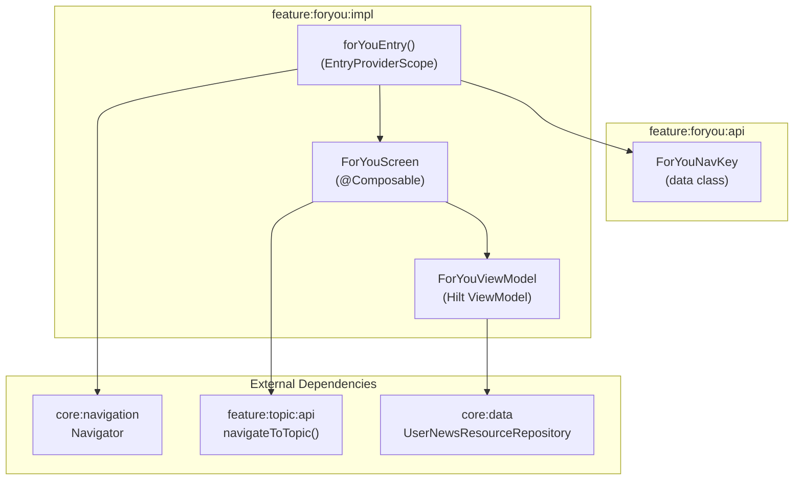
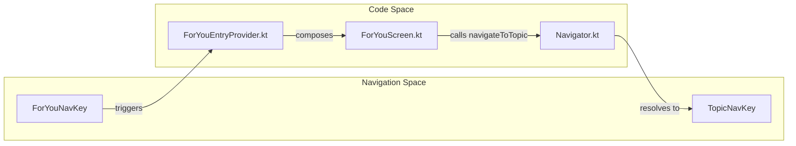

<!-- source: DeepWiki mcp.deepwiki.com · repo android/nowinandroid · page 6.1 For You Feature · fetched 2026-10-23 -->

# For You Feature

<details>
<summary>Relevant source files</summary>

The following files were used as context for generating this wiki page:

- [app/src/main/kotlin/com/google/samples/apps/nowinandroid/MainActivity.kt](app/src/main/kotlin/com/google/samples/apps/nowinandroid/MainActivity.kt)
- [feature/bookmarks/impl/build.gradle.kts](feature/bookmarks/impl/build.gradle.kts)
- [feature/bookmarks/impl/src/main/kotlin/com/google/samples/apps/nowinandroid/feature/bookmarks/impl/navigation/BookmarksEntryProvider.kt](feature/bookmarks/impl/src/main/kotlin/com/google/samples/apps/nowinandroid/feature/bookmarks/impl/navigation/BookmarksEntryProvider.kt)
- [feature/foryou/api/build.gradle.kts](feature/foryou/api/build.gradle.kts)
- [feature/foryou/impl/build.gradle.kts](feature/foryou/impl/build.gradle.kts)
- [feature/foryou/impl/src/main/kotlin/com/google/samples/apps/nowinandroid/feature/foryou/impl/ForYouScreen.kt](feature/foryou/impl/src/main/kotlin/com/google/samples/apps/nowinandroid/feature/foryou/impl/ForYouScreen.kt)
- [feature/foryou/impl/src/main/kotlin/com/google/samples/apps/nowinandroid/feature/foryou/impl/navigation/ForYouEntryProvider.kt](feature/foryou/impl/src/main/kotlin/com/google/samples/apps/nowinandroid/feature/foryou/impl/navigation/ForYouEntryProvider.kt)
- [feature/foryou/impl/src/test/kotlin/com/google/samples/apps/nowinandroid/feature/foryou/impl/ForYouScreenScreenshotTests.kt](feature/foryou/impl/src/test/kotlin/com/google/samples/apps/nowinandroid/feature/foryou/impl/ForYouScreenScreenshotTests.kt)
- [feature/foryou/src/test/screenshots/ForYouScreenPopulatedAndLoading_foldable.png](feature/foryou/src/test/screenshots/ForYouScreenPopulatedAndLoading_foldable.png)
- [feature/foryou/src/test/screenshots/ForYouScreenPopulatedAndLoading_tablet.png](feature/foryou/src/test/screenshots/ForYouScreenPopulatedAndLoading_tablet.png)
- [feature/foryou/src/test/screenshots/ForYouScreenPopulatedFeed_foldable.png](feature/foryou/src/test/screenshots/ForYouScreenPopulatedFeed_foldable.png)
- [feature/foryou/src/test/screenshots/ForYouScreenPopulatedFeed_tablet.png](feature/foryou/src/test/screenshots/ForYouScreenPopulatedFeed_tablet.png)
- [feature/foryou/src/test/screenshots/ForYouScreenTopicSelection_foldable.png](feature/foryou/src/test/screenshots/ForYouScreenTopicSelection_foldable.png)
- [feature/foryou/src/test/screenshots/ForYouScreenTopicSelection_phone.png](feature/foryou/src/test/screenshots/ForYouScreenTopicSelection_phone.png)
- [feature/foryou/src/test/screenshots/ForYouScreenTopicSelection_phone_dark.png](feature/foryou/src/test/screenshots/ForYouScreenTopicSelection_phone_dark.png)
- [feature/foryou/src/test/screenshots/ForYouScreenTopicSelection_tablet.png](feature/foryou/src/test/screenshots/ForYouScreenTopicSelection_tablet.png)
- [feature/interests/impl/build.gradle.kts](feature/interests/impl/build.gradle.kts)
- [feature/interests/impl/src/main/kotlin/com/google/samples/apps/nowinandroid/feature/interests/impl/navigation/InterestsEntryProvider.kt](feature/interests/impl/src/main/kotlin/com/google/samples/apps/nowinandroid/feature/interests/impl/navigation/InterestsEntryProvider.kt)
- [feature/interests/impl/src/test/kotlin/com/google/samples/apps/nowinandroid/interests/impl/InterestsListDetailScreenTest.kt](feature/interests/impl/src/test/kotlin/com/google/samples/apps/nowinandroid/interests/impl/InterestsListDetailScreenTest.kt)
- [feature/interests/impl/src/test/kotlin/com/google/samples/apps/nowinandroid/interests/impl/InterestsViewModelTest.kt](feature/interests/impl/src/test/kotlin/com/google/samples/apps/nowinandroid/interests/impl/InterestsViewModelTest.kt)
- [feature/search/impl/src/main/kotlin/com/google/samples/apps/nowinandroid/feature/search/impl/SearchUiStatePreviewParameterProvider.kt](feature/search/impl/src/main/kotlin/com/google/samples/apps/nowinandroid/feature/search/impl/SearchUiStatePreviewParameterProvider.kt)
- [feature/search/impl/src/main/kotlin/com/google/samples/apps/nowinandroid/feature/search/impl/navigation/SearchEntryProvider.kt](feature/search/impl/src/main/kotlin/com/google/samples/apps/nowinandroid/feature/search/impl/navigation/SearchEntryProvider.kt)
- [feature/topic/impl/src/main/kotlin/com/google/samples/apps/nowinandroid/feature/topic/impl/TopicScreen.kt](feature/topic/impl/src/main/kotlin/com/google/samples/apps/nowinandroid/feature/topic/impl/TopicScreen.kt)
- [feature/topic/impl/src/main/kotlin/com/google/samples/apps/nowinandroid/feature/topic/impl/navigation/TopicEntryProvider.kt](feature/topic/impl/src/main/kotlin/com/google/samples/apps/nowinandroid/feature/topic/impl/navigation/TopicEntryProvider.kt)

</details>


## Purpose and Scope

The For You feature module implements the home screen and default landing destination of the Now in Android application. It consists of two modules following the API/Impl pattern:
- `:feature:foryou:api` - Navigation contracts and public interfaces.
- `:feature:foryou:impl` - Feature implementation including the screen, ViewModel, and onboarding logic.

This page details the implementation of `ForYouScreen`, its associated state management via `ForYouViewModel`, the onboarding flow, and how the feature integrates into the app's navigation via `ForYouEntryProvider`.

---

## Feature Capabilities

The For You feature provides:

- **Personalized news feed** based on followed topics.
- **Onboarding flow** for first-time users to select topics.
- **Topic following/unfollowing** via UI interactions.
- **Navigation to topic details** via clickable topic tags.
- **Deep link handling** for notification-triggered navigation.

The feature is the default start destination as verified in the application's navigation testing.

**Sources**: [feature/foryou/impl/src/main/kotlin/com/google/samples/apps/nowinandroid/feature/foryou/impl/navigation/ForYouEntryProvider.kt:26-32](), [feature/foryou/impl/build.gradle.kts:17-43]()

---

## Module Structure

### Architecture Diagram: For You Modules



### Navigation Registration

The feature registers with the navigation system using `forYouEntry` in [feature/foryou/impl/src/main/kotlin/com/google/samples/apps/nowinandroid/feature/foryou/impl/navigation/ForYouEntryProvider.kt:26-32](). It maps the `ForYouNavKey` to the `ForYouScreen` composable and passes the `Navigator` for handling topic clicks.

```kotlin
fun EntryProviderScope<NavKey>.forYouEntry(navigator: Navigator) {
    entry<ForYouNavKey> {
        ForYouScreen(
            onTopicClick = navigator::navigateToTopic,
        )
    }
}
```

**Sources**: [feature/foryou/impl/src/main/kotlin/com/google/samples/apps/nowinandroid/feature/foryou/impl/navigation/ForYouEntryProvider.kt:1-33]()

---

## Screen and UI State

### ForYouScreen Components

The `ForYouScreen` is a state-aware composable that handles two primary states: onboarding and the personalized news feed.

- **Onboarding Flow**: Managed via `OnboardingUiState`. It displays a selection of topics for the user to follow when they first launch the app.
- **User News Feed**: Displays a list of `UserNewsResource` items. Users can bookmark news or click on topic tags within the cards.

### Visual Representation

The UI is tested across various form factors including phones, tablets, and foldables to ensure adaptive layouts work correctly.

| Component | Description | Screenshot Reference |
|-----------|-------------|----------------------|
| **Onboarding** | Topic selection grid | [feature/foryou/src/test/screenshots/ForYouScreenTopicSelection_foldable.png]() |
| **News Feed** | Populated list of news cards | [feature/foryou/src/test/screenshots/ForYouScreenPopulatedFeed_foldable.png]() |
| **Loading** | Shimmer/Loading indicators | [feature/foryou/src/test/screenshots/ForYouScreenPopulatedAndLoading_tablet.png]() |

**Sources**: [feature/foryou/impl/src/main/kotlin/com/google/samples/apps/nowinandroid/feature/foryou/impl/ForYouScreen.kt](), [feature/foryou/impl/build.gradle.kts:23-26]()

---

## ViewModel and Data Flow

### ForYouViewModel Implementation

The `ForYouViewModel` acts as the state producer for the For You screen. It interacts with the domain and data layers to fetch topics and news resources.

- **Onboarding State**: It tracks whether the user has completed onboarding and which topics they have selected.
- **Feed State**: It exposes a `StateFlow` of news resources, combined with user-specific data like bookmark status.
- **Interactions**: It provides methods to `updateTopicSelection` and `updateNewsResourceSaved`.

### Data Layer Integration

The feature relies heavily on the `UserNewsResourceRepository` which is injected into the `MainActivity` and passed through the `NiaAppState` to facilitate global data access and synchronization.

```kotlin
@Inject
lateinit var userNewsResourceRepository: UserNewsResourceRepository
```

**Sources**: [app/src/main/kotlin/com/google/samples/apps/nowinandroid/MainActivity.kt:73-74](), [app/src/main/kotlin/com/google/samples/apps/nowinandroid/MainActivity.kt:136-140]()

---

## Navigation and Adaptive UI

The For You feature integrates with the app's adaptive navigation system. It is one of the top-level destinations defined in the `NiaApp` navigation suite.

- **Entry Provider**: Uses `ForYouEntryProvider` to define how the screen is created within the `NavDisplay`.
- **Topic Navigation**: When a user clicks a topic tag in the feed, the screen calls `navigator::navigateToTopic`, which is an extension function provided by the topic feature API [feature/foryou/impl/src/main/kotlin/com/google/samples/apps/nowinandroid/feature/foryou/impl/navigation/ForYouEntryProvider.kt:29]().

### Navigation Entity Map



**Sources**: [feature/foryou/impl/src/main/kotlin/com/google/samples/apps/nowinandroid/feature/foryou/impl/navigation/ForYouEntryProvider.kt:26-32](), [feature/interests/impl/src/main/kotlin/com/google/samples/apps/nowinandroid/feature/interests/impl/navigation/InterestsEntryProvider.kt:32-51]()

---

## Testing Strategy

The For You feature is covered by multiple testing layers:

1.  **Screenshot Tests**: Uses Roborazzi to verify the UI across different themes (Light/Dark) and device configurations (Phone/Tablet/Foldable).
    - Example: `ForYouScreenScreenshotTests.kt`.
2.  **Unit Tests**: Verifies the `ForYouViewModel` logic, ensuring UI state transitions correctly from `Loading` to `Success`.
3.  **Integration Tests**: Validates the interaction between the For You screen and other features (like Topic Detail) within the `InterestsListDetailScreenTest` context for shared navigation logic.

**Sources**: [feature/foryou/impl/build.gradle.kts:36-43](), [feature/interests/impl/src/test/kotlin/com/google/samples/apps/nowinandroid/interests/impl/InterestsListDetailScreenTest.kt:120-123]()

---

