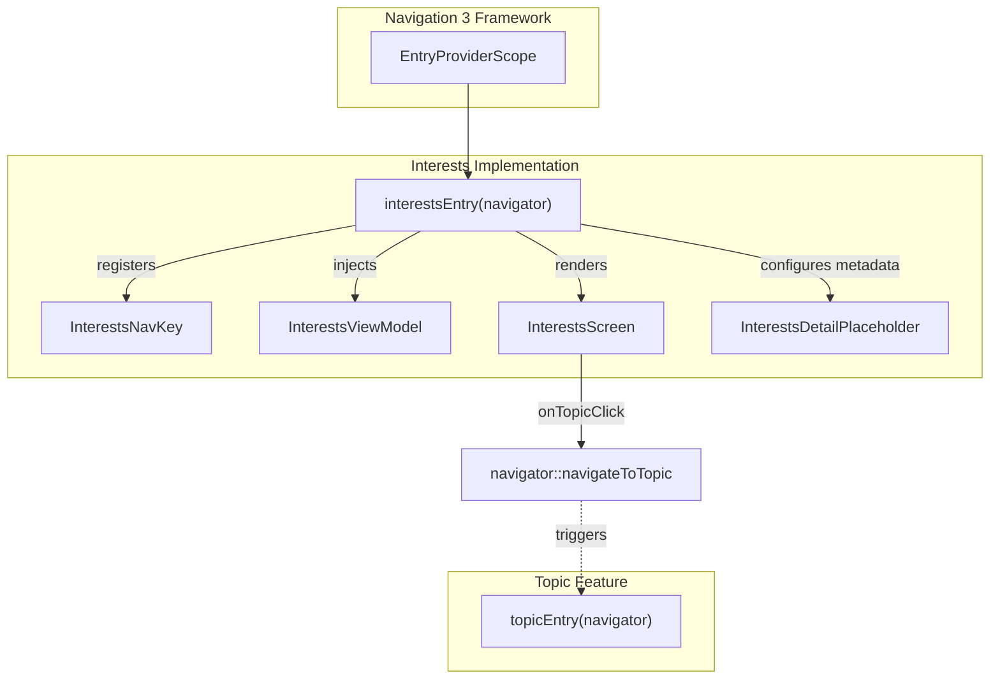
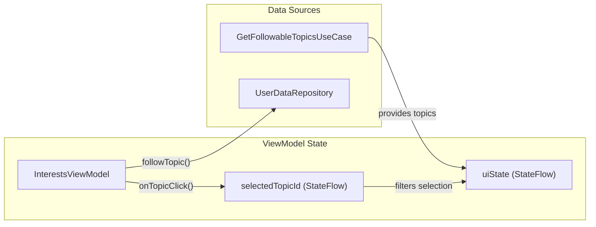

<!-- source: DeepWiki mcp.deepwiki.com · repo android/nowinandroid · page 6.2 Interests Feature · fetched 2026-10-23 -->

# Interests Feature

<details>
<summary>Relevant source files</summary>

The following files were used as context for generating this wiki page:

- [app/src/main/kotlin/com/google/samples/apps/nowinandroid/MainActivity.kt](app/src/main/kotlin/com/google/samples/apps/nowinandroid/MainActivity.kt)
- [core/navigation/README.md](core/navigation/README.md)
- [feature/bookmarks/impl/src/main/kotlin/com/google/samples/apps/nowinandroid/feature/bookmarks/impl/navigation/BookmarksEntryProvider.kt](feature/bookmarks/impl/src/main/kotlin/com/google/samples/apps/nowinandroid/feature/bookmarks/impl/navigation/BookmarksEntryProvider.kt)
- [feature/foryou/impl/src/main/kotlin/com/google/samples/apps/nowinandroid/feature/foryou/impl/navigation/ForYouEntryProvider.kt](feature/foryou/impl/src/main/kotlin/com/google/samples/apps/nowinandroid/feature/foryou/impl/navigation/ForYouEntryProvider.kt)
- [feature/interests/impl/README.md](feature/interests/impl/README.md)
- [feature/interests/impl/src/main/kotlin/com/google/samples/apps/nowinandroid/feature/interests/impl/InterestsScreen.kt](feature/interests/impl/src/main/kotlin/com/google/samples/apps/nowinandroid/feature/interests/impl/InterestsScreen.kt)
- [feature/interests/impl/src/main/kotlin/com/google/samples/apps/nowinandroid/feature/interests/impl/InterestsViewModel.kt](feature/interests/impl/src/main/kotlin/com/google/samples/apps/nowinandroid/feature/interests/impl/InterestsViewModel.kt)
- [feature/interests/impl/src/main/kotlin/com/google/samples/apps/nowinandroid/feature/interests/impl/navigation/InterestsEntryProvider.kt](feature/interests/impl/src/main/kotlin/com/google/samples/apps/nowinandroid/feature/interests/impl/navigation/InterestsEntryProvider.kt)
- [feature/interests/impl/src/test/kotlin/com/google/samples/apps/nowinandroid/interests/impl/InterestsListDetailScreenTest.kt](feature/interests/impl/src/test/kotlin/com/google/samples/apps/nowinandroid/interests/impl/InterestsListDetailScreenTest.kt)
- [feature/search/impl/src/main/kotlin/com/google/samples/apps/nowinandroid/feature/search/impl/navigation/SearchEntryProvider.kt](feature/search/impl/src/main/kotlin/com/google/samples/apps/nowinandroid/feature/search/impl/navigation/SearchEntryProvider.kt)
- [feature/topic/api/README.md](feature/topic/api/README.md)
- [feature/topic/impl/README.md](feature/topic/impl/README.md)
- [feature/topic/impl/src/main/kotlin/com/google/samples/apps/nowinandroid/feature/topic/impl/navigation/TopicEntryProvider.kt](feature/topic/impl/src/main/kotlin/com/google/samples/apps/nowinandroid/feature/topic/impl/navigation/TopicEntryProvider.kt)

</details>


## Purpose and Scope

The Interests Feature provides a topic browsing interface where users can explore available topics and view detailed information about each topic. This feature implements an adaptive list-detail layout that responds to different screen sizes and configurations. For information about individual topic details, see [Other Features](#6.3). For navigation patterns used across all features, see [Navigation and Adaptive UI](#4.2).

## Feature Overview

The Interests feature is one of the three top-level navigation destinations in the Now in Android application. It allows users to browse all available topics and navigate to topic detail screens. The feature demonstrates adaptive UI principles by automatically adjusting its layout based on available screen space:

- **Compact screens**: Shows a single pane with a list of topics; selecting a topic navigates to a full-screen detail view.
- **Expanded screens**: Shows both the list and detail panes side-by-side; selecting a topic updates the detail pane in place.

**Key Characteristics:**
- Top-level navigation destination accessible from the navigation bar.
- Adaptive list-detail layout using Material 3 Adaptive APIs.
- Integration with the Topic Detail feature for showing individual topic information.
- Hilt-based dependency injection for ViewModel creation using assisted injection.

Sources: [feature/interests/impl/src/main/kotlin/com/google/samples/apps/nowinandroid/feature/interests/impl/navigation/InterestsEntryProvider.kt:32-51](), [feature/interests/impl/src/test/kotlin/com/google/samples/apps/nowinandroid/interests/impl/InterestsListDetailScreenTest.kt:62-63]()

## Module Structure

The Interests feature follows the API/Impl pattern used throughout the application:

| Module | Purpose |
|--------|---------|
| `:feature:interests:api` | Defines navigation contracts (`InterestsNavKey`) and public interfaces. |
| `:feature:interests:impl` | Contains implementation of UI components, ViewModels, and navigation setup. |

The implementation module depends on:
- `core:ui` - Shared UI components.
- `core:designsystem` - Theme and design tokens.
- `core:domain` - Use cases for business logic (e.g., `GetFollowableTopicsUseCase`).
- `core:data` - Data layer access (`UserDataRepository`).
- `feature:topic:api` - Navigation to topic details.

Sources: [feature/interests/impl/README.md:16-40](), [feature/interests/impl/README.md:62-67](), [feature/interests/impl/src/main/kotlin/com/google/samples/apps/nowinandroid/feature/interests/impl/InterestsViewModel.kt:22-26]()

## Navigation Integration

### Entry Provider Setup

The Interests feature integrates into the application navigation system through the `interestsEntry` function, which registers the feature's navigation destination using the `EntryProviderScope`.



The entry provider is registered at application startup and handles:
- Creating the `InterestsViewModel` using a Hilt-assisted factory.
- Passing navigation callbacks for topic selection via `navigator::navigateToTopic`.
- Configuring the `ListDetailSceneStrategy` metadata to show `InterestsDetailPlaceholder` in the detail pane by default.

Sources: [feature/interests/impl/src/main/kotlin/com/google/samples/apps/nowinandroid/feature/interests/impl/navigation/InterestsEntryProvider.kt:32-51]()

### Navigation Key and State

The `InterestsNavKey` serves as the route identifier. It includes an `initialTopicId` which is used to seed the selected topic state in the ViewModel.

Sources: [feature/interests/impl/src/main/kotlin/com/google/samples/apps/nowinandroid/feature/interests/impl/InterestsViewModel.kt:43](), [feature/interests/impl/src/main/kotlin/com/google/samples/apps/nowinandroid/feature/interests/impl/InterestsViewModel.kt:51-54]()

## Adaptive UI Implementation

### List-Detail Pattern

The Interests feature uses Material 3's `ListDetailSceneStrategy` to implement adaptive layouts. This strategy is defined in the navigation metadata:

```kotlin
// From InterestsEntryProvider.kt:33-36
entry<InterestsNavKey>(
    metadata = ListDetailSceneStrategy.listPane {
        InterestsDetailPlaceholder()
    },
)
```

Sources: [feature/interests/impl/src/main/kotlin/com/google/samples/apps/nowinandroid/feature/interests/impl/navigation/InterestsEntryProvider.kt:33-36]()

### Pane Components

The list-detail layout consists of three key components:

1.  **List Pane (`InterestsScreen`)**: Displays the scrollable list of all available topics. It is tagged with `LIST_PANE_TEST_TAG` for testing.
2.  **Detail Pane Placeholder (`InterestsDetailPlaceholder`)**: Shows a message (e.g., "Select an interest") when no topic is selected on expanded screens.
3.  **Detail Pane (`TopicScreen`)**: When a topic is selected, the `topicEntry` provider handles rendering the `TopicScreen` in the detail pane (or full screen on compact devices).

Sources: [feature/interests/impl/src/main/kotlin/com/google/samples/apps/nowinandroid/feature/interests/impl/navigation/InterestsEntryProvider.kt:34-36](), [feature/interests/impl/src/test/kotlin/com/google/samples/apps/nowinandroid/interests/impl/InterestsListDetailScreenTest.kt:43-45]()

### Screen Size Behavior

The behavior adapts based on screen width qualifiers in tests and runtime configuration:

| Screen Size | Behavior | Test Qualifier |
| :--- | :--- | :--- |
| **Compact** | Shows only the list. Clicking a topic navigates to a new full-screen detail view. | `w412dp-h915dp` |
| **Expanded** | Shows list and detail panes side-by-side. Clicking a topic updates the detail pane. | `w1200dp-h840dp` |

Sources: [feature/interests/impl/src/test/kotlin/com/google/samples/apps/nowinandroid/interests/impl/InterestsListDetailScreenTest.kt:62-63](), [feature/interests/impl/src/test/kotlin/com/google/samples/apps/nowinandroid/interests/impl/InterestsListDetailScreenTest.kt:96-107](), [feature/interests/impl/src/test/kotlin/com/google/samples/apps/nowinandroid/interests/impl/InterestsListDetailScreenTest.kt:133-145]()

## ViewModel Architecture

### InterestsViewModel

The `InterestsViewModel` manages the state of the Interests screen. It uses `GetFollowableTopicsUseCase` to fetch topics and `UserDataRepository` to handle following/unfollowing actions.



**Key Functions:**
- `followTopic(followedTopicId, followed)`: Updates the user's followed topics in `UserDataRepository`.
- `onTopicClick(topicId)`: Updates the `selectedTopicId` in the `SavedStateHandle`.

Sources: [feature/interests/impl/src/main/kotlin/com/google/samples/apps/nowinandroid/feature/interests/impl/InterestsViewModel.kt:38-70](), [feature/interests/impl/src/main/kotlin/com/google/samples/apps/nowinandroid/feature/interests/impl/InterestsViewModel.kt:72-76]()

### Assisted Injection

The ViewModel is instantiated using an `AssistedFactory` to pass the `InterestsNavKey` at runtime.

```kotlin
// From InterestsViewModel.kt:78-81
@AssistedFactory
interface Factory {
    fun create(key: InterestsNavKey): InterestsViewModel
}
```

Sources: [feature/interests/impl/src/main/kotlin/com/google/samples/apps/nowinandroid/feature/interests/impl/InterestsViewModel.kt:78-81](), [feature/interests/impl/src/main/kotlin/com/google/samples/apps/nowinandroid/feature/interests/impl/navigation/InterestsEntryProvider.kt:38-40]()

## Testing Strategy

### InterestsListDetailScreenTest

The `InterestsListDetailScreenTest` class uses Robolectric and the Compose Testing library to verify adaptive behavior across different screen sizes.

**Key Test Scenarios:**
- `expandedWidth_initialState_showsTwoPanesWithPlaceholder`: Verifies that both the list and the placeholder are visible on large screens.
- `compactWidth_initialState_showsListPane`: Verifies that only the list is visible on small screens.
- `expandedWidth_topicSelected_updatesDetailPane`: Verifies that clicking a topic in the list updates the side pane without navigating away.
- `compactWidth_topicSelected_showsTopicDetailPane`: Verifies that clicking a topic navigates to the detail screen on small screens.

Sources: [feature/interests/impl/src/test/kotlin/com/google/samples/apps/nowinandroid/interests/impl/InterestsListDetailScreenTest.kt:96-107](), [feature/interests/impl/src/test/kotlin/com/google/samples/apps/nowinandroid/interests/impl/InterestsListDetailScreenTest.kt:133-145](), [feature/interests/impl/src/test/kotlin/com/google/samples/apps/nowinandroid/interests/impl/InterestsListDetailScreenTest.kt:149-164](), [feature/interests/impl/src/test/kotlin/com/google/samples/apps/nowinandroid/interests/impl/InterestsListDetailScreenTest.kt:168-183]()

### Test Navigation Display

The tests use a `TestNavDisplay` composable to simulate the app's navigation environment, including the `NavDisplay` and `rememberListDetailSceneStrategy`.

Sources: [feature/interests/impl/src/test/kotlin/com/google/samples/apps/nowinandroid/interests/impl/InterestsListDetailScreenTest.kt:110-130]()

---

