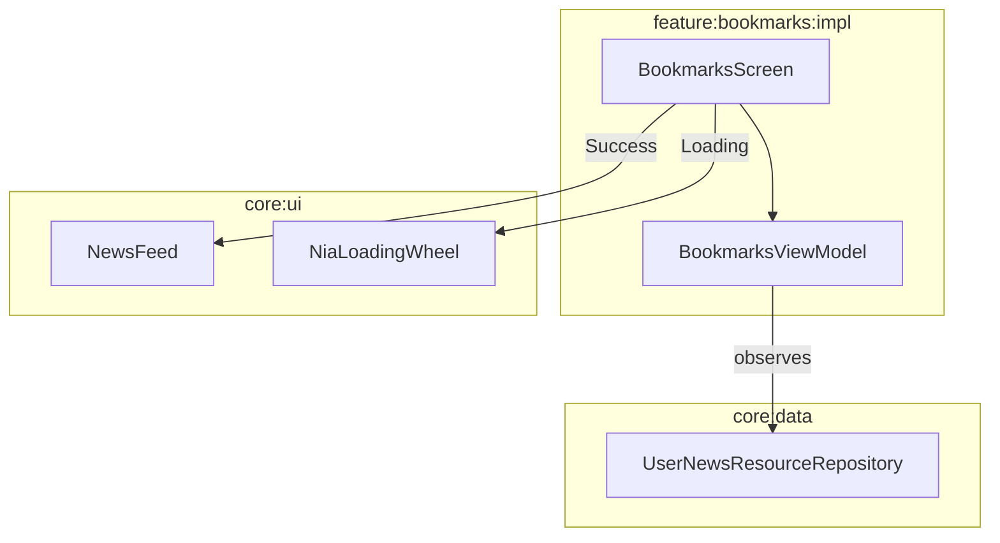
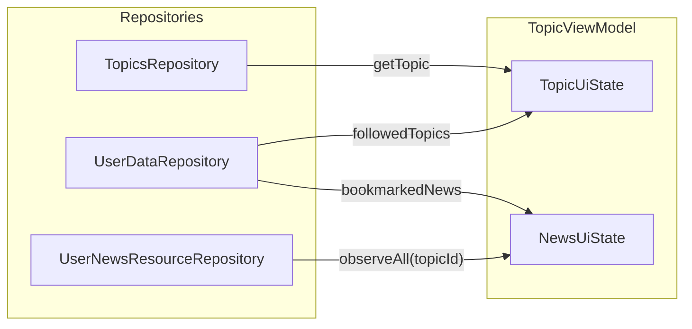
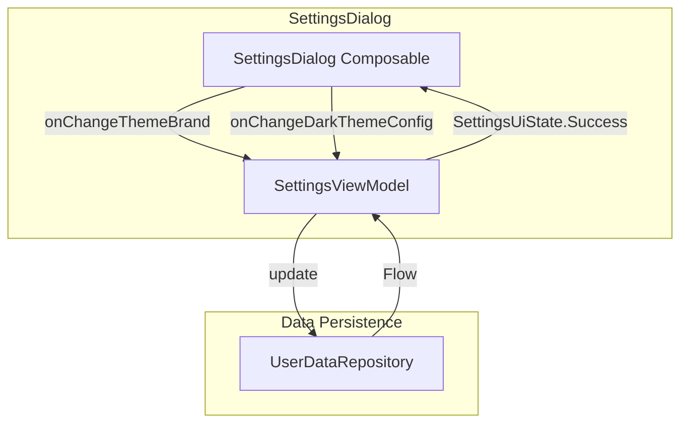
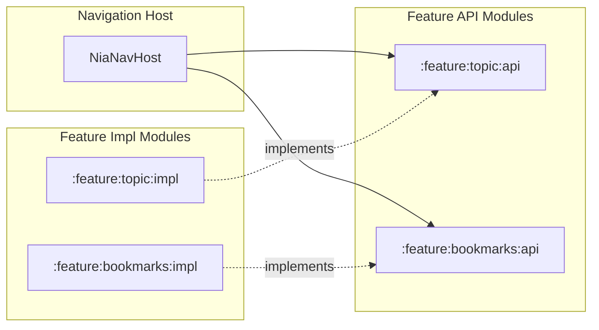

<!-- source: DeepWiki mcp.deepwiki.com · repo android/nowinandroid · page 6.3 Other Features · fetched 2026-10-23 -->

# Other Features

Relevant source files

The following files were used as context for generating this wiki page:

- [core/navigation/README.md](core/navigation/README.md)
- [feature/bookmarks/impl/src/androidTest/kotlin/com/google/samples/apps/nowinandroid/feature/bookmarks/impl/BookmarksScreenTest.kt](feature/bookmarks/impl/src/androidTest/kotlin/com/google/samples/apps/nowinandroid/feature/bookmarks/impl/BookmarksScreenTest.kt)
- [feature/bookmarks/impl/src/main/kotlin/com/google/samples/apps/nowinandroid/feature/bookmarks/impl/BookmarksScreen.kt](feature/bookmarks/impl/src/main/kotlin/com/google/samples/apps/nowinandroid/feature/bookmarks/impl/BookmarksScreen.kt)
- [feature/interests/impl/README.md](feature/interests/impl/README.md)
- [feature/settings/impl/.gitignore](feature/settings/impl/.gitignore)
- [feature/settings/impl/build.gradle.kts](feature/settings/impl/build.gradle.kts)
- [feature/settings/impl/src/androidTest/kotlin/com/google/samples/apps/nowinandroid/feature/settings/impl/SettingsDialogTest.kt](feature/settings/impl/src/androidTest/kotlin/com/google/samples/apps/nowinandroid/feature/settings/impl/SettingsDialogTest.kt)
- [feature/settings/impl/src/main/AndroidManifest.xml](feature/settings/impl/src/main/AndroidManifest.xml)
- [feature/topic/api/README.md](feature/topic/api/README.md)
- [feature/topic/impl/README.md](feature/topic/impl/README.md)
- [feature/topic/impl/src/main/kotlin/com/google/samples/apps/nowinandroid/feature/topic/impl/TopicViewModel.kt](feature/topic/impl/src/main/kotlin/com/google/samples/apps/nowinandroid/feature/topic/impl/TopicViewModel.kt)

This document describes the implementation details of the Search, Bookmarks, Topic Detail, and Settings feature modules in the Now in Android application. These features complement the For You and Interests features to provide a complete news reading experience, adhering to the project's offline-first architecture and `api`/`impl` modularization pattern.

## Feature Modules Overview

The application includes four additional feature modules beyond For You and Interests:

| Feature | Module Path | Primary Purpose |
|---------|------------|-----------------|
| Search | `:feature:search` | Search news resources and filter by topics |
| Bookmarks | `:feature:bookmarks` | View and manage saved news resources |
| Topic Detail | `:feature:topic` | Detailed information and news for a specific topic |
| Settings | `:feature:settings` | App preferences (theme, brand, dynamic color) |

**Sources:** [feature/topic/impl/README.md:16-20](), [feature/interests/impl/README.md:16-20]()

## Bookmarks Feature

The Bookmarks feature (UI label "Saved") allows users to view news resources they have bookmarked. It is a top-level destination in the app's navigation.

### Bookmarks UI and ViewModel

The `BookmarksScreen` uses a `BookmarksViewModel` to observe the user's saved news resources.

- **State Management**: `BookmarksViewModel` exposes a `feedUiState` as a `StateFlow<NewsFeedUiState>` [feature/bookmarks/impl/src/main/kotlin/com/google/samples/apps/nowinandroid/feature/bookmarks/impl/BookmarksScreen.kt:86-86]().
- **Loading State**: Displays a `NiaLoadingWheel` while fetching data [feature/bookmarks/impl/src/main/kotlin/com/google/samples/apps/nowinandroid/feature/bookmarks/impl/BookmarksScreen.kt:135-135]().
- **Empty State**: Displays an empty state illustration and text when no bookmarks exist [feature/bookmarks/impl/src/main/kotlin/com/google/samples/apps/nowinandroid/feature/bookmarks/impl/BookmarksScreen.kt:145-145]().
- **Undo Logic**: Supports undoing a bookmark removal via a snackbar triggered by `shouldDisplayUndoBookmark` [feature/bookmarks/impl/src/main/kotlin/com/google/samples/apps/nowinandroid/feature/bookmarks/impl/BookmarksScreen.kt:119-128]().

### Bookmarks Implementation Diagram

**Sources:** [feature/bookmarks/impl/src/main/kotlin/com/google/samples/apps/nowinandroid/feature/bookmarks/impl/BookmarksScreen.kt:80-98](), [feature/bookmarks/impl/src/main/kotlin/com/google/samples/apps/nowinandroid/feature/bookmarks/impl/BookmarksScreen.kt:134-147]()

## Topic Detail Feature

The Topic Detail feature provides a deep-dive into a specific topic. It is a secondary destination reached from the For You feed or Interests list.

### TopicViewModel and State

The `TopicViewModel` uses `AssistedInject` to receive the `topicId` at runtime [feature/topic/impl/src/main/kotlin/com/google/samples/apps/nowinandroid/feature/topic/impl/TopicViewModel.kt:43-48](). It manages two distinct UI states:

1.  **TopicUiState**: Represents the topic metadata and follow status [feature/topic/impl/src/main/kotlin/com/google/samples/apps/nowinandroid/feature/topic/impl/TopicViewModel.kt:161-165]().
2.  **NewsUiState**: Represents the list of news resources associated with this topic [feature/topic/impl/src/main/kotlin/com/google/samples/apps/nowinandroid/feature/topic/impl/TopicViewModel.kt:167-171]().

### Data Flow in Topic Detail

The ViewModel combines streams from multiple repositories:
- `TopicsRepository.getTopic(id)` for topic details [feature/topic/impl/src/main/kotlin/com/google/samples/apps/nowinandroid/feature/topic/impl/TopicViewModel.kt:108-110]().
- `UserDataRepository.userData` for follow and bookmark status [feature/topic/impl/src/main/kotlin/com/google/samples/apps/nowinandroid/feature/topic/impl/TopicViewModel.kt:103-105]().
- `UserNewsResourceRepository.observeAll` with a `NewsResourceQuery` filtered by `topicId` [feature/topic/impl/src/main/kotlin/com/google/samples/apps/nowinandroid/feature/topic/impl/TopicViewModel.kt:142-144]().

### Topic Detail Entity Relationship

**Sources:** [feature/topic/impl/src/main/kotlin/com/google/samples/apps/nowinandroid/feature/topic/impl/TopicViewModel.kt:97-159]()

## Settings Feature

The Settings feature is implemented as a `SettingsDialog`. It allows users to control the app's visual appearance and persistent preferences.

### Configuration Options

The dialog manages the `UserEditableSettings` which includes:
- **Brand**: `ThemeBrand` (DEFAULT or ANDROID) [feature/settings/impl/src/androidTest/kotlin/com/google/samples/apps/nowinandroid/feature/settings/impl/SettingsDialogTest.kt:24-25]().
- **Dark Theme**: `DarkThemeConfig` (FOLLOW_SYSTEM, LIGHT, or DARK) [feature/settings/impl/src/androidTest/kotlin/com/google/samples/apps/nowinandroid/feature/settings/impl/SettingsDialogTest.kt:23]().
- **Dynamic Color**: A boolean preference, visible only if the device supports it and the "Default" brand is selected [feature/settings/impl/src/androidTest/kotlin/com/google/samples/apps/nowinandroid/feature/settings/impl/SettingsDialogTest.kt:88-112]().

### Open Source Licenses

The settings module includes integration with Google Play Services OSS Licenses:
- It declares `OssLicensesMenuActivity` and `OssLicensesActivity` in its manifest [feature/settings/impl/src/main/AndroidManifest.xml:19-25]().
- It depends on `google.oss.licenses` [feature/settings/impl/build.gradle.kts:29-29]().

### Settings Logic Diagram

**Sources:** [feature/settings/impl/src/androidTest/kotlin/com/google/samples/apps/nowinandroid/feature/settings/impl/SettingsDialogTest.kt:41-47](), [feature/settings/impl/src/androidTest/kotlin/com/google/samples/apps/nowinandroid/feature/settings/impl/SettingsDialogTest.kt:59-70]()

## Navigation and Module Dependencies

The feature modules follow a strict dependency structure where the `impl` module depends on the `api` module and core modules like `core:data`, `core:ui`, and `core:navigation`.

- **Topic Impl Dependencies**: Depends on `core:data`, `core:designsystem`, `core:ui`, and `feature:topic:api` [feature/topic/impl/README.md:58-61]().
- **Interests Impl Dependencies**: Depends on `core:domain`, `core:ui`, `feature:interests:api`, and `feature:topic:api` (to navigate to topic details) [feature/interests/impl/README.md:63-67]().

### Navigation Flow Diagram

**Sources:** [feature/topic/impl/README.md:55-61](), [feature/interests/impl/README.md:62-67]()

---

