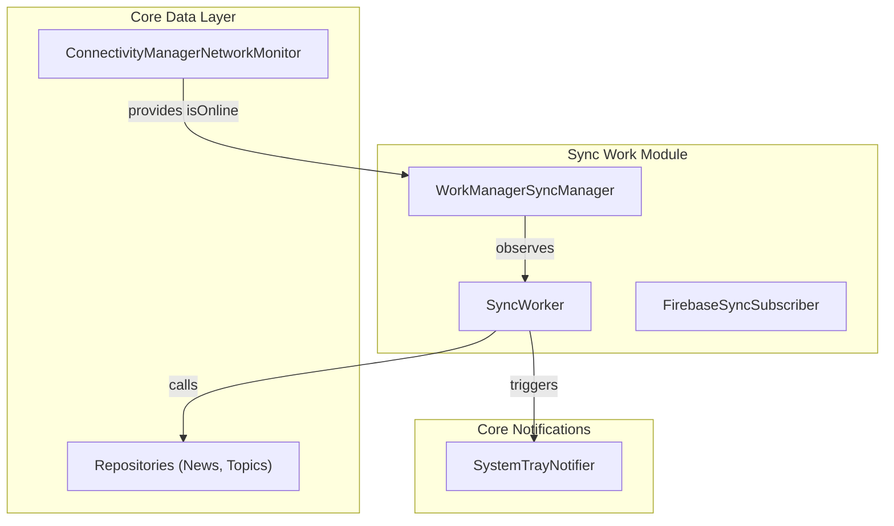
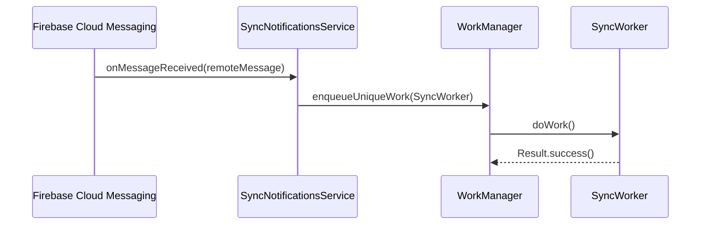

<!-- source: DeepWiki mcp.deepwiki.com · repo android/nowinandroid · page 7 Background Services · fetched 2026-10-23 -->

# Background Services

Relevant source files

The following files were used as context for generating this wiki page:

- [core/analytics/src/prod/kotlin/com/google/samples/apps/nowinandroid/core/analytics/AnalyticsModule.kt](core/analytics/src/prod/kotlin/com/google/samples/apps/nowinandroid/core/analytics/AnalyticsModule.kt)
- [core/analytics/src/prod/kotlin/com/google/samples/apps/nowinandroid/core/analytics/FirebaseAnalyticsHelper.kt](core/analytics/src/prod/kotlin/com/google/samples/apps/nowinandroid/core/analytics/FirebaseAnalyticsHelper.kt)
- [core/common/build.gradle.kts](core/common/build.gradle.kts)
- [core/data/src/main/kotlin/com/google/samples/apps/nowinandroid/core/data/repository/DefaultSearchContentsRepository.kt](core/data/src/main/kotlin/com/google/samples/apps/nowinandroid/core/data/repository/DefaultSearchContentsRepository.kt)
- [core/data/src/main/kotlin/com/google/samples/apps/nowinandroid/core/data/util/ConnectivityManagerNetworkMonitor.kt](core/data/src/main/kotlin/com/google/samples/apps/nowinandroid/core/data/util/ConnectivityManagerNetworkMonitor.kt)
- [core/datastore/src/main/kotlin/com/google/samples/apps/nowinandroid/core/datastore/di/DataStoreModule.kt](core/datastore/src/main/kotlin/com/google/samples/apps/nowinandroid/core/datastore/di/DataStoreModule.kt)
- [core/domain/build.gradle.kts](core/domain/build.gradle.kts)
- [core/domain/src/main/AndroidManifest.xml](core/domain/src/main/AndroidManifest.xml)
- [core/notifications/build.gradle.kts](core/notifications/build.gradle.kts)
- [core/notifications/src/main/res/drawable-anydpi-v24/core_notifications_ic_nia_notification.xml](core/notifications/src/main/res/drawable-anydpi-v24/core_notifications_ic_nia_notification.xml)
- [core/testing/src/main/kotlin/com/google/samples/apps/nowinandroid/core/testing/di/TestDispatchersModule.kt](core/testing/src/main/kotlin/com/google/samples/apps/nowinandroid/core/testing/di/TestDispatchersModule.kt)
- [sync/work/build.gradle.kts](sync/work/build.gradle.kts)
- [sync/work/src/androidTest/kotlin/com/google/samples/apps/nowinandroid/sync/workers/SyncWorkerTest.kt](sync/work/src/androidTest/kotlin/com/google/samples/apps/nowinandroid/sync/workers/SyncWorkerTest.kt)
- [sync/work/src/demo/kotlin/com/google/samples/apps/nowinandroid/sync/di/SyncModule.kt](sync/work/src/demo/kotlin/com/google/samples/apps/nowinandroid/sync/di/SyncModule.kt)
- [sync/work/src/main/kotlin/com/google/samples/apps/nowinandroid/sync/workers/SyncWorker.kt](sync/work/src/main/kotlin/com/google/samples/apps/nowinandroid/sync/workers/SyncWorker.kt)
- [sync/work/src/prod/AndroidManifest.xml](sync/work/src/prod/AndroidManifest.xml)
- [sync/work/src/prod/kotlin/com/google/samples/apps/nowinandroid/sync/di/SyncModule.kt](sync/work/src/prod/kotlin/com/google/samples/apps/nowinandroid/sync/di/SyncModule.kt)
- [sync/work/src/prod/kotlin/com/google/samples/apps/nowinandroid/sync/services/SyncNotificationsService.kt](sync/work/src/prod/kotlin/com/google/samples/apps/nowinandroid/sync/services/SyncNotificationsService.kt)

## Purpose and Scope

This page documents the background services implementation in the Now in Android application, specifically focusing on the `:sync:work` module that handles periodic data synchronization using WorkManager. This covers the architecture, scheduling, data flow, and notification integration for keeping local data up-to-date with remote sources.

For information about the data layer that sync interacts with, see the Data Layer section. For notification display details, see the Notifications section.

---

## Overview

The Now in Android application implements an offline-first architecture where data is synchronized in the background from network sources to local storage. This synchronization is handled by the `:sync:work` module, which uses AndroidX WorkManager to schedule and execute background tasks.

The background sync system performs the following functions:
- Periodically fetches news resources and topics from the network.
- Updates the local Room database (`:core:database`) with fresh content.
- Triggers system tray notifications (`:core:notifications`) when new content becomes available.
- Tracks sync operations via `:core:analytics`.
- Handles sync constraints (network availability, battery status) via `ConnectivityManagerNetworkMonitor` [core/data/src/main/kotlin/com/google/samples/apps/nowinandroid/core/data/util/ConnectivityManagerNetworkMonitor.kt:39-42]().

**Key Technologies:**
- **WorkManager**: Deferrable, constraint-based background task scheduling [sync/work/build.gradle.kts:33]().
- **Hilt**: Dependency injection for worker instantiation and module bindings [sync/work/build.gradle.kts:19]().
- **Coroutines**: Asynchronous data operations [core/common/build.gradle.kts:22]().
- **Firebase Cloud Messaging (FCM)**: Used in the `prod` flavor for remote sync triggers [sync/work/src/prod/kotlin/com/google/samples/apps/nowinandroid/sync/di/SyncModule.kt:19-21]().

Sources: [sync/work/build.gradle.kts:16-46](), [core/data/src/main/kotlin/com/google/samples/apps/nowinandroid/core/data/util/ConnectivityManagerNetworkMonitor.kt:39-95]()

---

## Module Architecture

The `:sync:work` module is a standalone Android library module that orchestrates background synchronization. It uses flavor-specific DI modules to provide different implementations for `demo` and `prod` environments.

### SyncModule Bindings

The `SyncModule` provides the necessary bindings for monitoring and subscribing to sync events.

| Interface | Demo Implementation | Prod Implementation |
|-----------|---------------------|---------------------|
| `SyncManager` | `WorkManagerSyncManager` | `WorkManagerSyncManager` |
| `SyncSubscriber` | `StubSyncSubscriber` | `FirebaseSyncSubscriber` |

In the `prod` flavor, `SyncModule` also provides `FirebaseMessaging` [sync/work/src/prod/kotlin/com/google/samples/apps/nowinandroid/sync/di/SyncModule.kt:47-50]().

### Data Flow and Code Entities

Sources: [sync/work/src/prod/kotlin/com/google/samples/apps/nowinandroid/sync/di/SyncModule.kt:33-51](), [sync/work/src/demo/kotlin/com/google/samples/apps/nowinandroid/sync/di/SyncModule.kt:28-40](), [core/data/src/main/kotlin/com/google/samples/apps/nowinandroid/core/data/util/ConnectivityManagerNetworkMonitor.kt:43-87]()

---

## Worker Implementation

The core logic of background synchronization resides in `SyncWorker`. It uses the `DelegatingWorker` pattern to allow Hilt to inject dependencies into the worker at runtime.

### SyncWorker Execution

`SyncWorker` is responsible for orchestrating the sync of multiple repositories. It is started via the `startUpSyncWork()` function which returns a `OneTimeWorkRequest` [sync/work/src/main/kotlin/com/google/samples/apps/nowinandroid/sync/workers/SyncWorker.kt:105-112]().

**Execution Flow:**
1. **Constraint Check**: WorkManager ensures constraints (like network) are met.
2. **doWork()**: The worker calls `sync()` on various repositories (Topics, News).
3. **Notification**: If new content is detected, it triggers `SyncNotificationsService` or a similar mechanism in the notification module.
4. **Analytics**: Logs the success or failure of the sync operation via `AnalyticsHelper` [core/analytics/src/prod/kotlin/com/google/samples/apps/nowinandroid/core/analytics/FirebaseAnalyticsHelper.kt:26-41]().

### WorkManager Testing

The `sync-test` functionality is verified using `WorkManagerTestInitHelper`. Tests like `SyncWorkerTest` ensure that the work request is enqueued correctly and transitions through states (ENQUEUED to RUNNING) when constraints are met [sync/work/src/androidTest/kotlin/com/google/samples/apps/nowinandroid/sync/workers/SyncWorkerTest.kt:49-74]().

Sources: [sync/work/src/main/kotlin/com/google/samples/apps/nowinandroid/sync/workers/SyncWorker.kt:50-115](), [sync/work/src/androidTest/kotlin/com/google/samples/apps/nowinandroid/sync/workers/SyncWorkerTest.kt:34-75]()

---

## Remote Sync (FCM Integration)

In the `prod` flavor, the application supports remote sync triggers via Firebase Cloud Messaging.

### SyncNotificationsService

The `SyncNotificationsService` extends `FirebaseMessagingService`. It listens for incoming FCM messages to trigger background synchronization [sync/work/src/prod/kotlin/com/google/samples/apps/nowinandroid/sync/services/SyncNotificationsService.kt:28-35]().

### SyncSubscriber

The `FirebaseSyncSubscriber` is responsible for subscribing the device to specific topics (e.g., "sync") to receive these remote triggers [sync/work/src/prod/kotlin/com/google/samples/apps/nowinandroid/sync/status/FirebaseSyncSubscriber.kt:23-30]().

Sources: [sync/work/src/prod/kotlin/com/google/samples/apps/nowinandroid/sync/di/SyncModule.kt:41-44](), [sync/work/src/prod/kotlin/com/google/samples/apps/nowinandroid/sync/services/SyncNotificationsService.kt:28-40]()

---

## Repository Integration

The synchronization process relies on repositories implementing a common sync interface.

### Sync Data Flow

Repositories like `DefaultSearchContentsRepository` participate in the sync process by updating local indices or databases [core/data/src/main/kotlin/com/google/samples/apps/nowinandroid/core/data/repository/DefaultSearchContentsRepository.kt:34-45]().

| Component | Role | File Reference |
|-----------|------|----------------|
| `SyncWorker` | Orchestrator | `sync/work/src/main/kotlin/com/google/samples/apps/nowinandroid/sync/workers/SyncWorker.kt` |
| `NiaDatabase` | Local Storage | `core/database/src/main/kotlin/com/google/samples/apps/nowinandroid/core/database/NiaDatabase.kt` |
| `NiaNetworkDataSource` | Remote Source | `core/network/src/main/kotlin/com/google/samples/apps/nowinandroid/core/network/NiaNetworkDataSource.kt` |
| `AnalyticsHelper` | Telemetry | `core/analytics/src/prod/kotlin/com/google/samples/apps/nowinandroid/core/analytics/AnalyticsHelper.kt` |

The `DataStoreModule` provides `UserPreferencesDataStore`, which is often checked during sync to determine user interests and filter what needs to be fetched [core/datastore/src/main/kotlin/com/google/samples/apps/nowinandroid/core/datastore/di/DataStoreModule.kt:44-58]().

Sources: [core/data/src/main/kotlin/com/google/samples/apps/nowinandroid/core/data/repository/DefaultSearchContentsRepository.kt:34-45](), [core/datastore/src/main/kotlin/com/google/samples/apps/nowinandroid/core/datastore/di/DataStoreModule.kt:40-59]()

---

## Testing Strategy

The `sync:work` module is tested using instrumented tests that utilize the `WorkManager` testing library.

- **SyncWorkerTest**: Uses `WorkManagerTestInitHelper` to initialize a testable version of `WorkManager` with a `SynchronousExecutor` [sync/work/src/androidTest/kotlin/com/google/samples/apps/nowinandroid/sync/workers/SyncWorkerTest.kt:43-50]().
- **Constraints**: Tests verify that work remains `ENQUEUED` until constraints are met via `testDriver.setAllConstraintsMet(request.id)` [sync/work/src/androidTest/kotlin/com/google/samples/apps/nowinandroid/sync/workers/SyncWorkerTest.kt:64-70]().
- **Hilt Integration**: `HiltAndroidRule` is used to manage dependency injection in the test environment [sync/work/src/androidTest/kotlin/com/google/samples/apps/nowinandroid/sync/workers/SyncWorkerTest.kt:37]().

Sources: [sync/work/src/androidTest/kotlin/com/google/samples/apps/nowinandroid/sync/workers/SyncWorkerTest.kt:17-75](), [sync/work/build.gradle.kts:42-46]()

---

