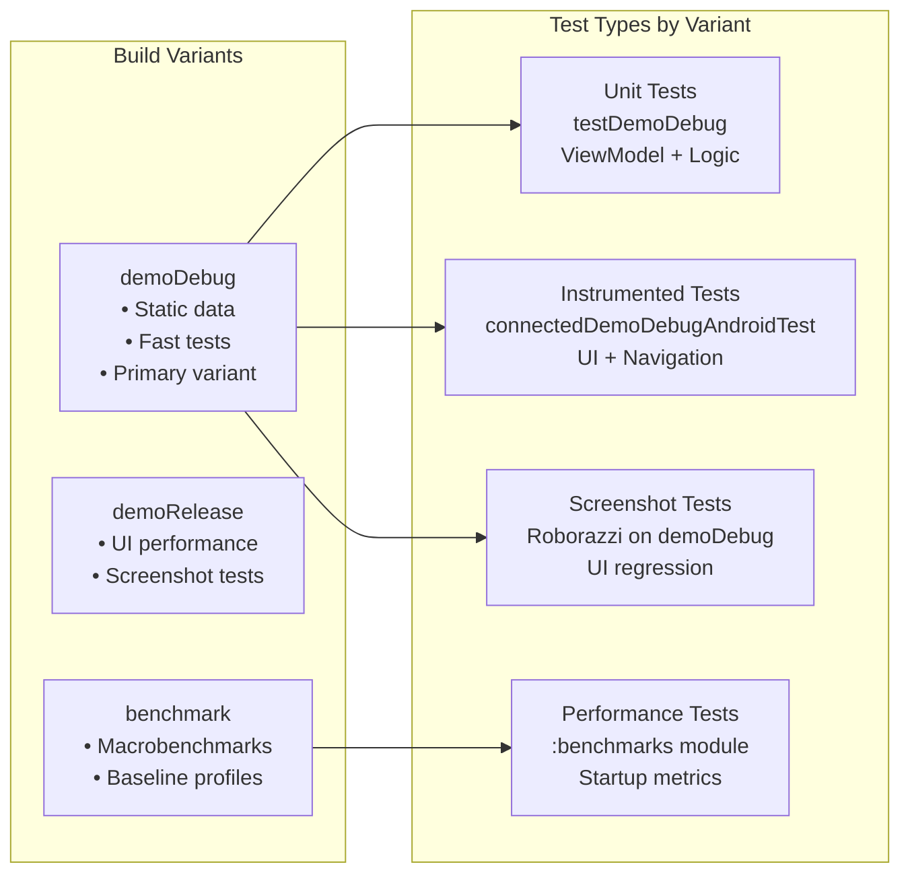

<!-- source: DeepWiki mcp.deepwiki.com · repo android/nowinandroid · page 8 Testing Strategy · fetched 2026-10-23 -->

# Testing Strategy

Relevant source files

The following files were used as context for generating this wiki page:

- [.google/packaging.yaml](.google/packaging.yaml)
- [README.md](README.md)
- [app/proguard-rules.pro](app/proguard-rules.pro)
- [core/data-test/README.md](core/data-test/README.md)
- [core/data/README.md](core/data/README.md)
- [core/datastore-proto/README.md](core/datastore-proto/README.md)
- [core/datastore-test/README.md](core/datastore-test/README.md)
- [core/datastore/README.md](core/datastore/README.md)
- [core/domain/README.md](core/domain/README.md)
- [core/testing/README.md](core/testing/README.md)
- [docs/images/screenshots.png](docs/images/screenshots.png)
- [ui-test-hilt-manifest/.gitignore](ui-test-hilt-manifest/.gitignore)
- [ui-test-hilt-manifest/build.gradle.kts](ui-test-hilt-manifest/build.gradle.kts)
- [ui-test-hilt-manifest/src/main/AndroidManifest.xml](ui-test-hilt-manifest/src/main/AndroidManifest.xml)

## Purpose and Scope

This document describes the comprehensive testing strategy employed by the Now in Android application. It covers the testing philosophy, test types, test infrastructure, code coverage measurement, and practical guidance for running tests.

For information about performance benchmarking and baseline profile generation specifically, see [Benchmarking and Performance](#8.3). For unit and integration testing implementation details, see [Unit and Integration Testing](#8.1). For screenshot testing specifics, see [Screenshot Testing](#8.2).

---

## Testing Philosophy

Now in Android follows a distinctive testing approach that **does not use mocking frameworks**. Instead, the project relies on test doubles that implement production interfaces, providing simplified but realistic implementations with additional testing hooks.

### Core Principles

1.  **Real Interface Implementation**: Test doubles implement the same interfaces as production code.
2.  **Realistic Behavior**: Test implementations provide simplified but functional behavior.
3.  **Testing Hooks**: Test doubles expose additional methods for state manipulation in tests.
4.  **Less Brittle Tests**: Tests exercise more production code rather than verifying mock interactions.
5.  **Offline-First by Design**: The `demo` flavor uses static data, enabling fast, deterministic tests.

Sources: [README.md:83-111]()

---

## Testing Architecture Overview

```mermaid
graph TB
    subgraph "Test Execution Layers"
        UNIT["Unit Tests<br/>testDemoDebug<br/>• ViewModel tests<br/>• Repository tests<br/>• Use case tests<br/>• JVM-based"]
        INSTRUMENTED["Instrumented Tests<br/>connectedDemoDebugAndroidTest<br/>• UI tests<br/>• Navigation tests<br/>• Integration tests<br/>• Device/Emulator"]
        SCREENSHOT["Screenshot Tests<br/>Roborazzi<br/>• verifyRoborazziDemoDebug<br/>• recordRoborazziDemoDebug<br/>• compareRoborazziDemoDebug"]
        MACRO["Macrobenchmarks<br/>:benchmarks module<br/>• StartupBenchmark<br/>• BaselineProfileGenerator"]
    end
    
    subgraph "Test Infrastructure Modules"
        CORE_TESTING[":core:testing<br/>• NiaTestRunner<br/>• TestDispatcherRule<br/>• Shared utilities"]
        DATA_TEST[":core:data-test<br/>• Test repositories<br/>• FakeNewsRepository<br/>• FakeTopicsRepository"]
        DATASTORE_TEST[":core:datastore-test<br/>• Temporary DataStore<br/>• testUserPreferencesDataStore()"]
    end
    
    subgraph "Test Doubles"
        DEMO_NET["DemoNiaNetworkDataSource<br/>• Static JSON assets<br/>• assets/news.json<br/>• No network calls"]
    end
    
    subgraph "Test Framework Support"
        HILT_TEST["@HiltAndroidTest<br/>HiltAndroidRule<br/>Dependency injection"]
        COMPOSE_TEST["createAndroidComposeRule<br/>Compose UI testing<br/>onNode* finders"]
        ROBORAZZI["Roborazzi Framework<br/>Screenshot capture<br/>Comparison engine"]
    end
    
    subgraph "Quality & Coverage"
        JACOCO["JaCoCo Tasks<br/>create{Variant}CombinedCoverageReport<br/>XML + HTML reports"]
    end
    
    UNIT --> CORE_TESTING
    UNIT --> DATA_TEST
    UNIT --> DEMO_NET
    
    INSTRUMENTED --> CORE_TESTING
    INSTRUMENTED --> DATASTORE_TEST
    INSTRUMENTED --> HILT_TEST
    INSTRUMENTED --> COMPOSE_TEST
    
    SCREENSHOT --> CORE_TESTING
    SCREENSHOT --> ROBORAZZI
    SCREENSHOT --> DATA_TEST
    
    MACRO -.->|uses| COMPOSE_TEST
    
    UNIT -.->|generates .exec| JACOCO
    INSTRUMENTED -.->|generates .ec| JACOCO
```

Sources: [README.md:83-151](), [core/testing/README.md:1-47](), [core/data-test/README.md:1-34]()

---

## Test Doubles Strategy

### Repository Test Doubles

The `:core:data-test` module provides test implementations for all repositories that implement the full production interface plus test-only methods. These test doubles maintain internal state that can be manipulated during tests.

**Key Characteristics:**
*   Implement the same interface as production repositories (e.g., `NewsRepository`, `TopicsRepository`).
*   Provide in-memory state management.
*   Expose test-only methods for state manipulation (e.g., `sendNewsResources()`).
*   Enable verification of resulting behavior rather than method calls.

**Example Test Doubles (from :core:data-test):**
*   `FakeNewsRepository`: In-memory news resource management.
*   `FakeTopicsRepository`: Topic data with follow/unfollow tracking.
*   `FakeUserDataRepository`: User preferences and settings.
*   `TestSearchContentsRepository`: Search index simulation.

Sources: [README.md:106-111](), [core/data-test/README.md:1-43]()

### DataStore Testing

The `:core:datastore-test` module provides utilities for testing with real `DataStore` implementations. Instrumented tests use a real Proto DataStore backed by a temporary folder that is wiped after each test.

**Benefits:**
*   Tests the actual Proto DataStore implementation.
*   Verifies Proto serialization/deserialization.
*   Catches real data flow issues.
*   Exercises complete storage path.

Sources: [README.md:101-104](), [core/datastore-test/README.md:1-28]()

### Network Data Source

The `demo` product flavor uses `DemoNiaNetworkDataSource`, which serves static JSON data from `assets/` instead of making network calls. This design choice enables deterministic test behavior and fast execution.

Sources: [README.md:75-76]()

---

## Test Variants and Build Configuration

**Important Note**: Only `demoDebug` is officially supported for testing. Running `./gradlew test` or `./gradlew connectedAndroidTest` without specifying a variant will attempt to test all variants and fail, as `prod` variants require a backend server.

Sources: [README.md:39-41](), [README.md:112-122]()

---

## Code Coverage with JaCoCo

The project uses JaCoCo to generate combined coverage reports from both unit tests (`.exec` files) and instrumented tests (`.ec` files).

**Convention Plugins:**
*   `AndroidApplicationJacocoConventionPlugin`: Applied to `:app` module.
*   `AndroidLibraryJacocoConventionPlugin`: Applied to library modules.

**Coverage Exclusions:**
The following patterns are excluded from coverage calculations:
*   `**/R.class` and `**/R$*.class`
*   `**/BuildConfig.*`
*   `**/*_Hilt*.class` and `**/Hilt_*.class`

Sources: [README.md:153-157]()

---

## Running Tests

### Local Test Execution

| Command | Purpose |
| :--- | :--- |
| `./gradlew testDemoDebug` | Run all unit tests. Screenshot tests will fail without baseline. |
| `./gradlew connectedDemoDebugAndroidTest` | Run instrumented tests. Requires connected device/emulator. |
| `./gradlew recordRoborazziDemoDebug` | Record screenshot baselines. |
| `./gradlew verifyRoborazziDemoDebug` | Verify screenshots against known correct baselines. |

Sources: [README.md:112-117](), [README.md:134-140]()

### Screenshot Testing Workflow

Screenshot tests using **Roborazzi** compare rendered UI against known correct baselines stored in the repository.

**Platform Considerations:**
Screenshot baselines are recorded on Linux CI. Tests run on non-Linux platforms may fail due to minor rendering differences.

Sources: [README.md:123-151]()

---

## Test Infrastructure Components

### Hilt Testing Integration

The project uses `HiltAndroidRule` to manage dependency injection in tests. This allows swapping production implementations for test doubles defined in test modules.

**Hilt Manifest Support:**
The `ui-test-hilt-manifest` module provides a `HiltComponentActivity` with `Theme.Material.Light.NoActionBar` to prevent action bar overlap during UI tests.

Sources: [ui-test-hilt-manifest/src/main/AndroidManifest.xml:17-30]()

### Test Infrastructure Modules

*   **`:core:testing`**: Shared test utilities, including `NiaTestRunner` and `TestDispatcherRule`. [core/testing/README.md:1-47]()
*   **`:core:data-test`**: Test implementations of data layer repositories like `FakeNewsRepository`. [core/data-test/README.md:1-34]()
*   **`:core:datastore-test`**: Utilities for testing with real `DataStore` implementations in a temporary environment. [core/datastore-test/README.md:1-28]()

---

## Summary

The Now in Android testing strategy emphasizes:
1.  **No Mocking**: Test doubles implement real interfaces.
2.  **Comprehensive Coverage**: Unit, instrumented, screenshot, and performance tests.
3.  **Offline-First Testing**: `demo` flavor enables fast, deterministic tests.
4.  **Standardized Configuration**: Convention plugins manage JaCoCo and test runners across 60+ modules.

For details, see [Unit and Integration Testing](#8.1), [Screenshot Testing](#8.2), and [Benchmarking and Performance](#8.3).

---

