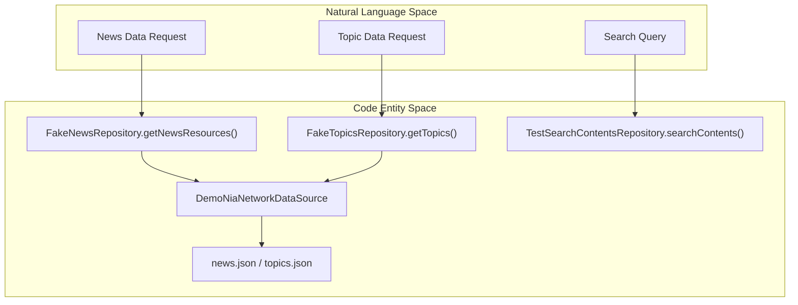
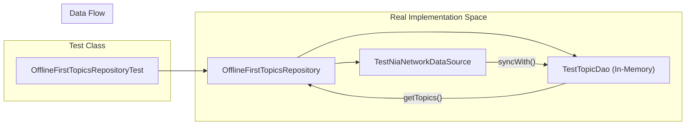

<!-- source: DeepWiki mcp.deepwiki.com · repo android/nowinandroid · page 8.1 Unit and Integration Testing · fetched 2026-10-23 -->

# Unit and Integration Testing

Relevant source files

The following files were used as context for generating this wiki page:

- [core/data-test/src/main/kotlin/com/google/samples/apps/nowinandroid/core/data/test/TestDataModule.kt](core/data-test/src/main/kotlin/com/google/samples/apps/nowinandroid/core/data/test/TestDataModule.kt)
- [core/data-test/src/main/kotlin/com/google/samples/apps/nowinandroid/core/data/test/repository/FakeNewsRepository.kt](core/data-test/src/main/kotlin/com/google/samples/apps/nowinandroid/core/data/test/repository/FakeNewsRepository.kt)
- [core/data-test/src/main/kotlin/com/google/samples/apps/nowinandroid/core/data/test/repository/FakeRecentSearchRepository.kt](core/data-test/src/main/kotlin/com/google/samples/apps/nowinandroid/core/data/test/repository/FakeRecentSearchRepository.kt)
- [core/data-test/src/main/kotlin/com/google/samples/apps/nowinandroid/core/data/test/repository/FakeSearchContentsRepository.kt](core/data-test/src/main/kotlin/com/google/samples/apps/nowinandroid/core/data/test/repository/FakeSearchContentsRepository.kt)
- [core/data-test/src/main/kotlin/com/google/samples/apps/nowinandroid/core/data/test/repository/FakeTopicsRepository.kt](core/data-test/src/main/kotlin/com/google/samples/apps/nowinandroid/core/data/test/repository/FakeTopicsRepository.kt)
- [core/data/src/main/kotlin/com/google/samples/apps/nowinandroid/core/data/repository/DefaultSearchContentsRepository.kt](core/data/src/main/kotlin/com/google/samples/apps/nowinandroid/core/data/repository/DefaultSearchContentsRepository.kt)
- [core/data/src/main/kotlin/com/google/samples/apps/nowinandroid/core/data/util/ConnectivityManagerNetworkMonitor.kt](core/data/src/main/kotlin/com/google/samples/apps/nowinandroid/core/data/util/ConnectivityManagerNetworkMonitor.kt)
- [core/data/src/test/kotlin/com/google/samples/apps/nowinandroid/core/data/repository/OfflineFirstNewsRepositoryTest.kt](core/data/src/test/kotlin/com/google/samples/apps/nowinandroid/core/data/repository/OfflineFirstNewsRepositoryTest.kt)
- [core/data/src/test/kotlin/com/google/samples/apps/nowinandroid/core/data/repository/OfflineFirstTopicsRepositoryTest.kt](core/data/src/test/kotlin/com/google/samples/apps/nowinandroid/core/data/repository/OfflineFirstTopicsRepositoryTest.kt)
- [core/data/src/test/kotlin/com/google/samples/apps/nowinandroid/core/data/repository/OfflineFirstUserDataRepositoryTest.kt](core/data/src/test/kotlin/com/google/samples/apps/nowinandroid/core/data/repository/OfflineFirstUserDataRepositoryTest.kt)
- [core/datastore-test/src/main/kotlin/com/google/samples/apps/nowinandroid/core/datastore/test/TestDataStoreModule.kt](core/datastore-test/src/main/kotlin/com/google/samples/apps/nowinandroid/core/datastore/test/TestDataStoreModule.kt)
- [core/datastore/src/test/kotlin/com/google/samples/apps/nowinandroid/core/datastore/NiaPreferencesDataSourceTest.kt](core/datastore/src/test/kotlin/com/google/samples/apps/nowinandroid/core/datastore/NiaPreferencesDataSourceTest.kt)
- [core/network/src/main/kotlin/com/google/samples/apps/nowinandroid/core/network/demo/DemoNiaNetworkDataSource.kt](core/network/src/main/kotlin/com/google/samples/apps/nowinandroid/core/network/demo/DemoNiaNetworkDataSource.kt)
- [core/testing/src/main/kotlin/com/google/samples/apps/nowinandroid/core/testing/di/TestDispatchersModule.kt](core/testing/src/main/kotlin/com/google/samples/apps/nowinandroid/core/testing/di/TestDispatchersModule.kt)
- [core/testing/src/main/kotlin/com/google/samples/apps/nowinandroid/core/testing/repository/TestSearchContentsRepository.kt](core/testing/src/main/kotlin/com/google/samples/apps/nowinandroid/core/testing/repository/TestSearchContentsRepository.kt)
- [sync/work/src/main/kotlin/com/google/samples/apps/nowinandroid/sync/workers/SyncWorker.kt](sync/work/src/main/kotlin/com/google/samples/apps/nowinandroid/sync/workers/SyncWorker.kt)
- [ui-test-hilt-manifest/.gitignore](ui-test-hilt-manifest/.gitignore)
- [ui-test-hilt-manifest/build.gradle.kts](ui-test-hilt-manifest/build.gradle.kts)
- [ui-test-hilt-manifest/src/main/AndroidManifest.xml](ui-test-hilt-manifest/src/main/AndroidManifest.xml)

This document describes the unit and integration testing strategy used in the Now in Android codebase, including the test doubles approach, test infrastructure modules, and testing philosophy.

## Overview

The Now in Android project uses a **no-mocking testing strategy**, relying instead on test doubles that implement real interfaces with controllable behavior. This approach provides several benefits:

- Test doubles are reusable across unit and instrumented tests.
- Tests verify against real interface contracts, not mock behavior.
- Demo flavor provides consistent static data for reproducible tests.
- Fake implementations are simpler to maintain than complex mock setups.

Sources: [core/data-test/src/main/kotlin/com/google/samples/apps/nowinandroid/core/data/test/repository/FakeNewsRepository.kt:33-38](), [core/network/src/main/kotlin/com/google/samples/apps/nowinandroid/core/network/demo/DemoNiaNetworkDataSource.kt:36-43]()

## Testing Philosophy

The codebase prioritizes testing against real implementations wherever possible. This is achieved through dependency injection and strategic use of test doubles.

| Test Type | Scope | Implementation |
|-----------|-------|----------------|
| **Unit Tests** | ViewModels, UseCases, Repositories | Fake repositories or real implementations with in-memory data stores. |
| **Integration Tests** | Data Layer, Sync logic | Real implementations of DAOs, DataSources, and Repositories. |
| **Instrumented Tests** | UI and Navigation | Real implementations with Hilt-injected test modules. |

Sources: [core/data/src/test/kotlin/com/google/samples/apps/nowinandroid/core/data/repository/OfflineFirstTopicsRepositoryTest.kt:40-65](), [core/data-test/src/main/kotlin/com/google/samples/apps/nowinandroid/core/data/test/repository/FakeNewsRepository.kt:39-42]()

## Test Infrastructure Modules

The project provides specialized modules to support testing across the app:

*   **`:core:testing`**: Contains general test utilities, including `TestDispatchersModule` [core/testing/src/main/kotlin/com/google/samples/apps/nowinandroid/core/testing/di/TestDispatchersModule.kt:30-45]() and `TestSearchContentsRepository` [core/testing/src/main/kotlin/com/google/samples/apps/nowinandroid/core/testing/repository/TestSearchContentsRepository.kt:29-56]().
*   **`:core:data-test`**: Provides fake implementations of data layer repositories such as `FakeNewsRepository` [core/data-test/src/main/kotlin/com/google/samples/apps/nowinandroid/core/data/test/repository/FakeNewsRepository.kt:39-42]() and `FakeTopicsRepository` [core/data-test/src/main/kotlin/com/google/samples/apps/nowinandroid/core/data/test/repository/FakeTopicsRepository.kt:39-42]().
*   **`:core:datastore-test`**: Includes `InMemoryDataStore` utilities for testing `NiaPreferencesDataSource` without disk I/O [core/data/src/test/kotlin/com/google/samples/apps/nowinandroid/core/data/repository/OfflineFirstUserDataRepositoryTest.kt:49-54]().
*   **`:ui-test-hilt-manifest`**: A manifest-only module providing `HiltComponentActivity` for instrumented UI tests [ui-test-hilt-manifest/src/main/AndroidManifest.xml:24-27]().

## Test Double Implementations

### Fake Repositories

Fake repositories are used in unit tests for ViewModels and UseCases to provide predictable data without requiring a database or network.

**Diagram: Mapping Data Requests to Test Double Entities**

*   **`FakeNewsRepository`**: Implements `NewsRepository`. It uses `DemoNiaNetworkDataSource` to fetch static news resources from JSON assets and applies local filtering logic for `NewsResourceQuery` [core/data-test/src/main/kotlin/com/google/samples/apps/nowinandroid/core/data/test/repository/FakeNewsRepository.kt:44-68]().
*   **`FakeTopicsRepository`**: Implements `TopicsRepository`. Similar to the news fake, it maps network models from `DemoNiaNetworkDataSource` to domain `Topic` models [core/data-test/src/main/kotlin/com/google/samples/apps/nowinandroid/core/data/test/repository/FakeTopicsRepository.kt:43-56]().
*   **`TestSearchContentsRepository`**: A specialized test double for search functionality. It maintains in-memory `MutableStateFlow` lists of topics and news resources, allowing tests to manually populate data via `addTopics` and `addNewsResources` [core/testing/src/main/kotlin/com/google/samples/apps/nowinandroid/core/testing/repository/TestSearchContentsRepository.kt:31-56]().

Sources: [core/data-test/src/main/kotlin/com/google/samples/apps/nowinandroid/core/data/test/repository/FakeNewsRepository.kt:39-71](), [core/data-test/src/main/kotlin/com/google/samples/apps/nowinandroid/core/data/test/repository/FakeTopicsRepository.kt:39-62](), [core/testing/src/main/kotlin/com/google/samples/apps/nowinandroid/core/testing/repository/TestSearchContentsRepository.kt:29-56]()

### Network and DataStore Doubles

*   **`DemoNiaNetworkDataSource`**: Provides static data by reading from JSON files (e.g., `news.json`, `topics.json`) via a `DemoAssetManager` [core/network/src/main/kotlin/com/google/samples/apps/nowinandroid/core/network/demo/DemoNiaNetworkDataSource.kt:45-56](). It is used in both the `demo` app flavor and in unit tests.
*   **`InMemoryDataStore`**: Used to test components that depend on `UserPreferences`. It avoids persistence issues by keeping data in memory during the test lifecycle [core/data/src/test/kotlin/com/google/samples/apps/nowinandroid/core/data/repository/OfflineFirstUserDataRepositoryTest.kt:49-54]().

Sources: [core/network/src/main/kotlin/com/google/samples/apps/nowinandroid/core/network/demo/DemoNiaNetworkDataSource.kt:39-82](), [core/data/src/test/kotlin/com/google/samples/apps/nowinandroid/core/data/repository/OfflineFirstUserDataRepositoryTest.kt:20-22]()

## Integration Testing with Real Implementations

For the data layer, Now in Android uses integration tests to verify that repositories correctly coordinate between network and local database sources.

**Diagram: Integration Test Data Flow for OfflineFirstTopicsRepository**

In `OfflineFirstTopicsRepositoryTest`, the `subject` is the real repository implementation [core/data/src/test/kotlin/com/google/samples/apps/nowinandroid/core/data/repository/OfflineFirstTopicsRepositoryTest.kt:61-64](). It is tested against a `TestTopicDao` and `TestNiaNetworkDataSource` to ensure that `syncWith` correctly pulls data from the network and persists it to the database [core/data/src/test/kotlin/com/google/samples/apps/nowinandroid/core/data/repository/OfflineFirstTopicsRepositoryTest.kt:82-102]().

Sources: [core/data/src/test/kotlin/com/google/samples/apps/nowinandroid/core/data/repository/OfflineFirstTopicsRepositoryTest.kt:40-102](), [core/data/src/test/kotlin/com/google/samples/apps/nowinandroid/core/data/repository/OfflineFirstNewsRepositoryTest.kt:80-87]()

## Test Infrastructure Components

### NiaTestRunner and Hilt

Instrumented tests use a custom runner (often configured in build scripts) to ensure the `Application` class is replaced with a Hilt-compatible test application. This allows Hilt to inject test doubles into the UI components.

### TestDispatchersModule

To ensure deterministic execution in tests, the `TestDispatchersModule` replaces the standard `DispatchersModule`. It provides a `TestDispatcher` for both `IO` and `Default` dispatchers, allowing tests to control coroutine execution timing [core/testing/src/main/kotlin/com/google/samples/apps/nowinandroid/core/testing/di/TestDispatchersModule.kt:31-45]().

Sources: [core/testing/src/main/kotlin/com/google/samples/apps/nowinandroid/core/testing/di/TestDispatchersModule.kt:17-46]()

### Coverage Requirements

The project enforces code coverage via JaCoCo. Coverage is measured for both unit and instrumented tests. The build system is configured to exclude generated code (like Hilt or Room classes) from these reports to ensure metrics reflect actual business logic.

Sources: [core/data/src/test/kotlin/com/google/samples/apps/nowinandroid/core/data/repository/OfflineFirstNewsRepositoryTest.kt:51-160]() (Example of comprehensive coverage in repository tests).

---

