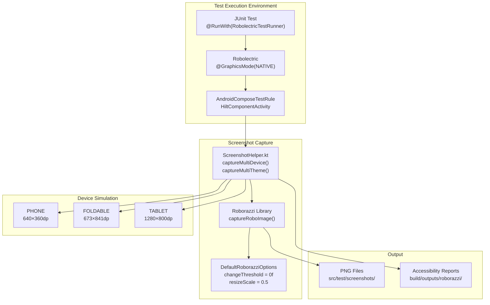
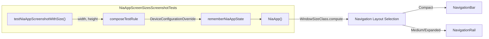

<!-- source: DeepWiki mcp.deepwiki.com · repo android/nowinandroid · page 8.2 Screenshot Testing · fetched 2026-10-23 -->

# Screenshot Testing

Relevant source files

The following files were used as context for generating this wiki page:

- [app/src/testDemo/kotlin/com/google/samples/apps/nowinandroid/ui/DeviceConfigurationOverrideWindowInsets.kt](app/src/testDemo/kotlin/com/google/samples/apps/nowinandroid/ui/DeviceConfigurationOverrideWindowInsets.kt)
- [app/src/testDemo/kotlin/com/google/samples/apps/nowinandroid/ui/NiaAppScreenSizesScreenshotTests.kt](app/src/testDemo/kotlin/com/google/samples/apps/nowinandroid/ui/NiaAppScreenSizesScreenshotTests.kt)
- [app/src/testDemo/kotlin/com/google/samples/apps/nowinandroid/ui/SnackbarInsetsScreenshotTests.kt](app/src/testDemo/kotlin/com/google/samples/apps/nowinandroid/ui/SnackbarInsetsScreenshotTests.kt)
- [app/src/testDemo/kotlin/com/google/samples/apps/nowinandroid/ui/SnackbarScreenshotTests.kt](app/src/testDemo/kotlin/com/google/samples/apps/nowinandroid/ui/SnackbarScreenshotTests.kt)
- [app/src/testDemo/screenshots/compactWidth_compactHeight_showsNavigationBar.png](app/src/testDemo/screenshots/compactWidth_compactHeight_showsNavigationBar.png)
- [app/src/testDemo/screenshots/compactWidth_expandedHeight_showsNavigationBar.png](app/src/testDemo/screenshots/compactWidth_expandedHeight_showsNavigationBar.png)
- [app/src/testDemo/screenshots/compactWidth_mediumHeight_showsNavigationBar.png](app/src/testDemo/screenshots/compactWidth_mediumHeight_showsNavigationBar.png)
- [app/src/testDemo/screenshots/expandedWidth_expandedHeight_showsNavigationRail.png](app/src/testDemo/screenshots/expandedWidth_expandedHeight_showsNavigationRail.png)
- [app/src/testDemo/screenshots/expandedWidth_mediumHeight_showsNavigationRail.png](app/src/testDemo/screenshots/expandedWidth_mediumHeight_showsNavigationRail.png)
- [app/src/testDemo/screenshots/insets_snackbar_compact_medium.png](app/src/testDemo/screenshots/insets_snackbar_compact_medium.png)
- [app/src/testDemo/screenshots/insets_snackbar_compact_medium_noSnackbar.png](app/src/testDemo/screenshots/insets_snackbar_compact_medium_noSnackbar.png)
- [app/src/testDemo/screenshots/insets_snackbar_expanded_expanded.png](app/src/testDemo/screenshots/insets_snackbar_expanded_expanded.png)
- [app/src/testDemo/screenshots/insets_snackbar_medium_medium.png](app/src/testDemo/screenshots/insets_snackbar_medium_medium.png)
- [app/src/testDemo/screenshots/mediumWidth_expandedHeight_showsNavigationRail.png](app/src/testDemo/screenshots/mediumWidth_expandedHeight_showsNavigationRail.png)
- [app/src/testDemo/screenshots/mediumWidth_mediumHeight_showsNavigationRail.png](app/src/testDemo/screenshots/mediumWidth_mediumHeight_showsNavigationRail.png)
- [core/designsystem/src/test/kotlin/com/google/samples/apps/nowinandroid/core/designsystem/BackgroundScreenshotTests.kt](core/designsystem/src/test/kotlin/com/google/samples/apps/nowinandroid/core/designsystem/BackgroundScreenshotTests.kt)
- [core/designsystem/src/test/kotlin/com/google/samples/apps/nowinandroid/core/designsystem/ButtonScreenshotTests.kt](core/designsystem/src/test/kotlin/com/google/samples/apps/nowinandroid/core/designsystem/ButtonScreenshotTests.kt)
- [core/designsystem/src/test/kotlin/com/google/samples/apps/nowinandroid/core/designsystem/FilterChipScreenshotTests.kt](core/designsystem/src/test/kotlin/com/google/samples/apps/nowinandroid/core/designsystem/FilterChipScreenshotTests.kt)
- [core/designsystem/src/test/kotlin/com/google/samples/apps/nowinandroid/core/designsystem/IconButtonScreenshotTests.kt](core/designsystem/src/test/kotlin/com/google/samples/apps/nowinandroid/core/designsystem/IconButtonScreenshotTests.kt)
- [core/designsystem/src/test/kotlin/com/google/samples/apps/nowinandroid/core/designsystem/LoadingWheelScreenshotTests.kt](core/designsystem/src/test/kotlin/com/google/samples/apps/nowinandroid/core/designsystem/LoadingWheelScreenshotTests.kt)
- [core/designsystem/src/test/kotlin/com/google/samples/apps/nowinandroid/core/designsystem/NavigationScreenshotTests.kt](core/designsystem/src/test/kotlin/com/google/samples/apps/nowinandroid/core/designsystem/NavigationScreenshotTests.kt)
- [core/designsystem/src/test/kotlin/com/google/samples/apps/nowinandroid/core/designsystem/TabsScreenshotTests.kt](core/designsystem/src/test/kotlin/com/google/samples/apps/nowinandroid/core/designsystem/TabsScreenshotTests.kt)
- [core/designsystem/src/test/kotlin/com/google/samples/apps/nowinandroid/core/designsystem/TagScreenshotTests.kt](core/designsystem/src/test/kotlin/com/google/samples/apps/nowinandroid/core/designsystem/TagScreenshotTests.kt)
- [core/designsystem/src/test/kotlin/com/google/samples/apps/nowinandroid/core/designsystem/TopAppBarScreenshotTests.kt](core/designsystem/src/test/kotlin/com/google/samples/apps/nowinandroid/core/designsystem/TopAppBarScreenshotTests.kt)
- [core/screenshot-testing/.gitignore](core/screenshot-testing/.gitignore)
- [core/screenshot-testing/build.gradle.kts](core/screenshot-testing/build.gradle.kts)
- [core/screenshot-testing/src/main/kotlin/com/google/samples/apps/nowinandroid/core/testing/util/ScreenshotHelper.kt](core/screenshot-testing/src/main/kotlin/com/google/samples/apps/nowinandroid/core/testing/util/ScreenshotHelper.kt)

## Purpose and Scope

This document describes the screenshot testing infrastructure in Now in Android, which uses **Roborazzi** to validate UI components and screens across multiple device configurations and theme variants. Screenshot tests verify visual correctness, accessibility compliance, and responsive behavior without requiring physical devices or emulators.

For information about unit and integration testing strategies, see [Unit and Integration Testing](8.1). For performance testing and baseline profiles, see [Benchmarking and Performance](8.3).

## Overview

Screenshot testing in Now in Android validates UI consistency by:
- Capturing rendered screenshots of Compose components using **Robolectric** native graphics mode.
- Comparing them against reference images using pixel-perfect matching.
- Testing across multiple device form factors (phone, foldable, tablet).
- Verifying theme combinations (light/dark × default/android × dynamic/static).
- Performing automated accessibility checks via the **Accessibility Test Framework (ATF)**.

**Sources:** [core/screenshot-testing/src/main/kotlin/com/google/samples/apps/nowinandroid/core/testing/util/ScreenshotHelper.kt:1-272]()

## Roborazzi Configuration

The application uses Roborazzi to bridge the gap between Robolectric unit tests and visual regression testing.

### DefaultRoborazziOptions
The `DefaultRoborazziOptions` constant provides the baseline configuration for all screenshot tests:

| Property | Value | Purpose |
|----------|-------|---------|
| `changeThreshold` | `0f` | Pixel-perfect matching; no tolerance for differences. |
| `resizeScale` | `0.5` | Reduces PNG file size by 50% to optimize repository storage. |

**Sources:** [core/screenshot-testing/src/main/kotlin/com/google/samples/apps/nowinandroid/core/testing/util/ScreenshotHelper.kt:56-62]()

## Device Configurations

### DefaultTestDevices Enum
The `DefaultTestDevices` enum defines standard device specs used across the project to ensure layout consistency.

| Device | Description | Spec String |
|--------|-------------|-------------|
| `PHONE` | Compact phone | `spec:shape=Normal,width=640,height=360,unit=dp,dpi=480` |
| `FOLDABLE` | Medium foldable | `spec:shape=Normal,width=673,height=841,unit=dp,dpi=480` |
| `TABLET` | Large tablet | `spec:shape=Normal,width=1280,height=800,unit=dp,dpi=480` |

**Sources:** [core/screenshot-testing/src/main/kotlin/com/google/samples/apps/nowinandroid/core/testing/util/ScreenshotHelper.kt:64-68]()

## ScreenshotHelper Utilities

The `ScreenshotHelper.kt` file provides extension functions for `AndroidComposeTestRule` to simplify multi-configuration testing.

### captureMultiDevice
Iterates through all `DefaultTestDevices` and invokes `captureForDevice` for each one [core/screenshot-testing/src/main/kotlin/com/google/samples/apps/nowinandroid/core/testing/util/ScreenshotHelper.kt:69-83]().

### captureForDevice
This function performs the following steps:
1. **Qualifiers**: Sets Robolectric qualifiers (e.g., `w640dp-h360dp-480dpi`) via `RuntimeEnvironment.setQualifiers` [core/screenshot-testing/src/main/kotlin/com/google/samples/apps/nowinandroid/core/testing/util/ScreenshotHelper.kt:97]().
2. **Content**: Sets the Compose content within a `CompositionLocalProvider` that provides `LocalInspectionMode = true` [core/screenshot-testing/src/main/kotlin/com/google/samples/apps/nowinandroid/core/testing/util/ScreenshotHelper.kt:100-102]().
3. **Accessibility**: Runs `checkRoboAccessibility` using the `AccessibilityCheckPreset.LATEST` [core/screenshot-testing/src/main/kotlin/com/google/samples/apps/nowinandroid/core/testing/util/ScreenshotHelper.kt:113-122]().
4. **Capture**: Saves the image to `src/test/screenshots/` with the device name appended [core/screenshot-testing/src/main/kotlin/com/google/samples/apps/nowinandroid/core/testing/util/ScreenshotHelper.kt:127-131]().

### captureMultiTheme
Takes screenshots combining light/dark modes, default/Android themes, and dynamic color states. It skips incompatible combinations (e.g., Android Theme cannot be Dynamic) [core/screenshot-testing/src/main/kotlin/com/google/samples/apps/nowinandroid/core/testing/util/ScreenshotHelper.kt:156-228]().

## Screen Size Testing (NiaApp)

The `NiaAppScreenSizesScreenshotTests` class specifically validates that the navigation UI (NavigationBar vs. NavigationRail) adapts correctly to different window size classes.

**Implementation Details:**
- Uses `DeviceConfigurationOverride(ForcedSize(...))` to simulate specific screen dimensions [app/src/testDemo/kotlin/com/google/samples/apps/nowinandroid/ui/NiaAppScreenSizesScreenshotTests.kt:120-122]().
- Manually computes `WindowSizeClass` and passes it to `NiaApp` to force specific adaptive behaviors [app/src/testDemo/kotlin/com/google/samples/apps/nowinandroid/ui/NiaAppScreenSizesScreenshotTests.kt:131-138]().
- Tests cover combinations like `compactWidth_compactHeight` and `mediumWidth_mediumHeight` [app/src/testDemo/kotlin/com/google/samples/apps/nowinandroid/ui/NiaAppScreenSizesScreenshotTests.kt:152-194]().

**Sources:** [app/src/testDemo/kotlin/com/google/samples/apps/nowinandroid/ui/NiaAppScreenSizesScreenshotTests.kt:115-149]()

## Snackbar and Inset Testing

`SnackbarScreenshotTests` and `SnackbarInsetsScreenshotTests` verify the placement of snackbars relative to system insets and navigation components.
- Tests use `DeviceConfigurationOverrideWindowInsets` to simulate status bars and navigation bars [app/src/testDemo/kotlin/com/google/samples/apps/nowinandroid/ui/SnackbarInsetsScreenshotTests.kt]().
- Screenshots such as `insets_snackbar_compact_medium.png` validate that snackbars do not overlap with the bottom navigation bar [app/src/testDemo/screenshots/insets_snackbar_compact_medium.png]().

## Design System Component Tests

Individual components in the `:core:designsystem` module have dedicated screenshot tests (e.g., `NavigationScreenshotTests`, `ButtonScreenshotTests`).
- **Font Scaling**: `NavigationScreenshotTests` includes a `navigation_hugeFont` test that overrides `FontScale` to `2f` to verify text wrapping and layout stability [core/designsystem/src/test/kotlin/com/google/samples/apps/nowinandroid/core/designsystem/NavigationScreenshotTests.kt:65-85]().
- **Multi-Theme**: Most component tests use `captureMultiTheme` to ensure colors are correct in both `NiaTheme` and the Android baseline theme [core/designsystem/src/test/kotlin/com/google/samples/apps/nowinandroid/core/designsystem/NavigationScreenshotTests.kt:56-62]().

**Sources:** [core/designsystem/src/test/kotlin/com/google/samples/apps/nowinandroid/core/designsystem/NavigationScreenshotTests.kt:1-111]()

## Visual Regression and CI Auto-Remediation

The project uses GitHub Actions to enforce screenshot consistency.

1. **Verification**: CI runs `./gradlew verifyRoborazziDemoDebug`. This task compares current renderings against the baseline images stored in the repository (e.g., `app/src/testDemo/screenshots/`).
2. **Detection**: If a pixel difference is detected (threshold > 0), the build fails.
3. **Auto-Remediation**:
    - CI generates a report with "Actual", "Expected", and "Diff" images.
    - Developers can run `./gradlew recordRoborazziDemoDebug` locally to update baselines.
    - In some workflows, CI can automatically suggest or commit updated baselines if the changes are deemed intentional (e.g., after a dependency update).

**Sources:** [app/src/testDemo/screenshots/compactWidth_compactHeight_showsNavigationBar.png](), [core/screenshot-testing/src/main/kotlin/com/google/samples/apps/nowinandroid/core/testing/util/ScreenshotHelper.kt:56-62]()

---

