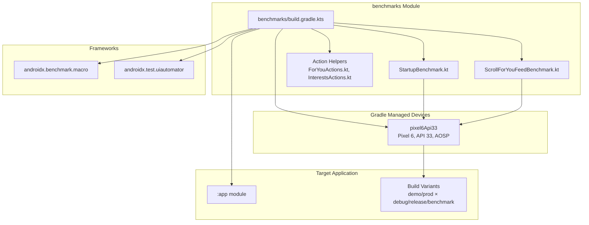
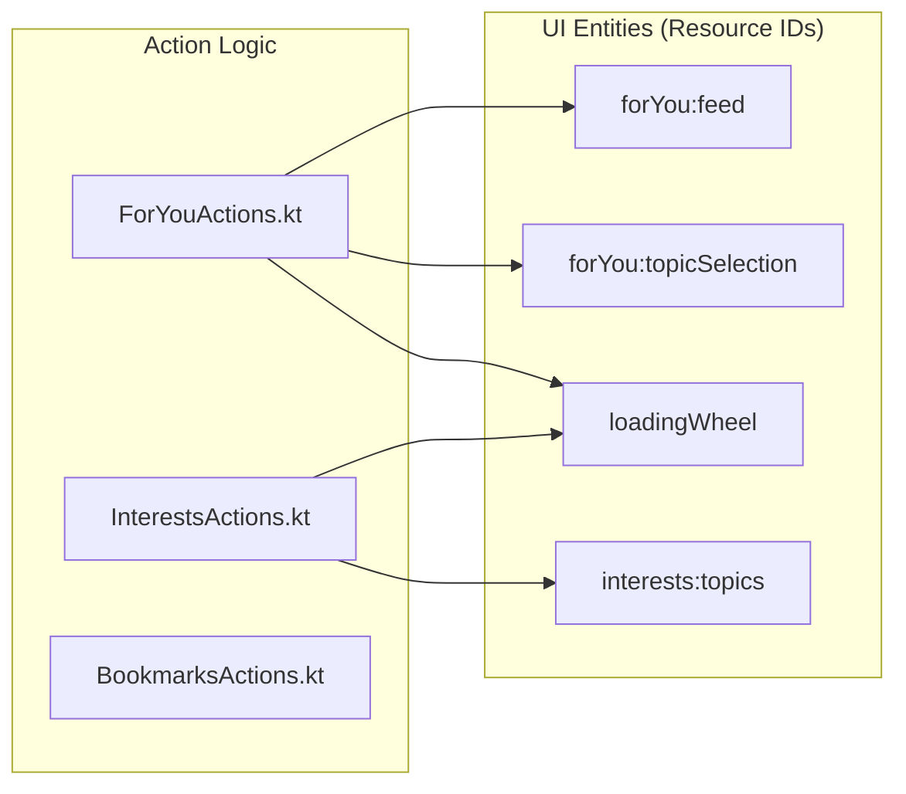

<!-- source: DeepWiki mcp.deepwiki.com · repo android/nowinandroid · page 8.3 Benchmarking and Performance · fetched 2026-10-23 -->

# Benchmarking and Performance

<details>
<summary>Relevant source files</summary>

The following files were used as context for generating this wiki page:

- [.github/ci-gradle.properties](.github/ci-gradle.properties)
- [.github/workflows/Build.yaml](.github/workflows/Build.yaml)
- [.github/workflows/NightlyBaselineProfiles.yaml](.github/workflows/NightlyBaselineProfiles.yaml)
- [.github/workflows/Release.yml](.github/workflows/Release.yml)
- [.run/Generate Demo Baseline Profile.run.xml](.run/Generate Demo Baseline Profile.run.xml)
- [app/benchmark-rules.pro](app/benchmark-rules.pro)
- [benchmarks/src/main/kotlin/com/google/samples/apps/nowinandroid/GeneralActions.kt](benchmarks/src/main/kotlin/com/google/samples/apps/nowinandroid/GeneralActions.kt)
- [benchmarks/src/main/kotlin/com/google/samples/apps/nowinandroid/baselineprofile/BookmarksBaselineProfile.kt](benchmarks/src/main/kotlin/com/google/samples/apps/nowinandroid/baselineprofile/BookmarksBaselineProfile.kt)
- [benchmarks/src/main/kotlin/com/google/samples/apps/nowinandroid/baselineprofile/ForYouBaselineProfile.kt](benchmarks/src/main/kotlin/com/google/samples/apps/nowinandroid/baselineprofile/ForYouBaselineProfile.kt)
- [benchmarks/src/main/kotlin/com/google/samples/apps/nowinandroid/baselineprofile/InterestsBaselineProfile.kt](benchmarks/src/main/kotlin/com/google/samples/apps/nowinandroid/baselineprofile/InterestsBaselineProfile.kt)
- [benchmarks/src/main/kotlin/com/google/samples/apps/nowinandroid/baselineprofile/StartupBaselineProfile.kt](benchmarks/src/main/kotlin/com/google/samples/apps/nowinandroid/baselineprofile/StartupBaselineProfile.kt)
- [benchmarks/src/main/kotlin/com/google/samples/apps/nowinandroid/bookmarks/BookmarksActions.kt](benchmarks/src/main/kotlin/com/google/samples/apps/nowinandroid/bookmarks/BookmarksActions.kt)
- [benchmarks/src/main/kotlin/com/google/samples/apps/nowinandroid/foryou/ForYouActions.kt](benchmarks/src/main/kotlin/com/google/samples/apps/nowinandroid/foryou/ForYouActions.kt)
- [benchmarks/src/main/kotlin/com/google/samples/apps/nowinandroid/foryou/ScrollForYouFeedBenchmark.kt](benchmarks/src/main/kotlin/com/google/samples/apps/nowinandroid/foryou/ScrollForYouFeedBenchmark.kt)
- [benchmarks/src/main/kotlin/com/google/samples/apps/nowinandroid/interests/InterestsActions.kt](benchmarks/src/main/kotlin/com/google/samples/apps/nowinandroid/interests/InterestsActions.kt)
- [benchmarks/src/main/kotlin/com/google/samples/apps/nowinandroid/startup/StartupBenchmark.kt](benchmarks/src/main/kotlin/com/google/samples/apps/nowinandroid/startup/StartupBenchmark.kt)
- [build-logic/gradle.properties](build-logic/gradle.properties)
- [compose_compiler_config.conf](compose_compiler_config.conf)
- [core/data-test/src/main/kotlin/com/google/samples/apps/nowinandroid/core/data/test/DefaultZoneIdTimeZoneMonitor.kt](core/data-test/src/main/kotlin/com/google/samples/apps/nowinandroid/core/data/test/DefaultZoneIdTimeZoneMonitor.kt)
- [core/testing/src/main/kotlin/com/google/samples/apps/nowinandroid/core/testing/util/TestTimeZoneMonitor.kt](core/testing/src/main/kotlin/com/google/samples/apps/nowinandroid/core/testing/util/TestTimeZoneMonitor.kt)
- [core/ui/src/main/kotlin/com/google/samples/apps/nowinandroid/core/ui/LocalTimeZone.kt](core/ui/src/main/kotlin/com/google/samples/apps/nowinandroid/core/ui/LocalTimeZone.kt)

</details>


This document covers the performance testing and optimization infrastructure in Now in Android, including macrobenchmark testing, baseline profile generation, Gradle Managed Devices (GMD), and automated performance workflows. For information about general testing strategy and test infrastructure, see [Testing Strategy](). For screenshot testing, see [Screenshot Testing]().

## Overview

The Now in Android project includes comprehensive performance testing to ensure optimal app startup times and runtime performance. The performance testing strategy consists of three main components:

1.  **Macrobenchmark tests** - Measure app startup and runtime performance (scrolling, navigation) under different compilation modes.
2.  **Baseline profiles** - Enable AOT compilation of critical code paths for faster startup and smoother UI.
3.  **Compose compiler metrics** - Analyze Compose compiler stability and performance.

All performance tests are located in the `:benchmarks` module and execute on Gradle Managed Devices to ensure consistency between local development and CI environments.

Sources: [benchmarks/build.gradle.kts:1-79](), [benchmarks/src/main/kotlin/com/google/samples/apps/nowinandroid/startup/StartupBenchmark.kt:34-38]()

## Benchmarks Module Architecture



**Benchmarks Module Configuration**

The `:benchmarks` module is configured as a test-only module that targets the `:app` module.

| Configuration | Value | Purpose |
|--------------|-------|---------|
| `targetProjectPath` | `:app` | Specifies which app to benchmark |
| `minSdk` | 28 | Minimum SDK for macrobenchmark tests |
| `managedDevices` | `pixel6Api33` | Gradle Managed Device configuration |
| `useConnectedDevices` | `false` | Forces GMD usage for consistency in baseline generation |

Sources: [benchmarks/build.gradle.kts:23-68]()

## Macrobenchmark Testing

Macrobenchmark tests measure the app's performance in realistic scenarios by automating the app on a physical or emulated device.

### Startup Benchmark Test

The `StartupBenchmark` measures cold startup time under different compilation strategies.

| Test Method | Compilation Mode | Purpose |
|-------------|-----------------|---------|
| `startupWithoutPreCompilation()` | `None()` | Baseline with no AOT compilation |
| `startupWithPartialCompilationAndDisabledBaselineProfile()` | `Partial(baselineProfileMode = Disable)` | JIT-only performance |
| `startupPrecompiledWithBaselineProfile()` | `Partial(baselineProfileMode = Require)` | Recommended performance with Baseline Profiles |
| `startupFullyPrecompiled()` | `Full()` | Maximum AOT compilation of all code |

Sources: [benchmarks/src/main/kotlin/com/google/samples/apps/nowinandroid/startup/StartupBenchmark.kt:44-57]()

### Runtime Benchmarks

The project also benchmarks specific user interactions, such as scrolling through the feed.

- **`ScrollForYouFeedBenchmark`**: Measures `FrameTimingMetric` while scrolling the For You feed. It uses `forYouWaitForContent()`, `forYouSelectTopics()`, and `forYouScrollFeedDownUp()` to simulate user behavior. [benchmarks/src/main/kotlin/com/google/samples/apps/nowinandroid/foryou/ScrollForYouFeedBenchmark.kt:31-60]()

## Benchmark Actions

To maintain clean benchmark code, UI interactions are encapsulated in "Action" files. These use `UiAutomator` to interact with the app via resource IDs and text.



### Key Action Functions

- **`forYouWaitForContent`**: Waits for the `loadingWheel` to disappear and the `forYou:topicSelection` list to populate. [benchmarks/src/main/kotlin/com/google/samples/apps/nowinandroid/foryou/ForYouActions.kt:28-36]()
- **`forYouSelectTopics`**: Programmatically clicks topics to populate the user's feed. [benchmarks/src/main/kotlin/com/google/samples/apps/nowinandroid/foryou/ForYouActions.kt:42-91]()
- **`interestsScrollTopicsDownUp`**: Locates `interests:topics` and performs a fling gesture. [benchmarks/src/main/kotlin/com/google/samples/apps/nowinandroid/interests/InterestsActions.kt:35-39]()
- **`goToInterestsScreen`**: Navigates via the bottom bar and waits for the "Interests" title in the Top App Bar. [benchmarks/src/main/kotlin/com/google/samples/apps/nowinandroid/interests/InterestsActions.kt:25-33]()

Sources: [benchmarks/src/main/kotlin/com/google/samples/apps/nowinandroid/foryou/ForYouActions.kt:28-109](), [benchmarks/src/main/kotlin/com/google/samples/apps/nowinandroid/interests/InterestsActions.kt:25-50]()

## Baseline Profiles

Baseline profiles are rules that tell the Android Runtime (ART) which code paths to pre-compile.

### Profile Generation Scenarios

The project defines specific classes for profile generation:
- `StartupBaselineProfile`
- `ForYouBaselineProfile`
- `InterestsBaselineProfile`
- `BookmarksBaselineProfile`

These classes use the `BaselineProfileRule` to record interactions. For example, `ForYouBaselineProfile` records the `forYouSelectTopics` and `forYouScrollFeedDownUp` actions.

Sources: [benchmarks/src/main/kotlin/com/google/samples/apps/nowinandroid/baselineprofile/ForYouBaselineProfile.kt:28-44]()

### Proguard Rules for Benchmarks

The `benchmark` build type uses `benchmark-rules.pro`, which explicitly disables obfuscation (`-dontobfuscate`). This is critical because baseline profiles must be generated with readable symbols to be correctly mapped back to the app's code during the release build's obfuscation phase.

Sources: [app/benchmark-rules.pro:1-18]()

## Gradle Managed Devices (GMD)

GMD is used to ensure that benchmarks and profile generation happen on a controlled, consistent environment.

**Configuration in benchmarks/build.gradle.kts:**
```kotlin
testOptions.managedDevices.localDevices {
    create("pixel6Api33") {
        device = "Pixel 6"
        apiLevel = 33
        systemImageSource = "aosp"
    }
}
```
Sources: [benchmarks/build.gradle.kts:48-54]()

In CI, these devices are configured with specific properties for stability:
- `gpu="swiftshader_indirect"`: Ensures software rendering for consistency.
- `numManagedDeviceShards=1`: Prevents parallel interference during performance measurement.

Sources: [.github/workflows/Release.yml:54-62]()

## CI/CD Performance Workflows

Performance automation is split into release-time generation and nightly updates.

| Workflow | Action | Command |
|----------|--------|---------|
| **Release** | Generates profile for the release APK | `./gradlew :app:assembleDemoRelease -P...androidx.benchmark.enabledRules=BaselineProfile` |
| **Nightly** | Updates profiles for all variants | `./gradlew :app:assemble -P...androidx.benchmark.enabledRules=baselineprofile` |

Sources: [.github/workflows/Release.yml:57-62](), [.github/workflows/NightlyBaselineProfiles.yaml:63-67]()

## Performance Optimization Workflows

### Compose Stability
The project uses a `compose_compiler_config.conf` file to treat specific data models as stable. This prevents unnecessary recompositions in the UI layer. Specifically, all classes in `com.google.samples.apps.nowinandroid.core.model.data.*` and Java standard library classes like `ZoneId` are marked as stable.

Sources: [compose_compiler_config.conf:1-12]()

### Manual Generation
Developers can trigger profile generation locally using a pre-configured Run Configuration in Android Studio. This runs the `:benchmark:pixel6Api31atdDemoBenchmarkAndroidTest` task with the `BaselineProfile` rule enabled and `--enable-display` to visually verify the automation.

Sources: [.run/Generate Demo Baseline Profile.run.xml:26-48]()

## Summary

The Now in Android benchmarking suite provides:
- **Consistent measurement** via `MacrobenchmarkRule` and Gradle Managed Devices.
- **Improved UX** through automated Baseline Profile generation in CI/CD.
- **Modular automation** using reusable actions like `ForYouActions` and `InterestsActions`.
- **Architectural stability** by leveraging the Compose compiler configuration for data models.

Sources: [benchmarks/build.gradle.kts:1-79](), [.github/workflows/Release.yml:50-62](), [compose_compiler_config.conf:1-12]()

---

