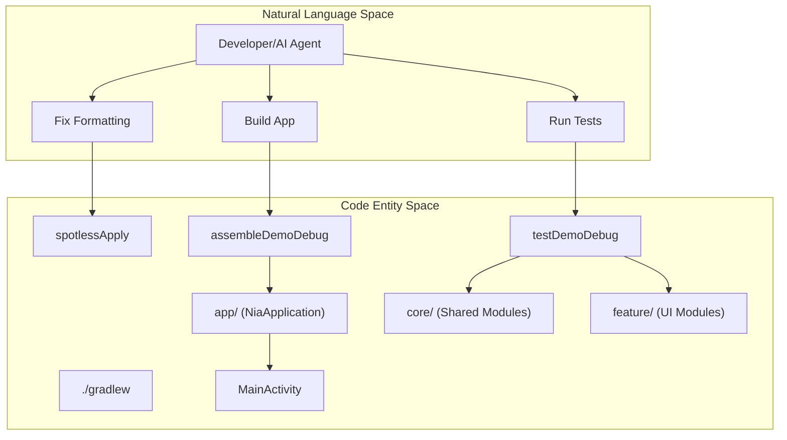
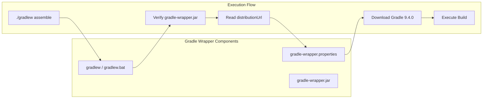

<!-- source: DeepWiki mcp.deepwiki.com · repo android/nowinandroid · page 9 Development Guide · fetched 2026-10-23 -->

# Development Guide

<details>
<summary>Relevant source files</summary>

The following files were used as context for generating this wiki page:

- [.github/pull_request_template.md](.github/pull_request_template.md)
- [.gitignore](.gitignore)
- [.google/BUILDME](.google/BUILDME)
- [.idea/codeStyles/Project.xml](.idea/codeStyles/Project.xml)
- [.idea/codeStyles/codeStyleConfig.xml](.idea/codeStyles/codeStyleConfig.xml)
- [.run/spotlessApply.run.xml](.run/spotlessApply.run.xml)
- [AGENT.md](AGENT.md)
- [AGENTS.md](AGENTS.md)
- [CODEOWNERS](CODEOWNERS)
- [app/prodRelease-badging.txt](app/prodRelease-badging.txt)
- [app/src/main/AndroidManifest.xml](app/src/main/AndroidManifest.xml)
- [app/src/main/res/mipmap-anydpi-v26/ic_launcher.xml](app/src/main/res/mipmap-anydpi-v26/ic_launcher.xml)
- [app/src/main/res/mipmap-anydpi-v26/ic_launcher_round.xml](app/src/main/res/mipmap-anydpi-v26/ic_launcher_round.xml)
- [gradle/wrapper/gradle-wrapper.jar](gradle/wrapper/gradle-wrapper.jar)
- [gradle/wrapper/gradle-wrapper.properties](gradle/wrapper/gradle-wrapper.properties)
- [gradlew](gradlew)
- [gradlew.bat](gradlew.bat)
- [tools/pre-push](tools/pre-push)
- [tools/setup.sh](tools/setup.sh)

</details>


This guide provides practical instructions for developers working on the Now in Android codebase. It covers environment setup, building and running the app, executing tests, working with the Gradle wrapper, and understanding the contribution guidelines.

---

## Prerequisites and Development Environment Setup

### Required Software

The Now in Android project requires the following tools:

| Tool | Version | Purpose |
|------|---------|---------|
| **Java Development Kit (JDK)** | 17+ | Required for Gradle builds and compilation |
| **Android Studio** | Latest stable | IDE for development |
| **Gradle** | 9.4.0 | Build system (managed via wrapper) |
| **Android SDK** | API 36 (compileSdk) | Android platform SDK |

**Sources:** [gradle/wrapper/gradle-wrapper.properties:4-4](), [app/prodRelease-badging.txt:1-1]()

### Initial Setup Script

The project provides a setup script to configure the local git environment, including commit message and pre-push hooks.

```bash
./tools/setup.sh
```

This script performs the following actions:
1.  **Git Commit Hook**: Installs the Gerrit `commit-msg` hook to ensure valid commit messages [tools/setup.sh:25-27]().
2.  **Pre-push Hook**: Copies `tools/pre-push` to your `.git/hooks/` directory [tools/setup.sh:31-33]().
3.  **IDE Configuration**: Recommends specific Android Studio settings for trailing spaces, line breaks, and auto-imports [tools/setup.sh:35-41]().

**Sources:** [tools/setup.sh:1-42](), [tools/pre-push:1-20]()

### Git Pre-push Hook

The `tools/pre-push` hook is designed to prevent broken builds from being pushed to the remote. It executes:
-   `./gradlew spotlessCheck`: Verifies code formatting [tools/pre-push:16-16]().
-   `./gradlew testDemoDebug`: Runs local unit tests for the demo variant [tools/pre-push:19-19]().

**Sources:** [tools/pre-push:1-20]()

---

## Build Variants and Flavors

The app uses two product flavors (`demo`, `prod`) and two build types (`debug`, `release`) [AGENT.md:26-27]().

| Flavor | Data Source | Usage |
|------|------------|-------|
| `demo` | Local static JSON assets | Standard development and local testing [AGENT.md:28-28]() |
| `prod` | Real network backend | Production releases [AGENT.md:26-26]() |

### Key Build Commands

```bash
# Build the standard development variant
./gradlew assembleDemoDebug

# Fix code formatting (Spotless)
./gradlew spotlessApply

# Check APK metadata/permissions against baseline
./gradlew :app:checkProdReleaseBadging
```

**Sources:** [AGENT.md:28-32](), [app/prodRelease-badging.txt:1-12]()

---

## Running Tests

### Local JVM Tests
Run tests on the `demoDebug` variant for the fastest feedback loop.

```bash
# Run all unit tests
./gradlew testDemoDebug

# Run a single test class
./gradlew testDemoDebug --tests "com.example.myapp.MyTestClass"

# Run Roborazzi screenshot tests
./gradlew verifyRoborazziDemoDebug
```

**Sources:** [AGENT.md:30-32](), [.github/pull_request_template.md:12-13]()

### Instrumented Tests
Instrumented tests are run using **Gradle Managed Devices (GMD)** to ensure consistency across environments.

```bash
# Run on a Pixel 6 API 31 managed device
./gradlew pixel6api31aospDebugAndroidTest
```

**Sources:** [AGENT.md:36-36]()

---

## Code Formatting and Quality

The project uses **Spotless** to enforce consistent code style. Before creating a Pull Request, you must ensure the code is formatted correctly.

### Spotless Integration
-   **Check**: `./gradlew spotlessCheck`
-   **Apply**: `./gradlew spotlessApply`

The IDE is also configured via `.idea/codeStyles/Project.xml` to match the project's formatting requirements.

**Sources:** [AGENT.md:29-29](), [.github/pull_request_template.md:13-13](), [.idea/codeStyles/Project.xml:1-120]()

### Badging Verification
The project tracks APK metadata (permissions, package name, activities) in `app/prodRelease-badging.txt`. Any change to the `AndroidManifest.xml` that affects these values requires updating this file.

**Sources:** [app/prodRelease-badging.txt:1-123](), [app/src/main/AndroidManifest.xml:17-73]()

---

## Contribution Guidelines

### Pull Request Process
1.  **Sign the CLA**: First-time contributors must sign the [Google CLA](https://cla.developers.google.com/) [.github/pull_request_template.md:8-8]().
2.  **Verify Locally**: Run `./gradlew testDemoDebug` and `./gradlew spotlessApply` [.github/pull_request_template.md:12-13]().
3.  **Description**: Provide a clear summary of "What" and "Why" in the PR description [.github/pull_request_template.md:23-25]().

### Code Ownership
The project uses a `CODEOWNERS` file to automatically assign reviewers for different parts of the codebase.

**Sources:** [CODEOWNERS:1-2]()

---

## AI Agent Instructions (`AGENT.md`)

The `AGENT.md` file serves as a high-level technical manifest for AI agents and developers to understand the project structure and common workflows.

### System Overview


**Sources:** [AGENT.md:1-60](), [app/src/main/AndroidManifest.xml:32-43]()

### Command Reference Mapping

| Action | Code Entity / Command |
|--------|-----------------------|
| Build | `./gradlew assembleDemoDebug` [AGENT.md:28-28]() |
| Format | `./gradlew spotlessApply` [AGENT.md:29-29]() |
| Unit Test | `./gradlew {variant}Test` [AGENT.md:30-30]() |
| Screenshot Test | `./gradlew verifyRoborazziDemoDebug` [AGENT.md:32-32]() |
| Device Test | `./gradlew pixel6api31aospDebugAndroidTest` [AGENT.md:36-36]() |

**Sources:** [AGENT.md:24-37]()

---

## Gradle Wrapper Technical Detail

The project is pinned to a specific Gradle version via the wrapper to ensure reproducible builds.

### Gradle Wrapper Structure


**Sources:** [gradlew:1-249](), [gradle/wrapper/gradle-wrapper.properties:1-9](), [gradle/wrapper/gradle-wrapper.jar:1-13]()

### Key Files
-   `gradlew`: POSIX shell script for Unix-based systems [gradlew:1-249]().
-   `gradlew.bat`: Batch script for Windows systems [gradlew.bat:1-94]().
-   `gradle/wrapper/gradle-wrapper.properties`: Contains the `distributionUrl` and `distributionSha256Sum` for the Gradle binary [gradle/wrapper/gradle-wrapper.properties:3-4]().

**Sources:** [gradlew:1-249](), [gradlew.bat:1-94](), [gradle/wrapper/gradle-wrapper.properties:1-9]()

---

