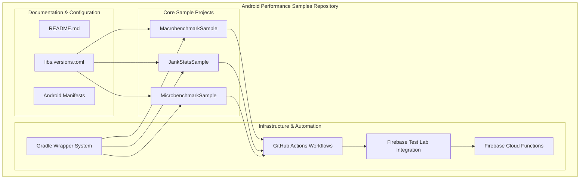
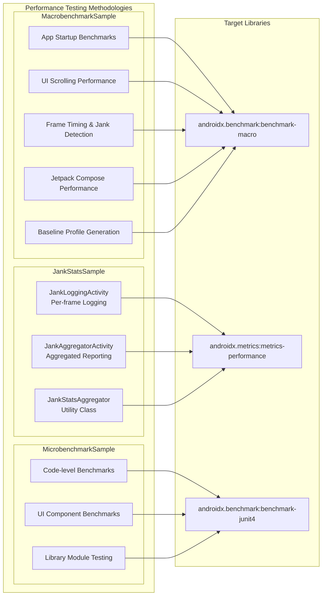
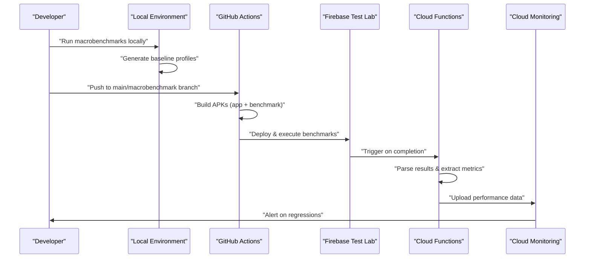

<!-- source: DeepWiki mcp.deepwiki.com · repo android/performance-samples · page 1 Overview · fetched 2026-10-23 -->

# Overview

Relevant source files

The following files were used as context for generating this wiki page:

- [JankStatsSample/README.md](JankStatsSample/README.md)
- [README.md](README.md)

## Purpose and Scope

The Android Performance Samples repository is a collection of sample projects that demonstrate different approaches to Android performance measurement and optimization. This repository serves as both a learning resource for Android developers and a production-ready template for implementing performance testing infrastructure in real applications.

The repository contains three primary sample projects that showcase complementary performance testing methodologies: end-to-end application performance testing, real-time UI performance monitoring, and code-level benchmarking. Additionally, it includes a comprehensive CI/CD pipeline that automates performance testing using cloud infrastructure.

For detailed information about individual sample projects, see [Sample Projects](#2). For CI/CD pipeline documentation, see [CI/CD Integration](#3). For build system configuration, see [Build System](#4).

## Repository Structure

The repository is organized around three main sample projects, each demonstrating a specific approach to performance measurement, supported by shared infrastructure and automation systems.

**Sources:** [README.md:1-47]()

## Performance Testing Approaches

Each sample project implements a distinct performance testing methodology, targeting different aspects of application performance and different stages of the development lifecycle.

**Sources:** [README.md:8-19](), [README.md:21-23](), [README.md:29-31](), [JankStatsSample/README.md:8-18]()

## Key Components and Roles

The following table summarizes the primary components in the repository and their specific roles in the performance testing ecosystem:

| Component | Primary Class/Module | Purpose | Target Use Case |
|-----------|---------------------|---------|-----------------|
| **MacrobenchmarkSample** | `:macrobenchmark` module | End-to-end application performance testing | App startup optimization, UI scrolling performance, baseline profile generation |
| **JankStatsSample** | `JankLoggingActivity`, `JankAggregatorActivity` | Real-time UI performance monitoring | Production jank detection, frame-by-frame analysis |
| **MicrobenchmarkSample** | `:microbenchmark` module | Code-level performance benchmarking | Individual function optimization, library performance |
| **Firebase Test Lab** | `firebase_test_lab.yml` workflow | Cloud-based automated testing | Continuous performance regression detection |
| **Baseline Profiles** | `baselineprofile/` generators | App optimization artifacts | Runtime performance improvements |

**Sources:** [README.md:8-14](), [JankStatsSample/README.md:8-15](), [README.md:21-23]()

## Integration Architecture

The repository demonstrates how performance testing integrates with modern Android development workflows, from local development to continuous integration and monitoring.

**Sources:** [README.md:16-17]()

The repository serves as a comprehensive example of how to implement performance testing across different levels of an Android application, from individual functions to complete user workflows, with automated cloud-based regression detection and monitoring.

---

