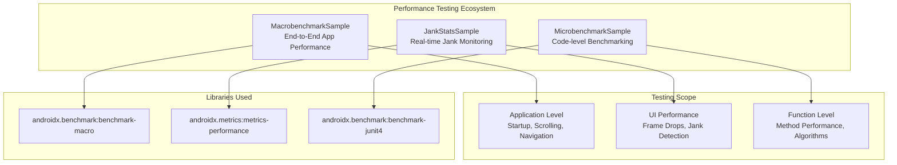
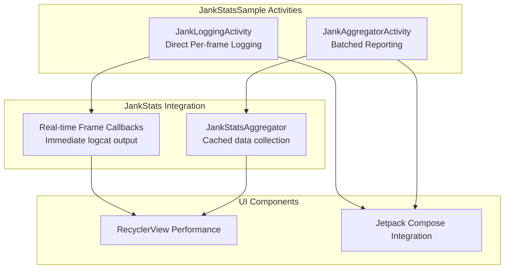
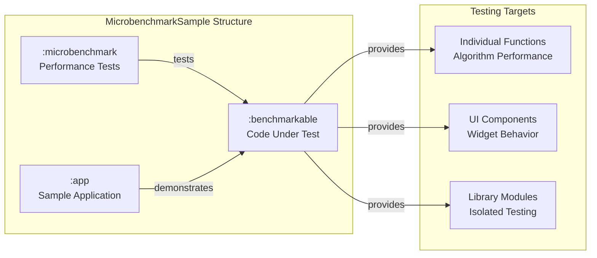
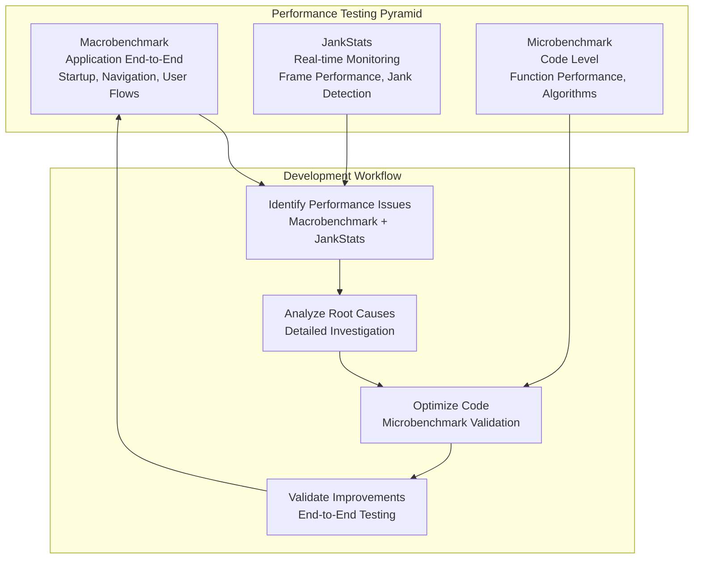

<!-- source: DeepWiki mcp.deepwiki.com · repo android/performance-samples · page 2 Sample Projects · fetched 2026-10-23 -->

# Sample Projects

Relevant source files

The following files were used as context for generating this wiki page:

- [JankStatsSample/README.md](JankStatsSample/README.md)
- [MacrobenchmarkSample/README.md](MacrobenchmarkSample/README.md)
- [MacrobenchmarkSample/app/benchmark-rules.pro](MacrobenchmarkSample/app/benchmark-rules.pro)
- [MacrobenchmarkSample/media/composition-tracing.png](MacrobenchmarkSample/media/composition-tracing.png)
- [README.md](README.md)

This document provides an overview of the three main sample projects in the Android Performance Samples repository, each demonstrating different approaches to Android performance measurement and optimization. These projects serve as both learning resources and production-ready templates for implementing performance testing strategies.

For detailed information about CI/CD integration and automated testing, see [CI/CD Integration](#3). For build system configuration details, see [Build System](#4).

## Overview of Sample Projects

The repository contains three complementary sample projects that address different aspects of Android performance testing:

Sources: [README.md:8-32](), [MacrobenchmarkSample/README.md:1-89](), [JankStatsSample/README.md:1-50]()

## MacrobenchmarkSample

The `MacrobenchmarkSample` is the flagship project focusing on end-to-end application performance testing using the Jetpack Macrobenchmark library. It provides comprehensive benchmarking capabilities for measuring application startup times, scrolling performance, and runtime behavior.

### Key Features and Components

```mermaid
graph LR
    subgraph "MacrobenchmarkSample Modules"
        APP[":app<br/>Target Application"]
        MACRO[":macrobenchmark<br/>Performance Tests"]
        BASE[":baseBenchmarks<br/>Reusable Templates"]
    end
    
    subgraph "Performance Metrics"
        STARTUP["Startup Benchmarks<br/>Cold/Warm Launch"]
        FRAMES["Frame Timing<br/>Jank Measurement"]
        BASELINE["Baseline Profiles<br/>Performance Optimization"]
    end
    
    subgraph "Target Activities"
        MAIN["MainActivity"]
        COMPOSE["ComposeActivity"]
        RECYCLER["RecyclerViewActivity"]
    end
    
    MACRO -->|"measures"| APP
    APP -->|"contains"| MAIN
    APP -->|"contains"| COMPOSE  
    APP -->|"contains"| RECYCLER
    
    MACRO -->|"generates"| STARTUP
    MACRO -->|"measures"| FRAMES
    MACRO -->|"creates"| BASELINE
    
    BASE -->|"provides templates"| MACRO
```

The project demonstrates several advanced features:

- **Baseline Profile Generation**: Uses separate generator classes for different user journeys, stored in `src/main/baselineProfiles` folder for easier maintenance
- **Composition Tracing**: Integration with Jetpack Compose for detailed UI performance analysis using `androidx.benchmark.perfettoSdkTracing.enable=true`
- **Firebase Test Lab Integration**: Automated cloud-based benchmarking through GitHub workflows
- **Drop-in Templates**: The `baseBenchmarks` module provides ready-to-use benchmarks for production applications

### Baseline Profile Management

The sample uses an advanced baseline profile system with granular control:

- Multiple profile files can be created and maintained separately
- Dedicated generators for specific user journeys
- Automatic profile updates without full regeneration for minor changes

Sources: [README.md:8-19](), [MacrobenchmarkSample/README.md:1-89]()

## JankStatsSample  

The `JankStatsSample` demonstrates real-time UI performance monitoring using the JankStats library to detect and analyze frame drops and UI jank during user interactions.

### Architecture and Monitoring Approaches

### Two Monitoring Strategies

The sample provides two distinct approaches to jank detection:

1. **Direct Logging (`JankLoggingActivity`)**: 
   - Creates `JankStats` object for immediate frame-by-frame analysis
   - Outputs performance metrics directly to logcat in real-time
   - Suitable for development and debugging scenarios

2. **Aggregated Reporting (`JankAggregatorActivity`)**:
   - Uses `JankStatsAggregator` utility class for batched data collection
   - Collects per-frame information and caches it internally
   - Outputs aggregated reports when requested (e.g., when activity goes to background)
   - Better for production monitoring with reduced overhead

### Performance State Management

The sample demonstrates integration with various UI states and components:

- `PerformanceMetricsState` for contextual performance information
- Activity lifecycle and navigation state tracking
- RecyclerView scroll performance monitoring
- Jetpack Compose integration patterns

Sources: [JankStatsSample/README.md:1-50](), [README.md:29-31]()

## MicrobenchmarkSample

The `MicrobenchmarkSample` focuses on code-level performance testing using the Benchmark library to measure individual function performance and UI component behavior within library modules.

### Key Characteristics

### Important Considerations

- **Device Requirements**: Screen must be on before running benchmarks to ensure accurate measurements
- **Isolated Testing**: Focuses on library module performance independent of application context
- **Granular Metrics**: Measures specific code paths and algorithms rather than full application flows

The microbenchmark approach complements the macrobenchmark testing by providing detailed performance data for specific code sections that might be identified as bottlenecks through broader application testing.

Sources: [README.md:21-27]()

## Integrated Testing Strategy

The three sample projects work together to provide a comprehensive performance testing strategy:

This layered approach enables developers to:

1. **Detect Issues**: Use macrobenchmarks and jank monitoring to identify performance problems
2. **Isolate Problems**: Apply microbenchmarks to specific code sections for detailed analysis  
3. **Monitor Production**: Implement real-time jank detection in production applications
4. **Validate Fixes**: Confirm improvements through comprehensive end-to-end testing

Sources: [README.md:1-46](), [MacrobenchmarkSample/README.md:1-89](), [JankStatsSample/README.md:1-50]()

---

