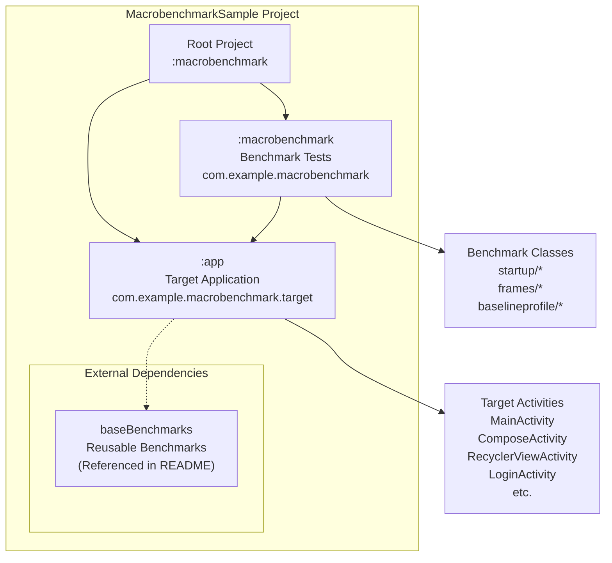
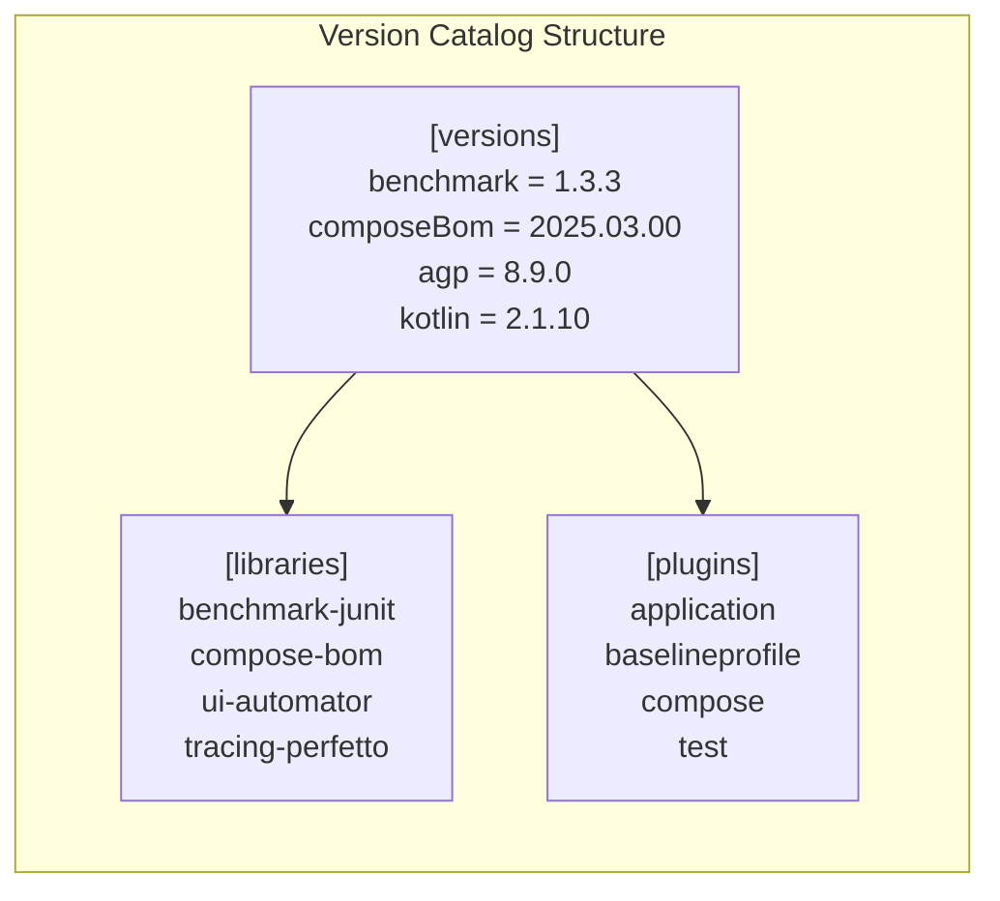
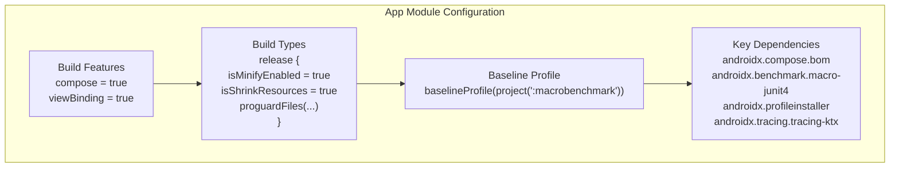
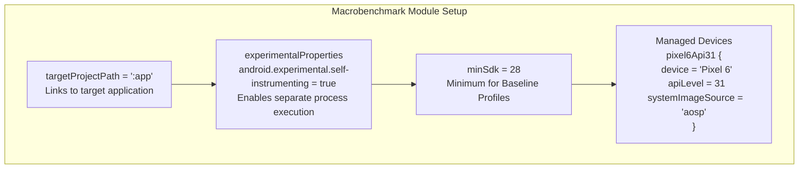
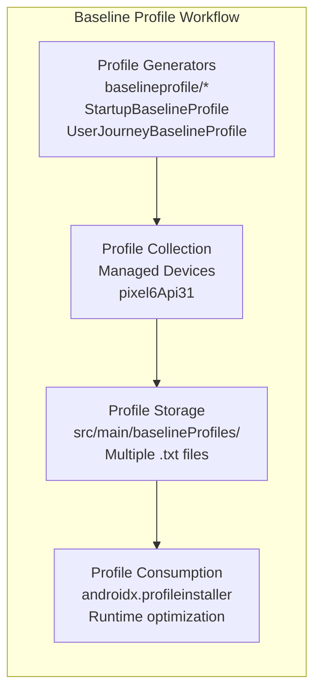

<!-- source: DeepWiki mcp.deepwiki.com · repo android/performance-samples · page 2.1 MacrobenchmarkSample · fetched 2026-10-23 -->

# MacrobenchmarkSample

Relevant source files

The following files were used as context for generating this wiki page:

- [MacrobenchmarkSample/README.md](MacrobenchmarkSample/README.md)
- [MacrobenchmarkSample/app/benchmark-rules.pro](MacrobenchmarkSample/app/benchmark-rules.pro)
- [MacrobenchmarkSample/app/build.gradle.kts](MacrobenchmarkSample/app/build.gradle.kts)
- [MacrobenchmarkSample/app/src/main/AndroidManifest.xml](MacrobenchmarkSample/app/src/main/AndroidManifest.xml)
- [MacrobenchmarkSample/build.gradle.kts](MacrobenchmarkSample/build.gradle.kts)
- [MacrobenchmarkSample/gradle/libs.versions.toml](MacrobenchmarkSample/gradle/libs.versions.toml)
- [MacrobenchmarkSample/macrobenchmark/build.gradle.kts](MacrobenchmarkSample/macrobenchmark/build.gradle.kts)
- [MacrobenchmarkSample/media/composition-tracing.png](MacrobenchmarkSample/media/composition-tracing.png)
- [MacrobenchmarkSample/settings.gradle.kts](MacrobenchmarkSample/settings.gradle.kts)

This document covers the MacrobenchmarkSample project, which demonstrates comprehensive end-to-end performance testing using the Jetpack Macrobenchmark library. The system provides a complete example of measuring app startup time, frame timing, scroll performance, and baseline profile generation for Android applications.

For information about real-time performance monitoring, see [JankStatsSample](#2.2). For code-level performance testing, see [MicrobenchmarkSample](#2.3). For CI/CD integration details, see [CI/CD Integration](#3).

## Project Architecture

The MacrobenchmarkSample follows a multi-module architecture designed to separate the target application from the benchmarking infrastructure. This separation ensures that benchmark code doesn't interfere with the performance characteristics of the app being tested.

## Module Structure

Sources: [MacrobenchmarkSample/settings.gradle.kts:17-19](), [MacrobenchmarkSample/README.md:17-20]()

## Build Configuration

The project uses Gradle with centralized dependency management through version catalogs. The configuration demonstrates proper setup for macrobenchmarking with baseline profile generation.

### Root Project Configuration

The root `build.gradle.kts` applies plugins without activation, allowing individual modules to configure them as needed:

| Plugin | Purpose |
|--------|---------|
| `application` | Applied to `:app` module for target app |
| `test` | Applied to `:macrobenchmark` module for benchmarks |
| `baselineprofile` | Applied to both modules for profile generation |
| `kotlin` | Applied to all modules for Kotlin support |
| `compose` | Applied to `:app` for Jetpack Compose UI |

Sources: [MacrobenchmarkSample/build.gradle.kts:17-23]()

### Version Management

The `libs.versions.toml` file centralizes all dependency versions:

Sources: [MacrobenchmarkSample/gradle/libs.versions.toml:1-60]()

## Target Application Module

The `:app` module serves as the target application for benchmarking. It's configured with release build optimizations while maintaining debuggability for performance analysis.

### Build Configuration

The app module configuration includes several key aspects for benchmarking:

Sources: [MacrobenchmarkSample/app/build.gradle.kts:37-55](), [MacrobenchmarkSample/app/build.gradle.kts:69-95]()

### Target Activities

The application manifest declares multiple activities for different performance testing scenarios:

| Activity | Purpose | Intent Action |
|----------|---------|---------------|
| `MainActivity` | Main launcher and navigation hub | `android.intent.action.MAIN` |
| `ComposeActivity` | Jetpack Compose UI performance testing | `com.example.macrobenchmark.target.COMPOSE_ACTIVITY` |
| `RecyclerViewActivity` | List scrolling performance | `com.example.macrobenchmark.target.RECYCLER_VIEW_ACTIVITY` |
| `ListViewActivity` | Legacy list performance | `com.example.macrobenchmark.target.LIST_VIEW_ACTIVITY` |
| `LoginActivity` | Authentication flow testing | `com.example.macrobenchmark.target.LOGIN_ACTIVITY` |
| `ScrollViewActivity` | Simple scroll performance | `com.example.macrobenchmark.target.SCROLL_VIEW_ACTIVITY` |
| `FullyDrawnStartupActivity` | Startup completion measurement | `com.example.macrobenchmark.target.FULLY_DRAWN_STARTUP_ACTIVITY` |

Sources: [MacrobenchmarkSample/app/src/main/AndroidManifest.xml:23-88]()

### Application Setup

The manifest includes essential configuration for benchmarking:

- `<profileable android:shell="true" />` enables profiling from shell commands
- All benchmark target activities are exported for external discovery
- `POST_NOTIFICATIONS` permission for potential notification-based testing
- Application class `ExampleApplication` for custom initialization

Sources: [MacrobenchmarkSample/app/src/main/AndroidManifest.xml:15-17](), [MacrobenchmarkSample/app/src/main/AndroidManifest.xml:5]()

## Macrobenchmark Module

The `:macrobenchmark` module contains the actual benchmark tests and baseline profile generators. It's configured as a test module with special capabilities for performance measurement.

### Module Configuration

The macrobenchmark module has distinct configuration requirements:

Sources: [MacrobenchmarkSample/macrobenchmark/build.gradle.kts:40](), [MacrobenchmarkSample/macrobenchmark/build.gradle.kts:62](), [MacrobenchmarkSample/macrobenchmark/build.gradle.kts:34-35](), [MacrobenchmarkSample/macrobenchmark/build.gradle.kts:51-57]()

### Baseline Profile Configuration

The module includes specific baseline profile generation settings:

- Uses managed devices (`pixel6Api31`) for consistent profile generation
- Disables connected devices (`useConnectedDevices = false`) for CI/CD compatibility
- Includes Perfetto tracing dependencies for composition analysis

Sources: [MacrobenchmarkSample/macrobenchmark/build.gradle.kts:66-75](), [MacrobenchmarkSample/macrobenchmark/build.gradle.kts:83-88]()

## Key Dependencies

The project integrates several critical performance libraries:

### Benchmarking Dependencies

| Library | Module | Purpose |
|---------|--------|---------|
| `androidx.benchmark:benchmark-macro-junit4` | `:macrobenchmark` | Core macrobenchmarking functionality |
| `androidx.test.uiautomator:uiautomator` | `:macrobenchmark` | UI interaction automation |
| `androidx.test.espresso:espresso-core` | `:macrobenchmark` | UI testing framework |

### Profiling Dependencies

| Library | Module | Purpose |
|---------|--------|---------|
| `androidx.profileinstaller:profileinstaller` | `:app` | Baseline profile installation |
| `androidx.tracing:tracing-perfetto` | `:macrobenchmark` | Perfetto tracing integration |
| `androidx.tracing:tracing-perfetto-binary` | `:macrobenchmark` | Perfetto binary dependencies |

### Compose Dependencies

| Library | Module | Purpose |
|---------|--------|---------|
| `androidx.compose:compose-bom` | `:app` | Compose version alignment |
| `androidx.compose.runtime:runtime-tracing` | `:app` | Compose performance tracing |

Sources: [MacrobenchmarkSample/gradle/libs.versions.toml:24-50](), [MacrobenchmarkSample/app/build.gradle.kts:69-95](), [MacrobenchmarkSample/macrobenchmark/build.gradle.kts:77-88]()

## Baseline Profile Integration

The project demonstrates the complete baseline profile workflow, from generation to consumption:

The system supports multiple profile files in `src/main/baselineProfiles` directory, enabling granular profile management without full regeneration for minor changes.

Sources: [MacrobenchmarkSample/README.md:22-31](), [MacrobenchmarkSample/app/build.gradle.kts:94]()

## Composition Tracing

The project includes advanced composition tracing capabilities for Jetpack Compose performance analysis:

- Requires `androidx.benchmark.perfettoSdkTracing.enable=true` instrumentation argument
- Provides detailed information about Composable recomposition timing
- Generates traces showing composition performance alongside frame timing metrics

Sources: [MacrobenchmarkSample/README.md:41-65]()

## Usage and Execution

The project can be executed through multiple methods:

1. **Android Studio**: Standard test execution (Ctrl-Shift-F10)
2. **Command Line**: `./gradlew macrobenchmark:cC`
3. **CI/CD**: Automated execution through GitHub Actions workflows

Sources: [MacrobenchmarkSample/README.md:34-39]()

---

