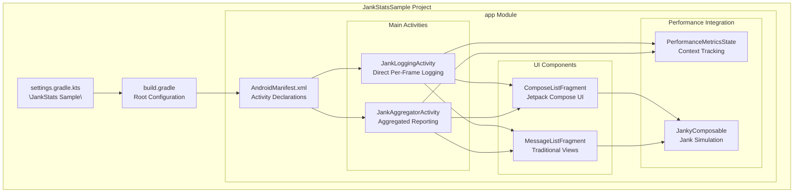
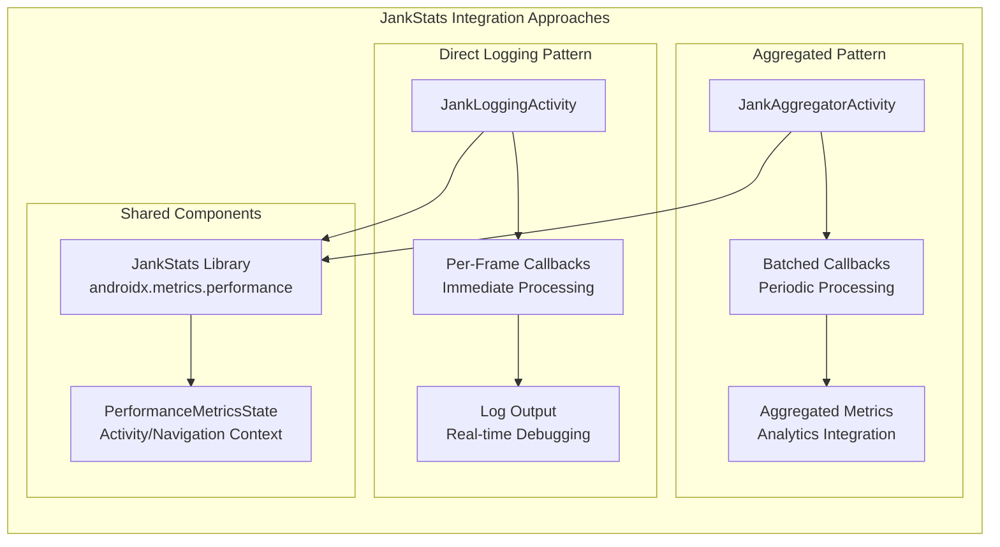
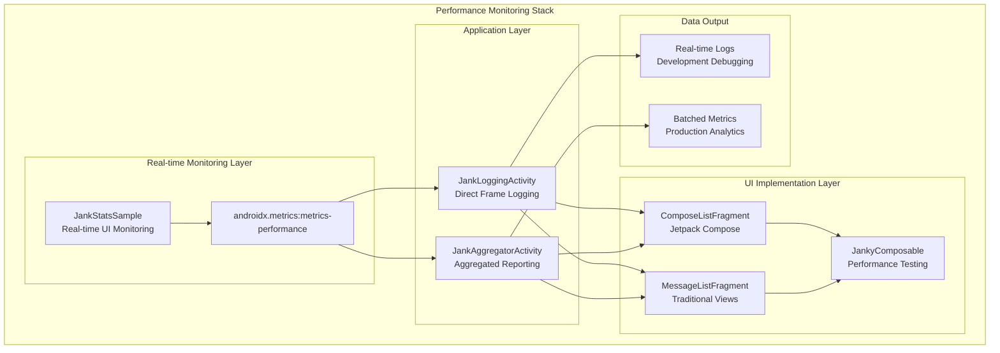

<!-- source: DeepWiki mcp.deepwiki.com · repo android/performance-samples · page 2.2 JankStatsSample · fetched 2026-10-23 -->

# JankStatsSample

<details>
<summary>Relevant source files</summary>

The following files were used as context for generating this wiki page:

- [JankStatsSample/app/src/main/AndroidManifest.xml](JankStatsSample/app/src/main/AndroidManifest.xml)
- [JankStatsSample/build.gradle](JankStatsSample/build.gradle)
- [JankStatsSample/settings.gradle.kts](JankStatsSample/settings.gradle.kts)

</details>


## Purpose and Scope

The JankStatsSample project demonstrates real-time UI performance monitoring using the `androidx.metrics:metrics-performance` library (JankStats). This sample showcases two distinct approaches to integrating JankStats into Android applications: direct per-frame logging and aggregated reporting patterns. The project serves as a practical reference for implementing continuous performance monitoring in production applications.

For comprehensive end-to-end performance testing, see [MacrobenchmarkSample](#2.1). For code-level performance measurement, see [MicrobenchmarkSample](#2.3).

## Project Architecture

The JankStatsSample follows a single-module Android application structure with two primary activity implementations that demonstrate different JankStats integration patterns.

### Project Structure Diagram



**Sources:** [JankStatsSample/app/src/main/AndroidManifest.xml:1-29](), [JankStatsSample/settings.gradle.kts:1-33](), [JankStatsSample/build.gradle:1-22]()

## Core Components

### Activity Configuration

The application declares two launcher activities in the Android manifest, each demonstrating a different JankStats integration approach:

| Activity | Purpose | Launcher Intent |
|----------|---------|-----------------|
| `JankLoggingActivity` | Direct per-frame logging with immediate callback processing | Main launcher activity |
| `JankAggregatorActivity` | Aggregated reporting with batched metric collection | Secondary launcher activity |

Both activities are configured as `android:exported="true"` to allow direct launching from the system launcher.

**Sources:** [JankStatsSample/app/src/main/AndroidManifest.xml:12-26]()

### JankStats Integration Patterns



**Sources:** [JankStatsSample/app/src/main/AndroidManifest.xml:13-14](), [JankStatsSample/app/src/main/AndroidManifest.xml:21-22]()

## Build Configuration

### Module Structure

The project uses a simplified single-module structure defined in the settings configuration:

```
rootProject.name = "JankStats Sample"
include(":app")
```

### Plugin Configuration

The root `build.gradle` applies essential Android and Kotlin plugins using version catalog references:

| Plugin | Purpose |
|--------|---------|
| `libs.plugins.application` | Android application plugin |
| `libs.plugins.kotlin` | Kotlin Android plugin |
| `libs.plugins.compose.compiler` | Jetpack Compose compiler plugin |

All plugins are configured with `apply false` at the root level, indicating they are applied at the module level.

**Sources:** [JankStatsSample/settings.gradle.kts:17-18](), [JankStatsSample/build.gradle:17-21]()

### Repository Configuration

The project configures standard Android development repositories through dependency resolution management:

- Google Maven repository for Android libraries
- Maven Central for general dependencies
- Gradle Plugin Portal for build plugins

**Sources:** [JankStatsSample/settings.gradle.kts:20-32]()

## Integration with Performance Monitoring

The JankStatsSample serves as a foundational component in the larger Android performance monitoring ecosystem. It provides real-time monitoring capabilities that complement the comprehensive testing approach demonstrated in other samples.

### Performance Monitoring Ecosystem



**Sources:** [JankStatsSample/app/src/main/AndroidManifest.xml:13-14](), [JankStatsSample/app/src/main/AndroidManifest.xml:21-22]()

The JankStatsSample demonstrates practical implementation patterns for continuous performance monitoring that can be integrated into production applications alongside comprehensive testing strategies provided by the MacrobenchmarkSample and MicrobenchmarkSample projects.

---

