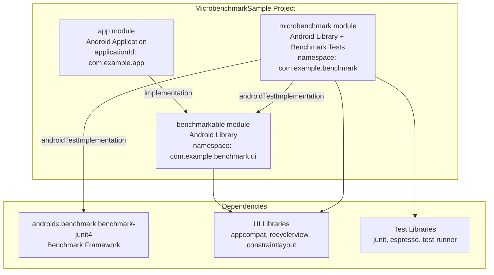
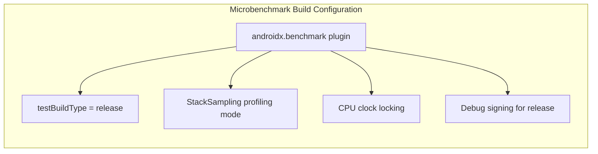
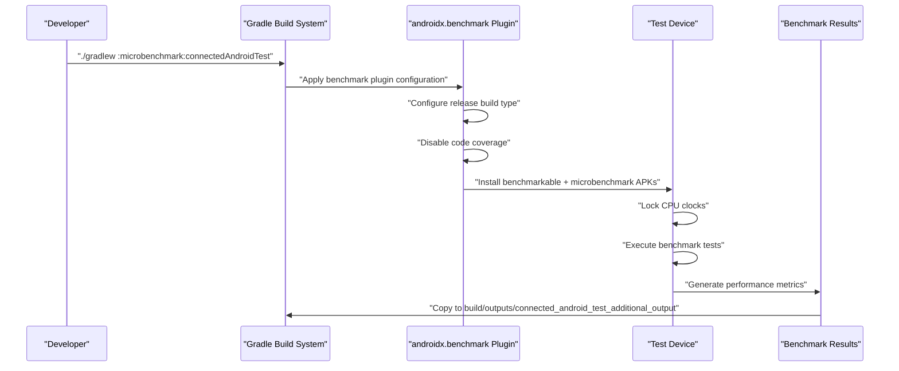

<!-- source: DeepWiki mcp.deepwiki.com · repo android/performance-samples · page 2.3 MicrobenchmarkSample · fetched 2026-10-23 -->

# MicrobenchmarkSample

<details>
<summary>Relevant source files</summary>

The following files were used as context for generating this wiki page:

- [MicrobenchmarkSample/app/build.gradle.kts](MicrobenchmarkSample/app/build.gradle.kts)
- [MicrobenchmarkSample/app/proguard-rules.pro](MicrobenchmarkSample/app/proguard-rules.pro)
- [MicrobenchmarkSample/benchmarkable/build.gradle.kts](MicrobenchmarkSample/benchmarkable/build.gradle.kts)
- [MicrobenchmarkSample/benchmarkable/proguard-rules.pro](MicrobenchmarkSample/benchmarkable/proguard-rules.pro)
- [MicrobenchmarkSample/benchmarkable/src/main/AndroidManifest.xml](MicrobenchmarkSample/benchmarkable/src/main/AndroidManifest.xml)
- [MicrobenchmarkSample/build.gradle.kts](MicrobenchmarkSample/build.gradle.kts)
- [MicrobenchmarkSample/microbenchmark/build.gradle.kts](MicrobenchmarkSample/microbenchmark/build.gradle.kts)
- [MicrobenchmarkSample/microbenchmark/src/androidTest/AndroidManifest.xml](MicrobenchmarkSample/microbenchmark/src/androidTest/AndroidManifest.xml)
- [MicrobenchmarkSample/microbenchmark/src/main/AndroidManifest.xml](MicrobenchmarkSample/microbenchmark/src/main/AndroidManifest.xml)

</details>


## Purpose and Scope

The MicrobenchmarkSample demonstrates code-level performance benchmarking using the AndroidX Benchmark library. This sample provides a complete setup for measuring individual function and UI component performance at the micro-level, complementing the end-to-end testing approach shown in MacrobenchmarkSample (see [2.1](#2.1)) and real-time monitoring covered in JankStatsSample (see [2.2](#2.2)).

The sample implements a three-module architecture optimized for microbenchmarking: a `benchmarkable` library containing code to be measured, a `microbenchmark` module with the actual benchmark tests, and an `app` module demonstrating integration in a real application context.

## Architecture Overview

### Module Structure



**Sources:** [MicrobenchmarkSample/app/build.gradle.kts:36](), [MicrobenchmarkSample/microbenchmark/build.gradle.kts:49](), [MicrobenchmarkSample/benchmarkable/build.gradle.kts:24-36]()

### Build Configuration Details

| Module | Type | Key Configurations |
|--------|------|-------------------|
| `app` | Android Application | Release build with ProGuard enabled, depends on `benchmarkable` |
| `benchmarkable` | Android Library | Standard library setup with UI dependencies |
| `microbenchmark` | Android Library | `androidx.benchmark` plugin, `testBuildType = "release"`, profiling enabled |

The `microbenchmark` module uses specialized build configuration for performance testing:



**Sources:** [MicrobenchmarkSample/microbenchmark/build.gradle.kts:5](), [MicrobenchmarkSample/microbenchmark/build.gradle.kts:23](), [MicrobenchmarkSample/microbenchmark/build.gradle.kts:20](), [MicrobenchmarkSample/microbenchmark/build.gradle.kts:26-32]()

## Benchmarkable Module

The `benchmarkable` module serves as the target library containing code to be measured. It implements a standard Android library setup with UI components commonly used in performance-critical scenarios.

### Dependencies and Configuration

The module includes essential Android UI libraries that are typical targets for microbenchmarking:

- `appcompat` - AppCompat library components
- `recyclerview` - List performance scenarios  
- `constraintlayout` - Layout inflation performance
- `cardview` - View rendering performance

### Manifest Configuration

The `benchmarkable` module declares a `MainActivity` as its main entry point, making it testable as a standalone library:

**Sources:** [MicrobenchmarkSample/benchmarkable/src/main/AndroidManifest.xml:5-13](), [MicrobenchmarkSample/benchmarkable/build.gradle.kts:8](), [MicrobenchmarkSample/benchmarkable/build.gradle.kts:24-30]()

## Microbenchmark Module

The `microbenchmark` module contains the actual benchmark tests and is configured specifically for performance measurement using the AndroidX Benchmark library.

### Benchmark Plugin Configuration

The module applies the `androidx.benchmark` plugin which automatically configures:

- **Code coverage disabling** - Removes instrumentation overhead
- **CPU clock locking** - Ensures consistent performance measurements  
- **Release build optimization** - Tests against optimized code
- **Debug signing** - Allows testing release builds during development
- **Result collection** - Copies benchmark results to `build/outputs/connected_android_test_additional_output`

### Profiling Configuration

The module enables `StackSampling` profiling mode for performance analysis:

```kotlin
// From microbenchmark/build.gradle.kts
testInstrumentationRunnerArguments["androidx.benchmark.profiling.mode"] = "StackSampling"
```

Available profiling modes include:
- `None` - Pure performance measurement
- `StackSampling` - Statistical sampling profiler
- `MethodTracing` - Detailed method call tracing

### Manifest Requirements

The benchmark module requires specific manifest permissions for performance testing:

```xml
<!-- Legacy storage for writing benchmark results on API 29 -->
<application android:requestLegacyExternalStorage="true">
    <!-- Allow profiling by shell commands -->
    <profileable android:shell="true" />
</application>
```

**Sources:** [MicrobenchmarkSample/microbenchmark/build.gradle.kts:5](), [MicrobenchmarkSample/microbenchmark/build.gradle.kts:20](), [MicrobenchmarkSample/microbenchmark/build.gradle.kts:26-32](), [MicrobenchmarkSample/microbenchmark/src/androidTest/AndroidManifest.xml:20-24]()

## App Module Integration

The `app` module demonstrates how to integrate the `benchmarkable` library in a real application context, providing a complete example of how microbenchmarked code would be used in production.

### Production-Ready Configuration

The app module includes production-ready build settings:

- **ProGuard optimization** enabled for release builds
- **Code obfuscation** through `proguard-android-optimize.txt`
- **Dependency on benchmarkable** module showing real-world integration

### Build Type Configuration

```kotlin
// From app/build.gradle.kts
buildTypes {
    getByName("release") {
        isMinifyEnabled = true
        proguardFiles(getDefaultProguardFile("proguard-android-optimize.txt"), "proguard-rules.pro")
    }
}
```

This configuration ensures that the app module represents realistic production conditions where the benchmarked code would actually run.

**Sources:** [MicrobenchmarkSample/app/build.gradle.kts:20-25](), [MicrobenchmarkSample/app/build.gradle.kts:36]()

## Benchmark Execution Flow



**Sources:** [MicrobenchmarkSample/microbenchmark/build.gradle.kts:26-32](), [MicrobenchmarkSample/microbenchmark/build.gradle.kts:49-50]()

## Project Structure Summary

The MicrobenchmarkSample implements a clean separation of concerns across its three modules:

1. **benchmarkable** - Contains the production code to be measured
2. **microbenchmark** - Houses the benchmark tests with specialized configuration  
3. **app** - Demonstrates real-world integration and usage

This architecture allows developers to measure specific code components in isolation while maintaining the context of how they integrate into complete applications, providing both granular performance insights and practical implementation guidance.

**Sources:** [MicrobenchmarkSample/build.gradle.kts:3-8](), [MicrobenchmarkSample/app/build.gradle.kts:36](), [MicrobenchmarkSample/microbenchmark/build.gradle.kts:49]()

---

