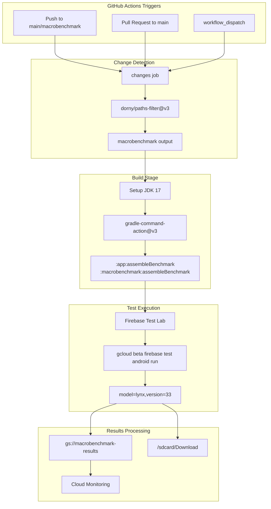
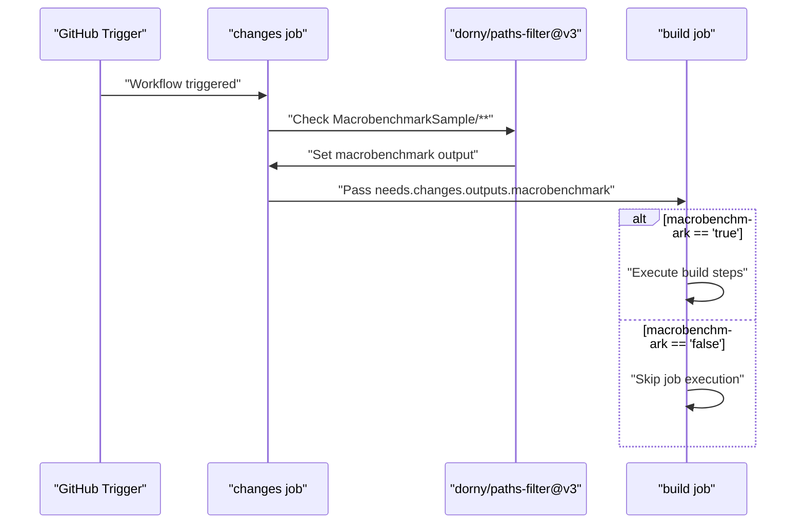
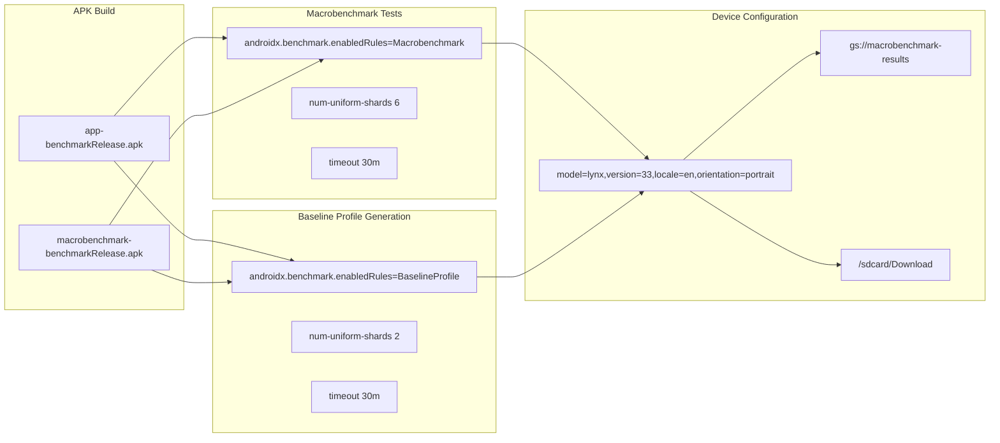
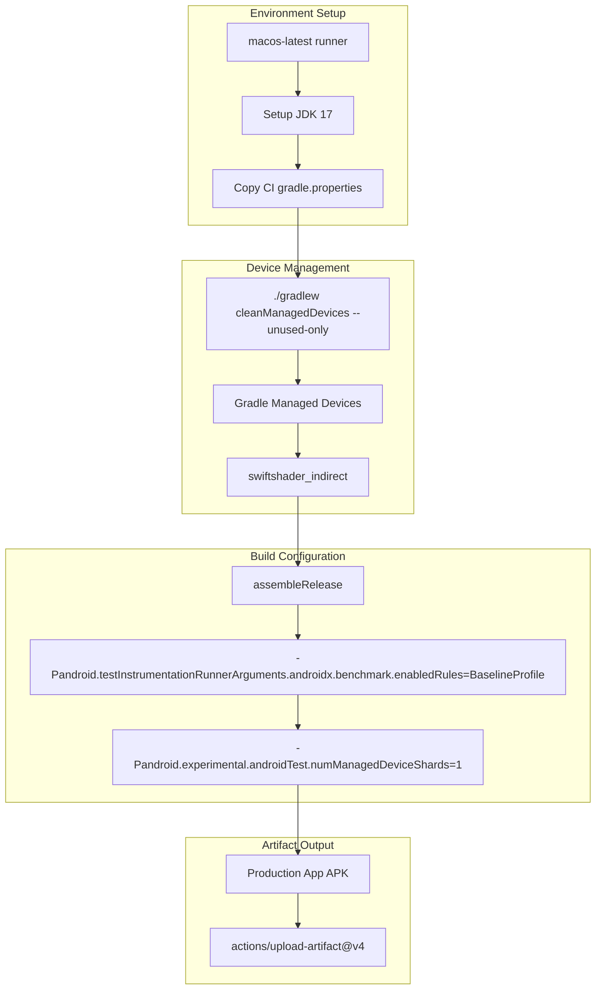
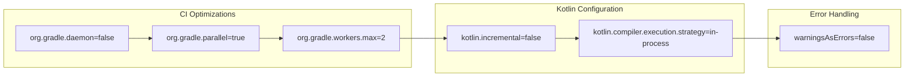

<!-- source: DeepWiki mcp.deepwiki.com · repo android/performance-samples · page 3 CI/CD Integration · fetched 2026-10-23 -->

# CI/CD Integration

Relevant source files

The following files were used as context for generating this wiki page:

- [.github/ci-gradle.properties](.github/ci-gradle.properties)
- [.github/workflows/copy-branch.yml](.github/workflows/copy-branch.yml)
- [.github/workflows/firebase_test_lab.yml](.github/workflows/firebase_test_lab.yml)
- [.github/workflows/generate-bp.yml](.github/workflows/generate-bp.yml)
- [.github/workflows/macrobenchmark.yml](.github/workflows/macrobenchmark.yml)

This document covers the comprehensive CI/CD pipeline that automates performance testing and baseline profile generation for the Android Performance Samples repository. The pipeline integrates GitHub Actions, Firebase Test Lab, and Google Cloud services to provide continuous performance monitoring and regression detection.

For detailed information about individual GitHub Actions workflows, see [GitHub Actions Workflows](#3.1). For Firebase Cloud Functions that process benchmark results, see [Firebase Cloud Functions](#3.2).

## CI/CD Architecture Overview

The CI/CD system implements a multi-stage pipeline that builds applications, runs performance tests on real devices, and monitors results for regressions. The architecture consists of GitHub Actions workflows that trigger based on code changes, execute tests on Firebase Test Lab, and integrate with Google Cloud services for result processing.

**CI/CD Pipeline Architecture**

Sources: [.github/workflows/firebase_test_lab.yml:1-100](), [.github/workflows/generate-bp.yml:1-82](), [.github/workflows/macrobenchmark.yml:1-65]()

## GitHub Actions Workflows

The repository implements three primary GitHub Actions workflows that handle different aspects of the CI/CD pipeline:

| Workflow File | Purpose | Triggers | Runner |
|---------------|---------|----------|---------|
| `firebase_test_lab.yml` | Execute macrobenchmarks on Firebase Test Lab | Push to main/macrobenchmark, PR to main | ubuntu-latest |
| `generate-bp.yml` | Generate baseline profiles using managed devices | Push to main only | macos-latest |
| `macrobenchmark.yml` | Build macrobenchmark APKs for validation | Push, PR, manual dispatch | macos-latest |

### Conditional Execution System

All workflows implement a two-job architecture with conditional execution based on file changes:

**Conditional Execution Flow**

The `changes` job uses `dorny/paths-filter@v3` to detect changes in the `MacrobenchmarkSample/**` directory path [.github/workflows/firebase_test_lab.yml:27-32](). This prevents unnecessary builds when changes occur outside the macrobenchmark sample.

Sources: [.github/workflows/firebase_test_lab.yml:16-32](), [.github/workflows/generate-bp.yml:20-34](), [.github/workflows/macrobenchmark.yml:15-29]()

### Firebase Test Lab Integration

The `firebase_test_lab.yml` workflow executes two distinct test suites on Firebase Test Lab using `gcloud beta firebase test android run`:

**Firebase Test Lab Execution**

The workflow executes tests on Pixel 7 devices (`model=lynx`) running Android 13 (`version=33`) with specific environment variables that control benchmark execution [.github/workflows/firebase_test_lab.yml:77-86]().

Sources: [.github/workflows/firebase_test_lab.yml:75-99]()

### Baseline Profile Generation

The `generate-bp.yml` workflow generates baseline profiles using Android Gradle Managed Devices on macOS runners. This workflow uses different Gradle parameters to optimize for baseline profile generation:

**Baseline Profile Generation Process**

The workflow uses managed devices with specific GPU configuration (`swiftshader_indirect`) and single-shard execution to optimize baseline profile generation performance [.github/workflows/generate-bp.yml:69-75]().

Sources: [.github/workflows/generate-bp.yml:36-81]()

## CI Configuration Management

The CI system uses a dedicated Gradle properties file to optimize build performance in continuous integration environments:

**CI Gradle Configuration**

The configuration disables Gradle daemon for CI environments, enables parallel execution with limited workers, and configures Kotlin compilation for optimal CI performance [.github/ci-gradle.properties:17-27]().

Sources: [.github/ci-gradle.properties:1-28]()

## Performance Monitoring Integration

The CI/CD pipeline integrates with Google Cloud services to provide automated performance regression detection. Firebase Test Lab results are stored in `gs://macrobenchmark-results` bucket, which triggers Cloud Functions for processing and metric extraction.

The monitoring system processes benchmark JSON files, extracts performance metrics, and uploads custom metrics to Google Cloud Monitoring for dashboard visualization and alerting on performance regressions.

Sources: [.github/workflows/firebase_test_lab.yml:83-84]()

---

