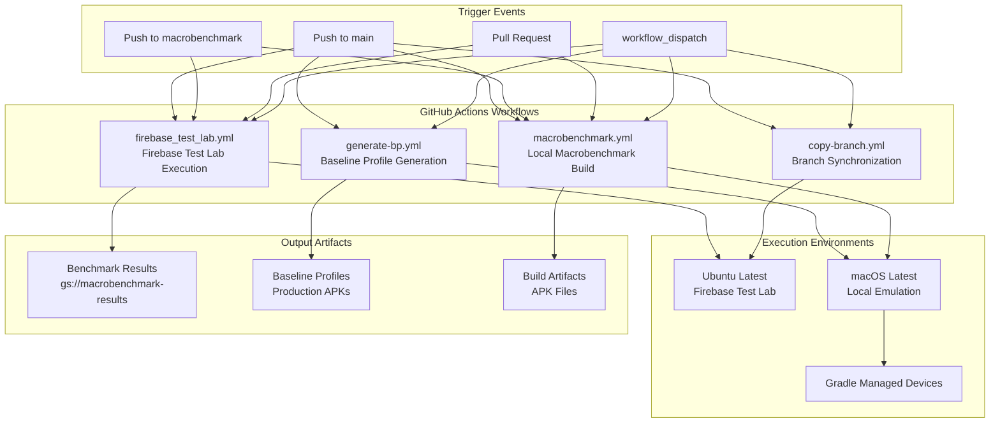
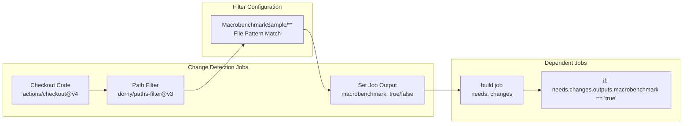
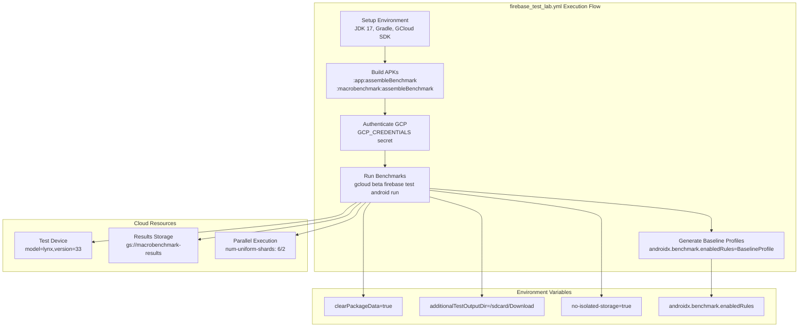
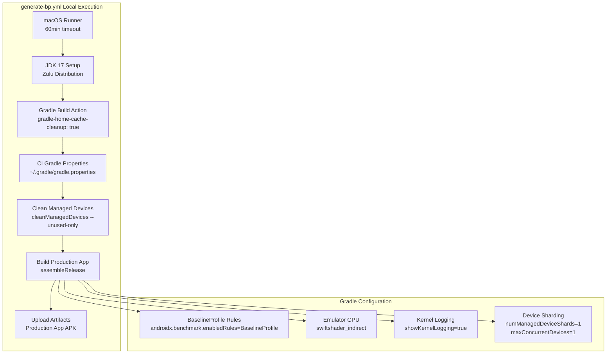

<!-- source: DeepWiki mcp.deepwiki.com · repo android/performance-samples · page 3.1 GitHub Actions Workflows · fetched 2026-10-23 -->

# GitHub Actions Workflows

<details>
<summary>Relevant source files</summary>

The following files were used as context for generating this wiki page:

- [.github/ci-gradle.properties](.github/ci-gradle.properties)
- [.github/workflows/copy-branch.yml](.github/workflows/copy-branch.yml)
- [.github/workflows/firebase_test_lab.yml](.github/workflows/firebase_test_lab.yml)
- [.github/workflows/generate-bp.yml](.github/workflows/generate-bp.yml)
- [.github/workflows/macrobenchmark.yml](.github/workflows/macrobenchmark.yml)

</details>


This document covers the GitHub Actions workflows that automate the CI/CD pipeline for the Android Performance Samples repository. These workflows handle building, testing, and deploying performance benchmarks across different environments, with particular focus on macrobenchmark execution and baseline profile generation.

For information about the Firebase Cloud Functions that process benchmark results from these workflows, see [Firebase Cloud Functions](#3.2). For details about the Firebase Test Lab integration specifics, see [Firebase Test Lab Integration](#2.1.3).

## Workflow Architecture Overview

The repository contains four main GitHub Actions workflows that work together to provide continuous integration and automated performance testing:



Sources: [.github/workflows/firebase_test_lab.yml:3-8](), [.github/workflows/generate-bp.yml:3-8](), [.github/workflows/macrobenchmark.yml:3-7](), [.github/workflows/copy-branch.yml:7-10]()

## Change Detection Pattern

All performance-related workflows implement a common change detection pattern to optimize CI resource usage by only running when MacrobenchmarkSample files are modified:



The `changes` job uses the `dorny/paths-filter@v3` action to detect modifications in the `MacrobenchmarkSample/**` directory pattern. This pattern is consistent across `firebase_test_lab.yml`, `generate-bp.yml`, and `macrobenchmark.yml` workflows.

Sources: [.github/workflows/firebase_test_lab.yml:16-32](), [.github/workflows/generate-bp.yml:15-34](), [.github/workflows/macrobenchmark.yml:15-29]()

## Firebase Test Lab Workflow

The `firebase_test_lab.yml` workflow orchestrates cloud-based benchmark execution using Google Cloud Platform services:



The workflow performs two separate test runs:
1. **Benchmark execution** with `androidx.benchmark.enabledRules=Macrobenchmark` using 6 uniform shards
2. **Baseline profile generation** with `androidx.benchmark.enabledRules=BaselineProfile` using 2 uniform shards

Sources: [.github/workflows/firebase_test_lab.yml:75-99]()

## Baseline Profile Generation Workflow

The `generate-bp.yml` workflow creates optimized baseline profiles for production releases using Gradle Managed Devices:



This workflow differs from others by running exclusively on `macOS-latest` and using Gradle Managed Devices instead of Firebase Test Lab for local baseline profile generation.

Sources: [.github/workflows/generate-bp.yml:36-81]()

## Macrobenchmark Build Workflow

The `macrobenchmark.yml` workflow performs build verification and local testing without cloud execution:

| Workflow Step | Configuration | Purpose |
|---------------|---------------|---------|
| `Setup JDK` | Java 17, Zulu distribution | Build environment |
| `Setup Gradle` | `gradle-build-action@v3` | Gradle caching and optimization |
| `Build Macrobenchmark Sample` | `./gradlew assemble` | Compile all modules |
| Exclusions | `-x :macrobenchmark:pixel6Api31NonMinifiedReleaseAndroidTest` | Skip expensive tests |
| Exclusions | `-x :macrobenchmark:collectNonMinifiedReleaseBaselineProfile` | Skip profile collection |

The build command excludes specific expensive tasks while enabling baseline profile rules for faster CI execution:

```bash
./gradlew assemble \
  -x :macrobenchmark:pixel6Api31NonMinifiedReleaseAndroidTest \
  -x :macrobenchmark:collectNonMinifiedReleaseBaselineProfile \
  -Pandroidx.benchmark.enabledRules=BaselineProfile
```

Sources: [.github/workflows/macrobenchmark.yml:55-64]()

## CI Configuration

The workflows use shared CI configuration through `.github/ci-gradle.properties`:

| Property | Value | Impact |
|----------|--------|--------|
| `org.gradle.daemon` | `false` | Prevents daemon issues in CI |
| `org.gradle.parallel` | `true` | Enables parallel builds |
| `org.gradle.workers.max` | `2` | Limits worker threads |
| `kotlin.incremental` | `false` | Disables incremental compilation |
| `kotlin.compiler.execution.strategy` | `in-process` | Compiler execution mode |
| `warningsAsErrors` | `false` | Warning handling for CI |

These properties optimize build performance and reliability in the CI environment by disabling features that can cause instability in containerized environments.

Sources: [.github/ci-gradle.properties:17-28]()

## Repository Access Controls

All workflows include repository ownership checks to prevent execution on forks:

```yaml
if: github.repository_owner == 'android'
```

This condition appears in the `changes` jobs of performance workflows and the main job of `copy-branch.yml`, ensuring that resource-intensive operations only run on the official Android repository.

Sources: [.github/workflows/firebase_test_lab.yml:17](), [.github/workflows/generate-bp.yml:21](), [.github/workflows/macrobenchmark.yml:16](), [.github/workflows/copy-branch.yml:17]()

---

