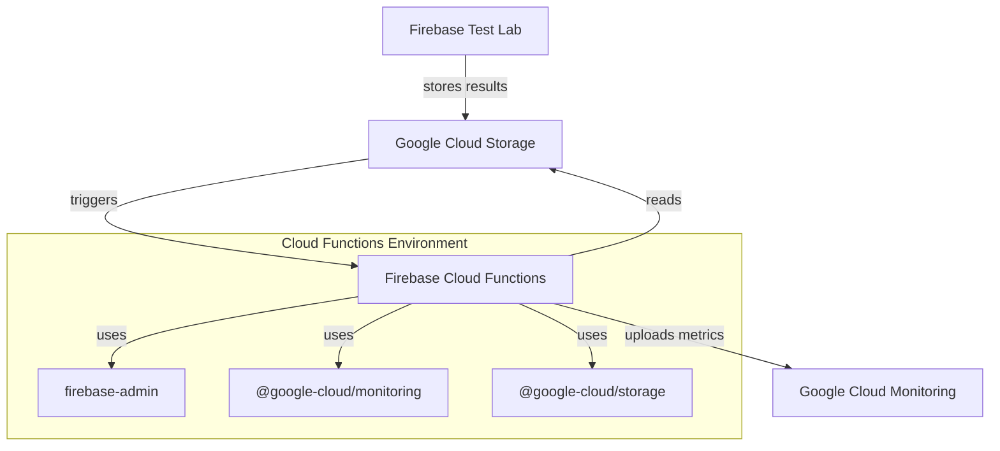
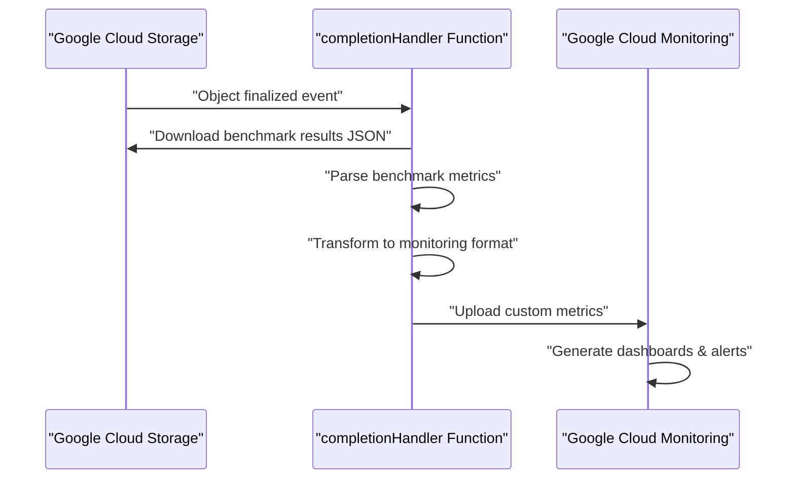
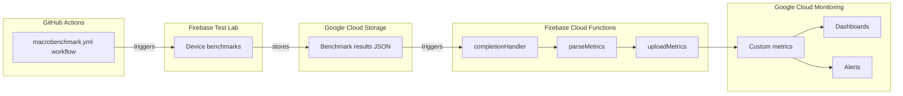

<!-- source: DeepWiki mcp.deepwiki.com · repo android/performance-samples · page 3.2 Firebase Cloud Functions · fetched 2026-10-23 -->

# Firebase Cloud Functions

Relevant source files

The following files were used as context for generating this wiki page:

- [MacrobenchmarkSample/functions/.nvmrc](MacrobenchmarkSample/functions/.nvmrc)
- [MacrobenchmarkSample/functions/package-lock.json](MacrobenchmarkSample/functions/package-lock.json)
- [MacrobenchmarkSample/functions/package.json](MacrobenchmarkSample/functions/package.json)
- [MacrobenchmarkSample/functions/yarn.lock](MacrobenchmarkSample/functions/yarn.lock)

This document covers the Node.js Firebase Cloud Functions used in the Android Performance Samples CI/CD pipeline to process benchmark results and upload performance metrics to Google Cloud Monitoring. These serverless functions act as the data processing layer between Firebase Test Lab benchmark execution and performance regression detection.

For information about the GitHub Actions workflows that trigger these functions, see [GitHub Actions Workflows](#3.1). For details about the broader macrobenchmark testing system, see [MacrobenchmarkSample](#2.1).

## Architecture Overview

The Firebase Cloud Functions serve as event-driven processors that handle benchmark result data from Google Cloud Storage and transform it into monitoring metrics.

Sources: [MacrobenchmarkSample/functions/package.json:16-20]()

## Dependencies and Runtime Configuration

The functions run on Node.js 22.14.0 and use several Google Cloud client libraries for service integration.

| Dependency | Version | Purpose |
|------------|---------|---------|
| `firebase-functions` | ^6.0.1 | Core Firebase Functions runtime |
| `firebase-admin` | ^13.0.0 | Firebase Admin SDK for authentication |
| `@google-cloud/monitoring` | ^4.1.0 | Google Cloud Monitoring API client |
| `@google-cloud/storage` | ^7.13.0 | Google Cloud Storage API client |

The runtime environment is configured with:
- Node.js version: 22.14.0
- TypeScript compilation target
- Main entry point: `lib/index.js`

Sources: [MacrobenchmarkSample/functions/package.json:12-26](), [MacrobenchmarkSample/functions/.nvmrc:1]()

## Function Structure and Data Flow

The cloud functions implement a completion handler pattern that processes benchmark results when they become available in Google Cloud Storage.

The functions follow this processing pipeline:
1. **Event Trigger**: GCS object finalization events trigger the completion handler
2. **Data Retrieval**: Functions download benchmark result JSON files from storage
3. **Metric Extraction**: Raw benchmark data is parsed and performance metrics extracted
4. **Format Transformation**: Metrics are converted to Google Cloud Monitoring format
5. **Upload**: Processed metrics are uploaded to create monitoring dashboards

Sources: Based on the CI/CD architecture diagrams and package dependencies

## Deployment and Build Configuration

The functions use a standard Firebase Functions deployment model with TypeScript compilation.

Build Scripts:
- `build`: Compiles TypeScript to JavaScript
- `watch`: Continuous compilation during development  
- `serve`: Local emulator for testing
- `deploy`: Production deployment to Firebase

The build process compiles TypeScript source files into the `lib/` directory, with `lib/index.js` serving as the main entry point for the Firebase Functions runtime.

Sources: [MacrobenchmarkSample/functions/package.json:3-10](), [MacrobenchmarkSample/functions/package.json:15]()

## Integration with Performance Testing Pipeline

The cloud functions serve as a critical component in the automated performance regression detection system, connecting benchmark execution with monitoring infrastructure.

This integration enables:
- **Automated Processing**: No manual intervention required for metric extraction
- **Scalable Analysis**: Functions scale automatically with benchmark volume
- **Real-time Monitoring**: Immediate availability of performance data
- **Regression Detection**: Continuous monitoring enables automated alerts

Sources: Based on the repository architecture and CI/CD workflow integration patterns

---

