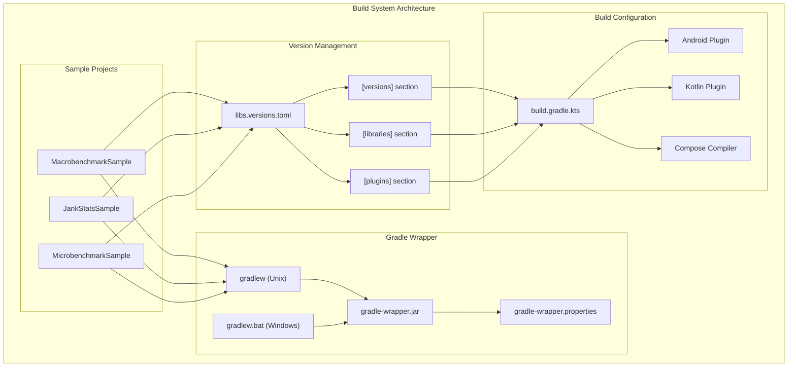
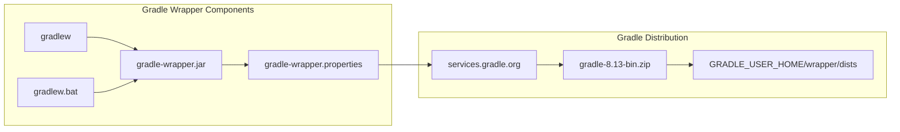
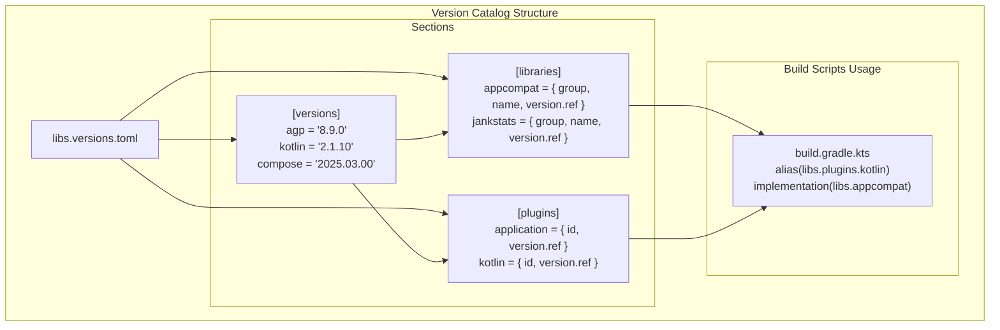
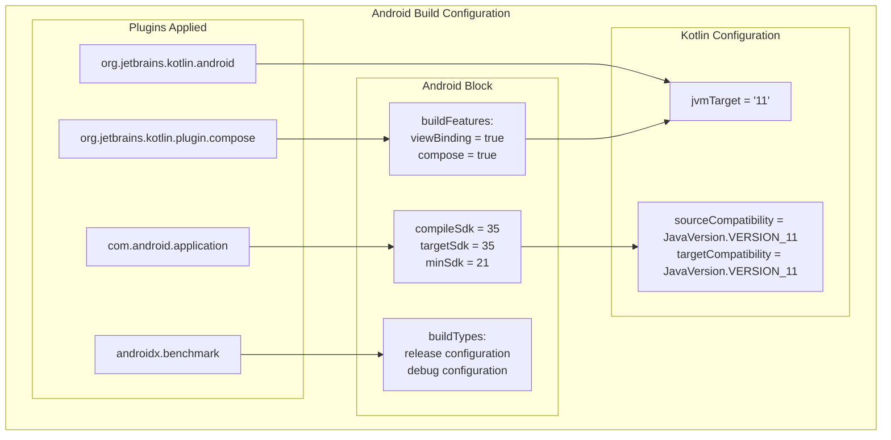
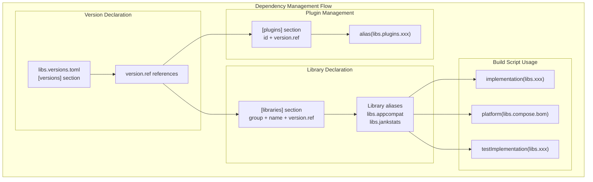

<!-- source: DeepWiki mcp.deepwiki.com · repo android/performance-samples · page 4 Build System · fetched 2026-10-23 -->

# Build System

Relevant source files

The following files were used as context for generating this wiki page:

- [JankStatsSample/app/build.gradle.kts](JankStatsSample/app/build.gradle.kts)
- [JankStatsSample/gradle/libs.versions.toml](JankStatsSample/gradle/libs.versions.toml)
- [JankStatsSample/gradle/wrapper/gradle-wrapper.jar](JankStatsSample/gradle/wrapper/gradle-wrapper.jar)
- [JankStatsSample/gradle/wrapper/gradle-wrapper.properties](JankStatsSample/gradle/wrapper/gradle-wrapper.properties)
- [JankStatsSample/gradlew](JankStatsSample/gradlew)
- [JankStatsSample/gradlew.bat](JankStatsSample/gradlew.bat)
- [MacrobenchmarkSample/gradle/wrapper/gradle-wrapper.properties](MacrobenchmarkSample/gradle/wrapper/gradle-wrapper.properties)
- [MicrobenchmarkSample/gradle/libs.versions.toml](MicrobenchmarkSample/gradle/libs.versions.toml)
- [MicrobenchmarkSample/gradle/wrapper/gradle-wrapper.properties](MicrobenchmarkSample/gradle/wrapper/gradle-wrapper.properties)

This document covers the Gradle-based build system that provides consistent configuration and dependency management across all sample projects in the Android Performance Samples repository. The build system ensures reproducible builds through the Gradle Wrapper and centralizes dependency versions using version catalogs.

For information about CI/CD automation that leverages this build system, see [CI/CD Integration](#3). For details about individual sample project configurations, see [Sample Projects](#2).

## Architecture Overview

The build system uses a standardized Gradle setup with wrapper scripts and centralized dependency management across all three sample projects: MacrobenchmarkSample, JankStatsSample, and MicrobenchmarkSample.

Sources: All sample project root directories, [MacrobenchmarkSample/gradle/wrapper/gradle-wrapper.properties:1-8](), [JankStatsSample/gradle/libs.versions.toml:1-54](), [MicrobenchmarkSample/gradle/libs.versions.toml:1-41]()

## Gradle Wrapper System

The Gradle Wrapper ensures all developers and CI systems use the exact same Gradle version, eliminating "works on my machine" issues. Each sample project includes identical wrapper configurations.

### Wrapper Configuration

All sample projects use Gradle 8.13 with consistent timeout and validation settings:

| Property | Value | Purpose |
|----------|--------|---------|
| `distributionUrl` | `gradle-8.13-bin.zip` | Gradle version specification |
| `networkTimeout` | `10000` | Network timeout in milliseconds |
| `validateDistributionUrl` | `true` | Security validation of download |
| `distributionBase` | `GRADLE_USER_HOME` | Local cache location |
| `zipStoreBase` | `GRADLE_USER_HOME` | Wrapper storage location |

Sources: [MacrobenchmarkSample/gradle/wrapper/gradle-wrapper.properties:1-8](), [JankStatsSample/gradle/wrapper/gradle-wrapper.properties:1-8](), [MicrobenchmarkSample/gradle/wrapper/gradle-wrapper.properties:1-8]()

### Cross-Platform Wrapper Scripts

The wrapper provides identical functionality across operating systems through platform-specific scripts:

**Unix/Linux/macOS**: The `gradlew` script handles POSIX-compliant shell execution with comprehensive error handling and Java detection.

**Windows**: The `gradlew.bat` script provides equivalent functionality for Windows command prompt and PowerShell environments.

Both scripts include:
- Java installation detection and validation
- JVM option configuration (`DEFAULT_JVM_OPTS`)
- Classpath setup for `gradle-wrapper.jar`
- Error handling for missing Java installations

Sources: [JankStatsSample/gradlew:1-252](), [JankStatsSample/gradlew.bat:1-95]()

## Version Catalog System

The build system uses Gradle's version catalog feature through `libs.versions.toml` files to centralize dependency management. Each sample maintains its own catalog while following consistent patterns.

### Catalog Structure

Sources: [JankStatsSample/gradle/libs.versions.toml:15-54](), [MicrobenchmarkSample/gradle/libs.versions.toml:1-41]()

### Sample-Specific Configurations

Each sample project maintains distinct dependency sets optimized for its purpose:

**JankStatsSample** includes:
- Jetpack Compose BOM and libraries
- JankStats performance monitoring library
- Navigation components for fragment-based UI

**MicrobenchmarkSample** includes:
- AndroidX Benchmark library for microbenchmarking
- Core testing dependencies
- Minimal UI dependencies for benchmarkable targets

**MacrobenchmarkSample** (inferred from architecture):
- Macrobenchmark testing libraries
- Baseline profile generation dependencies
- Performance measurement tools

Sources: [JankStatsSample/gradle/libs.versions.toml:30-47](), [MicrobenchmarkSample/gradle/libs.versions.toml:18-33]()

## Build Configuration Patterns

All sample projects follow consistent Android build configuration patterns while allowing for sample-specific customizations.

### Common Android Configuration

Sources: [JankStatsSample/app/build.gradle.kts:23-58]()

### Plugin Application Patterns

The build system demonstrates consistent plugin application using the version catalog:

- `alias(libs.plugins.kotlin)` for Kotlin Android plugin
- `alias(libs.plugins.compose.compiler)` for Compose compiler plugin  
- `id("com.android.application")` for Android application plugin
- `alias(libs.plugins.benchmark)` for benchmark-specific configurations

This pattern ensures plugin versions are centrally managed while maintaining readable build scripts.

Sources: [JankStatsSample/app/build.gradle.kts:17-21]()

## Dependency Management

The build system implements a structured approach to dependency management that balances consistency with sample-specific requirements.

Sources: [JankStatsSample/gradle/libs.versions.toml:18-47](), [JankStatsSample/app/build.gradle.kts:60-74]()

## Build System Integration

The build system integrates seamlessly with the broader development and CI/CD infrastructure, providing the foundation for automated testing and performance analysis.

The Gradle Wrapper ensures that GitHub Actions workflows, local development, and production builds all use identical build environments. Version catalogs eliminate dependency version conflicts across modules while maintaining upgrade paths for individual samples.

This standardized approach enables the CI/CD system to reliably execute performance benchmarks, generate baseline profiles, and produce consistent build artifacts across all sample projects.

Sources: All gradle wrapper files, version catalog files, and build configuration files across sample projects

---

