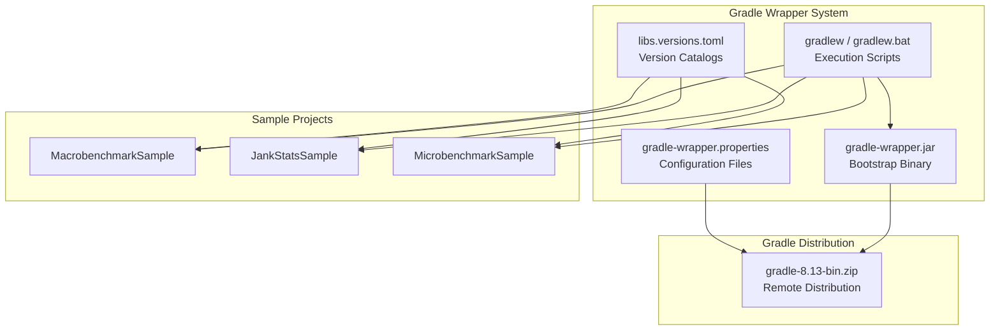
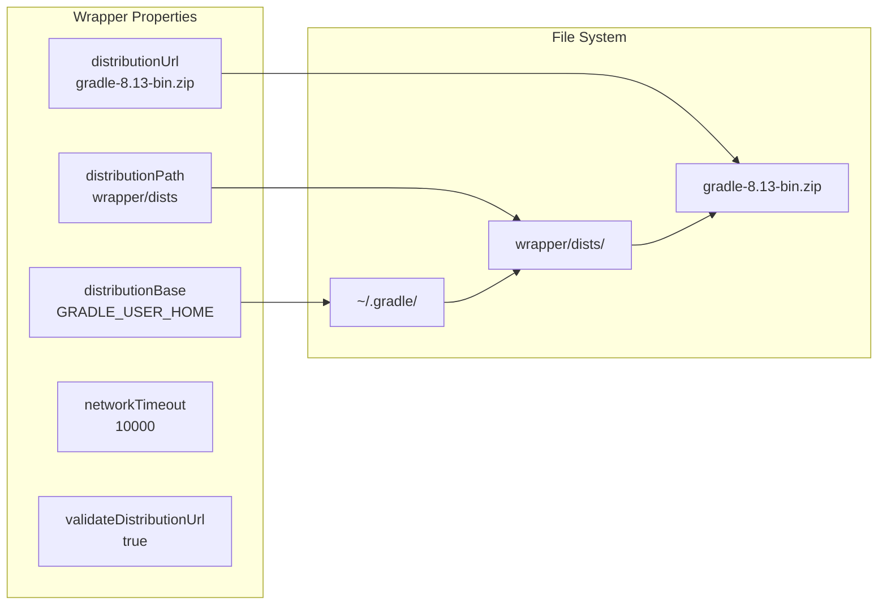
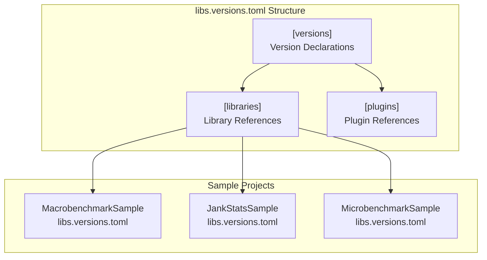
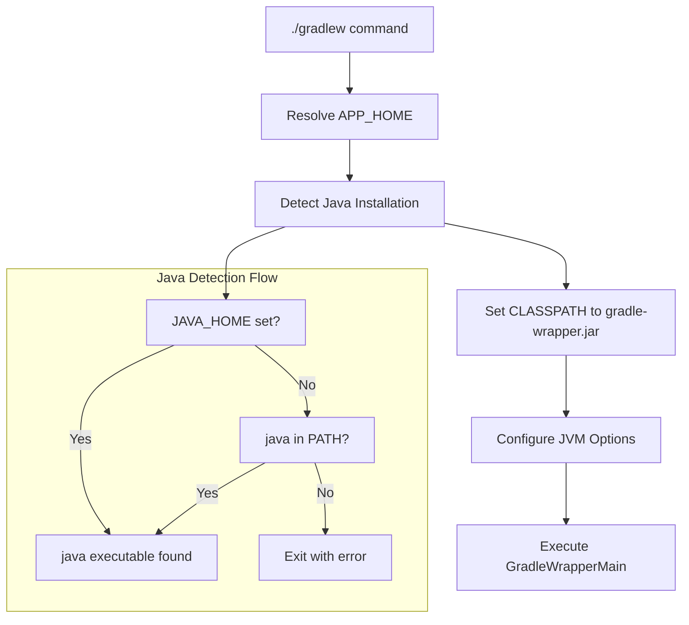
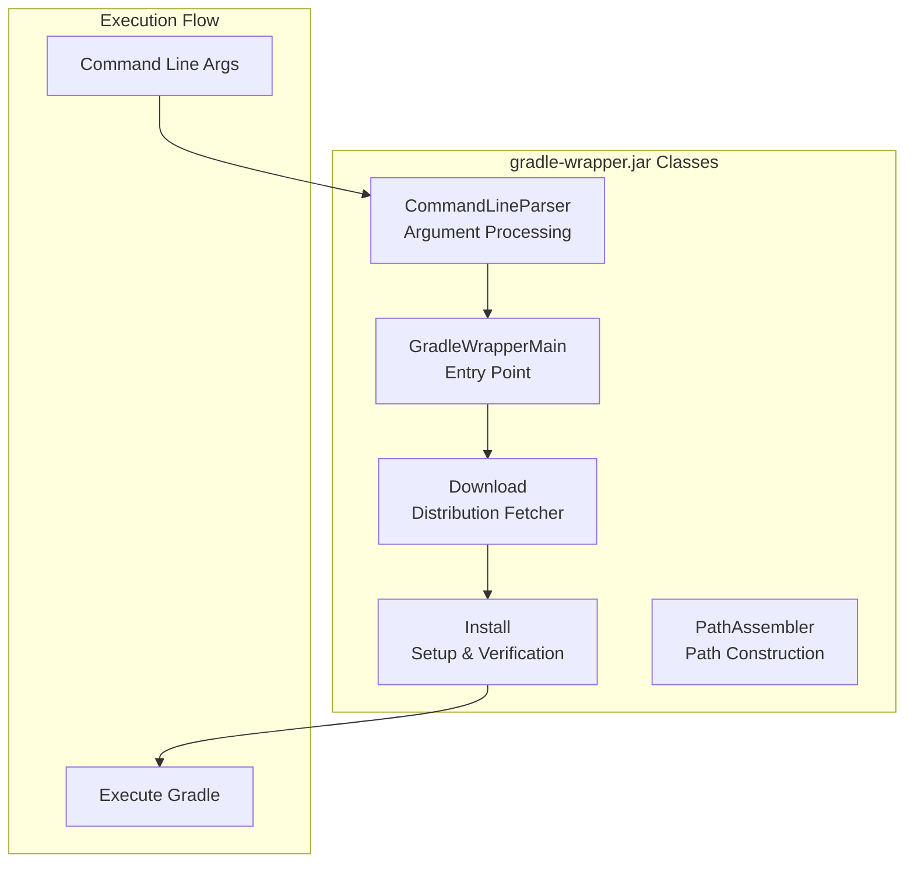
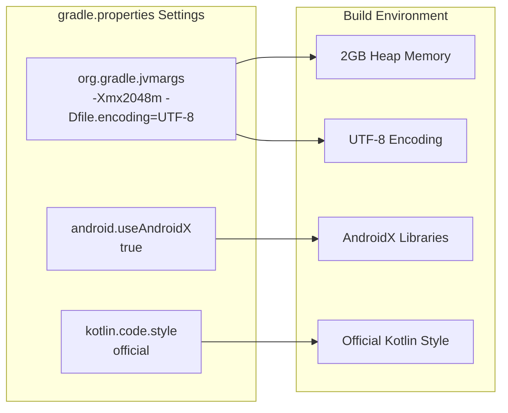

<!-- source: DeepWiki mcp.deepwiki.com · repo android/performance-samples · page 4.1 Gradle Wrapper and Configuration · fetched 2026-10-23 -->

# Gradle Wrapper and Configuration

Relevant source files

The following files were used as context for generating this wiki page:

- [JankStatsSample/app/build.gradle.kts](JankStatsSample/app/build.gradle.kts)
- [JankStatsSample/gradle/libs.versions.toml](JankStatsSample/gradle/libs.versions.toml)
- [JankStatsSample/gradle/wrapper/gradle-wrapper.jar](JankStatsSample/gradle/wrapper/gradle-wrapper.jar)
- [JankStatsSample/gradle/wrapper/gradle-wrapper.properties](JankStatsSample/gradle/wrapper/gradle-wrapper.properties)
- [JankStatsSample/gradlew](JankStatsSample/gradlew)
- [JankStatsSample/gradlew.bat](JankStatsSample/gradlew.bat)
- [MacrobenchmarkSample/gradle.properties](MacrobenchmarkSample/gradle.properties)
- [MacrobenchmarkSample/gradle/wrapper/gradle-wrapper.jar](MacrobenchmarkSample/gradle/wrapper/gradle-wrapper.jar)
- [MacrobenchmarkSample/gradle/wrapper/gradle-wrapper.properties](MacrobenchmarkSample/gradle/wrapper/gradle-wrapper.properties)
- [MacrobenchmarkSample/gradlew](MacrobenchmarkSample/gradlew)
- [MacrobenchmarkSample/gradlew.bat](MacrobenchmarkSample/gradlew.bat)
- [MicrobenchmarkSample/gradle/libs.versions.toml](MicrobenchmarkSample/gradle/libs.versions.toml)
- [MicrobenchmarkSample/gradle/wrapper/gradle-wrapper.jar](MicrobenchmarkSample/gradle/wrapper/gradle-wrapper.jar)
- [MicrobenchmarkSample/gradle/wrapper/gradle-wrapper.properties](MicrobenchmarkSample/gradle/wrapper/gradle-wrapper.properties)
- [MicrobenchmarkSample/gradlew](MicrobenchmarkSample/gradlew)
- [MicrobenchmarkSample/gradlew.bat](MicrobenchmarkSample/gradlew.bat)

This document explains the Gradle Wrapper system used across all sample projects in the Android Performance Samples repository, including wrapper configuration, version catalogs, and execution scripts. The Gradle Wrapper ensures consistent build environments by downloading and using a specific Gradle version.

For information about the overall build system architecture, see [Build System](#4). For Android-specific manifest configurations, see [Android Manifest Configurations](#4.2).

## Overview

The Gradle Wrapper system provides a standardized build environment across all three sample projects: MacrobenchmarkSample, JankStatsSample, and MicrobenchmarkSample. It consists of wrapper properties, execution scripts, the wrapper JAR, and centralized dependency management through version catalogs.

Sources: [MacrobenchmarkSample/gradle/wrapper/gradle-wrapper.properties:1-8](), [JankStatsSample/gradle/wrapper/gradle-wrapper.properties:1-8](), [MicrobenchmarkSample/gradle/wrapper/gradle-wrapper.properties:1-8]()

## Wrapper Properties Configuration

All sample projects use identical Gradle Wrapper configurations defined in their `gradle-wrapper.properties` files:

| Property | Value | Purpose |
|----------|-------|---------|
| `distributionBase` | `GRADLE_USER_HOME` | Base directory for Gradle distributions |
| `distributionPath` | `wrapper/dists` | Subdirectory for distribution storage |
| `distributionUrl` | `https://services.gradle.org/distributions/gradle-8.13-bin.zip` | Gradle 8.13 binary distribution |
| `networkTimeout` | `10000` | Network timeout in milliseconds |
| `validateDistributionUrl` | `true` | Enable URL validation |
| `zipStoreBase` | `GRADLE_USER_HOME` | Base directory for ZIP storage |
| `zipStorePath` | `wrapper/dists` | Subdirectory for ZIP storage |

Sources: [MacrobenchmarkSample/gradle/wrapper/gradle-wrapper.properties:1-8](), [MicrobenchmarkSample/gradle/wrapper/gradle-wrapper.properties:1-8](), [JankStatsSample/gradle/wrapper/gradle-wrapper.properties:1-8]()

## Version Catalogs

The repository uses Gradle Version Catalogs (`libs.versions.toml`) for centralized dependency management. Each sample project maintains its own catalog with project-specific dependencies while sharing common patterns.

### Common Configuration Pattern

### Version Consistency

| Component | MicrobenchmarkSample | JankStatsSample | Purpose |
|-----------|---------------------|-----------------|---------|
| `agp` | 8.9.0 | 8.9.0 | Android Gradle Plugin |
| `kotlin` | 2.1.10 | 2.1.10 | Kotlin compiler |
| `appcompat` | 1.7.0 | 1.7.0 | AndroidX AppCompat |
| `core` | 1.15.0 | 1.9.0 | AndroidX Core KTX |

Sources: [MicrobenchmarkSample/gradle/libs.versions.toml:1-41](), [JankStatsSample/gradle/libs.versions.toml:15-54]()

## Wrapper Execution Scripts

The Gradle Wrapper provides cross-platform execution through two scripts that handle Java detection, path resolution, and Gradle invocation.

### Unix/Linux Script (`gradlew`)

The `gradlew` script provides POSIX-compliant shell execution with the following key components:

Key script sections:
- **Path Resolution**: [JankStatsSample/gradlew:67-89]() resolves symbolic links and sets `APP_HOME`
- **Java Detection**: [JankStatsSample/gradlew:120-143]() handles `JAVA_HOME` and PATH-based Java discovery
- **Classpath Setup**: [JankStatsSample/gradlew:117]() sets `CLASSPATH` to `gradle-wrapper.jar`
- **Execution**: [JankStatsSample/gradlew:213-217]() invokes `org.gradle.wrapper.GradleWrapperMain`

### Windows Script (`gradlew.bat`)

The `gradlew.bat` script provides equivalent functionality for Windows environments:

- **Directory Resolution**: [JankStatsSample/gradlew.bat:29-36]() sets up `APP_HOME` and `DIRNAME`
- **Java Detection**: [JankStatsSample/gradlew.bat:41-68]() mirrors Unix Java discovery logic
- **Execution**: [JankStatsSample/gradlew.bat:77]() runs the same `GradleWrapperMain` class

Sources: [JankStatsSample/gradlew:1-252](), [MacrobenchmarkSample/gradlew:1-252](), [MicrobenchmarkSample/gradlew:1-252](), [JankStatsSample/gradlew.bat:1-95]()

## Gradle Wrapper Binary

The `gradle-wrapper.jar` file contains the bootstrap code for downloading and executing the specified Gradle distribution. This binary is identical across all sample projects and contains:

- `org.gradle.wrapper.GradleWrapperMain` - Main execution class
- `org.gradle.wrapper.Download` - Distribution download logic  
- `org.gradle.wrapper.Install` - Installation and verification
- `org.gradle.cli.CommandLineParser` - Argument parsing
- `org.gradle.wrapper.PathAssembler` - Path construction utilities

Sources: [JankStatsSample/gradle/wrapper/gradle-wrapper.jar:1-307](), [MacrobenchmarkSample/gradle/wrapper/gradle-wrapper.jar:1-307](), [MicrobenchmarkSample/gradle/wrapper/gradle-wrapper.jar:1-307]()

## Project Properties

The `gradle.properties` files configure project-wide Gradle settings:

### MacrobenchmarkSample Configuration

| Property | Value | Purpose |
|----------|-------|---------|
| `org.gradle.jvmargs` | `-Xmx2048m -Dfile.encoding=UTF-8` | JVM memory and encoding |
| `android.useAndroidX` | `true` | Enable AndroidX libraries |
| `kotlin.code.style` | `official` | Kotlin coding conventions |

Sources: [MacrobenchmarkSample/gradle.properties:23-35]()

## Cross-Project Consistency

The Gradle Wrapper system ensures build reproducibility across all sample projects through standardized configurations:

| Component | Consistency Level | Variation |
|-----------|------------------|-----------|
| Gradle Version | Identical (8.13) | None |
| Wrapper Properties | Identical | None |
| Script Logic | Identical | Platform-specific (Unix/Windows) |
| AGP Version | Identical (8.9.0) | None |
| Kotlin Version | Identical (2.1.10) | None |
| Version Catalog Structure | Consistent Pattern | Project-specific dependencies |

This consistency enables:
- **Reproducible Builds**: Same Gradle version across all environments
- **Simplified Maintenance**: Unified wrapper management
- **Cross-Platform Support**: Identical behavior on Unix and Windows
- **Dependency Management**: Centralized version control through catalogs

Sources: [MacrobenchmarkSample/gradle/wrapper/gradle-wrapper.properties:1-8](), [JankStatsSample/gradle/wrapper/gradle-wrapper.properties:1-8](), [MicrobenchmarkSample/gradle/wrapper/gradle-wrapper.properties:1-8](), [MicrobenchmarkSample/gradle/libs.versions.toml:1-41](), [JankStatsSample/gradle/libs.versions.toml:15-54]()

---

