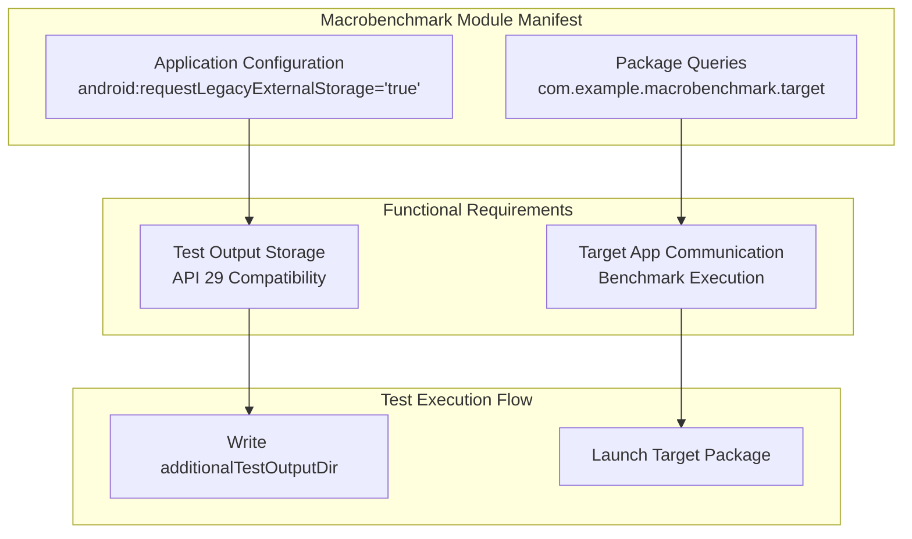
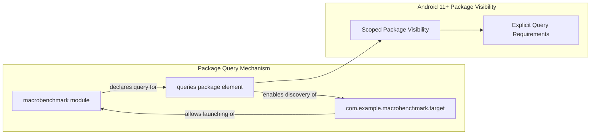
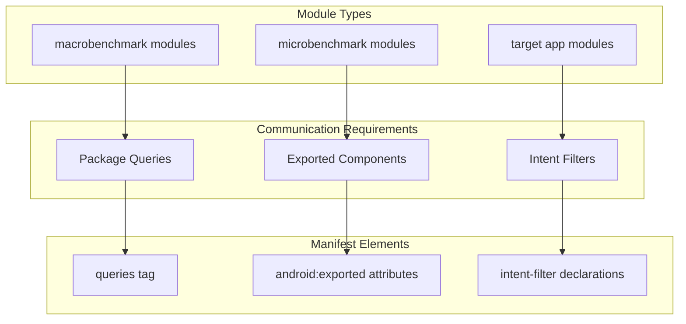
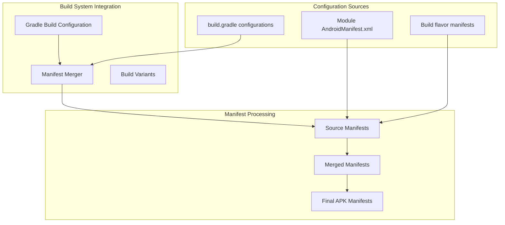

<!-- source: DeepWiki mcp.deepwiki.com · repo android/performance-samples · page 4.2 Android Manifest Configurations · fetched 2026-10-23 -->

# Android Manifest Configurations

Relevant source files

The following files were used as context for generating this wiki page:

- [MacrobenchmarkSample/macrobenchmark/src/main/AndroidManifest.xml](MacrobenchmarkSample/macrobenchmark/src/main/AndroidManifest.xml)

This document covers the Android manifest configurations used across the performance sample projects for enabling benchmarking capabilities, inter-module communication, and test execution requirements. These configurations are essential for proper operation of macrobenchmarks, baseline profile generation, and performance monitoring.

For information about the build system that processes these manifests, see [Gradle Wrapper and Configuration](#4.1). For details about the CI/CD integration that relies on these configurations, see [CI/CD Integration](#3).

## Purpose and Scope

Android manifest configurations in the performance samples serve several critical functions:
- Enable inter-module communication between benchmark modules and target applications
- Configure storage permissions for test output and result collection  
- Set up profileable configurations for baseline profile generation
- Define component declarations for activities used in performance testing

## Macrobenchmark Module Configuration

The macrobenchmark module requires specific manifest configurations to operate effectively as a testing harness for the target application.

### Core Configuration Elements

The macrobenchmark module manifest at [MacrobenchmarkSample/macrobenchmark/src/main/AndroidManifest.xml:18-24]() contains two essential configuration sections:

**Sources:** [MacrobenchmarkSample/macrobenchmark/src/main/AndroidManifest.xml:18-24]()

### Legacy Storage Configuration

The `android:requestLegacyExternalStorage="true"` attribute at [MacrobenchmarkSample/macrobenchmark/src/main/AndroidManifest.xml:20]() addresses API 29 scoped storage restrictions:

| Configuration | Purpose | API Level Impact |
|---------------|---------|------------------|
| `requestLegacyExternalStorage="true"` | Enable writing to `additionalTestOutputDir` | Required for API 29 |
| Application-level declaration | Applies to entire benchmark module | All API levels |

This configuration allows the macrobenchmark module to write performance test results and artifacts to external storage locations, which is essential for result collection and analysis in the CI/CD pipeline.

### Package Query Configuration

The `<queries>` section at [MacrobenchmarkSample/macrobenchmark/src/main/AndroidManifest.xml:21-23]() enables the benchmark module to discover and interact with the target application:

**Sources:** [MacrobenchmarkSample/macrobenchmark/src/main/AndroidManifest.xml:21-23]()

## Manifest Configuration Categories

Based on the performance testing architecture, Android manifests across the sample projects typically include these configuration categories:

### Inter-Module Communication

**Sources:** [MacrobenchmarkSample/macrobenchmark/src/main/AndroidManifest.xml:21-23]()

### Performance Testing Permissions

Performance testing modules require specific permissions for:
- External storage access for test output
- System-level performance data collection
- Network access for cloud result uploading
- Device state monitoring for accurate measurements

### Profileable Configurations

Baseline profile generation requires `android:profileable="true"` configurations in target application manifests to enable:
- Runtime profiling data collection
- ART compilation profile generation
- Performance optimization artifact creation

## Integration with Build System

The manifest configurations integrate with the Gradle build system to support:

**Sources:** [MacrobenchmarkSample/macrobenchmark/src/main/AndroidManifest.xml:18-24]()

The manifest configurations ensure that performance testing modules can execute properly within the broader build and testing infrastructure, enabling automated performance regression detection and continuous monitoring of application performance characteristics.