# Page: Overview

# Overview

<details>
<summary>Relevant source files</summary>

The following files were used as context for generating this wiki page:

- [JankStatsSample/README.md](JankStatsSample/README.md)
- [README.md](README.md)

</details>


## Purpose and Scope

The Android Performance Samples repository is a collection of sample projects that demonstrate different approaches to Android performance measurement and optimization. This repository serves as both a learning resource for Android developers and a production-ready template for implementing performance testing infrastructure in real applications.

The repository contains three primary sample projects that showcase complementary performance testing methodologies: end-to-end application performance testing, real-time UI performance monitoring, and code-level benchmarking. Additionally, it includes a comprehensive CI/CD pipeline that automates performance testing using cloud infrastructure.

For detailed information about individual sample projects, see [Sample Projects](#2). For CI/CD pipeline documentation, see [CI/CD Integration](#3). For build system configuration, see [Build System](#4).

## Repository Structure

The repository is organized around three main sample projects, each demonstrating a specific approach to performance measurement, supported by shared infrastructure and automation systems.

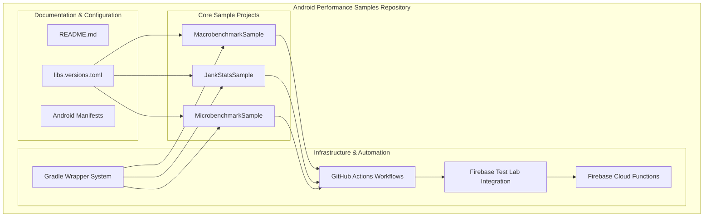

**Sources:** [README.md:1-47]()

## Performance Testing Approaches

Each sample project implements a distinct performance testing methodology, targeting different aspects of application performance and different stages of the development lifecycle.

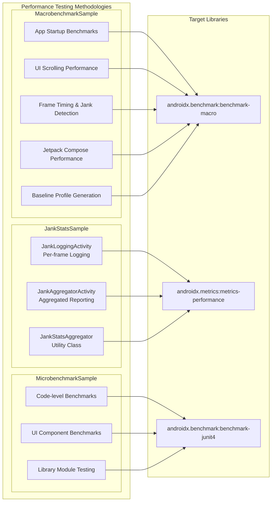

**Sources:** [README.md:8-19](), [README.md:21-23](), [README.md:29-31](), [JankStatsSample/README.md:8-18]()

## Key Components and Roles

The following table summarizes the primary components in the repository and their specific roles in the performance testing ecosystem:

| Component | Primary Class/Module | Purpose | Target Use Case |
|-----------|---------------------|---------|-----------------|
| **MacrobenchmarkSample** | `:macrobenchmark` module | End-to-end application performance testing | App startup optimization, UI scrolling performance, baseline profile generation |
| **JankStatsSample** | `JankLoggingActivity`, `JankAggregatorActivity` | Real-time UI performance monitoring | Production jank detection, frame-by-frame analysis |
| **MicrobenchmarkSample** | `:microbenchmark` module | Code-level performance benchmarking | Individual function optimization, library performance |
| **Firebase Test Lab** | `firebase_test_lab.yml` workflow | Cloud-based automated testing | Continuous performance regression detection |
| **Baseline Profiles** | `baselineprofile/` generators | App optimization artifacts | Runtime performance improvements |

**Sources:** [README.md:8-14](), [JankStatsSample/README.md:8-15](), [README.md:21-23]()

## Integration Architecture

The repository demonstrates how performance testing integrates with modern Android development workflows, from local development to continuous integration and monitoring.

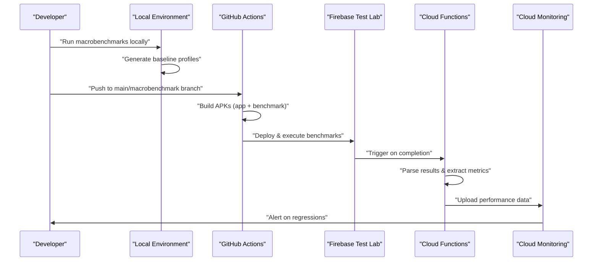

**Sources:** [README.md:16-17]()

The repository serves as a comprehensive example of how to implement performance testing across different levels of an Android application, from individual functions to complete user workflows, with automated cloud-based regression detection and monitoring.

---

# Page: Sample Projects

# Sample Projects

<details>
<summary>Relevant source files</summary>

The following files were used as context for generating this wiki page:

- [JankStatsSample/README.md](JankStatsSample/README.md)
- [MacrobenchmarkSample/README.md](MacrobenchmarkSample/README.md)
- [MacrobenchmarkSample/app/benchmark-rules.pro](MacrobenchmarkSample/app/benchmark-rules.pro)
- [MacrobenchmarkSample/media/composition-tracing.png](MacrobenchmarkSample/media/composition-tracing.png)
- [README.md](README.md)

</details>


This document provides an overview of the three main sample projects in the Android Performance Samples repository, each demonstrating different approaches to Android performance measurement and optimization. These projects serve as both learning resources and production-ready templates for implementing performance testing strategies.

For detailed information about CI/CD integration and automated testing, see [CI/CD Integration](#3). For build system configuration details, see [Build System](#4).

## Overview of Sample Projects

The repository contains three complementary sample projects that address different aspects of Android performance testing:

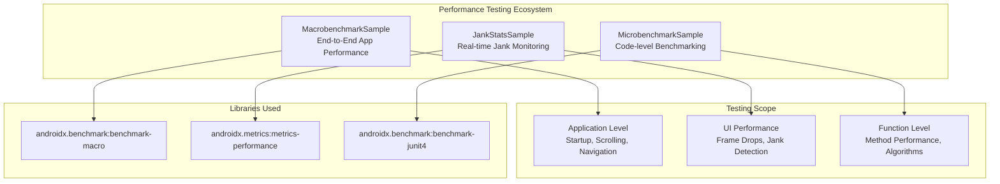

Sources: [README.md:8-32](), [MacrobenchmarkSample/README.md:1-89](), [JankStatsSample/README.md:1-50]()

## MacrobenchmarkSample

The `MacrobenchmarkSample` is the flagship project focusing on end-to-end application performance testing using the Jetpack Macrobenchmark library. It provides comprehensive benchmarking capabilities for measuring application startup times, scrolling performance, and runtime behavior.

### Key Features and Components

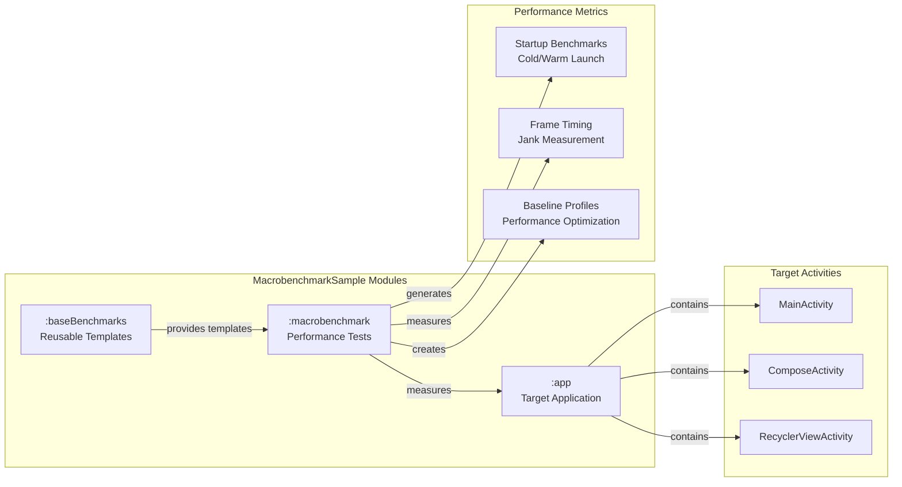

The project demonstrates several advanced features:

- **Baseline Profile Generation**: Uses separate generator classes for different user journeys, stored in `src/main/baselineProfiles` folder for easier maintenance
- **Composition Tracing**: Integration with Jetpack Compose for detailed UI performance analysis using `androidx.benchmark.perfettoSdkTracing.enable=true`
- **Firebase Test Lab Integration**: Automated cloud-based benchmarking through GitHub workflows
- **Drop-in Templates**: The `baseBenchmarks` module provides ready-to-use benchmarks for production applications

### Baseline Profile Management

The sample uses an advanced baseline profile system with granular control:

- Multiple profile files can be created and maintained separately
- Dedicated generators for specific user journeys
- Automatic profile updates without full regeneration for minor changes

Sources: [README.md:8-19](), [MacrobenchmarkSample/README.md:1-89]()

## JankStatsSample  

The `JankStatsSample` demonstrates real-time UI performance monitoring using the JankStats library to detect and analyze frame drops and UI jank during user interactions.

### Architecture and Monitoring Approaches

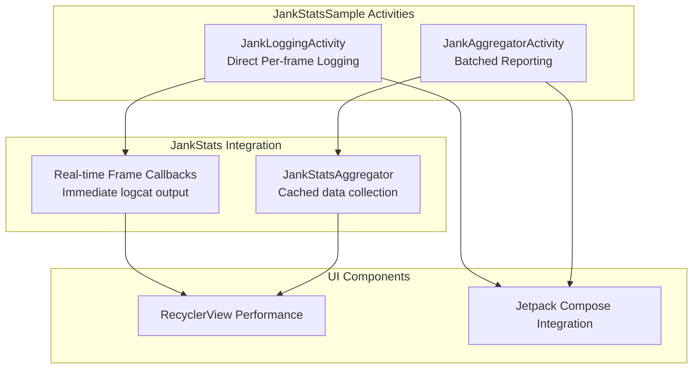

### Two Monitoring Strategies

The sample provides two distinct approaches to jank detection:

1. **Direct Logging (`JankLoggingActivity`)**: 
   - Creates `JankStats` object for immediate frame-by-frame analysis
   - Outputs performance metrics directly to logcat in real-time
   - Suitable for development and debugging scenarios

2. **Aggregated Reporting (`JankAggregatorActivity`)**:
   - Uses `JankStatsAggregator` utility class for batched data collection
   - Collects per-frame information and caches it internally
   - Outputs aggregated reports when requested (e.g., when activity goes to background)
   - Better for production monitoring with reduced overhead

### Performance State Management

The sample demonstrates integration with various UI states and components:

- `PerformanceMetricsState` for contextual performance information
- Activity lifecycle and navigation state tracking
- RecyclerView scroll performance monitoring
- Jetpack Compose integration patterns

Sources: [JankStatsSample/README.md:1-50](), [README.md:29-31]()

## MicrobenchmarkSample

The `MicrobenchmarkSample` focuses on code-level performance testing using the Benchmark library to measure individual function performance and UI component behavior within library modules.

### Key Characteristics

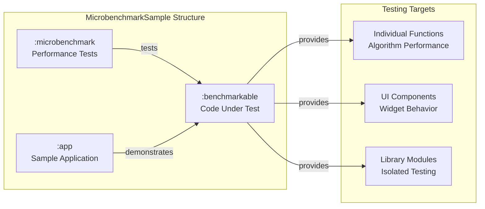

### Important Considerations

- **Device Requirements**: Screen must be on before running benchmarks to ensure accurate measurements
- **Isolated Testing**: Focuses on library module performance independent of application context
- **Granular Metrics**: Measures specific code paths and algorithms rather than full application flows

The microbenchmark approach complements the macrobenchmark testing by providing detailed performance data for specific code sections that might be identified as bottlenecks through broader application testing.

Sources: [README.md:21-27]()

## Integrated Testing Strategy

The three sample projects work together to provide a comprehensive performance testing strategy:

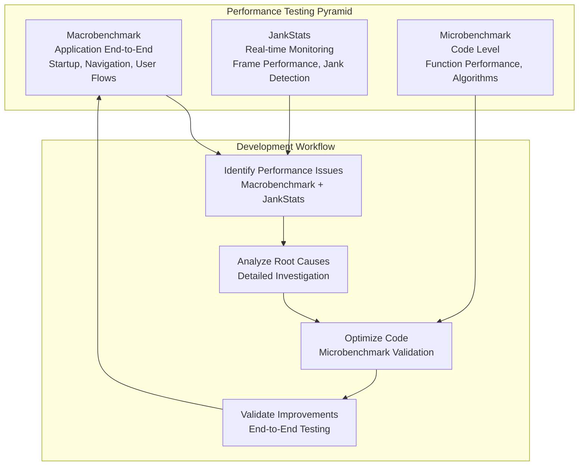

This layered approach enables developers to:

1. **Detect Issues**: Use macrobenchmarks and jank monitoring to identify performance problems
2. **Isolate Problems**: Apply microbenchmarks to specific code sections for detailed analysis  
3. **Monitor Production**: Implement real-time jank detection in production applications
4. **Validate Fixes**: Confirm improvements through comprehensive end-to-end testing

Sources: [README.md:1-46](), [MacrobenchmarkSample/README.md:1-89](), [JankStatsSample/README.md:1-50]()

---

# Page: MacrobenchmarkSample

# MacrobenchmarkSample

<details>
<summary>Relevant source files</summary>

The following files were used as context for generating this wiki page:

- [MacrobenchmarkSample/README.md](MacrobenchmarkSample/README.md)
- [MacrobenchmarkSample/app/benchmark-rules.pro](MacrobenchmarkSample/app/benchmark-rules.pro)
- [MacrobenchmarkSample/app/build.gradle.kts](MacrobenchmarkSample/app/build.gradle.kts)
- [MacrobenchmarkSample/app/src/main/AndroidManifest.xml](MacrobenchmarkSample/app/src/main/AndroidManifest.xml)
- [MacrobenchmarkSample/build.gradle.kts](MacrobenchmarkSample/build.gradle.kts)
- [MacrobenchmarkSample/gradle/libs.versions.toml](MacrobenchmarkSample/gradle/libs.versions.toml)
- [MacrobenchmarkSample/macrobenchmark/build.gradle.kts](MacrobenchmarkSample/macrobenchmark/build.gradle.kts)
- [MacrobenchmarkSample/media/composition-tracing.png](MacrobenchmarkSample/media/composition-tracing.png)
- [MacrobenchmarkSample/settings.gradle.kts](MacrobenchmarkSample/settings.gradle.kts)

</details>


This document covers the MacrobenchmarkSample project, which demonstrates comprehensive end-to-end performance testing using the Jetpack Macrobenchmark library. The system provides a complete example of measuring app startup time, frame timing, scroll performance, and baseline profile generation for Android applications.

For information about real-time performance monitoring, see [JankStatsSample](#2.2). For code-level performance testing, see [MicrobenchmarkSample](#2.3). For CI/CD integration details, see [CI/CD Integration](#3).

## Project Architecture

The MacrobenchmarkSample follows a multi-module architecture designed to separate the target application from the benchmarking infrastructure. This separation ensures that benchmark code doesn't interfere with the performance characteristics of the app being tested.

## Module Structure

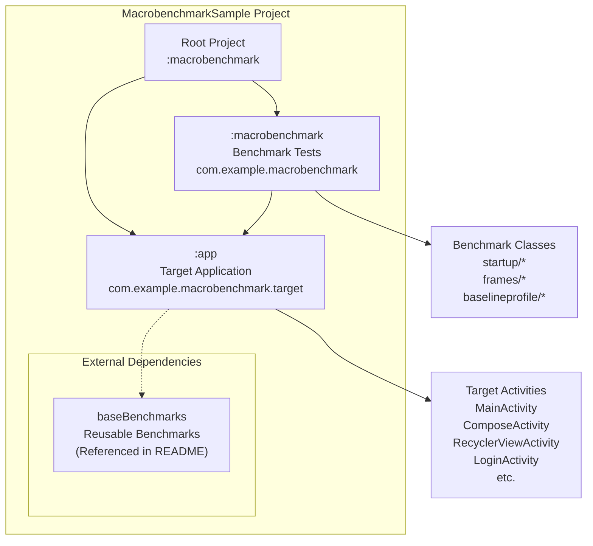

Sources: [MacrobenchmarkSample/settings.gradle.kts:17-19](), [MacrobenchmarkSample/README.md:17-20]()

## Build Configuration

The project uses Gradle with centralized dependency management through version catalogs. The configuration demonstrates proper setup for macrobenchmarking with baseline profile generation.

### Root Project Configuration

The root `build.gradle.kts` applies plugins without activation, allowing individual modules to configure them as needed:

| Plugin | Purpose |
|--------|---------|
| `application` | Applied to `:app` module for target app |
| `test` | Applied to `:macrobenchmark` module for benchmarks |
| `baselineprofile` | Applied to both modules for profile generation |
| `kotlin` | Applied to all modules for Kotlin support |
| `compose` | Applied to `:app` for Jetpack Compose UI |

Sources: [MacrobenchmarkSample/build.gradle.kts:17-23]()

### Version Management

The `libs.versions.toml` file centralizes all dependency versions:

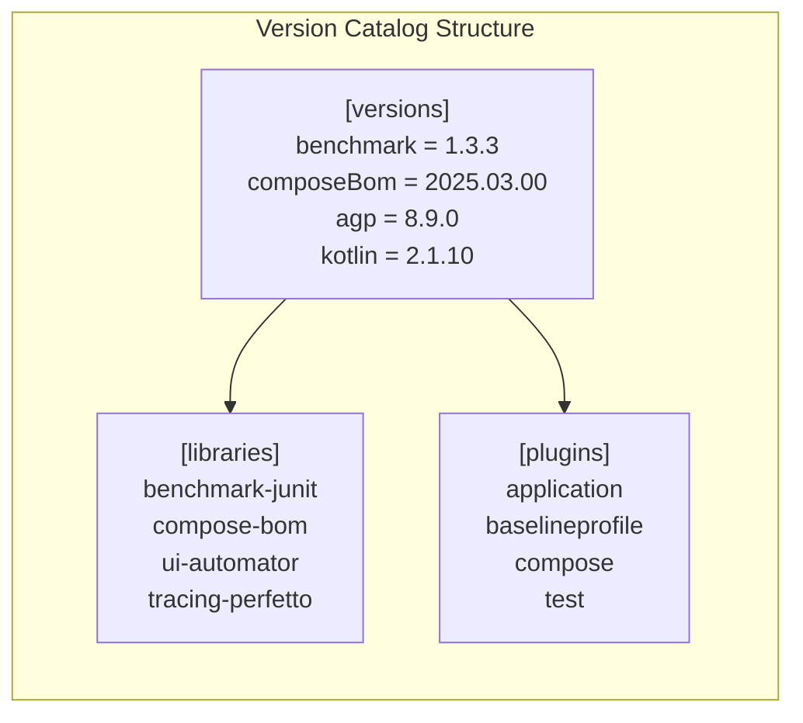

Sources: [MacrobenchmarkSample/gradle/libs.versions.toml:1-60]()

## Target Application Module

The `:app` module serves as the target application for benchmarking. It's configured with release build optimizations while maintaining debuggability for performance analysis.

### Build Configuration

The app module configuration includes several key aspects for benchmarking:

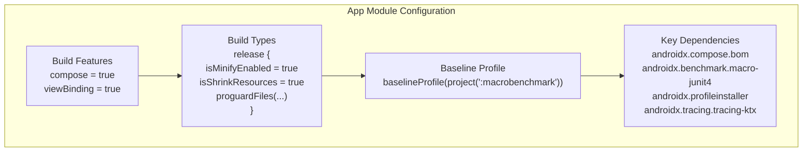

Sources: [MacrobenchmarkSample/app/build.gradle.kts:37-55](), [MacrobenchmarkSample/app/build.gradle.kts:69-95]()

### Target Activities

The application manifest declares multiple activities for different performance testing scenarios:

| Activity | Purpose | Intent Action |
|----------|---------|---------------|
| `MainActivity` | Main launcher and navigation hub | `android.intent.action.MAIN` |
| `ComposeActivity` | Jetpack Compose UI performance testing | `com.example.macrobenchmark.target.COMPOSE_ACTIVITY` |
| `RecyclerViewActivity` | List scrolling performance | `com.example.macrobenchmark.target.RECYCLER_VIEW_ACTIVITY` |
| `ListViewActivity` | Legacy list performance | `com.example.macrobenchmark.target.LIST_VIEW_ACTIVITY` |
| `LoginActivity` | Authentication flow testing | `com.example.macrobenchmark.target.LOGIN_ACTIVITY` |
| `ScrollViewActivity` | Simple scroll performance | `com.example.macrobenchmark.target.SCROLL_VIEW_ACTIVITY` |
| `FullyDrawnStartupActivity` | Startup completion measurement | `com.example.macrobenchmark.target.FULLY_DRAWN_STARTUP_ACTIVITY` |

Sources: [MacrobenchmarkSample/app/src/main/AndroidManifest.xml:23-88]()

### Application Setup

The manifest includes essential configuration for benchmarking:

- `<profileable android:shell="true" />` enables profiling from shell commands
- All benchmark target activities are exported for external discovery
- `POST_NOTIFICATIONS` permission for potential notification-based testing
- Application class `ExampleApplication` for custom initialization

Sources: [MacrobenchmarkSample/app/src/main/AndroidManifest.xml:15-17](), [MacrobenchmarkSample/app/src/main/AndroidManifest.xml:5]()

## Macrobenchmark Module

The `:macrobenchmark` module contains the actual benchmark tests and baseline profile generators. It's configured as a test module with special capabilities for performance measurement.

### Module Configuration

The macrobenchmark module has distinct configuration requirements:

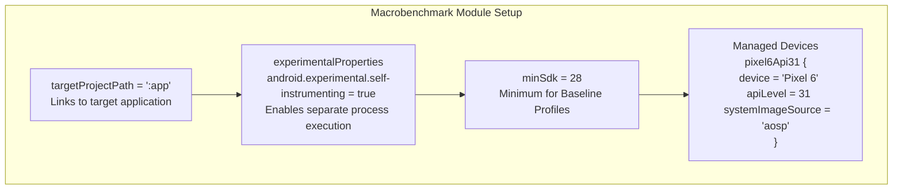

Sources: [MacrobenchmarkSample/macrobenchmark/build.gradle.kts:40](), [MacrobenchmarkSample/macrobenchmark/build.gradle.kts:62](), [MacrobenchmarkSample/macrobenchmark/build.gradle.kts:34-35](), [MacrobenchmarkSample/macrobenchmark/build.gradle.kts:51-57]()

### Baseline Profile Configuration

The module includes specific baseline profile generation settings:

- Uses managed devices (`pixel6Api31`) for consistent profile generation
- Disables connected devices (`useConnectedDevices = false`) for CI/CD compatibility
- Includes Perfetto tracing dependencies for composition analysis

Sources: [MacrobenchmarkSample/macrobenchmark/build.gradle.kts:66-75](), [MacrobenchmarkSample/macrobenchmark/build.gradle.kts:83-88]()

## Key Dependencies

The project integrates several critical performance libraries:

### Benchmarking Dependencies

| Library | Module | Purpose |
|---------|--------|---------|
| `androidx.benchmark:benchmark-macro-junit4` | `:macrobenchmark` | Core macrobenchmarking functionality |
| `androidx.test.uiautomator:uiautomator` | `:macrobenchmark` | UI interaction automation |
| `androidx.test.espresso:espresso-core` | `:macrobenchmark` | UI testing framework |

### Profiling Dependencies

| Library | Module | Purpose |
|---------|--------|---------|
| `androidx.profileinstaller:profileinstaller` | `:app` | Baseline profile installation |
| `androidx.tracing:tracing-perfetto` | `:macrobenchmark` | Perfetto tracing integration |
| `androidx.tracing:tracing-perfetto-binary` | `:macrobenchmark` | Perfetto binary dependencies |

### Compose Dependencies

| Library | Module | Purpose |
|---------|--------|---------|
| `androidx.compose:compose-bom` | `:app` | Compose version alignment |
| `androidx.compose.runtime:runtime-tracing` | `:app` | Compose performance tracing |

Sources: [MacrobenchmarkSample/gradle/libs.versions.toml:24-50](), [MacrobenchmarkSample/app/build.gradle.kts:69-95](), [MacrobenchmarkSample/macrobenchmark/build.gradle.kts:77-88]()

## Baseline Profile Integration

The project demonstrates the complete baseline profile workflow, from generation to consumption:

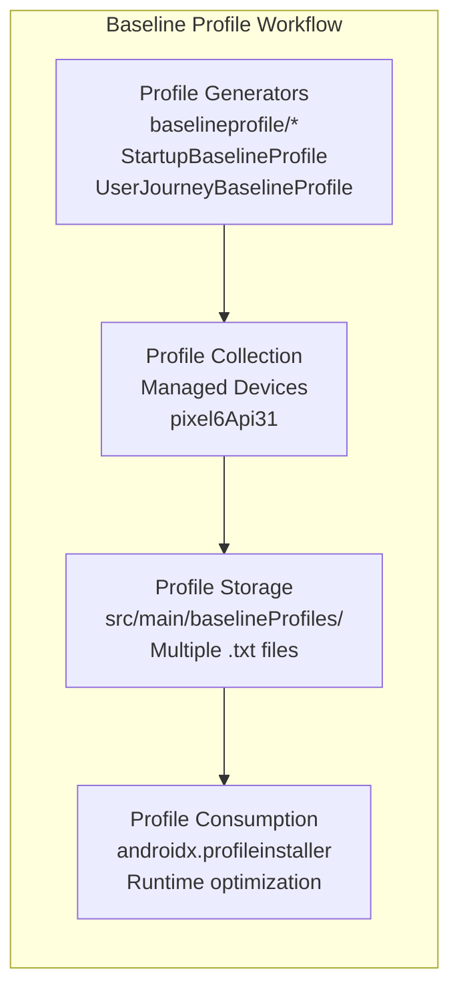

The system supports multiple profile files in `src/main/baselineProfiles` directory, enabling granular profile management without full regeneration for minor changes.

Sources: [MacrobenchmarkSample/README.md:22-31](), [MacrobenchmarkSample/app/build.gradle.kts:94]()

## Composition Tracing

The project includes advanced composition tracing capabilities for Jetpack Compose performance analysis:

- Requires `androidx.benchmark.perfettoSdkTracing.enable=true` instrumentation argument
- Provides detailed information about Composable recomposition timing
- Generates traces showing composition performance alongside frame timing metrics

Sources: [MacrobenchmarkSample/README.md:41-65]()

## Usage and Execution

The project can be executed through multiple methods:

1. **Android Studio**: Standard test execution (Ctrl-Shift-F10)
2. **Command Line**: `./gradlew macrobenchmark:cC`
3. **CI/CD**: Automated execution through GitHub Actions workflows

Sources: [MacrobenchmarkSample/README.md:34-39]()

---

# Page: Target Application Activities

# Target Application Activities

<details>
<summary>Relevant source files</summary>

The following files were used as context for generating this wiki page:

- [MacrobenchmarkSample/app/src/main/res/layout/activity_list_view.xml](MacrobenchmarkSample/app/src/main/res/layout/activity_list_view.xml)
- [MacrobenchmarkSample/app/src/main/res/layout/activity_scroll_view.xml](MacrobenchmarkSample/app/src/main/res/layout/activity_scroll_view.xml)
- [MacrobenchmarkSample/app/src/main/res/values/strings.xml](MacrobenchmarkSample/app/src/main/res/values/strings.xml)

</details>


This document covers the target application activities within the MacrobenchmarkSample's `:app` module. These activities serve as benchmarking targets for performance measurement and are designed to test different UI patterns and scenarios. For information about the actual benchmark implementations that measure these activities, see [Baseline Profile Generation](#2.1.2).

## Purpose and Scope

The target activities in the MacrobenchmarkSample app module represent various common Android UI patterns and use cases that need performance optimization. Each activity is designed to demonstrate specific performance characteristics and serve as a consistent target for macrobenchmark tests. These activities include traditional View-based UIs, Jetpack Compose implementations, and different scrolling patterns.

## Activity Architecture Overview

The target application follows a launcher-based architecture where `MainActivity` serves as the entry point to navigate to specialized activities for benchmarking different UI patterns.

### Activity Navigation Structure

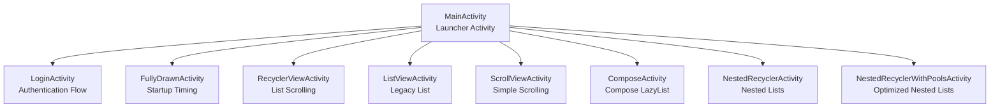

Sources: [MacrobenchmarkSample/app/src/main/res/values/strings.xml:21-28]()

## Activity Categories

The target activities are organized into distinct categories based on their performance testing purpose:

| Category | Activities | Purpose |
|----------|------------|---------|
| **Startup & Navigation** | `MainActivity`, `LoginActivity`, `FullyDrawnActivity` | App launch and navigation timing |
| **List Performance** | `RecyclerViewActivity`, `ListViewActivity`, `ComposeActivity` | Scrolling and list rendering |
| **Simple Scrolling** | `ScrollViewActivity` | Basic scroll performance |
| **Complex Layouts** | `NestedRecyclerActivity`, `NestedRecyclerWithPoolsActivity` | Advanced UI pattern optimization |

## Core Target Activities

### MainActivity (Launcher)
The main entry point that provides navigation to all other benchmark target activities. This activity serves as the starting point for app launch benchmarks and provides a consistent navigation interface.

### Login and Authentication Flow
The `LoginActivity` represents authentication workflows commonly found in production applications. This activity is referenced in the strings as `launchLoginActivity` and is used to benchmark user authentication flows.

### List-Based Activities

#### RecyclerViewActivity
Implements RecyclerView-based lists for measuring list scrolling performance. This is one of the most common UI patterns in Android applications and serves as a primary target for scroll jank measurements.

#### ListViewActivity
Implements the legacy ListView pattern for comparison testing against RecyclerView implementations. The layout is defined in `activity_list_view.xml` with a basic ListView configuration.

#### ComposeActivity
Implements Compose-based LazyList patterns for measuring Jetpack Compose list performance. Referenced as `launchComposeList` in the strings, this activity allows comparison between traditional View-based lists and Compose implementations.

### Scrolling Pattern Activities

#### ScrollViewActivity
Implements basic ScrollView patterns for simple scrolling benchmarks. The layout uses a LinearLayout within a ScrollView for measuring basic scroll performance without complex list recycling.

### Complex Layout Activities

#### NestedRecyclerActivity
Implements nested RecyclerView patterns to test complex scrolling scenarios with multiple levels of lists. This represents more challenging UI patterns that can impact performance.

#### NestedRecyclerWithPoolsActivity
Implements optimized nested RecyclerView patterns using shared RecyclerView pools. This demonstrates performance optimization techniques for complex nested scrolling scenarios.

## Layout Configuration Patterns

### ListView Implementation
The ListView activity uses a constraint-based layout with content description for accessibility:

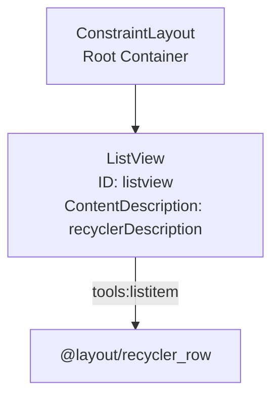

Sources: [MacrobenchmarkSample/app/src/main/res/layout/activity_list_view.xml:16-33]()

### ScrollView Implementation
The ScrollView activity uses a nested layout structure for dynamic content:

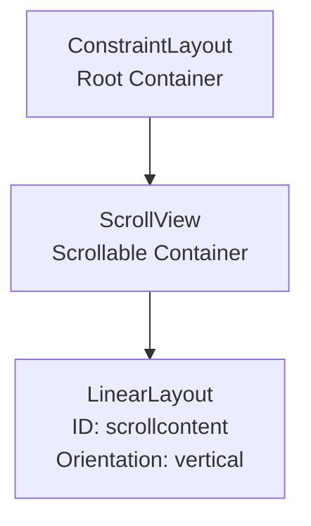

Sources: [MacrobenchmarkSample/app/src/main/res/layout/activity_scroll_view.xml:16-41]()

## Benchmarking Integration

These target activities are designed to work with the macrobenchmark module's performance tests. Each activity provides specific UI patterns that can be measured for:

- **Startup Time**: How quickly activities launch and become interactive
- **Frame Timing**: Jank detection during scrolling and interactions  
- **Memory Usage**: Resource consumption during different UI operations
- **Composition Performance**: Jetpack Compose rendering efficiency

The activities use consistent naming conventions and are referenced through the string resources to ensure reliable benchmark targeting.

Sources: [MacrobenchmarkSample/app/src/main/res/values/strings.xml:17-29]()

---

# Page: Baseline Profile Generation

# Baseline Profile Generation

<details>
<summary>Relevant source files</summary>

The following files were used as context for generating this wiki page:

- [JankStatsSample/app/src/main/java/com/example/jankstats/tools/simulateJank.kt](JankStatsSample/app/src/main/java/com/example/jankstats/tools/simulateJank.kt)
- [MacrobenchmarkSample/macrobenchmark/src/main/kotlin/com/example/macrobenchmark/baselineprofile/Common.kt](MacrobenchmarkSample/macrobenchmark/src/main/kotlin/com/example/macrobenchmark/baselineprofile/Common.kt)
- [MacrobenchmarkSample/macrobenchmark/src/main/kotlin/com/example/macrobenchmark/baselineprofile/ComposeActivityBaselineProfileGenerator.kt](MacrobenchmarkSample/macrobenchmark/src/main/kotlin/com/example/macrobenchmark/baselineprofile/ComposeActivityBaselineProfileGenerator.kt)
- [MacrobenchmarkSample/macrobenchmark/src/main/kotlin/com/example/macrobenchmark/baselineprofile/LoginBaselineProfileGenerator.kt](MacrobenchmarkSample/macrobenchmark/src/main/kotlin/com/example/macrobenchmark/baselineprofile/LoginBaselineProfileGenerator.kt)
- [MacrobenchmarkSample/macrobenchmark/src/main/kotlin/com/example/macrobenchmark/baselineprofile/RecyclerViewActivityBaselineProfileGenerator.kt](MacrobenchmarkSample/macrobenchmark/src/main/kotlin/com/example/macrobenchmark/baselineprofile/RecyclerViewActivityBaselineProfileGenerator.kt)

</details>


## Purpose and Scope

This document covers the baseline profile generation system within the MacrobenchmarkSample project. Baseline profiles are performance optimization artifacts that improve app startup time and runtime performance by providing ahead-of-time (AOT) compilation hints to the Android Runtime (ART). 

The baseline profile generation system automates the collection of performance data through simulated user journeys, which are then compiled into optimization profiles for production applications. For information about the broader macrobenchmark testing system, see [MacrobenchmarkSample](#2.1). For details on the target activities being profiled, see [Target Application Activities](#2.1.1).

## System Architecture

The baseline profile generation system consists of multiple specialized profile generators, each targeting different user flows and UI patterns within the target application.

### Profile Generator Architecture

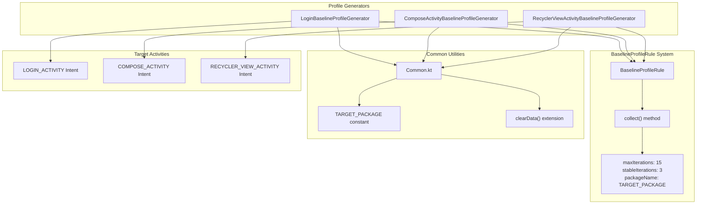

Sources: [MacrobenchmarkSample/macrobenchmark/src/main/kotlin/com/example/macrobenchmark/baselineprofile/Common.kt:22-32](), [MacrobenchmarkSample/macrobenchmark/src/main/kotlin/com/example/macrobenchmark/baselineprofile/LoginBaselineProfileGenerator.kt:30-46]()

### User Journey Simulation Flow

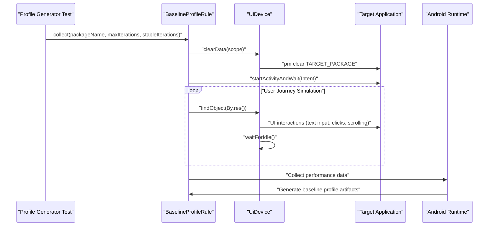

Sources: [MacrobenchmarkSample/macrobenchmark/src/main/kotlin/com/example/macrobenchmark/baselineprofile/LoginBaselineProfileGenerator.kt:34-47](), [MacrobenchmarkSample/macrobenchmark/src/main/kotlin/com/example/macrobenchmark/baselineprofile/Common.kt:24-32]()

## Profile Generator Components

### LoginBaselineProfileGenerator

The `LoginBaselineProfileGenerator` class creates baseline profiles for authentication flows by simulating user login interactions.

| Component | Implementation | Purpose |
|-----------|----------------|---------|
| Test Runner | `AndroidJUnit4ClassRunner` | JUnit test execution framework |
| Profile Rule | `BaselineProfileRule` | Orchestrates profile collection |
| User Journey | Login form interaction | Captures authentication flow performance |
| Iterations | `maxIterations = 15, stableIterations = 3` | Ensures statistical reliability |

**Key Implementation Details:**
- Clears application data before each iteration using `device.clearData(this)`
- Launches login activity via `Intent("$packageName.LOGIN_ACTIVITY")`
- Simulates user input: username field (`By.res("userName")`) and password field (`By.res("password")`)
- Triggers login action via `device.findObject(By.res("login")).click()`

Sources: [MacrobenchmarkSample/macrobenchmark/src/main/kotlin/com/example/macrobenchmark/baselineprofile/LoginBaselineProfileGenerator.kt:27-48]()

### ComposeActivityBaselineProfileGenerator

The `ComposeActivityBaselineProfileGenerator` optimizes Jetpack Compose UI performance through scrolling interaction profiles.

**Current Status:** Temporarily ignored due to `StaleObjectException` issues in CI environment ([line 31]()).

**User Journey Pattern:**
- Targets `COMPOSE_ACTIVITY` intent action
- Focuses on `myLazyColumn` scrollable component (`By.res("myLazyColumn")`)
- Implements bidirectional scrolling: `fling(Direction.DOWN)` followed by `fling(Direction.UP)`
- Configures gesture margins for reliable touch interactions (`device.displayWidth / 10`)

Sources: [MacrobenchmarkSample/macrobenchmark/src/main/kotlin/com/example/macrobenchmark/baselineprofile/ComposeActivityBaselineProfileGenerator.kt:31-56]()

### RecyclerViewActivityBaselineProfileGenerator  

The `RecyclerViewActivityBaselineProfileGenerator` creates performance profiles for traditional View-based scrolling components.

**Current Status:** Temporarily ignored due to flinging interaction issues ([line 29]()).

**Target Components:**
- `RECYCLER_VIEW_ACTIVITY` intent action  
- `recycler` resource identifier for RecyclerView component
- Bidirectional fling gestures with configured margins

Sources: [MacrobenchmarkSample/macrobenchmark/src/main/kotlin/com/example/macrobenchmark/baselineprofile/RecyclerViewActivityBaselineProfileGenerator.kt:29-54]()

## Common Utilities

### Shared Constants and Functions

The `Common.kt` file provides shared utilities across all profile generators:

| Utility | Type | Value/Implementation | Purpose |
|---------|------|---------------------|---------|
| `TARGET_PACKAGE` | Constant | `"com.example.macrobenchmark.target"` | Package identifier for target app |
| `clearData()` | Extension Function | `UiDevice.executeShellCommand("pm clear")` | Resets app state between iterations |

### UiDevice.clearData() Extension

```kotlin
fun UiDevice.clearData(scope: MacrobenchmarkScope) {
    val command = "pm clear ${scope.packageName}"
    val output = executeShellCommand(command)
}
```

This extension function ensures clean application state by clearing all app data before each profile collection iteration, preventing interference from previous test runs.

Sources: [MacrobenchmarkSample/macrobenchmark/src/main/kotlin/com/example/macrobenchmark/baselineprofile/Common.kt:17-33]()

## Configuration Parameters

All baseline profile generators use consistent configuration parameters for statistical reliability:

| Parameter | Value | Purpose |
|-----------|-------|---------|
| `maxIterations` | 15 | Maximum number of profile collection attempts |
| `stableIterations` | 3 | Minimum consistent results required |
| `packageName` | `TARGET_PACKAGE` | Target application package identifier |

These parameters balance collection thoroughness with execution time, ensuring statistically significant performance data while maintaining reasonable test duration.

Sources: [MacrobenchmarkSample/macrobenchmark/src/main/kotlin/com/example/macrobenchmark/baselineprofile/LoginBaselineProfileGenerator.kt:35-38](), [MacrobenchmarkSample/macrobenchmark/src/main/kotlin/com/example/macrobenchmark/baselineprofile/ComposeActivityBaselineProfileGenerator.kt:40-43]()

---

# Page: Firebase Test Lab Integration

# Firebase Test Lab Integration

<details>
<summary>Relevant source files</summary>

The following files were used as context for generating this wiki page:

- [MacrobenchmarkSample/ftl/README.md](MacrobenchmarkSample/ftl/README.md)
- [MacrobenchmarkSample/ftl/images/cloud_function_configuration.png](MacrobenchmarkSample/ftl/images/cloud_function_configuration.png)
- [MacrobenchmarkSample/ftl/images/cloud_function_invocation.png](MacrobenchmarkSample/ftl/images/cloud_function_invocation.png)
- [MacrobenchmarkSample/ftl/images/cloud_function_settings.png](MacrobenchmarkSample/ftl/images/cloud_function_settings.png)
- [MacrobenchmarkSample/ftl/images/custom_startupMs_maximum.png](MacrobenchmarkSample/ftl/images/custom_startupMs_maximum.png)
- [MacrobenchmarkSample/ftl/images/github_actions.png](MacrobenchmarkSample/ftl/images/github_actions.png)
- [MacrobenchmarkSample/ftl/images/monitoring.png](MacrobenchmarkSample/ftl/images/monitoring.png)

</details>


This document describes the Firebase Test Lab integration system for the MacrobenchmarkSample project, which provides automated performance testing and regression detection in the cloud. This system runs macrobenchmarks on physical devices in Firebase Test Lab as part of the CI/CD pipeline and monitors performance metrics over time.

For information about the target application being benchmarked, see [Target Application Activities](#2.1.1). For details about the broader CI/CD infrastructure, see [GitHub Actions Workflows](#3.1) and [Firebase Cloud Functions](#3.2).

## Architecture Overview

The Firebase Test Lab integration consists of three main components that work together to provide automated performance testing and monitoring:

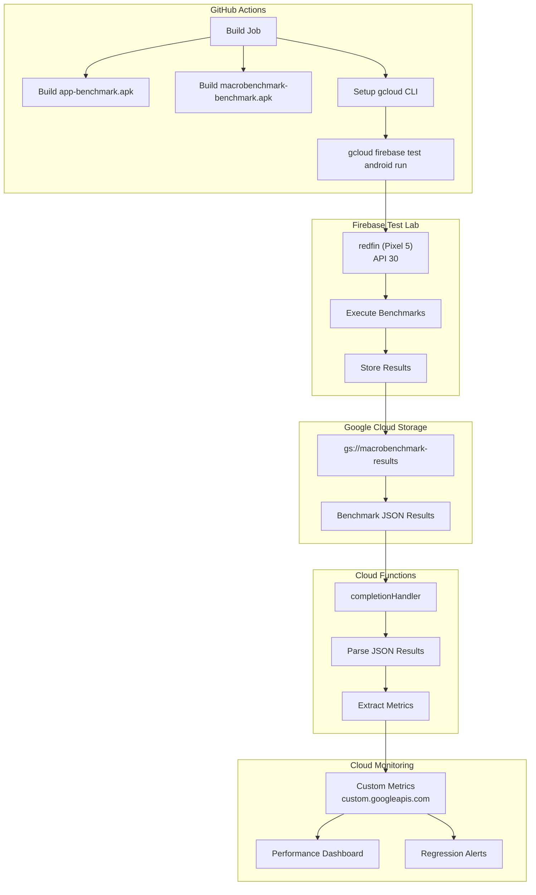

Sources: [MacrobenchmarkSample/ftl/README.md:1-288]()

## GitHub Actions Workflow Integration

The Firebase Test Lab integration is triggered by GitHub Actions workflows that build the necessary APK files and submit them for testing:

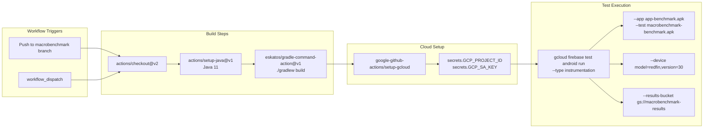

Sources: [MacrobenchmarkSample/ftl/README.md:52-108](), [MacrobenchmarkSample/ftl/README.md:111-177]()

## Test Execution Configuration

The Firebase Test Lab execution uses specific configuration parameters to ensure consistent and reliable benchmarking:

| Parameter | Value | Purpose |
|-----------|--------|---------|
| `--type` | `instrumentation` | Specifies the test type |
| `--app` | `app-benchmark.apk` | Target application APK |
| `--test` | `macrobenchmark-benchmark.apk` | Test instrumentation APK |
| `--device` | `model=redfin,version=30,locale=en,orientation=portrait` | Consistent device specification |
| `--directories-to-pull` | `/sdcard/Download` | Pull benchmark output files |
| `--results-bucket` | `gs://macrobenchmark-results` | Cloud Storage destination |
| `--environment-variables` | `additionalTestOutputDir=/sdcard/Download,no-isolated-storage=true` | Benchmark library configuration |
| `--timeout` | `20m` | Maximum test execution time |

The device specification ensures tests run on a consistent hardware configuration (Pixel 5 with Android API 30) to enable meaningful performance comparisons across test runs.

Sources: [MacrobenchmarkSample/ftl/README.md:166-177](), [MacrobenchmarkSample/ftl/README.md:179-187]()

## Cloud Function Processing

The `completionHandler` Cloud Function automatically processes benchmark results when Firebase Test Lab completes:

```mermaid
graph TB
    subgraph "Cloud Function Trigger"
        FTLComplete["Firebase Test Lab<br/>Completion Event"]
        StorageTrigger["Cloud Storage<br/>Object Creation"]
    end
    
    subgraph "completionHandler Function"
        Parse["Parse JSON Results"]
        PackageFilter["Filter by package_name<br/>Environment Variable"]
        DeviceFilter["Filter by device_configurations<br/>Environment Variable"]
        ExtractMetrics["Extract Performance Metrics"]
    end
    
    subgraph "Cloud Monitoring API"
        CreateMetrics["Create Custom Metrics"]
        Namespace["custom.googleapis.com<br/>Namespace"]
        Upload["Upload Metric Data"]
    end
    
    FTLComplete --> StorageTrigger
    StorageTrigger --> Parse
    Parse --> PackageFilter
    PackageFilter --> DeviceFilter
    DeviceFilter --> ExtractMetrics
    ExtractMetrics --> CreateMetrics
    CreateMetrics --> Namespace
    Namespace --> Upload
```

### Environment Variables Configuration

The Cloud Function requires specific environment variables for proper operation:

| Variable | Example Value | Description |
|----------|---------------|-------------|
| `package_name` | `"com.example.macrobenchmark"` | Target app package name for filtering |
| `device_configurations` | `["redfin-30-en-portrait"]` | Device configurations to track |

These variables are configured in the Google Cloud Console under the function's runtime settings with recommended memory allocation of 4GiB and timeout of 500 seconds.

Sources: [MacrobenchmarkSample/ftl/README.md:189-276](), [MacrobenchmarkSample/ftl/README.md:234-258]()

## Monitoring and Alerting

The system creates custom metrics in Google Cloud Monitoring for performance tracking and regression detection:

```mermaid
graph TB
    subgraph "Custom Metrics"
        StartupMetrics["Startup Time Metrics<br/>custom.googleapis.com/startupMs"]
        ScrollMetrics["Scroll Performance<br/>custom.googleapis.com/frameTime"]
        JankMetrics["Jank Detection<br/>custom.googleapis.com/jankCount"]
    end
    
    subgraph "Monitoring Tools"
        MQL["Metrics Query Language<br/>Query Editor"]
        Dashboard["Performance Dashboard"]
        Alerts["Regression Alerts"]
    end
    
    subgraph "Regression Detection"
        Thresholds["Performance Thresholds"]
        Notifications["Alert Notifications"]
        Trending["Historical Trending"]
    end
    
    StartupMetrics --> MQL
    ScrollMetrics --> MQL
    JankMetrics --> MQL
    MQL --> Dashboard
    MQL --> Alerts
    Alerts --> Thresholds
    Thresholds --> Notifications
    Dashboard --> Trending
```

The custom metrics use the `custom.googleapis.com` namespace and can be queried using MQL (Metrics Query Language) to create dashboards and set up alerts for performance regressions.

Sources: [MacrobenchmarkSample/ftl/README.md:275-288]()

## Setup Requirements

### One-Time Configuration

1. **Google Cloud Project Setup**
   - Create Firebase project with Blaze plan for adequate quota
   - Create Cloud Storage bucket named `macrobenchmark-results`
   - Deploy the Cloud Function with proper IAM permissions

2. **GitHub Secrets**
   - `GCP_PROJECT_ID`: Google Cloud Platform project ID
   - `GCP_CREDENTIALS`: Service account key JSON for authentication

3. **Service Account Permissions**
   - Firebase Test Lab API access
   - Cloud Storage read/write permissions
   - Cloud Monitoring write permissions

### Cloud Function Deployment

The Cloud Function is deployed using Firebase CLI:

```bash
# Initialize gcloud and firebase CLI
gcloud auth login
firebase login
gcloud config set project <your_project_id>

# Deploy the function
firebase deploy --only functions
```

The function source code and configuration are located in the MacrobenchmarkSample functions directory and include the necessary `package.json` and deployment configuration.

Sources: [MacrobenchmarkSample/ftl/README.md:19-51](), [MacrobenchmarkSample/ftl/README.md:194-232]()

---

# Page: JankStatsSample

# JankStatsSample

<details>
<summary>Relevant source files</summary>

The following files were used as context for generating this wiki page:

- [JankStatsSample/app/src/main/AndroidManifest.xml](JankStatsSample/app/src/main/AndroidManifest.xml)
- [JankStatsSample/build.gradle](JankStatsSample/build.gradle)
- [JankStatsSample/settings.gradle.kts](JankStatsSample/settings.gradle.kts)

</details>


## Purpose and Scope

The JankStatsSample project demonstrates real-time UI performance monitoring using the `androidx.metrics:metrics-performance` library (JankStats). This sample showcases two distinct approaches to integrating JankStats into Android applications: direct per-frame logging and aggregated reporting patterns. The project serves as a practical reference for implementing continuous performance monitoring in production applications.

For comprehensive end-to-end performance testing, see [MacrobenchmarkSample](#2.1). For code-level performance measurement, see [MicrobenchmarkSample](#2.3).

## Project Architecture

The JankStatsSample follows a single-module Android application structure with two primary activity implementations that demonstrate different JankStats integration patterns.

### Project Structure Diagram

```mermaid
graph TD
    subgraph "JankStatsSample Project"
        SETTINGS["settings.gradle.kts<br/>\"JankStats Sample\""]
        BUILD["build.gradle<br/>Root Configuration"]
        
        subgraph "app Module"
            MANIFEST["AndroidManifest.xml<br/>Activity Declarations"]
            
            subgraph "Main Activities"
                LOGGING["JankLoggingActivity<br/>Direct Per-Frame Logging"]
                AGGREGATOR["JankAggregatorActivity<br/>Aggregated Reporting"]
            end
            
            subgraph "UI Components"
                COMPOSE_FRAG["ComposeListFragment<br/>Jetpack Compose UI"]
                MESSAGE_FRAG["MessageListFragment<br/>Traditional Views"]
            end
            
            subgraph "Performance Integration"
                METRICS_STATE["PerformanceMetricsState<br/>Context Tracking"]
                JANKY_COMPOSE["JankyComposable<br/>Jank Simulation"]
            end
        end
    end
    
    SETTINGS --> BUILD
    BUILD --> MANIFEST
    MANIFEST --> LOGGING
    MANIFEST --> AGGREGATOR
    
    LOGGING --> COMPOSE_FRAG
    LOGGING --> MESSAGE_FRAG
    AGGREGATOR --> COMPOSE_FRAG
    AGGREGATOR --> MESSAGE_FRAG
    
    COMPOSE_FRAG --> JANKY_COMPOSE
    MESSAGE_FRAG --> JANKY_COMPOSE
    
    LOGGING --> METRICS_STATE
    AGGREGATOR --> METRICS_STATE
```

**Sources:** [JankStatsSample/app/src/main/AndroidManifest.xml:1-29](), [JankStatsSample/settings.gradle.kts:1-33](), [JankStatsSample/build.gradle:1-22]()

## Core Components

### Activity Configuration

The application declares two launcher activities in the Android manifest, each demonstrating a different JankStats integration approach:

| Activity | Purpose | Launcher Intent |
|----------|---------|-----------------|
| `JankLoggingActivity` | Direct per-frame logging with immediate callback processing | Main launcher activity |
| `JankAggregatorActivity` | Aggregated reporting with batched metric collection | Secondary launcher activity |

Both activities are configured as `android:exported="true"` to allow direct launching from the system launcher.

**Sources:** [JankStatsSample/app/src/main/AndroidManifest.xml:12-26]()

### JankStats Integration Patterns

```mermaid
graph LR
    subgraph "JankStats Integration Approaches"
        subgraph "Direct Logging Pattern"
            JLA["JankLoggingActivity"]
            DIRECT_CB["Per-Frame Callbacks<br/>Immediate Processing"]
            LOG_OUTPUT["Log Output<br/>Real-time Debugging"]
        end
        
        subgraph "Aggregated Pattern"
            JAA["JankAggregatorActivity"]
            BATCH_CB["Batched Callbacks<br/>Periodic Processing"]
            AGG_OUTPUT["Aggregated Metrics<br/>Analytics Integration"]
        end
        
        subgraph "Shared Components"
            JANK_STATS["JankStats Library<br/>androidx.metrics.performance"]
            PERF_STATE["PerformanceMetricsState<br/>Activity/Navigation Context"]
        end
    end
    
    JLA --> DIRECT_CB
    DIRECT_CB --> LOG_OUTPUT
    
    JAA --> BATCH_CB
    BATCH_CB --> AGG_OUTPUT
    
    JLA --> JANK_STATS
    JAA --> JANK_STATS
    
    JANK_STATS --> PERF_STATE
```

**Sources:** [JankStatsSample/app/src/main/AndroidManifest.xml:13-14](), [JankStatsSample/app/src/main/AndroidManifest.xml:21-22]()

## Build Configuration

### Module Structure

The project uses a simplified single-module structure defined in the settings configuration:

```
rootProject.name = "JankStats Sample"
include(":app")
```

### Plugin Configuration

The root `build.gradle` applies essential Android and Kotlin plugins using version catalog references:

| Plugin | Purpose |
|--------|---------|
| `libs.plugins.application` | Android application plugin |
| `libs.plugins.kotlin` | Kotlin Android plugin |
| `libs.plugins.compose.compiler` | Jetpack Compose compiler plugin |

All plugins are configured with `apply false` at the root level, indicating they are applied at the module level.

**Sources:** [JankStatsSample/settings.gradle.kts:17-18](), [JankStatsSample/build.gradle:17-21]()

### Repository Configuration

The project configures standard Android development repositories through dependency resolution management:

- Google Maven repository for Android libraries
- Maven Central for general dependencies
- Gradle Plugin Portal for build plugins

**Sources:** [JankStatsSample/settings.gradle.kts:20-32]()

## Integration with Performance Monitoring

The JankStatsSample serves as a foundational component in the larger Android performance monitoring ecosystem. It provides real-time monitoring capabilities that complement the comprehensive testing approach demonstrated in other samples.

### Performance Monitoring Ecosystem

```mermaid
graph TB
    subgraph "Performance Monitoring Stack"
        subgraph "Real-time Monitoring Layer"
            JS_SAMPLE["JankStatsSample<br/>Real-time UI Monitoring"]
            JANK_LIB["androidx.metrics:metrics-performance"]
        end
        
        subgraph "Application Layer"
            LOGGING_APPROACH["JankLoggingActivity<br/>Direct Frame Logging"]
            AGG_APPROACH["JankAggregatorActivity<br/>Aggregated Reporting"]
        end
        
        subgraph "UI Implementation Layer"
            COMPOSE_UI["ComposeListFragment<br/>Jetpack Compose"]
            VIEWS_UI["MessageListFragment<br/>Traditional Views"]
            JANK_SIM["JankyComposable<br/>Performance Testing"]
        end
        
        subgraph "Data Output"
            REALTIME_LOGS["Real-time Logs<br/>Development Debugging"]
            BATCH_METRICS["Batched Metrics<br/>Production Analytics"]
        end
    end
    
    JS_SAMPLE --> JANK_LIB
    JANK_LIB --> LOGGING_APPROACH
    JANK_LIB --> AGG_APPROACH
    
    LOGGING_APPROACH --> COMPOSE_UI
    LOGGING_APPROACH --> VIEWS_UI
    AGG_APPROACH --> COMPOSE_UI
    AGG_APPROACH --> VIEWS_UI
    
    COMPOSE_UI --> JANK_SIM
    VIEWS_UI --> JANK_SIM
    
    LOGGING_APPROACH --> REALTIME_LOGS
    AGG_APPROACH --> BATCH_METRICS
```

**Sources:** [JankStatsSample/app/src/main/AndroidManifest.xml:13-14](), [JankStatsSample/app/src/main/AndroidManifest.xml:21-22]()

The JankStatsSample demonstrates practical implementation patterns for continuous performance monitoring that can be integrated into production applications alongside comprehensive testing strategies provided by the MacrobenchmarkSample and MicrobenchmarkSample projects.

---

# Page: Real-time Monitoring Approaches

# Real-time Monitoring Approaches

<details>
<summary>Relevant source files</summary>

The following files were used as context for generating this wiki page:

- [JankStatsSample/app/src/main/java/com/example/jankstats/JankAggregatorActivity.kt](JankStatsSample/app/src/main/java/com/example/jankstats/JankAggregatorActivity.kt)
- [JankStatsSample/app/src/main/java/com/example/jankstats/JankLoggingActivity.kt](JankStatsSample/app/src/main/java/com/example/jankstats/JankLoggingActivity.kt)
- [JankStatsSample/app/src/main/java/com/example/jankstats/JankStatsAggregator.kt](JankStatsSample/app/src/main/java/com/example/jankstats/JankStatsAggregator.kt)
- [JankStatsSample/app/src/main/java/com/example/jankstats/JankyView.kt](JankStatsSample/app/src/main/java/com/example/jankstats/JankyView.kt)
- [JankStatsSample/app/src/main/java/com/example/jankstats/MessageListFragment.kt](JankStatsSample/app/src/main/java/com/example/jankstats/MessageListFragment.kt)

</details>


This document explains the two distinct approaches for implementing real-time UI performance monitoring using the JankStats library in Android applications. The JankStatsSample project demonstrates both direct per-frame logging and aggregated reporting patterns, each suited for different use cases and performance requirements.

For information about the overall JankStatsSample project architecture, see [JankStatsSample](#2.2). For details on Compose-specific integration patterns, see [Compose Integration](#2.2.2).

## Overview of Monitoring Approaches

The JankStats library provides flexibility in how applications collect and process UI performance data. The sample demonstrates two primary patterns:

| Approach | Implementation | Use Case | Performance Impact |
|----------|----------------|----------|-------------------|
| **Direct Logging** | `JankLoggingActivity` | Development, debugging, detailed analysis | Higher overhead per frame |
| **Aggregated Reporting** | `JankAggregatorActivity` + `JankStatsAggregator` | Production monitoring, periodic reporting | Lower overhead, batched processing |

## Direct Per-Frame Logging Approach

The direct logging approach provides immediate, granular access to performance data for every rendered frame. This pattern is implemented in `JankLoggingActivity` and offers real-time visibility into UI performance.

### Architecture Flow

```mermaid
sequenceDiagram
    participant UI as "UI Thread"
    participant JankStats as "JankStats"
    participant Listener as "OnFrameListener"
    participant Log as "Logging System"
    
    UI->>JankStats: "Frame rendered"
    JankStats->>JankStats: "Analyze frame timing"
    JankStats->>Listener: "onFrame(frameData)"
    Listener->>Log: "Log frame data immediately"
    
    Note over UI,Log: "Callback occurs for every frame"
    
    UI->>JankStats: "Next frame rendered"
    JankStats->>Listener: "onFrame(frameData)"
    Listener->>Log: "Log frame data immediately"
```

### Implementation Details

The direct logging implementation creates a `JankStats` instance with an immediate callback mechanism:

```mermaid
graph TD
    JankLoggingActivity["JankLoggingActivity"] --> JankStats["JankStats.createAndTrack()"]
    JankStats --> OnFrameListener["OnFrameListener"]
    OnFrameListener --> LogV["Log.v() per frame"]
    
    PerformanceMetricsState["PerformanceMetricsState"] --> StateHolder["metricsStateHolder"]
    StateHolder --> ActivityState["putState('Activity', className)"]
    StateHolder --> NavigationState["Navigation state tracking"]
    
    JankLoggingActivity --> PerformanceMetricsState
    JankLoggingActivity --> TrackingControl["isTrackingEnabled lifecycle"]
```

The key components include:

- **Frame Listener**: [JankStatsSample/app/src/main/java/com/example/jankstats/JankLoggingActivity.kt:48-52]() defines the callback that processes each frame
- **JankStats Initialization**: [JankStatsSample/app/src/main/java/com/example/jankstats/JankLoggingActivity.kt:66]() creates and configures the monitoring instance
- **Performance State**: [JankStatsSample/app/src/main/java/com/example/jankstats/JankLoggingActivity.kt:63-69]() establishes context for performance metrics
- **Lifecycle Management**: [JankStatsSample/app/src/main/java/com/example/jankstats/JankLoggingActivity.kt:77-86]() controls when tracking is active

### State Management Integration

The direct logging approach demonstrates comprehensive state tracking across different UI components:

```mermaid
graph LR
    MetricsStateHolder["PerformanceMetricsState.Holder"] --> ActivityState["Activity: className"]
    MetricsStateHolder --> NavigationState["Navigation: destination + args"]
    MetricsStateHolder --> RecyclerViewState["RecyclerView: Dragging/Settling"]
    
    ActivityState --> JankStats["JankStats Frame Callbacks"]
    NavigationState --> JankStats
    RecyclerViewState --> JankStats
```

Navigation state tracking is implemented in [JankStatsSample/app/src/main/java/com/example/jankstats/JankLoggingActivity.kt:107-116](), while RecyclerView state management is shown in [JankStatsSample/app/src/main/java/com/example/jankstats/MessageListFragment.kt:42-60]().

**Sources**: JankStatsSample/app/src/main/java/com/example/jankstats/JankLoggingActivity.kt, JankStatsSample/app/src/main/java/com/example/jankstats/MessageListFragment.kt

## Aggregated Reporting Approach

The aggregated reporting approach collects performance data over time and issues periodic reports, reducing the frequency of callbacks and processing overhead. This pattern uses the `JankStatsAggregator` utility class to buffer and batch process frame data.

### Architecture Flow

```mermaid
sequenceDiagram
    participant UI as "UI Thread"
    participant JankStats as "JankStats"
    participant Aggregator as "JankStatsAggregator"
    participant Buffer as "Frame Data Buffer"
    participant Listener as "OnJankReportListener"
    
    UI->>JankStats: "Frame rendered"
    JankStats->>Aggregator: "onFrame(frameData)"
    Aggregator->>Buffer: "Store jank frames only"
    Aggregator->>Aggregator: "Increment frame counter"
    
    Note over Buffer: "Buffer accumulates until report trigger"
    
    Aggregator->>Listener: "onJankReport(reason, totalFrames, jankFrames)"
    Listener->>Listener: "Process aggregated data"
    Aggregator->>Buffer: "Clear buffer and reset counters"
```

### Implementation Architecture

The aggregated approach introduces an intermediate layer that manages data collection and reporting:

```mermaid
graph TD
    JankAggregatorActivity["JankAggregatorActivity"] --> JankStatsAggregator["JankStatsAggregator"]
    JankStatsAggregator --> JankStats["jankStats: JankStats"]
    JankStatsAggregator --> FrameListener["OnFrameListener"]
    
    FrameListener --> FrameCounter["numFrames++"]
    FrameListener --> JankFilter["if (frameData.isJank)"]
    JankFilter --> BufferAdd["jankReport.add(frameData.copy())"]
    BufferAdd --> BufferCheck["if (size >= REPORT_BUFFER_LIMIT)"]
    BufferCheck --> AutoReport["issueJankReport('Max buffer size')"]
    
    JankStatsAggregator --> ReportListener["OnJankReportListener"]
    ReportListener --> LogProcessing["Process aggregated data"]
    
    JankAggregatorActivity --> LifecycleReports["issueJankReport('Activity paused')"]
```

### Buffer Management and Reporting Triggers

The `JankStatsAggregator` implements several mechanisms to trigger report generation:

- **Buffer Size Limit**: [JankStatsSample/app/src/main/java/com/example/jankstats/JankStatsAggregator.kt:46-48]() automatically issues reports when the buffer reaches 1000 frames
- **Lifecycle Events**: [JankStatsSample/app/src/main/java/com/example/jankstats/JankAggregatorActivity.kt:93-94]() triggers reports when the activity pauses
- **Manual Reporting**: [JankStatsSample/app/src/main/java/com/example/jankstats/JankStatsAggregator.kt:70-76]() allows applications to issue reports on demand

### Data Processing Efficiency

The aggregated approach optimizes data handling through selective buffering:

```mermaid
graph LR
    AllFrames["All Rendered Frames"] --> JankFilter["Jank Detection Filter"]
    JankFilter --> JankFrames["Jank Frames Only"]
    JankFilter --> FrameCount["Total Frame Counter"]
    
    JankFrames --> Buffer["ArrayList<FrameData>"]
    Buffer --> ReportTrigger["Report Trigger Event"]
    ReportTrigger --> ProcessedData["Aggregated Report Data"]
    
    FrameCount --> ProcessedData
```

The aggregator only stores `FrameData` for frames that experience jank ([JankStatsSample/app/src/main/java/com/example/jankstats/JankStatsAggregator.kt:44-45]()), while maintaining a count of all frames for comprehensive reporting.

**Sources**: JankStatsSample/app/src/main/java/com/example/jankstats/JankAggregatorActivity.kt, JankStatsSample/app/src/main/java/com/example/jankstats/JankStatsAggregator.kt

## Performance State Integration

Both monitoring approaches integrate with the `PerformanceMetricsState` system to provide contextual information about the application state when performance issues occur.

### State Management Pattern

```mermaid
graph TD
    ViewHierarchy["View Hierarchy Root"] --> StateHolder["PerformanceMetricsState.getHolderForHierarchy()"]
    StateHolder --> MetricsState["PerformanceMetricsState"]
    
    MetricsState --> ActivityState["putState('Activity', className)"]
    MetricsState --> NavigationState["putState('Navigation', destination)"]
    MetricsState --> ComponentState["putState('RecyclerView', scrollState)"]
    
    ActivityState --> FrameData["Included in FrameData"]
    NavigationState --> FrameData
    ComponentState --> FrameData
```

### Component-Specific State Tracking

The sample demonstrates state tracking patterns for different UI components:

| Component | State Information | Implementation |
|-----------|-------------------|----------------|
| **Activity** | Class name identification | [JankLoggingActivity.kt:69]() |
| **Navigation** | Current destination and arguments | [JankLoggingActivity.kt:110-115]() |
| **RecyclerView** | Scroll state (Dragging/Settling) | [MessageListFragment.kt:47-57]() |

**Sources**: JankStatsSample/app/src/main/java/com/example/jankstats/JankLoggingActivity.kt, JankStatsSample/app/src/main/java/com/example/jankstats/MessageListFragment.kt

## Performance Testing Integration

Both approaches integrate with artificial jank generation for testing and validation purposes through the `JankyView` component.

### Jank Simulation Architecture

```mermaid
graph TD
    JankyView["JankyView.onDraw()"] --> SimulateJank["simulateJank()"]
    SimulateJank --> UIThreadDelay["Artificial UI Thread Delay"]
    UIThreadDelay --> FrameRendering["Frame Rendering Completion"]
    FrameRendering --> JankStats["JankStats Detection"]
    JankStats --> MonitoringApproach["Direct Logging OR Aggregated Reporting"]
```

The `JankyView` implementation [JankStatsSample/app/src/main/java/com/example/jankstats/JankyView.kt:36-38]() demonstrates how to create reproducible performance testing scenarios for validating monitoring implementations.

**Sources**: JankStatsSample/app/src/main/java/com/example/jankstats/JankyView.kt

## Approach Selection Guidelines

The choice between direct logging and aggregated reporting depends on specific application requirements:

### Direct Logging Use Cases
- Development and debugging phases
- Detailed frame-by-frame analysis requirements
- Applications with low frame rates or infrequent UI updates
- Scenarios requiring immediate performance feedback

### Aggregated Reporting Use Cases
- Production monitoring systems
- Applications with high frame rates
- Memory-constrained environments
- Periodic performance analysis requirements
- Integration with analytics and monitoring services

Both approaches provide comprehensive performance monitoring capabilities while offering different trade-offs between granularity and efficiency.

**Sources**: JankStatsSample/app/src/main/java/com/example/jankstats/JankLoggingActivity.kt, JankStatsSample/app/src/main/java/com/example/jankstats/JankAggregatorActivity.kt, JankStatsSample/app/src/main/java/com/example/jankstats/JankStatsAggregator.kt

---

# Page: Compose Integration

# Compose Integration

<details>
<summary>Relevant source files</summary>

The following files were used as context for generating this wiki page:

- [JankStatsSample/app/src/main/java/com/example/jankstats/compose/ComposeListFragment.kt](JankStatsSample/app/src/main/java/com/example/jankstats/compose/ComposeListFragment.kt)
- [JankStatsSample/app/src/main/java/com/example/jankstats/compose/rememberMetricsStateHolder.kt](JankStatsSample/app/src/main/java/com/example/jankstats/compose/rememberMetricsStateHolder.kt)
- [JankStatsSample/app/src/main/res/drawable/ic_compose.xml](JankStatsSample/app/src/main/res/drawable/ic_compose.xml)
- [JankStatsSample/app/src/main/res/drawable/ic_construction.xml](JankStatsSample/app/src/main/res/drawable/ic_construction.xml)
- [JankStatsSample/app/src/main/res/drawable/ic_views.xml](JankStatsSample/app/src/main/res/drawable/ic_views.xml)
- [JankStatsSample/app/src/main/res/layout/activity_jank_logging.xml](JankStatsSample/app/src/main/res/layout/activity_jank_logging.xml)
- [JankStatsSample/app/src/main/res/menu/bottom_menu.xml](JankStatsSample/app/src/main/res/menu/bottom_menu.xml)

</details>


## Purpose and Scope

This document covers how JankStats integrates with Jetpack Compose UI components within the JankStatsSample project. It demonstrates the patterns and utilities for monitoring UI performance in Compose-based screens, including state reporting and real-time jank detection.

For information about the overall JankStatsSample architecture and traditional View-based monitoring approaches, see [Real-time Monitoring Approaches](#2.2.1).

## Architecture Overview

The Compose integration in JankStatsSample provides utilities and patterns for monitoring performance in Compose-based UI hierarchies. The system centers around the `rememberMetricsStateHolder()` utility function and demonstrates performance state reporting within Compose components.

**Compose Integration Architecture**
```mermaid
graph TD
    subgraph "Fragment Layer"
        CLF["ComposeListFragment"]
        CV["ComposeView"]
    end
    
    subgraph "Compose Layer"
        ML["MessageList @Composable"]
        MI["MessageItem @Composable"]
        JC["JankyComposable @Composable"]
    end
    
    subgraph "JankStats Integration"
        RMSH["rememberMetricsStateHolder()"]
        PMS["PerformanceMetricsState.Holder"]
        LV["LocalView.current"]
    end
    
    subgraph "State Tracking"
        LE["LaunchedEffect"]
        SF["snapshotFlow"]
        LLS["LazyListState"]
    end
    
    CLF --> CV
    CV --> ML
    ML --> MI
    MI --> JC
    
    ML --> RMSH
    RMSH --> LV
    RMSH --> PMS
    
    ML --> LE
    LE --> SF
    SF --> LLS
    
    PMS --> |"putState/removeState"| LE
```

Sources: [JankStatsSample/app/src/main/java/com/example/jankstats/compose/ComposeListFragment.kt:1-128](), [JankStatsSample/app/src/main/java/com/example/jankstats/compose/rememberMetricsStateHolder.kt:1-18]()

## MetricsStateHolder Utility

The `rememberMetricsStateHolder()` function provides the core integration point between Compose and JankStats. This utility handles the retrieval and lifecycle management of the performance metrics state holder within Compose components.

| Component | Purpose | Key Methods |
|-----------|---------|-------------|
| `rememberMetricsStateHolder()` | Retrieve and remember MetricsStateHolder from Compose context | `remember(view)` |
| `LocalView.current` | Access current view from Compose context | View access |
| `PerformanceMetricsState.getHolderForHierarchy()` | Get holder for view hierarchy | State holder creation |

**MetricsStateHolder Integration Flow**
```mermaid
sequenceDiagram
    participant Compose as "@Composable MessageList"
    participant RMSH as "rememberMetricsStateHolder()"
    participant LocalView as "LocalView.current"
    participant PMS as "PerformanceMetricsState"
    participant Holder as "MetricsStateHolder"
    
    Compose->>RMSH: "Call rememberMetricsStateHolder()"
    RMSH->>LocalView: "Get current view"
    LocalView-->>RMSH: "Return View instance"
    RMSH->>PMS: "getHolderForHierarchy(view)"
    PMS-->>RMSH: "Return Holder instance"
    RMSH->>Compose: "remember(view) { holder }"
    Note over Compose,Holder: "Holder remembered until view changes"
```

The implementation uses the `remember` function with the current view as a key, ensuring the holder is recreated when the view hierarchy changes:

[JankStatsSample/app/src/main/java/com/example/jankstats/compose/rememberMetricsStateHolder.kt:13-16]()

Sources: [JankStatsSample/app/src/main/java/com/example/jankstats/compose/rememberMetricsStateHolder.kt:1-18]()

## ComposeListFragment Implementation

The `ComposeListFragment` demonstrates a complete integration of JankStats with a Compose-based UI. It uses a `ComposeView` to host Compose content and sets up proper lifecycle management using `ViewCompositionStrategy.DisposeOnLifecycleDestroyed`.

### Fragment Structure

The fragment follows the standard pattern for integrating Compose with Fragment-based navigation:

| Component | Role | Configuration |
|-----------|------|---------------|
| `ComposeView` | Host for Compose content | Created in `onCreateView()` |
| `ViewCompositionStrategy` | Lifecycle management | `DisposeOnLifecycleDestroyed(viewLifecycleOwner)` |
| `MaterialTheme` | Theming wrapper | Applied to root content |
| Navigation integration | Fragment navigation | `findNavController().navigate()` |

[JankStatsSample/app/src/main/java/com/example/jankstats/compose/ComposeListFragment.kt:51-67]()

### MessageList Composable

The `MessageList` composable demonstrates the core pattern for JankStats integration in Compose:

**Performance State Reporting Pattern**
```mermaid
graph LR
    subgraph "Compose State"
        LLS["LazyListState"]
        RMSH["rememberMetricsStateHolder()"]
    end
    
    subgraph "Side Effects"
        LE["LaunchedEffect"]
        SF["snapshotFlow { isScrollInProgress }"]
    end
    
    subgraph "JankStats State"
        PS["putState('LazyList', 'Scrolling')"]
        RS["removeState('LazyList')"]
    end
    
    LLS --> SF
    RMSH --> LE
    LE --> SF
    SF --> |"isScrolling = true"| PS
    SF --> |"isScrolling = false"| RS
```

The implementation uses `LaunchedEffect` to avoid recomposition when reporting state changes:

[JankStatsSample/app/src/main/java/com/example/jankstats/compose/ComposeListFragment.kt:74-86]()

Sources: [JankStatsSample/app/src/main/java/com/example/jankstats/compose/ComposeListFragment.kt:1-128]()

## State Reporting Patterns

### Scrolling State Detection

The system tracks `LazyColumn` scrolling state using `snapshotFlow` to monitor `listState.isScrollInProgress`. This pattern ensures performance state is reported without causing unnecessary recompositions:

```kotlin
// From ComposeListFragment.kt:77-85
LaunchedEffect(metricsStateHolder, listState) {
    snapshotFlow { listState.isScrollInProgress }.collect { isScrolling ->
        if (isScrolling) {
            metricsStateHolder.state?.putState("LazyList", "Scrolling")
        } else {
            metricsStateHolder.state?.removeState("LazyList")
        }
    }
}
```

### Performance Impact Simulation

The `JankyComposable` demonstrates how performance issues can be detected by JankStats. It intentionally calls `simulateJank()` during composition to create measurable performance degradation:

| Component | Purpose | Performance Impact |
|-----------|---------|-------------------|
| `JankyComposable` | Simulate performance issues | Calls `simulateJank()` |
| `MessageItem` | List item wrapper | Contains `JankyComposable` |
| `simulateJank()` | Performance degradation | Intentional blocking operation |

**Jank Simulation Flow**
```mermaid
graph TD
    subgraph "UI Composition"
        LC["LazyColumn"]
        MI["MessageItem (100 items)"]
        JC["JankyComposable"]
    end
    
    subgraph "Performance Impact"
        SJ["simulateJank()"]
        FD["Frame Drops"]
        JS["JankStats Detection"]
    end
    
    LC --> MI
    MI --> JC
    JC --> SJ
    SJ --> FD
    FD --> JS
    
    Note[Every list item triggers jank]
    MI -.-> Note
```

[JankStatsSample/app/src/main/java/com/example/jankstats/compose/ComposeListFragment.kt:112-121]()

Sources: [JankStatsSample/app/src/main/java/com/example/jankstats/compose/ComposeListFragment.kt:89-121]()

## Integration Guidelines

### Key Implementation Patterns

1. **MetricsStateHolder Retrieval**: Use `rememberMetricsStateHolder()` to get the appropriate state holder for the current view hierarchy
2. **Side Effect Usage**: Report state changes from `LaunchedEffect` to prevent recomposition
3. **State Key Naming**: Use descriptive keys like `"LazyList"` for different UI components
4. **State Lifecycle**: Call `putState()` when entering a performance-critical state and `removeState()` when exiting

### Performance Considerations

The Compose integration is designed to minimize performance overhead:

- State holder is remembered and reused until view changes
- State reporting happens in side effects, not during composition
- `snapshotFlow` efficiently tracks state changes without continuous polling

Sources: [JankStatsSample/app/src/main/java/com/example/jankstats/compose/ComposeListFragment.kt:73-86](), [JankStatsSample/app/src/main/java/com/example/jankstats/compose/rememberMetricsStateHolder.kt:8-17]()

---

# Page: MicrobenchmarkSample

# MicrobenchmarkSample

<details>
<summary>Relevant source files</summary>

The following files were used as context for generating this wiki page:

- [MicrobenchmarkSample/app/build.gradle.kts](MicrobenchmarkSample/app/build.gradle.kts)
- [MicrobenchmarkSample/app/proguard-rules.pro](MicrobenchmarkSample/app/proguard-rules.pro)
- [MicrobenchmarkSample/benchmarkable/build.gradle.kts](MicrobenchmarkSample/benchmarkable/build.gradle.kts)
- [MicrobenchmarkSample/benchmarkable/proguard-rules.pro](MicrobenchmarkSample/benchmarkable/proguard-rules.pro)
- [MicrobenchmarkSample/benchmarkable/src/main/AndroidManifest.xml](MicrobenchmarkSample/benchmarkable/src/main/AndroidManifest.xml)
- [MicrobenchmarkSample/build.gradle.kts](MicrobenchmarkSample/build.gradle.kts)
- [MicrobenchmarkSample/microbenchmark/build.gradle.kts](MicrobenchmarkSample/microbenchmark/build.gradle.kts)
- [MicrobenchmarkSample/microbenchmark/src/androidTest/AndroidManifest.xml](MicrobenchmarkSample/microbenchmark/src/androidTest/AndroidManifest.xml)
- [MicrobenchmarkSample/microbenchmark/src/main/AndroidManifest.xml](MicrobenchmarkSample/microbenchmark/src/main/AndroidManifest.xml)

</details>


## Purpose and Scope

The MicrobenchmarkSample demonstrates code-level performance benchmarking using the AndroidX Benchmark library. This sample provides a complete setup for measuring individual function and UI component performance at the micro-level, complementing the end-to-end testing approach shown in MacrobenchmarkSample (see [2.1](#2.1)) and real-time monitoring covered in JankStatsSample (see [2.2](#2.2)).

The sample implements a three-module architecture optimized for microbenchmarking: a `benchmarkable` library containing code to be measured, a `microbenchmark` module with the actual benchmark tests, and an `app` module demonstrating integration in a real application context.

## Architecture Overview

### Module Structure

```mermaid
graph TD
    subgraph "MicrobenchmarkSample Project"
        APP["app module<br/>Android Application<br/>applicationId: com.example.app"]
        BENCHMARKABLE["benchmarkable module<br/>Android Library<br/>namespace: com.example.benchmark.ui"]
        MICRO["microbenchmark module<br/>Android Library + Benchmark Tests<br/>namespace: com.example.benchmark"]
    end
    
    subgraph "Dependencies"
        ANDROIDX_BENCHMARK["androidx.benchmark:benchmark-junit4<br/>Benchmark Framework"]
        UI_LIBS["UI Libraries<br/>appcompat, recyclerview, constraintlayout"]
        TEST_LIBS["Test Libraries<br/>junit, espresso, test-runner"]
    end
    
    APP -->|"implementation"| BENCHMARKABLE
    MICRO -->|"androidTestImplementation"| BENCHMARKABLE
    MICRO -->|"androidTestImplementation"| ANDROIDX_BENCHMARK
    BENCHMARKABLE --> UI_LIBS
    MICRO --> TEST_LIBS
    MICRO --> UI_LIBS
```

**Sources:** [MicrobenchmarkSample/app/build.gradle.kts:36](), [MicrobenchmarkSample/microbenchmark/build.gradle.kts:49](), [MicrobenchmarkSample/benchmarkable/build.gradle.kts:24-36]()

### Build Configuration Details

| Module | Type | Key Configurations |
|--------|------|-------------------|
| `app` | Android Application | Release build with ProGuard enabled, depends on `benchmarkable` |
| `benchmarkable` | Android Library | Standard library setup with UI dependencies |
| `microbenchmark` | Android Library | `androidx.benchmark` plugin, `testBuildType = "release"`, profiling enabled |

The `microbenchmark` module uses specialized build configuration for performance testing:

```mermaid
graph LR
    subgraph "Microbenchmark Build Configuration"
        PLUGIN["androidx.benchmark plugin"]
        RELEASE["testBuildType = release"]
        PROFILING["StackSampling profiling mode"]
        CLOCK["CPU clock locking"]
        SIGNING["Debug signing for release"]
    end
    
    PLUGIN --> RELEASE
    PLUGIN --> PROFILING
    PLUGIN --> CLOCK
    PLUGIN --> SIGNING
```

**Sources:** [MicrobenchmarkSample/microbenchmark/build.gradle.kts:5](), [MicrobenchmarkSample/microbenchmark/build.gradle.kts:23](), [MicrobenchmarkSample/microbenchmark/build.gradle.kts:20](), [MicrobenchmarkSample/microbenchmark/build.gradle.kts:26-32]()

## Benchmarkable Module

The `benchmarkable` module serves as the target library containing code to be measured. It implements a standard Android library setup with UI components commonly used in performance-critical scenarios.

### Dependencies and Configuration

The module includes essential Android UI libraries that are typical targets for microbenchmarking:

- `appcompat` - AppCompat library components
- `recyclerview` - List performance scenarios  
- `constraintlayout` - Layout inflation performance
- `cardview` - View rendering performance

### Manifest Configuration

The `benchmarkable` module declares a `MainActivity` as its main entry point, making it testable as a standalone library:

**Sources:** [MicrobenchmarkSample/benchmarkable/src/main/AndroidManifest.xml:5-13](), [MicrobenchmarkSample/benchmarkable/build.gradle.kts:8](), [MicrobenchmarkSample/benchmarkable/build.gradle.kts:24-30]()

## Microbenchmark Module

The `microbenchmark` module contains the actual benchmark tests and is configured specifically for performance measurement using the AndroidX Benchmark library.

### Benchmark Plugin Configuration

The module applies the `androidx.benchmark` plugin which automatically configures:

- **Code coverage disabling** - Removes instrumentation overhead
- **CPU clock locking** - Ensures consistent performance measurements  
- **Release build optimization** - Tests against optimized code
- **Debug signing** - Allows testing release builds during development
- **Result collection** - Copies benchmark results to `build/outputs/connected_android_test_additional_output`

### Profiling Configuration

The module enables `StackSampling` profiling mode for performance analysis:

```kotlin
// From microbenchmark/build.gradle.kts
testInstrumentationRunnerArguments["androidx.benchmark.profiling.mode"] = "StackSampling"
```

Available profiling modes include:
- `None` - Pure performance measurement
- `StackSampling` - Statistical sampling profiler
- `MethodTracing` - Detailed method call tracing

### Manifest Requirements

The benchmark module requires specific manifest permissions for performance testing:

```xml
<!-- Legacy storage for writing benchmark results on API 29 -->
<application android:requestLegacyExternalStorage="true">
    <!-- Allow profiling by shell commands -->
    <profileable android:shell="true" />
</application>
```

**Sources:** [MicrobenchmarkSample/microbenchmark/build.gradle.kts:5](), [MicrobenchmarkSample/microbenchmark/build.gradle.kts:20](), [MicrobenchmarkSample/microbenchmark/build.gradle.kts:26-32](), [MicrobenchmarkSample/microbenchmark/src/androidTest/AndroidManifest.xml:20-24]()

## App Module Integration

The `app` module demonstrates how to integrate the `benchmarkable` library in a real application context, providing a complete example of how microbenchmarked code would be used in production.

### Production-Ready Configuration

The app module includes production-ready build settings:

- **ProGuard optimization** enabled for release builds
- **Code obfuscation** through `proguard-android-optimize.txt`
- **Dependency on benchmarkable** module showing real-world integration

### Build Type Configuration

```kotlin
// From app/build.gradle.kts
buildTypes {
    getByName("release") {
        isMinifyEnabled = true
        proguardFiles(getDefaultProguardFile("proguard-android-optimize.txt"), "proguard-rules.pro")
    }
}
```

This configuration ensures that the app module represents realistic production conditions where the benchmarked code would actually run.

**Sources:** [MicrobenchmarkSample/app/build.gradle.kts:20-25](), [MicrobenchmarkSample/app/build.gradle.kts:36]()

## Benchmark Execution Flow

```mermaid
sequenceDiagram
    participant DEV as "Developer"
    participant GRADLE as "Gradle Build System"
    participant BENCHMARK as "androidx.benchmark Plugin"
    participant DEVICE as "Test Device"
    participant RESULTS as "Benchmark Results"
    
    DEV->>GRADLE: "./gradlew :microbenchmark:connectedAndroidTest"
    GRADLE->>BENCHMARK: "Apply benchmark plugin configuration"
    BENCHMARK->>BENCHMARK: "Configure release build type"
    BENCHMARK->>BENCHMARK: "Disable code coverage"
    BENCHMARK->>DEVICE: "Install benchmarkable + microbenchmark APKs"
    DEVICE->>DEVICE: "Lock CPU clocks"
    DEVICE->>DEVICE: "Execute benchmark tests"
    DEVICE->>RESULTS: "Generate performance metrics"
    RESULTS->>GRADLE: "Copy to build/outputs/connected_android_test_additional_output"
```

**Sources:** [MicrobenchmarkSample/microbenchmark/build.gradle.kts:26-32](), [MicrobenchmarkSample/microbenchmark/build.gradle.kts:49-50]()

## Project Structure Summary

The MicrobenchmarkSample implements a clean separation of concerns across its three modules:

1. **benchmarkable** - Contains the production code to be measured
2. **microbenchmark** - Houses the benchmark tests with specialized configuration  
3. **app** - Demonstrates real-world integration and usage

This architecture allows developers to measure specific code components in isolation while maintaining the context of how they integrate into complete applications, providing both granular performance insights and practical implementation guidance.

**Sources:** [MicrobenchmarkSample/build.gradle.kts:3-8](), [MicrobenchmarkSample/app/build.gradle.kts:36](), [MicrobenchmarkSample/microbenchmark/build.gradle.kts:49]()

---

# Page: CI/CD Integration

# CI/CD Integration

<details>
<summary>Relevant source files</summary>

The following files were used as context for generating this wiki page:

- [.github/ci-gradle.properties](.github/ci-gradle.properties)
- [.github/workflows/copy-branch.yml](.github/workflows/copy-branch.yml)
- [.github/workflows/firebase_test_lab.yml](.github/workflows/firebase_test_lab.yml)
- [.github/workflows/generate-bp.yml](.github/workflows/generate-bp.yml)
- [.github/workflows/macrobenchmark.yml](.github/workflows/macrobenchmark.yml)

</details>


This document covers the comprehensive CI/CD pipeline that automates performance testing and baseline profile generation for the Android Performance Samples repository. The pipeline integrates GitHub Actions, Firebase Test Lab, and Google Cloud services to provide continuous performance monitoring and regression detection.

For detailed information about individual GitHub Actions workflows, see [GitHub Actions Workflows](#3.1). For Firebase Cloud Functions that process benchmark results, see [Firebase Cloud Functions](#3.2).

## CI/CD Architecture Overview

The CI/CD system implements a multi-stage pipeline that builds applications, runs performance tests on real devices, and monitors results for regressions. The architecture consists of GitHub Actions workflows that trigger based on code changes, execute tests on Firebase Test Lab, and integrate with Google Cloud services for result processing.

**CI/CD Pipeline Architecture**
```mermaid
graph TD
    subgraph "GitHub Actions Triggers"
        PUSH["Push to main/macrobenchmark"]
        PR["Pull Request to main"]
        MANUAL["workflow_dispatch"]
    end
    
    subgraph "Change Detection"
        CHANGES["changes job"]
        FILTER["dorny/paths-filter@v3"]
        OUTPUT["macrobenchmark output"]
    end
    
    subgraph "Build Stage"
        SETUP["Setup JDK 17"]
        GRADLE["gradle-command-action@v3"]
        ASSEMBLE[":app:assembleBenchmark<br/>:macrobenchmark:assembleBenchmark"]
    end
    
    subgraph "Test Execution"
        FTL["Firebase Test Lab"]
        GCLOUD["gcloud beta firebase test android run"]
        DEVICES["model=lynx,version=33"]
    end
    
    subgraph "Results Processing"
        GCS["gs://macrobenchmark-results"]
        PULL["/sdcard/Download"]
        MONITOR["Cloud Monitoring"]
    end
    
    PUSH --> CHANGES
    PR --> CHANGES
    MANUAL --> CHANGES
    
    CHANGES --> FILTER
    FILTER --> OUTPUT
    OUTPUT --> SETUP
    
    SETUP --> GRADLE
    GRADLE --> ASSEMBLE
    ASSEMBLE --> FTL
    
    FTL --> GCLOUD
    GCLOUD --> DEVICES
    DEVICES --> GCS
    DEVICES --> PULL
    
    GCS --> MONITOR
```

Sources: [.github/workflows/firebase_test_lab.yml:1-100](), [.github/workflows/generate-bp.yml:1-82](), [.github/workflows/macrobenchmark.yml:1-65]()

## GitHub Actions Workflows

The repository implements three primary GitHub Actions workflows that handle different aspects of the CI/CD pipeline:

| Workflow File | Purpose | Triggers | Runner |
|---------------|---------|----------|---------|
| `firebase_test_lab.yml` | Execute macrobenchmarks on Firebase Test Lab | Push to main/macrobenchmark, PR to main | ubuntu-latest |
| `generate-bp.yml` | Generate baseline profiles using managed devices | Push to main only | macos-latest |
| `macrobenchmark.yml` | Build macrobenchmark APKs for validation | Push, PR, manual dispatch | macos-latest |

### Conditional Execution System

All workflows implement a two-job architecture with conditional execution based on file changes:

**Conditional Execution Flow**
```mermaid
sequenceDiagram
    participant T as "GitHub Trigger"
    participant C as "changes job"
    participant F as "dorny/paths-filter@v3"
    participant B as "build job"
    
    T->>C: "Workflow triggered"
    C->>F: "Check MacrobenchmarkSample/**"
    F->>C: "Set macrobenchmark output"
    C->>B: "Pass needs.changes.outputs.macrobenchmark"
    
    alt macrobenchmark == 'true'
        B->>B: "Execute build steps"
    else macrobenchmark == 'false'
        B->>B: "Skip job execution"
    end
```

The `changes` job uses `dorny/paths-filter@v3` to detect changes in the `MacrobenchmarkSample/**` directory path [.github/workflows/firebase_test_lab.yml:27-32](). This prevents unnecessary builds when changes occur outside the macrobenchmark sample.

Sources: [.github/workflows/firebase_test_lab.yml:16-32](), [.github/workflows/generate-bp.yml:20-34](), [.github/workflows/macrobenchmark.yml:15-29]()

### Firebase Test Lab Integration

The `firebase_test_lab.yml` workflow executes two distinct test suites on Firebase Test Lab using `gcloud beta firebase test android run`:

**Firebase Test Lab Execution**
```mermaid
graph LR
    subgraph "APK Build"
        APP["app-benchmarkRelease.apk"]
        TEST["macrobenchmark-benchmarkRelease.apk"]
    end
    
    subgraph "Macrobenchmark Tests"
        MACRO_ENV["androidx.benchmark.enabledRules=Macrobenchmark"]
        MACRO_SHARDS["num-uniform-shards 6"]
        MACRO_TIMEOUT["timeout 30m"]
    end
    
    subgraph "Baseline Profile Generation"
        BP_ENV["androidx.benchmark.enabledRules=BaselineProfile"]
        BP_SHARDS["num-uniform-shards 2"]
        BP_TIMEOUT["timeout 30m"]
    end
    
    subgraph "Device Configuration"
        DEVICE["model=lynx,version=33,locale=en,orientation=portrait"]
        RESULTS["gs://macrobenchmark-results"]
        PULL["/sdcard/Download"]
    end
    
    APP --> MACRO_ENV
    TEST --> MACRO_ENV
    MACRO_ENV --> DEVICE
    
    APP --> BP_ENV
    TEST --> BP_ENV
    BP_ENV --> DEVICE
    
    DEVICE --> RESULTS
    DEVICE --> PULL
```

The workflow executes tests on Pixel 7 devices (`model=lynx`) running Android 13 (`version=33`) with specific environment variables that control benchmark execution [.github/workflows/firebase_test_lab.yml:77-86]().

Sources: [.github/workflows/firebase_test_lab.yml:75-99]()

### Baseline Profile Generation

The `generate-bp.yml` workflow generates baseline profiles using Android Gradle Managed Devices on macOS runners. This workflow uses different Gradle parameters to optimize for baseline profile generation:

**Baseline Profile Generation Process**
```mermaid
graph TD
    subgraph "Environment Setup"
        MACOS["macos-latest runner"]
        JDK["Setup JDK 17"]
        GRADLE_PROPS["Copy CI gradle.properties"]
    end
    
    subgraph "Device Management"
        CLEAN["./gradlew cleanManagedDevices --unused-only"]
        GMD["Gradle Managed Devices"]
        GPU["swiftshader_indirect"]
    end
    
    subgraph "Build Configuration"
        RELEASE["assembleRelease"]
        BP_RULES["-Pandroid.testInstrumentationRunnerArguments.androidx.benchmark.enabledRules=BaselineProfile"]
        SHARDS["-Pandroid.experimental.androidTest.numManagedDeviceShards=1"]
    end
    
    subgraph "Artifact Output"
        APK["Production App APK"]
        UPLOAD["actions/upload-artifact@v4"]
    end
    
    MACOS --> JDK
    JDK --> GRADLE_PROPS
    GRADLE_PROPS --> CLEAN
    CLEAN --> GMD
    GMD --> GPU
    
    GPU --> RELEASE
    RELEASE --> BP_RULES
    BP_RULES --> SHARDS
    SHARDS --> APK
    APK --> UPLOAD
```

The workflow uses managed devices with specific GPU configuration (`swiftshader_indirect`) and single-shard execution to optimize baseline profile generation performance [.github/workflows/generate-bp.yml:69-75]().

Sources: [.github/workflows/generate-bp.yml:36-81]()

## CI Configuration Management

The CI system uses a dedicated Gradle properties file to optimize build performance in continuous integration environments:

**CI Gradle Configuration**
```mermaid
graph LR
    subgraph "CI Optimizations"
        DAEMON["org.gradle.daemon=false"]
        PARALLEL["org.gradle.parallel=true"]
        WORKERS["org.gradle.workers.max=2"]
    end
    
    subgraph "Kotlin Configuration"
        INCREMENTAL["kotlin.incremental=false"]
        STRATEGY["kotlin.compiler.execution.strategy=in-process"]
    end
    
    subgraph "Error Handling"
        WARNINGS["warningsAsErrors=false"]
    end
    
    DAEMON --> PARALLEL
    PARALLEL --> WORKERS
    WORKERS --> INCREMENTAL
    INCREMENTAL --> STRATEGY
    STRATEGY --> WARNINGS
```

The configuration disables Gradle daemon for CI environments, enables parallel execution with limited workers, and configures Kotlin compilation for optimal CI performance [.github/ci-gradle.properties:17-27]().

Sources: [.github/ci-gradle.properties:1-28]()

## Performance Monitoring Integration

The CI/CD pipeline integrates with Google Cloud services to provide automated performance regression detection. Firebase Test Lab results are stored in `gs://macrobenchmark-results` bucket, which triggers Cloud Functions for processing and metric extraction.

The monitoring system processes benchmark JSON files, extracts performance metrics, and uploads custom metrics to Google Cloud Monitoring for dashboard visualization and alerting on performance regressions.

Sources: [.github/workflows/firebase_test_lab.yml:83-84]()

---

# Page: GitHub Actions Workflows

# GitHub Actions Workflows

<details>
<summary>Relevant source files</summary>

The following files were used as context for generating this wiki page:

- [.github/ci-gradle.properties](.github/ci-gradle.properties)
- [.github/workflows/copy-branch.yml](.github/workflows/copy-branch.yml)
- [.github/workflows/firebase_test_lab.yml](.github/workflows/firebase_test_lab.yml)
- [.github/workflows/generate-bp.yml](.github/workflows/generate-bp.yml)
- [.github/workflows/macrobenchmark.yml](.github/workflows/macrobenchmark.yml)

</details>


This document covers the GitHub Actions workflows that automate the CI/CD pipeline for the Android Performance Samples repository. These workflows handle building, testing, and deploying performance benchmarks across different environments, with particular focus on macrobenchmark execution and baseline profile generation.

For information about the Firebase Cloud Functions that process benchmark results from these workflows, see [Firebase Cloud Functions](#3.2). For details about the Firebase Test Lab integration specifics, see [Firebase Test Lab Integration](#2.1.3).

## Workflow Architecture Overview

The repository contains four main GitHub Actions workflows that work together to provide continuous integration and automated performance testing:

```mermaid
graph TD
    subgraph "GitHub Actions Workflows"
        FTL["firebase_test_lab.yml<br/>Firebase Test Lab Execution"]
        GBP["generate-bp.yml<br/>Baseline Profile Generation"]
        MB["macrobenchmark.yml<br/>Local Macrobenchmark Build"]
        CB["copy-branch.yml<br/>Branch Synchronization"]
    end
    
    subgraph "Trigger Events"
        PUSH_MAIN["Push to main"]
        PUSH_MACRO["Push to macrobenchmark"]
        PR["Pull Request"]
        MANUAL["workflow_dispatch"]
    end
    
    subgraph "Execution Environments"
        UBUNTU["Ubuntu Latest<br/>Firebase Test Lab"]
        MACOS["macOS Latest<br/>Local Emulation"]
        GMD["Gradle Managed Devices"]
    end
    
    subgraph "Output Artifacts"
        RESULTS["Benchmark Results<br/>gs://macrobenchmark-results"]
        PROFILES["Baseline Profiles<br/>Production APKs"]
        APKS["Build Artifacts<br/>APK Files"]
    end
    
    PUSH_MAIN --> FTL
    PUSH_MAIN --> GBP
    PUSH_MAIN --> MB
    PUSH_MAIN --> CB
    
    PUSH_MACRO --> FTL
    PUSH_MACRO --> MB
    
    PR --> FTL
    PR --> MB
    
    MANUAL --> FTL
    MANUAL --> GBP
    MANUAL --> MB
    MANUAL --> CB
    
    FTL --> UBUNTU
    GBP --> MACOS
    MB --> MACOS
    CB --> UBUNTU
    
    FTL --> RESULTS
    GBP --> PROFILES
    MB --> APKS
    
    MACOS --> GMD
```

Sources: [.github/workflows/firebase_test_lab.yml:3-8](), [.github/workflows/generate-bp.yml:3-8](), [.github/workflows/macrobenchmark.yml:3-7](), [.github/workflows/copy-branch.yml:7-10]()

## Change Detection Pattern

All performance-related workflows implement a common change detection pattern to optimize CI resource usage by only running when MacrobenchmarkSample files are modified:

```mermaid
graph LR
    subgraph "Change Detection Jobs"
        CHECKOUT["Checkout Code<br/>actions/checkout@v4"]
        FILTER["Path Filter<br/>dorny/paths-filter@v3"]
        OUTPUT["Set Job Output<br/>macrobenchmark: true/false"]
    end
    
    subgraph "Filter Configuration"
        PATTERN["MacrobenchmarkSample/**<br/>File Pattern Match"]
    end
    
    subgraph "Dependent Jobs"
        BUILD_JOB["build job<br/>needs: changes"]
        CONDITION["if: needs.changes.outputs.macrobenchmark == 'true'"]
    end
    
    CHECKOUT --> FILTER
    FILTER --> PATTERN
    PATTERN --> OUTPUT
    OUTPUT --> BUILD_JOB
    BUILD_JOB --> CONDITION
```

The `changes` job uses the `dorny/paths-filter@v3` action to detect modifications in the `MacrobenchmarkSample/**` directory pattern. This pattern is consistent across `firebase_test_lab.yml`, `generate-bp.yml`, and `macrobenchmark.yml` workflows.

Sources: [.github/workflows/firebase_test_lab.yml:16-32](), [.github/workflows/generate-bp.yml:15-34](), [.github/workflows/macrobenchmark.yml:15-29]()

## Firebase Test Lab Workflow

The `firebase_test_lab.yml` workflow orchestrates cloud-based benchmark execution using Google Cloud Platform services:

```mermaid
graph TD
    subgraph "firebase_test_lab.yml Execution Flow"
        SETUP["Setup Environment<br/>JDK 17, Gradle, GCloud SDK"]
        BUILD["Build APKs<br/>:app:assembleBenchmark<br/>:macrobenchmark:assembleBenchmark"]
        AUTH["Authenticate GCP<br/>GCP_CREDENTIALS secret"]
        BENCH["Run Benchmarks<br/>gcloud beta firebase test android run"]
        PROFILE["Generate Baseline Profiles<br/>androidx.benchmark.enabledRules=BaselineProfile"]
    end
    
    subgraph "Cloud Resources"
        DEVICE["Test Device<br/>model=lynx,version=33"]
        BUCKET["Results Storage<br/>gs://macrobenchmark-results"]
        SHARDS["Parallel Execution<br/>num-uniform-shards: 6/2"]
    end
    
    subgraph "Environment Variables"
        CLEAR["clearPackageData=true"]
        OUTPUT["additionalTestOutputDir=/sdcard/Download"]
        STORAGE["no-isolated-storage=true"]
        RULES["androidx.benchmark.enabledRules"]
    end
    
    SETUP --> BUILD
    BUILD --> AUTH
    AUTH --> BENCH
    BENCH --> PROFILE
    
    BENCH --> DEVICE
    BENCH --> BUCKET
    BENCH --> SHARDS
    
    BENCH --> CLEAR
    BENCH --> OUTPUT
    BENCH --> STORAGE
    PROFILE --> RULES
```

The workflow performs two separate test runs:
1. **Benchmark execution** with `androidx.benchmark.enabledRules=Macrobenchmark` using 6 uniform shards
2. **Baseline profile generation** with `androidx.benchmark.enabledRules=BaselineProfile` using 2 uniform shards

Sources: [.github/workflows/firebase_test_lab.yml:75-99]()

## Baseline Profile Generation Workflow

The `generate-bp.yml` workflow creates optimized baseline profiles for production releases using Gradle Managed Devices:

```mermaid
graph TD
    subgraph "generate-bp.yml Local Execution"
        SETUP_MACOS["macOS Runner<br/>60min timeout"]
        JDK_SETUP["JDK 17 Setup<br/>Zulu Distribution"]
        GRADLE_SETUP["Gradle Build Action<br/>gradle-home-cache-cleanup: true"]
        CI_PROPS["CI Gradle Properties<br/>~/.gradle/gradle.properties"]
        CLEAN_GMD["Clean Managed Devices<br/>cleanManagedDevices --unused-only"]
        BUILD_RELEASE["Build Production App<br/>assembleRelease"]
        UPLOAD["Upload Artifacts<br/>Production App APK"]
    end
    
    subgraph "Gradle Configuration"
        BP_RULES["BaselineProfile Rules<br/>androidx.benchmark.enabledRules=BaselineProfile"]
        EMU_GPU["Emulator GPU<br/>swiftshader_indirect"]
        KERNEL_LOG["Kernel Logging<br/>showKernelLogging=true"]
        SHARDING["Device Sharding<br/>numManagedDeviceShards=1<br/>maxConcurrentDevices=1"]
    end
    
    SETUP_MACOS --> JDK_SETUP
    JDK_SETUP --> GRADLE_SETUP
    GRADLE_SETUP --> CI_PROPS
    CI_PROPS --> CLEAN_GMD
    CLEAN_GMD --> BUILD_RELEASE
    BUILD_RELEASE --> UPLOAD
    
    BUILD_RELEASE --> BP_RULES
    BUILD_RELEASE --> EMU_GPU
    BUILD_RELEASE --> KERNEL_LOG
    BUILD_RELEASE --> SHARDING
```

This workflow differs from others by running exclusively on `macOS-latest` and using Gradle Managed Devices instead of Firebase Test Lab for local baseline profile generation.

Sources: [.github/workflows/generate-bp.yml:36-81]()

## Macrobenchmark Build Workflow

The `macrobenchmark.yml` workflow performs build verification and local testing without cloud execution:

| Workflow Step | Configuration | Purpose |
|---------------|---------------|---------|
| `Setup JDK` | Java 17, Zulu distribution | Build environment |
| `Setup Gradle` | `gradle-build-action@v3` | Gradle caching and optimization |
| `Build Macrobenchmark Sample` | `./gradlew assemble` | Compile all modules |
| Exclusions | `-x :macrobenchmark:pixel6Api31NonMinifiedReleaseAndroidTest` | Skip expensive tests |
| Exclusions | `-x :macrobenchmark:collectNonMinifiedReleaseBaselineProfile` | Skip profile collection |

The build command excludes specific expensive tasks while enabling baseline profile rules for faster CI execution:

```bash
./gradlew assemble \
  -x :macrobenchmark:pixel6Api31NonMinifiedReleaseAndroidTest \
  -x :macrobenchmark:collectNonMinifiedReleaseBaselineProfile \
  -Pandroidx.benchmark.enabledRules=BaselineProfile
```

Sources: [.github/workflows/macrobenchmark.yml:55-64]()

## CI Configuration

The workflows use shared CI configuration through `.github/ci-gradle.properties`:

| Property | Value | Impact |
|----------|--------|--------|
| `org.gradle.daemon` | `false` | Prevents daemon issues in CI |
| `org.gradle.parallel` | `true` | Enables parallel builds |
| `org.gradle.workers.max` | `2` | Limits worker threads |
| `kotlin.incremental` | `false` | Disables incremental compilation |
| `kotlin.compiler.execution.strategy` | `in-process` | Compiler execution mode |
| `warningsAsErrors` | `false` | Warning handling for CI |

These properties optimize build performance and reliability in the CI environment by disabling features that can cause instability in containerized environments.

Sources: [.github/ci-gradle.properties:17-28]()

## Repository Access Controls

All workflows include repository ownership checks to prevent execution on forks:

```yaml
if: github.repository_owner == 'android'
```

This condition appears in the `changes` jobs of performance workflows and the main job of `copy-branch.yml`, ensuring that resource-intensive operations only run on the official Android repository.

Sources: [.github/workflows/firebase_test_lab.yml:17](), [.github/workflows/generate-bp.yml:21](), [.github/workflows/macrobenchmark.yml:16](), [.github/workflows/copy-branch.yml:17]()

---

# Page: Firebase Cloud Functions

# Firebase Cloud Functions

<details>
<summary>Relevant source files</summary>

The following files were used as context for generating this wiki page:

- [MacrobenchmarkSample/functions/.nvmrc](MacrobenchmarkSample/functions/.nvmrc)
- [MacrobenchmarkSample/functions/package-lock.json](MacrobenchmarkSample/functions/package-lock.json)
- [MacrobenchmarkSample/functions/package.json](MacrobenchmarkSample/functions/package.json)
- [MacrobenchmarkSample/functions/yarn.lock](MacrobenchmarkSample/functions/yarn.lock)

</details>


This document covers the Node.js Firebase Cloud Functions used in the Android Performance Samples CI/CD pipeline to process benchmark results and upload performance metrics to Google Cloud Monitoring. These serverless functions act as the data processing layer between Firebase Test Lab benchmark execution and performance regression detection.

For information about the GitHub Actions workflows that trigger these functions, see [GitHub Actions Workflows](#3.1). For details about the broader macrobenchmark testing system, see [MacrobenchmarkSample](#2.1).

## Architecture Overview

The Firebase Cloud Functions serve as event-driven processors that handle benchmark result data from Google Cloud Storage and transform it into monitoring metrics.

```mermaid
graph TD
    FTL["Firebase Test Lab"] -->|"stores results"| GCS["Google Cloud Storage"]
    GCS -->|"triggers"| FCF["Firebase Cloud Functions"]
    FCF -->|"reads"| GCS
    FCF -->|"uploads metrics"| GCM["Google Cloud Monitoring"]
    
    subgraph "Cloud Functions Environment"
        FCF -->|"uses"| FA["firebase-admin"]
        FCF -->|"uses"| GM["@google-cloud/monitoring"]
        FCF -->|"uses"| GS["@google-cloud/storage"]
    end
```

Sources: [MacrobenchmarkSample/functions/package.json:16-20]()

## Dependencies and Runtime Configuration

The functions run on Node.js 22.14.0 and use several Google Cloud client libraries for service integration.

| Dependency | Version | Purpose |
|------------|---------|---------|
| `firebase-functions` | ^6.0.1 | Core Firebase Functions runtime |
| `firebase-admin` | ^13.0.0 | Firebase Admin SDK for authentication |
| `@google-cloud/monitoring` | ^4.1.0 | Google Cloud Monitoring API client |
| `@google-cloud/storage` | ^7.13.0 | Google Cloud Storage API client |

The runtime environment is configured with:
- Node.js version: 22.14.0
- TypeScript compilation target
- Main entry point: `lib/index.js`

Sources: [MacrobenchmarkSample/functions/package.json:12-26](), [MacrobenchmarkSample/functions/.nvmrc:1]()

## Function Structure and Data Flow

The cloud functions implement a completion handler pattern that processes benchmark results when they become available in Google Cloud Storage.

```mermaid
sequenceDiagram
    participant GCS as "Google Cloud Storage"
    participant CF as "completionHandler Function"
    participant GM as "Google Cloud Monitoring"
    
    GCS->>CF: "Object finalized event"
    CF->>GCS: "Download benchmark results JSON"
    CF->>CF: "Parse benchmark metrics"
    CF->>CF: "Transform to monitoring format"
    CF->>GM: "Upload custom metrics"
    GM->>GM: "Generate dashboards & alerts"
```

The functions follow this processing pipeline:
1. **Event Trigger**: GCS object finalization events trigger the completion handler
2. **Data Retrieval**: Functions download benchmark result JSON files from storage
3. **Metric Extraction**: Raw benchmark data is parsed and performance metrics extracted
4. **Format Transformation**: Metrics are converted to Google Cloud Monitoring format
5. **Upload**: Processed metrics are uploaded to create monitoring dashboards

Sources: Based on the CI/CD architecture diagrams and package dependencies

## Deployment and Build Configuration

The functions use a standard Firebase Functions deployment model with TypeScript compilation.

Build Scripts:
- `build`: Compiles TypeScript to JavaScript
- `watch`: Continuous compilation during development  
- `serve`: Local emulator for testing
- `deploy`: Production deployment to Firebase

The build process compiles TypeScript source files into the `lib/` directory, with `lib/index.js` serving as the main entry point for the Firebase Functions runtime.

Sources: [MacrobenchmarkSample/functions/package.json:3-10](), [MacrobenchmarkSample/functions/package.json:15]()

## Integration with Performance Testing Pipeline

The cloud functions serve as a critical component in the automated performance regression detection system, connecting benchmark execution with monitoring infrastructure.

```mermaid
graph LR
    subgraph "GitHub Actions"
        GHA["macrobenchmark.yml workflow"]
    end
    
    subgraph "Firebase Test Lab"
        FTL["Device benchmarks"]
    end
    
    subgraph "Google Cloud Storage"
        GCS["Benchmark results JSON"]
    end
    
    subgraph "Firebase Cloud Functions"
        CH["completionHandler"]
        PM["parseMetrics"]
        UM["uploadMetrics"]
    end
    
    subgraph "Google Cloud Monitoring"
        CM["Custom metrics"]
        DB["Dashboards"]
        AL["Alerts"]
    end
    
    GHA -->|"triggers"| FTL
    FTL -->|"stores"| GCS
    GCS -->|"triggers"| CH
    CH --> PM
    PM --> UM
    UM --> CM
    CM --> DB
    CM --> AL
```

This integration enables:
- **Automated Processing**: No manual intervention required for metric extraction
- **Scalable Analysis**: Functions scale automatically with benchmark volume
- **Real-time Monitoring**: Immediate availability of performance data
- **Regression Detection**: Continuous monitoring enables automated alerts

Sources: Based on the repository architecture and CI/CD workflow integration patterns

---

# Page: Build System

# Build System

<details>
<summary>Relevant source files</summary>

The following files were used as context for generating this wiki page:

- [JankStatsSample/app/build.gradle.kts](JankStatsSample/app/build.gradle.kts)
- [JankStatsSample/gradle/libs.versions.toml](JankStatsSample/gradle/libs.versions.toml)
- [JankStatsSample/gradle/wrapper/gradle-wrapper.jar](JankStatsSample/gradle/wrapper/gradle-wrapper.jar)
- [JankStatsSample/gradle/wrapper/gradle-wrapper.properties](JankStatsSample/gradle/wrapper/gradle-wrapper.properties)
- [JankStatsSample/gradlew](JankStatsSample/gradlew)
- [JankStatsSample/gradlew.bat](JankStatsSample/gradlew.bat)
- [MacrobenchmarkSample/gradle/wrapper/gradle-wrapper.properties](MacrobenchmarkSample/gradle/wrapper/gradle-wrapper.properties)
- [MicrobenchmarkSample/gradle/libs.versions.toml](MicrobenchmarkSample/gradle/libs.versions.toml)
- [MicrobenchmarkSample/gradle/wrapper/gradle-wrapper.properties](MicrobenchmarkSample/gradle/wrapper/gradle-wrapper.properties)

</details>


This document covers the Gradle-based build system that provides consistent configuration and dependency management across all sample projects in the Android Performance Samples repository. The build system ensures reproducible builds through the Gradle Wrapper and centralizes dependency versions using version catalogs.

For information about CI/CD automation that leverages this build system, see [CI/CD Integration](#3). For details about individual sample project configurations, see [Sample Projects](#2).

## Architecture Overview

The build system uses a standardized Gradle setup with wrapper scripts and centralized dependency management across all three sample projects: MacrobenchmarkSample, JankStatsSample, and MicrobenchmarkSample.

```mermaid
graph TB
    subgraph "Build System Architecture"
        subgraph "Gradle Wrapper"
            GW["gradlew (Unix)"]
            GWB["gradlew.bat (Windows)"]
            GWJ["gradle-wrapper.jar"]
            GWP["gradle-wrapper.properties"]
        end
        
        subgraph "Version Management"
            LIBS["libs.versions.toml"]
            VERSIONS["[versions] section"]
            LIBRARIES["[libraries] section"] 
            PLUGINS["[plugins] section"]
        end
        
        subgraph "Sample Projects"
            MACRO["MacrobenchmarkSample"]
            JANK["JankStatsSample"]
            MICRO["MicrobenchmarkSample"]
        end
        
        subgraph "Build Configuration"
            AGK["build.gradle.kts"]
            ANDROID["Android Plugin"]
            KOTLIN["Kotlin Plugin"]
            COMPOSE["Compose Compiler"]
        end
    end
    
    GW --> GWJ
    GWB --> GWJ
    GWJ --> GWP
    
    LIBS --> VERSIONS
    LIBS --> LIBRARIES
    LIBS --> PLUGINS
    
    VERSIONS --> AGK
    LIBRARIES --> AGK
    PLUGINS --> AGK
    
    AGK --> ANDROID
    AGK --> KOTLIN
    AGK --> COMPOSE
    
    MACRO --> GW
    JANK --> GW
    MICRO --> GW
    
    MACRO --> LIBS
    JANK --> LIBS
    MICRO --> LIBS
```

Sources: All sample project root directories, [MacrobenchmarkSample/gradle/wrapper/gradle-wrapper.properties:1-8](), [JankStatsSample/gradle/libs.versions.toml:1-54](), [MicrobenchmarkSample/gradle/libs.versions.toml:1-41]()

## Gradle Wrapper System

The Gradle Wrapper ensures all developers and CI systems use the exact same Gradle version, eliminating "works on my machine" issues. Each sample project includes identical wrapper configurations.

### Wrapper Configuration

All sample projects use Gradle 8.13 with consistent timeout and validation settings:

| Property | Value | Purpose |
|----------|--------|---------|
| `distributionUrl` | `gradle-8.13-bin.zip` | Gradle version specification |
| `networkTimeout` | `10000` | Network timeout in milliseconds |
| `validateDistributionUrl` | `true` | Security validation of download |
| `distributionBase` | `GRADLE_USER_HOME` | Local cache location |
| `zipStoreBase` | `GRADLE_USER_HOME` | Wrapper storage location |

```mermaid
graph LR
    subgraph "Gradle Wrapper Components"
        UNIX[gradlew]
        WIN[gradlew.bat]
        JAR[gradle-wrapper.jar]
        PROPS[gradle-wrapper.properties]
    end
    
    subgraph "Gradle Distribution"
        REMOTE["services.gradle.org"]
        LOCAL["GRADLE_USER_HOME/wrapper/dists"]
        GRADLE813["gradle-8.13-bin.zip"]
    end
    
    UNIX --> JAR
    WIN --> JAR
    JAR --> PROPS
    PROPS --> REMOTE
    REMOTE --> GRADLE813
    GRADLE813 --> LOCAL
```

Sources: [MacrobenchmarkSample/gradle/wrapper/gradle-wrapper.properties:1-8](), [JankStatsSample/gradle/wrapper/gradle-wrapper.properties:1-8](), [MicrobenchmarkSample/gradle/wrapper/gradle-wrapper.properties:1-8]()

### Cross-Platform Wrapper Scripts

The wrapper provides identical functionality across operating systems through platform-specific scripts:

**Unix/Linux/macOS**: The `gradlew` script handles POSIX-compliant shell execution with comprehensive error handling and Java detection.

**Windows**: The `gradlew.bat` script provides equivalent functionality for Windows command prompt and PowerShell environments.

Both scripts include:
- Java installation detection and validation
- JVM option configuration (`DEFAULT_JVM_OPTS`)
- Classpath setup for `gradle-wrapper.jar`
- Error handling for missing Java installations

Sources: [JankStatsSample/gradlew:1-252](), [JankStatsSample/gradlew.bat:1-95]()

## Version Catalog System

The build system uses Gradle's version catalog feature through `libs.versions.toml` files to centralize dependency management. Each sample maintains its own catalog while following consistent patterns.

### Catalog Structure

```mermaid
graph TB
    subgraph "Version Catalog Structure"
        TOML["libs.versions.toml"]
        
        subgraph "Sections"
            VERS["[versions]<br/>agp = '8.9.0'<br/>kotlin = '2.1.10'<br/>compose = '2025.03.00'"]
            LIBS["[libraries]<br/>appcompat = { group, name, version.ref }<br/>jankstats = { group, name, version.ref }"]
            PLUGS["[plugins]<br/>application = { id, version.ref }<br/>kotlin = { id, version.ref }"]
        end
        
        subgraph "Build Scripts Usage"
            BUILD["build.gradle.kts<br/>alias(libs.plugins.kotlin)<br/>implementation(libs.appcompat)"]
        end
    end
    
    TOML --> VERS
    TOML --> LIBS  
    TOML --> PLUGS
    
    VERS --> LIBS
    VERS --> PLUGS
    LIBS --> BUILD
    PLUGS --> BUILD
```

Sources: [JankStatsSample/gradle/libs.versions.toml:15-54](), [MicrobenchmarkSample/gradle/libs.versions.toml:1-41]()

### Sample-Specific Configurations

Each sample project maintains distinct dependency sets optimized for its purpose:

**JankStatsSample** includes:
- Jetpack Compose BOM and libraries
- JankStats performance monitoring library
- Navigation components for fragment-based UI

**MicrobenchmarkSample** includes:
- AndroidX Benchmark library for microbenchmarking
- Core testing dependencies
- Minimal UI dependencies for benchmarkable targets

**MacrobenchmarkSample** (inferred from architecture):
- Macrobenchmark testing libraries
- Baseline profile generation dependencies
- Performance measurement tools

Sources: [JankStatsSample/gradle/libs.versions.toml:30-47](), [MicrobenchmarkSample/gradle/libs.versions.toml:18-33]()

## Build Configuration Patterns

All sample projects follow consistent Android build configuration patterns while allowing for sample-specific customizations.

### Common Android Configuration

```mermaid
graph TB
    subgraph "Android Build Configuration"
        subgraph "Plugins Applied"
            APP["com.android.application"]
            KOT["org.jetbrains.kotlin.android"]
            COMP["org.jetbrains.kotlin.plugin.compose"]
            BENCH["androidx.benchmark"]
        end
        
        subgraph "Android Block"
            SDK["compileSdk = 35<br/>targetSdk = 35<br/>minSdk = 21"]
            FEATURES["buildFeatures:<br/>viewBinding = true<br/>compose = true"]
            BUILD_TYPES["buildTypes:<br/>release configuration<br/>debug configuration"]
        end
        
        subgraph "Kotlin Configuration"
            JVM["jvmTarget = '11'"]
            COMPAT["sourceCompatibility = JavaVersion.VERSION_11<br/>targetCompatibility = JavaVersion.VERSION_11"]
        end
    end
    
    APP --> SDK
    KOT --> JVM
    COMP --> FEATURES
    BENCH --> BUILD_TYPES
    
    SDK --> COMPAT
    FEATURES --> JVM
```

Sources: [JankStatsSample/app/build.gradle.kts:23-58]()

### Plugin Application Patterns

The build system demonstrates consistent plugin application using the version catalog:

- `alias(libs.plugins.kotlin)` for Kotlin Android plugin
- `alias(libs.plugins.compose.compiler)` for Compose compiler plugin  
- `id("com.android.application")` for Android application plugin
- `alias(libs.plugins.benchmark)` for benchmark-specific configurations

This pattern ensures plugin versions are centrally managed while maintaining readable build scripts.

Sources: [JankStatsSample/app/build.gradle.kts:17-21]()

## Dependency Management

The build system implements a structured approach to dependency management that balances consistency with sample-specific requirements.

```mermaid
graph TB
    subgraph "Dependency Management Flow"
        subgraph "Version Declaration"
            VER_TOML["libs.versions.toml<br/>[versions] section"]
            VER_REF["version.ref references"]
        end
        
        subgraph "Library Declaration"
            LIB_DECL["[libraries] section<br/>group + name + version.ref"]
            LIB_ALIAS["Library aliases<br/>libs.appcompat<br/>libs.jankstats"]
        end
        
        subgraph "Build Script Usage"
            IMPL["implementation(libs.xxx)"]
            PLATFORM["platform(libs.compose.bom)"]
            TEST["testImplementation(libs.xxx)"]
        end
        
        subgraph "Plugin Management"
            PLUG_DECL["[plugins] section<br/>id + version.ref"]
            PLUG_ALIAS["alias(libs.plugins.xxx)"]
        end
    end
    
    VER_TOML --> VER_REF
    VER_REF --> LIB_DECL
    VER_REF --> PLUG_DECL
    
    LIB_DECL --> LIB_ALIAS
    LIB_ALIAS --> IMPL
    LIB_ALIAS --> PLATFORM
    LIB_ALIAS --> TEST
    
    PLUG_DECL --> PLUG_ALIAS
```

Sources: [JankStatsSample/gradle/libs.versions.toml:18-47](), [JankStatsSample/app/build.gradle.kts:60-74]()

## Build System Integration

The build system integrates seamlessly with the broader development and CI/CD infrastructure, providing the foundation for automated testing and performance analysis.

The Gradle Wrapper ensures that GitHub Actions workflows, local development, and production builds all use identical build environments. Version catalogs eliminate dependency version conflicts across modules while maintaining upgrade paths for individual samples.

This standardized approach enables the CI/CD system to reliably execute performance benchmarks, generate baseline profiles, and produce consistent build artifacts across all sample projects.

Sources: All gradle wrapper files, version catalog files, and build configuration files across sample projects

---

# Page: Gradle Wrapper and Configuration

# Gradle Wrapper and Configuration

<details>
<summary>Relevant source files</summary>

The following files were used as context for generating this wiki page:

- [JankStatsSample/app/build.gradle.kts](JankStatsSample/app/build.gradle.kts)
- [JankStatsSample/gradle/libs.versions.toml](JankStatsSample/gradle/libs.versions.toml)
- [JankStatsSample/gradle/wrapper/gradle-wrapper.jar](JankStatsSample/gradle/wrapper/gradle-wrapper.jar)
- [JankStatsSample/gradle/wrapper/gradle-wrapper.properties](JankStatsSample/gradle/wrapper/gradle-wrapper.properties)
- [JankStatsSample/gradlew](JankStatsSample/gradlew)
- [JankStatsSample/gradlew.bat](JankStatsSample/gradlew.bat)
- [MacrobenchmarkSample/gradle.properties](MacrobenchmarkSample/gradle.properties)
- [MacrobenchmarkSample/gradle/wrapper/gradle-wrapper.jar](MacrobenchmarkSample/gradle/wrapper/gradle-wrapper.jar)
- [MacrobenchmarkSample/gradle/wrapper/gradle-wrapper.properties](MacrobenchmarkSample/gradle/wrapper/gradle-wrapper.properties)
- [MacrobenchmarkSample/gradlew](MacrobenchmarkSample/gradlew)
- [MacrobenchmarkSample/gradlew.bat](MacrobenchmarkSample/gradlew.bat)
- [MicrobenchmarkSample/gradle/libs.versions.toml](MicrobenchmarkSample/gradle/libs.versions.toml)
- [MicrobenchmarkSample/gradle/wrapper/gradle-wrapper.jar](MicrobenchmarkSample/gradle/wrapper/gradle-wrapper.jar)
- [MicrobenchmarkSample/gradle/wrapper/gradle-wrapper.properties](MicrobenchmarkSample/gradle/wrapper/gradle-wrapper.properties)
- [MicrobenchmarkSample/gradlew](MicrobenchmarkSample/gradlew)
- [MicrobenchmarkSample/gradlew.bat](MicrobenchmarkSample/gradlew.bat)

</details>


This document explains the Gradle Wrapper system used across all sample projects in the Android Performance Samples repository, including wrapper configuration, version catalogs, and execution scripts. The Gradle Wrapper ensures consistent build environments by downloading and using a specific Gradle version.

For information about the overall build system architecture, see [Build System](#4). For Android-specific manifest configurations, see [Android Manifest Configurations](#4.2).

## Overview

The Gradle Wrapper system provides a standardized build environment across all three sample projects: MacrobenchmarkSample, JankStatsSample, and MicrobenchmarkSample. It consists of wrapper properties, execution scripts, the wrapper JAR, and centralized dependency management through version catalogs.

```mermaid
graph TB
    subgraph "Gradle Wrapper System"
        WP["gradle-wrapper.properties<br/>Configuration Files"]
        WJ["gradle-wrapper.jar<br/>Bootstrap Binary"]
        GW["gradlew / gradlew.bat<br/>Execution Scripts"]
        VC["libs.versions.toml<br/>Version Catalogs"]
    end
    
    subgraph "Sample Projects"
        MB["MacrobenchmarkSample"]
        JS["JankStatsSample"] 
        MS["MicrobenchmarkSample"]
    end
    
    subgraph "Gradle Distribution"
        GD["gradle-8.13-bin.zip<br/>Remote Distribution"]
    end
    
    WP --> GD
    WJ --> GD
    GW --> WJ
    VC --> MB
    VC --> JS
    VC --> MS
    
    GW --> MB
    GW --> JS
    GW --> MS
```

Sources: [MacrobenchmarkSample/gradle/wrapper/gradle-wrapper.properties:1-8](), [JankStatsSample/gradle/wrapper/gradle-wrapper.properties:1-8](), [MicrobenchmarkSample/gradle/wrapper/gradle-wrapper.properties:1-8]()

## Wrapper Properties Configuration

All sample projects use identical Gradle Wrapper configurations defined in their `gradle-wrapper.properties` files:

| Property | Value | Purpose |
|----------|-------|---------|
| `distributionBase` | `GRADLE_USER_HOME` | Base directory for Gradle distributions |
| `distributionPath` | `wrapper/dists` | Subdirectory for distribution storage |
| `distributionUrl` | `https://services.gradle.org/distributions/gradle-8.13-bin.zip` | Gradle 8.13 binary distribution |
| `networkTimeout` | `10000` | Network timeout in milliseconds |
| `validateDistributionUrl` | `true` | Enable URL validation |
| `zipStoreBase` | `GRADLE_USER_HOME` | Base directory for ZIP storage |
| `zipStorePath` | `wrapper/dists` | Subdirectory for ZIP storage |

```mermaid
graph LR
    subgraph "Wrapper Properties"
        DB["distributionBase<br/>GRADLE_USER_HOME"]
        DP["distributionPath<br/>wrapper/dists"]
        DU["distributionUrl<br/>gradle-8.13-bin.zip"]
        NT["networkTimeout<br/>10000"]
        VD["validateDistributionUrl<br/>true"]
    end
    
    subgraph "File System"
        GUH["~/.gradle/"]
        WD["wrapper/dists/"]
        GZ["gradle-8.13-bin.zip"]
    end
    
    DB --> GUH
    DP --> WD
    DU --> GZ
    GUH --> WD
    WD --> GZ
```

Sources: [MacrobenchmarkSample/gradle/wrapper/gradle-wrapper.properties:1-8](), [MicrobenchmarkSample/gradle/wrapper/gradle-wrapper.properties:1-8](), [JankStatsSample/gradle/wrapper/gradle-wrapper.properties:1-8]()

## Version Catalogs

The repository uses Gradle Version Catalogs (`libs.versions.toml`) for centralized dependency management. Each sample project maintains its own catalog with project-specific dependencies while sharing common patterns.

### Common Configuration Pattern

```mermaid
graph TB
    subgraph "libs.versions.toml Structure"
        V["[versions]<br/>Version Declarations"]
        L["[libraries]<br/>Library References"]
        P["[plugins]<br/>Plugin References"]
    end
    
    subgraph "Sample Projects"
        MB_LVT["MacrobenchmarkSample<br/>libs.versions.toml"]
        JS_LVT["JankStatsSample<br/>libs.versions.toml"]
        MS_LVT["MicrobenchmarkSample<br/>libs.versions.toml"]
    end
    
    V --> L
    V --> P
    
    L --> MB_LVT
    L --> JS_LVT  
    L --> MS_LVT
```

### Version Consistency

| Component | MicrobenchmarkSample | JankStatsSample | Purpose |
|-----------|---------------------|-----------------|---------|
| `agp` | 8.9.0 | 8.9.0 | Android Gradle Plugin |
| `kotlin` | 2.1.10 | 2.1.10 | Kotlin compiler |
| `appcompat` | 1.7.0 | 1.7.0 | AndroidX AppCompat |
| `core` | 1.15.0 | 1.9.0 | AndroidX Core KTX |

Sources: [MicrobenchmarkSample/gradle/libs.versions.toml:1-41](), [JankStatsSample/gradle/libs.versions.toml:15-54]()

## Wrapper Execution Scripts

The Gradle Wrapper provides cross-platform execution through two scripts that handle Java detection, path resolution, and Gradle invocation.

### Unix/Linux Script (`gradlew`)

The `gradlew` script provides POSIX-compliant shell execution with the following key components:

```mermaid
graph TD
    START["./gradlew command"] --> HOME["Resolve APP_HOME"]
    HOME --> JAVA["Detect Java Installation"]
    JAVA --> CP["Set CLASSPATH to gradle-wrapper.jar"]
    CP --> JVM["Configure JVM Options"]
    JVM --> EXEC["Execute GradleWrapperMain"]
    
    subgraph "Java Detection Flow"
        JH["JAVA_HOME set?"]
        JP["java in PATH?"]
        JE["java executable found"]
        ERR["Exit with error"]
    end
    
    JAVA --> JH
    JH -->|Yes| JE
    JH -->|No| JP
    JP -->|Yes| JE
    JP -->|No| ERR
```

Key script sections:
- **Path Resolution**: [JankStatsSample/gradlew:67-89]() resolves symbolic links and sets `APP_HOME`
- **Java Detection**: [JankStatsSample/gradlew:120-143]() handles `JAVA_HOME` and PATH-based Java discovery
- **Classpath Setup**: [JankStatsSample/gradlew:117]() sets `CLASSPATH` to `gradle-wrapper.jar`
- **Execution**: [JankStatsSample/gradlew:213-217]() invokes `org.gradle.wrapper.GradleWrapperMain`

### Windows Script (`gradlew.bat`)

The `gradlew.bat` script provides equivalent functionality for Windows environments:

- **Directory Resolution**: [JankStatsSample/gradlew.bat:29-36]() sets up `APP_HOME` and `DIRNAME`
- **Java Detection**: [JankStatsSample/gradlew.bat:41-68]() mirrors Unix Java discovery logic
- **Execution**: [JankStatsSample/gradlew.bat:77]() runs the same `GradleWrapperMain` class

Sources: [JankStatsSample/gradlew:1-252](), [MacrobenchmarkSample/gradlew:1-252](), [MicrobenchmarkSample/gradlew:1-252](), [JankStatsSample/gradlew.bat:1-95]()

## Gradle Wrapper Binary

The `gradle-wrapper.jar` file contains the bootstrap code for downloading and executing the specified Gradle distribution. This binary is identical across all sample projects and contains:

- `org.gradle.wrapper.GradleWrapperMain` - Main execution class
- `org.gradle.wrapper.Download` - Distribution download logic  
- `org.gradle.wrapper.Install` - Installation and verification
- `org.gradle.cli.CommandLineParser` - Argument parsing
- `org.gradle.wrapper.PathAssembler` - Path construction utilities

```mermaid
graph TB
    subgraph "gradle-wrapper.jar Classes"
        GWM["GradleWrapperMain<br/>Entry Point"]
        DL["Download<br/>Distribution Fetcher"]
        INST["Install<br/>Setup & Verification"]
        CLP["CommandLineParser<br/>Argument Processing"]
        PA["PathAssembler<br/>Path Construction"]
    end
    
    subgraph "Execution Flow"
        ARGS["Command Line Args"] --> CLP
        CLP --> GWM
        GWM --> DL
        DL --> INST
        INST --> GRADLE["Execute Gradle"]
    end
```

Sources: [JankStatsSample/gradle/wrapper/gradle-wrapper.jar:1-307](), [MacrobenchmarkSample/gradle/wrapper/gradle-wrapper.jar:1-307](), [MicrobenchmarkSample/gradle/wrapper/gradle-wrapper.jar:1-307]()

## Project Properties

The `gradle.properties` files configure project-wide Gradle settings:

### MacrobenchmarkSample Configuration

| Property | Value | Purpose |
|----------|-------|---------|
| `org.gradle.jvmargs` | `-Xmx2048m -Dfile.encoding=UTF-8` | JVM memory and encoding |
| `android.useAndroidX` | `true` | Enable AndroidX libraries |
| `kotlin.code.style` | `official` | Kotlin coding conventions |

```mermaid
graph LR
    subgraph "gradle.properties Settings"
        JVM["org.gradle.jvmargs<br/>-Xmx2048m -Dfile.encoding=UTF-8"]
        AX["android.useAndroidX<br/>true"]
        KCS["kotlin.code.style<br/>official"]
    end
    
    subgraph "Build Environment"
        MEM["2GB Heap Memory"]
        UTF8["UTF-8 Encoding"]
        ANDROIDX["AndroidX Libraries"]
        STYLE["Official Kotlin Style"]
    end
    
    JVM --> MEM
    JVM --> UTF8
    AX --> ANDROIDX
    KCS --> STYLE
```

Sources: [MacrobenchmarkSample/gradle.properties:23-35]()

## Cross-Project Consistency

The Gradle Wrapper system ensures build reproducibility across all sample projects through standardized configurations:

| Component | Consistency Level | Variation |
|-----------|------------------|-----------|
| Gradle Version | Identical (8.13) | None |
| Wrapper Properties | Identical | None |
| Script Logic | Identical | Platform-specific (Unix/Windows) |
| AGP Version | Identical (8.9.0) | None |
| Kotlin Version | Identical (2.1.10) | None |
| Version Catalog Structure | Consistent Pattern | Project-specific dependencies |

This consistency enables:
- **Reproducible Builds**: Same Gradle version across all environments
- **Simplified Maintenance**: Unified wrapper management
- **Cross-Platform Support**: Identical behavior on Unix and Windows
- **Dependency Management**: Centralized version control through catalogs

Sources: [MacrobenchmarkSample/gradle/wrapper/gradle-wrapper.properties:1-8](), [JankStatsSample/gradle/wrapper/gradle-wrapper.properties:1-8](), [MicrobenchmarkSample/gradle/wrapper/gradle-wrapper.properties:1-8](), [MicrobenchmarkSample/gradle/libs.versions.toml:1-41](), [JankStatsSample/gradle/libs.versions.toml:15-54]()

---

# Page: Android Manifest Configurations

# Android Manifest Configurations

<details>
<summary>Relevant source files</summary>

The following files were used as context for generating this wiki page:

- [MacrobenchmarkSample/macrobenchmark/src/main/AndroidManifest.xml](MacrobenchmarkSample/macrobenchmark/src/main/AndroidManifest.xml)

</details>


This document covers the Android manifest configurations used across the performance sample projects for enabling benchmarking capabilities, inter-module communication, and test execution requirements. These configurations are essential for proper operation of macrobenchmarks, baseline profile generation, and performance monitoring.

For information about the build system that processes these manifests, see [Gradle Wrapper and Configuration](#4.1). For details about the CI/CD integration that relies on these configurations, see [CI/CD Integration](#3).

## Purpose and Scope

Android manifest configurations in the performance samples serve several critical functions:
- Enable inter-module communication between benchmark modules and target applications
- Configure storage permissions for test output and result collection  
- Set up profileable configurations for baseline profile generation
- Define component declarations for activities used in performance testing

## Macrobenchmark Module Configuration

The macrobenchmark module requires specific manifest configurations to operate effectively as a testing harness for the target application.

### Core Configuration Elements

The macrobenchmark module manifest at [MacrobenchmarkSample/macrobenchmark/src/main/AndroidManifest.xml:18-24]() contains two essential configuration sections:

```mermaid
graph TD
    subgraph "MacrobenchmarkManifest" ["Macrobenchmark Module Manifest"]
        APP_CONFIG["Application Configuration<br/>android:requestLegacyExternalStorage='true'"]
        QUERIES["Package Queries<br/>com.example.macrobenchmark.target"]
    end
    
    subgraph "FunctionalPurpose" ["Functional Requirements"]
        STORAGE["Test Output Storage<br/>API 29 Compatibility"]
        TARGET_COMM["Target App Communication<br/>Benchmark Execution"]
    end
    
    APP_CONFIG --> STORAGE
    QUERIES --> TARGET_COMM
    
    subgraph "TestExecution" ["Test Execution Flow"]
        WRITE_OUTPUT["Write additionalTestOutputDir"]
        LAUNCH_TARGET["Launch Target Package"]
    end
    
    STORAGE --> WRITE_OUTPUT
    TARGET_COMM --> LAUNCH_TARGET
```

**Sources:** [MacrobenchmarkSample/macrobenchmark/src/main/AndroidManifest.xml:18-24]()

### Legacy Storage Configuration

The `android:requestLegacyExternalStorage="true"` attribute at [MacrobenchmarkSample/macrobenchmark/src/main/AndroidManifest.xml:20]() addresses API 29 scoped storage restrictions:

| Configuration | Purpose | API Level Impact |
|---------------|---------|------------------|
| `requestLegacyExternalStorage="true"` | Enable writing to `additionalTestOutputDir` | Required for API 29 |
| Application-level declaration | Applies to entire benchmark module | All API levels |

This configuration allows the macrobenchmark module to write performance test results and artifacts to external storage locations, which is essential for result collection and analysis in the CI/CD pipeline.

### Package Query Configuration

The `<queries>` section at [MacrobenchmarkSample/macrobenchmark/src/main/AndroidManifest.xml:21-23]() enables the benchmark module to discover and interact with the target application:

```mermaid
graph LR
    subgraph "QueryMechanism" ["Package Query Mechanism"]
        BENCHMARK_MODULE["macrobenchmark module"]
        TARGET_PACKAGE["com.example.macrobenchmark.target"]
        QUERY_ELEMENT["queries package element"]
    end
    
    BENCHMARK_MODULE -->|"declares query for"| QUERY_ELEMENT
    QUERY_ELEMENT -->|"enables discovery of"| TARGET_PACKAGE
    TARGET_PACKAGE -->|"allows launching of"| BENCHMARK_MODULE
    
    subgraph "AndroidSecurity" ["Android 11+ Package Visibility"]
        SCOPED_VISIBILITY["Scoped Package Visibility"]
        EXPLICIT_QUERIES["Explicit Query Requirements"]
    end
    
    QUERY_ELEMENT --> SCOPED_VISIBILITY
    SCOPED_VISIBILITY --> EXPLICIT_QUERIES
```

**Sources:** [MacrobenchmarkSample/macrobenchmark/src/main/AndroidManifest.xml:21-23]()

## Manifest Configuration Categories

Based on the performance testing architecture, Android manifests across the sample projects typically include these configuration categories:

### Inter-Module Communication

```mermaid
graph TD
    subgraph "ModuleTypes" ["Module Types"]
        MACRO_MODULE["macrobenchmark modules"]
        TARGET_MODULE["target app modules"] 
        MICRO_MODULE["microbenchmark modules"]
    end
    
    subgraph "CommunicationNeeds" ["Communication Requirements"]
        PACKAGE_QUERIES["Package Queries"]
        INTENT_FILTERS["Intent Filters"]
        EXPORTED_COMPONENTS["Exported Components"]
    end
    
    subgraph "ManifestElements" ["Manifest Elements"]
        QUERIES_TAG["queries tag"]
        ACTIVITY_EXPORTS["android:exported attributes"]
        INTENT_DECLARATIONS["intent-filter declarations"]
    end
    
    MACRO_MODULE --> PACKAGE_QUERIES
    TARGET_MODULE --> INTENT_FILTERS
    MICRO_MODULE --> EXPORTED_COMPONENTS
    
    PACKAGE_QUERIES --> QUERIES_TAG
    INTENT_FILTERS --> INTENT_DECLARATIONS
    EXPORTED_COMPONENTS --> ACTIVITY_EXPORTS
```

**Sources:** [MacrobenchmarkSample/macrobenchmark/src/main/AndroidManifest.xml:21-23]()

### Performance Testing Permissions

Performance testing modules require specific permissions for:
- External storage access for test output
- System-level performance data collection
- Network access for cloud result uploading
- Device state monitoring for accurate measurements

### Profileable Configurations

Baseline profile generation requires `android:profileable="true"` configurations in target application manifests to enable:
- Runtime profiling data collection
- ART compilation profile generation
- Performance optimization artifact creation

## Integration with Build System

The manifest configurations integrate with the Gradle build system to support:

```mermaid
graph TB
    subgraph "BuildIntegration" ["Build System Integration"]
        GRADLE_CONFIG["Gradle Build Configuration"]
        MANIFEST_MERGER["Manifest Merger"]
        BUILD_VARIANTS["Build Variants"]
    end
    
    subgraph "ManifestProcessing" ["Manifest Processing"]
        SOURCE_MANIFEST["Source Manifests"]
        MERGED_MANIFEST["Merged Manifests"]
        FINAL_APK["Final APK Manifests"]
    end
    
    subgraph "ConfigurationSources" ["Configuration Sources"]
        MODULE_MANIFEST["Module AndroidManifest.xml"]
        BUILD_GRADLE["build.gradle configurations"]
        FLAVOR_MANIFESTS["Build flavor manifests"]
    end
    
    GRADLE_CONFIG --> MANIFEST_MERGER
    MANIFEST_MERGER --> SOURCE_MANIFEST
    SOURCE_MANIFEST --> MERGED_MANIFEST
    MERGED_MANIFEST --> FINAL_APK
    
    MODULE_MANIFEST --> SOURCE_MANIFEST
    BUILD_GRADLE --> MANIFEST_MERGER
    FLAVOR_MANIFESTS --> SOURCE_MANIFEST
```

**Sources:** [MacrobenchmarkSample/macrobenchmark/src/main/AndroidManifest.xml:18-24]()

The manifest configurations ensure that performance testing modules can execute properly within the broader build and testing infrastructure, enabling automated performance regression detection and continuous monitoring of application performance characteristics.