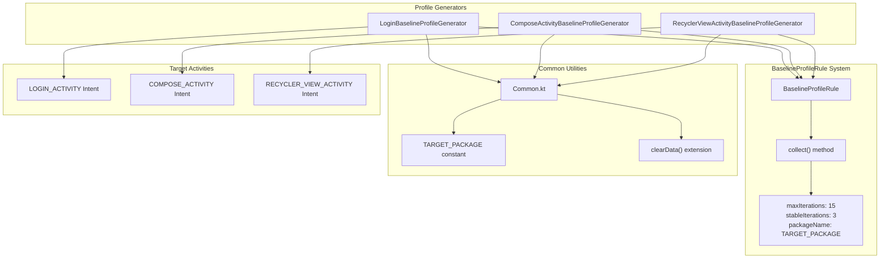
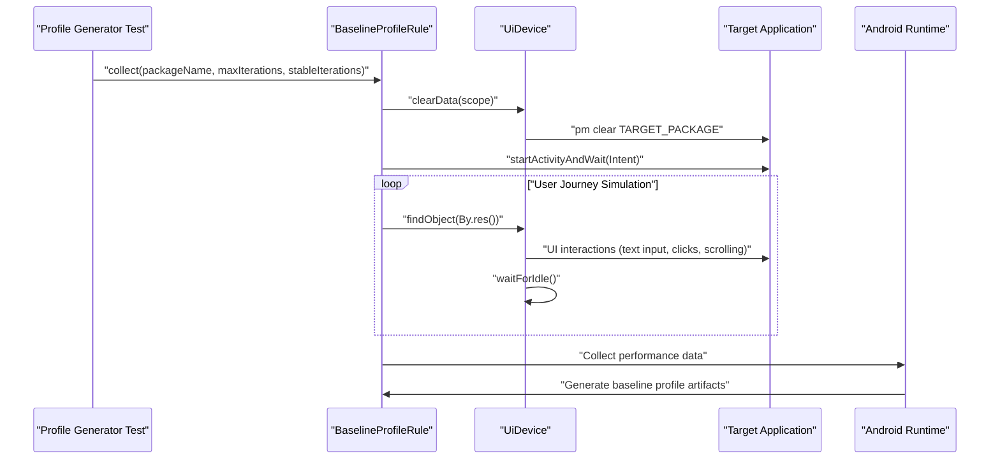

<!-- source: DeepWiki mcp.deepwiki.com · repo android/performance-samples · extra page Baseline Profile Generation · fetched 2026-10-23 -->

# Baseline Profile Generation

<details>
<summary>Relevant source files</summary>

The following files were used as context for generating this wiki page:

- [JankStatsSample/app/src/main/java/com/example/jankstats/tools/simulateJank.kt](JankStatsSample/app/src/main/java/com/example/jankstats/tools/simulateJank.kt)
- [MacrobenchmarkSample/macrobenchmark/src/main/kotlin/com/example/macrobenchmark/baselineprofile/Common.kt](MacrobenchmarkSample/macrobenchmark/src/main/kotlin/com/example/macrobenchmark/baselineprofile/Common.kt)
- [MacrobenchmarkSample/macrobenchmark/src/main/kotlin/com/example/macrobenchmark/baselineprofile/ComposeActivityBaselineProfileGenerator.kt](MacrobenchmarkSample/macrobenchmark/src/main/kotlin/com/example/macrobenchmark/baselineprofile/ComposeActivityBaselineProfileGenerator.kt)
- [MacrobenchmarkSample/macrobenchmark/src/main/kotlin/com/example/macrobenchmark/baselineprofile/LoginBaselineProfileGenerator.kt](MacrobenchmarkSample/macrobenchmark/src/main/kotlin/com/example/macrobenchmark/baselineprofile/LoginBaselineProfileGenerator.kt)
- [MacrobenchmarkSample/macrobenchmark/src/main/kotlin/com/example/macrobenchmark/baselineprofile/RecyclerViewActivityBaselineProfileGenerator.kt](MacrobenchmarkSample/macrobenchmark/src/main/kotlin/com/example/macrobenchmark/baselineprofile/RecyclerViewActivityBaselineProfileGenerator.kt)

</details>


## Purpose and Scope

This document covers the baseline profile generation system within the MacrobenchmarkSample project. Baseline profiles are performance optimization artifacts that improve app startup time and runtime performance by providing ahead-of-time (AOT) compilation hints to the Android Runtime (ART). 

The baseline profile generation system automates the collection of performance data through simulated user journeys, which are then compiled into optimization profiles for production applications. For information about the broader macrobenchmark testing system, see [MacrobenchmarkSample](#2.1). For details on the target activities being profiled, see [Target Application Activities](#2.1.1).

## System Architecture

The baseline profile generation system consists of multiple specialized profile generators, each targeting different user flows and UI patterns within the target application.

### Profile Generator Architecture



Sources: [MacrobenchmarkSample/macrobenchmark/src/main/kotlin/com/example/macrobenchmark/baselineprofile/Common.kt:22-32](), [MacrobenchmarkSample/macrobenchmark/src/main/kotlin/com/example/macrobenchmark/baselineprofile/LoginBaselineProfileGenerator.kt:30-46]()

### User Journey Simulation Flow



Sources: [MacrobenchmarkSample/macrobenchmark/src/main/kotlin/com/example/macrobenchmark/baselineprofile/LoginBaselineProfileGenerator.kt:34-47](), [MacrobenchmarkSample/macrobenchmark/src/main/kotlin/com/example/macrobenchmark/baselineprofile/Common.kt:24-32]()

## Profile Generator Components

### LoginBaselineProfileGenerator

The `LoginBaselineProfileGenerator` class creates baseline profiles for authentication flows by simulating user login interactions.

| Component | Implementation | Purpose |
|-----------|----------------|---------|
| Test Runner | `AndroidJUnit4ClassRunner` | JUnit test execution framework |
| Profile Rule | `BaselineProfileRule` | Orchestrates profile collection |
| User Journey | Login form interaction | Captures authentication flow performance |
| Iterations | `maxIterations = 15, stableIterations = 3` | Ensures statistical reliability |

**Key Implementation Details:**
- Clears application data before each iteration using `device.clearData(this)`
- Launches login activity via `Intent("$packageName.LOGIN_ACTIVITY")`
- Simulates user input: username field (`By.res("userName")`) and password field (`By.res("password")`)
- Triggers login action via `device.findObject(By.res("login")).click()`

Sources: [MacrobenchmarkSample/macrobenchmark/src/main/kotlin/com/example/macrobenchmark/baselineprofile/LoginBaselineProfileGenerator.kt:27-48]()

### ComposeActivityBaselineProfileGenerator

The `ComposeActivityBaselineProfileGenerator` optimizes Jetpack Compose UI performance through scrolling interaction profiles.

**Current Status:** Temporarily ignored due to `StaleObjectException` issues in CI environment ([line 31]()).

**User Journey Pattern:**
- Targets `COMPOSE_ACTIVITY` intent action
- Focuses on `myLazyColumn` scrollable component (`By.res("myLazyColumn")`)
- Implements bidirectional scrolling: `fling(Direction.DOWN)` followed by `fling(Direction.UP)`
- Configures gesture margins for reliable touch interactions (`device.displayWidth / 10`)

Sources: [MacrobenchmarkSample/macrobenchmark/src/main/kotlin/com/example/macrobenchmark/baselineprofile/ComposeActivityBaselineProfileGenerator.kt:31-56]()

### RecyclerViewActivityBaselineProfileGenerator  

The `RecyclerViewActivityBaselineProfileGenerator` creates performance profiles for traditional View-based scrolling components.

**Current Status:** Temporarily ignored due to flinging interaction issues ([line 29]()).

**Target Components:**
- `RECYCLER_VIEW_ACTIVITY` intent action  
- `recycler` resource identifier for RecyclerView component
- Bidirectional fling gestures with configured margins

Sources: [MacrobenchmarkSample/macrobenchmark/src/main/kotlin/com/example/macrobenchmark/baselineprofile/RecyclerViewActivityBaselineProfileGenerator.kt:29-54]()

## Common Utilities

### Shared Constants and Functions

The `Common.kt` file provides shared utilities across all profile generators:

| Utility | Type | Value/Implementation | Purpose |
|---------|------|---------------------|---------|
| `TARGET_PACKAGE` | Constant | `"com.example.macrobenchmark.target"` | Package identifier for target app |
| `clearData()` | Extension Function | `UiDevice.executeShellCommand("pm clear")` | Resets app state between iterations |

### UiDevice.clearData() Extension

```kotlin
fun UiDevice.clearData(scope: MacrobenchmarkScope) {
    val command = "pm clear ${scope.packageName}"
    val output = executeShellCommand(command)
}
```

This extension function ensures clean application state by clearing all app data before each profile collection iteration, preventing interference from previous test runs.

Sources: [MacrobenchmarkSample/macrobenchmark/src/main/kotlin/com/example/macrobenchmark/baselineprofile/Common.kt:17-33]()

## Configuration Parameters

All baseline profile generators use consistent configuration parameters for statistical reliability:

| Parameter | Value | Purpose |
|-----------|-------|---------|
| `maxIterations` | 15 | Maximum number of profile collection attempts |
| `stableIterations` | 3 | Minimum consistent results required |
| `packageName` | `TARGET_PACKAGE` | Target application package identifier |

These parameters balance collection thoroughness with execution time, ensuring statistically significant performance data while maintaining reasonable test duration.

Sources: [MacrobenchmarkSample/macrobenchmark/src/main/kotlin/com/example/macrobenchmark/baselineprofile/LoginBaselineProfileGenerator.kt:35-38](), [MacrobenchmarkSample/macrobenchmark/src/main/kotlin/com/example/macrobenchmark/baselineprofile/ComposeActivityBaselineProfileGenerator.kt:40-43]()

---

