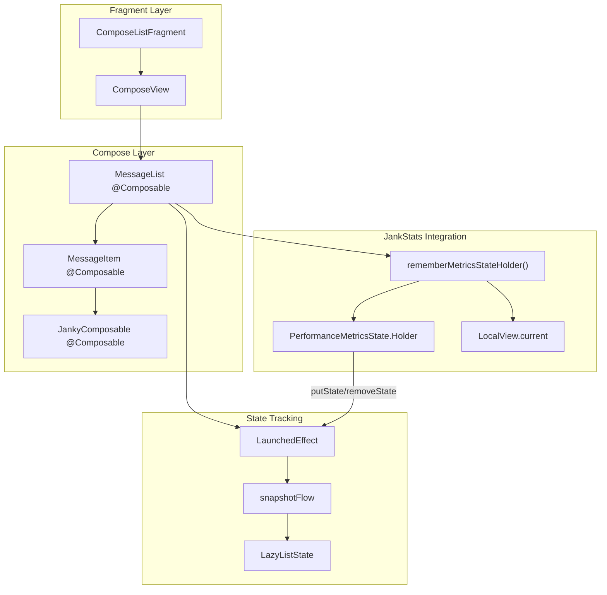
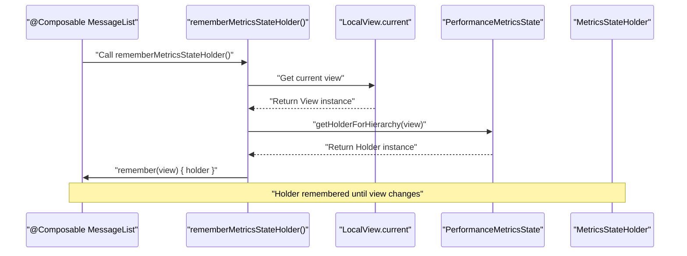
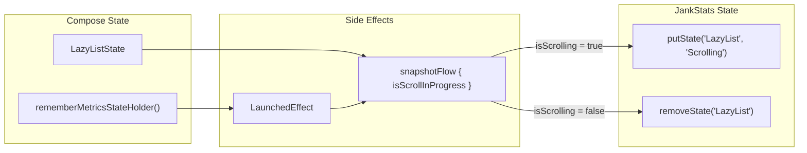
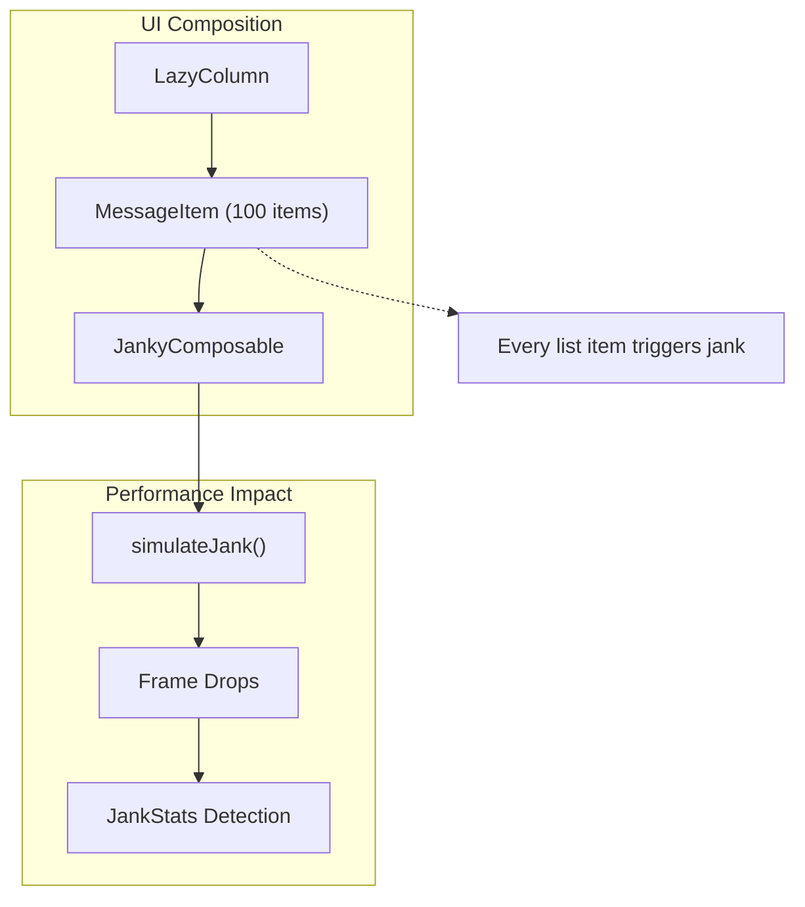

<!-- source: DeepWiki mcp.deepwiki.com · repo android/performance-samples · extra page Compose Integration · fetched 2026-10-23 -->

# Compose Integration

<details>
<summary>Relevant source files</summary>

The following files were used as context for generating this wiki page:

- [JankStatsSample/app/src/main/java/com/example/jankstats/compose/ComposeListFragment.kt](JankStatsSample/app/src/main/java/com/example/jankstats/compose/ComposeListFragment.kt)
- [JankStatsSample/app/src/main/java/com/example/jankstats/compose/rememberMetricsStateHolder.kt](JankStatsSample/app/src/main/java/com/example/jankstats/compose/rememberMetricsStateHolder.kt)
- [JankStatsSample/app/src/main/res/drawable/ic_compose.xml](JankStatsSample/app/src/main/res/drawable/ic_compose.xml)
- [JankStatsSample/app/src/main/res/drawable/ic_construction.xml](JankStatsSample/app/src/main/res/drawable/ic_construction.xml)
- [JankStatsSample/app/src/main/res/drawable/ic_views.xml](JankStatsSample/app/src/main/res/drawable/ic_views.xml)
- [JankStatsSample/app/src/main/res/layout/activity_jank_logging.xml](JankStatsSample/app/src/main/res/layout/activity_jank_logging.xml)
- [JankStatsSample/app/src/main/res/menu/bottom_menu.xml](JankStatsSample/app/src/main/res/menu/bottom_menu.xml)

</details>


## Purpose and Scope

This document covers how JankStats integrates with Jetpack Compose UI components within the JankStatsSample project. It demonstrates the patterns and utilities for monitoring UI performance in Compose-based screens, including state reporting and real-time jank detection.

For information about the overall JankStatsSample architecture and traditional View-based monitoring approaches, see [Real-time Monitoring Approaches](#2.2.1).

## Architecture Overview

The Compose integration in JankStatsSample provides utilities and patterns for monitoring performance in Compose-based UI hierarchies. The system centers around the `rememberMetricsStateHolder()` utility function and demonstrates performance state reporting within Compose components.

**Compose Integration Architecture**


Sources: [JankStatsSample/app/src/main/java/com/example/jankstats/compose/ComposeListFragment.kt:1-128](), [JankStatsSample/app/src/main/java/com/example/jankstats/compose/rememberMetricsStateHolder.kt:1-18]()

## MetricsStateHolder Utility

The `rememberMetricsStateHolder()` function provides the core integration point between Compose and JankStats. This utility handles the retrieval and lifecycle management of the performance metrics state holder within Compose components.

| Component | Purpose | Key Methods |
|-----------|---------|-------------|
| `rememberMetricsStateHolder()` | Retrieve and remember MetricsStateHolder from Compose context | `remember(view)` |
| `LocalView.current` | Access current view from Compose context | View access |
| `PerformanceMetricsState.getHolderForHierarchy()` | Get holder for view hierarchy | State holder creation |

**MetricsStateHolder Integration Flow**


The implementation uses the `remember` function with the current view as a key, ensuring the holder is recreated when the view hierarchy changes:

[JankStatsSample/app/src/main/java/com/example/jankstats/compose/rememberMetricsStateHolder.kt:13-16]()

Sources: [JankStatsSample/app/src/main/java/com/example/jankstats/compose/rememberMetricsStateHolder.kt:1-18]()

## ComposeListFragment Implementation

The `ComposeListFragment` demonstrates a complete integration of JankStats with a Compose-based UI. It uses a `ComposeView` to host Compose content and sets up proper lifecycle management using `ViewCompositionStrategy.DisposeOnLifecycleDestroyed`.

### Fragment Structure

The fragment follows the standard pattern for integrating Compose with Fragment-based navigation:

| Component | Role | Configuration |
|-----------|------|---------------|
| `ComposeView` | Host for Compose content | Created in `onCreateView()` |
| `ViewCompositionStrategy` | Lifecycle management | `DisposeOnLifecycleDestroyed(viewLifecycleOwner)` |
| `MaterialTheme` | Theming wrapper | Applied to root content |
| Navigation integration | Fragment navigation | `findNavController().navigate()` |

[JankStatsSample/app/src/main/java/com/example/jankstats/compose/ComposeListFragment.kt:51-67]()

### MessageList Composable

The `MessageList` composable demonstrates the core pattern for JankStats integration in Compose:

**Performance State Reporting Pattern**


The implementation uses `LaunchedEffect` to avoid recomposition when reporting state changes:

[JankStatsSample/app/src/main/java/com/example/jankstats/compose/ComposeListFragment.kt:74-86]()

Sources: [JankStatsSample/app/src/main/java/com/example/jankstats/compose/ComposeListFragment.kt:1-128]()

## State Reporting Patterns

### Scrolling State Detection

The system tracks `LazyColumn` scrolling state using `snapshotFlow` to monitor `listState.isScrollInProgress`. This pattern ensures performance state is reported without causing unnecessary recompositions:

```kotlin
// From ComposeListFragment.kt:77-85
LaunchedEffect(metricsStateHolder, listState) {
    snapshotFlow { listState.isScrollInProgress }.collect { isScrolling ->
        if (isScrolling) {
            metricsStateHolder.state?.putState("LazyList", "Scrolling")
        } else {
            metricsStateHolder.state?.removeState("LazyList")
        }
    }
}
```

### Performance Impact Simulation

The `JankyComposable` demonstrates how performance issues can be detected by JankStats. It intentionally calls `simulateJank()` during composition to create measurable performance degradation:

| Component | Purpose | Performance Impact |
|-----------|---------|-------------------|
| `JankyComposable` | Simulate performance issues | Calls `simulateJank()` |
| `MessageItem` | List item wrapper | Contains `JankyComposable` |
| `simulateJank()` | Performance degradation | Intentional blocking operation |

**Jank Simulation Flow**


[JankStatsSample/app/src/main/java/com/example/jankstats/compose/ComposeListFragment.kt:112-121]()

Sources: [JankStatsSample/app/src/main/java/com/example/jankstats/compose/ComposeListFragment.kt:89-121]()

## Integration Guidelines

### Key Implementation Patterns

1. **MetricsStateHolder Retrieval**: Use `rememberMetricsStateHolder()` to get the appropriate state holder for the current view hierarchy
2. **Side Effect Usage**: Report state changes from `LaunchedEffect` to prevent recomposition
3. **State Key Naming**: Use descriptive keys like `"LazyList"` for different UI components
4. **State Lifecycle**: Call `putState()` when entering a performance-critical state and `removeState()` when exiting

### Performance Considerations

The Compose integration is designed to minimize performance overhead:

- State holder is remembered and reused until view changes
- State reporting happens in side effects, not during composition
- `snapshotFlow` efficiently tracks state changes without continuous polling

Sources: [JankStatsSample/app/src/main/java/com/example/jankstats/compose/ComposeListFragment.kt:73-86](), [JankStatsSample/app/src/main/java/com/example/jankstats/compose/rememberMetricsStateHolder.kt:8-17]()

---

