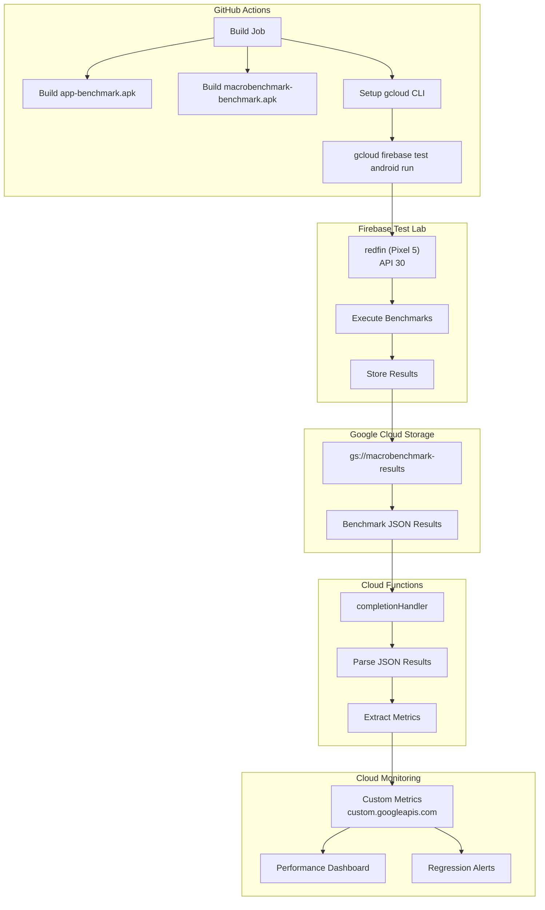
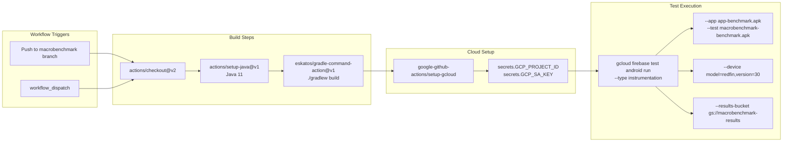
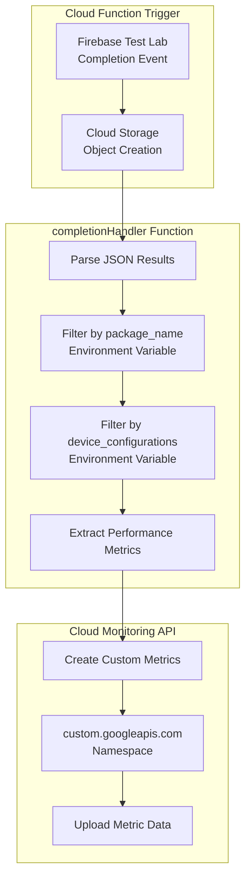
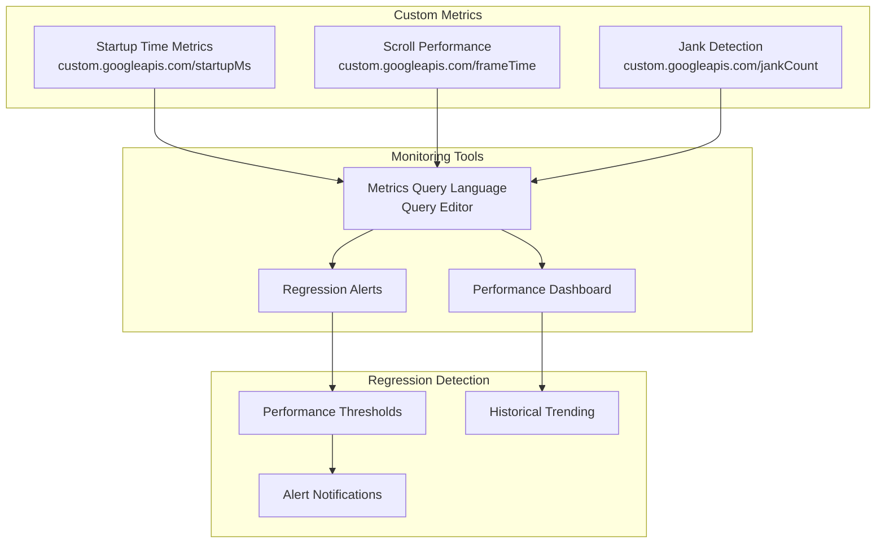

<!-- source: DeepWiki mcp.deepwiki.com · repo android/performance-samples · extra page Firebase Test Lab Integration · fetched 2026-10-23 -->

# Firebase Test Lab Integration

<details>
<summary>Relevant source files</summary>

The following files were used as context for generating this wiki page:

- [MacrobenchmarkSample/ftl/README.md](MacrobenchmarkSample/ftl/README.md)
- [MacrobenchmarkSample/ftl/images/cloud_function_configuration.png](MacrobenchmarkSample/ftl/images/cloud_function_configuration.png)
- [MacrobenchmarkSample/ftl/images/cloud_function_invocation.png](MacrobenchmarkSample/ftl/images/cloud_function_invocation.png)
- [MacrobenchmarkSample/ftl/images/cloud_function_settings.png](MacrobenchmarkSample/ftl/images/cloud_function_settings.png)
- [MacrobenchmarkSample/ftl/images/custom_startupMs_maximum.png](MacrobenchmarkSample/ftl/images/custom_startupMs_maximum.png)
- [MacrobenchmarkSample/ftl/images/github_actions.png](MacrobenchmarkSample/ftl/images/github_actions.png)
- [MacrobenchmarkSample/ftl/images/monitoring.png](MacrobenchmarkSample/ftl/images/monitoring.png)

</details>


This document describes the Firebase Test Lab integration system for the MacrobenchmarkSample project, which provides automated performance testing and regression detection in the cloud. This system runs macrobenchmarks on physical devices in Firebase Test Lab as part of the CI/CD pipeline and monitors performance metrics over time.

For information about the target application being benchmarked, see [Target Application Activities](#2.1.1). For details about the broader CI/CD infrastructure, see [GitHub Actions Workflows](#3.1) and [Firebase Cloud Functions](#3.2).

## Architecture Overview

The Firebase Test Lab integration consists of three main components that work together to provide automated performance testing and monitoring:



Sources: [MacrobenchmarkSample/ftl/README.md:1-288]()

## GitHub Actions Workflow Integration

The Firebase Test Lab integration is triggered by GitHub Actions workflows that build the necessary APK files and submit them for testing:



Sources: [MacrobenchmarkSample/ftl/README.md:52-108](), [MacrobenchmarkSample/ftl/README.md:111-177]()

## Test Execution Configuration

The Firebase Test Lab execution uses specific configuration parameters to ensure consistent and reliable benchmarking:

| Parameter | Value | Purpose |
|-----------|--------|---------|
| `--type` | `instrumentation` | Specifies the test type |
| `--app` | `app-benchmark.apk` | Target application APK |
| `--test` | `macrobenchmark-benchmark.apk` | Test instrumentation APK |
| `--device` | `model=redfin,version=30,locale=en,orientation=portrait` | Consistent device specification |
| `--directories-to-pull` | `/sdcard/Download` | Pull benchmark output files |
| `--results-bucket` | `gs://macrobenchmark-results` | Cloud Storage destination |
| `--environment-variables` | `additionalTestOutputDir=/sdcard/Download,no-isolated-storage=true` | Benchmark library configuration |
| `--timeout` | `20m` | Maximum test execution time |

The device specification ensures tests run on a consistent hardware configuration (Pixel 5 with Android API 30) to enable meaningful performance comparisons across test runs.

Sources: [MacrobenchmarkSample/ftl/README.md:166-177](), [MacrobenchmarkSample/ftl/README.md:179-187]()

## Cloud Function Processing

The `completionHandler` Cloud Function automatically processes benchmark results when Firebase Test Lab completes:



### Environment Variables Configuration

The Cloud Function requires specific environment variables for proper operation:

| Variable | Example Value | Description |
|----------|---------------|-------------|
| `package_name` | `"com.example.macrobenchmark"` | Target app package name for filtering |
| `device_configurations` | `["redfin-30-en-portrait"]` | Device configurations to track |

These variables are configured in the Google Cloud Console under the function's runtime settings with recommended memory allocation of 4GiB and timeout of 500 seconds.

Sources: [MacrobenchmarkSample/ftl/README.md:189-276](), [MacrobenchmarkSample/ftl/README.md:234-258]()

## Monitoring and Alerting

The system creates custom metrics in Google Cloud Monitoring for performance tracking and regression detection:



The custom metrics use the `custom.googleapis.com` namespace and can be queried using MQL (Metrics Query Language) to create dashboards and set up alerts for performance regressions.

Sources: [MacrobenchmarkSample/ftl/README.md:275-288]()

## Setup Requirements

### One-Time Configuration

1. **Google Cloud Project Setup**
   - Create Firebase project with Blaze plan for adequate quota
   - Create Cloud Storage bucket named `macrobenchmark-results`
   - Deploy the Cloud Function with proper IAM permissions

2. **GitHub Secrets**
   - `GCP_PROJECT_ID`: Google Cloud Platform project ID
   - `GCP_CREDENTIALS`: Service account key JSON for authentication

3. **Service Account Permissions**
   - Firebase Test Lab API access
   - Cloud Storage read/write permissions
   - Cloud Monitoring write permissions

### Cloud Function Deployment

The Cloud Function is deployed using Firebase CLI:

```bash
# Initialize gcloud and firebase CLI
gcloud auth login
firebase login
gcloud config set project <your_project_id>

# Deploy the function
firebase deploy --only functions
```

The function source code and configuration are located in the MacrobenchmarkSample functions directory and include the necessary `package.json` and deployment configuration.

Sources: [MacrobenchmarkSample/ftl/README.md:19-51](), [MacrobenchmarkSample/ftl/README.md:194-232]()

---

