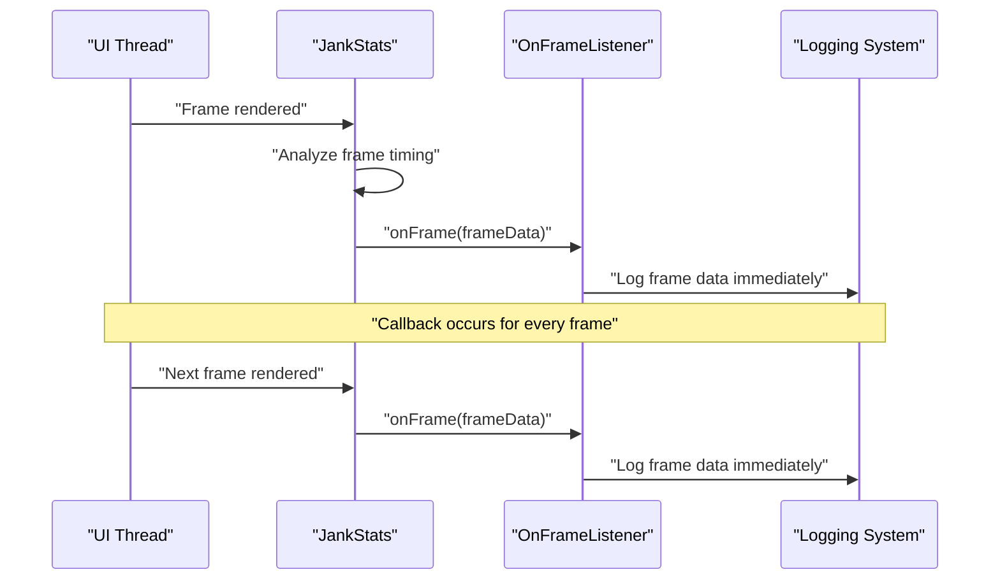
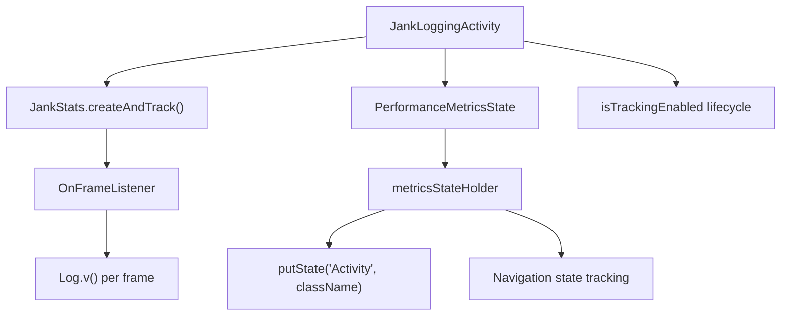
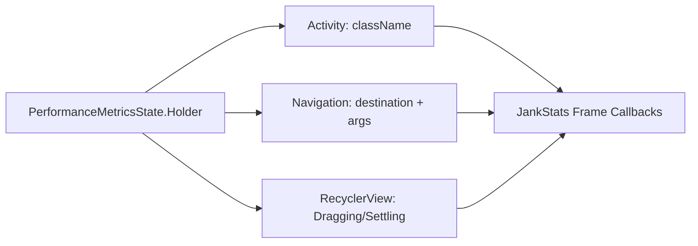
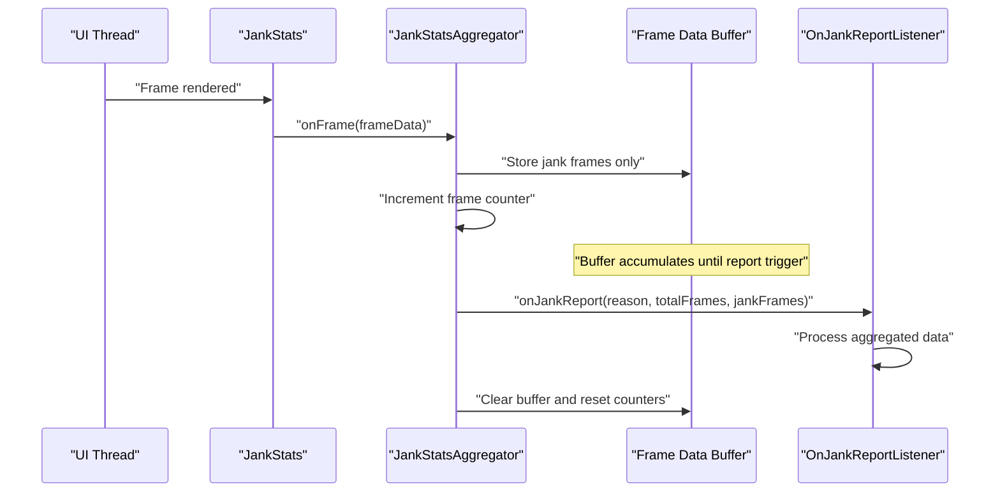
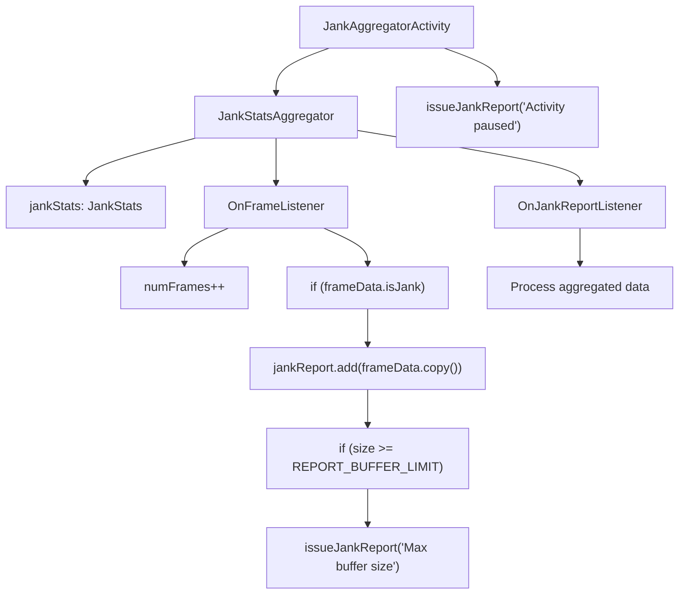
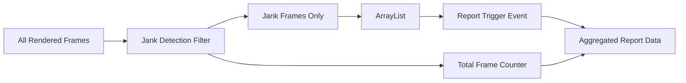
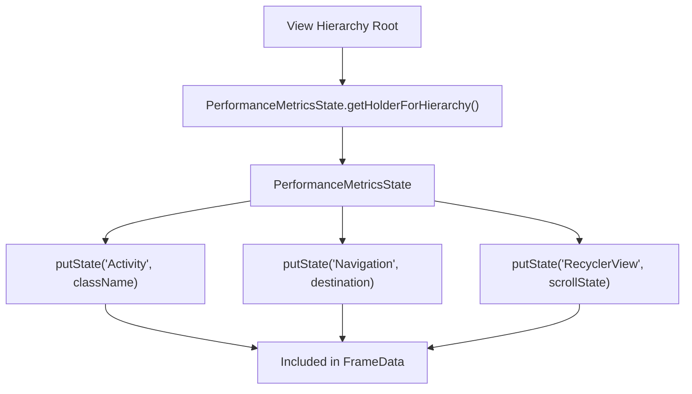
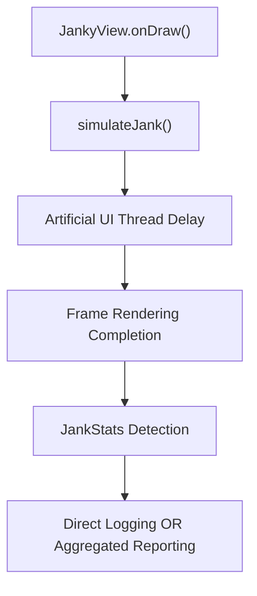

<!-- source: DeepWiki mcp.deepwiki.com · repo android/performance-samples · extra page Real-time Monitoring Approaches · fetched 2026-10-23 -->

# Real-time Monitoring Approaches

Relevant source files

The following files were used as context for generating this wiki page:

- [JankStatsSample/app/src/main/java/com/example/jankstats/JankAggregatorActivity.kt](JankStatsSample/app/src/main/java/com/example/jankstats/JankAggregatorActivity.kt)
- [JankStatsSample/app/src/main/java/com/example/jankstats/JankLoggingActivity.kt](JankStatsSample/app/src/main/java/com/example/jankstats/JankLoggingActivity.kt)
- [JankStatsSample/app/src/main/java/com/example/jankstats/JankStatsAggregator.kt](JankStatsSample/app/src/main/java/com/example/jankstats/JankStatsAggregator.kt)
- [JankStatsSample/app/src/main/java/com/example/jankstats/JankyView.kt](JankStatsSample/app/src/main/java/com/example/jankstats/JankyView.kt)
- [JankStatsSample/app/src/main/java/com/example/jankstats/MessageListFragment.kt](JankStatsSample/app/src/main/java/com/example/jankstats/MessageListFragment.kt)

This document explains the two distinct approaches for implementing real-time UI performance monitoring using the JankStats library in Android applications. The JankStatsSample project demonstrates both direct per-frame logging and aggregated reporting patterns, each suited for different use cases and performance requirements.

For information about the overall JankStatsSample project architecture, see [JankStatsSample](#2.2). For details on Compose-specific integration patterns, see [Compose Integration](#2.2.2).

## Overview of Monitoring Approaches

The JankStats library provides flexibility in how applications collect and process UI performance data. The sample demonstrates two primary patterns:

| Approach | Implementation | Use Case | Performance Impact |
|----------|----------------|----------|-------------------|
| **Direct Logging** | `JankLoggingActivity` | Development, debugging, detailed analysis | Higher overhead per frame |
| **Aggregated Reporting** | `JankAggregatorActivity` + `JankStatsAggregator` | Production monitoring, periodic reporting | Lower overhead, batched processing |

## Direct Per-Frame Logging Approach

The direct logging approach provides immediate, granular access to performance data for every rendered frame. This pattern is implemented in `JankLoggingActivity` and offers real-time visibility into UI performance.

### Architecture Flow

### Implementation Details

The direct logging implementation creates a `JankStats` instance with an immediate callback mechanism:

The key components include:

- **Frame Listener**: [JankStatsSample/app/src/main/java/com/example/jankstats/JankLoggingActivity.kt:48-52]() defines the callback that processes each frame
- **JankStats Initialization**: [JankStatsSample/app/src/main/java/com/example/jankstats/JankLoggingActivity.kt:66]() creates and configures the monitoring instance
- **Performance State**: [JankStatsSample/app/src/main/java/com/example/jankstats/JankLoggingActivity.kt:63-69]() establishes context for performance metrics
- **Lifecycle Management**: [JankStatsSample/app/src/main/java/com/example/jankstats/JankLoggingActivity.kt:77-86]() controls when tracking is active

### State Management Integration

The direct logging approach demonstrates comprehensive state tracking across different UI components:

Navigation state tracking is implemented in [JankStatsSample/app/src/main/java/com/example/jankstats/JankLoggingActivity.kt:107-116](), while RecyclerView state management is shown in [JankStatsSample/app/src/main/java/com/example/jankstats/MessageListFragment.kt:42-60]().

**Sources**: JankStatsSample/app/src/main/java/com/example/jankstats/JankLoggingActivity.kt, JankStatsSample/app/src/main/java/com/example/jankstats/MessageListFragment.kt

## Aggregated Reporting Approach

The aggregated reporting approach collects performance data over time and issues periodic reports, reducing the frequency of callbacks and processing overhead. This pattern uses the `JankStatsAggregator` utility class to buffer and batch process frame data.

### Architecture Flow

### Implementation Architecture

The aggregated approach introduces an intermediate layer that manages data collection and reporting:

### Buffer Management and Reporting Triggers

The `JankStatsAggregator` implements several mechanisms to trigger report generation:

- **Buffer Size Limit**: [JankStatsSample/app/src/main/java/com/example/jankstats/JankStatsAggregator.kt:46-48]() automatically issues reports when the buffer reaches 1000 frames
- **Lifecycle Events**: [JankStatsSample/app/src/main/java/com/example/jankstats/JankAggregatorActivity.kt:93-94]() triggers reports when the activity pauses
- **Manual Reporting**: [JankStatsSample/app/src/main/java/com/example/jankstats/JankStatsAggregator.kt:70-76]() allows applications to issue reports on demand

### Data Processing Efficiency

The aggregated approach optimizes data handling through selective buffering:

The aggregator only stores `FrameData` for frames that experience jank ([JankStatsSample/app/src/main/java/com/example/jankstats/JankStatsAggregator.kt:44-45]()), while maintaining a count of all frames for comprehensive reporting.

**Sources**: JankStatsSample/app/src/main/java/com/example/jankstats/JankAggregatorActivity.kt, JankStatsSample/app/src/main/java/com/example/jankstats/JankStatsAggregator.kt

## Performance State Integration

Both monitoring approaches integrate with the `PerformanceMetricsState` system to provide contextual information about the application state when performance issues occur.

### State Management Pattern

### Component-Specific State Tracking

The sample demonstrates state tracking patterns for different UI components:

| Component | State Information | Implementation |
|-----------|-------------------|----------------|
| **Activity** | Class name identification | [JankLoggingActivity.kt:69]() |
| **Navigation** | Current destination and arguments | [JankLoggingActivity.kt:110-115]() |
| **RecyclerView** | Scroll state (Dragging/Settling) | [MessageListFragment.kt:47-57]() |

**Sources**: JankStatsSample/app/src/main/java/com/example/jankstats/JankLoggingActivity.kt, JankStatsSample/app/src/main/java/com/example/jankstats/MessageListFragment.kt

## Performance Testing Integration

Both approaches integrate with artificial jank generation for testing and validation purposes through the `JankyView` component.

### Jank Simulation Architecture

The `JankyView` implementation [JankStatsSample/app/src/main/java/com/example/jankstats/JankyView.kt:36-38]() demonstrates how to create reproducible performance testing scenarios for validating monitoring implementations.

**Sources**: JankStatsSample/app/src/main/java/com/example/jankstats/JankyView.kt

## Approach Selection Guidelines

The choice between direct logging and aggregated reporting depends on specific application requirements:

### Direct Logging Use Cases
- Development and debugging phases
- Detailed frame-by-frame analysis requirements
- Applications with low frame rates or infrequent UI updates
- Scenarios requiring immediate performance feedback

### Aggregated Reporting Use Cases
- Production monitoring systems
- Applications with high frame rates
- Memory-constrained environments
- Periodic performance analysis requirements
- Integration with analytics and monitoring services

Both approaches provide comprehensive performance monitoring capabilities while offering different trade-offs between granularity and efficiency.

**Sources**: JankStatsSample/app/src/main/java/com/example/jankstats/JankLoggingActivity.kt, JankStatsSample/app/src/main/java/com/example/jankstats/JankAggregatorActivity.kt, JankStatsSample/app/src/main/java/com/example/jankstats/JankStatsAggregator.kt

---

