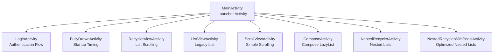
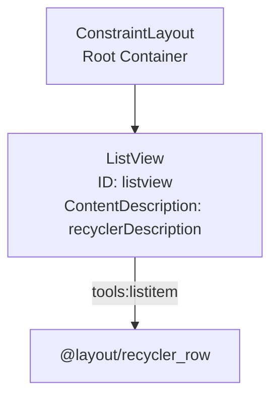
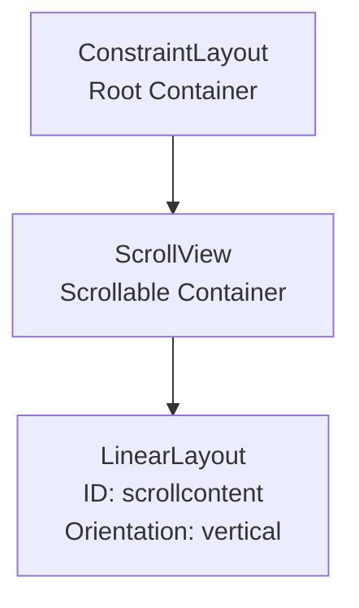

<!-- source: DeepWiki mcp.deepwiki.com · repo android/performance-samples · extra page Target Application Activities · fetched 2026-10-23 -->

# Target Application Activities

Relevant source files

The following files were used as context for generating this wiki page:

- [MacrobenchmarkSample/app/src/main/res/layout/activity_list_view.xml](MacrobenchmarkSample/app/src/main/res/layout/activity_list_view.xml)
- [MacrobenchmarkSample/app/src/main/res/layout/activity_scroll_view.xml](MacrobenchmarkSample/app/src/main/res/layout/activity_scroll_view.xml)
- [MacrobenchmarkSample/app/src/main/res/values/strings.xml](MacrobenchmarkSample/app/src/main/res/values/strings.xml)

This document covers the target application activities within the MacrobenchmarkSample's `:app` module. These activities serve as benchmarking targets for performance measurement and are designed to test different UI patterns and scenarios. For information about the actual benchmark implementations that measure these activities, see [Baseline Profile Generation](#2.1.2).

## Purpose and Scope

The target activities in the MacrobenchmarkSample app module represent various common Android UI patterns and use cases that need performance optimization. Each activity is designed to demonstrate specific performance characteristics and serve as a consistent target for macrobenchmark tests. These activities include traditional View-based UIs, Jetpack Compose implementations, and different scrolling patterns.

## Activity Architecture Overview

The target application follows a launcher-based architecture where `MainActivity` serves as the entry point to navigate to specialized activities for benchmarking different UI patterns.

### Activity Navigation Structure

Sources: [MacrobenchmarkSample/app/src/main/res/values/strings.xml:21-28]()

## Activity Categories

The target activities are organized into distinct categories based on their performance testing purpose:

| Category | Activities | Purpose |
|----------|------------|---------|
| **Startup & Navigation** | `MainActivity`, `LoginActivity`, `FullyDrawnActivity` | App launch and navigation timing |
| **List Performance** | `RecyclerViewActivity`, `ListViewActivity`, `ComposeActivity` | Scrolling and list rendering |
| **Simple Scrolling** | `ScrollViewActivity` | Basic scroll performance |
| **Complex Layouts** | `NestedRecyclerActivity`, `NestedRecyclerWithPoolsActivity` | Advanced UI pattern optimization |

## Core Target Activities

### MainActivity (Launcher)
The main entry point that provides navigation to all other benchmark target activities. This activity serves as the starting point for app launch benchmarks and provides a consistent navigation interface.

### Login and Authentication Flow
The `LoginActivity` represents authentication workflows commonly found in production applications. This activity is referenced in the strings as `launchLoginActivity` and is used to benchmark user authentication flows.

### List-Based Activities

#### RecyclerViewActivity
Implements RecyclerView-based lists for measuring list scrolling performance. This is one of the most common UI patterns in Android applications and serves as a primary target for scroll jank measurements.

#### ListViewActivity
Implements the legacy ListView pattern for comparison testing against RecyclerView implementations. The layout is defined in `activity_list_view.xml` with a basic ListView configuration.

#### ComposeActivity
Implements Compose-based LazyList patterns for measuring Jetpack Compose list performance. Referenced as `launchComposeList` in the strings, this activity allows comparison between traditional View-based lists and Compose implementations.

### Scrolling Pattern Activities

#### ScrollViewActivity
Implements basic ScrollView patterns for simple scrolling benchmarks. The layout uses a LinearLayout within a ScrollView for measuring basic scroll performance without complex list recycling.

### Complex Layout Activities

#### NestedRecyclerActivity
Implements nested RecyclerView patterns to test complex scrolling scenarios with multiple levels of lists. This represents more challenging UI patterns that can impact performance.

#### NestedRecyclerWithPoolsActivity
Implements optimized nested RecyclerView patterns using shared RecyclerView pools. This demonstrates performance optimization techniques for complex nested scrolling scenarios.

## Layout Configuration Patterns

### ListView Implementation
The ListView activity uses a constraint-based layout with content description for accessibility:

Sources: [MacrobenchmarkSample/app/src/main/res/layout/activity_list_view.xml:16-33]()

### ScrollView Implementation
The ScrollView activity uses a nested layout structure for dynamic content:

Sources: [MacrobenchmarkSample/app/src/main/res/layout/activity_scroll_view.xml:16-41]()

## Benchmarking Integration

These target activities are designed to work with the macrobenchmark module's performance tests. Each activity provides specific UI patterns that can be measured for:

- **Startup Time**: How quickly activities launch and become interactive
- **Frame Timing**: Jank detection during scrolling and interactions  
- **Memory Usage**: Resource consumption during different UI operations
- **Composition Performance**: Jetpack Compose rendering efficiency

The activities use consistent naming conventions and are referenced through the string resources to ensure reliable benchmark targeting.

Sources: [MacrobenchmarkSample/app/src/main/res/values/strings.xml:17-29]()

---

