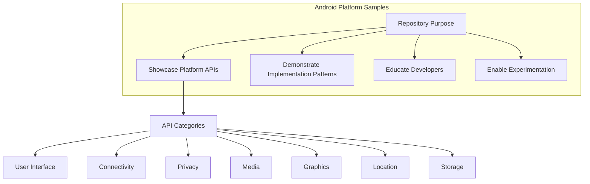
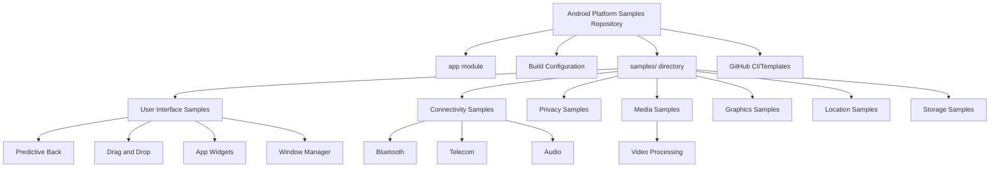
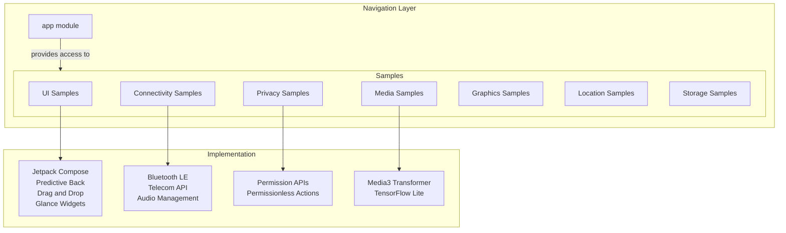
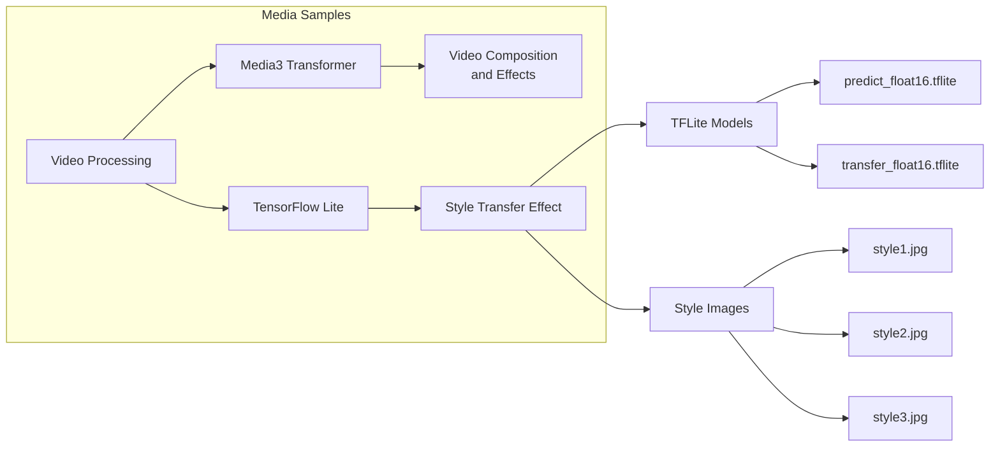
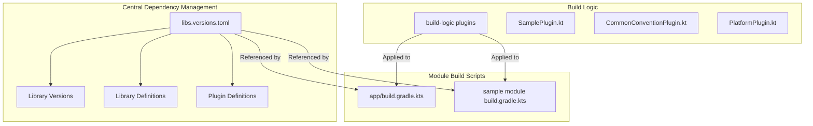
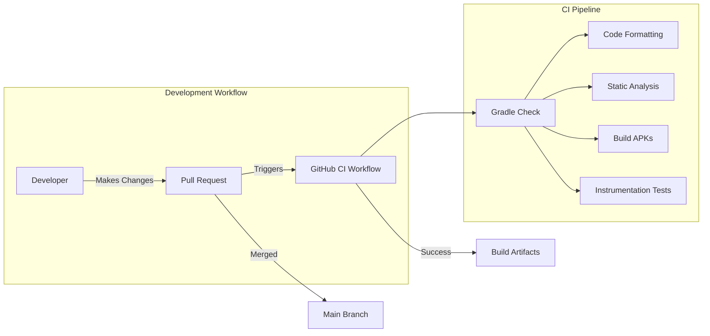

<!-- source: DeepWiki mcp.deepwiki.com · repo android/platform-samples · page 1 Overview · fetched 2026-10-23 -->

# Overview

Relevant source files

The following files were used as context for generating this wiki page:

- [.editorconfig](.editorconfig)
- [.github/ISSUE_TEMPLATE/bug_report.yml](.github/ISSUE_TEMPLATE/bug_report.yml)
- [.github/ISSUE_TEMPLATE/feature_request.yml](.github/ISSUE_TEMPLATE/feature_request.yml)
- [.github/PULL_REQUEST_TEMPLATE/pull_request_template.md](.github/PULL_REQUEST_TEMPLATE/pull_request_template.md)
- [.gitignore](.gitignore)
- [README.md](README.md)
- [app/src/main/AndroidManifest.xml](app/src/main/AndroidManifest.xml)
- [build.gradle.kts](build.gradle.kts)
- [samples/media/video/build.gradle.kts](samples/media/video/build.gradle.kts)
- [samples/media/video/download_model.gradle](samples/media/video/download_model.gradle)
- [samples/media/video/src/main/assets/style1.jpg](samples/media/video/src/main/assets/style1.jpg)
- [samples/media/video/src/main/assets/style2.jpg](samples/media/video/src/main/assets/style2.jpg)
- [samples/media/video/src/main/assets/style3.jpg](samples/media/video/src/main/assets/style3.jpg)
- [samples/media/video/src/main/java/com/example/platform/media/video/StyleTransferEffect.kt](samples/media/video/src/main/java/com/example/platform/media/video/StyleTransferEffect.kt)
- [samples/media/video/src/main/java/com/example/platform/media/video/TransformerTFLite.kt](samples/media/video/src/main/java/com/example/platform/media/video/TransformerTFLite.kt)
- [tools/pre-push](tools/pre-push)

The Android Platform Samples repository is a comprehensive collection of code samples demonstrating various Android platform APIs and capabilities. This documentation provides a high-level overview of the repository's structure, organization, and how to navigate the samples effectively.

The repository showcases specific Android functionalities in isolated, focused examples that are designed to illustrate best practices for implementing particular platform features. These samples are not intended for production use but rather as learning resources for developers integrating platform capabilities into their own applications.

For detailed information about the build system and dependency management used throughout the repository, see [Build System and Dependencies](#2).

Sources: [README.md:3-10]()

## Repository Purpose and Scope

This repository serves as a centralized resource for developers to:

1. Explore implementation examples of Android platform APIs
2. Understand recommended patterns for specific platform features
3. Learn how to leverage new platform capabilities
4. Experiment with code that demonstrates targeted functionality

The samples cover a wide range of platform areas including user interface components, connectivity features, privacy implementations, media handling, graphics, location services, and storage access patterns.

Sources: [README.md:3-10](), [README.md:12-24]()

## Repository Organization

The repository is structured with a clear organization designed to help developers find relevant samples. All samples are organized into topic-specific folders, with each sample folder containing its own implementation along with documentation.

Sources: [README.md:12-24]()

## Sample Architecture

Each sample is developed as a standalone module that demonstrates a specific platform capability. This isolation ensures that developers can understand each feature without being overwhelmed by unnecessary dependencies or complexity.

The repository uses an `app` module that serves as a container for accessing samples. This module is primarily a navigation mechanism and is not essential to understand the sample functionality itself.

Sources: [README.md:30-37](), [app/src/main/AndroidManifest.xml:16-43]()

## Media Processing Capabilities

The repository includes examples of advanced media processing, particularly focused on video transformation using Media3 Transformer and TensorFlow Lite for style transfer effects.

Sources: [samples/media/video/build.gradle.kts:42-79](), [samples/media/video/src/main/java/com/example/platform/media/video/TransformerTFLite.kt:52-266](), [samples/media/video/src/main/java/com/example/platform/media/video/StyleTransferEffect.kt:1-185]()

## Build and Dependency Management

The repository implements a centralized dependency management system using a version catalog in `libs.versions.toml`. This file defines versions, libraries, and plugins used throughout the project, ensuring consistency across all samples.

Sources: [build.gradle.kts:16-21]()

## Development Workflow

The repository includes robust CI/CD integration through GitHub workflows, ensuring code quality through automated builds, tests, and code style checks. Developers can contribute by following the workflow described in the repository documentation.

Sources: [.github/PULL_REQUEST_TEMPLATE/pull_request_template.md:1-15](), [tools/pre-push:1-96]()

## Running the Samples

To explore the samples, you can clone the repository, open it in Android Studio, and run the `app` configuration. This will launch a navigator application that allows you to browse through the available samples and run them individually.

| Step | Description |
|------|-------------|
| 1 | Clone the repository |
| 2 | Open the project in Android Studio |
| 3 | Sync & Run the `app` configuration |
| 4 | Navigate through categories in the samples list screen |
| 5 | Select a sample to view its implementation |

Sources: [README.md:26-37]()

## Issue Reporting and Contributions

The repository welcomes contributions from the community. If you encounter issues with any sample, you can report them using the GitHub issue tracker. When submitting pull requests, ensure that your code passes all tests and formatting checks.

Sources: [README.md:39-50](), [.github/ISSUE_TEMPLATE/bug_report.yml:1-60](), [.github/ISSUE_TEMPLATE/feature_request.yml:1-54]()

---

