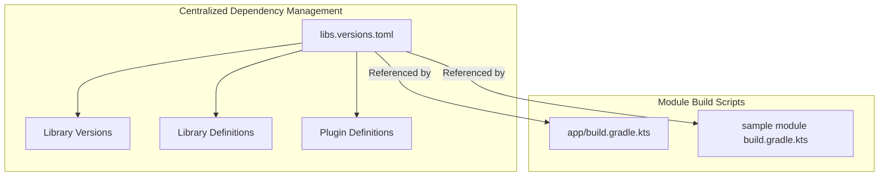
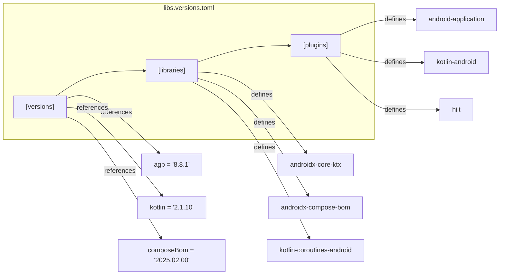
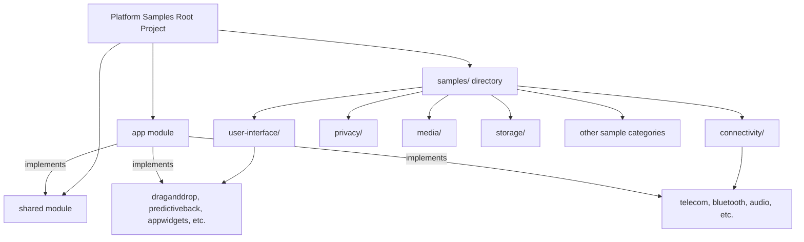
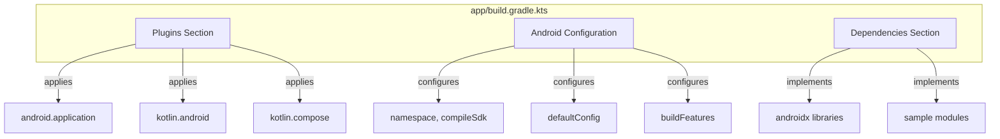
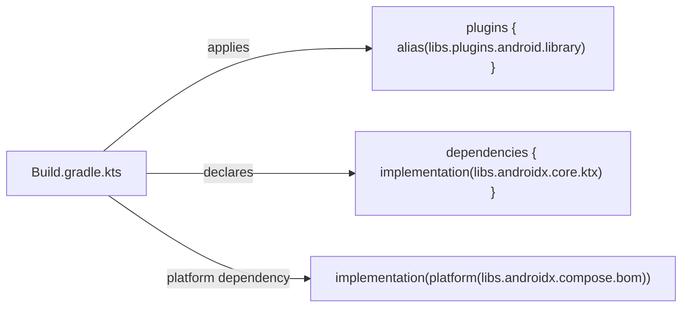
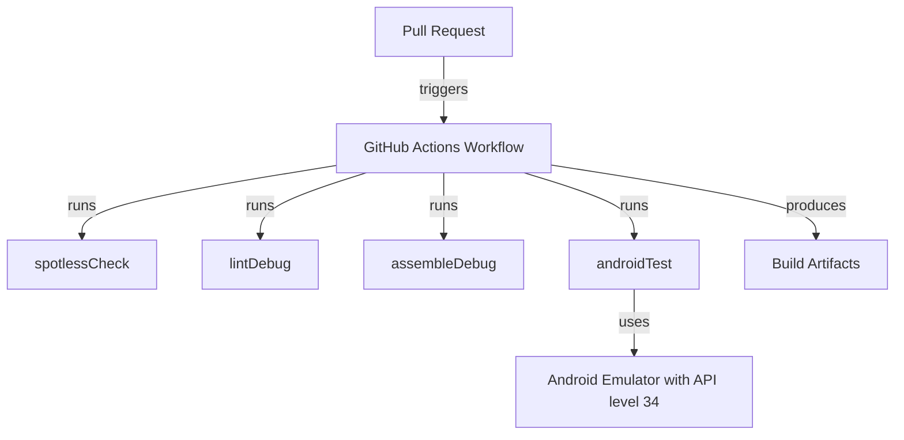
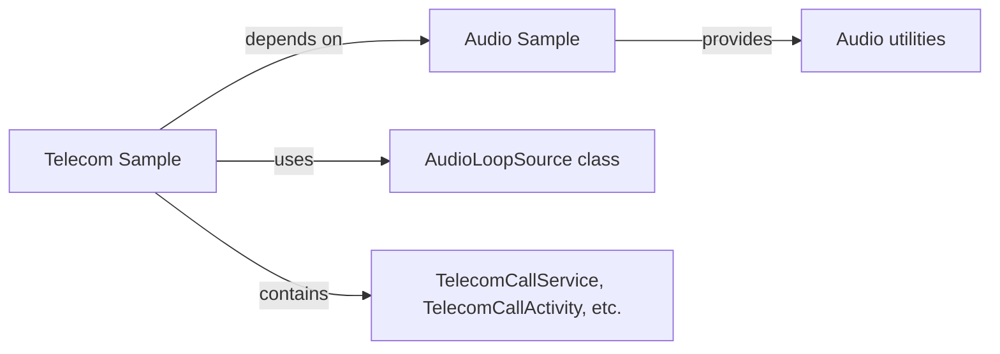

<!-- source: DeepWiki mcp.deepwiki.com · repo android/platform-samples · page 2 Build System and Dependencies · fetched 2026-10-23 -->

# Build System and Dependencies

<details>
<summary>Relevant source files</summary>

The following files were used as context for generating this wiki page:

- [.github/ISSUE_TEMPLATE/config.yml](.github/ISSUE_TEMPLATE/config.yml)
- [.github/ci-gradle.properties](.github/ci-gradle.properties)
- [.github/workflows/build.yml](.github/workflows/build.yml)
- [.github/workflows/issues-stale.yml](.github/workflows/issues-stale.yml)
- [app/build.gradle.kts](app/build.gradle.kts)
- [gradle/libs.versions.toml](gradle/libs.versions.toml)
- [samples/connectivity/telecom/README.md](samples/connectivity/telecom/README.md)
- [samples/connectivity/telecom/build.gradle.kts](samples/connectivity/telecom/build.gradle.kts)
- [samples/connectivity/telecom/src/main/AndroidManifest.xml](samples/connectivity/telecom/src/main/AndroidManifest.xml)
- [samples/user-interface/constraintlayout/src/main/java/com/example/platform/ui/constraintlayout/view/BoundsImageView.kt](samples/user-interface/constraintlayout/src/main/java/com/example/platform/ui/constraintlayout/view/BoundsImageView.kt)
- [settings.gradle.kts](settings.gradle.kts)

</details>


## Purpose and Scope

This document explains the dependency management system and build configuration used throughout the Android Platform Samples repository. It covers how dependencies are declared, managed, and used across the various modules in the project. This includes the centralized version catalog, project structure, module organization, and continuous integration setup.

For information about specific sample implementations, see [User Interface Samples](#3) or [Connectivity Samples](#4).

## Dependency Management Overview

The Android Platform Samples repository employs a centralized dependency management system using Gradle's Version Catalog feature. This ensures consistent dependency versions across all modules and simplifies updating dependencies.



Sources: [gradle/libs.versions.toml:1-197](), [app/build.gradle.kts:1-110](), [samples/connectivity/telecom/build.gradle.kts:1-67]()

### Version Catalog Structure

The central component of the dependency management system is the `libs.versions.toml` file, which is organized into three main sections:

1. **Versions**: Defines all dependency versions in a single location
2. **Libraries**: Defines library dependencies using the versions defined above
3. **Plugins**: Defines Gradle plugins



Sources: [gradle/libs.versions.toml:16-54](), [gradle/libs.versions.toml:62-182](), [gradle/libs.versions.toml:183-197]()

#### Version Definitions

The `[versions]` section defines version numbers for all dependencies:

```
[versions]
agp = "8.8.1"
kotlin = "2.1.10"
composeBom = "2025.02.00"
...
```

Sources: [gradle/libs.versions.toml:16-61]()

#### Library Definitions

The `[libraries]` section defines library dependencies, often referencing versions from the `[versions]` section:

```
[libraries]
androidx-core-ktx = { group = "androidx.core", name = "core-ktx", version.ref = "coreKtx" }
androidx-compose-bom = { group = "androidx.compose", name = "compose-bom", version.ref = "composeBom" }
...
```

Sources: [gradle/libs.versions.toml:62-182]()

#### Plugin Definitions

The `[plugins]` section defines Gradle plugins:

```
[plugins]
android-application = { id = "com.android.application", version.ref = "agp" }
kotlin-android = { id = "org.jetbrains.kotlin.android", version.ref = "kotlin" }
...
```

Sources: [gradle/libs.versions.toml:183-197]()

## Project Structure

The Android Platform Samples repository is organized as a multi-module Gradle project with a clear hierarchy.



Sources: [settings.gradle.kts:38-68](), [app/build.gradle.kts:73-101]()

### Module Organization

The project is organized into the following key components:

1. **App Module**: The main container application that integrates all sample modules
2. **Shared Module**: Contains shared code used across sample modules
3. **Sample Modules**: Individual modules for each sample, organized by category

Each sample module is configured as an Android library module, making it easy to include in the main app module.

## Build Configuration

### Repository Configuration

The repository configuration is defined in `settings.gradle.kts`, which sets up repository access and includes all modules in the project:

```kotlin
pluginManagement {
    repositories {
        google()
        mavenCentral()
        gradlePluginPortal()
    }
}
dependencyResolutionManagement {
    repositoriesMode.set(RepositoriesMode.FAIL_ON_PROJECT_REPOS)
    repositories {
        google()
        mavenCentral()
    }
}
```

Sources: [settings.gradle.kts:17-36]()

### Module Inclusion

All modules are included in the project using the `include()` function in `settings.gradle.kts`:

```kotlin
include(":app")
include(":shared")
include(":samples:accessibility")
include(":samples:camera:camera2")
// ... more modules
```

Sources: [settings.gradle.kts:38-68]()

### App Module Configuration

The app module (`app/build.gradle.kts`) is configured as an Android application that includes all sample modules as dependencies:



Sources: [app/build.gradle.kts:17-22](), [app/build.gradle.kts:24-57](), [app/build.gradle.kts:59-109]()

The key configurations include:

1. **Plugin Application**: Applies necessary plugins for Android application and Kotlin
2. **Android Configuration**: Sets up SDK versions, build types, and features
3. **Dependencies**: Declares dependencies on framework libraries and sample modules

### Sample Module Configuration

Each sample module follows a similar pattern for configuration, as seen in the Telecom sample:

```kotlin
plugins {
    alias(libs.plugins.android.library)
    alias(libs.plugins.kotlin.compose)
    alias(libs.plugins.kotlin.android)
    id("kotlin-parcelize")
}

android {
    namespace = "com.example.platform.connectivity.telecom"
    compileSdk = 35
    // ...
}

dependencies {
    implementation("androidx.core:core-telecom:1.0.0-alpha02")
    implementation(project(mapOf("path" to ":samples:connectivity:audio")))
    // ...
}
```

Sources: [samples/connectivity/telecom/build.gradle.kts:18-39](), [samples/connectivity/telecom/build.gradle.kts:41-66]()

## Dependency Usage Patterns

### Using the Version Catalog

Dependencies are referenced from the version catalog using the `libs` accessor:



Sources: [app/build.gradle.kts:18-21](), [app/build.gradle.kts:61-72](), [samples/connectivity/telecom/build.gradle.kts:19-23]()

Common patterns include:

1. **Plugin Application**: Using `alias(libs.plugins.<plugin-id>)`
2. **Library Implementation**: Using `implementation(libs.<library-id>)`
3. **BOM (Bill of Materials)**: Using `implementation(platform(libs.<bom-id>))`
4. **Project Dependencies**: Using `implementation(project(":<module-path>"))`

## Continuous Integration

The project uses GitHub Actions for continuous integration, as defined in `.github/workflows/build.yml`.



Sources: [.github/workflows/build.yml:1-123]()

The CI workflow includes:

1. **Code Formatting Check**: Using Spotless
2. **Lint Check**: Running Android lint on debug build
3. **Debug Build**: Assembling debug APKs
4. **Instrumentation Tests**: Running Android tests on an emulator

## Module Interdependencies

Some sample modules depend on other modules, as seen with the Telecom sample depending on the Audio sample:



Sources: [samples/connectivity/telecom/build.gradle.kts:43](), [samples/connectivity/telecom/README.md:1-20]()

This dependency is declared in the build file:

```kotlin
implementation(project(mapOf("path" to ":samples:connectivity:audio")))
```

And is used to access audio utilities such as `AudioLoopSource` from the audio sample.

## Summary

The Android Platform Samples repository uses a well-structured build system with centralized dependency management through Gradle's Version Catalog feature. All dependencies are defined in a single `libs.versions.toml` file, making it easy to maintain consistent versions across the project. The project is organized into multiple modules, with a main app module that integrates all sample modules. Each sample module is configured as an Android library with specific dependencies and features. Continuous integration is handled through GitHub Actions, ensuring code quality and build stability.

---

