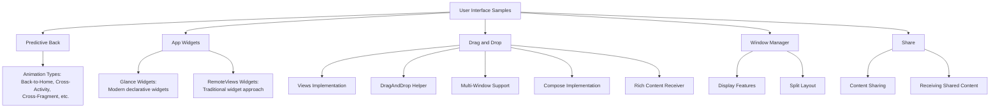
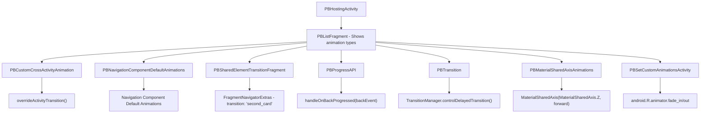
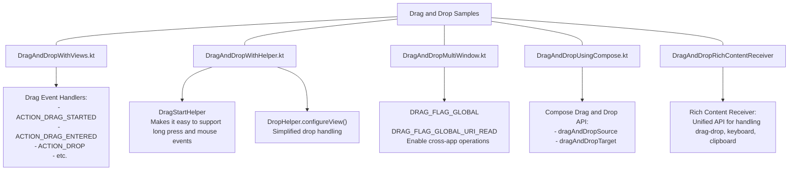
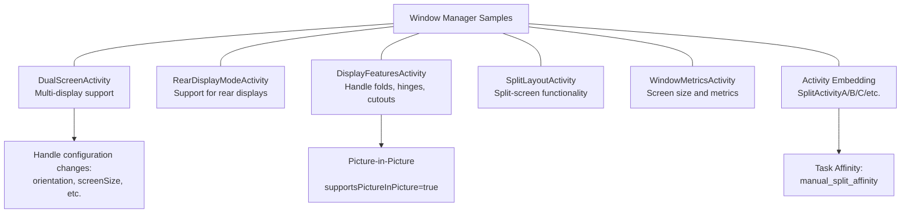
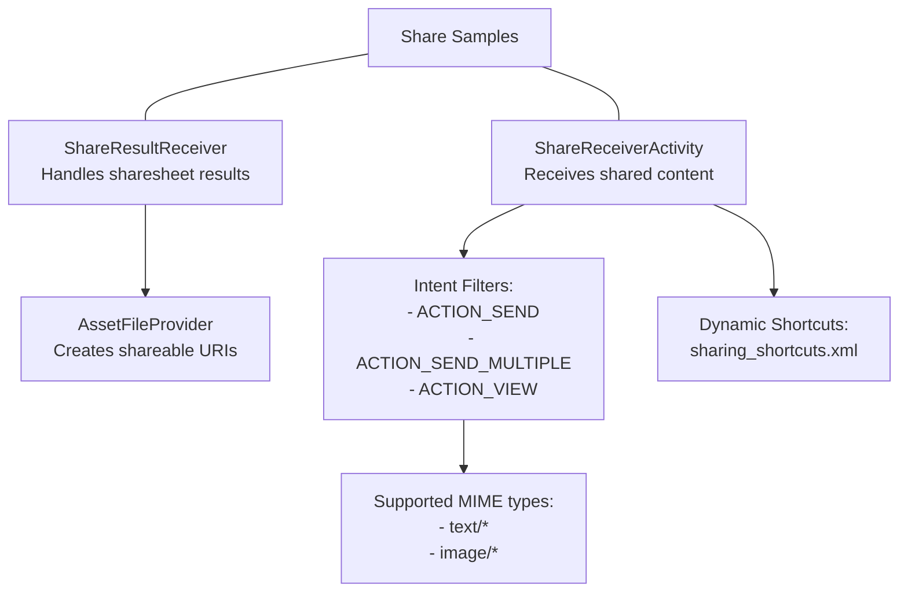

<!-- source: DeepWiki mcp.deepwiki.com · repo android/platform-samples · page 3 User Interface Samples · fetched 2026-10-23 -->

# User Interface Samples

<details>
<summary>Relevant source files</summary>

The following files were used as context for generating this wiki page:

- [gradle/wrapper/gradle-wrapper.properties](gradle/wrapper/gradle-wrapper.properties)
- [samples/connectivity/callnotification/README.md](samples/connectivity/callnotification/README.md)
- [samples/connectivity/callnotification/build.gradle.kts](samples/connectivity/callnotification/build.gradle.kts)
- [samples/connectivity/callnotification/src/main/AndroidManifest.xml](samples/connectivity/callnotification/src/main/AndroidManifest.xml)
- [samples/connectivity/callnotification/src/main/java/com/example/platform/connectivity/callnotification/CallNotificationSample.kt](samples/connectivity/callnotification/src/main/java/com/example/platform/connectivity/callnotification/CallNotificationSample.kt)
- [samples/connectivity/callnotification/src/main/java/com/example/platform/connectivity/callnotification/NotificationSource.kt](samples/connectivity/callnotification/src/main/java/com/example/platform/connectivity/callnotification/NotificationSource.kt)
- [samples/user-interface/appwidgets/src/main/AndroidManifest.xml](samples/user-interface/appwidgets/src/main/AndroidManifest.xml)
- [samples/user-interface/appwidgets/src/main/java/com/example/platform/ui/appwidgets/AppWidgets.kt](samples/user-interface/appwidgets/src/main/java/com/example/platform/ui/appwidgets/AppWidgets.kt)
- [samples/user-interface/appwidgets/src/main/java/com/example/platform/ui/appwidgets/glance/layout/ActionDemonstrationActivity.kt](samples/user-interface/appwidgets/src/main/java/com/example/platform/ui/appwidgets/glance/layout/ActionDemonstrationActivity.kt)
- [samples/user-interface/appwidgets/src/main/java/com/example/platform/ui/appwidgets/glance/layout/CollectionsKtx.kt](samples/user-interface/appwidgets/src/main/java/com/example/platform/ui/appwidgets/glance/layout/CollectionsKtx.kt)
- [samples/user-interface/appwidgets/src/main/java/com/example/platform/ui/appwidgets/glance/layout/toolbars/ExpressiveToolbarAppWidget.kt](samples/user-interface/appwidgets/src/main/java/com/example/platform/ui/appwidgets/glance/layout/toolbars/ExpressiveToolbarAppWidget.kt)
- [samples/user-interface/appwidgets/src/main/res/drawable-night-nodpi/sample_expressive_toolbar_preview.png](samples/user-interface/appwidgets/src/main/res/drawable-night-nodpi/sample_expressive_toolbar_preview.png)
- [samples/user-interface/appwidgets/src/main/res/drawable-nodpi/sample_expressive_toolbar_preview.png](samples/user-interface/appwidgets/src/main/res/drawable-nodpi/sample_expressive_toolbar_preview.png)
- [samples/user-interface/appwidgets/src/main/res/values-xlarge/dimens.xml](samples/user-interface/appwidgets/src/main/res/values-xlarge/dimens.xml)
- [samples/user-interface/appwidgets/src/main/res/values/dimens.xml](samples/user-interface/appwidgets/src/main/res/values/dimens.xml)
- [samples/user-interface/appwidgets/src/main/res/values/strings.xml](samples/user-interface/appwidgets/src/main/res/values/strings.xml)
- [samples/user-interface/appwidgets/src/main/res/values/themes.xml](samples/user-interface/appwidgets/src/main/res/values/themes.xml)
- [samples/user-interface/appwidgets/src/main/res/xml/sample_expressive_toolbar_widget_info.xml](samples/user-interface/appwidgets/src/main/res/xml/sample_expressive_toolbar_widget_info.xml)
- [samples/user-interface/draganddrop/README.md](samples/user-interface/draganddrop/README.md)
- [samples/user-interface/draganddrop/build.gradle.kts](samples/user-interface/draganddrop/build.gradle.kts)
- [samples/user-interface/draganddrop/src/main/AndroidManifest.xml](samples/user-interface/draganddrop/src/main/AndroidManifest.xml)
- [samples/user-interface/draganddrop/src/main/java/com/example/platform/ui/draganddrop/DragAndDrop.kt](samples/user-interface/draganddrop/src/main/java/com/example/platform/ui/draganddrop/DragAndDrop.kt)
- [samples/user-interface/draganddrop/src/main/java/com/example/platform/ui/draganddrop/DragAndDropFileProvider.kt](samples/user-interface/draganddrop/src/main/java/com/example/platform/ui/draganddrop/DragAndDropFileProvider.kt)
- [samples/user-interface/draganddrop/src/main/java/com/example/platform/ui/draganddrop/DragAndDropMultiWindow.kt](samples/user-interface/draganddrop/src/main/java/com/example/platform/ui/draganddrop/DragAndDropMultiWindow.kt)
- [samples/user-interface/draganddrop/src/main/java/com/example/platform/ui/draganddrop/DragAndDropRichContentReceiverFragment.kt](samples/user-interface/draganddrop/src/main/java/com/example/platform/ui/draganddrop/DragAndDropRichContentReceiverFragment.kt)
- [samples/user-interface/draganddrop/src/main/java/com/example/platform/ui/draganddrop/DragAndDropUsingCompose.kt](samples/user-interface/draganddrop/src/main/java/com/example/platform/ui/draganddrop/DragAndDropUsingCompose.kt)
- [samples/user-interface/draganddrop/src/main/java/com/example/platform/ui/draganddrop/DragAndDropWithHelper.kt](samples/user-interface/draganddrop/src/main/java/com/example/platform/ui/draganddrop/DragAndDropWithHelper.kt)
- [samples/user-interface/draganddrop/src/main/java/com/example/platform/ui/draganddrop/DragAndDropWithViews.kt](samples/user-interface/draganddrop/src/main/java/com/example/platform/ui/draganddrop/DragAndDropWithViews.kt)
- [samples/user-interface/draganddrop/src/main/java/com/example/platform/ui/draganddrop/RichContentReceiverAdapter.kt](samples/user-interface/draganddrop/src/main/java/com/example/platform/ui/draganddrop/RichContentReceiverAdapter.kt)
- [samples/user-interface/draganddrop/src/main/res/layout/fragment_dnd_richcontent.xml](samples/user-interface/draganddrop/src/main/res/layout/fragment_dnd_richcontent.xml)
- [samples/user-interface/draganddrop/src/main/res/layout/fragment_drag_and_drop_with_helper.xml](samples/user-interface/draganddrop/src/main/res/layout/fragment_drag_and_drop_with_helper.xml)
- [samples/user-interface/draganddrop/src/main/res/layout/fragment_drag_and_drop_with_views.xml](samples/user-interface/draganddrop/src/main/res/layout/fragment_drag_and_drop_with_views.xml)
- [samples/user-interface/draganddrop/src/main/res/layout/grid_item.xml](samples/user-interface/draganddrop/src/main/res/layout/grid_item.xml)
- [samples/user-interface/draganddrop/src/main/res/values/strings.xml](samples/user-interface/draganddrop/src/main/res/values/strings.xml)
- [samples/user-interface/predictiveback/README.md](samples/user-interface/predictiveback/README.md)
- [samples/user-interface/predictiveback/build.gradle.kts](samples/user-interface/predictiveback/build.gradle.kts)
- [samples/user-interface/predictiveback/src/main/AndroidManifest.xml](samples/user-interface/predictiveback/src/main/AndroidManifest.xml)
- [samples/user-interface/predictiveback/src/main/java/com/example/platform/ui/predictiveback/PBAnimation.kt](samples/user-interface/predictiveback/src/main/java/com/example/platform/ui/predictiveback/PBAnimation.kt)
- [samples/user-interface/predictiveback/src/main/java/com/example/platform/ui/predictiveback/PBListFragment.kt](samples/user-interface/predictiveback/src/main/java/com/example/platform/ui/predictiveback/PBListFragment.kt)
- [samples/user-interface/predictiveback/src/main/res/layout/fragment_animation_list.xml](samples/user-interface/predictiveback/src/main/res/layout/fragment_animation_list.xml)
- [samples/user-interface/predictiveback/src/main/res/navigation/nav_graph.xml](samples/user-interface/predictiveback/src/main/res/navigation/nav_graph.xml)
- [samples/user-interface/predictiveback/src/main/res/values/strings.xml](samples/user-interface/predictiveback/src/main/res/values/strings.xml)
- [samples/user-interface/share/src/main/AndroidManifest.xml](samples/user-interface/share/src/main/AndroidManifest.xml)
- [samples/user-interface/windowmanager/src/main/AndroidManifest.xml](samples/user-interface/windowmanager/src/main/AndroidManifest.xml)

</details>


This page provides an overview of the UI-related samples in the Android Platform Samples repository. These samples demonstrate modern UI patterns, APIs, and techniques for creating rich, interactive user interfaces on Android. The samples cover a range of UI capabilities, from navigation animations to widgets and drag-and-drop functionality.

## Overview

The User Interface samples showcase implementation patterns for various Android UI features. Each sample is designed to demonstrate a specific UI capability, implementation approach, or API.



Sources:
- [samples/user-interface/predictiveback/README.md]()
- [samples/user-interface/appwidgets/src/main/java/com/example/platform/ui/appwidgets/AppWidgets.kt]()
- [samples/user-interface/draganddrop/README.md]()
- [samples/user-interface/windowmanager/src/main/AndroidManifest.xml]()
- [samples/user-interface/share/src/main/AndroidManifest.xml]()

## Predictive Back Samples

The Predictive Back samples demonstrate different types of back gesture animations introduced in Android 14. This feature provides visual cues about the destination when a user initiates a back gesture, enhancing navigation predictability.

### Animation Types

The samples cover multiple animation scenarios:

| Animation Type | Description | Implementation Approach |
|----------------|-------------|-------------------------|
| Back-to-Home | Animation when returning to the launcher | System default animation |
| Cross-Activity | Animation between activities | Default or custom animations |
| Cross-Fragment | Animation between fragments | Navigation Component animations |
| Shared Element Cross-Fragment | Transition animation for shared elements | FragmentNavigatorExtras |
| Custom Progress API | Custom animation using the Progress API | OnBackPressedCallback with handleOnBackProgressed |
| Custom AndroidX Transition | Animation using the AndroidX Transition API | TransitionSeekController |
| Material SharedAxis | Animation using Material Motion | MaterialSharedAxis transition |
| setCustomAnimations | Basic animation between fragments | Fragment transaction animations |



Sources:
- [samples/user-interface/predictiveback/README.md]()
- [samples/user-interface/predictiveback/src/main/java/com/example/platform/ui/predictiveback/PBListFragment.kt]()
- [samples/user-interface/predictiveback/src/main/java/com/example/platform/ui/predictiveback/PBAnimation.kt]()
- [samples/user-interface/predictiveback/src/main/res/navigation/nav_graph.xml]()

### Implementation Examples

#### Custom Cross-Activity Animation

```kotlin
override fun onCreate(savedInstanceState: Bundle?) {
    // ...
    overrideActivityTransition(
        OVERRIDE_TRANSITION_OPEN,
        android.R.anim.fade_in,
        0
    )
    
    overrideActivityTransition(
        OVERRIDE_TRANSITION_CLOSE,
        0,
        android.R.anim.fade_out
    )
}
```

#### Progress API Animation

```kotlin
val predictiveBackCallback = object: OnBackPressedCallback(enabled=false) {
    override fun handleOnBackProgressed(backEvent: BackEventCompat) {
        when (backEvent.swipeEdge) {
            BackEventCompat.EDGE_LEFT ->
                binding.box.translationX = backEvent.progress * maxXShift
            BackEventCompat.EDGE_RIGHT ->
                binding.box.translationX = -(backEvent.progress * maxXShift)
        }
        binding.box.scaleX = 1F - (0.1F * backEvent.progress)
        binding.box.scaleY = 1F - (0.1F * backEvent.progress)
    }
    
    // Other callback methods...
}
```

Sources:
- [samples/user-interface/predictiveback/README.md:18-42]()
- [samples/user-interface/predictiveback/README.md:97-131]()

## App Widgets Samples

The App Widgets samples demonstrate how to create and manage home screen widgets using both the traditional RemoteViews approach and the newer Jetpack Glance API.

### Widget Types

The samples include various widget layouts and design patterns:

| Widget Type | Description | Implementation |
|-------------|-------------|----------------|
| Expressive Toolbar | Toolbar with a 4-sided cookie cut shape | Glance API |
| Toolbar | Basic toolbar with header | Glance API |
| Search Toolbar | Toolbar optimized for search | Glance API |
| Long Text | Widget focused on displaying text | Glance API |
| Text and Image | Combined text and image presentation | Glance API |
| Image Text List | Scrollable list with images and text | Glance API |
| Checklist | Task-oriented list with checkboxes | Glance API |
| Action List | List of actionable items | Glance API |
| Image Grid | Grid of images | Glance API |
| Weather Forecast | Weather display widget | Both RemoteViews and Glance |

```mermaid
flowchart TD
    AWEntry["AppWidgets.kt - Main entry point"] --> AWProviders["widgetProviders - Gets installed widget providers"]
    AWEntry --> AWList["AppWidgetsList - Displays available widgets"]
    
    AWList --> AWPin["requestPinAppWidget() - Pin to home screen"]
    AWList --> CLInfo["CanonicalLayoutsInfoCard - Widget layout samples"]
    
    subgraph "Widget Implementations"
        GlanceWidgets["Glance Widgets"] --> ExpToolbar["ExpressiveToolbarAppWidget"]
        GlanceWidgets --> Toolbar["ToolBarAppWidgetReceiver"]
        GlanceWidgets --> SearchToolbar["SearchToolBarAppWidgetReceiver"]
        GlanceWidgets --> LongText["LongTextAppWidgetReceiver"]
        GlanceWidgets --> TextImage["TextWithImageAppWidgetReceiver"]
        GlanceWidgets --> ImageList["ImageTextListAppWidgetReceiver"]
        GlanceWidgets --> CheckList["CheckListAppWidgetReceiver"]
        GlanceWidgets --> ActionList["ActionListAppWidgetAppWidgetReceiver"]
        GlanceWidgets --> ImageGrid["ImageGridAppWidgetReceiver"]
        
        RVWidgets["RemoteViews Widgets"] --> WeatherRV["WeatherForecastAppWidget"]
    end
    
    GlanceWeather["WeatherGlanceWidgetReceiver"] --> GlanceImpl["Glance API Implementation"]
    WeatherRV --> RVImpl["RemoteViews Implementation"]
```



Sources:
- [samples/user-interface/appwidgets/src/main/AndroidManifest.xml]()
- [samples/user-interface/appwidgets/src/main/java/com/example/platform/ui/appwidgets/AppWidgets.kt]()
- [samples/user-interface/appwidgets/src/main/java/com/example/platform/ui/appwidgets/glance/layout/toolbars/ExpressiveToolbarAppWidget.kt]()

### Glance Widget Implementation

The following shows an example of implementing a widget using the Glance API:

```kotlin
class ExpressiveToolbarAppWidget : GlanceAppWidget() {
    override val sizeMode: SizeMode = SizeMode.Exact

    override suspend fun provideGlance(context: Context, id: GlanceId) {
        provideContent {
            GlanceTheme {
                WidgetContent()
            }
        }
    }

    @Composable
    fun WidgetContent() {
        ExpressiveToolbarLayout(
            centerButton = ExpressiveToolBarButton(
                iconRes = R.drawable.sample_add_icon,
                contentDescription = "Add notes",
                onClick = actionStartDemoActivity("add notes button")
            ),
            cornerButtons = listOf(
                // Button definitions...
            )
        )
    }
}

class ExpressiveToolbarAppWidgetReceiver : GlanceAppWidgetReceiver() {
    override val glanceAppWidget: GlanceAppWidget = ExpressiveToolbarAppWidget()
}
```

Sources:
- [samples/user-interface/appwidgets/src/main/java/com/example/platform/ui/appwidgets/glance/layout/toolbars/ExpressiveToolbarAppWidget.kt]()
- [samples/user-interface/appwidgets/src/main/res/xml/sample_expressive_toolbar_widget_info.xml]()

## Drag and Drop Samples

The Drag and Drop samples demonstrate various approaches to implementing drag and drop functionality, from basic View implementations to Jetpack Compose and rich content handling.

### Implementation Approaches

The samples cover multiple implementation techniques:

| Implementation | Description | Key APIs |
|----------------|-------------|----------|
| Views-based | Basic implementation using Android View system | View.startDragAndDrop, OnDragListener |
| DragAndDropHelper | Using the Jetpack DragAndDrop library | DragStartHelper, DropHelper |
| Multi-window | Drag and drop across apps | DRAG_FLAG_GLOBAL, DRAG_FLAG_GLOBAL_URI_READ |
| Compose | Implementation in Jetpack Compose | dragAndDropSource, dragAndDropTarget |
| Rich Content | Handling rich media using unified APIs | OnReceiveContentListener, ContentInfoCompat |



Sources:
- [samples/user-interface/draganddrop/README.md]()
- [samples/user-interface/draganddrop/src/main/java/com/example/platform/ui/draganddrop/DragAndDropWithViews.kt]()
- [samples/user-interface/draganddrop/src/main/java/com/example/platform/ui/draganddrop/DragAndDropWithHelper.kt]()
- [samples/user-interface/draganddrop/src/main/java/com/example/platform/ui/draganddrop/DragAndDropMultiWindow.kt]()
- [samples/user-interface/draganddrop/src/main/java/com/example/platform/ui/draganddrop/DragAndDropRichContentReceiverFragment.kt]()

### Implementation Examples

#### Using DragStartHelper

```kotlin
DragStartHelper(draggableView) { view: View, _: DragStartHelper ->
    val item = ClipData.Item(view.tag as? CharSequence)
    val dragData = ClipData(
        view.tag as? CharSequence,
        arrayOf(ClipDescription.MIMETYPE_TEXT_PLAIN),
        item,
    )
    view.startDragAndDrop(
        dragData,
        View.DragShadowBuilder(view),
        null,
        0,
    )
}.attach()
```

#### Using DropHelper

```kotlin
DropHelper.configureView(
    requireActivity(),
    targetView,
    arrayOf("text/*"),
) { _, payload: ContentInfoCompat ->
    val item = payload.clip.getItemAt(0)
    val dragData = item.text
    Glide.with(this).load(dragData).centerCrop().into(targetView)
    val (_, remaining) = payload.partition { it == item }
    remaining
}
```

Sources:
- [samples/user-interface/draganddrop/src/main/java/com/example/platform/ui/draganddrop/DragAndDropWithHelper.kt:68-87]()
- [samples/user-interface/draganddrop/src/main/java/com/example/platform/ui/draganddrop/DragAndDropWithHelper.kt:93-104]()

## Window Manager Samples

The Window Manager samples demonstrate how to work with different display configurations, including multi-display environments and foldable devices.

The samples include:

- Display features detection
- Window metrics
- Split layout handling
- Dual screen support
- Rear display mode
- Activity embedding



Sources:
- [samples/user-interface/windowmanager/src/main/AndroidManifest.xml]()

## Share Samples

The Share samples demonstrate how to implement content sharing between apps, including sending and receiving shared content such as text and images.

Key features demonstrated:

- Sharing content using Intent.ACTION_SEND
- Receiving shared content from other apps
- Handling multiple shared items with ACTION_SEND_MULTIPLE
- Managing file URIs with FileProvider
- Handling share results with BroadcastReceiver



Sources:
- [samples/user-interface/share/src/main/AndroidManifest.xml]()

## Call Notification Sample

While not strictly a UI component, the Call Notification sample demonstrates how to create and manage call-specific notifications, which have unique UI requirements and behaviors.

Key features demonstrated:

- Creating incoming call notifications with CallStyle
- Implementing ongoing call notifications
- Handling notification actions (answer, reject, end call)
- Setting up proper notification channels for calls

```kotlin
// Creating an incoming call notification
NotificationCompat.Builder(context, ChannelId)
    .setSmallIcon(R.drawable.ic_dialog_dialer)
    .setFullScreenIntent(pendingIntent, true)
    .setSound(ringToneUri)
    .setOngoing(true)
    .setVisibility(VISIBILITY_PUBLIC)
    .setPriority(PRIORITY_MAX)
    .setStyle(
        NotificationCompat.CallStyle.forIncomingCall(
            fakeCaller,
            cancelCallPendingIntent,
            receiveCallPendingIntent,
        ),
    )
    .build()
```

Sources:
- [samples/connectivity/callnotification/src/main/java/com/example/platform/connectivity/callnotification/NotificationSource.kt]()
- [samples/connectivity/callnotification/src/main/java/com/example/platform/connectivity/callnotification/CallNotificationSample.kt]()

## Summary

The User Interface samples in the Android Platform Samples repository demonstrate modern UI implementation patterns and techniques across multiple categories. These samples provide practical examples of implementing predictive back animations, app widgets, drag-and-drop functionality, window management for different screen configurations, and content sharing.

Each sample is designed to showcase a specific approach or API, making it easier for developers to understand and implement these UI capabilities in their own applications.

---

