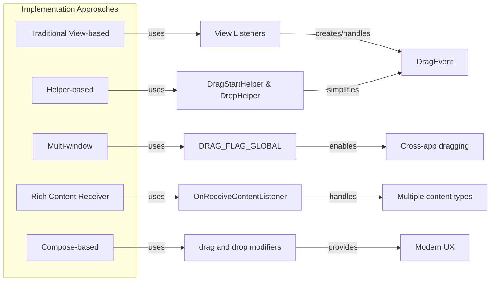
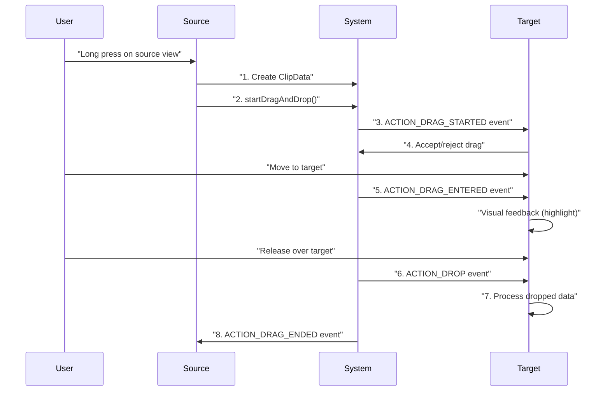

<!-- source: DeepWiki mcp.deepwiki.com · repo android/platform-samples · page 3.1 Drag and Drop · fetched 2026-10-23 -->

# Drag and Drop

<details>
<summary>Relevant source files</summary>

The following files were used as context for generating this wiki page:

- [gradle/wrapper/gradle-wrapper.properties](gradle/wrapper/gradle-wrapper.properties)
- [samples/user-interface/draganddrop/README.md](samples/user-interface/draganddrop/README.md)
- [samples/user-interface/draganddrop/build.gradle.kts](samples/user-interface/draganddrop/build.gradle.kts)
- [samples/user-interface/draganddrop/src/main/AndroidManifest.xml](samples/user-interface/draganddrop/src/main/AndroidManifest.xml)
- [samples/user-interface/draganddrop/src/main/java/com/example/platform/ui/draganddrop/DragAndDrop.kt](samples/user-interface/draganddrop/src/main/java/com/example/platform/ui/draganddrop/DragAndDrop.kt)
- [samples/user-interface/draganddrop/src/main/java/com/example/platform/ui/draganddrop/DragAndDropFileProvider.kt](samples/user-interface/draganddrop/src/main/java/com/example/platform/ui/draganddrop/DragAndDropFileProvider.kt)
- [samples/user-interface/draganddrop/src/main/java/com/example/platform/ui/draganddrop/DragAndDropMultiWindow.kt](samples/user-interface/draganddrop/src/main/java/com/example/platform/ui/draganddrop/DragAndDropMultiWindow.kt)
- [samples/user-interface/draganddrop/src/main/java/com/example/platform/ui/draganddrop/DragAndDropRichContentReceiverFragment.kt](samples/user-interface/draganddrop/src/main/java/com/example/platform/ui/draganddrop/DragAndDropRichContentReceiverFragment.kt)
- [samples/user-interface/draganddrop/src/main/java/com/example/platform/ui/draganddrop/DragAndDropUsingCompose.kt](samples/user-interface/draganddrop/src/main/java/com/example/platform/ui/draganddrop/DragAndDropUsingCompose.kt)
- [samples/user-interface/draganddrop/src/main/java/com/example/platform/ui/draganddrop/DragAndDropWithHelper.kt](samples/user-interface/draganddrop/src/main/java/com/example/platform/ui/draganddrop/DragAndDropWithHelper.kt)
- [samples/user-interface/draganddrop/src/main/java/com/example/platform/ui/draganddrop/DragAndDropWithViews.kt](samples/user-interface/draganddrop/src/main/java/com/example/platform/ui/draganddrop/DragAndDropWithViews.kt)
- [samples/user-interface/draganddrop/src/main/java/com/example/platform/ui/draganddrop/RichContentReceiverAdapter.kt](samples/user-interface/draganddrop/src/main/java/com/example/platform/ui/draganddrop/RichContentReceiverAdapter.kt)
- [samples/user-interface/draganddrop/src/main/res/layout/fragment_dnd_richcontent.xml](samples/user-interface/draganddrop/src/main/res/layout/fragment_dnd_richcontent.xml)
- [samples/user-interface/draganddrop/src/main/res/layout/fragment_drag_and_drop_with_helper.xml](samples/user-interface/draganddrop/src/main/res/layout/fragment_drag_and_drop_with_helper.xml)
- [samples/user-interface/draganddrop/src/main/res/layout/fragment_drag_and_drop_with_views.xml](samples/user-interface/draganddrop/src/main/res/layout/fragment_drag_and_drop_with_views.xml)
- [samples/user-interface/draganddrop/src/main/res/layout/grid_item.xml](samples/user-interface/draganddrop/src/main/res/layout/grid_item.xml)
- [samples/user-interface/draganddrop/src/main/res/values/strings.xml](samples/user-interface/draganddrop/src/main/res/values/strings.xml)

</details>


This document provides a comprehensive overview of the Drag and Drop functionality in the Android Platform Samples. It covers different implementation approaches including traditional View-based implementation, helper-based implementation using AndroidX libraries, multi-window drag and drop, rich content receiving, and Jetpack Compose implementation.

## Overview

Android's drag and drop functionality allows users to move data between different views within an application or even between applications. The platform samples demonstrate several approaches to implementing this feature, each with its own benefits and use cases.

### Drag and Drop Approaches Diagram



Sources: [samples/user-interface/draganddrop/README.md:1-22]()

## Core Components

The drag and drop system consists of several key components that work together to enable a smooth user experience.

### Drag and Drop Operation Flow



Sources: [samples/user-interface/draganddrop/src/main/java/com/example/platform/ui/draganddrop/DragAndDropWithViews.kt:61-136]()

### Key Components and Their Relationships

```mermaid
classDiagram
    class "DragSource" {
        +setOnLongClickListener()
        +startDragAndDrop()
        +ClipData content
    }
    
    class "DropTarget" {
        +setOnDragListener()
        +handleDragEvent()
        +processDroppedData()
    }
    
    class "DragStartHelper" {
        +attach()
        +startDrag()
    }
    
    class "DropHelper" {
        +configureView()
        +Options class
    }
    
    class "ClipData" {
        +newPlainText()
        +newUri()
        +getItemAt()
    }
    
    class "DragEvent" {
        +ACTION_DRAG_STARTED
        +ACTION_DRAG_ENTERED
        +ACTION_DRAG_LOCATION
        +ACTION_DRAG_EXITED
        +ACTION_DROP
        +ACTION_DRAG_ENDED
    }
    
    "DragSource" ..> "ClipData": creates
    "DragSource" ..> "DragStartHelper": can use
    "DropTarget" ..> "DragEvent": processes
    "DropTarget" ..> "DropHelper": can use
    "DropHelper" ..> "ClipData": processes
    "DragStartHelper" ..> "ClipData": configures
```

Sources: 
- [samples/user-interface/draganddrop/src/main/java/com/example/platform/ui/draganddrop/DragAndDropWithViews.kt:61-136]()
- [samples/user-interface/draganddrop/src/main/java/com/example/platform/ui/draganddrop/DragAndDropWithHelper.kt:68-104]()

## Implementation Approaches

The platform samples demonstrate five distinct approaches to implementing drag and drop functionality.

### 1. Traditional View-based Implementation

This approach uses the standard Android View system APIs without additional helper libraries. It relies on `setOnLongClickListener` for the drag source and `setOnDragListener` for the drop target.

```kotlin
// Setting up drag source
private fun setupDrag(draggableView: ImageView) {
    draggableView.setOnLongClickListener { v ->
        val clipItem = ClipData.Item(v.tag as? CharSequence)
        val draggedData = ClipData(
            "label", 
            arrayOf(ClipDescription.MIMETYPE_TEXT_PLAIN), 
            clipItem
        )
        v.startDragAndDrop(
            draggedData,
            View.DragShadowBuilder(v),
            null,
            View.DRAG_FLAG_GLOBAL or View.DRAG_FLAG_GLOBAL_URI_READ
        )
    }
}
```

```kotlin
// Setting up drop target
private fun setupDrop(dropTarget: ImageView) {
    dropTarget.setOnDragListener { v, event ->
        when (event.action) {
            DragEvent.ACTION_DRAG_STARTED -> {
                // Check if we can accept the drag
                if (event.clipDescription.hasMimeType(ClipDescription.MIMETYPE_TEXT_PLAIN)) {
                    (v as? ImageView)?.alpha = 0.5F
                    v.invalidate()
                    true
                } else {
                    false
                }
            }
            DragEvent.ACTION_DROP -> {
                // Handle the drop
                val dropPermission = requestDragAndDropPermissions(event)
                val item = event.clipData.getItemAt(0)
                // Process data
                dropPermission.release()
                true
            }
            // Handle other events...
            else -> false
        }
    }
}
```

Sources: [samples/user-interface/draganddrop/src/main/java/com/example/platform/ui/draganddrop/DragAndDropWithViews.kt:61-136]()

### 2. Helper-based Implementation

This approach uses the `DragStartHelper` and `DropHelper` from the AndroidX drag-and-drop library to simplify implementation.

```kotlin
// Setting up drag source with DragStartHelper
private fun setupDrag(draggableView: ImageView) {
    DragStartHelper(draggableView) { view: View, _: DragStartHelper ->
        val item = ClipData.Item(view.tag as? CharSequence)
        val dragData = ClipData(
            view.tag as? CharSequence,
            arrayOf(ClipDescription.MIMETYPE_TEXT_PLAIN),
            item,
        )
        view.startDragAndDrop(
            dragData,
            View.DragShadowBuilder(view),
            null,
            0,
        )
    }.attach()
}
```

```kotlin
// Setting up drop target with DropHelper
private fun setupDrop(targetView: ImageView) {
    DropHelper.configureView(
        requireActivity(),
        targetView,
        arrayOf("text/*"),
    ) { _, payload: ContentInfoCompat ->
        val item = payload.clip.getItemAt(0)
        val dragData = item.text
        Glide.with(this).load(dragData).centerCrop().into(targetView)
        val (_, remaining) = payload.partition { it == item }
        remaining
    }
}
```

Sources: [samples/user-interface/draganddrop/src/main/java/com/example/platform/ui/draganddrop/DragAndDropWithHelper.kt:68-104]()

### 3. Multi-window Implementation

This implementation demonstrates drag and drop between different applications in multi-window mode. It requires the use of global drag flags and appropriate permission handling.

```kotlin
// Setting up drag source for multi-window
private fun setupDrag(draggableView: ImageView) {
    DragStartHelper(draggableView) { view: View, _: DragStartHelper ->
        val item = ClipData.Item(view.tag as? CharSequence)
        val dragData = ClipData(
            view.tag as? CharSequence,
            arrayOf(ClipDescription.MIMETYPE_TEXT_PLAIN),
            item,
        )
        // Flag is required so data from clipdata can be read by drop target
        val flags = View.DRAG_FLAG_GLOBAL or View.DRAG_FLAG_GLOBAL_URI_READ
        view.startDragAndDrop(
            dragData,
            View.DragShadowBuilder(view),
            null,
            flags,
        )
    }.attach()
}
```

Sources: [samples/user-interface/draganddrop/src/main/java/com/example/platform/ui/draganddrop/DragAndDropMultiWindow.kt:56-73]()

### 4. Rich Content Receiver Implementation

This approach demonstrates handling different types of content (text, images, videos) using the unified receiver API, which works for drag and drop, keyboard input, and clipboard operations.

```kotlin
// Setting up a rich content receiver
binding.rvDropTarget.setOnReceiveContentListener(
    arrayOf("image/*", "text/*", "video/*"),
) { _, payload ->
    val (uriContent, remaining) = ContentInfoCompat.partition(
        payload,
    ) { item: ClipData.Item -> item.uri != null }

    if (uriContent != null) {
        // Handle URI content (e.g., images)
        val item = uriContent.clip.getItemAt(0)
        item.uri?.let { uri ->
            // Process image URI
        }
    }
    if (remaining != null) {
        // Handle text content
        val item = remaining.clip.getItemAt(0)
        // Process text
    }
    null
}
```

Sources: [samples/user-interface/draganddrop/src/main/java/com/example/platform/ui/draganddrop/DragAndDropRichContentReceiverFragment.kt:64-99]()

### 5. Compose Implementation

This implementation shows how to implement drag and drop in Jetpack Compose using the drag and drop modifiers.

```kotlin
// Compose drag source
GlideImage(
    model = url,
    contentDescription = "demo",
    modifier = Modifier
        .size(100.dp)
        .dragAndDropSource {
            detectTapGestures(
                onLongPress = {
                    startTransfer(
                        DragAndDropTransferData(
                            ClipData.newPlainText(
                                "image Url", url,
                            ),
                        ),
                    )
                },
            )
        },
)

// Compose drop target
Box(
    modifier = modifier
        .fillMaxWidth()
        .padding(8.dp)
        .background(color = backgroundColor)
        .dragAndDropTarget(
            shouldStartDragAndDrop = { event ->
                event.mimeTypes().contains(ClipDescription.MIMETYPE_TEXT_PLAIN)
            },
            target = dragAndDropTarget,
        ),
) {
    // Content
}
```

Sources: [samples/user-interface/draganddrop/src/main/java/com/example/platform/ui/draganddrop/DragAndDropUsingCompose.kt:151-176](), [samples/user-interface/draganddrop/src/main/java/com/example/platform/ui/draganddrop/DragAndDropUsingCompose.kt:98-123]()

## Data Types and Permissions

### Supported Content Types

The drag and drop system supports various content types:

| Content Type | MIME Type | Creation Method | Example Use |
|--------------|-----------|----------------|-------------|
| Text | text/plain | ClipData.newPlainText() | Dragging text between text fields |
| URI | image/*, video/*, etc. | ClipData.newUri() | Dragging images between views |
| Intent | application/x-intent | ClipData.newIntent() | Dragging app shortcuts |
| Multiple items | Mixed | ClipData constructor | Complex data transfers |

Sources: 
- [samples/user-interface/draganddrop/src/main/java/com/example/platform/ui/draganddrop/DragAndDropWithViews.kt:63-76]()
- [samples/user-interface/draganddrop/src/main/java/com/example/platform/ui/draganddrop/DragAndDropRichContentReceiverFragment.kt:151-180]()

### Cross-application Permissions

When implementing drag and drop between different applications, permissions must be properly managed:

1. **Drag Flags**: The source must set appropriate flags:
   - `DRAG_FLAG_GLOBAL`: Allows cross-app drag operations
   - `DRAG_FLAG_GLOBAL_URI_READ`: Grants permission to read content URIs

2. **Permission Management**: The drop target must request permissions to access the data:
   - Using `requestDragAndDropPermissions(event)` in traditional implementation
   - Using `DropHelper` which handles permissions automatically

3. **FileProvider**: For sharing files, use FileProvider to generate secure content URIs:
   ```xml
   <provider
       android:name="com.example.platform.ui.draganddrop.DragAndDropFileProvider"
       android:authorities="${applicationId}.draganddrop.provider"
       android:exported="false"
       android:grantUriPermissions="true">
       <meta-data
           android:name="android.support.FILE_PROVIDER_PATHS"
           android:resource="@xml/filepaths" />
   </provider>
   ```

Sources: 
- [samples/user-interface/draganddrop/src/main/java/com/example/platform/ui/draganddrop/DragAndDropMultiWindow.kt:64-66]()
- [samples/user-interface/draganddrop/src/main/AndroidManifest.xml:29-37]()

## Implementation Guidelines

### Best Practices

1. **Use AndroidX helpers** for simplified implementation:
   - `DragStartHelper` for initiating drag
   - `DropHelper` for handling drops

2. **Provide visual feedback** during drag operations:
   - Highlight drop targets when a drag enters
   - Show a drag shadow
   - Use alpha or other visual indicators to show drag state

3. **Handle different content types** appropriately:
   - Check MIME types before accepting drops
   - Use `ContentInfoCompat.partition()` to separate different content types

4. **Manage permissions** carefully:
   - Always release drag permissions after use
   - Use `FileProvider` for secure file sharing

5. **Consider platform versions**:
   - Some drag and drop features require specific Android versions
   - Use `@RequiresApi` annotations and version checks when needed

Sources: 
- [samples/user-interface/draganddrop/src/main/java/com/example/platform/ui/draganddrop/DragAndDropWithHelper.kt:36-104]()
- [samples/user-interface/draganddrop/src/main/java/com/example/platform/ui/draganddrop/DragAndDropWithViews.kt:83-116]()

### Debugging and Troubleshooting

Common issues and solutions:

| Issue | Possible Causes | Solution |
|-------|----------------|----------|
| Drag not starting | Long press not detected, ClipData creation error | Verify OnLongClickListener, check ClipData creation |
| Drop not working | Drop target not accepting the content type | Check MIME types, verify OnDragListener implementation |
| Cross-app permissions | Missing flags, permission not requested | Use DRAG_FLAG_GLOBAL, request permissions with requestDragAndDropPermissions() |
| File URI access denied | FileProvider issues | Verify FileProvider setup, use content:// URIs not file:// |
| Performance issues | Complex data in drag operation | Keep drag data small, perform heavy processing after drop |

Sources: [samples/user-interface/draganddrop/src/main/java/com/example/platform/ui/draganddrop/DragAndDropRichContentReceiverFragment.kt:73-98]()

## Conclusion

The Drag and Drop functionality in Android provides a powerful way to enable intuitive data transfer within and between applications. The Platform Samples demonstrate various implementation approaches, from traditional view-based methods to modern Compose-based implementations.

For developers, the recommended approach is to use the AndroidX drag and drop helpers (`DragStartHelper` and `DropHelper`) which provide simplified APIs while handling many of the complexities of the drag and drop system.

For handling rich content, the `OnReceiveContentListener` API provides a unified way to process data from drag and drop, clipboard, and keyboard input sources.

For more information about related UI interactions such as gesture detection and touch handling, see the Window Manager samples at [Window Manager](#3.4).

---

