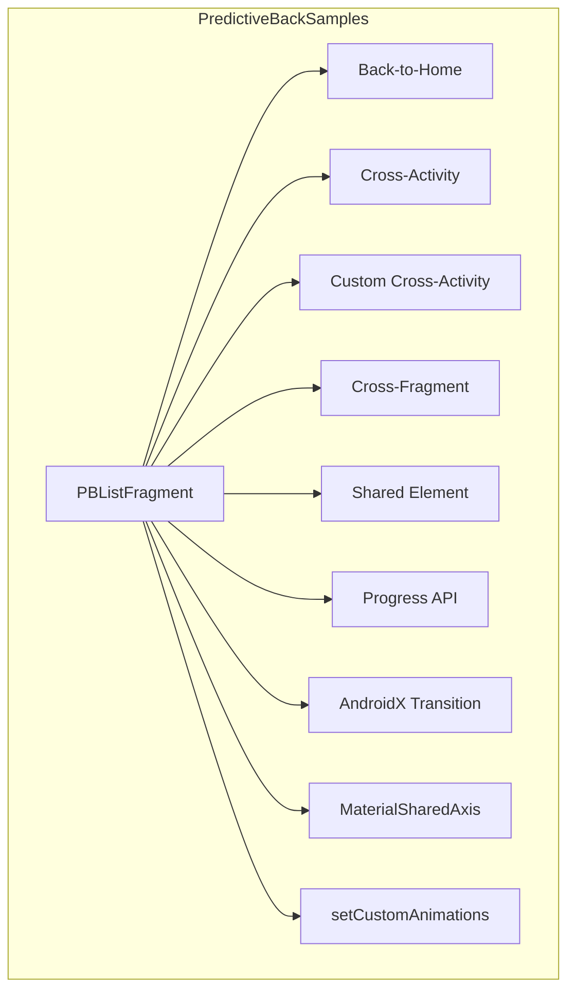
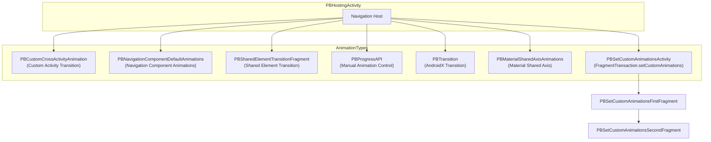
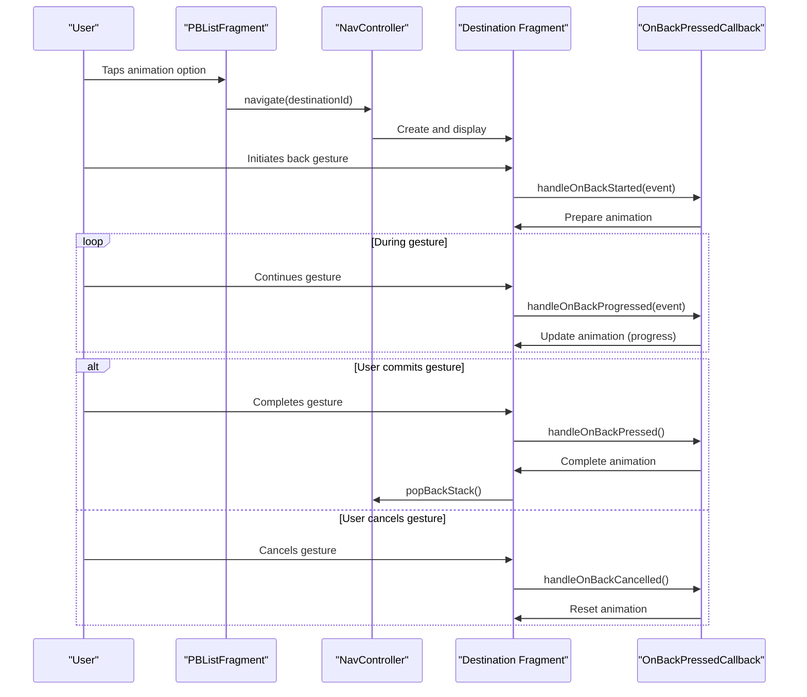

<!-- source: DeepWiki mcp.deepwiki.com · repo android/platform-samples · page 3.2 Predictive Back · fetched 2026-10-23 -->

# Predictive Back

<details>
<summary>Relevant source files</summary>

The following files were used as context for generating this wiki page:

- [samples/user-interface/predictiveback/README.md](samples/user-interface/predictiveback/README.md)
- [samples/user-interface/predictiveback/build.gradle.kts](samples/user-interface/predictiveback/build.gradle.kts)
- [samples/user-interface/predictiveback/src/main/AndroidManifest.xml](samples/user-interface/predictiveback/src/main/AndroidManifest.xml)
- [samples/user-interface/predictiveback/src/main/java/com/example/platform/ui/predictiveback/PBAnimation.kt](samples/user-interface/predictiveback/src/main/java/com/example/platform/ui/predictiveback/PBAnimation.kt)
- [samples/user-interface/predictiveback/src/main/java/com/example/platform/ui/predictiveback/PBCustomCrossActivityAnimation.kt](samples/user-interface/predictiveback/src/main/java/com/example/platform/ui/predictiveback/PBCustomCrossActivityAnimation.kt)
- [samples/user-interface/predictiveback/src/main/java/com/example/platform/ui/predictiveback/PBHostingActivity.kt](samples/user-interface/predictiveback/src/main/java/com/example/platform/ui/predictiveback/PBHostingActivity.kt)
- [samples/user-interface/predictiveback/src/main/java/com/example/platform/ui/predictiveback/PBListFragment.kt](samples/user-interface/predictiveback/src/main/java/com/example/platform/ui/predictiveback/PBListFragment.kt)
- [samples/user-interface/predictiveback/src/main/java/com/example/platform/ui/predictiveback/PBSetCustomAnimationsActivity.kt](samples/user-interface/predictiveback/src/main/java/com/example/platform/ui/predictiveback/PBSetCustomAnimationsActivity.kt)
- [samples/user-interface/predictiveback/src/main/java/com/example/platform/ui/predictiveback/PBSetCustomAnimationsFirstFragment.kt](samples/user-interface/predictiveback/src/main/java/com/example/platform/ui/predictiveback/PBSetCustomAnimationsFirstFragment.kt)
- [samples/user-interface/predictiveback/src/main/java/com/example/platform/ui/predictiveback/PBSetCustomAnimationsSecondFragment.kt](samples/user-interface/predictiveback/src/main/java/com/example/platform/ui/predictiveback/PBSetCustomAnimationsSecondFragment.kt)
- [samples/user-interface/predictiveback/src/main/res/drawable/button.xml](samples/user-interface/predictiveback/src/main/res/drawable/button.xml)
- [samples/user-interface/predictiveback/src/main/res/layout/activity_custom_cross_animation.xml](samples/user-interface/predictiveback/src/main/res/layout/activity_custom_cross_animation.xml)
- [samples/user-interface/predictiveback/src/main/res/layout/activity_set_custom_animations.xml](samples/user-interface/predictiveback/src/main/res/layout/activity_set_custom_animations.xml)
- [samples/user-interface/predictiveback/src/main/res/layout/fragment_animation_list.xml](samples/user-interface/predictiveback/src/main/res/layout/fragment_animation_list.xml)
- [samples/user-interface/predictiveback/src/main/res/layout/fragment_material_shared_axis.xml](samples/user-interface/predictiveback/src/main/res/layout/fragment_material_shared_axis.xml)
- [samples/user-interface/predictiveback/src/main/res/layout/fragment_navigation_component_default_animations.xml](samples/user-interface/predictiveback/src/main/res/layout/fragment_navigation_component_default_animations.xml)
- [samples/user-interface/predictiveback/src/main/res/layout/fragment_progress_api.xml](samples/user-interface/predictiveback/src/main/res/layout/fragment_progress_api.xml)
- [samples/user-interface/predictiveback/src/main/res/layout/fragment_set_custom_animations.xml](samples/user-interface/predictiveback/src/main/res/layout/fragment_set_custom_animations.xml)
- [samples/user-interface/predictiveback/src/main/res/layout/fragment_set_custom_animations_second.xml](samples/user-interface/predictiveback/src/main/res/layout/fragment_set_custom_animations_second.xml)
- [samples/user-interface/predictiveback/src/main/res/layout/fragment_shared_element_transition.xml](samples/user-interface/predictiveback/src/main/res/layout/fragment_shared_element_transition.xml)
- [samples/user-interface/predictiveback/src/main/res/layout/fragment_transition.xml](samples/user-interface/predictiveback/src/main/res/layout/fragment_transition.xml)
- [samples/user-interface/predictiveback/src/main/res/navigation/nav_graph.xml](samples/user-interface/predictiveback/src/main/res/navigation/nav_graph.xml)
- [samples/user-interface/predictiveback/src/main/res/values/strings.xml](samples/user-interface/predictiveback/src/main/res/values/strings.xml)

</details>


## Purpose and Scope

This document provides a comprehensive guide to implementing Predictive Back gesture animations in Android Views-based applications. Predictive Back is a gesture-based navigation system introduced in Android 14 that provides visual confirmation of back navigation destinations through animated previews. This page focuses on various animation techniques for implementing Predictive Back in traditional View-based UIs.

For information about implementing Predictive Back in Jetpack Compose, see the external documentation referenced in the samples README.

Sources: [samples/user-interface/predictiveback/README.md:15-16]()

## Overview of Predictive Back

The Predictive Back gesture enhances user experience by showing where a back action will take the user before they commit to it. When a user initiates a back gesture (by swiping from either edge of the screen), the system previews the destination through animation, allowing users to either complete or cancel the navigation.

The Android Platform Samples repository demonstrates several implementation approaches for Predictive Back animations:



Sources: [samples/user-interface/predictiveback/src/main/java/com/example/platform/ui/predictiveback/PBAnimation.kt:19-30](), [samples/user-interface/predictiveback/src/main/java/com/example/platform/ui/predictiveback/PBListFragment.kt:29-76]()

## Prerequisites for Using Predictive Back

To enable and test Predictive Back in your application, the following are required:

1. An Android device or emulator running Android 14 (API level 34) or higher
2. Gesture navigation enabled on the device
3. Predictive Back enabled in Developer Options (for Android 14)

Sources: [samples/user-interface/predictiveback/src/main/java/com/example/platform/ui/predictiveback/PBAnimation.kt:33-37]()

## Animation Types

### 1. System Default Animations

#### Back-to-Home Animation

The back-to-home animation occurs when a user attempts to navigate back from the root activity of an application. The system automatically provides an animation showing the home screen as the destination.

#### Default Cross-Activity Animation

The default cross-activity animation is automatically provided by the system when navigating between activities. This animation works without additional configuration.

Sources: [samples/user-interface/predictiveback/src/main/java/com/example/platform/ui/predictiveback/PBAnimation.kt:38-45]()

### 2. Custom Animation Implementations

The following diagram shows the relationships between the various custom Predictive Back animation implementations in the samples:



Sources: [samples/user-interface/predictiveback/src/main/res/navigation/nav_graph.xml:17-88](), [samples/user-interface/predictiveback/src/main/java/com/example/platform/ui/predictiveback/PBHostingActivity.kt:25-37]()

## Implementation Techniques

### 1. Custom Cross-Activity Animation

To create custom animations when navigating between activities, use `overrideActivityTransition` instead of the deprecated `overridePendingTransition`. This approach ensures compatibility with the Predictive Back gesture.

```kotlin
override fun onCreate(savedInstanceState: Bundle?) {
    // ...
    overrideActivityTransition(
        OVERRIDE_TRANSITION_OPEN,
        android.R.anim.fade_in,
        0
    )
    
    overrideActivityTransition(
        OVERRIDE_TRANSITION_CLOSE,
        0,
        android.R.anim.fade_out
    )
}
```

Sources: [samples/user-interface/predictiveback/README.md:18-42](), [samples/user-interface/predictiveback/src/main/java/com/example/platform/ui/predictiveback/PBCustomCrossActivityAnimation.kt:29-50]()

### 2. Cross-Fragment Animation

The Navigation Component's default animations work with Predictive Back. These animations can be specified in navigation XML files:

```xml
<action
    android:id="@+id/show_PBNavigationComponentDefaultAnimations"
    app:destination="@id/PBNavigationComponentDefaultAnimations"
    app:enterAnim="@animator/nav_default_enter_anim"
    app:exitAnim="@animator/nav_default_exit_anim"
    app:popEnterAnim="@animator/nav_default_pop_enter_anim"
    app:popExitAnim="@animator/nav_default_pop_exit_anim" />
```

Sources: [samples/user-interface/predictiveback/README.md:44-56](), [samples/user-interface/predictiveback/src/main/res/navigation/nav_graph.xml:27-33]()

### 3. Shared Element Cross-Fragment Animation

Shared element transitions between fragments are supported with Predictive Back, provided you're using fragment library version 1.7.0+ and transition library version 1.5.0+.

Implementation requires:
1. Setting the `transitionName` attribute on views to be animated
2. Using `FragmentNavigatorExtras` to specify the shared elements
3. Defining the transition types in the receiving fragment

```kotlin
// In sending fragment
binding.sharedElementCrossFragment.setOnClickListener {
   findNavController().navigate(
       R.id.show_PBSharedElementTransitionFragment,
       null,
       null,
       FragmentNavigatorExtras(it to "second_card")
   )
}

// In receiving fragment
override fun onCreate(savedInstanceState: Bundle?) {
    super.onCreate(savedInstanceState)
    enterTransition = AutoTransition()
    sharedElementEnterTransition = AutoTransition()
}
```

Note that both `enterTransition` and `sharedElementEnterTransition` must be specified to enable Predictive Back animations.

Sources: [samples/user-interface/predictiveback/README.md:58-90](), [samples/user-interface/predictiveback/src/main/java/com/example/platform/ui/predictiveback/PBListFragment.kt:56-63]()

### 4. Custom Progress API Animation

The Progress API provides precise control over animations during the back gesture. This approach allows you to animate views based on the gesture's progress.

```kotlin
val predictiveBackCallback = object: OnBackPressedCallback(enabled=false) {

    override fun handleOnBackProgressed(backEvent: BackEventCompat) {
        when (backEvent.swipeEdge) {
            BackEventCompat.EDGE_LEFT ->
                binding.box.translationX = backEvent.progress * maxXShift
            BackEventCompat.EDGE_RIGHT ->
                binding.box.translationX = -(backEvent.progress * maxXShift)
        }
        binding.box.scaleX = 1F - (0.1F * backEvent.progress)
        binding.box.scaleY = 1F - (0.1F * backEvent.progress)
    }

    override fun handleOnBackPressed() {
        // your back handling logic
    }

    override fun handleOnBackCancelled() {
        binding.box.scaleX = 1F
        binding.box.scaleY = 1F
        binding.box.translationX = 0F
    }
}
```

Sources: [samples/user-interface/predictiveback/README.md:92-132]()

### 5. Custom AndroidX Transition

AndroidX Transitions provide a more declarative way to define animations and can be controlled through the back gesture progress.

```kotlin
val transitionSet = TransitionSet().apply {
    addTransition(Fade(Fade.MODE_OUT))
    addTransition(ChangeBounds())
    addTransition(Fade(Fade.MODE_IN))
}

val callback = object : OnBackPressedCallback(enabled = false) {
    var controller: TransitionSeekController? = null

    override fun handleOnBackStarted(backEvent: BackEvent) {
        // Create the transition
        controller = TransitionManager.controlDelayedTransition(
            binding.textContainer,
            transitionSet
        )
        changeTextVisibility(ShowText.SHORT)
    }

    override fun handleOnBackProgressed(backEvent: BackEvent) {
        // Play the transition as the user swipes back
        if (controller?.isReady == true) {
            controller?.currentFraction = backEvent.progress
        }
    }

    override fun handleOnBackPressed() {
        // Finish playing the transition when the user commits back
        controller?.animateToEnd()
        this.isEnabled = false
    }

    override fun handleOnBackCancelled() {
        // If the user cancels the back gesture, reset the state
        transition(ShowText.LONG)
    }
}
```

Sources: [samples/user-interface/predictiveback/README.md:134-213]()

### 6. MaterialSharedAxis Animation

Material Design's SharedAxis transitions can be used with Predictive Back to create sophisticated motion patterns:

```kotlin
// Fragment A
override fun onCreateView(savedInstanceState: Bundle?) {
    super.onCreate(savedInstanceState)

    exitTransition = MaterialSharedAxis(MaterialSharedAxis.Z, /* forward= */ true)
    reenterTransition = MaterialSharedAxis(MaterialSharedAxis.Z, /* forward= */ false)
}

// Fragment B
override fun onCreateView(savedInstanceState: Bundle?) {
    super.onCreate(savedInstanceState)

    enterTransition = MaterialSharedAxis(MaterialSharedAxis.Z, /* forward= */ true)
    returnTransition = MaterialSharedAxis(MaterialSharedAxis.Z, /* forward= */ false)
}
```

Sources: [samples/user-interface/predictiveback/README.md:215-242](), [samples/user-interface/predictiveback/src/main/java/com/example/platform/ui/predictiveback/PBListFragment.kt:41-42]()

### 7. Using setCustomAnimations

While it's recommended to use fragment transitions, `setCustomAnimations` can also work with Predictive Back:

```kotlin
parentFragmentManager.commit {
    setCustomAnimations(
        android.R.animator.fade_in, // enter
        android.R.animator.fade_out, // exit
        android.R.animator.fade_in, // popEnter
        android.R.animator.fade_out) // popExit
    replace(R.id.fragment_container, PBSetCustomAnimationsSecondFragment())
    setReorderingAllowed(true)
    addToBackStack(null)
}
```

Sources: [samples/user-interface/predictiveback/README.md:243-288](), [samples/user-interface/predictiveback/src/main/java/com/example/platform/ui/predictiveback/PBSetCustomAnimationsFirstFragment.kt:39-50]()

## Navigation and Fragment Management

The following diagram illustrates how the sample code manages navigation between different fragments and activities with Predictive Back support:



Sources: [samples/user-interface/predictiveback/src/main/java/com/example/platform/ui/predictiveback/PBListFragment.kt:47-75](), [samples/user-interface/predictiveback/README.md:95-125]()

## Component Architecture

The following table outlines the key components in the Predictive Back implementation:

| Component | Description | Purpose |
|-----------|-------------|---------|
| `PBListFragment` | Main list fragment displaying animation options | Entry point to different animation demos |
| `PBAnimation` enum | Defines the types of animations available | Used to categorize different animation types |
| `OnBackPressedCallback` | Extended callback for back events | Handles back gesture lifecycle events |
| `BackEventCompat` | Event data for back gestures | Provides gesture information like progress and edge |
| `TransitionSeekController` | Controller for AndroidX transitions | Enables programmatic control of transitions |
| `MaterialSharedAxis` | Material Design transition | Creates directional transitions between UI states |

Sources: [samples/user-interface/predictiveback/src/main/java/com/example/platform/ui/predictiveback/PBAnimation.kt:19-30](), [samples/user-interface/predictiveback/README.md:95-125](), [samples/user-interface/predictiveback/README.md:150-180]()

## Dependencies and Requirements

The Predictive Back implementation requires several key libraries:

```kotlin
dependencies {
    implementation(libs.androidx.appcompat)
    implementation(libs.androidx.constraintlayout)
    implementation(libs.material)
    implementation(libs.androidx.navigation.fragment)
    implementation(libs.androidx.navigation.ui)
    implementation(libs.androidx.fragment)  // Version 1.7.0+ required for shared element transitions
    implementation(libs.androidx.transition)  // Version 1.5.0+ required for shared element transitions
}
```

Sources: [samples/user-interface/predictiveback/build.gradle.kts:41-49](), [samples/user-interface/predictiveback/README.md:58-64]()

## Best Practices

1. **Use Modern APIs**: Prefer `overrideActivityTransition` over `overridePendingTransition` for activity transitions.
2. **Animation Resources**: Use animator resources instead of animation resources for better compatibility.
3. **Fragment Transitions**: When possible, use fragment transitions (`setEnterTransition`, etc.) instead of `setCustomAnimations`.
4. **Shared Elements**: When using shared element transitions, remember to set both `enterTransition` and `sharedElementEnterTransition`.
5. **Subtle Animations**: Follow Material Design guidelines by keeping animations subtle and meaningful, enhancing rather than distracting from the user experience.
6. **Testing**: Test your animations on devices with gesture navigation enabled to verify they work correctly with the Predictive Back gesture.

Sources: [samples/user-interface/predictiveback/README.md:18-23](), [samples/user-interface/predictiveback/README.md:87-90](), [samples/user-interface/predictiveback/README.md:243-247]()

## Conclusion

Predictive Back is a significant enhancement to Android's navigation system, providing users with visual cues about navigation destinations. The implementation techniques demonstrated in this document enable developers to create custom, visually pleasing transitions that work seamlessly with this system.

Whether using simple cross-fragment animations, sophisticated shared element transitions, or completely custom animations with the Progress API, developers have multiple options for creating intuitive and engaging Predictive Back experiences.

---

