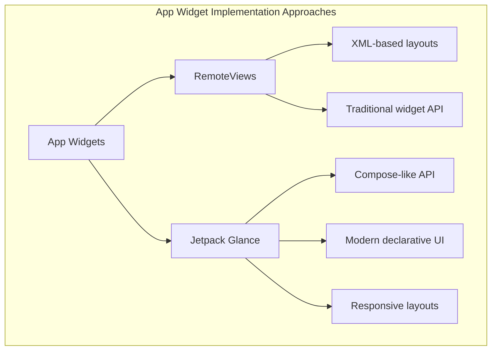
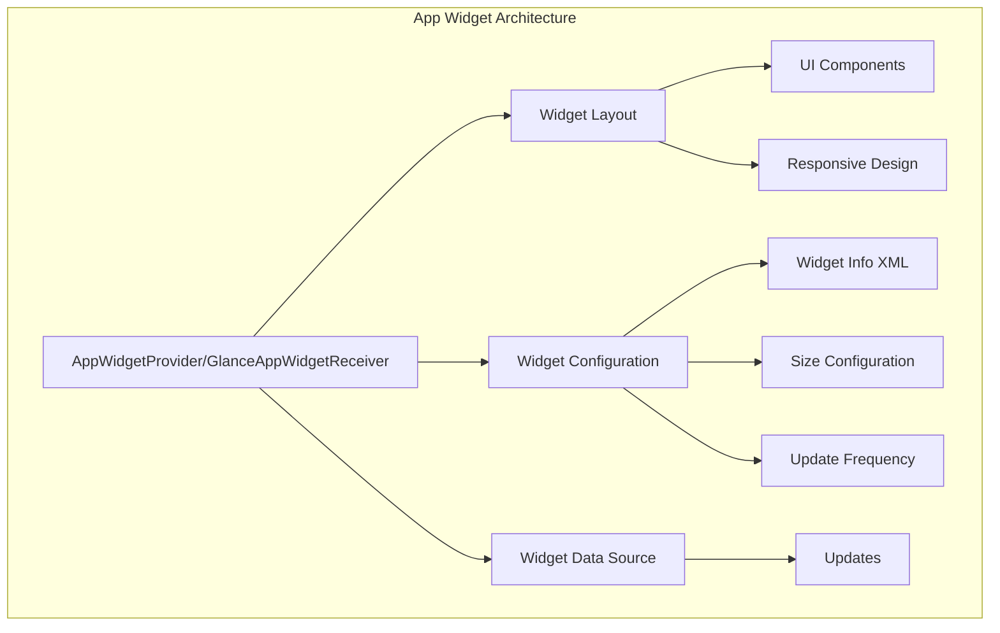
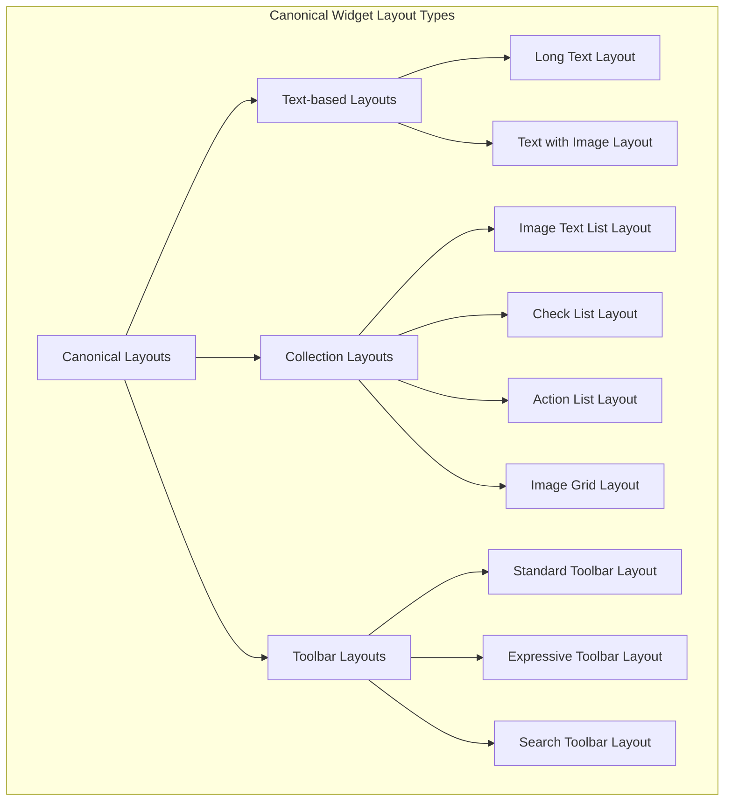
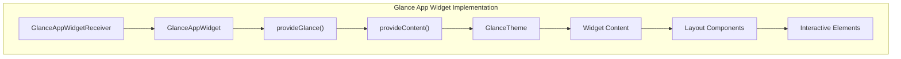
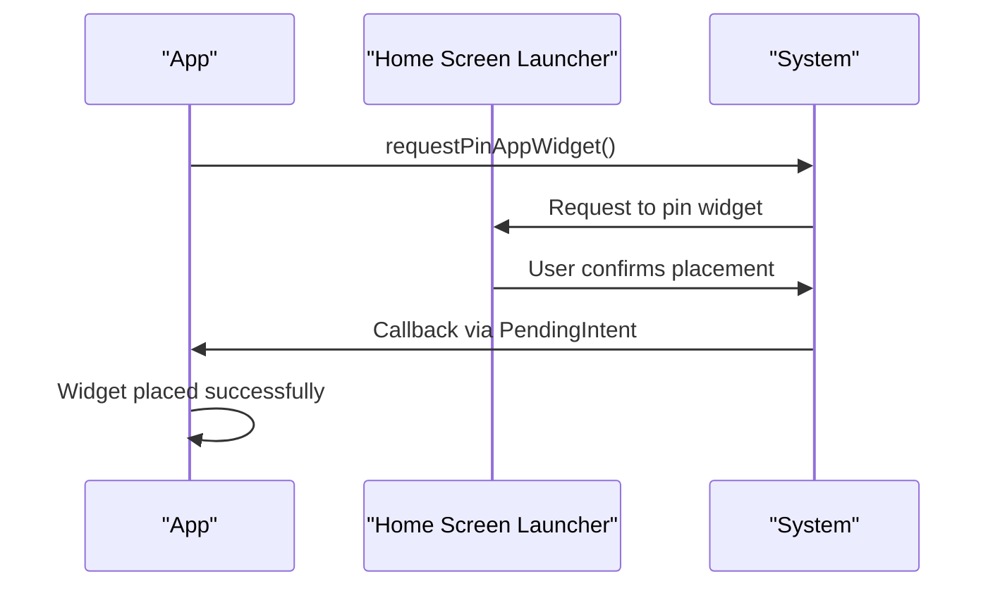
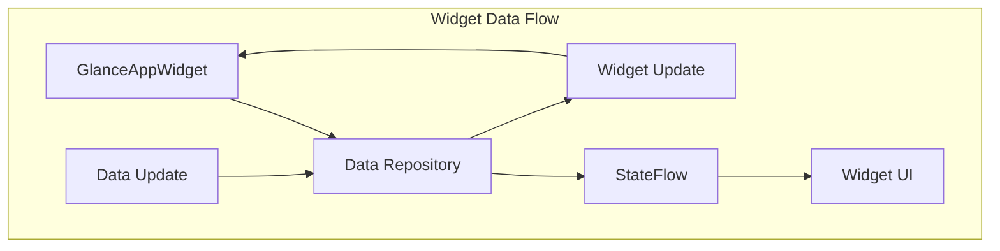

<!-- source: DeepWiki mcp.deepwiki.com · repo android/platform-samples · page 3.3 App Widgets · fetched 2026-10-23 -->

# App Widgets

<details>
<summary>Relevant source files</summary>

The following files were used as context for generating this wiki page:

- [samples/user-interface/appwidgets/README.md](samples/user-interface/appwidgets/README.md)
- [samples/user-interface/appwidgets/src/main/AndroidManifest.xml](samples/user-interface/appwidgets/src/main/AndroidManifest.xml)
- [samples/user-interface/appwidgets/src/main/java/com/example/platform/ui/appwidgets/AppWidgets.kt](samples/user-interface/appwidgets/src/main/java/com/example/platform/ui/appwidgets/AppWidgets.kt)
- [samples/user-interface/appwidgets/src/main/java/com/example/platform/ui/appwidgets/glance/layout/ActionDemonstrationActivity.kt](samples/user-interface/appwidgets/src/main/java/com/example/platform/ui/appwidgets/glance/layout/ActionDemonstrationActivity.kt)
- [samples/user-interface/appwidgets/src/main/java/com/example/platform/ui/appwidgets/glance/layout/CanonicalLayoutActivity.kt](samples/user-interface/appwidgets/src/main/java/com/example/platform/ui/appwidgets/glance/layout/CanonicalLayoutActivity.kt)
- [samples/user-interface/appwidgets/src/main/java/com/example/platform/ui/appwidgets/glance/layout/CollectionsKtx.kt](samples/user-interface/appwidgets/src/main/java/com/example/platform/ui/appwidgets/glance/layout/CollectionsKtx.kt)
- [samples/user-interface/appwidgets/src/main/java/com/example/platform/ui/appwidgets/glance/layout/collections/layout/CheckListLayout.kt](samples/user-interface/appwidgets/src/main/java/com/example/platform/ui/appwidgets/glance/layout/collections/layout/CheckListLayout.kt)
- [samples/user-interface/appwidgets/src/main/java/com/example/platform/ui/appwidgets/glance/layout/collections/layout/ImageGridLayout.kt](samples/user-interface/appwidgets/src/main/java/com/example/platform/ui/appwidgets/glance/layout/collections/layout/ImageGridLayout.kt)
- [samples/user-interface/appwidgets/src/main/java/com/example/platform/ui/appwidgets/glance/layout/collections/layout/ImageTextListLayout.kt](samples/user-interface/appwidgets/src/main/java/com/example/platform/ui/appwidgets/glance/layout/collections/layout/ImageTextListLayout.kt)
- [samples/user-interface/appwidgets/src/main/java/com/example/platform/ui/appwidgets/glance/layout/text/data/FakeLongTextRespository.kt](samples/user-interface/appwidgets/src/main/java/com/example/platform/ui/appwidgets/glance/layout/text/data/FakeLongTextRespository.kt)
- [samples/user-interface/appwidgets/src/main/java/com/example/platform/ui/appwidgets/glance/layout/text/layout/LongTextLayout.kt](samples/user-interface/appwidgets/src/main/java/com/example/platform/ui/appwidgets/glance/layout/text/layout/LongTextLayout.kt)
- [samples/user-interface/appwidgets/src/main/java/com/example/platform/ui/appwidgets/glance/layout/text/layout/TextWithImageLayout.kt](samples/user-interface/appwidgets/src/main/java/com/example/platform/ui/appwidgets/glance/layout/text/layout/TextWithImageLayout.kt)
- [samples/user-interface/appwidgets/src/main/java/com/example/platform/ui/appwidgets/glance/layout/toolbars/ExpressiveToolbarAppWidget.kt](samples/user-interface/appwidgets/src/main/java/com/example/platform/ui/appwidgets/glance/layout/toolbars/ExpressiveToolbarAppWidget.kt)
- [samples/user-interface/appwidgets/src/main/res/drawable-night-nodpi/sample_expressive_toolbar_preview.png](samples/user-interface/appwidgets/src/main/res/drawable-night-nodpi/sample_expressive_toolbar_preview.png)
- [samples/user-interface/appwidgets/src/main/res/drawable-nodpi/cl_activity_row_action_list.png](samples/user-interface/appwidgets/src/main/res/drawable-nodpi/cl_activity_row_action_list.png)
- [samples/user-interface/appwidgets/src/main/res/drawable-nodpi/cl_activity_row_checklist.png](samples/user-interface/appwidgets/src/main/res/drawable-nodpi/cl_activity_row_checklist.png)
- [samples/user-interface/appwidgets/src/main/res/drawable-nodpi/cl_activity_row_expressive_toolbar.png](samples/user-interface/appwidgets/src/main/res/drawable-nodpi/cl_activity_row_expressive_toolbar.png)
- [samples/user-interface/appwidgets/src/main/res/drawable-nodpi/cl_activity_row_hero_image.png](samples/user-interface/appwidgets/src/main/res/drawable-nodpi/cl_activity_row_hero_image.png)
- [samples/user-interface/appwidgets/src/main/res/drawable-nodpi/cl_activity_row_image_grid.png](samples/user-interface/appwidgets/src/main/res/drawable-nodpi/cl_activity_row_image_grid.png)
- [samples/user-interface/appwidgets/src/main/res/drawable-nodpi/cl_activity_row_image_text_list.png](samples/user-interface/appwidgets/src/main/res/drawable-nodpi/cl_activity_row_image_text_list.png)
- [samples/user-interface/appwidgets/src/main/res/drawable-nodpi/cl_activity_row_long_text.png](samples/user-interface/appwidgets/src/main/res/drawable-nodpi/cl_activity_row_long_text.png)
- [samples/user-interface/appwidgets/src/main/res/drawable-nodpi/cl_activity_row_text_image.png](samples/user-interface/appwidgets/src/main/res/drawable-nodpi/cl_activity_row_text_image.png)
- [samples/user-interface/appwidgets/src/main/res/drawable-nodpi/sample_expressive_toolbar_preview.png](samples/user-interface/appwidgets/src/main/res/drawable-nodpi/sample_expressive_toolbar_preview.png)
- [samples/user-interface/appwidgets/src/main/res/values-xlarge/dimens.xml](samples/user-interface/appwidgets/src/main/res/values-xlarge/dimens.xml)
- [samples/user-interface/appwidgets/src/main/res/values/dimens.xml](samples/user-interface/appwidgets/src/main/res/values/dimens.xml)
- [samples/user-interface/appwidgets/src/main/res/values/strings.xml](samples/user-interface/appwidgets/src/main/res/values/strings.xml)
- [samples/user-interface/appwidgets/src/main/res/values/themes.xml](samples/user-interface/appwidgets/src/main/res/values/themes.xml)
- [samples/user-interface/appwidgets/src/main/res/xml/sample_expressive_toolbar_widget_info.xml](samples/user-interface/appwidgets/src/main/res/xml/sample_expressive_toolbar_widget_info.xml)

</details>


App Widgets are miniature application views that can be embedded in other applications (such as the Home screen) and receive periodic updates. This page documents how to implement App Widgets in Android, covering both traditional RemoteViews and modern Jetpack Glance approaches, along with canonical layout patterns and best practices.

## Overview

The Android platform provides a flexible App Widget framework that allows developers to create engaging, glanceable experiences that users can add to their home screens. The platform samples demonstrate two distinct approaches to implementing App Widgets:

1. Traditional **RemoteViews-based** widgets
2. Modern **Jetpack Glance** widgets (using a Compose-like API)



Sources: 
- [samples/user-interface/appwidgets/README.md:1-15]()
- [samples/user-interface/appwidgets/src/main/AndroidManifest.xml:172-198]()

## Widget Components

An App Widget implementation consists of several key components:



### 1. Widget Provider/Receiver

The entry point for an App Widget is either:
- `AppWidgetProvider` (RemoteViews approach)
- `GlanceAppWidgetReceiver` (Glance approach)

These classes handle widget instantiation, updates, and user interactions.

### 2. Widget Configuration

The `appwidget-provider` XML defines characteristics like:
- Minimum and maximum dimensions
- Update frequency
- Preview image
- Initial layout

### 3. Widget Layout

The visual representation of the widget, built using either:
- XML layouts with RemoteViews
- Composable functions with Glance

Sources:
- [samples/user-interface/appwidgets/src/main/AndroidManifest.xml:30-48]()
- [samples/user-interface/appwidgets/src/main/res/xml/sample_expressive_toolbar_widget_info.xml:16-28]()

## Canonical Layout Patterns

The platform samples showcase several intentionally designed widget layouts that follow Android design guidelines. These layouts adapt to different widget sizes and maintain both visual appeal and usability.



### Text-based Layouts

These layouts focus on presenting text content in a clean, readable format:

1. **Long Text Layout**: Displays a primary text with a caption, optimized for readable longer text content.
2. **Text with Image Layout**: Combines text and supporting imagery, adapting layout based on available space.

### Collection Layouts

Designed for presenting lists or grids of items:

1. **Image Text List**: Shows a scrollable list of items with images and text.
2. **Check List**: Interactive list with checkable items, useful for task lists.
3. **Action List**: List with toggleable action items.
4. **Image Grid**: Displays a grid of images with optional captions.

### Toolbar Layouts

Provide quick access to app actions:

1. **Standard Toolbar**: Row of action buttons with a header.
2. **Expressive Toolbar**: Distinctively shaped toolbar (e.g., cookie-cut shape) with central and corner buttons.
3. **Search Toolbar**: Toolbar with prominent search action.

Sources:
- [samples/user-interface/appwidgets/README.md:17-56]()
- [samples/user-interface/appwidgets/src/main/java/com/example/platform/ui/appwidgets/glance/layout/CanonicalLayoutActivity.kt:258-313]()
- [samples/user-interface/appwidgets/src/main/res/values/strings.xml:72-90]()

## Implementing with Jetpack Glance

Jetpack Glance provides a Compose-like declarative API for building App Widgets. Let's examine how to implement a widget with Glance:

### Basic Structure



The implementation typically consists of:

1. A class extending `GlanceAppWidgetReceiver`
2. A class extending `GlanceAppWidget` with:
   - `sizeMode` configuration
   - `provideGlance()` implementation
   - Composable functions defining the widget UI

For example, the `ExpressiveToolbarAppWidget` implementation:

```
class ExpressiveToolbarAppWidget : GlanceAppWidget() {
    override val sizeMode: SizeMode = SizeMode.Exact
    
    override suspend fun provideGlance(context: Context, id: GlanceId) {
        provideContent {
            GlanceTheme {
                WidgetContent()
            }
        }
    }
    
    @Composable
    fun WidgetContent() {
        ExpressiveToolbarLayout(
            centerButton = ExpressiveToolBarButton(...),
            cornerButtons = listOf(...)
        )
    }
}

class ExpressiveToolbarAppWidgetReceiver : GlanceAppWidgetReceiver() {
    override val glanceAppWidget: GlanceAppWidget = ExpressiveToolbarAppWidget()
}
```

### Responsive Layouts

Glance widgets can adapt to different sizes using size-aware composables. This is demonstrated in the `CheckListLayout`:

```
private enum class CheckListLayoutSize(val maxWidth: Dp) {
    Small(maxWidth = 260.dp),
    Medium(maxWidth = 304.dp),
    Large(maxWidth = 348.dp),
    XLarge(maxWidth = 396.dp),
    XXLarge(maxWidth = Dp.Infinity);
    
    companion object {
        @Composable
        fun fromLocalSize(): CheckListLayoutSize {
            val size = LocalSize.current
            
            CheckListLayoutSize.values().forEach {
                if (size.width < it.maxWidth) {
                    return it
                }
            }
            throw IllegalStateException("No mapped size ")
        }
        
        fun CheckListLayoutSize.isWiderThan(checkListLayoutSize: CheckListLayoutSize): Boolean {
            return this.maxWidth > checkListLayoutSize.maxWidth
        }
        
        @Composable
        fun showTitleBar(): Boolean {
            return LocalSize.current.height >= 180.dp
        }
    }
}
```

This allows layout components to make intelligent decisions based on the available space:

```
@Composable
private fun TrailingIconButtonSet(...) {
    val checkListLayoutSize = CheckListLayoutSize.fromLocalSize()
    
    if (checkListLayoutSize.isWiderThan(CheckListLayoutSize.Medium)) {
        CircleIconButton(...)
        
        if (checkListLayoutSize.isWiderThan(CheckListLayoutSize.Large)) {
            CircleIconButton(...)
        }
        
        if (checkListLayoutSize.isWiderThan(CheckListLayoutSize.XLarge)) {
            CircleIconButton(...)
        }
    }
}
```

Sources:
- [samples/user-interface/appwidgets/src/main/java/com/example/platform/ui/appwidgets/glance/layout/toolbars/ExpressiveToolbarAppWidget.kt:43-93]()
- [samples/user-interface/appwidgets/src/main/java/com/example/platform/ui/appwidgets/glance/layout/collections/layout/CheckListLayout.kt:338-379]()
- [samples/user-interface/appwidgets/src/main/java/com/example/platform/ui/appwidgets/glance/layout/collections/layout/CheckListLayout.kt:262-302]()

## Widget Sizing and Dimensions

App Widgets must specify their dimensions for proper display on home screens. This is handled in two places:

1. **XML Configuration**: Each widget's info XML file specifies minimum, maximum, and target sizes.

```xml
<appwidget-provider
    android:minWidth="@dimen/sample_expressive_toolbar_widget_min_width"
    android:minHeight="@dimen/sample_expressive_toolbar_widget_min_height"
    android:minResizeWidth="@dimen/sample_expressive_toolbar_widget_min_resize_width"
    android:minResizeHeight="@dimen/sample_expressive_toolbar_widget_min_resize_height"
    android:maxResizeWidth="@dimen/sample_expressive_toolbar_widget_max_resize_width"
    android:maxResizeHeight="@dimen/sample_expressive_toolbar_widget_max_resize_height"
    android:targetCellWidth="@integer/sample_expressive_toolbar_target_cell_width"
    android:targetCellHeight="@integer/sample_expressive_toolbar_target_cell_height"
    android:resizeMode="horizontal|vertical" />
```

2. **Resources**: Dimension values are defined in `dimens.xml` files, with special consideration for different device types:

```xml
<!-- For handheld devices -->
<dimen name="sample_expressive_toolbar_widget_min_width">120dp</dimen>
<dimen name="sample_expressive_toolbar_widget_min_height">115dp</dimen>

<!-- For tablets (in values-xlarge) -->
<dimen name="sample_expressive_toolbar_widget_min_width">180dp</dimen>
<dimen name="sample_expressive_toolbar_widget_min_height">184dp</dimen>
```

The codebase provides appropriate dimensions for different widget types based on their purpose and content density:

| Widget Type | Default Cell Size | Min Size | Max Size |
|-------------|------------------|----------|----------|
| Long Text | 2×2 | 120dp × 115dp | 624dp × 276dp |
| Text with Image | 4×2 | 256dp × 115dp | 624dp × 422dp |
| Check List | 2×2 | 120dp × 115dp | 624dp × 422dp |
| Action List | 4×2 | 256dp × 115dp | 624dp × 422dp |
| Image Grid | 4×3 | 256dp × 185dp | 624dp × 422dp |
| Toolbar | 4×1 | 256dp × 48dp | 624dp × 422dp |
| Expressive Toolbar | 2×2 | 120dp × 115dp | 624dp × 200dp |
| Search Toolbar | 2×2 | 120dp × 115dp | 624dp × 422dp |

Sources:
- [samples/user-interface/appwidgets/src/main/res/xml/sample_expressive_toolbar_widget_info.xml:16-28]()
- [samples/user-interface/appwidgets/src/main/res/values/dimens.xml:17-136]()
- [samples/user-interface/appwidgets/src/main/res/values-xlarge/dimens.xml:4-113]()

## Widget Pinning

App Widget pinning allows apps to request the launcher to place their widgets directly on the home screen. The platform samples demonstrate this feature in `AppWidgets.kt`:



The implementation involves:

1. Checking if the launcher supports pinning:
```kotlin
if (AppWidgetManager.getInstance(context).isRequestPinAppWidgetSupported) {
    // Proceed with pinning
}
```

2. Setting up a success callback:
```kotlin
val successCallback = PendingIntent.getBroadcast(
    context,
    0,
    Intent(context, AppWidgetPinnedReceiver::class.java),
    PendingIntent.FLAG_UPDATE_CURRENT or PendingIntent.FLAG_IMMUTABLE,
)
```

3. Requesting the pin operation:
```kotlin
AppWidgetManager.getInstance(context).requestPinAppWidget(provider, null, successCallback)
```

The sample also includes a more modern approach using `GlanceAppWidgetManager`:

```kotlin
val glanceManager = GlanceAppWidgetManager(context)
coroutineScope.launch {
    glanceManager.requestPinGlanceAppWidget(receiver::class.java)
}
```

Sources:
- [samples/user-interface/appwidgets/src/main/java/com/example/platform/ui/appwidgets/AppWidgets.kt:142-155]()
- [samples/user-interface/appwidgets/src/main/java/com/example/platform/ui/appwidgets/glance/layout/CanonicalLayoutActivity.kt:236-249]()

## Data Management and Updates

App Widgets need to display and refresh data efficiently. The platform samples demonstrate this with repository patterns:



The `FakeLongTextRepository` demonstrates a simple data management approach:

1. **Data Storage**: Using a StateFlow to maintain and update state
```kotlin
private val data = MutableStateFlow(demoItems[0])
fun data(): Flow<LongTextLayoutData> = data
```

2. **Data Access**: Providing data access via singleton pattern
```kotlin
companion object {
    private val repositories = mutableMapOf<GlanceId, FakeLongTextRepository>()
    
    fun getRepo(glanceId: GlanceId): FakeLongTextRepository {
        return synchronized(repositories) {
            repositories.computeIfAbsentExt(glanceId) {
                FakeLongTextRepository()
            }!!
        }
    }
    
    fun cleanUp(glanceId: GlanceId) {
        synchronized(repositories) {
            repositories.remove(glanceId)
        }
    }
}
```

3. **Data Updates**: Methods to refresh data
```kotlin
fun refresh() {
    itemIndex = (itemIndex + 1) % itemsCount
    this.load()
}

fun load(): LongTextLayoutData {
    itemsCount = demoItems.size
    data.value = demoItems[itemIndex]
    return data.value
}
```

Sources:
- [samples/user-interface/appwidgets/src/main/java/com/example/platform/ui/appwidgets/glance/layout/text/data/FakeLongTextRespository.kt:11-89]()

## Widget Actions and Interactions

App Widgets can respond to user interactions through actions. The platform samples demonstrate two approaches:

1. **RemoteViews Actions**: Using PendingIntents for actions
2. **Glance Actions**: Using the Glance action system

For Glance widgets, actions are typically defined with handlers:

```kotlin
CircleIconButton(
    imageProvider = ImageProvider(leadingButtonRes),
    backgroundColor = null,
    contentColor = GlanceTheme.colors.secondary,
    contentDescription = leadingButtonContentDescription,
    onClick = actionStartDemoActivity("Edit click on item: ${item.key}"),
)
```

Actions can launch activities with additional data:

```kotlin
internal val ActionSourceMessageKey = ActionParameters.Key<String>("actionSourceMessageKey")

fun actionStartDemoActivity(message: String): Action {
    return actionStartActivity<ActionDemonstrationActivity>(
        parameters = actionParametersOf(
            ActionSourceMessageKey to message
        )
    )
}
```

The `ActionDemonstrationActivity` then receives and processes this data:

```kotlin
val source = intent.getStringExtra(ActionSourceMessageKey.name) ?: "Unknown"
Text("Launched from $source")
```

Sources:
- [samples/user-interface/appwidgets/src/main/java/com/example/platform/ui/appwidgets/glance/layout/collections/layout/CheckListLayout.kt:235-246]()
- [samples/user-interface/appwidgets/src/main/java/com/example/platform/ui/appwidgets/glance/layout/ActionDemonstrationActivity.kt:27-46]()

## Best Practices

From the platform samples, we can identify several best practices for App Widget development:

1. **Responsive Design**: Adapt layouts based on available space
   ```kotlin
   @Composable
   fun fromLocalSize(): TextWithImageLayoutSize {
       val size = LocalSize.current
       val isTall = size.height >= size.width
       
       return if (isTall && size.height <= 300.dp) {
           VerticalSmall
       } else if (isTall) {
           VerticalLarge
       } else if (size.width <= 165.dp) {
           HorizontalSmall
       } else {
           HorizontalLarge
       }
   }
   ```

2. **Proper Sizing**: Define appropriate minimum and maximum dimensions
   ```xml
   <dimen name="sample_long_text_widget_min_width">120dp</dimen>
   <dimen name="sample_long_text_widget_min_height">115dp</dimen>
   <dimen name="sample_long_text_min_resize_width">120dp</dimen>
   <dimen name="sample_long_text_min_resize_height">115dp</dimen>
   <dimen name="sample_long_text_max_resize_width">624dp</dimen>
   <dimen name="sample_long_text_max_resize_height">276dp</dimen>
   ```

3. **Adaptive Content**: Show/hide elements based on available space
   ```kotlin
   if (checkListLayoutSize.isWiderThan(CheckListLayoutSize.Large)) {
       CircleIconButton(...)
   }
   ```

4. **Provide Preview Images**: Help users understand what the widget looks like
   ```xml
   android:previewImage="@drawable/sample_expressive_toolbar_preview"
   ```

5. **Support Different Device Types**: Provide size resources for different device categories
   ```xml
   <!-- For tablets (in values-xlarge) -->
   <dimen name="sample_toolbar_widget_min_width">298dp</dimen>
   ```

6. **Use Appropriate Layouts**: Choose canonical layouts that match your content
   - Text-heavy content: Long Text or Text with Image
   - Collections: Image Text List, Check List, or Image Grid
   - Actions: Toolbar variants

Sources:
- [samples/user-interface/appwidgets/src/main/java/com/example/platform/ui/appwidgets/glance/layout/text/layout/TextWithImageLayout.kt:382-396]()
- [samples/user-interface/appwidgets/src/main/res/values/dimens.xml:65-72]()
- [samples/user-interface/appwidgets/src/main/res/values-xlarge/dimens.xml:24-30]()
- [samples/user-interface/appwidgets/src/main/res/xml/sample_expressive_toolbar_widget_info.xml:24]()

## Related Resources

For more information on specific aspects of Android app development:

- For information about User Interface components, see [User Interface Samples](#3)
- For specific details on Drag and Drop functionality, see [Drag and Drop](#3.1)
- For information about Predictive Back behavior, see [Predictive Back](#3.2)
- For details about Window Manager APIs, see [Window Manager](#3.4)

Sources:
- [samples/user-interface/appwidgets/README.md:85-96]()

---

