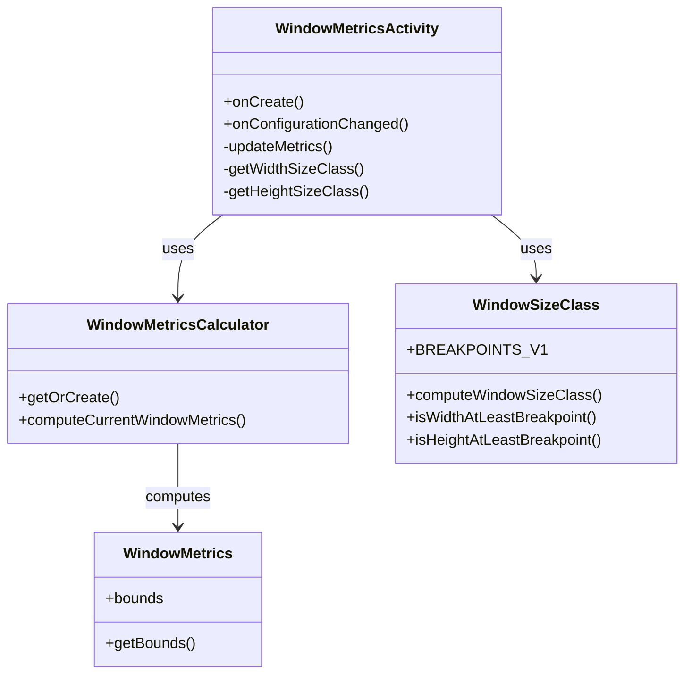
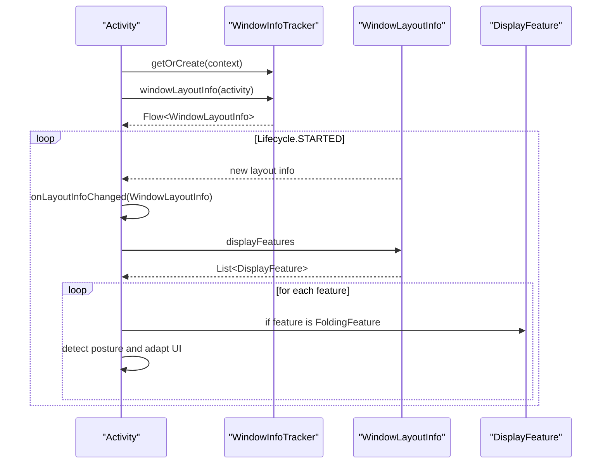
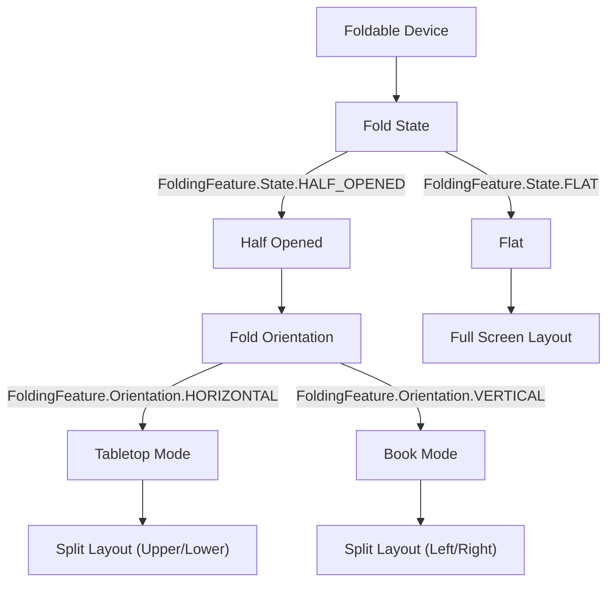
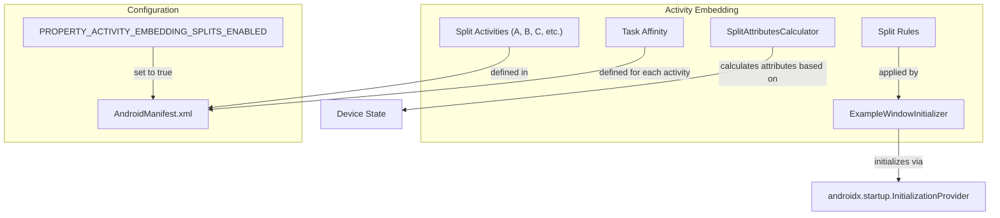

<!-- source: DeepWiki mcp.deepwiki.com · repo android/platform-samples · page 3.4 Window Manager · fetched 2026-10-23 -->

# Window Manager

<details>
<summary>Relevant source files</summary>

The following files were used as context for generating this wiki page:

- [samples/connectivity/callnotification/README.md](samples/connectivity/callnotification/README.md)
- [samples/connectivity/callnotification/build.gradle.kts](samples/connectivity/callnotification/build.gradle.kts)
- [samples/connectivity/callnotification/src/main/AndroidManifest.xml](samples/connectivity/callnotification/src/main/AndroidManifest.xml)
- [samples/connectivity/callnotification/src/main/java/com/example/platform/connectivity/callnotification/CallNotificationSample.kt](samples/connectivity/callnotification/src/main/java/com/example/platform/connectivity/callnotification/CallNotificationSample.kt)
- [samples/connectivity/callnotification/src/main/java/com/example/platform/connectivity/callnotification/NotificationSource.kt](samples/connectivity/callnotification/src/main/java/com/example/platform/connectivity/callnotification/NotificationSource.kt)
- [samples/user-interface/share/src/main/AndroidManifest.xml](samples/user-interface/share/src/main/AndroidManifest.xml)
- [samples/user-interface/windowmanager/build.gradle.kts](samples/user-interface/windowmanager/build.gradle.kts)
- [samples/user-interface/windowmanager/src/main/AndroidManifest.xml](samples/user-interface/windowmanager/src/main/AndroidManifest.xml)
- [samples/user-interface/windowmanager/src/main/java/com/example/platform/ui/windowmanager/MediaPlayerActivity.kt](samples/user-interface/windowmanager/src/main/java/com/example/platform/ui/windowmanager/MediaPlayerActivity.kt)
- [samples/user-interface/windowmanager/src/main/java/com/example/platform/ui/windowmanager/WindowMetricsActivity.kt](samples/user-interface/windowmanager/src/main/java/com/example/platform/ui/windowmanager/WindowMetricsActivity.kt)
- [samples/user-interface/windowmanager/src/main/java/com/example/platform/ui/windowmanager/util/SampleTools.kt](samples/user-interface/windowmanager/src/main/java/com/example/platform/ui/windowmanager/util/SampleTools.kt)
- [samples/user-interface/windowmanager/src/main/res/layout/activity_media_player.xml](samples/user-interface/windowmanager/src/main/res/layout/activity_media_player.xml)
- [samples/user-interface/windowmanager/src/main/res/layout/activity_window_metrics.xml](samples/user-interface/windowmanager/src/main/res/layout/activity_window_metrics.xml)
- [samples/user-interface/windowmanager/src/main/res/values/strings.xml](samples/user-interface/windowmanager/src/main/res/values/strings.xml)
- [samples/user-interface/windowmanager/src/main/res/xml/activity_mediaplayer_scene.xml](samples/user-interface/windowmanager/src/main/res/xml/activity_mediaplayer_scene.xml)

</details>


This document provides a comprehensive guide to using the Window Manager API in Android for creating adaptive UIs that respond to different screen configurations, including multi-display, foldable devices, and split-screen scenarios. The Window Manager sample demonstrates how to build applications that adapt to various device form factors and screen states.

## Overview

The Window Manager API allows applications to detect and adapt to:
- Window size changes and window metrics
- Display features (hinges, folds)
- Device postures (folded, tabletop mode, book mode)
- Multiple displays
- Split-screen configurations
- Activity embedding

Sources: [samples/user-interface/windowmanager/src/main/AndroidManifest.xml:1-196](), [samples/user-interface/windowmanager/build.gradle.kts:1-54]()

## Architecture Overview

The Window Manager sample relies primarily on the Jetpack WindowManager library to provide information about window state and display features.

**Window Manager Architecture Diagram**

```mermaid
flowchart TB
    subgraph "Application Layer"
        App["Your Application"]
        DemoActivities["Demo Activities (WindowDemosActivity, etc.)"]
    end
    
    subgraph "AndroidX Window Manager"
        WindowInfoTracker["WindowInfoTracker"]
        WindowMetricsCalculator["WindowMetricsCalculator"]
        WindowSizeClass["WindowSizeClass"]
        DisplayFeature["DisplayFeature"]
        FoldingFeature["FoldingFeature"]
        WindowLayoutInfo["WindowLayoutInfo"]
    end
    
    subgraph "Device State"
        DeviceState["Device State (Posture)"]
        DisplayState["Display State & Features"]
    end
    
    App --> DemoActivities
    DemoActivities --> WindowInfoTracker
    DemoActivities --> WindowMetricsCalculator
    WindowInfoTracker --> WindowLayoutInfo
    WindowLayoutInfo --> DisplayFeature
    DisplayFeature <|-- FoldingFeature
    WindowMetricsCalculator --> WindowSizeClass
    DisplayState --> WindowInfoTracker
    DeviceState --> WindowInfoTracker
```

Sources: [samples/user-interface/windowmanager/build.gradle.kts:39-53](), [samples/user-interface/windowmanager/src/main/AndroidManifest.xml:29-63]()

## Key Components

### Window Metrics

The Window Metrics API allows you to obtain information about the current window size and classify it into size classes for responsive layout design.

**Window Metrics Components**



The `WindowMetricsActivity` demonstrates how to use these components to compute and display window metrics:

1. Get the current window metrics using `WindowMetricsCalculator.getOrCreate().computeCurrentWindowMetrics(this)`
2. Extract the width and height from the metrics bounds
3. Compute the window size class using `WindowSizeClass.computeWindowSizeClass()`
4. Use the size class to determine appropriate layouts based on COMPACT, MEDIUM, or EXPANDED classifications

The sample handles configuration changes (like rotation) by updating metrics in `onConfigurationChanged()`.

Sources: [samples/user-interface/windowmanager/src/main/java/com/example/platform/ui/windowmanager/WindowMetricsActivity.kt:1-90](), [samples/user-interface/windowmanager/src/main/res/layout/activity_window_metrics.xml:1-24]()

### Display Features

Display features represent physical attributes of the display like folds, hinges, and cutouts. The sample demonstrates how to detect and adapt layouts to these features.

**Display Feature Usage Flow**



The sample uses Kotlin Flow to observe changes to the window layout information and react accordingly.

Sources: [samples/user-interface/windowmanager/src/main/java/com/example/platform/ui/windowmanager/MediaPlayerActivity.kt:54-62](), [samples/user-interface/windowmanager/src/main/java/com/example/platform/ui/windowmanager/util/SampleTools.kt:16-122]()

## Adapting to Foldable Devices

The sample demonstrates several techniques for adapting UIs to foldable devices:

### Detecting Device Postures

The sample includes utility functions to detect different device postures:

```kotlin
// Checks if the device is in tabletop mode (folded with hinge horizontal)
fun isTableTopMode(foldFeature: FoldingFeature) =
    foldFeature.state == FoldingFeature.State.HALF_OPENED &&
            foldFeature.orientation == FoldingFeature.Orientation.HORIZONTAL

// Checks if the device is in book mode (folded with hinge vertical)
fun isBookModeMode(foldFeature: FoldingFeature) =
    foldFeature.state == FoldingFeature.State.HALF_OPENED &&
            foldFeature.orientation == FoldingFeature.Orientation.VERTICAL
```

**Foldable Device Postures**



Sources: [samples/user-interface/windowmanager/src/main/java/com/example/platform/ui/windowmanager/util/SampleTools.kt:56-62]()

### Media Player Example

The `MediaPlayerActivity` demonstrates how to adapt a media player UI to foldable devices:

1. In flat mode: The player uses the full screen with embedded controls
2. In tabletop mode: The player is shown on the top portion, with controls on the bottom portion

The activity observes WindowLayoutInfo changes using Kotlin Flow and adjusts the layout accordingly:

```kotlin
WindowInfoTracker.getOrCreate(this@MediaPlayerActivity)
    .windowLayoutInfo(this@MediaPlayerActivity)
    .collect { newLayoutInfo ->
        onLayoutInfoChanged(newLayoutInfo)
    }
```

When layout changes occur, it checks for folding features and adapts the UI:

```kotlin
private fun onLayoutInfoChanged(newLayoutInfo: WindowLayoutInfo) {
    if (newLayoutInfo.displayFeatures.isEmpty()) {
        centerPlayer()
    } else {
        for (displayFeature in newLayoutInfo.displayFeatures) {
            val foldFeature = displayFeature as? FoldingFeature
            if (foldFeature != null) {
                if (isTableTopMode(foldFeature)) {
                    // Window is full-screen and device's posture is tabletop
                    val fold = foldPosition(binding.root, foldFeature)
                    foldPlayer(fold)
                } else {
                    centerPlayer()
                }
            }
        }
    }
}
```

The XML layout uses `MotionLayout` with a `ReactiveGuide` to position UI elements based on the fold position:

```xml
<androidx.constraintlayout.widget.ReactiveGuide
    android:id="@+id/fold"
    app:reactiveGuide_valueId="@id/fold"
    app:reactiveGuide_animateChange="true"
    app:reactiveGuide_applyToAllConstraintSets="true"
    android:orientation="horizontal"
    app:layout_constraintGuide_end="0dp"
    android:layout_height="wrap_content"
    android:layout_width="wrap_content"/>
```

Sources: [samples/user-interface/windowmanager/src/main/java/com/example/platform/ui/windowmanager/MediaPlayerActivity.kt:1-147](), [samples/user-interface/windowmanager/src/main/res/layout/activity_media_player.xml:1-58](), [samples/user-interface/windowmanager/src/main/res/xml/activity_mediaplayer_scene.xml:1-31]()

## Activity Embedding and Split Screens

The Window Manager sample includes extensive examples of activity embedding and split screen layouts. This capability allows multiple activities to be displayed simultaneously in split screen configurations.

**Activity Embedding Architecture**



The manifest enables activity embedding with the property:

```xml
<property
    android:name="android.window.PROPERTY_ACTIVITY_EMBEDDING_SPLITS_ENABLED"
    android:value="true" />
```

Multiple split activities with different configurations are defined, each with specific task affinities to enable proper splitting:

```xml
<activity
    android:name=".embedding.SplitActivityA"
    android:configChanges="orientation|screenSize|smallestScreenSize|screenLayout|colorMode|density|touchscreen"
    android:exported="true"
    android:label="Split Main"
    android:taskAffinity="com.example.platform.ui.windowmanager.manual_split_affinity" />
```

The sample demonstrates several types of split screen approaches:

1. **Basic Split**: Dividing the screen between two activities
2. **Device State Aware Split**: Changing split configuration based on device posture
3. **List-Detail Split**: Showing a list on one side and detail on the other
4. **Placeholder Split**: Using placeholder activities when needed
5. **Runtime Toggle Split**: Changing split attributes at runtime

Sources: [samples/user-interface/windowmanager/src/main/AndroidManifest.xml:19-193]()

## Display Features Adaptation

The sample includes utilities for adapting layouts to display features:

**Display Feature Adaptation Pattern**

```mermaid
flowchart LR
    subgraph "Window Manager API"
        WindowInfoTracker["WindowInfoTracker"]
        WindowLayoutInfo["WindowLayoutInfo"]
        DisplayFeature["DisplayFeature"]
        FoldingFeature["FoldingFeature: DisplayFeature"]
    end
    
    subgraph "Adaptation Utilities"
        AdjustFeaturePos["adjustFeaturePositionOffset()"]
        GetLayoutParams["getLayoutParamsForFeatureInFrameLayout()"]
        FoldPosition["foldPosition()"]
        GetBounds["getFeatureBoundsInWindow()"]
    end
    
    subgraph "UI Implementation"
        UpdateLayout["Update Layout Based on Features"]
        SplitLayoutImpl["Split Layout Implementation"]
    end
    
    WindowInfoTracker -->|"provides"| WindowLayoutInfo
    WindowLayoutInfo -->|"contains"| DisplayFeature
    DisplayFeature <|-- FoldingFeature
    DisplayFeature -->|"input to"| AdjustFeaturePos
    AdjustFeaturePos -->|"calculates"| FeatureRect["Feature Rectangle in View Coordinates"]
    FeatureRect -->|"used by"| GetLayoutParams
    GetLayoutParams -->|"creates"| LayoutParams["FrameLayout.LayoutParams"]
    LayoutParams -->|"applied to"| SplitLayoutImpl
    FoldingFeature -->|"input to"| FoldPosition
    FoldPosition -->|"calculated using"| GetBounds
    FoldPosition -->|"position used by"| UpdateLayout
```

Key utility functions include:

1. `adjustFeaturePositionOffset()`: Converts DisplayFeature coordinates to view coordinates
2. `getLayoutParamsForFeatureInFrameLayout()`: Creates layout parameters for a view representing a display feature
3. `foldPosition()`: Calculates a fold's position relative to a view
4. `getFeatureBoundsInWindow()`: Gets the bounds of a display feature translated to a view's coordinate space

Sources: [samples/user-interface/windowmanager/src/main/java/com/example/platform/ui/windowmanager/util/SampleTools.kt:31-116]()

## Window Modes

The sample demonstrates several window modes for foldable and multi-display devices:

### Dual Screen Mode

The `DualScreenActivity` demonstrates how to present content on both displays of a foldable device simultaneously. This is enabled in the manifest with specific configuration flags:

```xml
<activity
    android:name=".DualScreenActivity"
    android:exported="false"
    android:configChanges="keyboard|keyboardHidden|orientation|screenSize|screenLayout|smallestScreenSize|uiMode"
    android:label="@string/dual_screen_activity"/>
```

### Rear Display Mode

The `RearDisplayModeActivity` shows how to handle rear display mode on compatible devices:

```xml
<activity
    android:name=".RearDisplayModeActivity"
    android:exported="false"
    android:configChanges="keyboard|keyboardHidden|orientation|screenSize|screenLayout|smallestScreenSize|uiMode"
    android:label="@string/rear_display_activity"/>
```

Sources: [samples/user-interface/windowmanager/src/main/AndroidManifest.xml:34-43]()

## Implementation Guide

### 1. Adding Dependencies

To use the Window Manager APIs, add the following dependencies to your `build.gradle.kts` file:

```kotlin
dependencies {
    implementation("androidx.window:window:x.y.z")
    implementation("androidx.window:window-java:x.y.z")
    implementation("androidx.window.core:window-core:x.y.z")
    // Optional RxJava integration
    implementation("androidx.window:window-rxjava2:x.y.z")
}
```

Sources: [samples/user-interface/windowmanager/build.gradle.kts:39-53]()

### 2. Obtaining Window Metrics

To obtain window metrics and size classes:

```kotlin
// Get the WindowMetricsCalculator
val windowMetrics = WindowMetricsCalculator.getOrCreate().computeCurrentWindowMetrics(this)

// Get width and height
val width = windowMetrics.bounds.width()
val height = windowMetrics.bounds.height()

// Convert to DP
val density = resources.displayMetrics.density
val widthDp = width / density
val heightDp = height / density

// Compute window size class
val windowSizeClass = WindowSizeClass.BREAKPOINTS_V1.computeWindowSizeClass(widthDp, heightDp)

// Check size class
if (windowSizeClass.isWidthAtLeastBreakpoint(WIDTH_DP_EXPANDED_LOWER_BOUND)) {
    // Use expanded width layout
} else if (windowSizeClass.isWidthAtLeastBreakpoint(WIDTH_DP_MEDIUM_LOWER_BOUND)) {
    // Use medium width layout
} else {
    // Use compact width layout
}
```

Sources: [samples/user-interface/windowmanager/src/main/java/com/example/platform/ui/windowmanager/WindowMetricsActivity.kt:51-74]()

### 3. Observing Display Features

To observe display features and adapt your UI:

```kotlin
// Using Kotlin Flow
lifecycleScope.launch(Dispatchers.Main) {
    lifecycle.repeatOnLifecycle(Lifecycle.State.STARTED) {
        WindowInfoTracker.getOrCreate(this@YourActivity)
            .windowLayoutInfo(this@YourActivity)
            .collect { newLayoutInfo ->
                // Handle layout info changes
                handleDisplayFeatures(newLayoutInfo.displayFeatures)
            }
    }
}

// Handle display features
private fun handleDisplayFeatures(displayFeatures: List<DisplayFeature>) {
    for (feature in displayFeatures) {
        if (feature is FoldingFeature) {
            when {
                isTableTopMode(feature) -> {
                    // Adapt UI for tabletop mode
                    val foldPosition = foldPosition(rootView, feature)
                    adaptForTabletopMode(foldPosition)
                }
                isBookModeMode(feature) -> {
                    // Adapt UI for book mode
                    adaptForBookMode()
                }
                else -> {
                    // Default UI for flat mode
                    adaptForFlatMode()
                }
            }
        }
    }
}
```

Sources: [samples/user-interface/windowmanager/src/main/java/com/example/platform/ui/windowmanager/MediaPlayerActivity.kt:54-146]()

### 4. Enabling Activity Embedding

To enable activity embedding for split-screen experiences:

1. Add the property to your manifest:

```xml
<property
    android:name="android.window.PROPERTY_ACTIVITY_EMBEDDING_SPLITS_ENABLED"
    android:value="true" />
```

2. Configure activities with appropriate task affinities:

```xml
<activity
    android:name=".YourSplitActivityA"
    android:configChanges="orientation|screenSize|smallestScreenSize|screenLayout|colorMode|density|touchscreen"
    android:taskAffinity="com.example.yourapp.split_affinity" />

<activity
    android:name=".YourSplitActivityB"
    android:configChanges="orientation|screenSize|smallestScreenSize|screenLayout|colorMode|density|touchscreen"
    android:taskAffinity="com.example.yourapp.split_affinity" />
```

3. Set up an initializer to define split rules:

```xml
<provider
    android:name="androidx.startup.InitializationProvider"
    android:authorities="${applicationId}.androidx-startup"
    android:exported="false"
    android:grantUriPermissions="true"
    tools:node="merge">
    <meta-data
        android:name="com.example.yourapp.YourWindowInitializer"
        android:value="androidx.startup" />
</provider>
```

Sources: [samples/user-interface/windowmanager/src/main/AndroidManifest.xml:25-190]()

## Best Practices

1. **Handle Configuration Changes**: Always handle configuration changes properly to ensure your UI adapts correctly when the device state changes.

2. **Use WindowSizeClass**: Rather than hardcoding pixel dimensions, use WindowSizeClass to categorize window sizes into COMPACT, MEDIUM, and EXPANDED for responsive layouts.

3. **Observe WindowLayoutInfo**: Use Kotlin Flow or RxJava to observe changes to WindowLayoutInfo for real-time adaptation to display features.

4. **Test on Different Devices**: Test your application on various device form factors, including foldables, multi-display, and traditional devices.

5. **Graceful Degradation**: Ensure your application works properly even on devices that don't support specific features like foldable displays.

6. **Appropriate Task Affinities**: When using activity embedding, ensure activities have appropriate task affinities to enable proper splitting.

Sources: [samples/user-interface/windowmanager/src/main/AndroidManifest.xml:1-196](), [samples/user-interface/windowmanager/src/main/java/com/example/platform/ui/windowmanager/WindowMetricsActivity.kt:46-49]()

## Conclusion

The Window Manager API provides powerful tools for creating adaptive UIs that respond appropriately to different screen configurations, device states, and display features. By using the techniques demonstrated in the sample, you can create applications that deliver optimal user experiences across a wide range of Android devices, including foldables and multi-display configurations.

---

