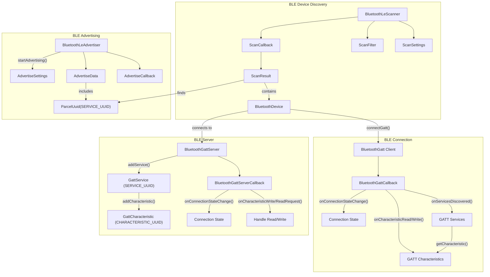
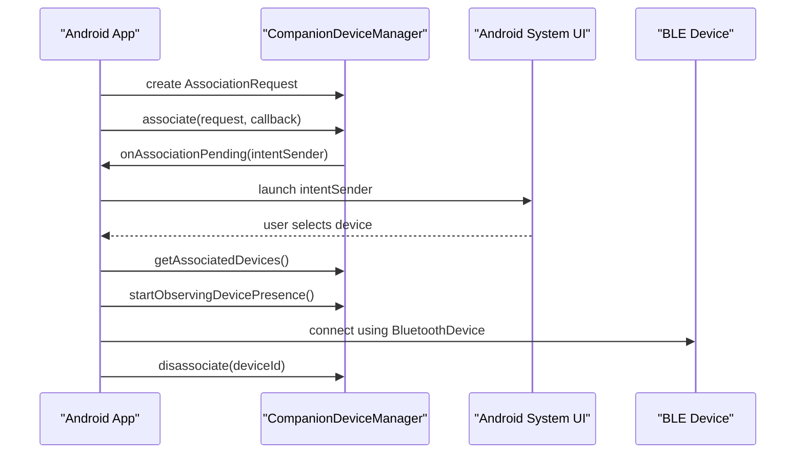
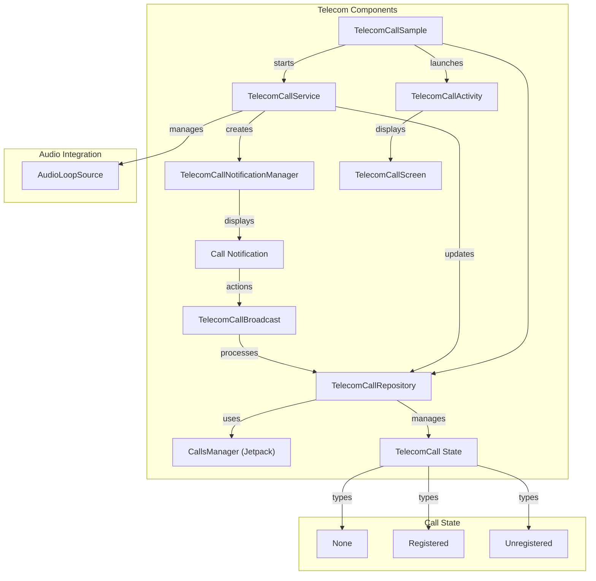
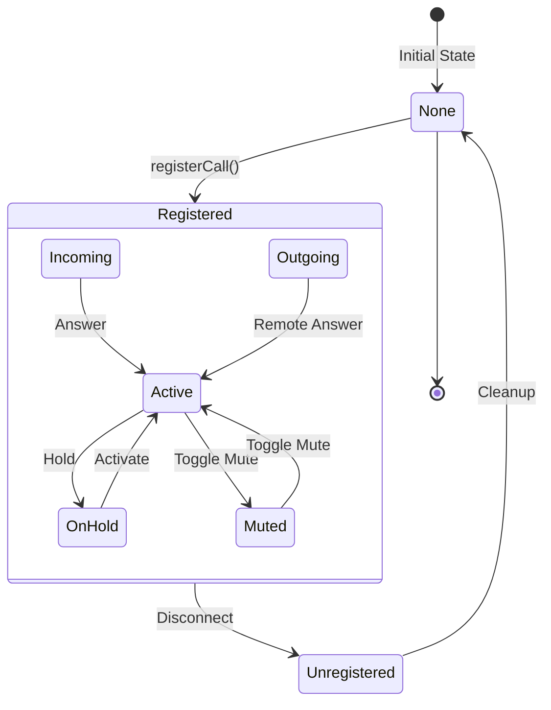

<!-- source: DeepWiki mcp.deepwiki.com · repo android/platform-samples · page 4 Connectivity Samples · fetched 2026-10-23 -->

# Connectivity Samples

<details>
<summary>Relevant source files</summary>

The following files were used as context for generating this wiki page:

- [samples/connectivity/audio/README.md](samples/connectivity/audio/README.md)
- [samples/connectivity/audio/src/AndroidManifest.xml](samples/connectivity/audio/src/AndroidManifest.xml)
- [samples/connectivity/bluetooth/ble/README.md](samples/connectivity/bluetooth/ble/README.md)
- [samples/connectivity/bluetooth/ble/src/main/AndroidManifest.xml](samples/connectivity/bluetooth/ble/src/main/AndroidManifest.xml)
- [samples/connectivity/bluetooth/ble/src/main/java/com/example/platform/connectivity/bluetooth/ble/BLEScanIntentSample.kt](samples/connectivity/bluetooth/ble/src/main/java/com/example/platform/connectivity/bluetooth/ble/BLEScanIntentSample.kt)
- [samples/connectivity/bluetooth/ble/src/main/java/com/example/platform/connectivity/bluetooth/ble/ConnectGATTSample.kt](samples/connectivity/bluetooth/ble/src/main/java/com/example/platform/connectivity/bluetooth/ble/ConnectGATTSample.kt)
- [samples/connectivity/bluetooth/ble/src/main/java/com/example/platform/connectivity/bluetooth/ble/FindBLEDevicesSample.kt](samples/connectivity/bluetooth/ble/src/main/java/com/example/platform/connectivity/bluetooth/ble/FindBLEDevicesSample.kt)
- [samples/connectivity/bluetooth/ble/src/main/java/com/example/platform/connectivity/bluetooth/ble/server/GATTServerSample.kt](samples/connectivity/bluetooth/ble/src/main/java/com/example/platform/connectivity/bluetooth/ble/server/GATTServerSample.kt)
- [samples/connectivity/bluetooth/ble/src/main/java/com/example/platform/connectivity/bluetooth/ble/server/GATTServerSampleService.kt](samples/connectivity/bluetooth/ble/src/main/java/com/example/platform/connectivity/bluetooth/ble/server/GATTServerSampleService.kt)
- [samples/connectivity/bluetooth/companion/src/main/java/com/example/platform/connectivity/bluetooth/cdm/AssociatedDeviceCompat.kt](samples/connectivity/bluetooth/companion/src/main/java/com/example/platform/connectivity/bluetooth/cdm/AssociatedDeviceCompat.kt)
- [samples/connectivity/bluetooth/companion/src/main/java/com/example/platform/connectivity/bluetooth/cdm/CompanionDeviceManagerSample.kt](samples/connectivity/bluetooth/companion/src/main/java/com/example/platform/connectivity/bluetooth/cdm/CompanionDeviceManagerSample.kt)
- [samples/connectivity/telecom/src/androidTest/java/com/example/platform/connectivity/telecom/TelecomSampleTest.kt](samples/connectivity/telecom/src/androidTest/java/com/example/platform/connectivity/telecom/TelecomSampleTest.kt)
- [samples/connectivity/telecom/src/main/java/com/example/platform/connectivity/telecom/TelecomCallSample.kt](samples/connectivity/telecom/src/main/java/com/example/platform/connectivity/telecom/TelecomCallSample.kt)
- [samples/connectivity/telecom/src/main/java/com/example/platform/connectivity/telecom/call/TelecomCallActivity.kt](samples/connectivity/telecom/src/main/java/com/example/platform/connectivity/telecom/call/TelecomCallActivity.kt)
- [samples/connectivity/telecom/src/main/java/com/example/platform/connectivity/telecom/call/TelecomCallBroadcast.kt](samples/connectivity/telecom/src/main/java/com/example/platform/connectivity/telecom/call/TelecomCallBroadcast.kt)
- [samples/connectivity/telecom/src/main/java/com/example/platform/connectivity/telecom/call/TelecomCallNotificationManager.kt](samples/connectivity/telecom/src/main/java/com/example/platform/connectivity/telecom/call/TelecomCallNotificationManager.kt)
- [samples/connectivity/telecom/src/main/java/com/example/platform/connectivity/telecom/call/TelecomCallScreen.kt](samples/connectivity/telecom/src/main/java/com/example/platform/connectivity/telecom/call/TelecomCallScreen.kt)
- [samples/connectivity/telecom/src/main/java/com/example/platform/connectivity/telecom/call/TelecomCallService.kt](samples/connectivity/telecom/src/main/java/com/example/platform/connectivity/telecom/call/TelecomCallService.kt)
- [samples/connectivity/telecom/src/main/java/com/example/platform/connectivity/telecom/model/TelecomCallRepository.kt](samples/connectivity/telecom/src/main/java/com/example/platform/connectivity/telecom/model/TelecomCallRepository.kt)
- [samples/location/src/main/java/com/example/platform/location/permission/LocationPermissions.kt](samples/location/src/main/java/com/example/platform/location/permission/LocationPermissions.kt)

</details>


The Connectivity Samples section provides a comprehensive overview of Android platform connectivity-related APIs and features. This documentation covers Bluetooth Low Energy (BLE), Telecom, Audio, and Companion Device Manager implementations with working code examples that demonstrate best practices for integrating these features into Android applications.

For information about privacy features, see [Privacy and Permissions](#5).

## Overview

The connectivity samples demonstrate various ways Android applications can establish and manage connections between devices and services. These samples are designed to work on modern Android versions and showcase compatibility techniques across different API levels.

Key connectivity features covered include:

- Bluetooth Low Energy device discovery and communication
- Telecom call management and UI
- Audio management for communication
- Companion device association and management

Sources: [samples/connectivity/bluetooth/ble/README.md](), [samples/connectivity/audio/README.md]()

## Bluetooth Low Energy (BLE)

Bluetooth Low Energy samples demonstrate how to scan for, connect to, and communicate with BLE devices, as well as how to advertise and handle connections as a GATT server.

### BLE Components and Workflow Diagram



Sources: [samples/connectivity/bluetooth/ble/src/main/java/com/example/platform/connectivity/bluetooth/ble/ConnectGATTSample.kt](), [samples/connectivity/bluetooth/ble/src/main/java/com/example/platform/connectivity/bluetooth/ble/FindBLEDevicesSample.kt](), [samples/connectivity/bluetooth/ble/src/main/java/com/example/platform/connectivity/bluetooth/ble/server/GATTServerSample.kt](), [samples/connectivity/bluetooth/ble/src/main/java/com/example/platform/connectivity/bluetooth/ble/server/GATTServerSampleService.kt]()

### BLE Device Discovery

The samples include two approaches for finding BLE devices:

1. **Direct Scanning**: Using `BluetoothLeScanner` with a `ScanCallback` to get real-time scan results.
   ```
   adapter.bluetoothLeScanner.startScan(null, scanSettings, leScanCallback)
   ```

2. **PendingIntent Scanning**: Using a PendingIntent to scan in the background, even when the app is not running.
   ```
   scanner.startScan(scanFilters, scanSettings, resultIntent)
   ```

The `FindBLEDevicesSample` [samples/connectivity/bluetooth/ble/src/main/java/com/example/platform/connectivity/bluetooth/ble/FindBLEDevicesSample.kt:72-80]() showcases a complete implementation of BLE scanning, while `BLEScanIntentSample` [samples/connectivity/bluetooth/ble/src/main/java/com/example/platform/connectivity/bluetooth/ble/BLEScanIntentSample.kt:64-74]() demonstrates background scanning using PendingIntent.

Sources: [samples/connectivity/bluetooth/ble/src/main/java/com/example/platform/connectivity/bluetooth/ble/FindBLEDevicesSample.kt](), [samples/connectivity/bluetooth/ble/src/main/java/com/example/platform/connectivity/bluetooth/ble/BLEScanIntentSample.kt]()

### BLE Connection and Communication

The `ConnectGATTSample` [samples/connectivity/bluetooth/ble/src/main/java/com/example/platform/connectivity/bluetooth/ble/ConnectGATTSample.kt:66-87]() demonstrates how to connect to a BLE device and communicate with its GATT service:

1. Connect to a device using `BluetoothDevice.connectGatt()`
2. Discover services using `BluetoothGatt.discoverServices()`
3. Read/write characteristics using `BluetoothGatt.readCharacteristic()` and `BluetoothGatt.writeCharacteristic()`
4. Request MTU changes with `BluetoothGatt.requestMtu()`

The sample efficiently manages the connection lifecycle through a `BLEConnectEffect` composable that handles connection state changes, service discovery, and data transmission.

Sources: [samples/connectivity/bluetooth/ble/src/main/java/com/example/platform/connectivity/bluetooth/ble/ConnectGATTSample.kt]()

### GATT Server Implementation

The `GATTServerSample` [samples/connectivity/bluetooth/ble/src/main/java/com/example/platform/connectivity/bluetooth/ble/server/GATTServerSample.kt:47-114]() and `GATTServerSampleService` [samples/connectivity/bluetooth/ble/src/main/java/com/example/platform/connectivity/bluetooth/ble/server/GATTServerSampleService.kt:59-287]() demonstrate how to:

1. Create a GATT server using `BluetoothManager.openGattServer()`
2. Define services and characteristics with specific UUIDs
3. Handle read/write requests through a `BluetoothGattServerCallback`
4. Advertise the GATT service using `BluetoothLeAdvertiser`

The server runs as a foreground service to maintain connections even when the app is in the background.

Sources: [samples/connectivity/bluetooth/ble/src/main/java/com/example/platform/connectivity/bluetooth/ble/server/GATTServerSample.kt](), [samples/connectivity/bluetooth/ble/src/main/java/com/example/platform/connectivity/bluetooth/ble/server/GATTServerSampleService.kt]()

### BLE Permissions

BLE operations require specific permissions based on Android version:

```
<!-- Legacy permissions (pre-Android 12) -->
<uses-permission android:name="android.permission.BLUETOOTH" android:maxSdkVersion="30" />
<uses-permission android:name="android.permission.BLUETOOTH_ADMIN" android:maxSdkVersion="30" />

<!-- Modern permissions (Android 12+) -->
<uses-permission android:name="android.permission.BLUETOOTH_SCAN" android:usesPermissionFlags="neverForLocation" />
<uses-permission android:name="android.permission.BLUETOOTH_CONNECT" />
<uses-permission android:name="android.permission.BLUETOOTH_ADVERTISE" />

<!-- Location permissions (may be required) -->
<uses-permission android:name="android.permission.ACCESS_FINE_LOCATION" />
```

The samples demonstrate proper permission handling with version-specific code paths.

Sources: [samples/connectivity/bluetooth/ble/src/main/AndroidManifest.xml]()

## Companion Device Manager

The Companion Device Manager sample demonstrates a higher-level API for associating and managing companion devices, building on top of the Bluetooth APIs.

### Companion Device Flow Diagram



The `CompanionDeviceManagerSample` [samples/connectivity/bluetooth/companion/src/main/java/com/example/platform/connectivity/bluetooth/cdm/CompanionDeviceManagerSample.kt:72-96]() demonstrates:

1. Creating an association request with device filters
2. Launching the system UI for device selection
3. Managing associated devices
4. Connecting to associated devices
5. Disassociating devices when needed

The sample handles API level differences between Android versions, providing compatibility from Android 8.0 (API 26) through Android 14 with `AssociatedDeviceCompat` [samples/connectivity/bluetooth/companion/src/main/java/com/example/platform/connectivity/bluetooth/cdm/AssociatedDeviceCompat.kt:28-33]().

Sources: [samples/connectivity/bluetooth/companion/src/main/java/com/example/platform/connectivity/bluetooth/cdm/CompanionDeviceManagerSample.kt](), [samples/connectivity/bluetooth/companion/src/main/java/com/example/platform/connectivity/bluetooth/cdm/AssociatedDeviceCompat.kt]()

## Telecom API

The Telecom samples demonstrate integration with Android's telecom system for call management, allowing apps to participate in the platform's call ecosystem with proper UI and notification handling.

### Telecom Architecture Diagram



Sources: [samples/connectivity/telecom/src/main/java/com/example/platform/connectivity/telecom/model/TelecomCallRepository.kt](), [samples/connectivity/telecom/src/main/java/com/example/platform/connectivity/telecom/call/TelecomCallService.kt](), [samples/connectivity/telecom/src/main/java/com/example/platform/connectivity/telecom/call/TelecomCallScreen.kt](), [samples/connectivity/telecom/src/main/java/com/example/platform/connectivity/telecom/call/TelecomCallActivity.kt]()

### Call Management

The Telecom sample uses a central `TelecomCallRepository` [samples/connectivity/telecom/src/main/java/com/example/platform/connectivity/telecom/model/TelecomCallRepository.kt:48-329]() that:

1. Integrates with the Jetpack Telecom `CallsManager` class
2. Manages call state through a `StateFlow<TelecomCall>`
3. Handles call actions like answer, disconnect, hold, and audio routing

The repository implements the call control logic inside a `CallControlScope` that provides methods to manipulate the call state.

Sources: [samples/connectivity/telecom/src/main/java/com/example/platform/connectivity/telecom/model/TelecomCallRepository.kt]()

### Call Service and Notifications

The `TelecomCallService` [samples/connectivity/telecom/src/main/java/com/example/platform/connectivity/telecom/call/TelecomCallService.kt:56-193]() handles call lifecycle:

1. Registers calls with the `TelecomCallRepository`
2. Updates notifications through `TelecomCallNotificationManager`
3. Manages audio connections (starting/stopping the audio loop)
4. Processes incoming/outgoing calls

Call notifications are implemented using `NotificationCompat.CallStyle` to display incoming and ongoing call notifications with appropriate actions:

```
val callStyle = NotificationCompat.CallStyle.forIncomingCall(
    caller,
    rejectPendingIntent,
    answerPendingIntent
)
```

Sources: [samples/connectivity/telecom/src/main/java/com/example/platform/connectivity/telecom/call/TelecomCallService.kt](), [samples/connectivity/telecom/src/main/java/com/example/platform/connectivity/telecom/call/TelecomCallNotificationManager.kt]()

### Call UI

The `TelecomCallScreen` [samples/connectivity/telecom/src/main/java/com/example/platform/connectivity/telecom/call/TelecomCallScreen.kt:80-113]() and related composables implement a call UI that:

1. Displays caller information
2. Shows appropriate actions for incoming/ongoing calls
3. Provides controls for mute, hold, and audio routing
4. Updates based on the current call state

The UI is designed to work with Jetpack Compose and adapts to different call states.

Sources: [samples/connectivity/telecom/src/main/java/com/example/platform/connectivity/telecom/call/TelecomCallScreen.kt]()

### Call Lifecycle Flow Diagram



Sources: [samples/connectivity/telecom/src/main/java/com/example/platform/connectivity/telecom/model/TelecomCallRepository.kt](), [samples/connectivity/telecom/src/main/java/com/example/platform/connectivity/telecom/call/TelecomCallService.kt]()

## Audio Management

The Audio Management samples demonstrate how to handle audio for communication scenarios, particularly for integrating with the Telecom samples.

### Audio Components

The audio samples include:
- `AudioLoopSource`: A utility class that demonstrates capturing audio from the microphone and playing it back through the speaker
- `AudioCommsSample`: Shows how to use the AudioManager to manage communication devices during calls

The Telecom sample integrates with these audio components to handle audio during calls, creating a realistic call experience.

Sources: [samples/connectivity/audio/README.md](), [samples/connectivity/audio/src/AndroidManifest.xml]()

## Common Architecture and Integration Patterns

The connectivity samples share several architectural patterns and integration points:

### Permission Handling

All connectivity samples use a common pattern for requesting and checking permissions:

```
PermissionBox(permissions = listOf(Manifest.permission.BLUETOOTH_CONNECT)) {
    // Content requiring permissions
}
```

This approach ensures permissions are requested at the right time and the UI adapts based on permission state.

Sources: [samples/connectivity/bluetooth/ble/src/main/java/com/example/platform/connectivity/bluetooth/ble/BLEScanIntentSample.kt](), [samples/location/src/main/java/com/example/platform/location/permission/LocationPermissions.kt]()

### Lifecycle-Aware Components

Connectivity features are managed in relation to the application lifecycle:

1. Starting scans/connections when the app is in the foreground
2. Stopping scans/connections when the app is in the background
3. Using foreground services when needed to maintain connections

This pattern is implemented using lifecycle observers and effect handlers in Compose.

Sources: [samples/connectivity/bluetooth/ble/src/main/java/com/example/platform/connectivity/bluetooth/ble/FindBLEDevicesSample.kt:234-281](), [samples/connectivity/bluetooth/ble/src/main/java/com/example/platform/connectivity/bluetooth/ble/ConnectGATTSample.kt:227-339]()

### StateFlow-Based Architecture

The samples use Kotlin Flows and StateFlow for reactive state management:

```kotlin
// Define state
private val _currentCall: MutableStateFlow<TelecomCall> = MutableStateFlow(TelecomCall.None)
val currentCall = _currentCall.asStateFlow()

// Observe state in UI
val call by repository.currentCall.collectAsState()
```

This architecture enables reactive UI updates and clean separation of concerns.

Sources: [samples/connectivity/telecom/src/main/java/com/example/platform/connectivity/telecom/model/TelecomCallRepository.kt:82-84](), [samples/connectivity/telecom/src/main/java/com/example/platform/connectivity/telecom/call/TelecomCallScreen.kt:84]()

## Conclusion

The Connectivity Samples provide comprehensive implementations of key Android connectivity features. They demonstrate best practices for BLE communication, Telecom integration, and audio management with proper permission handling and lifecycle awareness.

These samples work together to show how connectivity features can be integrated into Android applications:

- Bluetooth enables device-to-device communication
- Companion Device Manager provides a higher-level API for device association 
- Telecom API enables call management integration
- Audio components provide audio capture and playback

By following these patterns, developers can create robust connectivity features in their own applications.

---

