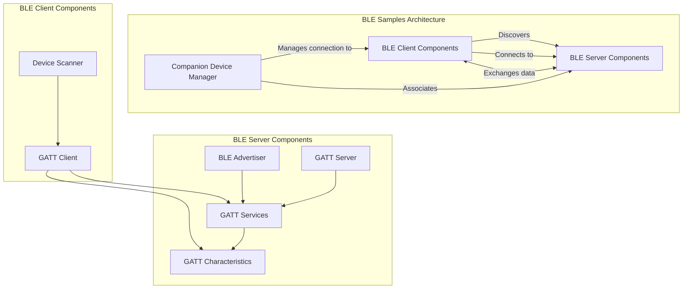
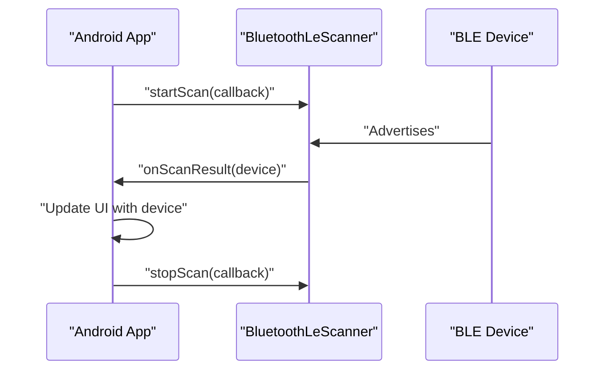
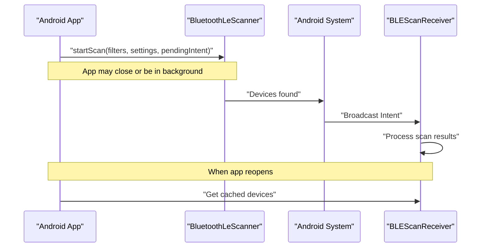
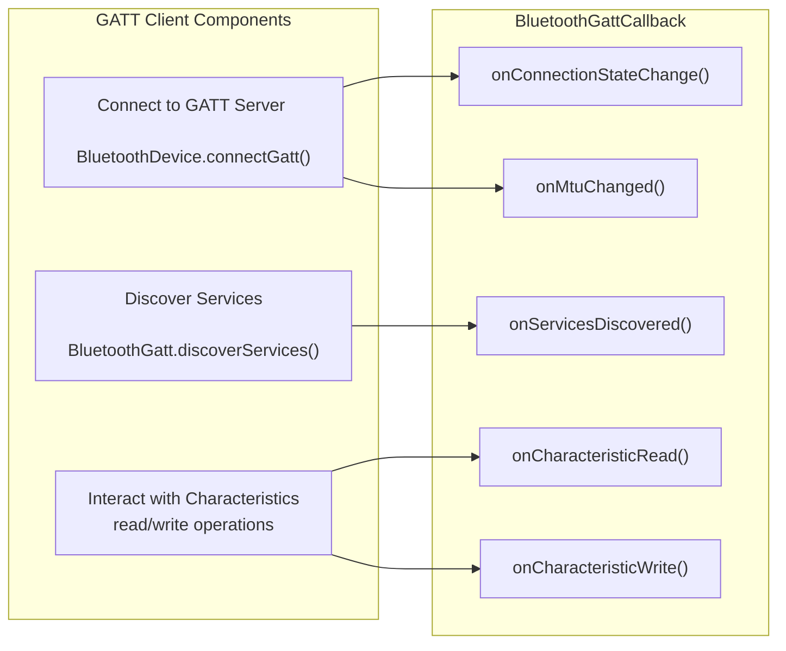
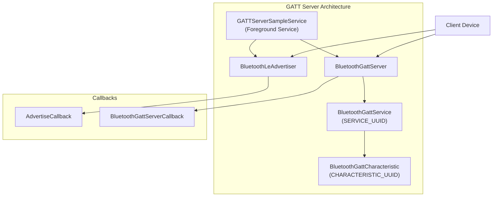
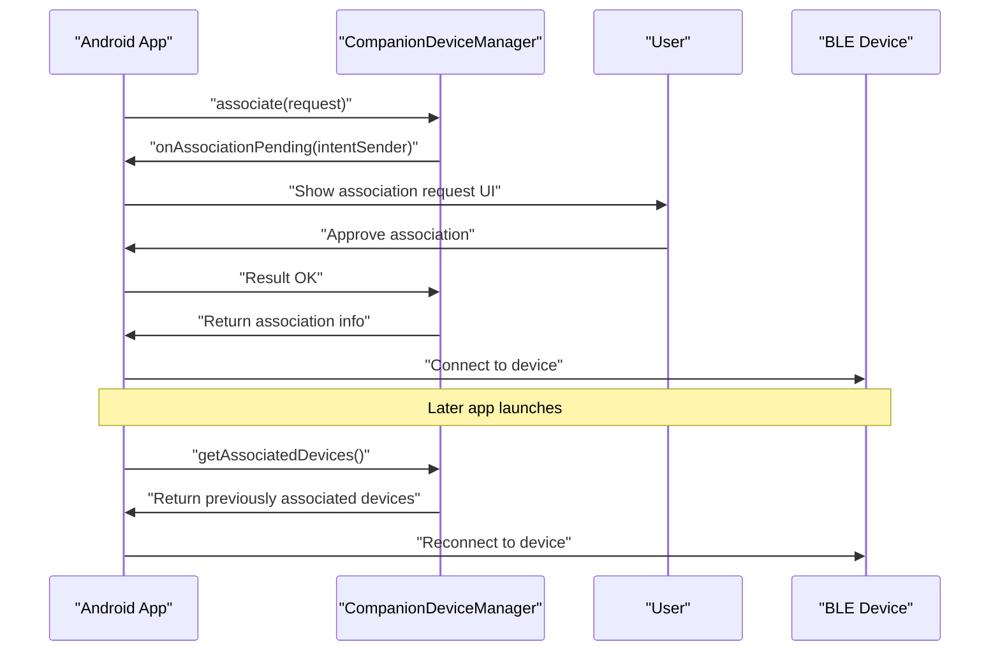

<!-- source: DeepWiki mcp.deepwiki.com · repo android/platform-samples · page 4.1 Bluetooth Low Energy · fetched 2026-10-23 -->

# Bluetooth Low Energy

<details>
<summary>Relevant source files</summary>

The following files were used as context for generating this wiki page:

- [samples/connectivity/bluetooth/ble/README.md](samples/connectivity/bluetooth/ble/README.md)
- [samples/connectivity/bluetooth/ble/src/main/AndroidManifest.xml](samples/connectivity/bluetooth/ble/src/main/AndroidManifest.xml)
- [samples/connectivity/bluetooth/ble/src/main/java/com/example/platform/connectivity/bluetooth/ble/BLEScanIntentSample.kt](samples/connectivity/bluetooth/ble/src/main/java/com/example/platform/connectivity/bluetooth/ble/BLEScanIntentSample.kt)
- [samples/connectivity/bluetooth/ble/src/main/java/com/example/platform/connectivity/bluetooth/ble/BluetoothSampleBox.kt](samples/connectivity/bluetooth/ble/src/main/java/com/example/platform/connectivity/bluetooth/ble/BluetoothSampleBox.kt)
- [samples/connectivity/bluetooth/ble/src/main/java/com/example/platform/connectivity/bluetooth/ble/ConnectGATTSample.kt](samples/connectivity/bluetooth/ble/src/main/java/com/example/platform/connectivity/bluetooth/ble/ConnectGATTSample.kt)
- [samples/connectivity/bluetooth/ble/src/main/java/com/example/platform/connectivity/bluetooth/ble/FindBLEDevicesSample.kt](samples/connectivity/bluetooth/ble/src/main/java/com/example/platform/connectivity/bluetooth/ble/FindBLEDevicesSample.kt)
- [samples/connectivity/bluetooth/ble/src/main/java/com/example/platform/connectivity/bluetooth/ble/server/GATTServerSample.kt](samples/connectivity/bluetooth/ble/src/main/java/com/example/platform/connectivity/bluetooth/ble/server/GATTServerSample.kt)
- [samples/connectivity/bluetooth/ble/src/main/java/com/example/platform/connectivity/bluetooth/ble/server/GATTServerSampleService.kt](samples/connectivity/bluetooth/ble/src/main/java/com/example/platform/connectivity/bluetooth/ble/server/GATTServerSampleService.kt)
- [samples/connectivity/bluetooth/companion/src/main/java/com/example/platform/connectivity/bluetooth/cdm/AssociatedDeviceCompat.kt](samples/connectivity/bluetooth/companion/src/main/java/com/example/platform/connectivity/bluetooth/cdm/AssociatedDeviceCompat.kt)
- [samples/connectivity/bluetooth/companion/src/main/java/com/example/platform/connectivity/bluetooth/cdm/CompanionDeviceManagerSample.kt](samples/connectivity/bluetooth/companion/src/main/java/com/example/platform/connectivity/bluetooth/cdm/CompanionDeviceManagerSample.kt)

</details>


## Purpose and Scope

This document provides a detailed guide to the Bluetooth Low Energy (BLE) samples in the Android Platform Samples repository. It covers device discovery, GATT connection management, data exchange, GATT server implementation, and integration with the Companion Device Manager. For information about Telecom and Audio management, see the related connectivity documentation in [Telecom API](#4.2) and [Audio Management](#4.3).

## Overview of Bluetooth Low Energy

Bluetooth Low Energy (BLE) is a wireless technology designed for short-range communication with reduced power consumption compared to Classic Bluetooth. The Android Platform Samples provides comprehensive examples demonstrating key BLE workflows and architectures.



Sources: 
- [samples/connectivity/bluetooth/ble/README.md]()
- [samples/connectivity/bluetooth/ble/src/main/java/com/example/platform/connectivity/bluetooth/ble/ConnectGATTSample.kt]()
- [samples/connectivity/bluetooth/ble/src/main/java/com/example/platform/connectivity/bluetooth/ble/server/GATTServerSample.kt]()

## Required Permissions

The BLE samples require specific permissions depending on the Android version and functionality:

| Permission | Purpose | API Requirement |
|------------|---------|-----------------|
| `BLUETOOTH`, `BLUETOOTH_ADMIN` | Legacy Bluetooth permissions | API 30 or lower |
| `BLUETOOTH_SCAN` | Scanning for BLE devices | API 31+ |
| `BLUETOOTH_CONNECT` | Communicating with paired devices | API 31+ |
| `BLUETOOTH_ADVERTISE` | Advertising as a BLE device | API 31+ |
| `ACCESS_FINE_LOCATION`, `ACCESS_COARSE_LOCATION` | Required for scanning on Android 11 and below | API 30 or lower |
| `FOREGROUND_SERVICE_CONNECTED_DEVICE` | Running GATT server as a foreground service | API 31+ |

The manifest file configures these permissions with appropriate flags, such as `android:usesPermissionFlags="neverForLocation"` for the `BLUETOOTH_SCAN` permission when scan results aren't used to derive location information.

Sources:
- [samples/connectivity/bluetooth/ble/src/main/AndroidManifest.xml:20-47]()

## BLE Device Discovery

The samples provide two main approaches for discovering BLE devices:

### Direct Device Scanning

The `FindBLEDevicesSample` demonstrates scanning for BLE devices directly using `BluetoothLeScanner`:



Key components include:
- `ScanSettings` configuration for controlling scan mode, callback type, and frequency
- `ScanCallback` implementation to receive discovered devices
- Lifecycle management to start/stop scanning at appropriate times
- UI integration to display and filter discovered devices

Sources:
- [samples/connectivity/bluetooth/ble/src/main/java/com/example/platform/connectivity/bluetooth/ble/FindBLEDevicesSample.kt:72-136]()
- [samples/connectivity/bluetooth/ble/src/main/java/com/example/platform/connectivity/bluetooth/ble/FindBLEDevicesSample.kt:231-281]()

### Background Scanning with PendingIntents

The `BLEScanIntentSample` demonstrates a technique for scanning for BLE devices even when the app is not in the foreground using `PendingIntent`:



This approach is useful for scenarios where you need to continuously monitor for specific BLE devices without keeping the app in the foreground.

Sources:
- [samples/connectivity/bluetooth/ble/src/main/java/com/example/platform/connectivity/bluetooth/ble/BLEScanIntentSample.kt:99-151]()
- [samples/connectivity/bluetooth/ble/src/main/java/com/example/platform/connectivity/bluetooth/ble/BLEScanIntentSample.kt:187-220]()

## GATT Client Implementation

The `ConnectGATTSample` demonstrates connecting to a GATT server and interacting with its services and characteristics:



The implementation follows these key steps:

1. **Connection Management**:
   - Create a `BluetoothGattCallback` to handle connection state changes and data operations
   - Call `BluetoothDevice.connectGatt()` to establish a connection
   - Handle lifecycle-aware connection management (connecting in `onStart`, disconnecting in `onStop`)

2. **Service and Characteristic Discovery**:
   - After connection, call `BluetoothGatt.discoverServices()` to discover GATT services
   - Find the target service UUID and characteristic UUID
   - Update UI to show connection state and available services

3. **Data Exchange**:
   - Read characteristics using `readCharacteristic()`
   - Write to characteristics using `writeCharacteristic()`
   - Handle platform-specific API differences between Android versions

4. **Performance Optimization**:
   - Request custom MTU sizes for more efficient data transfer
   - Handle connection parameters appropriately

Sources:
- [samples/connectivity/bluetooth/ble/src/main/java/com/example/platform/connectivity/bluetooth/ble/ConnectGATTSample.kt:66-87]()
- [samples/connectivity/bluetooth/ble/src/main/java/com/example/platform/connectivity/bluetooth/ble/ConnectGATTSample.kt:92-178]()
- [samples/connectivity/bluetooth/ble/src/main/java/com/example/platform/connectivity/bluetooth/ble/ConnectGATTSample.kt:225-339]()

The sample provides a re-usable `BLEConnectEffect` composable function that encapsulates the connection logic and makes it easier to integrate BLE connectivity into different screens.

### Cross-Version Compatibility

The sample handles different API levels gracefully:

```
if (Build.VERSION.SDK_INT >= Build.VERSION_CODES.TIRAMISU) {
    gatt.writeCharacteristic(
        characteristic,
        data,
        BluetoothGattCharacteristic.WRITE_TYPE_DEFAULT,
    )
} else {
    characteristic.writeType = BluetoothGattCharacteristic.WRITE_TYPE_DEFAULT
    @Suppress("DEPRECATION")
    characteristic.value = data
    @Suppress("DEPRECATION")
    gatt.writeCharacteristic(characteristic)
}
```

This approach ensures the code works consistently across different Android versions.

Sources:
- [samples/connectivity/bluetooth/ble/src/main/java/com/example/platform/connectivity/bluetooth/ble/ConnectGATTSample.kt:183-202]()

## GATT Server Implementation

The samples include a complete GATT server implementation that allows an Android device to act as a BLE peripheral:



The server implementation consists of:

1. **Foreground Service** - `GATTServerSampleService` runs as a foreground service to maintain BLE advertising and connections even when the app is in the background.

2. **GATT Service Definition** - Creates a `BluetoothGattService` with a specific UUID and adds a `BluetoothGattCharacteristic` that clients can read from and write to.

3. **BLE Advertising** - Uses `BluetoothLeAdvertiser` to broadcast the service's availability to nearby devices.

4. **Client Connection Handling** - Implements a `BluetoothGattServerCallback` to process connection state changes and client requests.

Key implementation details:

- **Service UUID**: `00002222-0000-1000-8000-00805f9b34fb`
- **Characteristic UUID**: `00001111-0000-1000-8000-00805f9b34fb`
- Characteristic has both read and write permissions
- The server keeps a log of all client interactions that can be viewed in the UI

Sources:
- [samples/connectivity/bluetooth/ble/src/main/java/com/example/platform/connectivity/bluetooth/ble/server/GATTServerSample.kt:47-114]()
- [samples/connectivity/bluetooth/ble/src/main/java/com/example/platform/connectivity/bluetooth/ble/server/GATTServerSampleService.kt:59-286]()

## Companion Device Manager Integration

The samples demonstrate integration with Android's Companion Device Manager (CDM) to establish and manage long-term associations with BLE devices:



The Companion Device Manager provides several advantages:
- Persistent device associations across app restarts
- System-mediated device selection dialog
- Special permission handling for associated devices
- Improved connection reliability and user experience

Key implementation components:

1. **Association Request**:
   - Create a `BluetoothLeDeviceFilter` with the target service UUID
   - Build an `AssociationRequest` with the filter
   - Call `CompanionDeviceManager.associate()` to initiate the association

2. **Device Selection**:
   - System shows a native device selection dialog to the user
   - On user selection, the app receives the device information

3. **Persistent Association**:
   - Use `CompanionDeviceManager.getAssociatedDevices()` to retrieve previously associated devices
   - Call `startObservingDevicePresence()` to monitor device availability
   - Handle backward compatibility between different Android versions

4. **Connection Management**:
   - Connect to the associated device using standard GATT connection APIs
   - Optionally disassociate devices that are no longer needed

Sources:
- [samples/connectivity/bluetooth/companion/src/main/java/com/example/platform/connectivity/bluetooth/cdm/CompanionDeviceManagerSample.kt:74-97]()
- [samples/connectivity/bluetooth/companion/src/main/java/com/example/platform/connectivity/bluetooth/cdm/CompanionDeviceManagerSample.kt:101-141]()
- [samples/connectivity/bluetooth/companion/src/main/java/com/example/platform/connectivity/bluetooth/cdm/CompanionDeviceManagerSample.kt:308-352]()
- [samples/connectivity/bluetooth/companion/src/main/java/com/example/platform/connectivity/bluetooth/cdm/AssociatedDeviceCompat.kt:28-65]()

## Key Considerations and Best Practices

When implementing BLE functionality using these samples, consider the following best practices:

### Permission Handling

Use the `BluetoothSampleBox` composable as a wrapper to handle all required permissions based on API level:

```
BluetoothSampleBox(extraPermissions = extraPermissions) { adapter ->
    // BLE implementation code here
}
```

This handles checking for Bluetooth availability, enabling Bluetooth if needed, and requesting all necessary permissions.

Sources:
- [samples/connectivity/bluetooth/ble/src/main/java/com/example/platform/connectivity/bluetooth/ble/BluetoothSampleBox.kt:49-103]()

### Battery Optimization

1. **Scan Settings**: Use appropriate `ScanSettings` based on your use case:
   - `SCAN_MODE_LOW_POWER` for background scanning
   - `SCAN_MODE_BALANCED` for general use
   - `SCAN_MODE_LOW_LATENCY` only when immediate discovery is critical

2. **Targeted Scanning**: Use `ScanFilter` to scan only for devices with specific service UUIDs or names.

3. **Scan Duration**: Limit scan duration and stop scanning when not needed.

4. **Connection Management**: Disconnect GATT connections when not in use, particularly when the app is in the background.

### Error Handling

Properly handle BLE errors, particularly:

1. **Connection Failures**: Implement retry logic with exponential backoff for transient failures.

2. **Permission Denied**: Check for all required permissions before attempting operations.

3. **Feature Availability**: Check if the device supports Bluetooth, BLE, and multi-advertisement before attempting those operations.

4. **GATT Errors**: Handle GATT errors in callbacks and provide appropriate user feedback.

```
if (status != BluetoothGatt.GATT_SUCCESS) {
    // Handle specific error codes here
    Log.e("BLEConnectEffect", "An error happened: $status")
}
```

Sources:
- [samples/connectivity/bluetooth/ble/src/main/java/com/example/platform/connectivity/bluetooth/ble/ConnectGATTSample.kt:254-261]()

## Conclusion

The Bluetooth Low Energy samples in the Android Platform Samples repository demonstrate comprehensive approaches to implementing BLE functionality in Android applications. From device discovery and connection management to GATT server implementation and Companion Device Manager integration, these samples provide a solid foundation for building robust BLE-enabled applications.

By leveraging these implementations, developers can create energy-efficient, reliable connections between Android devices and BLE peripherals while following Android best practices for permission handling and lifecycle management.

---

