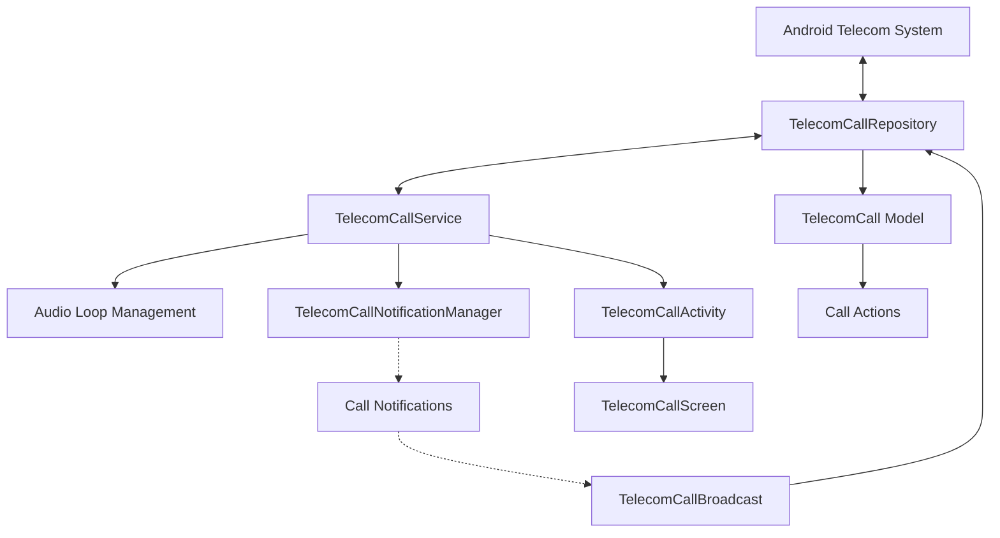
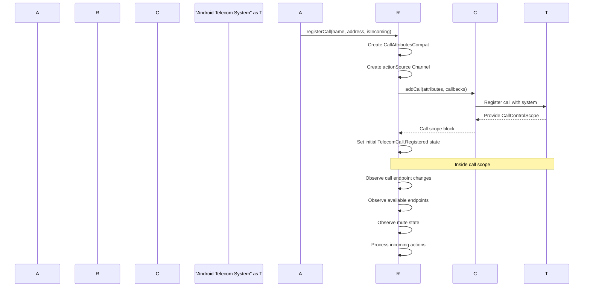
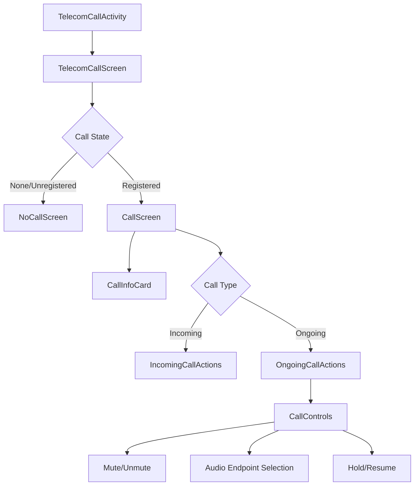
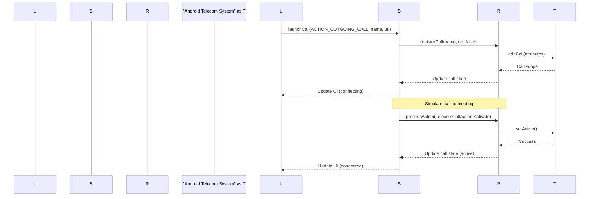
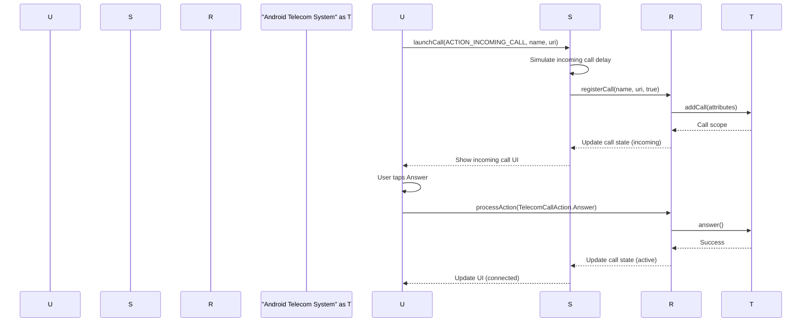

<!-- source: DeepWiki mcp.deepwiki.com · repo android/platform-samples · page 4.2 Telecom API · fetched 2026-10-23 -->

# Telecom API

<details>
<summary>Relevant source files</summary>

The following files were used as context for generating this wiki page:

- [samples/connectivity/telecom/src/androidTest/java/com/example/platform/connectivity/telecom/TelecomSampleTest.kt](samples/connectivity/telecom/src/androidTest/java/com/example/platform/connectivity/telecom/TelecomSampleTest.kt)
- [samples/connectivity/telecom/src/main/java/com/example/platform/connectivity/telecom/TelecomCallSample.kt](samples/connectivity/telecom/src/main/java/com/example/platform/connectivity/telecom/TelecomCallSample.kt)
- [samples/connectivity/telecom/src/main/java/com/example/platform/connectivity/telecom/call/TelecomCallActivity.kt](samples/connectivity/telecom/src/main/java/com/example/platform/connectivity/telecom/call/TelecomCallActivity.kt)
- [samples/connectivity/telecom/src/main/java/com/example/platform/connectivity/telecom/call/TelecomCallBroadcast.kt](samples/connectivity/telecom/src/main/java/com/example/platform/connectivity/telecom/call/TelecomCallBroadcast.kt)
- [samples/connectivity/telecom/src/main/java/com/example/platform/connectivity/telecom/call/TelecomCallNotificationManager.kt](samples/connectivity/telecom/src/main/java/com/example/platform/connectivity/telecom/call/TelecomCallNotificationManager.kt)
- [samples/connectivity/telecom/src/main/java/com/example/platform/connectivity/telecom/call/TelecomCallScreen.kt](samples/connectivity/telecom/src/main/java/com/example/platform/connectivity/telecom/call/TelecomCallScreen.kt)
- [samples/connectivity/telecom/src/main/java/com/example/platform/connectivity/telecom/call/TelecomCallService.kt](samples/connectivity/telecom/src/main/java/com/example/platform/connectivity/telecom/call/TelecomCallService.kt)
- [samples/connectivity/telecom/src/main/java/com/example/platform/connectivity/telecom/model/TelecomCallRepository.kt](samples/connectivity/telecom/src/main/java/com/example/platform/connectivity/telecom/model/TelecomCallRepository.kt)
- [samples/location/src/main/java/com/example/platform/location/permission/LocationPermissions.kt](samples/location/src/main/java/com/example/platform/location/permission/LocationPermissions.kt)

</details>


The Telecom API sample demonstrates how to integrate with Android's Telecom framework to implement calling functionality in your application. This documentation covers the architecture and implementation details of the sample, including call management, UI implementation, and notification handling.

The sample showcases how to use the Jetpack Telecom library (`androidx.core.telecom`) to create a calling application that properly integrates with the Android system.

## System Architecture

The Telecom API sample implements a complete calling application with the following components:



The architecture follows a repository pattern where:

1. `TelecomCallRepository` is the central class that interfaces with the Android Telecom system
2. `TelecomCallService` manages the lifecycle of calls and handles background tasks
3. `TelecomCallActivity` and `TelecomCallScreen` provide the user interface
4. `TelecomCallNotificationManager` creates and updates call notifications
5. `TelecomCallBroadcast` receives actions from notifications

Sources:
- [samples/connectivity/telecom/src/main/java/com/example/platform/connectivity/telecom/model/TelecomCallRepository.kt:41-329]()
- [samples/connectivity/telecom/src/main/java/com/example/platform/connectivity/telecom/call/TelecomCallService.kt:43-193]()
- [samples/connectivity/telecom/src/main/java/com/example/platform/connectivity/telecom/call/TelecomCallActivity.kt:37-101]()

## Call Model

The call model uses a sealed class hierarchy to represent different call states:

```mermaid
classDiagram
    class "TelecomCall" {
        <<sealed class>>
    }
    
    class "None" {
        No active call
    }
    
    class "Registered" {
        +String id
        +boolean isActive
        +boolean isOnHold
        +boolean isMuted
        +CallAttributesCompat callAttributes
        +List~CallEndpointCompat~ availableCallEndpoints
        +CallEndpointCompat currentCallEndpoint
        +processAction(TelecomCallAction)
    }
    
    class "Unregistered" {
        +String id
        +CallAttributesCompat callAttributes
        +DisconnectCause disconnectCause
    }
    
    "TelecomCall" <|-- "None"
    "TelecomCall" <|-- "Registered" 
    "TelecomCall" <|-- "Unregistered"
```

Call actions are represented by another sealed class hierarchy (`TelecomCallAction`):

```mermaid
classDiagram
    class "TelecomCallAction" {
        <<sealed class>>
    }
    
    class "Answer" {
    }
    
    class "Disconnect" {
        +DisconnectCause cause
    }
    
    class "Hold" {
    }
    
    class "Activate" {
    }
    
    class "ToggleMute" {
        +boolean muted
    }
    
    class "SwitchAudioEndpoint" {
        +String endpointId
    }
    
    class "TransferCall" {
        +String endpointId
    }
    
    "TelecomCallAction" <|-- "Answer"
    "TelecomCallAction" <|-- "Disconnect"
    "TelecomCallAction" <|-- "Hold"
    "TelecomCallAction" <|-- "Activate"
    "TelecomCallAction" <|-- "ToggleMute"
    "TelecomCallAction" <|-- "SwitchAudioEndpoint"
    "TelecomCallAction" <|-- "TransferCall"
```

Sources:
- [samples/connectivity/telecom/src/main/java/com/example/platform/connectivity/telecom/model/TelecomCallRepository.kt:83-84]()
- [samples/connectivity/telecom/src/main/java/com/example/platform/connectivity/telecom/model/TelecomCallRepository.kt:170-231]()

## Call Repository

The `TelecomCallRepository` is the central component of the Telecom sample. It:

1. Registers the app with the Android Telecom system
2. Manages the call lifecycle
3. Exposes call state via a Flow
4. Processes call actions

Key methods and properties:

| Member | Description |
|--------|-------------|
| `currentCall` | StateFlow that emits the current call state |
| `registerCall()` | Registers a new call with the Telecom system |
| `processCallActions()` | Processes user actions within the call scope |
| `updateCurrentCall()` | Updates the current call state |

The repository is created as a singleton via the `create()` method and uses `CallsManager` from the Jetpack Telecom library.

Sources:
- [samples/connectivity/telecom/src/main/java/com/example/platform/connectivity/telecom/model/TelecomCallRepository.kt:48-80]()
- [samples/connectivity/telecom/src/main/java/com/example/platform/connectivity/telecom/model/TelecomCallRepository.kt:90-165]()

## Call Registration Process

When a call is registered:

1. The call attributes are created with display name, address, direction, and capabilities
2. A channel is created to send actions to the call scope
3. The call is registered with the Telecom system using `callsManager.addCall()`
4. Call state changes are observed and reflected in the UI



Sources:
- [samples/connectivity/telecom/src/main/java/com/example/platform/connectivity/telecom/model/TelecomCallRepository.kt:90-165]()

## Call Actions Processing

Call actions are processed within the call scope in `processCallActions()`:

1. The UI sends actions to the repository through a Channel
2. The repository processes actions within the call scope
3. Appropriate Telecom APIs are called based on the action type
4. Call state is updated based on the results

For example, to process a "hold" action:

```kotlin
TelecomCallAction.Hold -> {
    when (val result = setInactive()) {
        is CallControlResult.Success -> {
            onIsCallInactive()
        }
        is CallControlResult.Error -> {
            updateCurrentCall {
                copy(errorCode = result.errorCode)
            }
        }
    }
}
```

Sources:
- [samples/connectivity/telecom/src/main/java/com/example/platform/connectivity/telecom/model/TelecomCallRepository.kt:170-231]()

## Call Service

The `TelecomCallService` handles the call lifecycle in the background:

1. Manages the call state
2. Updates notifications through `TelecomCallNotificationManager`
3. Controls audio resources
4. Processes system events

Key implementation details:

- The service is not declared as a foreground service because the Telecom framework provides foreground service delegation when a call is active
- Incoming and outgoing calls are started with different intents
- Audio management is handled through `AudioLoopSource`

Sources:
- [samples/connectivity/telecom/src/main/java/com/example/platform/connectivity/telecom/call/TelecomCallService.kt:43-56]()
- [samples/connectivity/telecom/src/main/java/com/example/platform/connectivity/telecom/call/TelecomCallService.kt:98-147]()
- [samples/connectivity/telecom/src/main/java/com/example/platform/connectivity/telecom/call/TelecomCallService.kt:154-182]()

## Call UI

The call UI is implemented using Jetpack Compose:



Key components:

- `TelecomCallActivity`: Hosts the call screen and handles special flags for showing above the lock screen
- `TelecomCallScreen`: Observes call state and renders appropriate UI
- Different UI components for incoming and ongoing calls
- Controls for mute, hold, and audio endpoint selection

Sources:
- [samples/connectivity/telecom/src/main/java/com/example/platform/connectivity/telecom/call/TelecomCallScreen.kt:76-113]()
- [samples/connectivity/telecom/src/main/java/com/example/platform/connectivity/telecom/call/TelecomCallScreen.kt:127-166]()
- [samples/connectivity/telecom/src/main/java/com/example/platform/connectivity/telecom/call/TelecomCallScreen.kt:283-397]()

## Call Notifications

Call notifications are created using the `TelecomCallNotificationManager`:

1. Different notification channels for incoming and ongoing calls
2. Call-style notifications with appropriate actions
3. Full-screen intent for incoming calls

The sample uses `NotificationCompat.CallStyle` to create call-appropriate notifications that integrate with the system UI:

```kotlin
val callStyle = if (isIncoming) {
    NotificationCompat.CallStyle.forIncomingCall(
        caller,
        rejectPendingIntent,
        answerPendingIntent
    )
} else {
    NotificationCompat.CallStyle.forOngoingCall(
        caller,
        hangupPendingIntent
    )
}
```

Actions from notifications are processed through `TelecomCallBroadcast` which routes them to the `TelecomCallRepository`.

Sources:
- [samples/connectivity/telecom/src/main/java/com/example/platform/connectivity/telecom/call/TelecomCallNotificationManager.kt:46-152]()
- [samples/connectivity/telecom/src/main/java/com/example/platform/connectivity/telecom/call/TelecomCallBroadcast.kt:31-62]()

## Audio Endpoint Management

The sample demonstrates how to manage audio endpoints (speaker, bluetooth, etc.):

1. Available endpoints are exposed through the call state
2. UI allows users to select different endpoints
3. Endpoint change requests are processed through the Telecom system

```kotlin
val newEndpoint = endpoints.firstOrNull { it.identifier == action.endpointId }
if (newEndpoint != null) {
    requestEndpointChange(newEndpoint)
}
```

The UI displays different icons for different endpoint types:

```kotlin
private fun getEndpointIcon(type: @CallEndpointCompat.Companion.EndpointType Int): Int {
    return when (type) {
        TYPE_BLUETOOTH -> R.drawable.round_bluetooth_audio_24
        TYPE_SPEAKER -> R.drawable.round_speaker_phone_24
        TYPE_STREAMING -> R.drawable.round_send_to_mobile_24
        TYPE_WIRED_HEADSET -> R.drawable.round_headphones_24
        else -> R.drawable.round_smartphone_24
    }
}
```

Sources:
- [samples/connectivity/telecom/src/main/java/com/example/platform/connectivity/telecom/model/TelecomCallRepository.kt:248-260]()
- [samples/connectivity/telecom/src/main/java/com/example/platform/connectivity/telecom/call/TelecomCallScreen.kt:336-366]()
- [samples/connectivity/telecom/src/main/java/com/example/platform/connectivity/telecom/call/TelecomCallScreen.kt:417-425]()

## Usage Flow

### Making an Outgoing Call

To make an outgoing call:



Sources:
- [samples/connectivity/telecom/src/main/java/com/example/platform/connectivity/telecom/TelecomCallSample.kt:123-128]()
- [samples/connectivity/telecom/src/main/java/com/example/platform/connectivity/telecom/call/TelecomCallService.kt:114-146]()

### Handling an Incoming Call

For incoming calls:



Sources:
- [samples/connectivity/telecom/src/main/java/com/example/platform/connectivity/telecom/TelecomCallSample.kt:110-115]()
- [samples/connectivity/telecom/src/main/java/com/example/platform/connectivity/telecom/call/TelecomCallService.kt:114-146]()
- [samples/connectivity/telecom/src/main/java/com/example/platform/connectivity/telecom/model/TelecomCallRepository.kt:267-283]()

## Permissions

The sample requires several permissions:

| Permission | Purpose | Android Version |
|------------|---------|----------------|
| `RECORD_AUDIO` | For capturing audio during calls | All |
| `MANAGE_OWN_CALLS` | For integration with the Telecom system | Android 8.0+ |
| `POST_NOTIFICATIONS` | For showing call notifications | Android 13+ |

These permissions are requested at runtime using the `PermissionBox` component.

Sources:
- [samples/connectivity/telecom/src/main/java/com/example/platform/connectivity/telecom/TelecomCallSample.kt:52-68]()

## Sample Entry Point

The sample entry point is the `TelecomCallSample` composable, which:

1. Requests necessary permissions
2. Displays buttons to initiate incoming or outgoing calls
3. Starts the appropriate service with call information

```kotlin
Button(
    enabled = !hasOngoingCall,
    onClick = {
        context.launchCall(
            action = TelecomCallService.ACTION_OUTGOING_CALL,
            name = "Bob",
            uri = Uri.parse("tel:54321"),
        )
    },
) {
    Text(text = "Make fake call")
}
```

Sources:
- [samples/connectivity/telecom/src/main/java/com/example/platform/connectivity/telecom/TelecomCallSample.kt:49-144]()

## Conclusion

The Telecom API sample demonstrates a complete implementation of a calling app using the Android Telecom framework. By following this sample, developers can implement calling functionality in their apps with proper integration with the Android system, including call notifications, audio management, and UI.

---

