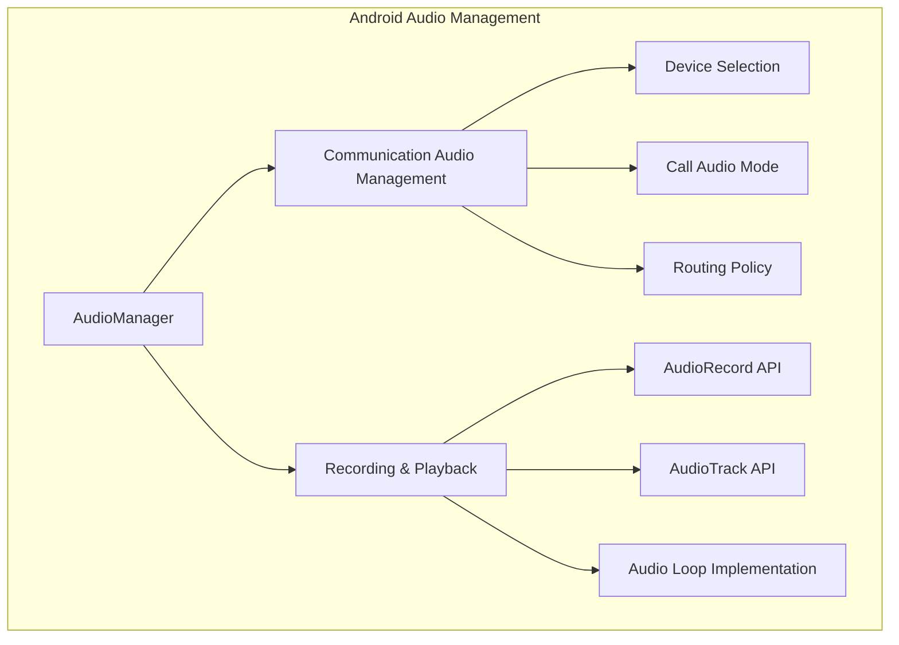
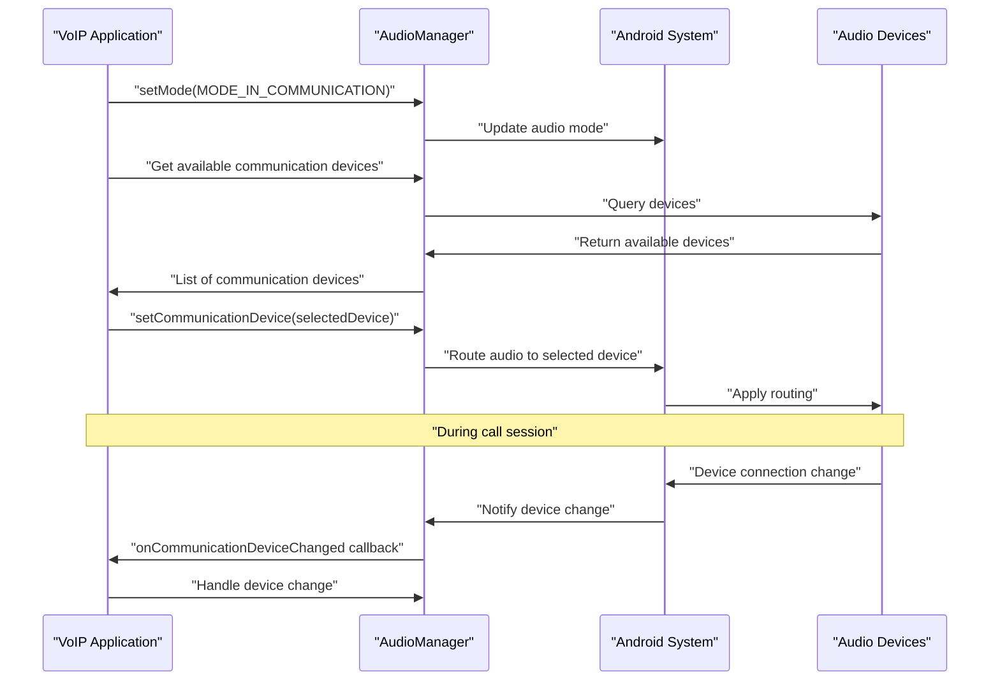
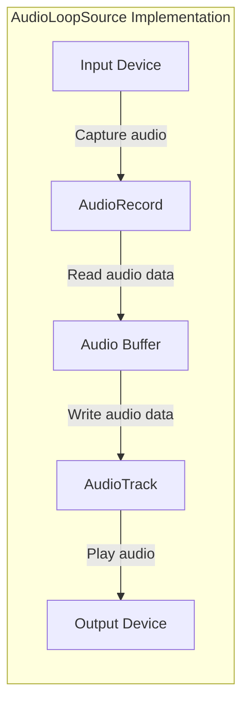

<!-- source: DeepWiki mcp.deepwiki.com · repo android/platform-samples · page 4.3 Audio Management · fetched 2026-10-23 -->

# Audio Management

<details>
<summary>Relevant source files</summary>

The following files were used as context for generating this wiki page:

- [samples/connectivity/audio/README.md](samples/connectivity/audio/README.md)
- [samples/connectivity/audio/src/AndroidManifest.xml](samples/connectivity/audio/src/AndroidManifest.xml)

</details>


This document covers the audio management capabilities related to connectivity in the Android Platform Samples repository. It focuses on handling audio for communication scenarios (such as VoIP calls) and demonstrating basic audio input/output operations.

## Overview

The Audio Management sample demonstrates two primary aspects of audio handling in Android applications:

1. Managing audio routing and device selection during communications
2. Basic audio recording and playback using low-level Android audio APIs



Sources: [samples/connectivity/audio/README.md:5-9]()

## Communication Audio Management

The Communication Audio Manager sample demonstrates how to properly manage audio resources during a communication session, such as a VoIP call. This is crucial for ensuring proper device selection, audio routing, and call quality.

### Key Components

The sample illustrates how to leverage Android's `AudioManager` API to:

1. Set appropriate audio modes for communication
2. Select and manage communication devices
3. Handle audio focus changes
4. Implement proper routing policies



Sources: [samples/connectivity/audio/README.md:5-6]()

### Audio Mode Management

The sample demonstrates properly setting audio modes during communication:

| Audio Mode | Purpose | Typical Use Case |
|------------|---------|------------------|
| MODE_NORMAL | Regular audio playback | Default app state |
| MODE_IN_COMMUNICATION | Optimizes audio routing for bidirectional communication | VoIP calls |
| MODE_IN_CALL | Used for telephony calls | Cellular calls |
| MODE_CALL_SCREENING | For call screening applications | Call screening |

### Device Selection and Routing

A key aspect of the communication audio management sample is demonstrating how to:

1. Retrieve available communication devices
2. Select the appropriate device for the current context
3. Handle device connection/disconnection events
4. Apply proper routing policies

Sources: [samples/connectivity/audio/README.md:5-6]()

## Audio Loop Implementation

The AudioLoopSource utility shows how to implement basic audio recording and playback functionality using Android's low-level audio APIs. It demonstrates a simple audio loop that captures audio from the input device and immediately plays it back through the output device.



Sources: [samples/connectivity/audio/README.md:7-9]()

### Key Components of AudioLoopSource

1. **AudioRecord**: Captures audio from the selected input device
2. **AudioTrack**: Plays back audio to the selected output device
3. **Buffer Management**: Demonstrates proper handling of audio buffers between capture and playback

The implementation showcases:

- Proper initialization of audio recording and playback components
- Sample rate and buffer size calculation
- Synchronization between recording and playback
- Resource management and cleanup

```mermaid
sequenceDiagram
    participant App as "Application"
    participant Loop as "AudioLoopSource"
    participant Record as "AudioRecord"
    participant Track as "AudioTrack"
    
    App->>Loop: "initialize()"
    Loop->>Record: "create AudioRecord"
    Loop->>Track: "create AudioTrack"
    App->>Loop: "start()"
    Loop->>Record: "startRecording()"
    Loop->>Track: "play()"
    
    loop Audio Loop Processing
        Record->>Loop: "read audio data"
        Loop->>Track: "write audio data"
    end
    
    App->>Loop: "stop()"
    Loop->>Record: "stop()"
    Loop->>Track: "stop()"
    App->>Loop: "release()"
    Loop->>Record: "release()"
    Loop->>Track: "release()"
```

Sources: [samples/connectivity/audio/README.md:7-9]()

## Permission Requirements

The audio samples require the `RECORD_AUDIO` permission to function properly:

```xml
<uses-permission android:name="android.permission.RECORD_AUDIO"/>
```

This permission is necessary for applications that need to capture audio from the device's microphones or other input sources. The sample demonstrates the proper way to request and handle this permission at runtime.

Sources: [samples/connectivity/audio/src/AndroidManifest.xml:18-19]()

## Best Practices

The audio samples demonstrate several best practices for audio management in Android applications:

1. **Proper Audio Mode Selection**: Setting the appropriate audio mode based on the application's current state
2. **Resource Management**: Properly initializing, using, and releasing audio resources
3. **Permission Handling**: Requesting and checking for required permissions
4. **Device Change Handling**: Responding to audio device connection and disconnection events
5. **Buffer Management**: Efficiently handling audio buffers to prevent underruns or overruns

Following these practices ensures optimal audio quality and performance while minimizing battery consumption and resource conflicts with other applications.

Sources: [samples/connectivity/audio/README.md:5-9]()

## Related Resources

For additional information on audio in Android, refer to the official Android documentation at https://developer.android.com/guide/topics/media.

---

