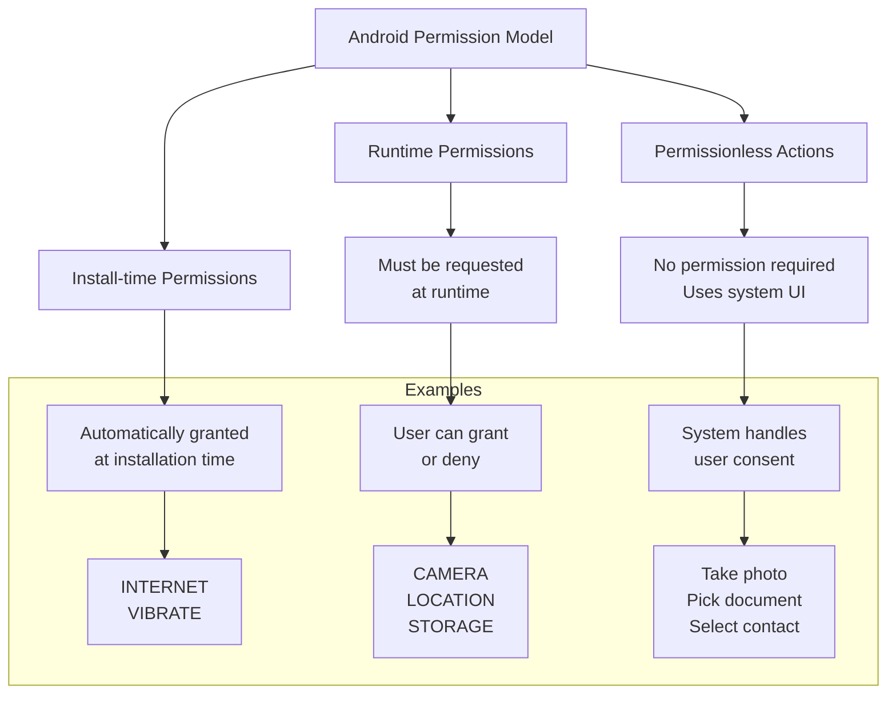
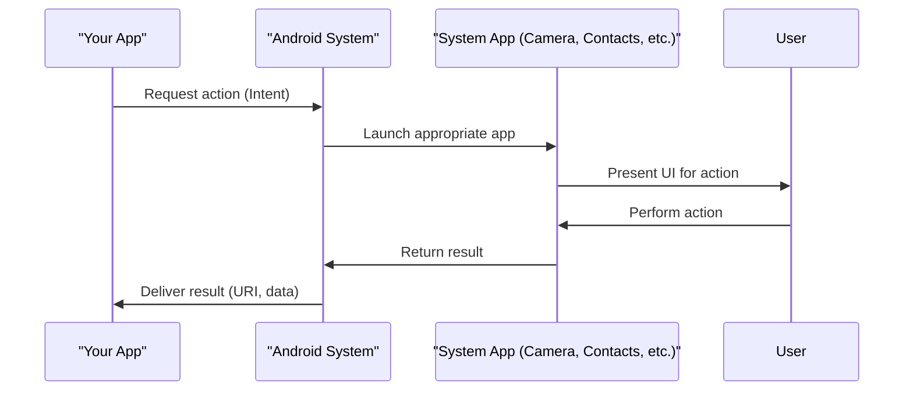
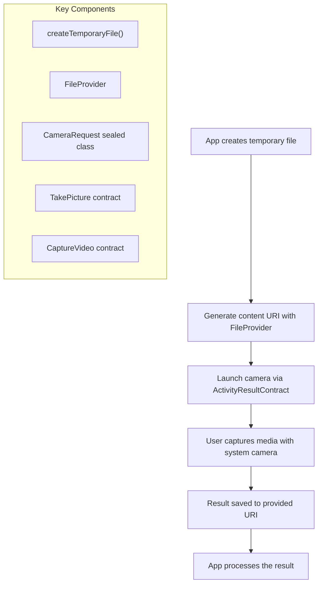
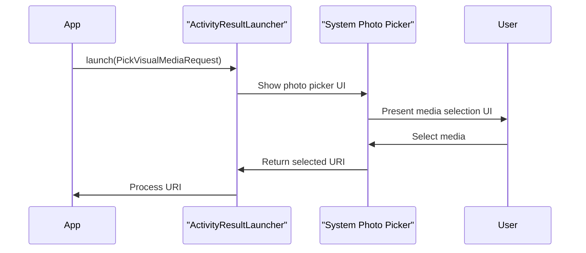
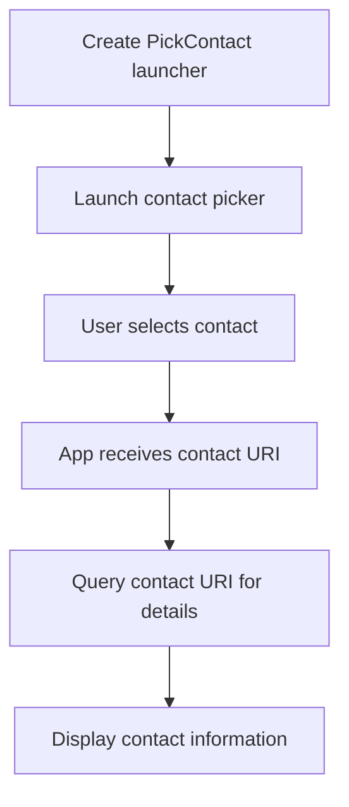
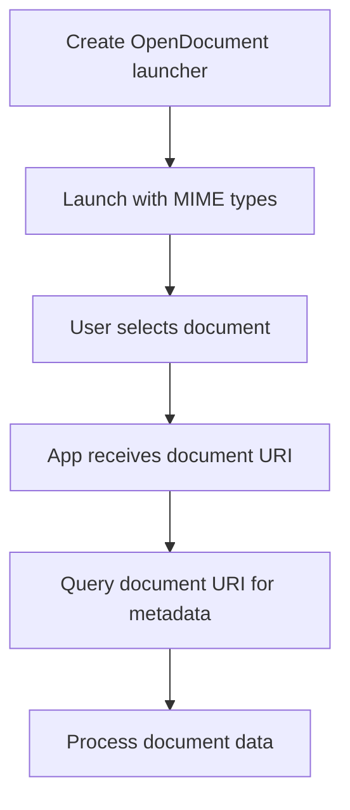
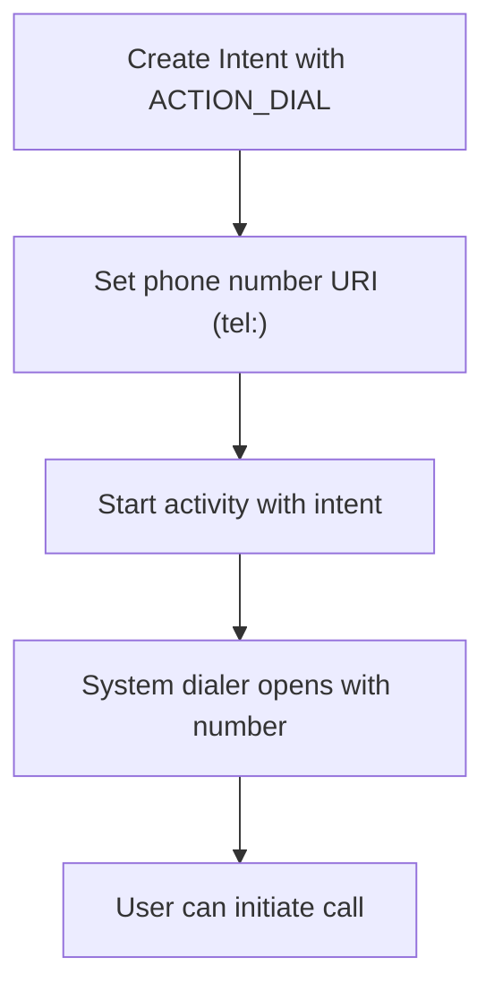
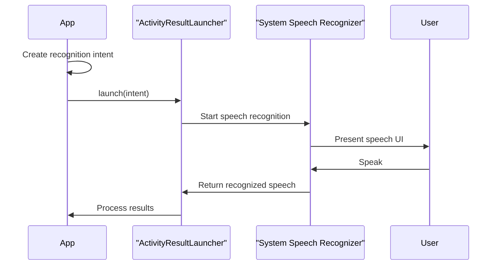
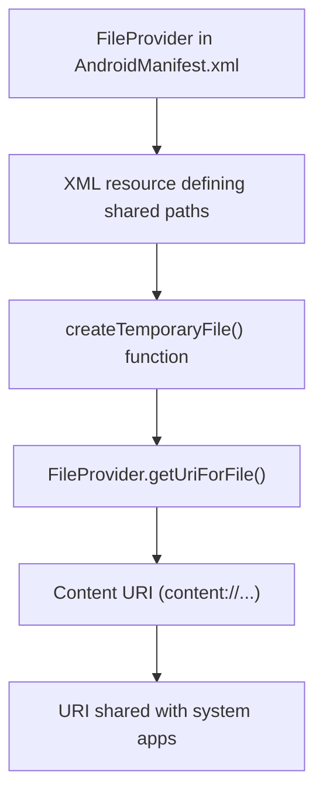

<!-- source: DeepWiki mcp.deepwiki.com · repo android/platform-samples · page 5 Privacy and Permissions · fetched 2026-10-23 -->

# Privacy and Permissions

<details>
<summary>Relevant source files</summary>

The following files were used as context for generating this wiki page:

- [app/README.md](app/README.md)
- [app/src/main/java/com/example/platform/app/MainActivity.kt](app/src/main/java/com/example/platform/app/MainActivity.kt)
- [samples/privacy/permissions/src/main/AndroidManifest.xml](samples/privacy/permissions/src/main/AndroidManifest.xml)
- [samples/privacy/permissions/src/main/java/com/example/platform/privacy/permissions/Permissionless.kt](samples/privacy/permissions/src/main/java/com/example/platform/privacy/permissions/Permissionless.kt)
- [samples/privacy/permissions/src/main/res/xml/image_paths.xml](samples/privacy/permissions/src/main/res/xml/image_paths.xml)

</details>


This page provides an overview of Android's privacy and permissions framework with a special focus on implementing common user actions without requiring explicit permissions. For more specific information about permissionless actions implementation, see [Permissionless Actions](#5.1).

## Introduction

Android's permission system is designed to protect user privacy by controlling application access to sensitive data and system features. Understanding how to minimize permission requests while maintaining functionality is crucial for building privacy-friendly apps that users trust.

The samples in this section demonstrate how to implement common functionality like taking photos, selecting contacts, and accessing documents without requesting runtime permissions by leveraging system-provided interfaces that handle permission requirements on behalf of your app.

Sources:
- [samples/privacy/permissions/src/main/java/com/example/platform/privacy/permissions/Permissionless.kt:17-105]()

## Android Permission Model

Android offers several approaches to accessing functionality that might require permissions:



Sources:
- [samples/privacy/permissions/src/main/AndroidManifest.xml:17-25]()

## Permissionless Actions

Permissionless actions allow your app to perform common tasks without requesting explicit permissions by delegating the action to system components that already have the necessary access. The user explicitly chooses to share data with your app through the system UI, improving transparency and trust.



The `Permissionless.kt` file demonstrates several types of permissionless actions:
- Camera operations (photos and videos)
- Media selection
- Contact picking
- Document selection
- Phone calls
- Speech recognition

Sources:
- [samples/privacy/permissions/src/main/java/com/example/platform/privacy/permissions/Permissionless.kt:72-104]()

## Implementation with Activity Result API

The samples implement permissionless actions using the modern Activity Result API, which provides a structured way to launch activities for results.

```mermaid
classDiagram
    class "ActivityResultContract" {
        <<abstract>>
        +createIntent(context, input)
        +parseResult(resultCode, intent)
    }
    
    class "ActivityResultLauncher" {
        +launch(input)
        +unregister()
    }
    
    class "rememberLauncherForActivityResult()" {
        Creates launcher in Compose
    }
    
    class "Specific Contracts" {
        TakePicture
        CaptureVideo
        PickContact
        PickVisualMedia
        OpenDocument
    }
    
    "ActivityResultContract" <|-- "Specific Contracts"
    "rememberLauncherForActivityResult()" --> "ActivityResultLauncher"
    "rememberLauncherForActivityResult()" --> "ActivityResultContract"
```

Sources:
- [samples/privacy/permissions/src/main/java/com/example/platform/privacy/permissions/Permissionless.kt:26-29]()
- [samples/privacy/permissions/src/main/java/com/example/platform/privacy/permissions/Permissionless.kt:192-202]()

## Camera Operations

The sample demonstrates capturing photos and videos without requesting CAMERA permission by using `ActivityResultContracts.TakePicture()` and `ActivityResultContracts.CaptureVideo()`.

### Implementation Flow



### File Management

The sample uses a utility function to create temporary files and FileProvider to generate secure content URIs:

```kotlin
private suspend fun Context.createTemporaryFile(name: String, type: String): Uri =
    withContext(Dispatchers.IO) {
        val file = File.createTempFile(name, type, cacheDir).apply {
            createNewFile()
        }
        FileProvider.getUriForFile(applicationContext, "$packageName.provider", file)
    }
```

A `CameraRequest` sealed class manages different states of the camera operation:

```kotlin
sealed class CameraRequest {
    abstract val uri: Uri
    object None : CameraRequest() { ... }
    data class Pending(override val uri: Uri) : CameraRequest()
    data class Completed(override val uri: Uri) : CameraRequest()
}
```

Sources:
- [samples/privacy/permissions/src/main/java/com/example/platform/privacy/permissions/Permissionless.kt:149-170]()
- [samples/privacy/permissions/src/main/java/com/example/platform/privacy/permissions/Permissionless.kt:298-314]()
- [samples/privacy/permissions/src/main/AndroidManifest.xml:28-37]()
- [samples/privacy/permissions/src/main/res/xml/image_paths.xml:17-21]()

## Media Selection

The sample uses `ActivityResultContracts.PickVisualMedia()` to allow users to select media without storage permissions:



Key implementation points:
1. Create a launcher with `ActivityResultContracts.PickVisualMedia()`
2. Launch with a `PickVisualMediaRequest` specifying desired media type
3. Handle the returned URI to display or process the selected media

Sources:
- [samples/privacy/permissions/src/main/java/com/example/platform/privacy/permissions/Permissionless.kt:365-402]()

## Contact Selection

To access contact information without permission, the sample uses `ActivityResultContracts.PickContact()`:



After receiving the contact URI, the app queries it for detailed information:

```kotlin
context.contentResolver.query(uri, null, null, null, null).use { cursor ->
    contactInfo = if (cursor != null && cursor.moveToFirst()) {
        (0 until cursor.columnCount).joinToString("\n") {
            "${cursor.getColumnName(it)}: ${cursor.getStringOrNull(it)}"
        }
    } else {
        "Error while retrieving contact information"
    }
}
```

Sources:
- [samples/privacy/permissions/src/main/java/com/example/platform/privacy/permissions/Permissionless.kt:317-362]()

## Document Selection

The sample demonstrates document selection using `ActivityResultContracts.OpenDocument()`:



Key implementation points:
1. Create launcher with `ActivityResultContracts.OpenDocument()`
2. Specify MIME types to filter available documents
3. Query received URI for document metadata

Sources:
- [samples/privacy/permissions/src/main/java/com/example/platform/privacy/permissions/Permissionless.kt:405-451]()

## Phone Calls

The sample shows how to initiate a phone call without requiring the `CALL_PHONE` permission by using `ACTION_DIAL` instead of `ACTION_CALL`:



Implementation:
```kotlin
val intent = Intent(Intent.ACTION_DIAL, Uri.parse("tel:123456789")).apply {
    flags = Intent.FLAG_ACTIVITY_NEW_TASK
}
context.startActivity(intent)
```

Sources:
- [samples/privacy/permissions/src/main/java/com/example/platform/privacy/permissions/Permissionless.kt:454-474]()
- [samples/privacy/permissions/src/main/AndroidManifest.xml:19-19]()

## Speech Recognition

The sample demonstrates speech recognition without requiring the `RECORD_AUDIO` permission:



Implementation:
```kotlin
val intent = Intent(RecognizerIntent.ACTION_RECOGNIZE_SPEECH)
intent.putExtra(
    RecognizerIntent.EXTRA_LANGUAGE_MODEL,
    RecognizerIntent.LANGUAGE_MODEL_FREE_FORM
)
launcher.launch(intent)
```

Sources:
- [samples/privacy/permissions/src/main/java/com/example/platform/privacy/permissions/Permissionless.kt:477-523]()
- [samples/privacy/permissions/src/main/AndroidManifest.xml:21-21]()

## FileProvider Configuration

FileProvider is crucial for securely sharing files between your app and system components:



Configuration in AndroidManifest.xml:
```xml
<provider
    android:name="androidx.core.content.FileProvider"
    android:authorities="${applicationId}.provider"
    android:exported="false"
    android:grantUriPermissions="true">
    <meta-data
        android:name="android.support.FILE_PROVIDER_PATHS"
        android:resource="@xml/image_paths" />
</provider>
```

Paths configuration in image_paths.xml:
```xml
<paths>
    <cache-path
        name="temp_images"
        path="." />
</paths>
```

Sources:
- [samples/privacy/permissions/src/main/AndroidManifest.xml:28-37]()
- [samples/privacy/permissions/src/main/res/xml/image_paths.xml:17-21]()
- [samples/privacy/permissions/src/main/java/com/example/platform/privacy/permissions/Permissionless.kt:149-155]()

## Privacy Best Practices

Based on the samples, here are key privacy best practices for Android developers:

| Practice | Description | Example in Samples |
|----------|-------------|-------------------|
| Use permissionless APIs | Leverage system UI for sensitive operations | Using Photo Picker instead of requesting storage permission |
| Implement Activity Result API | More structured approach to handling activity results | All samples use `rememberLauncherForActivityResult()` |
| Secure file sharing | Use FileProvider for secure URI generation | `createTemporaryFile()` function |
| Prefer less invasive intents | Choose intents that don't require permissions | Using `ACTION_DIAL` instead of `ACTION_CALL` |
| Request minimal permissions | Only request permissions absolutely necessary | Samples avoid requesting permissions when possible |

Sources:
- [samples/privacy/permissions/src/main/java/com/example/platform/privacy/permissions/Permissionless.kt:106-138]()

## Summary

The Privacy and Permissions samples demonstrate how to implement common functionality without requiring explicit permissions by leveraging system-provided interfaces. By following these patterns, you can:

1. Improve user privacy by minimizing permission requests
2. Enhance user experience by using familiar system UI
3. Reduce the likelihood of permission denials affecting your app functionality
4. Implement proper file sharing between your app and system components

For more detailed information about implementing permissionless actions, see [Permissionless Actions](#5.1).

Sources:
- [samples/privacy/permissions/src/main/java/com/example/platform/privacy/permissions/Permissionless.kt:17-524]()

---

