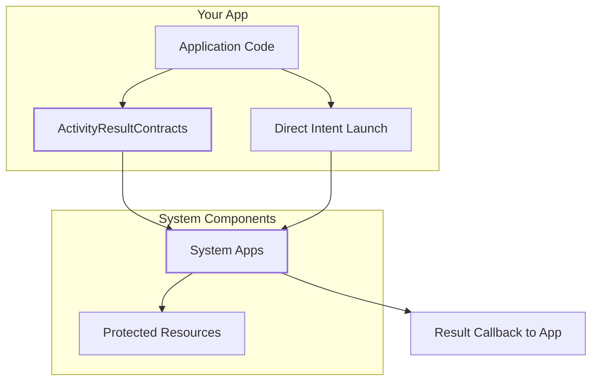
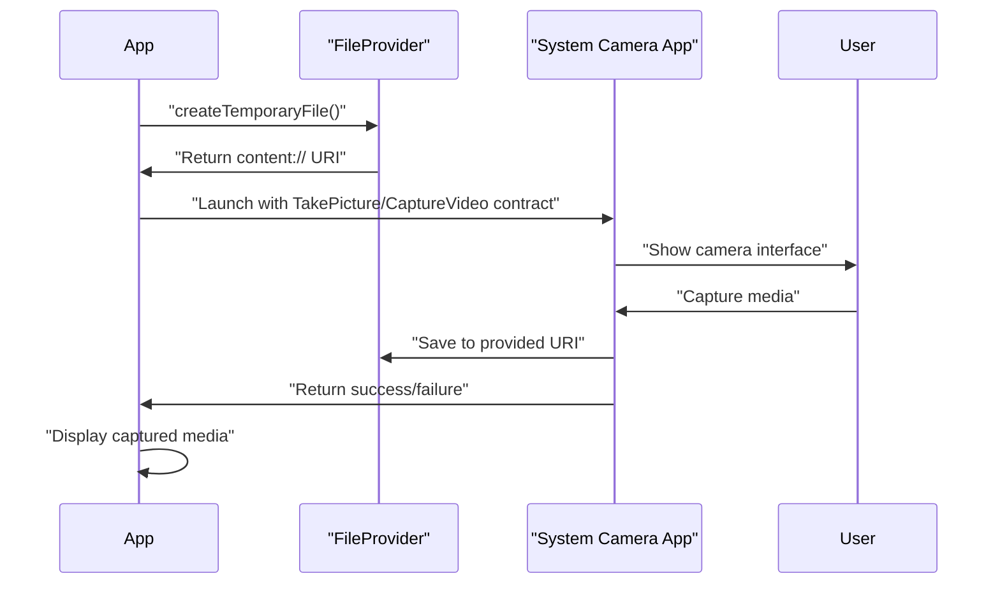
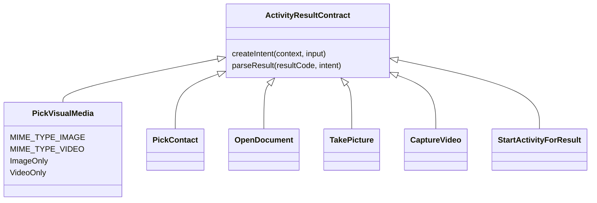

<!-- source: DeepWiki mcp.deepwiki.com · repo android/platform-samples · page 5.1 Permissionless Actions · fetched 2026-10-23 -->

# Permissionless Actions

<details>
<summary>Relevant source files</summary>

The following files were used as context for generating this wiki page:

- [app/README.md](app/README.md)
- [app/src/main/java/com/example/platform/app/MainActivity.kt](app/src/main/java/com/example/platform/app/MainActivity.kt)
- [samples/privacy/permissions/src/main/AndroidManifest.xml](samples/privacy/permissions/src/main/AndroidManifest.xml)
- [samples/privacy/permissions/src/main/java/com/example/platform/privacy/permissions/Permissionless.kt](samples/privacy/permissions/src/main/java/com/example/platform/privacy/permissions/Permissionless.kt)
- [samples/privacy/permissions/src/main/res/xml/image_paths.xml](samples/privacy/permissions/src/main/res/xml/image_paths.xml)

</details>


## Overview

This document provides a comprehensive guide to implementing actions in Android applications that don't require explicit runtime permissions. Permissionless actions improve user experience by delegating sensitive operations to system apps, eliminating the need for your app to request permissions directly. This approach enhances privacy and simplifies your implementation.

The examples in this document demonstrate how to:
- Capture photos and videos
- Select contacts, media, and documents
- Make phone calls
- Perform speech recognition

All without requiring runtime permission requests from your app.

Sources: [samples/privacy/permissions/src/main/java/com/example/platform/privacy/permissions/Permissionless.kt:17-104]()

## Permissionless Actions Architecture



Permissionless actions work by delegating sensitive operations to system apps that already have the necessary permissions. Your app launches a system app with an intent, and the system app handles the permission-protected operation. The result is then returned to your app through a callback.

Sources: [samples/privacy/permissions/src/main/java/com/example/platform/privacy/permissions/Permissionless.kt:30-70](), [samples/privacy/permissions/src/main/java/com/example/platform/privacy/permissions/Permissionless.kt:177-229]()

## Camera Actions

### Taking Photos and Recording Videos

The sample demonstrates how to capture photos and videos without requiring the CAMERA permission by using the Activity Result API:



The implementation requires:
1. A FileProvider configuration in your AndroidManifest.xml
2. Creating a temporary file with a content URI
3. Using ActivityResultContracts.TakePicture() or ActivityResultContracts.CaptureVideo()

Sources: [samples/privacy/permissions/src/main/java/com/example/platform/privacy/permissions/Permissionless.kt:149-170](), [samples/privacy/permissions/src/main/java/com/example/platform/privacy/permissions/Permissionless.kt:297-315](), [samples/privacy/permissions/src/main/AndroidManifest.xml:28-37]()

### FileProvider Configuration

To enable camera actions, you must configure a FileProvider in your manifest and define the paths it can access:

```xml
<!-- In AndroidManifest.xml -->
<provider
    android:name="androidx.core.content.FileProvider"
    android:authorities="${applicationId}.provider"
    android:exported="false"
    android:grantUriPermissions="true">
    <meta-data
        android:name="android.support.FILE_PROVIDER_PATHS"
        android:resource="@xml/image_paths" />
</provider>
```

```xml
<!-- In image_paths.xml -->
<paths>
    <cache-path
        name="temp_images"
        path="." />
</paths>
```

Sources: [samples/privacy/permissions/src/main/AndroidManifest.xml:28-37](), [samples/privacy/permissions/src/main/res/xml/image_paths.xml:17-21]()

## Content Selection Actions

### Media Selection

The sample demonstrates how to let users select images without needing storage permissions:

```kotlin
// Create launcher for photo picker
val launcher = rememberLauncherForActivityResult(ActivityResultContracts.PickVisualMedia()) { uri ->
    // Process selected URI
}

// Launch with specific media type
launcher.launch(PickVisualMediaRequest(ActivityResultContracts.PickVisualMedia.ImageOnly))
```

Sources: [samples/privacy/permissions/src/main/java/com/example/platform/privacy/permissions/Permissionless.kt:365-402]()

### Contact Selection

To access contacts without READ_CONTACTS permission:

```kotlin
// Create launcher for contact picker
val launcher = rememberLauncherForActivityResult(ActivityResultContracts.PickContact()) { uri ->
    // Query contact data using ContentResolver
    context.contentResolver.query(uri, null, null, null, null).use { cursor ->
        // Process cursor data
    }
}

// Launch contact picker
launcher.launch(null)
```

Sources: [samples/privacy/permissions/src/main/java/com/example/platform/privacy/permissions/Permissionless.kt:317-362]()

### Document Selection

To access documents without storage permissions:

```kotlin
val launcher = rememberLauncherForActivityResult(ActivityResultContracts.OpenDocument()) { uri ->
    // Process selected document URI
}

// Launch document picker with mime type filter
launcher.launch(arrayOf("*/*"))
```

Sources: [samples/privacy/permissions/src/main/java/com/example/platform/privacy/permissions/Permissionless.kt:405-452]()

## Communication Actions

### Phone Calls

To make phone calls without CALL_PHONE permission:

```kotlin
val intent = Intent(Intent.ACTION_DIAL, Uri.parse("tel:123456789")).apply {
    flags = Intent.FLAG_ACTIVITY_NEW_TASK
}
context.startActivity(intent)
```

This uses ACTION_DIAL which opens the dialer app with the number pre-filled, but requires the user to initiate the actual call.

Sources: [samples/privacy/permissions/src/main/java/com/example/platform/privacy/permissions/Permissionless.kt:454-475]()

### Speech Recognition

To use speech recognition without RECORD_AUDIO permission:

```kotlin
val launcher = rememberLauncherForActivityResult(
    ActivityResultContracts.StartActivityForResult()
) { result ->
    // Process speech recognition results
}

val intent = Intent(RecognizerIntent.ACTION_RECOGNIZE_SPEECH)
intent.putExtra(
    RecognizerIntent.EXTRA_LANGUAGE_MODEL,
    RecognizerIntent.LANGUAGE_MODEL_FREE_FORM
)
launcher.launch(intent)
```

Sources: [samples/privacy/permissions/src/main/java/com/example/platform/privacy/permissions/Permissionless.kt:477-524]()

## ActivityResultContracts API



The ActivityResultContracts API provides a set of predefined contracts for common operations. Each contract defines:
- How to create an intent for a specific action
- How to parse the result returned from that action

In Jetpack Compose, you can use the `rememberLauncherForActivityResult` function to create a launcher for a specific contract.

Sources: [samples/privacy/permissions/src/main/java/com/example/platform/privacy/permissions/Permissionless.kt:26-29](), [samples/privacy/permissions/src/main/java/com/example/platform/privacy/permissions/Permissionless.kt:183-203]()

## Implementation Guide

### General Pattern

1. Define an ActivityResultContract launcher using `rememberLauncherForActivityResult`
2. Process the result in the callback
3. Launch the contract with appropriate parameters when needed

```kotlin
// 1. Define launcher
val launcher = rememberLauncherForActivityResult(ContractType()) { result ->
    // 2. Process result
}

// 3. Launch when needed
launcher.launch(inputData)
```

### Special Case: Camera Actions

For camera operations, additional steps are required:

1. Configure FileProvider in AndroidManifest.xml
2. Create a temporary file and get its URI via FileProvider
3. Pass the URI to the camera contract
4. Handle the result after capture

The sample uses a utility function `createTemporaryFile` to handle file creation outside the main thread and get a shareable URI:

```kotlin
private suspend fun Context.createTemporaryFile(name: String, type: String): Uri =
    withContext(Dispatchers.IO) {
        val file = File.createTempFile(name, type, cacheDir).apply {
            createNewFile()
        }
        FileProvider.getUriForFile(applicationContext, "$packageName.provider", file)
    }
```

Sources: [samples/privacy/permissions/src/main/java/com/example/platform/privacy/permissions/Permissionless.kt:149-155](), [samples/privacy/permissions/src/main/java/com/example/platform/privacy/permissions/Permissionless.kt:176-295]()

## Benefits of Permissionless Approaches

| Approach | Benefits | Use Cases |
|----------|----------|-----------|
| Permissionless | • Improved user experience<br>• Reduced permission requests<br>• Enhanced privacy<br>• Simplified implementation | • Occasional access to protected resources<br>• Non-critical functionality<br>• User-initiated actions |
| Permission-based | • Direct access to resources<br>• Background processing<br>• More control over implementation | • Core app functionality<br>• Background processing<br>• Continuous access to resources |

Sources: [samples/privacy/permissions/src/main/java/com/example/platform/privacy/permissions/Permissionless.kt:106-138]()

## Conclusion

Permissionless actions provide a powerful way to access sensitive functionality without requiring explicit permissions. By delegating operations to system apps through the Activity Result API or direct intents, you can create a smoother user experience while respecting privacy. The samples in this document demonstrate various permissionless approaches that you can implement in your own applications.

For more comprehensive privacy features and permission handling in Android, see the main [Privacy and Permissions](#5) section.

---

