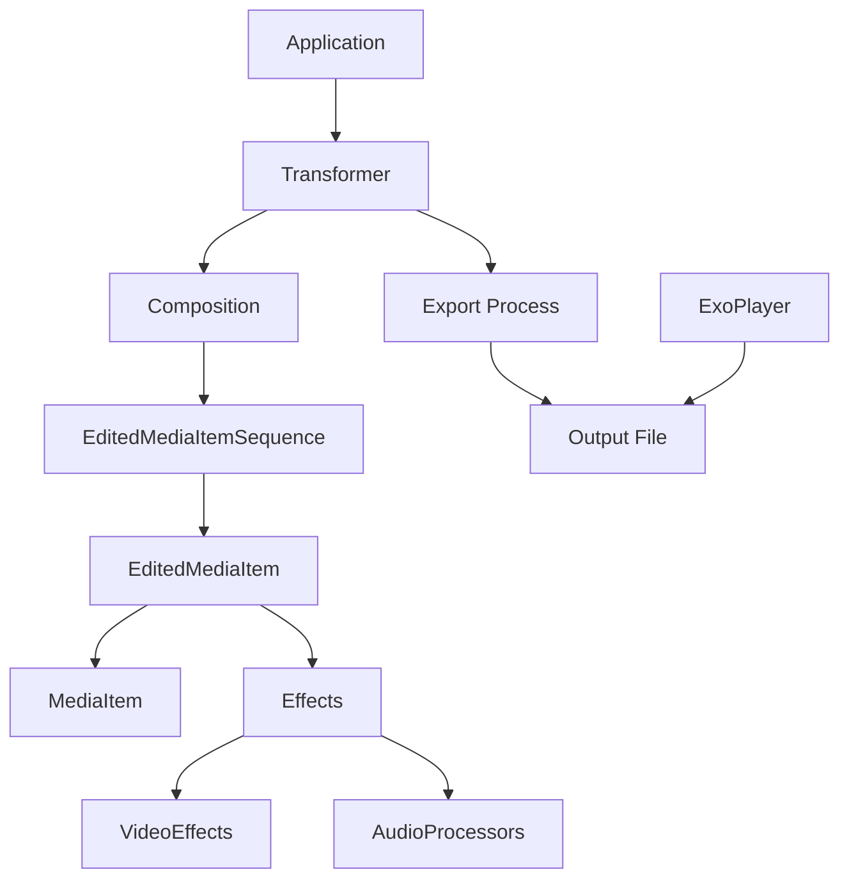
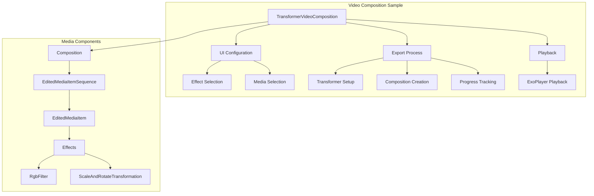
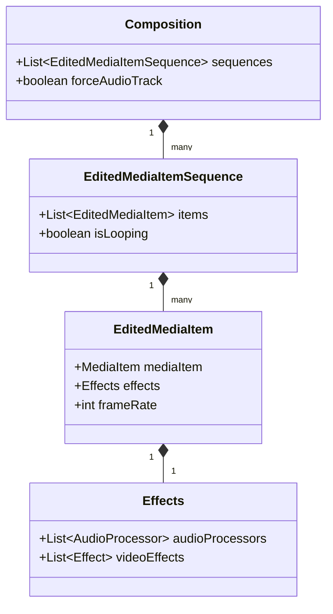
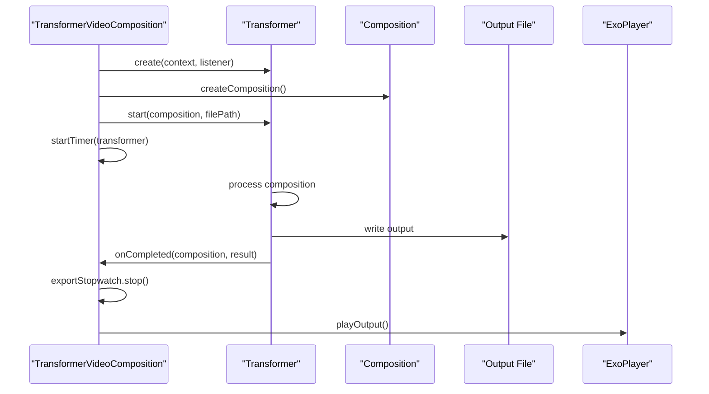

<!-- source: DeepWiki mcp.deepwiki.com · repo android/platform-samples · page 6 Media Samples · fetched 2026-10-23 -->

# Media Samples

Relevant source files

The following files were used as context for generating this wiki page:

- [samples/media/video/src/main/AndroidManifest.xml](samples/media/video/src/main/AndroidManifest.xml)
- [samples/media/video/src/main/java/com/example/platform/media/video/TransformerVideoComposition.kt](samples/media/video/src/main/java/com/example/platform/media/video/TransformerVideoComposition.kt)
- [samples/media/video/src/main/res/layout/transformer_composition_layout.xml](samples/media/video/src/main/res/layout/transformer_composition_layout.xml)
- [samples/media/video/src/main/res/values/strings.xml](samples/media/video/src/main/res/values/strings.xml)

## Purpose and Scope

This document provides an overview of the media processing capabilities in the Android Platform Samples repository. The Media Samples section demonstrates how to implement advanced media manipulation features in Android applications using Media3 libraries, with a focus on video transformation, composition, and effects.

The current samples showcase how to use the Media3 Transformer API to create complex media compositions by combining multiple video sources, applying visual effects, adding background audio, and including static images.

For information on UI-related features, see [User Interface Samples](#3), and for audio management specifically, see [Audio Management](#4.3).

## Media3 Transformer Overview

Media3 Transformer is a powerful API for manipulating media content in Android applications. It provides capabilities for video editing, composition, and adding visual effects.

Sources: [samples/media/video/src/main/java/com/example/platform/media/video/TransformerVideoComposition.kt:34-42]()

## Available Media Samples

The repository currently includes the following media sample:

### Video Transformation and Composition

The Video Transformation sample demonstrates how to use Media3 Transformer to create compositions that combine multiple video sources, apply visual effects, add background audio, and incorporate static images.

Sources: [samples/media/video/src/main/java/com/example/platform/media/video/TransformerVideoComposition.kt]()

## Media3 Transformer Implementation

### Core Components

The video transformation sample is built around the following key components:

| Component | Purpose |
|-----------|---------|
| `Transformer` | Main class that handles the export process |
| `Composition` | Represents a collection of media sequences to be processed |
| `EditedMediaItemSequence` | A sequence of media items that form a track in the composition |
| `EditedMediaItem` | A media item with effects applied |
| `Effects` | Container for video effects and audio processors |
| `ExoPlayer` | Used to play back the transformed media |

Sources: [samples/media/video/src/main/java/com/example/platform/media/video/TransformerVideoComposition.kt:34-42]()

### Creating Media Compositions

A `Composition` consists of one or more `EditedMediaItemSequence` objects. Each sequence can contain multiple `EditedMediaItem` objects, which can represent videos, audio, or images.

The sample demonstrates creating a composition with:
- A video sequence containing multiple videos and optionally an image
- An optional audio sequence for background audio

The implementation can be found in the `createComposition()` method:

Sources: [samples/media/video/src/main/java/com/example/platform/media/video/TransformerVideoComposition.kt:151-201]()

### Applying Video Effects

The sample demonstrates applying two types of video effects:
1. Grayscale filter using `RgbFilter.createGrayscaleFilter()`
2. Scaling using `ScaleAndRotateTransformation`

Effects are only applied to the first video in the sequence, showing how to selectively apply transformations:

Sources: [samples/media/video/src/main/java/com/example/platform/media/video/TransformerVideoComposition.kt:232-248]()

### Export Process

The export process involves:
1. Creating a `Transformer` instance
2. Setting up a listener to handle export events
3. Starting the export with the composition
4. Tracking the progress of the export

Sources: [samples/media/video/src/main/java/com/example/platform/media/video/TransformerVideoComposition.kt:218-227](), [samples/media/video/src/main/java/com/example/platform/media/video/TransformerVideoComposition.kt:80-97]()

### Playback of Results

After the export is complete, the sample uses `ExoPlayer` to play back the resulting media file:

Sources: [samples/media/video/src/main/java/com/example/platform/media/video/TransformerVideoComposition.kt:253-265]()

## User Interface

The sample provides a simple UI with configuration options and playback controls:

| UI Element | Purpose |
|------------|---------|
| ChipGroup | Contains selectable configuration options |
| Background Audio Chip | Toggle for adding background audio |
| Scale Chip | Toggle for scaling the first video |
| Grayscale Chip | Toggle for applying grayscale to the first video |
| Image Chip | Toggle for adding an intro image |
| Export Button | Triggers the export process |
| Progress Text | Shows the export progress |
| PlayerView | Displays the exported video |

Sources: [samples/media/video/src/main/res/layout/transformer_composition_layout.xml](), [samples/media/video/src/main/res/values/strings.xml]()

## Implementation Workflow

The typical workflow for using the Media3 Transformer in this sample follows these steps:

1. **Configure the composition** - Select which effects and media elements to include
2. **Create the composition** - Build the `Composition` object with videos, effects, and optional audio
3. **Set up the Transformer** - Create a `Transformer` with appropriate listeners
4. **Export the composition** - Start the transformation process
5. **Monitor progress** - Track the export progress
6. **Play the result** - Use `ExoPlayer` to play the exported file

Sources: [samples/media/video/src/main/java/com/example/platform/media/video/TransformerVideoComposition.kt]()

## Example Use Cases

### Video Editing Applications

The sample demonstrates capabilities useful for video editing applications:
- Combining multiple video clips
- Adding intro slides/images
- Applying visual effects
- Adding background music

### Content Creation

Media3 Transformer can be used for content creation scenarios:
- Generating marketing videos
- Creating social media content with consistent branding
- Transforming user-generated content

Sources: [samples/media/video/src/main/java/com/example/platform/media/video/TransformerVideoComposition.kt]()

## Media Assets

The sample uses the following remote media assets:

| Asset Type | URI |
|------------|-----|
| Video 1 | https://storage.googleapis.com/exoplayer-test-media-1/mp4/android-screens-10s.mp4 |
| Video 2 | https://storage.googleapis.com/exoplayer-test-media-0/android-block-1080-hevc.mp4 |
| Image | https://developer.android.com/static/images/media/overview/migrate-to-media3_1440.png |
| Audio | https://storage.googleapis.com/exoplayer-test-media-0/play.mp3 |

Sources: [samples/media/video/src/main/java/com/example/platform/media/video/TransformerVideoComposition.kt:303-318]()

## Additional Resources

For more detailed information about Media3 Transformer implementation, explore:
- [Video Transformation](#6.1) - Detailed guide on using Media3 Transformer for video composition and effects

---

