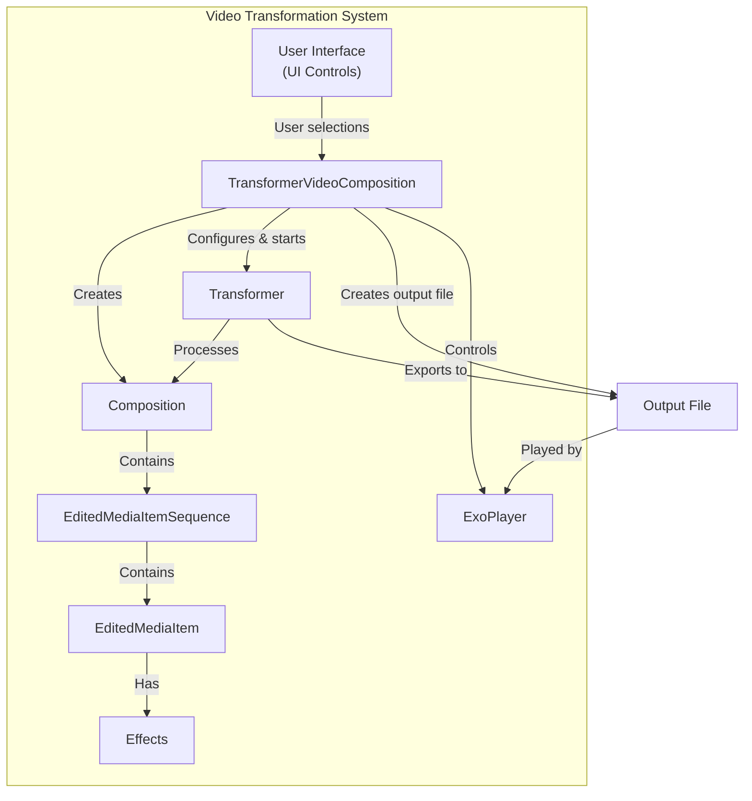
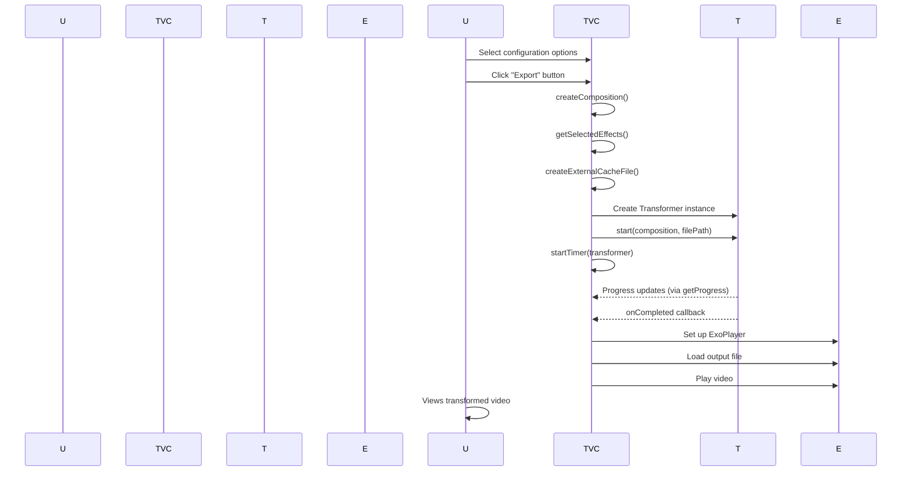
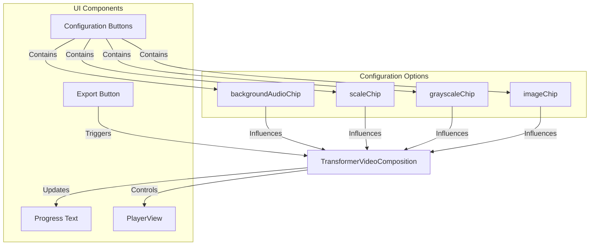

<!-- source: DeepWiki mcp.deepwiki.com · repo android/platform-samples · page 6.1 Video Transformation · fetched 2026-10-23 -->

# Video Transformation

<details>
<summary>Relevant source files</summary>

The following files were used as context for generating this wiki page:

- [samples/media/video/src/main/AndroidManifest.xml](samples/media/video/src/main/AndroidManifest.xml)
- [samples/media/video/src/main/java/com/example/platform/media/video/TransformerVideoComposition.kt](samples/media/video/src/main/java/com/example/platform/media/video/TransformerVideoComposition.kt)
- [samples/media/video/src/main/res/layout/transformer_composition_layout.xml](samples/media/video/src/main/res/layout/transformer_composition_layout.xml)
- [samples/media/video/src/main/res/values/strings.xml](samples/media/video/src/main/res/values/strings.xml)

</details>


## Purpose and Scope

This document provides a technical overview of the Video Transformation system in the Android Platform Samples repository. It demonstrates how to use Media3 Transformer API for video composition and effects. The system showcases how to combine multiple video sources, apply visual effects, add background audio, and incorporate static images into a video composition.

## System Overview

The Video Transformation sample demonstrates the capabilities of Media3's Transformer API to process and manipulate video content. It allows developers to create complex media compositions by combining multiple media sources (videos, images, audio) and applying various transformations.



Sources: [samples/media/video/src/main/java/com/example/platform/media/video/TransformerVideoComposition.kt:54-320]()

## Key Components

### TransformerVideoComposition

The main component that orchestrates the video transformation process, implemented as a Fragment. It handles user input, sets up the transformation, and displays the result.

### Transformer

The central Media3 class that performs the actual media processing. It takes a Composition and outputs the processed media to a file.

### Composition

Defines the structure of the output media, containing sequences of edited media items.

```mermaid
classDiagram
    class "Composition" {
        +Builder(sequences) Builder
        +experimentalSetForceAudioTrack() Builder
        +build() Composition
    }
    class "EditedMediaItemSequence" {
        +EditedMediaItemSequence(items, isLooping)
    }
    class "EditedMediaItem" {
        +Builder(mediaItem) Builder
        +setEffects(effects) Builder
        +setFrameRate(frameRate) Builder
        +build() EditedMediaItem
    }
    class "MediaItem" {
        +fromUri(uri) MediaItem
        +setImageDurationMs(durationMs) Builder
    }
    class "Effects" {
        +Effects(audioProcessors, videoEffects)
    }
    
    "Composition" --> "EditedMediaItemSequence" : contains
    "EditedMediaItemSequence" --> "EditedMediaItem" : contains
    "EditedMediaItem" --> "MediaItem" : wraps
    "EditedMediaItem" --> "Effects" : applies
```

Sources: [samples/media/video/src/main/java/com/example/platform/media/video/TransformerVideoComposition.kt:151-201]()

### Effects

Visual effects that can be applied to media items:

- **RgbFilter**: Creates grayscale or other color transformations
- **ScaleAndRotateTransformation**: Allows scaling and rotating the video content

Sources: [samples/media/video/src/main/java/com/example/platform/media/video/TransformerVideoComposition.kt:232-248]()

## Transformation Workflow

The following diagram illustrates the workflow of video transformation:



Sources: [samples/media/video/src/main/java/com/example/platform/media/video/TransformerVideoComposition.kt:118-135](), [samples/media/video/src/main/java/com/example/platform/media/video/TransformerVideoComposition.kt:218-227]()

## User Interface and Configuration Options

The UI allows users to configure the video transformation with several options:

1. **Add background audio**: Adds a looping audio track to the composition
2. **Scale video**: Applies scaling to the first video (reduces size to 20%)
3. **Grayscale**: Applies grayscale filter to the first video
4. **Add intro image**: Adds a static image at the beginning of the composition

After configuration, the user can click "Export" to start the transformation process. Once complete, the transformed video is automatically played.



Sources: [samples/media/video/src/main/res/layout/transformer_composition_layout.xml:17-82](), [samples/media/video/src/main/res/values/strings.xml:17-35]()

## Implementation Details

### Creating a Composition

The sample creates a composition by:
1. Creating `EditedMediaItem` instances for videos, with optional effects
2. Optionally adding an image to the start of the video sequence
3. Creating a video sequence with `EditedMediaItemSequence`
4. Optionally adding a background audio track in a separate sequence
5. Building a `Composition` with the sequences

Key code: [samples/media/video/src/main/java/com/example/platform/media/video/TransformerVideoComposition.kt:151-201]()

### Applying Effects

Effects are applied only to the first video in the composition:

```
- If grayscale is selected: Adds RgbFilter.createGrayscaleFilter()
- If scale is selected: Adds ScaleAndRotateTransformation with scale factor 0.2
```

Key code: [samples/media/video/src/main/java/com/example/platform/media/video/TransformerVideoComposition.kt:232-248]()

### Export Process

The export process involves:
1. Creating a cache file for the output
2. Setting up a Transformer instance with a listener for completion events
3. Starting the transformation
4. Updating UI to show progress
5. Playing the result with ExoPlayer when complete

Key code: [samples/media/video/src/main/java/com/example/platform/media/video/TransformerVideoComposition.kt:218-227]()

## Media Sources

The sample uses the following media sources:

| Type | URI | Purpose |
|------|-----|---------|
| Video 1 | android-screens-10s.mp4 | First video in sequence (effects applied) |
| Video 2 | android-block-1080-hevc.mp4 | Second video in sequence |
| Image | Android Media3 logo | Optional intro image (3 seconds) |
| Audio | play.mp3 | Optional background audio (looping) |

Sources: [samples/media/video/src/main/java/com/example/platform/media/video/TransformerVideoComposition.kt:311-318]()

## Example Workflow

1. User selects desired configuration options (checkboxes for effects, audio, image)
2. User clicks "Export" button
3. `TransformerVideoComposition` creates a `Composition` based on selected options
4. `Transformer` processes the composition and writes to an output file
5. Progress is shown to the user during export
6. When export completes, the video is played automatically with `ExoPlayer`

Sources: [samples/media/video/src/main/java/com/example/platform/media/video/TransformerVideoComposition.kt:118-135](), [samples/media/video/src/main/java/com/example/platform/media/video/TransformerVideoComposition.kt:80-97]()

## Requirements

The sample requires:
- Internet permission to access the remote media files
- Media3 libraries (Transformer, ExoPlayer, UI components)

Sources: [samples/media/video/src/main/AndroidManifest.xml:18-20]()