# Page: Overview

# Overview

<details>
<summary>Relevant source files</summary>

The following files were used as context for generating this wiki page:

- [.editorconfig](.editorconfig)
- [.github/ISSUE_TEMPLATE/bug_report.yml](.github/ISSUE_TEMPLATE/bug_report.yml)
- [.github/ISSUE_TEMPLATE/feature_request.yml](.github/ISSUE_TEMPLATE/feature_request.yml)
- [.github/PULL_REQUEST_TEMPLATE/pull_request_template.md](.github/PULL_REQUEST_TEMPLATE/pull_request_template.md)
- [.gitignore](.gitignore)
- [README.md](README.md)
- [app/src/main/AndroidManifest.xml](app/src/main/AndroidManifest.xml)
- [build.gradle.kts](build.gradle.kts)
- [samples/media/video/build.gradle.kts](samples/media/video/build.gradle.kts)
- [samples/media/video/download_model.gradle](samples/media/video/download_model.gradle)
- [samples/media/video/src/main/assets/style1.jpg](samples/media/video/src/main/assets/style1.jpg)
- [samples/media/video/src/main/assets/style2.jpg](samples/media/video/src/main/assets/style2.jpg)
- [samples/media/video/src/main/assets/style3.jpg](samples/media/video/src/main/assets/style3.jpg)
- [samples/media/video/src/main/java/com/example/platform/media/video/StyleTransferEffect.kt](samples/media/video/src/main/java/com/example/platform/media/video/StyleTransferEffect.kt)
- [samples/media/video/src/main/java/com/example/platform/media/video/TransformerTFLite.kt](samples/media/video/src/main/java/com/example/platform/media/video/TransformerTFLite.kt)
- [tools/pre-push](tools/pre-push)

</details>


The Android Platform Samples repository is a comprehensive collection of code samples demonstrating various Android platform APIs and capabilities. This documentation provides a high-level overview of the repository's structure, organization, and how to navigate the samples effectively.

The repository showcases specific Android functionalities in isolated, focused examples that are designed to illustrate best practices for implementing particular platform features. These samples are not intended for production use but rather as learning resources for developers integrating platform capabilities into their own applications.

For detailed information about the build system and dependency management used throughout the repository, see [Build System and Dependencies](#2).

Sources: [README.md:3-10]()

## Repository Purpose and Scope

This repository serves as a centralized resource for developers to:

1. Explore implementation examples of Android platform APIs
2. Understand recommended patterns for specific platform features
3. Learn how to leverage new platform capabilities
4. Experiment with code that demonstrates targeted functionality

The samples cover a wide range of platform areas including user interface components, connectivity features, privacy implementations, media handling, graphics, location services, and storage access patterns.

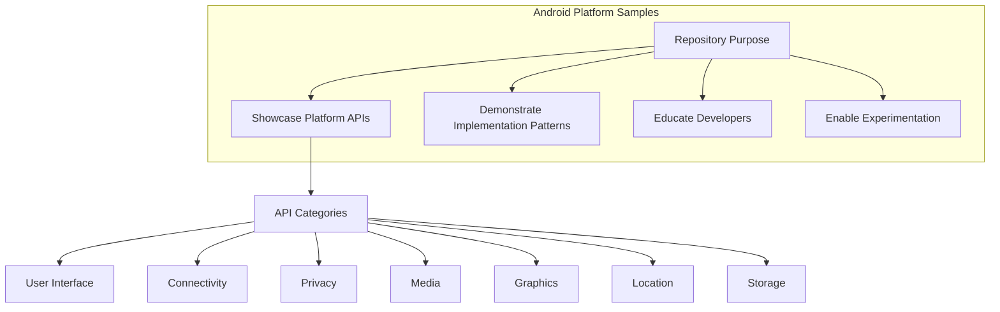

Sources: [README.md:3-10](), [README.md:12-24]()

## Repository Organization

The repository is structured with a clear organization designed to help developers find relevant samples. All samples are organized into topic-specific folders, with each sample folder containing its own implementation along with documentation.

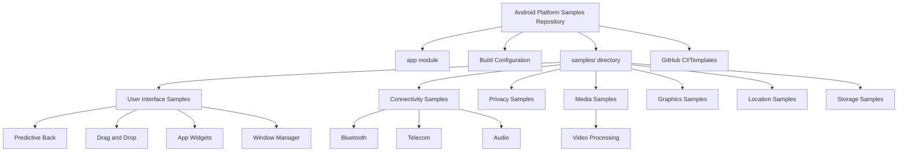

Sources: [README.md:12-24]()

## Sample Architecture

Each sample is developed as a standalone module that demonstrates a specific platform capability. This isolation ensures that developers can understand each feature without being overwhelmed by unnecessary dependencies or complexity.

The repository uses an `app` module that serves as a container for accessing samples. This module is primarily a navigation mechanism and is not essential to understand the sample functionality itself.

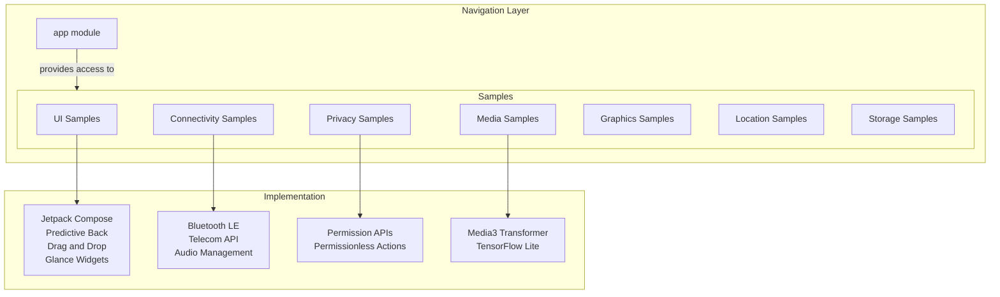

Sources: [README.md:30-37](), [app/src/main/AndroidManifest.xml:16-43]()

## Media Processing Capabilities

The repository includes examples of advanced media processing, particularly focused on video transformation using Media3 Transformer and TensorFlow Lite for style transfer effects.

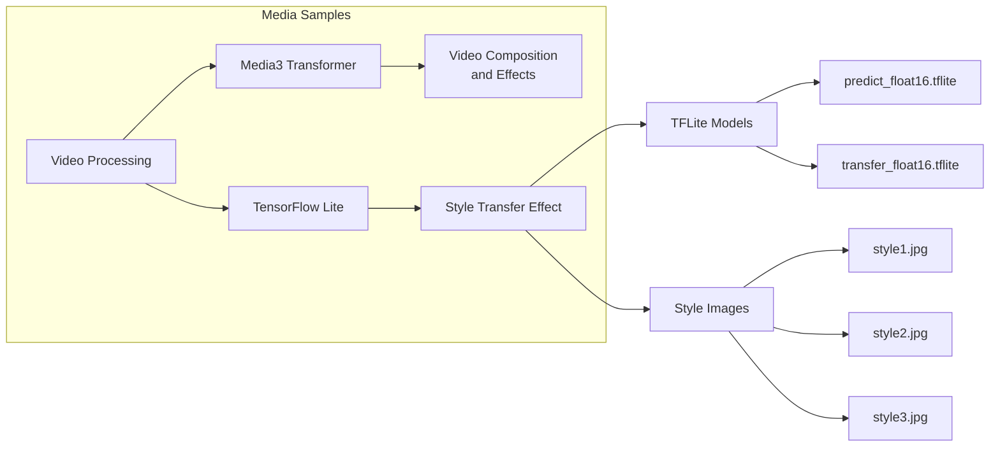

Sources: [samples/media/video/build.gradle.kts:42-79](), [samples/media/video/src/main/java/com/example/platform/media/video/TransformerTFLite.kt:52-266](), [samples/media/video/src/main/java/com/example/platform/media/video/StyleTransferEffect.kt:1-185]()

## Build and Dependency Management

The repository implements a centralized dependency management system using a version catalog in `libs.versions.toml`. This file defines versions, libraries, and plugins used throughout the project, ensuring consistency across all samples.

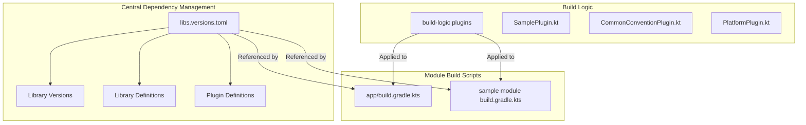

Sources: [build.gradle.kts:16-21]()

## Development Workflow

The repository includes robust CI/CD integration through GitHub workflows, ensuring code quality through automated builds, tests, and code style checks. Developers can contribute by following the workflow described in the repository documentation.

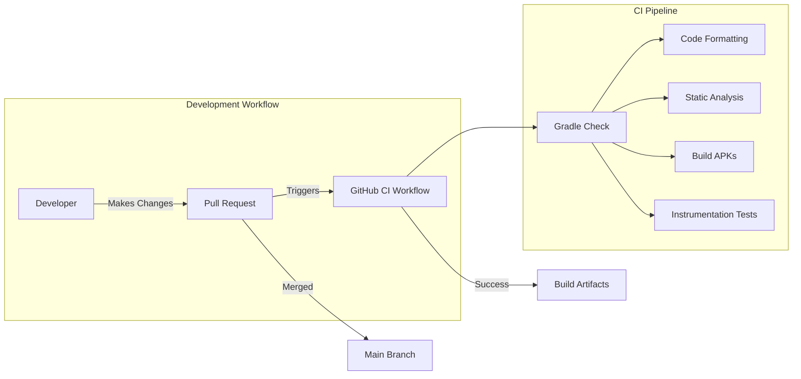

Sources: [.github/PULL_REQUEST_TEMPLATE/pull_request_template.md:1-15](), [tools/pre-push:1-96]()

## Running the Samples

To explore the samples, you can clone the repository, open it in Android Studio, and run the `app` configuration. This will launch a navigator application that allows you to browse through the available samples and run them individually.

| Step | Description |
|------|-------------|
| 1 | Clone the repository |
| 2 | Open the project in Android Studio |
| 3 | Sync & Run the `app` configuration |
| 4 | Navigate through categories in the samples list screen |
| 5 | Select a sample to view its implementation |

Sources: [README.md:26-37]()

## Issue Reporting and Contributions

The repository welcomes contributions from the community. If you encounter issues with any sample, you can report them using the GitHub issue tracker. When submitting pull requests, ensure that your code passes all tests and formatting checks.

Sources: [README.md:39-50](), [.github/ISSUE_TEMPLATE/bug_report.yml:1-60](), [.github/ISSUE_TEMPLATE/feature_request.yml:1-54]()

---

# Page: Build System and Dependencies

# Build System and Dependencies

<details>
<summary>Relevant source files</summary>

The following files were used as context for generating this wiki page:

- [.github/ISSUE_TEMPLATE/config.yml](.github/ISSUE_TEMPLATE/config.yml)
- [.github/ci-gradle.properties](.github/ci-gradle.properties)
- [.github/workflows/build.yml](.github/workflows/build.yml)
- [.github/workflows/issues-stale.yml](.github/workflows/issues-stale.yml)
- [app/build.gradle.kts](app/build.gradle.kts)
- [gradle/libs.versions.toml](gradle/libs.versions.toml)
- [samples/connectivity/telecom/README.md](samples/connectivity/telecom/README.md)
- [samples/connectivity/telecom/build.gradle.kts](samples/connectivity/telecom/build.gradle.kts)
- [samples/connectivity/telecom/src/main/AndroidManifest.xml](samples/connectivity/telecom/src/main/AndroidManifest.xml)
- [samples/user-interface/constraintlayout/src/main/java/com/example/platform/ui/constraintlayout/view/BoundsImageView.kt](samples/user-interface/constraintlayout/src/main/java/com/example/platform/ui/constraintlayout/view/BoundsImageView.kt)
- [settings.gradle.kts](settings.gradle.kts)

</details>


## Purpose and Scope

This document explains the dependency management system and build configuration used throughout the Android Platform Samples repository. It covers how dependencies are declared, managed, and used across the various modules in the project. This includes the centralized version catalog, project structure, module organization, and continuous integration setup.

For information about specific sample implementations, see [User Interface Samples](#3) or [Connectivity Samples](#4).

## Dependency Management Overview

The Android Platform Samples repository employs a centralized dependency management system using Gradle's Version Catalog feature. This ensures consistent dependency versions across all modules and simplifies updating dependencies.

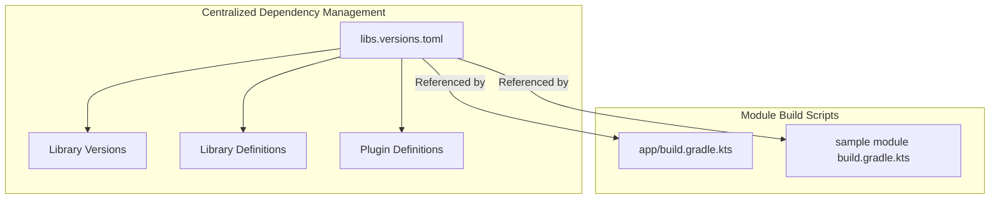

Sources: [gradle/libs.versions.toml:1-197](), [app/build.gradle.kts:1-110](), [samples/connectivity/telecom/build.gradle.kts:1-67]()

### Version Catalog Structure

The central component of the dependency management system is the `libs.versions.toml` file, which is organized into three main sections:

1. **Versions**: Defines all dependency versions in a single location
2. **Libraries**: Defines library dependencies using the versions defined above
3. **Plugins**: Defines Gradle plugins

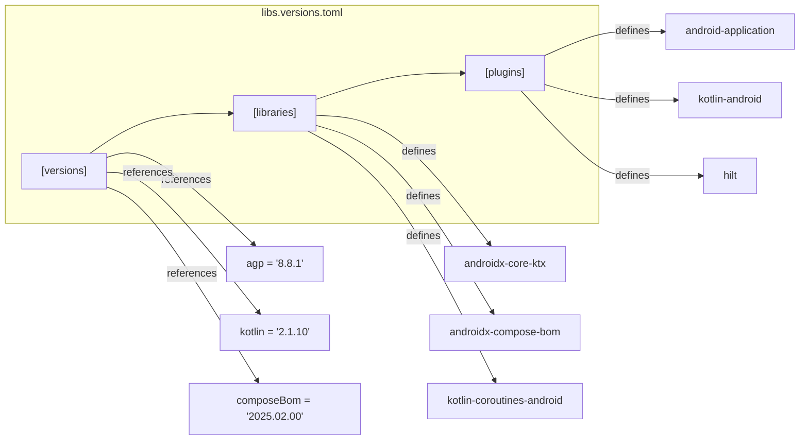

Sources: [gradle/libs.versions.toml:16-54](), [gradle/libs.versions.toml:62-182](), [gradle/libs.versions.toml:183-197]()

#### Version Definitions

The `[versions]` section defines version numbers for all dependencies:

```
[versions]
agp = "8.8.1"
kotlin = "2.1.10"
composeBom = "2025.02.00"
...
```

Sources: [gradle/libs.versions.toml:16-61]()

#### Library Definitions

The `[libraries]` section defines library dependencies, often referencing versions from the `[versions]` section:

```
[libraries]
androidx-core-ktx = { group = "androidx.core", name = "core-ktx", version.ref = "coreKtx" }
androidx-compose-bom = { group = "androidx.compose", name = "compose-bom", version.ref = "composeBom" }
...
```

Sources: [gradle/libs.versions.toml:62-182]()

#### Plugin Definitions

The `[plugins]` section defines Gradle plugins:

```
[plugins]
android-application = { id = "com.android.application", version.ref = "agp" }
kotlin-android = { id = "org.jetbrains.kotlin.android", version.ref = "kotlin" }
...
```

Sources: [gradle/libs.versions.toml:183-197]()

## Project Structure

The Android Platform Samples repository is organized as a multi-module Gradle project with a clear hierarchy.

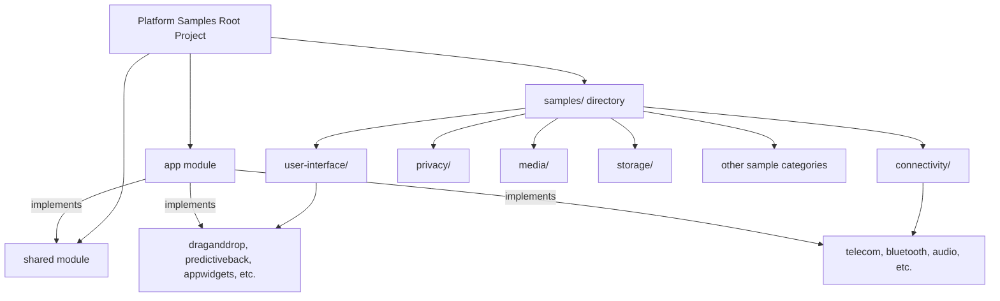

Sources: [settings.gradle.kts:38-68](), [app/build.gradle.kts:73-101]()

### Module Organization

The project is organized into the following key components:

1. **App Module**: The main container application that integrates all sample modules
2. **Shared Module**: Contains shared code used across sample modules
3. **Sample Modules**: Individual modules for each sample, organized by category

Each sample module is configured as an Android library module, making it easy to include in the main app module.

## Build Configuration

### Repository Configuration

The repository configuration is defined in `settings.gradle.kts`, which sets up repository access and includes all modules in the project:

```kotlin
pluginManagement {
    repositories {
        google()
        mavenCentral()
        gradlePluginPortal()
    }
}
dependencyResolutionManagement {
    repositoriesMode.set(RepositoriesMode.FAIL_ON_PROJECT_REPOS)
    repositories {
        google()
        mavenCentral()
    }
}
```

Sources: [settings.gradle.kts:17-36]()

### Module Inclusion

All modules are included in the project using the `include()` function in `settings.gradle.kts`:

```kotlin
include(":app")
include(":shared")
include(":samples:accessibility")
include(":samples:camera:camera2")
// ... more modules
```

Sources: [settings.gradle.kts:38-68]()

### App Module Configuration

The app module (`app/build.gradle.kts`) is configured as an Android application that includes all sample modules as dependencies:

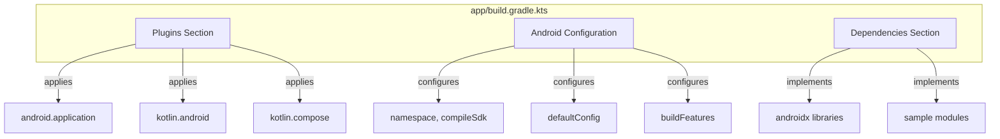

Sources: [app/build.gradle.kts:17-22](), [app/build.gradle.kts:24-57](), [app/build.gradle.kts:59-109]()

The key configurations include:

1. **Plugin Application**: Applies necessary plugins for Android application and Kotlin
2. **Android Configuration**: Sets up SDK versions, build types, and features
3. **Dependencies**: Declares dependencies on framework libraries and sample modules

### Sample Module Configuration

Each sample module follows a similar pattern for configuration, as seen in the Telecom sample:

```kotlin
plugins {
    alias(libs.plugins.android.library)
    alias(libs.plugins.kotlin.compose)
    alias(libs.plugins.kotlin.android)
    id("kotlin-parcelize")
}

android {
    namespace = "com.example.platform.connectivity.telecom"
    compileSdk = 35
    // ...
}

dependencies {
    implementation("androidx.core:core-telecom:1.0.0-alpha02")
    implementation(project(mapOf("path" to ":samples:connectivity:audio")))
    // ...
}
```

Sources: [samples/connectivity/telecom/build.gradle.kts:18-39](), [samples/connectivity/telecom/build.gradle.kts:41-66]()

## Dependency Usage Patterns

### Using the Version Catalog

Dependencies are referenced from the version catalog using the `libs` accessor:

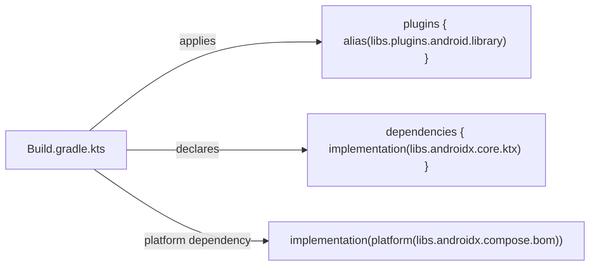

Sources: [app/build.gradle.kts:18-21](), [app/build.gradle.kts:61-72](), [samples/connectivity/telecom/build.gradle.kts:19-23]()

Common patterns include:

1. **Plugin Application**: Using `alias(libs.plugins.<plugin-id>)`
2. **Library Implementation**: Using `implementation(libs.<library-id>)`
3. **BOM (Bill of Materials)**: Using `implementation(platform(libs.<bom-id>))`
4. **Project Dependencies**: Using `implementation(project(":<module-path>"))`

## Continuous Integration

The project uses GitHub Actions for continuous integration, as defined in `.github/workflows/build.yml`.

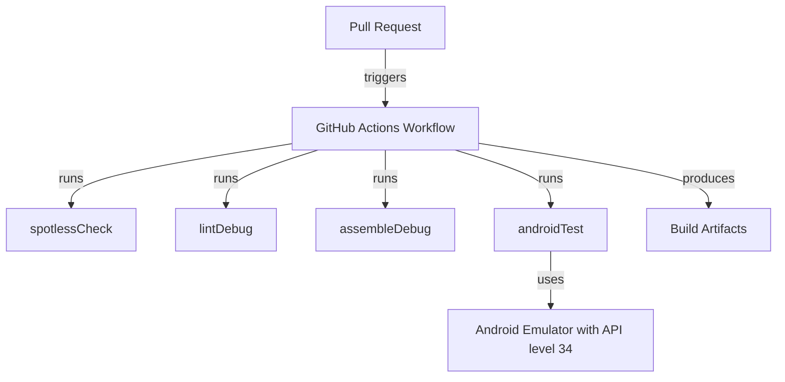

Sources: [.github/workflows/build.yml:1-123]()

The CI workflow includes:

1. **Code Formatting Check**: Using Spotless
2. **Lint Check**: Running Android lint on debug build
3. **Debug Build**: Assembling debug APKs
4. **Instrumentation Tests**: Running Android tests on an emulator

## Module Interdependencies

Some sample modules depend on other modules, as seen with the Telecom sample depending on the Audio sample:

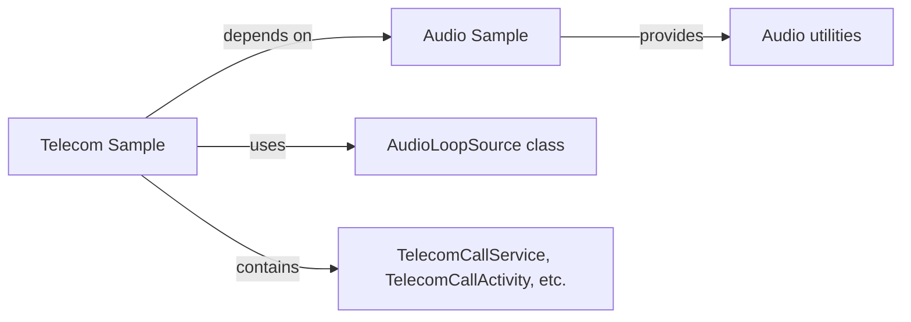

Sources: [samples/connectivity/telecom/build.gradle.kts:43](), [samples/connectivity/telecom/README.md:1-20]()

This dependency is declared in the build file:

```kotlin
implementation(project(mapOf("path" to ":samples:connectivity:audio")))
```

And is used to access audio utilities such as `AudioLoopSource` from the audio sample.

## Summary

The Android Platform Samples repository uses a well-structured build system with centralized dependency management through Gradle's Version Catalog feature. All dependencies are defined in a single `libs.versions.toml` file, making it easy to maintain consistent versions across the project. The project is organized into multiple modules, with a main app module that integrates all sample modules. Each sample module is configured as an Android library with specific dependencies and features. Continuous integration is handled through GitHub Actions, ensuring code quality and build stability.

---

# Page: User Interface Samples

# User Interface Samples

<details>
<summary>Relevant source files</summary>

The following files were used as context for generating this wiki page:

- [gradle/wrapper/gradle-wrapper.properties](gradle/wrapper/gradle-wrapper.properties)
- [samples/connectivity/callnotification/README.md](samples/connectivity/callnotification/README.md)
- [samples/connectivity/callnotification/build.gradle.kts](samples/connectivity/callnotification/build.gradle.kts)
- [samples/connectivity/callnotification/src/main/AndroidManifest.xml](samples/connectivity/callnotification/src/main/AndroidManifest.xml)
- [samples/connectivity/callnotification/src/main/java/com/example/platform/connectivity/callnotification/CallNotificationSample.kt](samples/connectivity/callnotification/src/main/java/com/example/platform/connectivity/callnotification/CallNotificationSample.kt)
- [samples/connectivity/callnotification/src/main/java/com/example/platform/connectivity/callnotification/NotificationSource.kt](samples/connectivity/callnotification/src/main/java/com/example/platform/connectivity/callnotification/NotificationSource.kt)
- [samples/user-interface/appwidgets/src/main/AndroidManifest.xml](samples/user-interface/appwidgets/src/main/AndroidManifest.xml)
- [samples/user-interface/appwidgets/src/main/java/com/example/platform/ui/appwidgets/AppWidgets.kt](samples/user-interface/appwidgets/src/main/java/com/example/platform/ui/appwidgets/AppWidgets.kt)
- [samples/user-interface/appwidgets/src/main/java/com/example/platform/ui/appwidgets/glance/layout/ActionDemonstrationActivity.kt](samples/user-interface/appwidgets/src/main/java/com/example/platform/ui/appwidgets/glance/layout/ActionDemonstrationActivity.kt)
- [samples/user-interface/appwidgets/src/main/java/com/example/platform/ui/appwidgets/glance/layout/CollectionsKtx.kt](samples/user-interface/appwidgets/src/main/java/com/example/platform/ui/appwidgets/glance/layout/CollectionsKtx.kt)
- [samples/user-interface/appwidgets/src/main/java/com/example/platform/ui/appwidgets/glance/layout/toolbars/ExpressiveToolbarAppWidget.kt](samples/user-interface/appwidgets/src/main/java/com/example/platform/ui/appwidgets/glance/layout/toolbars/ExpressiveToolbarAppWidget.kt)
- [samples/user-interface/appwidgets/src/main/res/drawable-night-nodpi/sample_expressive_toolbar_preview.png](samples/user-interface/appwidgets/src/main/res/drawable-night-nodpi/sample_expressive_toolbar_preview.png)
- [samples/user-interface/appwidgets/src/main/res/drawable-nodpi/sample_expressive_toolbar_preview.png](samples/user-interface/appwidgets/src/main/res/drawable-nodpi/sample_expressive_toolbar_preview.png)
- [samples/user-interface/appwidgets/src/main/res/values-xlarge/dimens.xml](samples/user-interface/appwidgets/src/main/res/values-xlarge/dimens.xml)
- [samples/user-interface/appwidgets/src/main/res/values/dimens.xml](samples/user-interface/appwidgets/src/main/res/values/dimens.xml)
- [samples/user-interface/appwidgets/src/main/res/values/strings.xml](samples/user-interface/appwidgets/src/main/res/values/strings.xml)
- [samples/user-interface/appwidgets/src/main/res/values/themes.xml](samples/user-interface/appwidgets/src/main/res/values/themes.xml)
- [samples/user-interface/appwidgets/src/main/res/xml/sample_expressive_toolbar_widget_info.xml](samples/user-interface/appwidgets/src/main/res/xml/sample_expressive_toolbar_widget_info.xml)
- [samples/user-interface/draganddrop/README.md](samples/user-interface/draganddrop/README.md)
- [samples/user-interface/draganddrop/build.gradle.kts](samples/user-interface/draganddrop/build.gradle.kts)
- [samples/user-interface/draganddrop/src/main/AndroidManifest.xml](samples/user-interface/draganddrop/src/main/AndroidManifest.xml)
- [samples/user-interface/draganddrop/src/main/java/com/example/platform/ui/draganddrop/DragAndDrop.kt](samples/user-interface/draganddrop/src/main/java/com/example/platform/ui/draganddrop/DragAndDrop.kt)
- [samples/user-interface/draganddrop/src/main/java/com/example/platform/ui/draganddrop/DragAndDropFileProvider.kt](samples/user-interface/draganddrop/src/main/java/com/example/platform/ui/draganddrop/DragAndDropFileProvider.kt)
- [samples/user-interface/draganddrop/src/main/java/com/example/platform/ui/draganddrop/DragAndDropMultiWindow.kt](samples/user-interface/draganddrop/src/main/java/com/example/platform/ui/draganddrop/DragAndDropMultiWindow.kt)
- [samples/user-interface/draganddrop/src/main/java/com/example/platform/ui/draganddrop/DragAndDropRichContentReceiverFragment.kt](samples/user-interface/draganddrop/src/main/java/com/example/platform/ui/draganddrop/DragAndDropRichContentReceiverFragment.kt)
- [samples/user-interface/draganddrop/src/main/java/com/example/platform/ui/draganddrop/DragAndDropUsingCompose.kt](samples/user-interface/draganddrop/src/main/java/com/example/platform/ui/draganddrop/DragAndDropUsingCompose.kt)
- [samples/user-interface/draganddrop/src/main/java/com/example/platform/ui/draganddrop/DragAndDropWithHelper.kt](samples/user-interface/draganddrop/src/main/java/com/example/platform/ui/draganddrop/DragAndDropWithHelper.kt)
- [samples/user-interface/draganddrop/src/main/java/com/example/platform/ui/draganddrop/DragAndDropWithViews.kt](samples/user-interface/draganddrop/src/main/java/com/example/platform/ui/draganddrop/DragAndDropWithViews.kt)
- [samples/user-interface/draganddrop/src/main/java/com/example/platform/ui/draganddrop/RichContentReceiverAdapter.kt](samples/user-interface/draganddrop/src/main/java/com/example/platform/ui/draganddrop/RichContentReceiverAdapter.kt)
- [samples/user-interface/draganddrop/src/main/res/layout/fragment_dnd_richcontent.xml](samples/user-interface/draganddrop/src/main/res/layout/fragment_dnd_richcontent.xml)
- [samples/user-interface/draganddrop/src/main/res/layout/fragment_drag_and_drop_with_helper.xml](samples/user-interface/draganddrop/src/main/res/layout/fragment_drag_and_drop_with_helper.xml)
- [samples/user-interface/draganddrop/src/main/res/layout/fragment_drag_and_drop_with_views.xml](samples/user-interface/draganddrop/src/main/res/layout/fragment_drag_and_drop_with_views.xml)
- [samples/user-interface/draganddrop/src/main/res/layout/grid_item.xml](samples/user-interface/draganddrop/src/main/res/layout/grid_item.xml)
- [samples/user-interface/draganddrop/src/main/res/values/strings.xml](samples/user-interface/draganddrop/src/main/res/values/strings.xml)
- [samples/user-interface/predictiveback/README.md](samples/user-interface/predictiveback/README.md)
- [samples/user-interface/predictiveback/build.gradle.kts](samples/user-interface/predictiveback/build.gradle.kts)
- [samples/user-interface/predictiveback/src/main/AndroidManifest.xml](samples/user-interface/predictiveback/src/main/AndroidManifest.xml)
- [samples/user-interface/predictiveback/src/main/java/com/example/platform/ui/predictiveback/PBAnimation.kt](samples/user-interface/predictiveback/src/main/java/com/example/platform/ui/predictiveback/PBAnimation.kt)
- [samples/user-interface/predictiveback/src/main/java/com/example/platform/ui/predictiveback/PBListFragment.kt](samples/user-interface/predictiveback/src/main/java/com/example/platform/ui/predictiveback/PBListFragment.kt)
- [samples/user-interface/predictiveback/src/main/res/layout/fragment_animation_list.xml](samples/user-interface/predictiveback/src/main/res/layout/fragment_animation_list.xml)
- [samples/user-interface/predictiveback/src/main/res/navigation/nav_graph.xml](samples/user-interface/predictiveback/src/main/res/navigation/nav_graph.xml)
- [samples/user-interface/predictiveback/src/main/res/values/strings.xml](samples/user-interface/predictiveback/src/main/res/values/strings.xml)
- [samples/user-interface/share/src/main/AndroidManifest.xml](samples/user-interface/share/src/main/AndroidManifest.xml)
- [samples/user-interface/windowmanager/src/main/AndroidManifest.xml](samples/user-interface/windowmanager/src/main/AndroidManifest.xml)

</details>


This page provides an overview of the UI-related samples in the Android Platform Samples repository. These samples demonstrate modern UI patterns, APIs, and techniques for creating rich, interactive user interfaces on Android. The samples cover a range of UI capabilities, from navigation animations to widgets and drag-and-drop functionality.

## Overview

The User Interface samples showcase implementation patterns for various Android UI features. Each sample is designed to demonstrate a specific UI capability, implementation approach, or API.

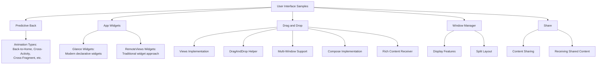

Sources:
- [samples/user-interface/predictiveback/README.md]()
- [samples/user-interface/appwidgets/src/main/java/com/example/platform/ui/appwidgets/AppWidgets.kt]()
- [samples/user-interface/draganddrop/README.md]()
- [samples/user-interface/windowmanager/src/main/AndroidManifest.xml]()
- [samples/user-interface/share/src/main/AndroidManifest.xml]()

## Predictive Back Samples

The Predictive Back samples demonstrate different types of back gesture animations introduced in Android 14. This feature provides visual cues about the destination when a user initiates a back gesture, enhancing navigation predictability.

### Animation Types

The samples cover multiple animation scenarios:

| Animation Type | Description | Implementation Approach |
|----------------|-------------|-------------------------|
| Back-to-Home | Animation when returning to the launcher | System default animation |
| Cross-Activity | Animation between activities | Default or custom animations |
| Cross-Fragment | Animation between fragments | Navigation Component animations |
| Shared Element Cross-Fragment | Transition animation for shared elements | FragmentNavigatorExtras |
| Custom Progress API | Custom animation using the Progress API | OnBackPressedCallback with handleOnBackProgressed |
| Custom AndroidX Transition | Animation using the AndroidX Transition API | TransitionSeekController |
| Material SharedAxis | Animation using Material Motion | MaterialSharedAxis transition |
| setCustomAnimations | Basic animation between fragments | Fragment transaction animations |

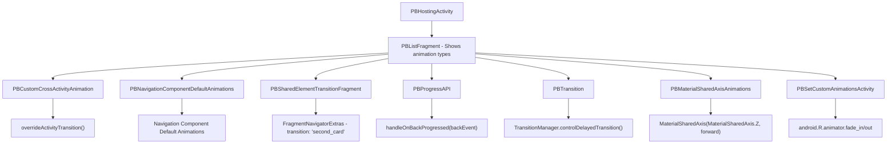

Sources:
- [samples/user-interface/predictiveback/README.md]()
- [samples/user-interface/predictiveback/src/main/java/com/example/platform/ui/predictiveback/PBListFragment.kt]()
- [samples/user-interface/predictiveback/src/main/java/com/example/platform/ui/predictiveback/PBAnimation.kt]()
- [samples/user-interface/predictiveback/src/main/res/navigation/nav_graph.xml]()

### Implementation Examples

#### Custom Cross-Activity Animation

```kotlin
override fun onCreate(savedInstanceState: Bundle?) {
    // ...
    overrideActivityTransition(
        OVERRIDE_TRANSITION_OPEN,
        android.R.anim.fade_in,
        0
    )
    
    overrideActivityTransition(
        OVERRIDE_TRANSITION_CLOSE,
        0,
        android.R.anim.fade_out
    )
}
```

#### Progress API Animation

```kotlin
val predictiveBackCallback = object: OnBackPressedCallback(enabled=false) {
    override fun handleOnBackProgressed(backEvent: BackEventCompat) {
        when (backEvent.swipeEdge) {
            BackEventCompat.EDGE_LEFT ->
                binding.box.translationX = backEvent.progress * maxXShift
            BackEventCompat.EDGE_RIGHT ->
                binding.box.translationX = -(backEvent.progress * maxXShift)
        }
        binding.box.scaleX = 1F - (0.1F * backEvent.progress)
        binding.box.scaleY = 1F - (0.1F * backEvent.progress)
    }
    
    // Other callback methods...
}
```

Sources:
- [samples/user-interface/predictiveback/README.md:18-42]()
- [samples/user-interface/predictiveback/README.md:97-131]()

## App Widgets Samples

The App Widgets samples demonstrate how to create and manage home screen widgets using both the traditional RemoteViews approach and the newer Jetpack Glance API.

### Widget Types

The samples include various widget layouts and design patterns:

| Widget Type | Description | Implementation |
|-------------|-------------|----------------|
| Expressive Toolbar | Toolbar with a 4-sided cookie cut shape | Glance API |
| Toolbar | Basic toolbar with header | Glance API |
| Search Toolbar | Toolbar optimized for search | Glance API |
| Long Text | Widget focused on displaying text | Glance API |
| Text and Image | Combined text and image presentation | Glance API |
| Image Text List | Scrollable list with images and text | Glance API |
| Checklist | Task-oriented list with checkboxes | Glance API |
| Action List | List of actionable items | Glance API |
| Image Grid | Grid of images | Glance API |
| Weather Forecast | Weather display widget | Both RemoteViews and Glance |

```mermaid
flowchart TD
    AWEntry["AppWidgets.kt - Main entry point"] --> AWProviders["widgetProviders - Gets installed widget providers"]
    AWEntry --> AWList["AppWidgetsList - Displays available widgets"]
    
    AWList --> AWPin["requestPinAppWidget() - Pin to home screen"]
    AWList --> CLInfo["CanonicalLayoutsInfoCard - Widget layout samples"]
    
    subgraph "Widget Implementations"
        GlanceWidgets["Glance Widgets"] --> ExpToolbar["ExpressiveToolbarAppWidget"]
        GlanceWidgets --> Toolbar["ToolBarAppWidgetReceiver"]
        GlanceWidgets --> SearchToolbar["SearchToolBarAppWidgetReceiver"]
        GlanceWidgets --> LongText["LongTextAppWidgetReceiver"]
        GlanceWidgets --> TextImage["TextWithImageAppWidgetReceiver"]
        GlanceWidgets --> ImageList["ImageTextListAppWidgetReceiver"]
        GlanceWidgets --> CheckList["CheckListAppWidgetReceiver"]
        GlanceWidgets --> ActionList["ActionListAppWidgetAppWidgetReceiver"]
        GlanceWidgets --> ImageGrid["ImageGridAppWidgetReceiver"]
        
        RVWidgets["RemoteViews Widgets"] --> WeatherRV["WeatherForecastAppWidget"]
    end
    
    GlanceWeather["WeatherGlanceWidgetReceiver"] --> GlanceImpl["Glance API Implementation"]
    WeatherRV --> RVImpl["RemoteViews Implementation"]
```

Sources:
- [samples/user-interface/appwidgets/src/main/AndroidManifest.xml]()
- [samples/user-interface/appwidgets/src/main/java/com/example/platform/ui/appwidgets/AppWidgets.kt]()
- [samples/user-interface/appwidgets/src/main/java/com/example/platform/ui/appwidgets/glance/layout/toolbars/ExpressiveToolbarAppWidget.kt]()

### Glance Widget Implementation

The following shows an example of implementing a widget using the Glance API:

```kotlin
class ExpressiveToolbarAppWidget : GlanceAppWidget() {
    override val sizeMode: SizeMode = SizeMode.Exact

    override suspend fun provideGlance(context: Context, id: GlanceId) {
        provideContent {
            GlanceTheme {
                WidgetContent()
            }
        }
    }

    @Composable
    fun WidgetContent() {
        ExpressiveToolbarLayout(
            centerButton = ExpressiveToolBarButton(
                iconRes = R.drawable.sample_add_icon,
                contentDescription = "Add notes",
                onClick = actionStartDemoActivity("add notes button")
            ),
            cornerButtons = listOf(
                // Button definitions...
            )
        )
    }
}

class ExpressiveToolbarAppWidgetReceiver : GlanceAppWidgetReceiver() {
    override val glanceAppWidget: GlanceAppWidget = ExpressiveToolbarAppWidget()
}
```

Sources:
- [samples/user-interface/appwidgets/src/main/java/com/example/platform/ui/appwidgets/glance/layout/toolbars/ExpressiveToolbarAppWidget.kt]()
- [samples/user-interface/appwidgets/src/main/res/xml/sample_expressive_toolbar_widget_info.xml]()

## Drag and Drop Samples

The Drag and Drop samples demonstrate various approaches to implementing drag and drop functionality, from basic View implementations to Jetpack Compose and rich content handling.

### Implementation Approaches

The samples cover multiple implementation techniques:

| Implementation | Description | Key APIs |
|----------------|-------------|----------|
| Views-based | Basic implementation using Android View system | View.startDragAndDrop, OnDragListener |
| DragAndDropHelper | Using the Jetpack DragAndDrop library | DragStartHelper, DropHelper |
| Multi-window | Drag and drop across apps | DRAG_FLAG_GLOBAL, DRAG_FLAG_GLOBAL_URI_READ |
| Compose | Implementation in Jetpack Compose | dragAndDropSource, dragAndDropTarget |
| Rich Content | Handling rich media using unified APIs | OnReceiveContentListener, ContentInfoCompat |

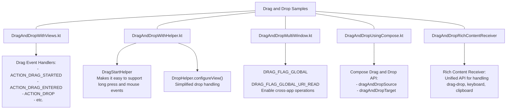

Sources:
- [samples/user-interface/draganddrop/README.md]()
- [samples/user-interface/draganddrop/src/main/java/com/example/platform/ui/draganddrop/DragAndDropWithViews.kt]()
- [samples/user-interface/draganddrop/src/main/java/com/example/platform/ui/draganddrop/DragAndDropWithHelper.kt]()
- [samples/user-interface/draganddrop/src/main/java/com/example/platform/ui/draganddrop/DragAndDropMultiWindow.kt]()
- [samples/user-interface/draganddrop/src/main/java/com/example/platform/ui/draganddrop/DragAndDropRichContentReceiverFragment.kt]()

### Implementation Examples

#### Using DragStartHelper

```kotlin
DragStartHelper(draggableView) { view: View, _: DragStartHelper ->
    val item = ClipData.Item(view.tag as? CharSequence)
    val dragData = ClipData(
        view.tag as? CharSequence,
        arrayOf(ClipDescription.MIMETYPE_TEXT_PLAIN),
        item,
    )
    view.startDragAndDrop(
        dragData,
        View.DragShadowBuilder(view),
        null,
        0,
    )
}.attach()
```

#### Using DropHelper

```kotlin
DropHelper.configureView(
    requireActivity(),
    targetView,
    arrayOf("text/*"),
) { _, payload: ContentInfoCompat ->
    val item = payload.clip.getItemAt(0)
    val dragData = item.text
    Glide.with(this).load(dragData).centerCrop().into(targetView)
    val (_, remaining) = payload.partition { it == item }
    remaining
}
```

Sources:
- [samples/user-interface/draganddrop/src/main/java/com/example/platform/ui/draganddrop/DragAndDropWithHelper.kt:68-87]()
- [samples/user-interface/draganddrop/src/main/java/com/example/platform/ui/draganddrop/DragAndDropWithHelper.kt:93-104]()

## Window Manager Samples

The Window Manager samples demonstrate how to work with different display configurations, including multi-display environments and foldable devices.

The samples include:

- Display features detection
- Window metrics
- Split layout handling
- Dual screen support
- Rear display mode
- Activity embedding

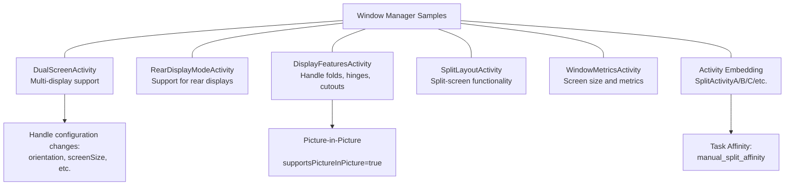

Sources:
- [samples/user-interface/windowmanager/src/main/AndroidManifest.xml]()

## Share Samples

The Share samples demonstrate how to implement content sharing between apps, including sending and receiving shared content such as text and images.

Key features demonstrated:

- Sharing content using Intent.ACTION_SEND
- Receiving shared content from other apps
- Handling multiple shared items with ACTION_SEND_MULTIPLE
- Managing file URIs with FileProvider
- Handling share results with BroadcastReceiver

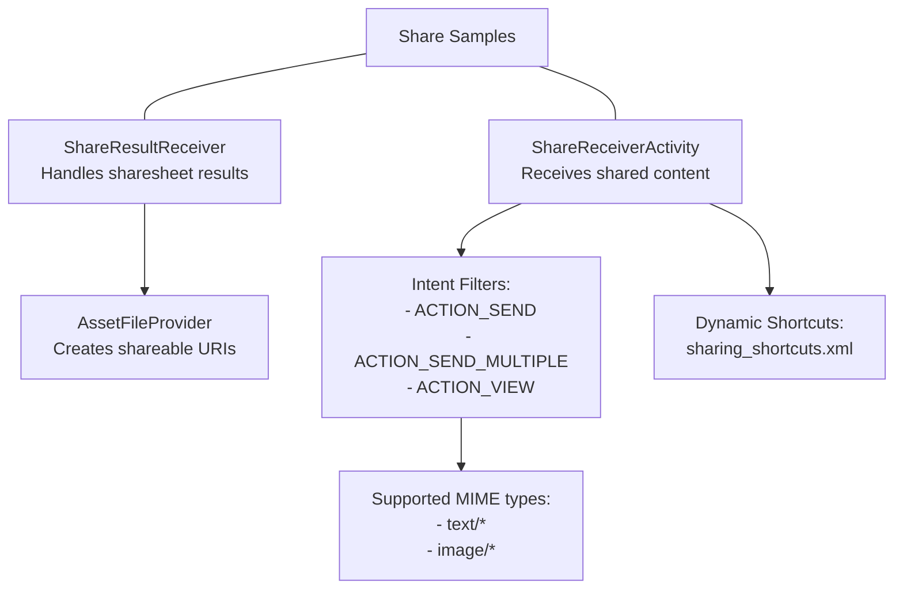

Sources:
- [samples/user-interface/share/src/main/AndroidManifest.xml]()

## Call Notification Sample

While not strictly a UI component, the Call Notification sample demonstrates how to create and manage call-specific notifications, which have unique UI requirements and behaviors.

Key features demonstrated:

- Creating incoming call notifications with CallStyle
- Implementing ongoing call notifications
- Handling notification actions (answer, reject, end call)
- Setting up proper notification channels for calls

```kotlin
// Creating an incoming call notification
NotificationCompat.Builder(context, ChannelId)
    .setSmallIcon(R.drawable.ic_dialog_dialer)
    .setFullScreenIntent(pendingIntent, true)
    .setSound(ringToneUri)
    .setOngoing(true)
    .setVisibility(VISIBILITY_PUBLIC)
    .setPriority(PRIORITY_MAX)
    .setStyle(
        NotificationCompat.CallStyle.forIncomingCall(
            fakeCaller,
            cancelCallPendingIntent,
            receiveCallPendingIntent,
        ),
    )
    .build()
```

Sources:
- [samples/connectivity/callnotification/src/main/java/com/example/platform/connectivity/callnotification/NotificationSource.kt]()
- [samples/connectivity/callnotification/src/main/java/com/example/platform/connectivity/callnotification/CallNotificationSample.kt]()

## Summary

The User Interface samples in the Android Platform Samples repository demonstrate modern UI implementation patterns and techniques across multiple categories. These samples provide practical examples of implementing predictive back animations, app widgets, drag-and-drop functionality, window management for different screen configurations, and content sharing.

Each sample is designed to showcase a specific approach or API, making it easier for developers to understand and implement these UI capabilities in their own applications.

---

# Page: Drag and Drop

# Drag and Drop

<details>
<summary>Relevant source files</summary>

The following files were used as context for generating this wiki page:

- [gradle/wrapper/gradle-wrapper.properties](gradle/wrapper/gradle-wrapper.properties)
- [samples/user-interface/draganddrop/README.md](samples/user-interface/draganddrop/README.md)
- [samples/user-interface/draganddrop/build.gradle.kts](samples/user-interface/draganddrop/build.gradle.kts)
- [samples/user-interface/draganddrop/src/main/AndroidManifest.xml](samples/user-interface/draganddrop/src/main/AndroidManifest.xml)
- [samples/user-interface/draganddrop/src/main/java/com/example/platform/ui/draganddrop/DragAndDrop.kt](samples/user-interface/draganddrop/src/main/java/com/example/platform/ui/draganddrop/DragAndDrop.kt)
- [samples/user-interface/draganddrop/src/main/java/com/example/platform/ui/draganddrop/DragAndDropFileProvider.kt](samples/user-interface/draganddrop/src/main/java/com/example/platform/ui/draganddrop/DragAndDropFileProvider.kt)
- [samples/user-interface/draganddrop/src/main/java/com/example/platform/ui/draganddrop/DragAndDropMultiWindow.kt](samples/user-interface/draganddrop/src/main/java/com/example/platform/ui/draganddrop/DragAndDropMultiWindow.kt)
- [samples/user-interface/draganddrop/src/main/java/com/example/platform/ui/draganddrop/DragAndDropRichContentReceiverFragment.kt](samples/user-interface/draganddrop/src/main/java/com/example/platform/ui/draganddrop/DragAndDropRichContentReceiverFragment.kt)
- [samples/user-interface/draganddrop/src/main/java/com/example/platform/ui/draganddrop/DragAndDropUsingCompose.kt](samples/user-interface/draganddrop/src/main/java/com/example/platform/ui/draganddrop/DragAndDropUsingCompose.kt)
- [samples/user-interface/draganddrop/src/main/java/com/example/platform/ui/draganddrop/DragAndDropWithHelper.kt](samples/user-interface/draganddrop/src/main/java/com/example/platform/ui/draganddrop/DragAndDropWithHelper.kt)
- [samples/user-interface/draganddrop/src/main/java/com/example/platform/ui/draganddrop/DragAndDropWithViews.kt](samples/user-interface/draganddrop/src/main/java/com/example/platform/ui/draganddrop/DragAndDropWithViews.kt)
- [samples/user-interface/draganddrop/src/main/java/com/example/platform/ui/draganddrop/RichContentReceiverAdapter.kt](samples/user-interface/draganddrop/src/main/java/com/example/platform/ui/draganddrop/RichContentReceiverAdapter.kt)
- [samples/user-interface/draganddrop/src/main/res/layout/fragment_dnd_richcontent.xml](samples/user-interface/draganddrop/src/main/res/layout/fragment_dnd_richcontent.xml)
- [samples/user-interface/draganddrop/src/main/res/layout/fragment_drag_and_drop_with_helper.xml](samples/user-interface/draganddrop/src/main/res/layout/fragment_drag_and_drop_with_helper.xml)
- [samples/user-interface/draganddrop/src/main/res/layout/fragment_drag_and_drop_with_views.xml](samples/user-interface/draganddrop/src/main/res/layout/fragment_drag_and_drop_with_views.xml)
- [samples/user-interface/draganddrop/src/main/res/layout/grid_item.xml](samples/user-interface/draganddrop/src/main/res/layout/grid_item.xml)
- [samples/user-interface/draganddrop/src/main/res/values/strings.xml](samples/user-interface/draganddrop/src/main/res/values/strings.xml)

</details>


This document provides a comprehensive overview of the Drag and Drop functionality in the Android Platform Samples. It covers different implementation approaches including traditional View-based implementation, helper-based implementation using AndroidX libraries, multi-window drag and drop, rich content receiving, and Jetpack Compose implementation.

## Overview

Android's drag and drop functionality allows users to move data between different views within an application or even between applications. The platform samples demonstrate several approaches to implementing this feature, each with its own benefits and use cases.

### Drag and Drop Approaches Diagram

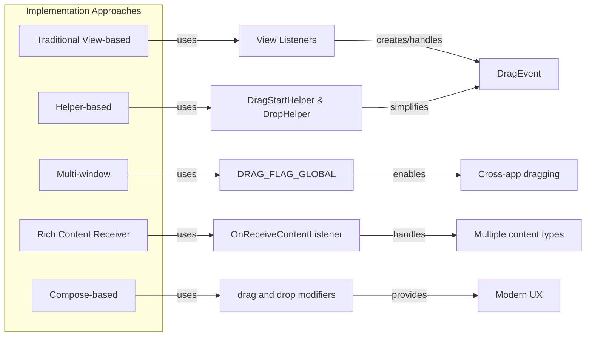

Sources: [samples/user-interface/draganddrop/README.md:1-22]()

## Core Components

The drag and drop system consists of several key components that work together to enable a smooth user experience.

### Drag and Drop Operation Flow

```mermaid
sequenceDiagram
    User->>Source: "Long press on source view"
    Source->>System: "1. Create ClipData"
    Source->>System: "2. startDragAndDrop()"
    System->>Target: "3. ACTION_DRAG_STARTED event"
    Target->>System: "4. Accept/reject drag"
    User->>Target: "Move to target"
    System->>Target: "5. ACTION_DRAG_ENTERED event"
    Target->>Target: "Visual feedback (highlight)"
    User->>Target: "Release over target"
    System->>Target: "6. ACTION_DROP event"
    Target->>Target: "7. Process dropped data"
    System->>Source: "8. ACTION_DRAG_ENDED event"
```

Sources: [samples/user-interface/draganddrop/src/main/java/com/example/platform/ui/draganddrop/DragAndDropWithViews.kt:61-136]()

### Key Components and Their Relationships

```mermaid
classDiagram
    class "DragSource" {
        +setOnLongClickListener()
        +startDragAndDrop()
        +ClipData content
    }
    
    class "DropTarget" {
        +setOnDragListener()
        +handleDragEvent()
        +processDroppedData()
    }
    
    class "DragStartHelper" {
        +attach()
        +startDrag()
    }
    
    class "DropHelper" {
        +configureView()
        +Options class
    }
    
    class "ClipData" {
        +newPlainText()
        +newUri()
        +getItemAt()
    }
    
    class "DragEvent" {
        +ACTION_DRAG_STARTED
        +ACTION_DRAG_ENTERED
        +ACTION_DRAG_LOCATION
        +ACTION_DRAG_EXITED
        +ACTION_DROP
        +ACTION_DRAG_ENDED
    }
    
    "DragSource" ..> "ClipData": creates
    "DragSource" ..> "DragStartHelper": can use
    "DropTarget" ..> "DragEvent": processes
    "DropTarget" ..> "DropHelper": can use
    "DropHelper" ..> "ClipData": processes
    "DragStartHelper" ..> "ClipData": configures
```

Sources: 
- [samples/user-interface/draganddrop/src/main/java/com/example/platform/ui/draganddrop/DragAndDropWithViews.kt:61-136]()
- [samples/user-interface/draganddrop/src/main/java/com/example/platform/ui/draganddrop/DragAndDropWithHelper.kt:68-104]()

## Implementation Approaches

The platform samples demonstrate five distinct approaches to implementing drag and drop functionality.

### 1. Traditional View-based Implementation

This approach uses the standard Android View system APIs without additional helper libraries. It relies on `setOnLongClickListener` for the drag source and `setOnDragListener` for the drop target.

```kotlin
// Setting up drag source
private fun setupDrag(draggableView: ImageView) {
    draggableView.setOnLongClickListener { v ->
        val clipItem = ClipData.Item(v.tag as? CharSequence)
        val draggedData = ClipData(
            "label", 
            arrayOf(ClipDescription.MIMETYPE_TEXT_PLAIN), 
            clipItem
        )
        v.startDragAndDrop(
            draggedData,
            View.DragShadowBuilder(v),
            null,
            View.DRAG_FLAG_GLOBAL or View.DRAG_FLAG_GLOBAL_URI_READ
        )
    }
}
```

```kotlin
// Setting up drop target
private fun setupDrop(dropTarget: ImageView) {
    dropTarget.setOnDragListener { v, event ->
        when (event.action) {
            DragEvent.ACTION_DRAG_STARTED -> {
                // Check if we can accept the drag
                if (event.clipDescription.hasMimeType(ClipDescription.MIMETYPE_TEXT_PLAIN)) {
                    (v as? ImageView)?.alpha = 0.5F
                    v.invalidate()
                    true
                } else {
                    false
                }
            }
            DragEvent.ACTION_DROP -> {
                // Handle the drop
                val dropPermission = requestDragAndDropPermissions(event)
                val item = event.clipData.getItemAt(0)
                // Process data
                dropPermission.release()
                true
            }
            // Handle other events...
            else -> false
        }
    }
}
```

Sources: [samples/user-interface/draganddrop/src/main/java/com/example/platform/ui/draganddrop/DragAndDropWithViews.kt:61-136]()

### 2. Helper-based Implementation

This approach uses the `DragStartHelper` and `DropHelper` from the AndroidX drag-and-drop library to simplify implementation.

```kotlin
// Setting up drag source with DragStartHelper
private fun setupDrag(draggableView: ImageView) {
    DragStartHelper(draggableView) { view: View, _: DragStartHelper ->
        val item = ClipData.Item(view.tag as? CharSequence)
        val dragData = ClipData(
            view.tag as? CharSequence,
            arrayOf(ClipDescription.MIMETYPE_TEXT_PLAIN),
            item,
        )
        view.startDragAndDrop(
            dragData,
            View.DragShadowBuilder(view),
            null,
            0,
        )
    }.attach()
}
```

```kotlin
// Setting up drop target with DropHelper
private fun setupDrop(targetView: ImageView) {
    DropHelper.configureView(
        requireActivity(),
        targetView,
        arrayOf("text/*"),
    ) { _, payload: ContentInfoCompat ->
        val item = payload.clip.getItemAt(0)
        val dragData = item.text
        Glide.with(this).load(dragData).centerCrop().into(targetView)
        val (_, remaining) = payload.partition { it == item }
        remaining
    }
}
```

Sources: [samples/user-interface/draganddrop/src/main/java/com/example/platform/ui/draganddrop/DragAndDropWithHelper.kt:68-104]()

### 3. Multi-window Implementation

This implementation demonstrates drag and drop between different applications in multi-window mode. It requires the use of global drag flags and appropriate permission handling.

```kotlin
// Setting up drag source for multi-window
private fun setupDrag(draggableView: ImageView) {
    DragStartHelper(draggableView) { view: View, _: DragStartHelper ->
        val item = ClipData.Item(view.tag as? CharSequence)
        val dragData = ClipData(
            view.tag as? CharSequence,
            arrayOf(ClipDescription.MIMETYPE_TEXT_PLAIN),
            item,
        )
        // Flag is required so data from clipdata can be read by drop target
        val flags = View.DRAG_FLAG_GLOBAL or View.DRAG_FLAG_GLOBAL_URI_READ
        view.startDragAndDrop(
            dragData,
            View.DragShadowBuilder(view),
            null,
            flags,
        )
    }.attach()
}
```

Sources: [samples/user-interface/draganddrop/src/main/java/com/example/platform/ui/draganddrop/DragAndDropMultiWindow.kt:56-73]()

### 4. Rich Content Receiver Implementation

This approach demonstrates handling different types of content (text, images, videos) using the unified receiver API, which works for drag and drop, keyboard input, and clipboard operations.

```kotlin
// Setting up a rich content receiver
binding.rvDropTarget.setOnReceiveContentListener(
    arrayOf("image/*", "text/*", "video/*"),
) { _, payload ->
    val (uriContent, remaining) = ContentInfoCompat.partition(
        payload,
    ) { item: ClipData.Item -> item.uri != null }

    if (uriContent != null) {
        // Handle URI content (e.g., images)
        val item = uriContent.clip.getItemAt(0)
        item.uri?.let { uri ->
            // Process image URI
        }
    }
    if (remaining != null) {
        // Handle text content
        val item = remaining.clip.getItemAt(0)
        // Process text
    }
    null
}
```

Sources: [samples/user-interface/draganddrop/src/main/java/com/example/platform/ui/draganddrop/DragAndDropRichContentReceiverFragment.kt:64-99]()

### 5. Compose Implementation

This implementation shows how to implement drag and drop in Jetpack Compose using the drag and drop modifiers.

```kotlin
// Compose drag source
GlideImage(
    model = url,
    contentDescription = "demo",
    modifier = Modifier
        .size(100.dp)
        .dragAndDropSource {
            detectTapGestures(
                onLongPress = {
                    startTransfer(
                        DragAndDropTransferData(
                            ClipData.newPlainText(
                                "image Url", url,
                            ),
                        ),
                    )
                },
            )
        },
)

// Compose drop target
Box(
    modifier = modifier
        .fillMaxWidth()
        .padding(8.dp)
        .background(color = backgroundColor)
        .dragAndDropTarget(
            shouldStartDragAndDrop = { event ->
                event.mimeTypes().contains(ClipDescription.MIMETYPE_TEXT_PLAIN)
            },
            target = dragAndDropTarget,
        ),
) {
    // Content
}
```

Sources: [samples/user-interface/draganddrop/src/main/java/com/example/platform/ui/draganddrop/DragAndDropUsingCompose.kt:151-176](), [samples/user-interface/draganddrop/src/main/java/com/example/platform/ui/draganddrop/DragAndDropUsingCompose.kt:98-123]()

## Data Types and Permissions

### Supported Content Types

The drag and drop system supports various content types:

| Content Type | MIME Type | Creation Method | Example Use |
|--------------|-----------|----------------|-------------|
| Text | text/plain | ClipData.newPlainText() | Dragging text between text fields |
| URI | image/*, video/*, etc. | ClipData.newUri() | Dragging images between views |
| Intent | application/x-intent | ClipData.newIntent() | Dragging app shortcuts |
| Multiple items | Mixed | ClipData constructor | Complex data transfers |

Sources: 
- [samples/user-interface/draganddrop/src/main/java/com/example/platform/ui/draganddrop/DragAndDropWithViews.kt:63-76]()
- [samples/user-interface/draganddrop/src/main/java/com/example/platform/ui/draganddrop/DragAndDropRichContentReceiverFragment.kt:151-180]()

### Cross-application Permissions

When implementing drag and drop between different applications, permissions must be properly managed:

1. **Drag Flags**: The source must set appropriate flags:
   - `DRAG_FLAG_GLOBAL`: Allows cross-app drag operations
   - `DRAG_FLAG_GLOBAL_URI_READ`: Grants permission to read content URIs

2. **Permission Management**: The drop target must request permissions to access the data:
   - Using `requestDragAndDropPermissions(event)` in traditional implementation
   - Using `DropHelper` which handles permissions automatically

3. **FileProvider**: For sharing files, use FileProvider to generate secure content URIs:
   ```xml
   <provider
       android:name="com.example.platform.ui.draganddrop.DragAndDropFileProvider"
       android:authorities="${applicationId}.draganddrop.provider"
       android:exported="false"
       android:grantUriPermissions="true">
       <meta-data
           android:name="android.support.FILE_PROVIDER_PATHS"
           android:resource="@xml/filepaths" />
   </provider>
   ```

Sources: 
- [samples/user-interface/draganddrop/src/main/java/com/example/platform/ui/draganddrop/DragAndDropMultiWindow.kt:64-66]()
- [samples/user-interface/draganddrop/src/main/AndroidManifest.xml:29-37]()

## Implementation Guidelines

### Best Practices

1. **Use AndroidX helpers** for simplified implementation:
   - `DragStartHelper` for initiating drag
   - `DropHelper` for handling drops

2. **Provide visual feedback** during drag operations:
   - Highlight drop targets when a drag enters
   - Show a drag shadow
   - Use alpha or other visual indicators to show drag state

3. **Handle different content types** appropriately:
   - Check MIME types before accepting drops
   - Use `ContentInfoCompat.partition()` to separate different content types

4. **Manage permissions** carefully:
   - Always release drag permissions after use
   - Use `FileProvider` for secure file sharing

5. **Consider platform versions**:
   - Some drag and drop features require specific Android versions
   - Use `@RequiresApi` annotations and version checks when needed

Sources: 
- [samples/user-interface/draganddrop/src/main/java/com/example/platform/ui/draganddrop/DragAndDropWithHelper.kt:36-104]()
- [samples/user-interface/draganddrop/src/main/java/com/example/platform/ui/draganddrop/DragAndDropWithViews.kt:83-116]()

### Debugging and Troubleshooting

Common issues and solutions:

| Issue | Possible Causes | Solution |
|-------|----------------|----------|
| Drag not starting | Long press not detected, ClipData creation error | Verify OnLongClickListener, check ClipData creation |
| Drop not working | Drop target not accepting the content type | Check MIME types, verify OnDragListener implementation |
| Cross-app permissions | Missing flags, permission not requested | Use DRAG_FLAG_GLOBAL, request permissions with requestDragAndDropPermissions() |
| File URI access denied | FileProvider issues | Verify FileProvider setup, use content:// URIs not file:// |
| Performance issues | Complex data in drag operation | Keep drag data small, perform heavy processing after drop |

Sources: [samples/user-interface/draganddrop/src/main/java/com/example/platform/ui/draganddrop/DragAndDropRichContentReceiverFragment.kt:73-98]()

## Conclusion

The Drag and Drop functionality in Android provides a powerful way to enable intuitive data transfer within and between applications. The Platform Samples demonstrate various implementation approaches, from traditional view-based methods to modern Compose-based implementations.

For developers, the recommended approach is to use the AndroidX drag and drop helpers (`DragStartHelper` and `DropHelper`) which provide simplified APIs while handling many of the complexities of the drag and drop system.

For handling rich content, the `OnReceiveContentListener` API provides a unified way to process data from drag and drop, clipboard, and keyboard input sources.

For more information about related UI interactions such as gesture detection and touch handling, see the Window Manager samples at [Window Manager](#3.4).

---

# Page: Predictive Back

# Predictive Back

<details>
<summary>Relevant source files</summary>

The following files were used as context for generating this wiki page:

- [samples/user-interface/predictiveback/README.md](samples/user-interface/predictiveback/README.md)
- [samples/user-interface/predictiveback/build.gradle.kts](samples/user-interface/predictiveback/build.gradle.kts)
- [samples/user-interface/predictiveback/src/main/AndroidManifest.xml](samples/user-interface/predictiveback/src/main/AndroidManifest.xml)
- [samples/user-interface/predictiveback/src/main/java/com/example/platform/ui/predictiveback/PBAnimation.kt](samples/user-interface/predictiveback/src/main/java/com/example/platform/ui/predictiveback/PBAnimation.kt)
- [samples/user-interface/predictiveback/src/main/java/com/example/platform/ui/predictiveback/PBCustomCrossActivityAnimation.kt](samples/user-interface/predictiveback/src/main/java/com/example/platform/ui/predictiveback/PBCustomCrossActivityAnimation.kt)
- [samples/user-interface/predictiveback/src/main/java/com/example/platform/ui/predictiveback/PBHostingActivity.kt](samples/user-interface/predictiveback/src/main/java/com/example/platform/ui/predictiveback/PBHostingActivity.kt)
- [samples/user-interface/predictiveback/src/main/java/com/example/platform/ui/predictiveback/PBListFragment.kt](samples/user-interface/predictiveback/src/main/java/com/example/platform/ui/predictiveback/PBListFragment.kt)
- [samples/user-interface/predictiveback/src/main/java/com/example/platform/ui/predictiveback/PBSetCustomAnimationsActivity.kt](samples/user-interface/predictiveback/src/main/java/com/example/platform/ui/predictiveback/PBSetCustomAnimationsActivity.kt)
- [samples/user-interface/predictiveback/src/main/java/com/example/platform/ui/predictiveback/PBSetCustomAnimationsFirstFragment.kt](samples/user-interface/predictiveback/src/main/java/com/example/platform/ui/predictiveback/PBSetCustomAnimationsFirstFragment.kt)
- [samples/user-interface/predictiveback/src/main/java/com/example/platform/ui/predictiveback/PBSetCustomAnimationsSecondFragment.kt](samples/user-interface/predictiveback/src/main/java/com/example/platform/ui/predictiveback/PBSetCustomAnimationsSecondFragment.kt)
- [samples/user-interface/predictiveback/src/main/res/drawable/button.xml](samples/user-interface/predictiveback/src/main/res/drawable/button.xml)
- [samples/user-interface/predictiveback/src/main/res/layout/activity_custom_cross_animation.xml](samples/user-interface/predictiveback/src/main/res/layout/activity_custom_cross_animation.xml)
- [samples/user-interface/predictiveback/src/main/res/layout/activity_set_custom_animations.xml](samples/user-interface/predictiveback/src/main/res/layout/activity_set_custom_animations.xml)
- [samples/user-interface/predictiveback/src/main/res/layout/fragment_animation_list.xml](samples/user-interface/predictiveback/src/main/res/layout/fragment_animation_list.xml)
- [samples/user-interface/predictiveback/src/main/res/layout/fragment_material_shared_axis.xml](samples/user-interface/predictiveback/src/main/res/layout/fragment_material_shared_axis.xml)
- [samples/user-interface/predictiveback/src/main/res/layout/fragment_navigation_component_default_animations.xml](samples/user-interface/predictiveback/src/main/res/layout/fragment_navigation_component_default_animations.xml)
- [samples/user-interface/predictiveback/src/main/res/layout/fragment_progress_api.xml](samples/user-interface/predictiveback/src/main/res/layout/fragment_progress_api.xml)
- [samples/user-interface/predictiveback/src/main/res/layout/fragment_set_custom_animations.xml](samples/user-interface/predictiveback/src/main/res/layout/fragment_set_custom_animations.xml)
- [samples/user-interface/predictiveback/src/main/res/layout/fragment_set_custom_animations_second.xml](samples/user-interface/predictiveback/src/main/res/layout/fragment_set_custom_animations_second.xml)
- [samples/user-interface/predictiveback/src/main/res/layout/fragment_shared_element_transition.xml](samples/user-interface/predictiveback/src/main/res/layout/fragment_shared_element_transition.xml)
- [samples/user-interface/predictiveback/src/main/res/layout/fragment_transition.xml](samples/user-interface/predictiveback/src/main/res/layout/fragment_transition.xml)
- [samples/user-interface/predictiveback/src/main/res/navigation/nav_graph.xml](samples/user-interface/predictiveback/src/main/res/navigation/nav_graph.xml)
- [samples/user-interface/predictiveback/src/main/res/values/strings.xml](samples/user-interface/predictiveback/src/main/res/values/strings.xml)

</details>


## Purpose and Scope

This document provides a comprehensive guide to implementing Predictive Back gesture animations in Android Views-based applications. Predictive Back is a gesture-based navigation system introduced in Android 14 that provides visual confirmation of back navigation destinations through animated previews. This page focuses on various animation techniques for implementing Predictive Back in traditional View-based UIs.

For information about implementing Predictive Back in Jetpack Compose, see the external documentation referenced in the samples README.

Sources: [samples/user-interface/predictiveback/README.md:15-16]()

## Overview of Predictive Back

The Predictive Back gesture enhances user experience by showing where a back action will take the user before they commit to it. When a user initiates a back gesture (by swiping from either edge of the screen), the system previews the destination through animation, allowing users to either complete or cancel the navigation.

The Android Platform Samples repository demonstrates several implementation approaches for Predictive Back animations:

```mermaid
flowchart TD
    subgraph "PredictiveBackSamples"
        A["PBListFragment"]
        B["Back-to-Home"]
        C["Cross-Activity"]
        D["Custom Cross-Activity"]
        E["Cross-Fragment"]
        F["Shared Element"]
        G["Progress API"]
        H["AndroidX Transition"]
        I["MaterialSharedAxis"]
        J["setCustomAnimations"]
        
        A --> B
        A --> C
        A --> D
        A --> E
        A --> F
        A --> G
        A --> H
        A --> I
        A --> J
    end
```

Sources: [samples/user-interface/predictiveback/src/main/java/com/example/platform/ui/predictiveback/PBAnimation.kt:19-30](), [samples/user-interface/predictiveback/src/main/java/com/example/platform/ui/predictiveback/PBListFragment.kt:29-76]()

## Prerequisites for Using Predictive Back

To enable and test Predictive Back in your application, the following are required:

1. An Android device or emulator running Android 14 (API level 34) or higher
2. Gesture navigation enabled on the device
3. Predictive Back enabled in Developer Options (for Android 14)

Sources: [samples/user-interface/predictiveback/src/main/java/com/example/platform/ui/predictiveback/PBAnimation.kt:33-37]()

## Animation Types

### 1. System Default Animations

#### Back-to-Home Animation

The back-to-home animation occurs when a user attempts to navigate back from the root activity of an application. The system automatically provides an animation showing the home screen as the destination.

#### Default Cross-Activity Animation

The default cross-activity animation is automatically provided by the system when navigating between activities. This animation works without additional configuration.

Sources: [samples/user-interface/predictiveback/src/main/java/com/example/platform/ui/predictiveback/PBAnimation.kt:38-45]()

### 2. Custom Animation Implementations

The following diagram shows the relationships between the various custom Predictive Back animation implementations in the samples:

```mermaid
graph TD
    subgraph "PBHostingActivity"
        NavHost["Navigation Host"]
    end
    
    subgraph "AnimationTypes"
        CustomActivity["PBCustomCrossActivityAnimation<br/>(Custom Activity Transition)"]
        CrossFragment["PBNavigationComponentDefaultAnimations<br/>(Navigation Component Animations)"]
        SharedElement["PBSharedElementTransitionFragment<br/>(Shared Element Transition)"]
        ProgressAPI["PBProgressAPI<br/>(Manual Animation Control)"]
        Transition["PBTransition<br/>(AndroidX Transition)"]
        MaterialShared["PBMaterialSharedAxisAnimations<br/>(Material Shared Axis)"]
        CustomAnimations["PBSetCustomAnimationsActivity<br/>(FragmentTransaction.setCustomAnimations)"]
    end
    
    NavHost --> CustomActivity
    NavHost --> CrossFragment
    NavHost --> SharedElement
    NavHost --> ProgressAPI
    NavHost --> Transition
    NavHost --> MaterialShared
    NavHost --> CustomAnimations
    
    CustomAnimations --> FirstFrag["PBSetCustomAnimationsFirstFragment"]
    FirstFrag --> SecondFrag["PBSetCustomAnimationsSecondFragment"]
```

Sources: [samples/user-interface/predictiveback/src/main/res/navigation/nav_graph.xml:17-88](), [samples/user-interface/predictiveback/src/main/java/com/example/platform/ui/predictiveback/PBHostingActivity.kt:25-37]()

## Implementation Techniques

### 1. Custom Cross-Activity Animation

To create custom animations when navigating between activities, use `overrideActivityTransition` instead of the deprecated `overridePendingTransition`. This approach ensures compatibility with the Predictive Back gesture.

```kotlin
override fun onCreate(savedInstanceState: Bundle?) {
    // ...
    overrideActivityTransition(
        OVERRIDE_TRANSITION_OPEN,
        android.R.anim.fade_in,
        0
    )
    
    overrideActivityTransition(
        OVERRIDE_TRANSITION_CLOSE,
        0,
        android.R.anim.fade_out
    )
}
```

Sources: [samples/user-interface/predictiveback/README.md:18-42](), [samples/user-interface/predictiveback/src/main/java/com/example/platform/ui/predictiveback/PBCustomCrossActivityAnimation.kt:29-50]()

### 2. Cross-Fragment Animation

The Navigation Component's default animations work with Predictive Back. These animations can be specified in navigation XML files:

```xml
<action
    android:id="@+id/show_PBNavigationComponentDefaultAnimations"
    app:destination="@id/PBNavigationComponentDefaultAnimations"
    app:enterAnim="@animator/nav_default_enter_anim"
    app:exitAnim="@animator/nav_default_exit_anim"
    app:popEnterAnim="@animator/nav_default_pop_enter_anim"
    app:popExitAnim="@animator/nav_default_pop_exit_anim" />
```

Sources: [samples/user-interface/predictiveback/README.md:44-56](), [samples/user-interface/predictiveback/src/main/res/navigation/nav_graph.xml:27-33]()

### 3. Shared Element Cross-Fragment Animation

Shared element transitions between fragments are supported with Predictive Back, provided you're using fragment library version 1.7.0+ and transition library version 1.5.0+.

Implementation requires:
1. Setting the `transitionName` attribute on views to be animated
2. Using `FragmentNavigatorExtras` to specify the shared elements
3. Defining the transition types in the receiving fragment

```kotlin
// In sending fragment
binding.sharedElementCrossFragment.setOnClickListener {
   findNavController().navigate(
       R.id.show_PBSharedElementTransitionFragment,
       null,
       null,
       FragmentNavigatorExtras(it to "second_card")
   )
}

// In receiving fragment
override fun onCreate(savedInstanceState: Bundle?) {
    super.onCreate(savedInstanceState)
    enterTransition = AutoTransition()
    sharedElementEnterTransition = AutoTransition()
}
```

Note that both `enterTransition` and `sharedElementEnterTransition` must be specified to enable Predictive Back animations.

Sources: [samples/user-interface/predictiveback/README.md:58-90](), [samples/user-interface/predictiveback/src/main/java/com/example/platform/ui/predictiveback/PBListFragment.kt:56-63]()

### 4. Custom Progress API Animation

The Progress API provides precise control over animations during the back gesture. This approach allows you to animate views based on the gesture's progress.

```kotlin
val predictiveBackCallback = object: OnBackPressedCallback(enabled=false) {

    override fun handleOnBackProgressed(backEvent: BackEventCompat) {
        when (backEvent.swipeEdge) {
            BackEventCompat.EDGE_LEFT ->
                binding.box.translationX = backEvent.progress * maxXShift
            BackEventCompat.EDGE_RIGHT ->
                binding.box.translationX = -(backEvent.progress * maxXShift)
        }
        binding.box.scaleX = 1F - (0.1F * backEvent.progress)
        binding.box.scaleY = 1F - (0.1F * backEvent.progress)
    }

    override fun handleOnBackPressed() {
        // your back handling logic
    }

    override fun handleOnBackCancelled() {
        binding.box.scaleX = 1F
        binding.box.scaleY = 1F
        binding.box.translationX = 0F
    }
}
```

Sources: [samples/user-interface/predictiveback/README.md:92-132]()

### 5. Custom AndroidX Transition

AndroidX Transitions provide a more declarative way to define animations and can be controlled through the back gesture progress.

```kotlin
val transitionSet = TransitionSet().apply {
    addTransition(Fade(Fade.MODE_OUT))
    addTransition(ChangeBounds())
    addTransition(Fade(Fade.MODE_IN))
}

val callback = object : OnBackPressedCallback(enabled = false) {
    var controller: TransitionSeekController? = null

    override fun handleOnBackStarted(backEvent: BackEvent) {
        // Create the transition
        controller = TransitionManager.controlDelayedTransition(
            binding.textContainer,
            transitionSet
        )
        changeTextVisibility(ShowText.SHORT)
    }

    override fun handleOnBackProgressed(backEvent: BackEvent) {
        // Play the transition as the user swipes back
        if (controller?.isReady == true) {
            controller?.currentFraction = backEvent.progress
        }
    }

    override fun handleOnBackPressed() {
        // Finish playing the transition when the user commits back
        controller?.animateToEnd()
        this.isEnabled = false
    }

    override fun handleOnBackCancelled() {
        // If the user cancels the back gesture, reset the state
        transition(ShowText.LONG)
    }
}
```

Sources: [samples/user-interface/predictiveback/README.md:134-213]()

### 6. MaterialSharedAxis Animation

Material Design's SharedAxis transitions can be used with Predictive Back to create sophisticated motion patterns:

```kotlin
// Fragment A
override fun onCreateView(savedInstanceState: Bundle?) {
    super.onCreate(savedInstanceState)

    exitTransition = MaterialSharedAxis(MaterialSharedAxis.Z, /* forward= */ true)
    reenterTransition = MaterialSharedAxis(MaterialSharedAxis.Z, /* forward= */ false)
}

// Fragment B
override fun onCreateView(savedInstanceState: Bundle?) {
    super.onCreate(savedInstanceState)

    enterTransition = MaterialSharedAxis(MaterialSharedAxis.Z, /* forward= */ true)
    returnTransition = MaterialSharedAxis(MaterialSharedAxis.Z, /* forward= */ false)
}
```

Sources: [samples/user-interface/predictiveback/README.md:215-242](), [samples/user-interface/predictiveback/src/main/java/com/example/platform/ui/predictiveback/PBListFragment.kt:41-42]()

### 7. Using setCustomAnimations

While it's recommended to use fragment transitions, `setCustomAnimations` can also work with Predictive Back:

```kotlin
parentFragmentManager.commit {
    setCustomAnimations(
        android.R.animator.fade_in, // enter
        android.R.animator.fade_out, // exit
        android.R.animator.fade_in, // popEnter
        android.R.animator.fade_out) // popExit
    replace(R.id.fragment_container, PBSetCustomAnimationsSecondFragment())
    setReorderingAllowed(true)
    addToBackStack(null)
}
```

Sources: [samples/user-interface/predictiveback/README.md:243-288](), [samples/user-interface/predictiveback/src/main/java/com/example/platform/ui/predictiveback/PBSetCustomAnimationsFirstFragment.kt:39-50]()

## Navigation and Fragment Management

The following diagram illustrates how the sample code manages navigation between different fragments and activities with Predictive Back support:

```mermaid
sequenceDiagram
    participant User as "User"
    participant PBList as "PBListFragment"
    participant NavController as "NavController"
    participant Fragment as "Destination Fragment"
    participant Callback as "OnBackPressedCallback"
    
    User->>PBList: Taps animation option
    PBList->>NavController: navigate(destinationId)
    NavController->>Fragment: Create and display
    
    User->>Fragment: Initiates back gesture
    Fragment->>Callback: handleOnBackStarted(event)
    Callback->>Fragment: Prepare animation
    
    loop During gesture
        User->>Fragment: Continues gesture
        Fragment->>Callback: handleOnBackProgressed(event)
        Callback->>Fragment: Update animation (progress)
    end
    
    alt User commits gesture
        User->>Fragment: Completes gesture
        Fragment->>Callback: handleOnBackPressed()
        Callback->>Fragment: Complete animation
        Fragment->>NavController: popBackStack()
    else User cancels gesture
        User->>Fragment: Cancels gesture
        Fragment->>Callback: handleOnBackCancelled()
        Callback->>Fragment: Reset animation
    end
```

Sources: [samples/user-interface/predictiveback/src/main/java/com/example/platform/ui/predictiveback/PBListFragment.kt:47-75](), [samples/user-interface/predictiveback/README.md:95-125]()

## Component Architecture

The following table outlines the key components in the Predictive Back implementation:

| Component | Description | Purpose |
|-----------|-------------|---------|
| `PBListFragment` | Main list fragment displaying animation options | Entry point to different animation demos |
| `PBAnimation` enum | Defines the types of animations available | Used to categorize different animation types |
| `OnBackPressedCallback` | Extended callback for back events | Handles back gesture lifecycle events |
| `BackEventCompat` | Event data for back gestures | Provides gesture information like progress and edge |
| `TransitionSeekController` | Controller for AndroidX transitions | Enables programmatic control of transitions |
| `MaterialSharedAxis` | Material Design transition | Creates directional transitions between UI states |

Sources: [samples/user-interface/predictiveback/src/main/java/com/example/platform/ui/predictiveback/PBAnimation.kt:19-30](), [samples/user-interface/predictiveback/README.md:95-125](), [samples/user-interface/predictiveback/README.md:150-180]()

## Dependencies and Requirements

The Predictive Back implementation requires several key libraries:

```kotlin
dependencies {
    implementation(libs.androidx.appcompat)
    implementation(libs.androidx.constraintlayout)
    implementation(libs.material)
    implementation(libs.androidx.navigation.fragment)
    implementation(libs.androidx.navigation.ui)
    implementation(libs.androidx.fragment)  // Version 1.7.0+ required for shared element transitions
    implementation(libs.androidx.transition)  // Version 1.5.0+ required for shared element transitions
}
```

Sources: [samples/user-interface/predictiveback/build.gradle.kts:41-49](), [samples/user-interface/predictiveback/README.md:58-64]()

## Best Practices

1. **Use Modern APIs**: Prefer `overrideActivityTransition` over `overridePendingTransition` for activity transitions.
2. **Animation Resources**: Use animator resources instead of animation resources for better compatibility.
3. **Fragment Transitions**: When possible, use fragment transitions (`setEnterTransition`, etc.) instead of `setCustomAnimations`.
4. **Shared Elements**: When using shared element transitions, remember to set both `enterTransition` and `sharedElementEnterTransition`.
5. **Subtle Animations**: Follow Material Design guidelines by keeping animations subtle and meaningful, enhancing rather than distracting from the user experience.
6. **Testing**: Test your animations on devices with gesture navigation enabled to verify they work correctly with the Predictive Back gesture.

Sources: [samples/user-interface/predictiveback/README.md:18-23](), [samples/user-interface/predictiveback/README.md:87-90](), [samples/user-interface/predictiveback/README.md:243-247]()

## Conclusion

Predictive Back is a significant enhancement to Android's navigation system, providing users with visual cues about navigation destinations. The implementation techniques demonstrated in this document enable developers to create custom, visually pleasing transitions that work seamlessly with this system.

Whether using simple cross-fragment animations, sophisticated shared element transitions, or completely custom animations with the Progress API, developers have multiple options for creating intuitive and engaging Predictive Back experiences.

---

# Page: App Widgets

# App Widgets

<details>
<summary>Relevant source files</summary>

The following files were used as context for generating this wiki page:

- [samples/user-interface/appwidgets/README.md](samples/user-interface/appwidgets/README.md)
- [samples/user-interface/appwidgets/src/main/AndroidManifest.xml](samples/user-interface/appwidgets/src/main/AndroidManifest.xml)
- [samples/user-interface/appwidgets/src/main/java/com/example/platform/ui/appwidgets/AppWidgets.kt](samples/user-interface/appwidgets/src/main/java/com/example/platform/ui/appwidgets/AppWidgets.kt)
- [samples/user-interface/appwidgets/src/main/java/com/example/platform/ui/appwidgets/glance/layout/ActionDemonstrationActivity.kt](samples/user-interface/appwidgets/src/main/java/com/example/platform/ui/appwidgets/glance/layout/ActionDemonstrationActivity.kt)
- [samples/user-interface/appwidgets/src/main/java/com/example/platform/ui/appwidgets/glance/layout/CanonicalLayoutActivity.kt](samples/user-interface/appwidgets/src/main/java/com/example/platform/ui/appwidgets/glance/layout/CanonicalLayoutActivity.kt)
- [samples/user-interface/appwidgets/src/main/java/com/example/platform/ui/appwidgets/glance/layout/CollectionsKtx.kt](samples/user-interface/appwidgets/src/main/java/com/example/platform/ui/appwidgets/glance/layout/CollectionsKtx.kt)
- [samples/user-interface/appwidgets/src/main/java/com/example/platform/ui/appwidgets/glance/layout/collections/layout/CheckListLayout.kt](samples/user-interface/appwidgets/src/main/java/com/example/platform/ui/appwidgets/glance/layout/collections/layout/CheckListLayout.kt)
- [samples/user-interface/appwidgets/src/main/java/com/example/platform/ui/appwidgets/glance/layout/collections/layout/ImageGridLayout.kt](samples/user-interface/appwidgets/src/main/java/com/example/platform/ui/appwidgets/glance/layout/collections/layout/ImageGridLayout.kt)
- [samples/user-interface/appwidgets/src/main/java/com/example/platform/ui/appwidgets/glance/layout/collections/layout/ImageTextListLayout.kt](samples/user-interface/appwidgets/src/main/java/com/example/platform/ui/appwidgets/glance/layout/collections/layout/ImageTextListLayout.kt)
- [samples/user-interface/appwidgets/src/main/java/com/example/platform/ui/appwidgets/glance/layout/text/data/FakeLongTextRespository.kt](samples/user-interface/appwidgets/src/main/java/com/example/platform/ui/appwidgets/glance/layout/text/data/FakeLongTextRespository.kt)
- [samples/user-interface/appwidgets/src/main/java/com/example/platform/ui/appwidgets/glance/layout/text/layout/LongTextLayout.kt](samples/user-interface/appwidgets/src/main/java/com/example/platform/ui/appwidgets/glance/layout/text/layout/LongTextLayout.kt)
- [samples/user-interface/appwidgets/src/main/java/com/example/platform/ui/appwidgets/glance/layout/text/layout/TextWithImageLayout.kt](samples/user-interface/appwidgets/src/main/java/com/example/platform/ui/appwidgets/glance/layout/text/layout/TextWithImageLayout.kt)
- [samples/user-interface/appwidgets/src/main/java/com/example/platform/ui/appwidgets/glance/layout/toolbars/ExpressiveToolbarAppWidget.kt](samples/user-interface/appwidgets/src/main/java/com/example/platform/ui/appwidgets/glance/layout/toolbars/ExpressiveToolbarAppWidget.kt)
- [samples/user-interface/appwidgets/src/main/res/drawable-night-nodpi/sample_expressive_toolbar_preview.png](samples/user-interface/appwidgets/src/main/res/drawable-night-nodpi/sample_expressive_toolbar_preview.png)
- [samples/user-interface/appwidgets/src/main/res/drawable-nodpi/cl_activity_row_action_list.png](samples/user-interface/appwidgets/src/main/res/drawable-nodpi/cl_activity_row_action_list.png)
- [samples/user-interface/appwidgets/src/main/res/drawable-nodpi/cl_activity_row_checklist.png](samples/user-interface/appwidgets/src/main/res/drawable-nodpi/cl_activity_row_checklist.png)
- [samples/user-interface/appwidgets/src/main/res/drawable-nodpi/cl_activity_row_expressive_toolbar.png](samples/user-interface/appwidgets/src/main/res/drawable-nodpi/cl_activity_row_expressive_toolbar.png)
- [samples/user-interface/appwidgets/src/main/res/drawable-nodpi/cl_activity_row_hero_image.png](samples/user-interface/appwidgets/src/main/res/drawable-nodpi/cl_activity_row_hero_image.png)
- [samples/user-interface/appwidgets/src/main/res/drawable-nodpi/cl_activity_row_image_grid.png](samples/user-interface/appwidgets/src/main/res/drawable-nodpi/cl_activity_row_image_grid.png)
- [samples/user-interface/appwidgets/src/main/res/drawable-nodpi/cl_activity_row_image_text_list.png](samples/user-interface/appwidgets/src/main/res/drawable-nodpi/cl_activity_row_image_text_list.png)
- [samples/user-interface/appwidgets/src/main/res/drawable-nodpi/cl_activity_row_long_text.png](samples/user-interface/appwidgets/src/main/res/drawable-nodpi/cl_activity_row_long_text.png)
- [samples/user-interface/appwidgets/src/main/res/drawable-nodpi/cl_activity_row_text_image.png](samples/user-interface/appwidgets/src/main/res/drawable-nodpi/cl_activity_row_text_image.png)
- [samples/user-interface/appwidgets/src/main/res/drawable-nodpi/sample_expressive_toolbar_preview.png](samples/user-interface/appwidgets/src/main/res/drawable-nodpi/sample_expressive_toolbar_preview.png)
- [samples/user-interface/appwidgets/src/main/res/values-xlarge/dimens.xml](samples/user-interface/appwidgets/src/main/res/values-xlarge/dimens.xml)
- [samples/user-interface/appwidgets/src/main/res/values/dimens.xml](samples/user-interface/appwidgets/src/main/res/values/dimens.xml)
- [samples/user-interface/appwidgets/src/main/res/values/strings.xml](samples/user-interface/appwidgets/src/main/res/values/strings.xml)
- [samples/user-interface/appwidgets/src/main/res/values/themes.xml](samples/user-interface/appwidgets/src/main/res/values/themes.xml)
- [samples/user-interface/appwidgets/src/main/res/xml/sample_expressive_toolbar_widget_info.xml](samples/user-interface/appwidgets/src/main/res/xml/sample_expressive_toolbar_widget_info.xml)

</details>


App Widgets are miniature application views that can be embedded in other applications (such as the Home screen) and receive periodic updates. This page documents how to implement App Widgets in Android, covering both traditional RemoteViews and modern Jetpack Glance approaches, along with canonical layout patterns and best practices.

## Overview

The Android platform provides a flexible App Widget framework that allows developers to create engaging, glanceable experiences that users can add to their home screens. The platform samples demonstrate two distinct approaches to implementing App Widgets:

1. Traditional **RemoteViews-based** widgets
2. Modern **Jetpack Glance** widgets (using a Compose-like API)

```mermaid
graph TD
    subgraph "App Widget Implementation Approaches"
        A["App Widgets"] --> B["RemoteViews"]
        A --> C["Jetpack Glance"]
        
        B --> D["XML-based layouts"]
        B --> E["Traditional widget API"]
        
        C --> F["Compose-like API"]
        C --> G["Modern declarative UI"]
        C --> H["Responsive layouts"]
    end
```

Sources: 
- [samples/user-interface/appwidgets/README.md:1-15]()
- [samples/user-interface/appwidgets/src/main/AndroidManifest.xml:172-198]()

## Widget Components

An App Widget implementation consists of several key components:

```mermaid
flowchart TD
    subgraph "App Widget Architecture"
        A["AppWidgetProvider/GlanceAppWidgetReceiver"] --> B["Widget Layout"]
        A --> C["Widget Configuration"]
        
        B --> D["UI Components"]
        B --> E["Responsive Design"]
        
        C --> F["Widget Info XML"]
        C --> G["Size Configuration"]
        C --> H["Update Frequency"]
        
        A --> I["Widget Data Source"]
        I --> J["Updates"]
    end
```

### 1. Widget Provider/Receiver

The entry point for an App Widget is either:
- `AppWidgetProvider` (RemoteViews approach)
- `GlanceAppWidgetReceiver` (Glance approach)

These classes handle widget instantiation, updates, and user interactions.

### 2. Widget Configuration

The `appwidget-provider` XML defines characteristics like:
- Minimum and maximum dimensions
- Update frequency
- Preview image
- Initial layout

### 3. Widget Layout

The visual representation of the widget, built using either:
- XML layouts with RemoteViews
- Composable functions with Glance

Sources:
- [samples/user-interface/appwidgets/src/main/AndroidManifest.xml:30-48]()
- [samples/user-interface/appwidgets/src/main/res/xml/sample_expressive_toolbar_widget_info.xml:16-28]()

## Canonical Layout Patterns

The platform samples showcase several intentionally designed widget layouts that follow Android design guidelines. These layouts adapt to different widget sizes and maintain both visual appeal and usability.

```mermaid
flowchart TD
    subgraph "Canonical Widget Layout Types"
        A["Canonical Layouts"] --> B["Text-based Layouts"]
        A --> C["Collection Layouts"]
        A --> D["Toolbar Layouts"]
        
        B --> E["Long Text Layout"]
        B --> F["Text with Image Layout"]
        
        C --> G["Image Text List Layout"]
        C --> H["Check List Layout"]
        C --> I["Action List Layout"]
        C --> J["Image Grid Layout"]
        
        D --> K["Standard Toolbar Layout"]
        D --> L["Expressive Toolbar Layout"]
        D --> M["Search Toolbar Layout"]
    end
```

### Text-based Layouts

These layouts focus on presenting text content in a clean, readable format:

1. **Long Text Layout**: Displays a primary text with a caption, optimized for readable longer text content.
2. **Text with Image Layout**: Combines text and supporting imagery, adapting layout based on available space.

### Collection Layouts

Designed for presenting lists or grids of items:

1. **Image Text List**: Shows a scrollable list of items with images and text.
2. **Check List**: Interactive list with checkable items, useful for task lists.
3. **Action List**: List with toggleable action items.
4. **Image Grid**: Displays a grid of images with optional captions.

### Toolbar Layouts

Provide quick access to app actions:

1. **Standard Toolbar**: Row of action buttons with a header.
2. **Expressive Toolbar**: Distinctively shaped toolbar (e.g., cookie-cut shape) with central and corner buttons.
3. **Search Toolbar**: Toolbar with prominent search action.

Sources:
- [samples/user-interface/appwidgets/README.md:17-56]()
- [samples/user-interface/appwidgets/src/main/java/com/example/platform/ui/appwidgets/glance/layout/CanonicalLayoutActivity.kt:258-313]()
- [samples/user-interface/appwidgets/src/main/res/values/strings.xml:72-90]()

## Implementing with Jetpack Glance

Jetpack Glance provides a Compose-like declarative API for building App Widgets. Let's examine how to implement a widget with Glance:

### Basic Structure

```mermaid
flowchart TD
    subgraph "Glance App Widget Implementation"
        A["GlanceAppWidgetReceiver"] --> B["GlanceAppWidget"]
        B --> C["provideGlance()"]
        C --> D["provideContent()"]
        D --> E["GlanceTheme"]
        E --> F["Widget Content"]
        F --> G["Layout Components"]
        G --> H["Interactive Elements"]
    end
```

The implementation typically consists of:

1. A class extending `GlanceAppWidgetReceiver`
2. A class extending `GlanceAppWidget` with:
   - `sizeMode` configuration
   - `provideGlance()` implementation
   - Composable functions defining the widget UI

For example, the `ExpressiveToolbarAppWidget` implementation:

```
class ExpressiveToolbarAppWidget : GlanceAppWidget() {
    override val sizeMode: SizeMode = SizeMode.Exact
    
    override suspend fun provideGlance(context: Context, id: GlanceId) {
        provideContent {
            GlanceTheme {
                WidgetContent()
            }
        }
    }
    
    @Composable
    fun WidgetContent() {
        ExpressiveToolbarLayout(
            centerButton = ExpressiveToolBarButton(...),
            cornerButtons = listOf(...)
        )
    }
}

class ExpressiveToolbarAppWidgetReceiver : GlanceAppWidgetReceiver() {
    override val glanceAppWidget: GlanceAppWidget = ExpressiveToolbarAppWidget()
}
```

### Responsive Layouts

Glance widgets can adapt to different sizes using size-aware composables. This is demonstrated in the `CheckListLayout`:

```
private enum class CheckListLayoutSize(val maxWidth: Dp) {
    Small(maxWidth = 260.dp),
    Medium(maxWidth = 304.dp),
    Large(maxWidth = 348.dp),
    XLarge(maxWidth = 396.dp),
    XXLarge(maxWidth = Dp.Infinity);
    
    companion object {
        @Composable
        fun fromLocalSize(): CheckListLayoutSize {
            val size = LocalSize.current
            
            CheckListLayoutSize.values().forEach {
                if (size.width < it.maxWidth) {
                    return it
                }
            }
            throw IllegalStateException("No mapped size ")
        }
        
        fun CheckListLayoutSize.isWiderThan(checkListLayoutSize: CheckListLayoutSize): Boolean {
            return this.maxWidth > checkListLayoutSize.maxWidth
        }
        
        @Composable
        fun showTitleBar(): Boolean {
            return LocalSize.current.height >= 180.dp
        }
    }
}
```

This allows layout components to make intelligent decisions based on the available space:

```
@Composable
private fun TrailingIconButtonSet(...) {
    val checkListLayoutSize = CheckListLayoutSize.fromLocalSize()
    
    if (checkListLayoutSize.isWiderThan(CheckListLayoutSize.Medium)) {
        CircleIconButton(...)
        
        if (checkListLayoutSize.isWiderThan(CheckListLayoutSize.Large)) {
            CircleIconButton(...)
        }
        
        if (checkListLayoutSize.isWiderThan(CheckListLayoutSize.XLarge)) {
            CircleIconButton(...)
        }
    }
}
```

Sources:
- [samples/user-interface/appwidgets/src/main/java/com/example/platform/ui/appwidgets/glance/layout/toolbars/ExpressiveToolbarAppWidget.kt:43-93]()
- [samples/user-interface/appwidgets/src/main/java/com/example/platform/ui/appwidgets/glance/layout/collections/layout/CheckListLayout.kt:338-379]()
- [samples/user-interface/appwidgets/src/main/java/com/example/platform/ui/appwidgets/glance/layout/collections/layout/CheckListLayout.kt:262-302]()

## Widget Sizing and Dimensions

App Widgets must specify their dimensions for proper display on home screens. This is handled in two places:

1. **XML Configuration**: Each widget's info XML file specifies minimum, maximum, and target sizes.

```xml
<appwidget-provider
    android:minWidth="@dimen/sample_expressive_toolbar_widget_min_width"
    android:minHeight="@dimen/sample_expressive_toolbar_widget_min_height"
    android:minResizeWidth="@dimen/sample_expressive_toolbar_widget_min_resize_width"
    android:minResizeHeight="@dimen/sample_expressive_toolbar_widget_min_resize_height"
    android:maxResizeWidth="@dimen/sample_expressive_toolbar_widget_max_resize_width"
    android:maxResizeHeight="@dimen/sample_expressive_toolbar_widget_max_resize_height"
    android:targetCellWidth="@integer/sample_expressive_toolbar_target_cell_width"
    android:targetCellHeight="@integer/sample_expressive_toolbar_target_cell_height"
    android:resizeMode="horizontal|vertical" />
```

2. **Resources**: Dimension values are defined in `dimens.xml` files, with special consideration for different device types:

```xml
<!-- For handheld devices -->
<dimen name="sample_expressive_toolbar_widget_min_width">120dp</dimen>
<dimen name="sample_expressive_toolbar_widget_min_height">115dp</dimen>

<!-- For tablets (in values-xlarge) -->
<dimen name="sample_expressive_toolbar_widget_min_width">180dp</dimen>
<dimen name="sample_expressive_toolbar_widget_min_height">184dp</dimen>
```

The codebase provides appropriate dimensions for different widget types based on their purpose and content density:

| Widget Type | Default Cell Size | Min Size | Max Size |
|-------------|------------------|----------|----------|
| Long Text | 2×2 | 120dp × 115dp | 624dp × 276dp |
| Text with Image | 4×2 | 256dp × 115dp | 624dp × 422dp |
| Check List | 2×2 | 120dp × 115dp | 624dp × 422dp |
| Action List | 4×2 | 256dp × 115dp | 624dp × 422dp |
| Image Grid | 4×3 | 256dp × 185dp | 624dp × 422dp |
| Toolbar | 4×1 | 256dp × 48dp | 624dp × 422dp |
| Expressive Toolbar | 2×2 | 120dp × 115dp | 624dp × 200dp |
| Search Toolbar | 2×2 | 120dp × 115dp | 624dp × 422dp |

Sources:
- [samples/user-interface/appwidgets/src/main/res/xml/sample_expressive_toolbar_widget_info.xml:16-28]()
- [samples/user-interface/appwidgets/src/main/res/values/dimens.xml:17-136]()
- [samples/user-interface/appwidgets/src/main/res/values-xlarge/dimens.xml:4-113]()

## Widget Pinning

App Widget pinning allows apps to request the launcher to place their widgets directly on the home screen. The platform samples demonstrate this feature in `AppWidgets.kt`:

```mermaid
sequenceDiagram
    participant App as "App"
    participant Launcher as "Home Screen Launcher"
    participant System as "System"
    
    App->>System: requestPinAppWidget()
    System->>Launcher: Request to pin widget
    Launcher->>System: User confirms placement
    System->>App: Callback via PendingIntent
    App->>App: Widget placed successfully
```

The implementation involves:

1. Checking if the launcher supports pinning:
```kotlin
if (AppWidgetManager.getInstance(context).isRequestPinAppWidgetSupported) {
    // Proceed with pinning
}
```

2. Setting up a success callback:
```kotlin
val successCallback = PendingIntent.getBroadcast(
    context,
    0,
    Intent(context, AppWidgetPinnedReceiver::class.java),
    PendingIntent.FLAG_UPDATE_CURRENT or PendingIntent.FLAG_IMMUTABLE,
)
```

3. Requesting the pin operation:
```kotlin
AppWidgetManager.getInstance(context).requestPinAppWidget(provider, null, successCallback)
```

The sample also includes a more modern approach using `GlanceAppWidgetManager`:

```kotlin
val glanceManager = GlanceAppWidgetManager(context)
coroutineScope.launch {
    glanceManager.requestPinGlanceAppWidget(receiver::class.java)
}
```

Sources:
- [samples/user-interface/appwidgets/src/main/java/com/example/platform/ui/appwidgets/AppWidgets.kt:142-155]()
- [samples/user-interface/appwidgets/src/main/java/com/example/platform/ui/appwidgets/glance/layout/CanonicalLayoutActivity.kt:236-249]()

## Data Management and Updates

App Widgets need to display and refresh data efficiently. The platform samples demonstrate this with repository patterns:

```mermaid
flowchart TD
    subgraph "Widget Data Flow"
        A["GlanceAppWidget"] --> B["Data Repository"]
        B --> C["StateFlow<Data>"]
        C --> D["Widget UI"]
        
        E["Data Update"] --> B
        B --> F["Widget Update"]
        F --> A
    end
```

The `FakeLongTextRepository` demonstrates a simple data management approach:

1. **Data Storage**: Using a StateFlow to maintain and update state
```kotlin
private val data = MutableStateFlow(demoItems[0])
fun data(): Flow<LongTextLayoutData> = data
```

2. **Data Access**: Providing data access via singleton pattern
```kotlin
companion object {
    private val repositories = mutableMapOf<GlanceId, FakeLongTextRepository>()
    
    fun getRepo(glanceId: GlanceId): FakeLongTextRepository {
        return synchronized(repositories) {
            repositories.computeIfAbsentExt(glanceId) {
                FakeLongTextRepository()
            }!!
        }
    }
    
    fun cleanUp(glanceId: GlanceId) {
        synchronized(repositories) {
            repositories.remove(glanceId)
        }
    }
}
```

3. **Data Updates**: Methods to refresh data
```kotlin
fun refresh() {
    itemIndex = (itemIndex + 1) % itemsCount
    this.load()
}

fun load(): LongTextLayoutData {
    itemsCount = demoItems.size
    data.value = demoItems[itemIndex]
    return data.value
}
```

Sources:
- [samples/user-interface/appwidgets/src/main/java/com/example/platform/ui/appwidgets/glance/layout/text/data/FakeLongTextRespository.kt:11-89]()

## Widget Actions and Interactions

App Widgets can respond to user interactions through actions. The platform samples demonstrate two approaches:

1. **RemoteViews Actions**: Using PendingIntents for actions
2. **Glance Actions**: Using the Glance action system

For Glance widgets, actions are typically defined with handlers:

```kotlin
CircleIconButton(
    imageProvider = ImageProvider(leadingButtonRes),
    backgroundColor = null,
    contentColor = GlanceTheme.colors.secondary,
    contentDescription = leadingButtonContentDescription,
    onClick = actionStartDemoActivity("Edit click on item: ${item.key}"),
)
```

Actions can launch activities with additional data:

```kotlin
internal val ActionSourceMessageKey = ActionParameters.Key<String>("actionSourceMessageKey")

fun actionStartDemoActivity(message: String): Action {
    return actionStartActivity<ActionDemonstrationActivity>(
        parameters = actionParametersOf(
            ActionSourceMessageKey to message
        )
    )
}
```

The `ActionDemonstrationActivity` then receives and processes this data:

```kotlin
val source = intent.getStringExtra(ActionSourceMessageKey.name) ?: "Unknown"
Text("Launched from $source")
```

Sources:
- [samples/user-interface/appwidgets/src/main/java/com/example/platform/ui/appwidgets/glance/layout/collections/layout/CheckListLayout.kt:235-246]()
- [samples/user-interface/appwidgets/src/main/java/com/example/platform/ui/appwidgets/glance/layout/ActionDemonstrationActivity.kt:27-46]()

## Best Practices

From the platform samples, we can identify several best practices for App Widget development:

1. **Responsive Design**: Adapt layouts based on available space
   ```kotlin
   @Composable
   fun fromLocalSize(): TextWithImageLayoutSize {
       val size = LocalSize.current
       val isTall = size.height >= size.width
       
       return if (isTall && size.height <= 300.dp) {
           VerticalSmall
       } else if (isTall) {
           VerticalLarge
       } else if (size.width <= 165.dp) {
           HorizontalSmall
       } else {
           HorizontalLarge
       }
   }
   ```

2. **Proper Sizing**: Define appropriate minimum and maximum dimensions
   ```xml
   <dimen name="sample_long_text_widget_min_width">120dp</dimen>
   <dimen name="sample_long_text_widget_min_height">115dp</dimen>
   <dimen name="sample_long_text_min_resize_width">120dp</dimen>
   <dimen name="sample_long_text_min_resize_height">115dp</dimen>
   <dimen name="sample_long_text_max_resize_width">624dp</dimen>
   <dimen name="sample_long_text_max_resize_height">276dp</dimen>
   ```

3. **Adaptive Content**: Show/hide elements based on available space
   ```kotlin
   if (checkListLayoutSize.isWiderThan(CheckListLayoutSize.Large)) {
       CircleIconButton(...)
   }
   ```

4. **Provide Preview Images**: Help users understand what the widget looks like
   ```xml
   android:previewImage="@drawable/sample_expressive_toolbar_preview"
   ```

5. **Support Different Device Types**: Provide size resources for different device categories
   ```xml
   <!-- For tablets (in values-xlarge) -->
   <dimen name="sample_toolbar_widget_min_width">298dp</dimen>
   ```

6. **Use Appropriate Layouts**: Choose canonical layouts that match your content
   - Text-heavy content: Long Text or Text with Image
   - Collections: Image Text List, Check List, or Image Grid
   - Actions: Toolbar variants

Sources:
- [samples/user-interface/appwidgets/src/main/java/com/example/platform/ui/appwidgets/glance/layout/text/layout/TextWithImageLayout.kt:382-396]()
- [samples/user-interface/appwidgets/src/main/res/values/dimens.xml:65-72]()
- [samples/user-interface/appwidgets/src/main/res/values-xlarge/dimens.xml:24-30]()
- [samples/user-interface/appwidgets/src/main/res/xml/sample_expressive_toolbar_widget_info.xml:24]()

## Related Resources

For more information on specific aspects of Android app development:

- For information about User Interface components, see [User Interface Samples](#3)
- For specific details on Drag and Drop functionality, see [Drag and Drop](#3.1)
- For information about Predictive Back behavior, see [Predictive Back](#3.2)
- For details about Window Manager APIs, see [Window Manager](#3.4)

Sources:
- [samples/user-interface/appwidgets/README.md:85-96]()

---

# Page: Window Manager

# Window Manager

<details>
<summary>Relevant source files</summary>

The following files were used as context for generating this wiki page:

- [samples/connectivity/callnotification/README.md](samples/connectivity/callnotification/README.md)
- [samples/connectivity/callnotification/build.gradle.kts](samples/connectivity/callnotification/build.gradle.kts)
- [samples/connectivity/callnotification/src/main/AndroidManifest.xml](samples/connectivity/callnotification/src/main/AndroidManifest.xml)
- [samples/connectivity/callnotification/src/main/java/com/example/platform/connectivity/callnotification/CallNotificationSample.kt](samples/connectivity/callnotification/src/main/java/com/example/platform/connectivity/callnotification/CallNotificationSample.kt)
- [samples/connectivity/callnotification/src/main/java/com/example/platform/connectivity/callnotification/NotificationSource.kt](samples/connectivity/callnotification/src/main/java/com/example/platform/connectivity/callnotification/NotificationSource.kt)
- [samples/user-interface/share/src/main/AndroidManifest.xml](samples/user-interface/share/src/main/AndroidManifest.xml)
- [samples/user-interface/windowmanager/build.gradle.kts](samples/user-interface/windowmanager/build.gradle.kts)
- [samples/user-interface/windowmanager/src/main/AndroidManifest.xml](samples/user-interface/windowmanager/src/main/AndroidManifest.xml)
- [samples/user-interface/windowmanager/src/main/java/com/example/platform/ui/windowmanager/MediaPlayerActivity.kt](samples/user-interface/windowmanager/src/main/java/com/example/platform/ui/windowmanager/MediaPlayerActivity.kt)
- [samples/user-interface/windowmanager/src/main/java/com/example/platform/ui/windowmanager/WindowMetricsActivity.kt](samples/user-interface/windowmanager/src/main/java/com/example/platform/ui/windowmanager/WindowMetricsActivity.kt)
- [samples/user-interface/windowmanager/src/main/java/com/example/platform/ui/windowmanager/util/SampleTools.kt](samples/user-interface/windowmanager/src/main/java/com/example/platform/ui/windowmanager/util/SampleTools.kt)
- [samples/user-interface/windowmanager/src/main/res/layout/activity_media_player.xml](samples/user-interface/windowmanager/src/main/res/layout/activity_media_player.xml)
- [samples/user-interface/windowmanager/src/main/res/layout/activity_window_metrics.xml](samples/user-interface/windowmanager/src/main/res/layout/activity_window_metrics.xml)
- [samples/user-interface/windowmanager/src/main/res/values/strings.xml](samples/user-interface/windowmanager/src/main/res/values/strings.xml)
- [samples/user-interface/windowmanager/src/main/res/xml/activity_mediaplayer_scene.xml](samples/user-interface/windowmanager/src/main/res/xml/activity_mediaplayer_scene.xml)

</details>


This document provides a comprehensive guide to using the Window Manager API in Android for creating adaptive UIs that respond to different screen configurations, including multi-display, foldable devices, and split-screen scenarios. The Window Manager sample demonstrates how to build applications that adapt to various device form factors and screen states.

## Overview

The Window Manager API allows applications to detect and adapt to:
- Window size changes and window metrics
- Display features (hinges, folds)
- Device postures (folded, tabletop mode, book mode)
- Multiple displays
- Split-screen configurations
- Activity embedding

Sources: [samples/user-interface/windowmanager/src/main/AndroidManifest.xml:1-196](), [samples/user-interface/windowmanager/build.gradle.kts:1-54]()

## Architecture Overview

The Window Manager sample relies primarily on the Jetpack WindowManager library to provide information about window state and display features.

**Window Manager Architecture Diagram**

```mermaid
flowchart TB
    subgraph "Application Layer"
        App["Your Application"]
        DemoActivities["Demo Activities (WindowDemosActivity, etc.)"]
    end
    
    subgraph "AndroidX Window Manager"
        WindowInfoTracker["WindowInfoTracker"]
        WindowMetricsCalculator["WindowMetricsCalculator"]
        WindowSizeClass["WindowSizeClass"]
        DisplayFeature["DisplayFeature"]
        FoldingFeature["FoldingFeature"]
        WindowLayoutInfo["WindowLayoutInfo"]
    end
    
    subgraph "Device State"
        DeviceState["Device State (Posture)"]
        DisplayState["Display State & Features"]
    end
    
    App --> DemoActivities
    DemoActivities --> WindowInfoTracker
    DemoActivities --> WindowMetricsCalculator
    WindowInfoTracker --> WindowLayoutInfo
    WindowLayoutInfo --> DisplayFeature
    DisplayFeature <|-- FoldingFeature
    WindowMetricsCalculator --> WindowSizeClass
    DisplayState --> WindowInfoTracker
    DeviceState --> WindowInfoTracker
```

Sources: [samples/user-interface/windowmanager/build.gradle.kts:39-53](), [samples/user-interface/windowmanager/src/main/AndroidManifest.xml:29-63]()

## Key Components

### Window Metrics

The Window Metrics API allows you to obtain information about the current window size and classify it into size classes for responsive layout design.

**Window Metrics Components**

```mermaid
classDiagram
    class WindowMetricsActivity {
        +onCreate()
        +onConfigurationChanged()
        -updateMetrics()
        -getWidthSizeClass()
        -getHeightSizeClass()
    }
    
    class WindowMetricsCalculator {
        +getOrCreate()
        +computeCurrentWindowMetrics()
    }
    
    class WindowSizeClass {
        +BREAKPOINTS_V1
        +computeWindowSizeClass()
        +isWidthAtLeastBreakpoint()
        +isHeightAtLeastBreakpoint()
    }
    
    class WindowMetrics {
        +bounds
        +getBounds()
    }
    
    WindowMetricsActivity --> WindowMetricsCalculator: uses
    WindowMetricsCalculator --> WindowMetrics: computes
    WindowMetricsActivity --> WindowSizeClass: uses
```

The `WindowMetricsActivity` demonstrates how to use these components to compute and display window metrics:

1. Get the current window metrics using `WindowMetricsCalculator.getOrCreate().computeCurrentWindowMetrics(this)`
2. Extract the width and height from the metrics bounds
3. Compute the window size class using `WindowSizeClass.computeWindowSizeClass()`
4. Use the size class to determine appropriate layouts based on COMPACT, MEDIUM, or EXPANDED classifications

The sample handles configuration changes (like rotation) by updating metrics in `onConfigurationChanged()`.

Sources: [samples/user-interface/windowmanager/src/main/java/com/example/platform/ui/windowmanager/WindowMetricsActivity.kt:1-90](), [samples/user-interface/windowmanager/src/main/res/layout/activity_window_metrics.xml:1-24]()

### Display Features

Display features represent physical attributes of the display like folds, hinges, and cutouts. The sample demonstrates how to detect and adapt layouts to these features.

**Display Feature Usage Flow**

```mermaid
sequenceDiagram
    participant Activity as "Activity"
    participant WindowInfoTracker as "WindowInfoTracker"
    participant WindowLayoutInfo as "WindowLayoutInfo"
    participant DisplayFeature as "DisplayFeature"
    
    Activity->>WindowInfoTracker: getOrCreate(context)
    Activity->>WindowInfoTracker: windowLayoutInfo(activity)
    WindowInfoTracker-->>Activity: Flow<WindowLayoutInfo>
    loop Lifecycle.STARTED
        WindowLayoutInfo-->>Activity: new layout info
        Activity->>Activity: onLayoutInfoChanged(WindowLayoutInfo)
        Activity->>WindowLayoutInfo: displayFeatures
        WindowLayoutInfo-->>Activity: List<DisplayFeature>
        loop for each feature
            Activity->>DisplayFeature: if feature is FoldingFeature
            Activity->>Activity: detect posture and adapt UI
        end
    end
```

The sample uses Kotlin Flow to observe changes to the window layout information and react accordingly.

Sources: [samples/user-interface/windowmanager/src/main/java/com/example/platform/ui/windowmanager/MediaPlayerActivity.kt:54-62](), [samples/user-interface/windowmanager/src/main/java/com/example/platform/ui/windowmanager/util/SampleTools.kt:16-122]()

## Adapting to Foldable Devices

The sample demonstrates several techniques for adapting UIs to foldable devices:

### Detecting Device Postures

The sample includes utility functions to detect different device postures:

```kotlin
// Checks if the device is in tabletop mode (folded with hinge horizontal)
fun isTableTopMode(foldFeature: FoldingFeature) =
    foldFeature.state == FoldingFeature.State.HALF_OPENED &&
            foldFeature.orientation == FoldingFeature.Orientation.HORIZONTAL

// Checks if the device is in book mode (folded with hinge vertical)
fun isBookModeMode(foldFeature: FoldingFeature) =
    foldFeature.state == FoldingFeature.State.HALF_OPENED &&
            foldFeature.orientation == FoldingFeature.Orientation.VERTICAL
```

**Foldable Device Postures**

```mermaid
flowchart TB
    Device["Foldable Device"] --> FoldState["Fold State"]
    FoldState --> |"FoldingFeature.State.FLAT"| Flat["Flat"]
    FoldState --> |"FoldingFeature.State.HALF_OPENED"| HalfOpened["Half Opened"]
    
    HalfOpened --> FoldOrientation["Fold Orientation"]
    FoldOrientation --> |"FoldingFeature.Orientation.HORIZONTAL"| Tabletop["Tabletop Mode"]
    FoldOrientation --> |"FoldingFeature.Orientation.VERTICAL"| BookMode["Book Mode"]
    
    Flat --> FlatLayout["Full Screen Layout"]
    Tabletop --> TabletopLayout["Split Layout (Upper/Lower)"]
    BookMode --> BookLayout["Split Layout (Left/Right)"]
```

Sources: [samples/user-interface/windowmanager/src/main/java/com/example/platform/ui/windowmanager/util/SampleTools.kt:56-62]()

### Media Player Example

The `MediaPlayerActivity` demonstrates how to adapt a media player UI to foldable devices:

1. In flat mode: The player uses the full screen with embedded controls
2. In tabletop mode: The player is shown on the top portion, with controls on the bottom portion

The activity observes WindowLayoutInfo changes using Kotlin Flow and adjusts the layout accordingly:

```kotlin
WindowInfoTracker.getOrCreate(this@MediaPlayerActivity)
    .windowLayoutInfo(this@MediaPlayerActivity)
    .collect { newLayoutInfo ->
        onLayoutInfoChanged(newLayoutInfo)
    }
```

When layout changes occur, it checks for folding features and adapts the UI:

```kotlin
private fun onLayoutInfoChanged(newLayoutInfo: WindowLayoutInfo) {
    if (newLayoutInfo.displayFeatures.isEmpty()) {
        centerPlayer()
    } else {
        for (displayFeature in newLayoutInfo.displayFeatures) {
            val foldFeature = displayFeature as? FoldingFeature
            if (foldFeature != null) {
                if (isTableTopMode(foldFeature)) {
                    // Window is full-screen and device's posture is tabletop
                    val fold = foldPosition(binding.root, foldFeature)
                    foldPlayer(fold)
                } else {
                    centerPlayer()
                }
            }
        }
    }
}
```

The XML layout uses `MotionLayout` with a `ReactiveGuide` to position UI elements based on the fold position:

```xml
<androidx.constraintlayout.widget.ReactiveGuide
    android:id="@+id/fold"
    app:reactiveGuide_valueId="@id/fold"
    app:reactiveGuide_animateChange="true"
    app:reactiveGuide_applyToAllConstraintSets="true"
    android:orientation="horizontal"
    app:layout_constraintGuide_end="0dp"
    android:layout_height="wrap_content"
    android:layout_width="wrap_content"/>
```

Sources: [samples/user-interface/windowmanager/src/main/java/com/example/platform/ui/windowmanager/MediaPlayerActivity.kt:1-147](), [samples/user-interface/windowmanager/src/main/res/layout/activity_media_player.xml:1-58](), [samples/user-interface/windowmanager/src/main/res/xml/activity_mediaplayer_scene.xml:1-31]()

## Activity Embedding and Split Screens

The Window Manager sample includes extensive examples of activity embedding and split screen layouts. This capability allows multiple activities to be displayed simultaneously in split screen configurations.

**Activity Embedding Architecture**

```mermaid
flowchart TB
    subgraph "Activity Embedding"
        SplitActivities["Split Activities (A, B, C, etc.)"]
        SplitRules["Split Rules"]
        TaskAffinity["Task Affinity"]
        SplitAttributesCalculator["SplitAttributesCalculator"]
        WindowInitializer["ExampleWindowInitializer"]
    end
    
    subgraph "Configuration"
        Manifest["AndroidManifest.xml"]
        Properties["PROPERTY_ACTIVITY_EMBEDDING_SPLITS_ENABLED"]
    end
    
    Properties -->|"set to true"| Manifest
    SplitActivities -->|"defined in"| Manifest
    TaskAffinity -->|"defined for each activity"| Manifest
    WindowInitializer -->|"initializes via"| Startup["androidx.startup.InitializationProvider"]
    SplitRules -->|"applied by"| WindowInitializer
    SplitAttributesCalculator -->|"calculates attributes based on"| DeviceState["Device State"]
```

The manifest enables activity embedding with the property:

```xml
<property
    android:name="android.window.PROPERTY_ACTIVITY_EMBEDDING_SPLITS_ENABLED"
    android:value="true" />
```

Multiple split activities with different configurations are defined, each with specific task affinities to enable proper splitting:

```xml
<activity
    android:name=".embedding.SplitActivityA"
    android:configChanges="orientation|screenSize|smallestScreenSize|screenLayout|colorMode|density|touchscreen"
    android:exported="true"
    android:label="Split Main"
    android:taskAffinity="com.example.platform.ui.windowmanager.manual_split_affinity" />
```

The sample demonstrates several types of split screen approaches:

1. **Basic Split**: Dividing the screen between two activities
2. **Device State Aware Split**: Changing split configuration based on device posture
3. **List-Detail Split**: Showing a list on one side and detail on the other
4. **Placeholder Split**: Using placeholder activities when needed
5. **Runtime Toggle Split**: Changing split attributes at runtime

Sources: [samples/user-interface/windowmanager/src/main/AndroidManifest.xml:19-193]()

## Display Features Adaptation

The sample includes utilities for adapting layouts to display features:

**Display Feature Adaptation Pattern**

```mermaid
flowchart LR
    subgraph "Window Manager API"
        WindowInfoTracker["WindowInfoTracker"]
        WindowLayoutInfo["WindowLayoutInfo"]
        DisplayFeature["DisplayFeature"]
        FoldingFeature["FoldingFeature: DisplayFeature"]
    end
    
    subgraph "Adaptation Utilities"
        AdjustFeaturePos["adjustFeaturePositionOffset()"]
        GetLayoutParams["getLayoutParamsForFeatureInFrameLayout()"]
        FoldPosition["foldPosition()"]
        GetBounds["getFeatureBoundsInWindow()"]
    end
    
    subgraph "UI Implementation"
        UpdateLayout["Update Layout Based on Features"]
        SplitLayoutImpl["Split Layout Implementation"]
    end
    
    WindowInfoTracker -->|"provides"| WindowLayoutInfo
    WindowLayoutInfo -->|"contains"| DisplayFeature
    DisplayFeature <|-- FoldingFeature
    DisplayFeature -->|"input to"| AdjustFeaturePos
    AdjustFeaturePos -->|"calculates"| FeatureRect["Feature Rectangle in View Coordinates"]
    FeatureRect -->|"used by"| GetLayoutParams
    GetLayoutParams -->|"creates"| LayoutParams["FrameLayout.LayoutParams"]
    LayoutParams -->|"applied to"| SplitLayoutImpl
    FoldingFeature -->|"input to"| FoldPosition
    FoldPosition -->|"calculated using"| GetBounds
    FoldPosition -->|"position used by"| UpdateLayout
```

Key utility functions include:

1. `adjustFeaturePositionOffset()`: Converts DisplayFeature coordinates to view coordinates
2. `getLayoutParamsForFeatureInFrameLayout()`: Creates layout parameters for a view representing a display feature
3. `foldPosition()`: Calculates a fold's position relative to a view
4. `getFeatureBoundsInWindow()`: Gets the bounds of a display feature translated to a view's coordinate space

Sources: [samples/user-interface/windowmanager/src/main/java/com/example/platform/ui/windowmanager/util/SampleTools.kt:31-116]()

## Window Modes

The sample demonstrates several window modes for foldable and multi-display devices:

### Dual Screen Mode

The `DualScreenActivity` demonstrates how to present content on both displays of a foldable device simultaneously. This is enabled in the manifest with specific configuration flags:

```xml
<activity
    android:name=".DualScreenActivity"
    android:exported="false"
    android:configChanges="keyboard|keyboardHidden|orientation|screenSize|screenLayout|smallestScreenSize|uiMode"
    android:label="@string/dual_screen_activity"/>
```

### Rear Display Mode

The `RearDisplayModeActivity` shows how to handle rear display mode on compatible devices:

```xml
<activity
    android:name=".RearDisplayModeActivity"
    android:exported="false"
    android:configChanges="keyboard|keyboardHidden|orientation|screenSize|screenLayout|smallestScreenSize|uiMode"
    android:label="@string/rear_display_activity"/>
```

Sources: [samples/user-interface/windowmanager/src/main/AndroidManifest.xml:34-43]()

## Implementation Guide

### 1. Adding Dependencies

To use the Window Manager APIs, add the following dependencies to your `build.gradle.kts` file:

```kotlin
dependencies {
    implementation("androidx.window:window:x.y.z")
    implementation("androidx.window:window-java:x.y.z")
    implementation("androidx.window.core:window-core:x.y.z")
    // Optional RxJava integration
    implementation("androidx.window:window-rxjava2:x.y.z")
}
```

Sources: [samples/user-interface/windowmanager/build.gradle.kts:39-53]()

### 2. Obtaining Window Metrics

To obtain window metrics and size classes:

```kotlin
// Get the WindowMetricsCalculator
val windowMetrics = WindowMetricsCalculator.getOrCreate().computeCurrentWindowMetrics(this)

// Get width and height
val width = windowMetrics.bounds.width()
val height = windowMetrics.bounds.height()

// Convert to DP
val density = resources.displayMetrics.density
val widthDp = width / density
val heightDp = height / density

// Compute window size class
val windowSizeClass = WindowSizeClass.BREAKPOINTS_V1.computeWindowSizeClass(widthDp, heightDp)

// Check size class
if (windowSizeClass.isWidthAtLeastBreakpoint(WIDTH_DP_EXPANDED_LOWER_BOUND)) {
    // Use expanded width layout
} else if (windowSizeClass.isWidthAtLeastBreakpoint(WIDTH_DP_MEDIUM_LOWER_BOUND)) {
    // Use medium width layout
} else {
    // Use compact width layout
}
```

Sources: [samples/user-interface/windowmanager/src/main/java/com/example/platform/ui/windowmanager/WindowMetricsActivity.kt:51-74]()

### 3. Observing Display Features

To observe display features and adapt your UI:

```kotlin
// Using Kotlin Flow
lifecycleScope.launch(Dispatchers.Main) {
    lifecycle.repeatOnLifecycle(Lifecycle.State.STARTED) {
        WindowInfoTracker.getOrCreate(this@YourActivity)
            .windowLayoutInfo(this@YourActivity)
            .collect { newLayoutInfo ->
                // Handle layout info changes
                handleDisplayFeatures(newLayoutInfo.displayFeatures)
            }
    }
}

// Handle display features
private fun handleDisplayFeatures(displayFeatures: List<DisplayFeature>) {
    for (feature in displayFeatures) {
        if (feature is FoldingFeature) {
            when {
                isTableTopMode(feature) -> {
                    // Adapt UI for tabletop mode
                    val foldPosition = foldPosition(rootView, feature)
                    adaptForTabletopMode(foldPosition)
                }
                isBookModeMode(feature) -> {
                    // Adapt UI for book mode
                    adaptForBookMode()
                }
                else -> {
                    // Default UI for flat mode
                    adaptForFlatMode()
                }
            }
        }
    }
}
```

Sources: [samples/user-interface/windowmanager/src/main/java/com/example/platform/ui/windowmanager/MediaPlayerActivity.kt:54-146]()

### 4. Enabling Activity Embedding

To enable activity embedding for split-screen experiences:

1. Add the property to your manifest:

```xml
<property
    android:name="android.window.PROPERTY_ACTIVITY_EMBEDDING_SPLITS_ENABLED"
    android:value="true" />
```

2. Configure activities with appropriate task affinities:

```xml
<activity
    android:name=".YourSplitActivityA"
    android:configChanges="orientation|screenSize|smallestScreenSize|screenLayout|colorMode|density|touchscreen"
    android:taskAffinity="com.example.yourapp.split_affinity" />

<activity
    android:name=".YourSplitActivityB"
    android:configChanges="orientation|screenSize|smallestScreenSize|screenLayout|colorMode|density|touchscreen"
    android:taskAffinity="com.example.yourapp.split_affinity" />
```

3. Set up an initializer to define split rules:

```xml
<provider
    android:name="androidx.startup.InitializationProvider"
    android:authorities="${applicationId}.androidx-startup"
    android:exported="false"
    android:grantUriPermissions="true"
    tools:node="merge">
    <meta-data
        android:name="com.example.yourapp.YourWindowInitializer"
        android:value="androidx.startup" />
</provider>
```

Sources: [samples/user-interface/windowmanager/src/main/AndroidManifest.xml:25-190]()

## Best Practices

1. **Handle Configuration Changes**: Always handle configuration changes properly to ensure your UI adapts correctly when the device state changes.

2. **Use WindowSizeClass**: Rather than hardcoding pixel dimensions, use WindowSizeClass to categorize window sizes into COMPACT, MEDIUM, and EXPANDED for responsive layouts.

3. **Observe WindowLayoutInfo**: Use Kotlin Flow or RxJava to observe changes to WindowLayoutInfo for real-time adaptation to display features.

4. **Test on Different Devices**: Test your application on various device form factors, including foldables, multi-display, and traditional devices.

5. **Graceful Degradation**: Ensure your application works properly even on devices that don't support specific features like foldable displays.

6. **Appropriate Task Affinities**: When using activity embedding, ensure activities have appropriate task affinities to enable proper splitting.

Sources: [samples/user-interface/windowmanager/src/main/AndroidManifest.xml:1-196](), [samples/user-interface/windowmanager/src/main/java/com/example/platform/ui/windowmanager/WindowMetricsActivity.kt:46-49]()

## Conclusion

The Window Manager API provides powerful tools for creating adaptive UIs that respond appropriately to different screen configurations, device states, and display features. By using the techniques demonstrated in the sample, you can create applications that deliver optimal user experiences across a wide range of Android devices, including foldables and multi-display configurations.

---

# Page: Connectivity Samples

# Connectivity Samples

<details>
<summary>Relevant source files</summary>

The following files were used as context for generating this wiki page:

- [samples/connectivity/audio/README.md](samples/connectivity/audio/README.md)
- [samples/connectivity/audio/src/AndroidManifest.xml](samples/connectivity/audio/src/AndroidManifest.xml)
- [samples/connectivity/bluetooth/ble/README.md](samples/connectivity/bluetooth/ble/README.md)
- [samples/connectivity/bluetooth/ble/src/main/AndroidManifest.xml](samples/connectivity/bluetooth/ble/src/main/AndroidManifest.xml)
- [samples/connectivity/bluetooth/ble/src/main/java/com/example/platform/connectivity/bluetooth/ble/BLEScanIntentSample.kt](samples/connectivity/bluetooth/ble/src/main/java/com/example/platform/connectivity/bluetooth/ble/BLEScanIntentSample.kt)
- [samples/connectivity/bluetooth/ble/src/main/java/com/example/platform/connectivity/bluetooth/ble/ConnectGATTSample.kt](samples/connectivity/bluetooth/ble/src/main/java/com/example/platform/connectivity/bluetooth/ble/ConnectGATTSample.kt)
- [samples/connectivity/bluetooth/ble/src/main/java/com/example/platform/connectivity/bluetooth/ble/FindBLEDevicesSample.kt](samples/connectivity/bluetooth/ble/src/main/java/com/example/platform/connectivity/bluetooth/ble/FindBLEDevicesSample.kt)
- [samples/connectivity/bluetooth/ble/src/main/java/com/example/platform/connectivity/bluetooth/ble/server/GATTServerSample.kt](samples/connectivity/bluetooth/ble/src/main/java/com/example/platform/connectivity/bluetooth/ble/server/GATTServerSample.kt)
- [samples/connectivity/bluetooth/ble/src/main/java/com/example/platform/connectivity/bluetooth/ble/server/GATTServerSampleService.kt](samples/connectivity/bluetooth/ble/src/main/java/com/example/platform/connectivity/bluetooth/ble/server/GATTServerSampleService.kt)
- [samples/connectivity/bluetooth/companion/src/main/java/com/example/platform/connectivity/bluetooth/cdm/AssociatedDeviceCompat.kt](samples/connectivity/bluetooth/companion/src/main/java/com/example/platform/connectivity/bluetooth/cdm/AssociatedDeviceCompat.kt)
- [samples/connectivity/bluetooth/companion/src/main/java/com/example/platform/connectivity/bluetooth/cdm/CompanionDeviceManagerSample.kt](samples/connectivity/bluetooth/companion/src/main/java/com/example/platform/connectivity/bluetooth/cdm/CompanionDeviceManagerSample.kt)
- [samples/connectivity/telecom/src/androidTest/java/com/example/platform/connectivity/telecom/TelecomSampleTest.kt](samples/connectivity/telecom/src/androidTest/java/com/example/platform/connectivity/telecom/TelecomSampleTest.kt)
- [samples/connectivity/telecom/src/main/java/com/example/platform/connectivity/telecom/TelecomCallSample.kt](samples/connectivity/telecom/src/main/java/com/example/platform/connectivity/telecom/TelecomCallSample.kt)
- [samples/connectivity/telecom/src/main/java/com/example/platform/connectivity/telecom/call/TelecomCallActivity.kt](samples/connectivity/telecom/src/main/java/com/example/platform/connectivity/telecom/call/TelecomCallActivity.kt)
- [samples/connectivity/telecom/src/main/java/com/example/platform/connectivity/telecom/call/TelecomCallBroadcast.kt](samples/connectivity/telecom/src/main/java/com/example/platform/connectivity/telecom/call/TelecomCallBroadcast.kt)
- [samples/connectivity/telecom/src/main/java/com/example/platform/connectivity/telecom/call/TelecomCallNotificationManager.kt](samples/connectivity/telecom/src/main/java/com/example/platform/connectivity/telecom/call/TelecomCallNotificationManager.kt)
- [samples/connectivity/telecom/src/main/java/com/example/platform/connectivity/telecom/call/TelecomCallScreen.kt](samples/connectivity/telecom/src/main/java/com/example/platform/connectivity/telecom/call/TelecomCallScreen.kt)
- [samples/connectivity/telecom/src/main/java/com/example/platform/connectivity/telecom/call/TelecomCallService.kt](samples/connectivity/telecom/src/main/java/com/example/platform/connectivity/telecom/call/TelecomCallService.kt)
- [samples/connectivity/telecom/src/main/java/com/example/platform/connectivity/telecom/model/TelecomCallRepository.kt](samples/connectivity/telecom/src/main/java/com/example/platform/connectivity/telecom/model/TelecomCallRepository.kt)
- [samples/location/src/main/java/com/example/platform/location/permission/LocationPermissions.kt](samples/location/src/main/java/com/example/platform/location/permission/LocationPermissions.kt)

</details>


The Connectivity Samples section provides a comprehensive overview of Android platform connectivity-related APIs and features. This documentation covers Bluetooth Low Energy (BLE), Telecom, Audio, and Companion Device Manager implementations with working code examples that demonstrate best practices for integrating these features into Android applications.

For information about privacy features, see [Privacy and Permissions](#5).

## Overview

The connectivity samples demonstrate various ways Android applications can establish and manage connections between devices and services. These samples are designed to work on modern Android versions and showcase compatibility techniques across different API levels.

Key connectivity features covered include:

- Bluetooth Low Energy device discovery and communication
- Telecom call management and UI
- Audio management for communication
- Companion device association and management

Sources: [samples/connectivity/bluetooth/ble/README.md](), [samples/connectivity/audio/README.md]()

## Bluetooth Low Energy (BLE)

Bluetooth Low Energy samples demonstrate how to scan for, connect to, and communicate with BLE devices, as well as how to advertise and handle connections as a GATT server.

### BLE Components and Workflow Diagram

```mermaid
flowchart TD
    subgraph "BLE Device Discovery"
        Scanner["BluetoothLeScanner"] --> ScanCallback["ScanCallback"]
        Scanner --> ScanFilter["ScanFilter"]
        Scanner --> ScanSettings["ScanSettings"]
        ScanCallback --> ScanResult["ScanResult"]
        ScanResult --> |"contains"| BLEDevice["BluetoothDevice"]
    end

    subgraph "BLE Connection"
        BLEDevice --> |"connectGatt()"| GattClient["BluetoothGatt Client"]
        GattClient --> GattCallback["BluetoothGattCallback"]
        GattCallback --> |"onConnectionStateChange()"| StateChange["Connection State"]
        GattCallback --> |"onServicesDiscovered()"| Services["GATT Services"]
        GattCallback --> |"onCharacteristicRead/Write()"| Characteristics["GATT Characteristics"]
        Services --> |"getCharacteristic()"| Characteristics
    end

    subgraph "BLE Server"
        GattServer["BluetoothGattServer"] --> ServerCallback["BluetoothGattServerCallback"]
        GattServer --> |"addService()"| Service["GattService (SERVICE_UUID)"]
        Service --> |"addCharacteristic()"| Characteristic["GattCharacteristic (CHARACTERISTIC_UUID)"]
        ServerCallback --> |"onConnectionStateChange()"| ServerState["Connection State"]
        ServerCallback --> |"onCharacteristicWrite/ReadRequest()"| CharacteristicIO["Handle Read/Write"]
    end

    subgraph "BLE Advertising"
        Advertiser["BluetoothLeAdvertiser"] --> |"startAdvertising()"| AdvertiseSettings["AdvertiseSettings"]
        Advertiser --> AdvertiseData["AdvertiseData"]
        Advertiser --> AdvertiseCallback["AdvertiseCallback"]
        AdvertiseData --> |"includes"| ServiceUUID["ParcelUuid(SERVICE_UUID)"]
    end

    ScanResult -->|"finds"| ServiceUUID
    BLEDevice -->|"connects to"| GattServer
```

Sources: [samples/connectivity/bluetooth/ble/src/main/java/com/example/platform/connectivity/bluetooth/ble/ConnectGATTSample.kt](), [samples/connectivity/bluetooth/ble/src/main/java/com/example/platform/connectivity/bluetooth/ble/FindBLEDevicesSample.kt](), [samples/connectivity/bluetooth/ble/src/main/java/com/example/platform/connectivity/bluetooth/ble/server/GATTServerSample.kt](), [samples/connectivity/bluetooth/ble/src/main/java/com/example/platform/connectivity/bluetooth/ble/server/GATTServerSampleService.kt]()

### BLE Device Discovery

The samples include two approaches for finding BLE devices:

1. **Direct Scanning**: Using `BluetoothLeScanner` with a `ScanCallback` to get real-time scan results.
   ```
   adapter.bluetoothLeScanner.startScan(null, scanSettings, leScanCallback)
   ```

2. **PendingIntent Scanning**: Using a PendingIntent to scan in the background, even when the app is not running.
   ```
   scanner.startScan(scanFilters, scanSettings, resultIntent)
   ```

The `FindBLEDevicesSample` [samples/connectivity/bluetooth/ble/src/main/java/com/example/platform/connectivity/bluetooth/ble/FindBLEDevicesSample.kt:72-80]() showcases a complete implementation of BLE scanning, while `BLEScanIntentSample` [samples/connectivity/bluetooth/ble/src/main/java/com/example/platform/connectivity/bluetooth/ble/BLEScanIntentSample.kt:64-74]() demonstrates background scanning using PendingIntent.

Sources: [samples/connectivity/bluetooth/ble/src/main/java/com/example/platform/connectivity/bluetooth/ble/FindBLEDevicesSample.kt](), [samples/connectivity/bluetooth/ble/src/main/java/com/example/platform/connectivity/bluetooth/ble/BLEScanIntentSample.kt]()

### BLE Connection and Communication

The `ConnectGATTSample` [samples/connectivity/bluetooth/ble/src/main/java/com/example/platform/connectivity/bluetooth/ble/ConnectGATTSample.kt:66-87]() demonstrates how to connect to a BLE device and communicate with its GATT service:

1. Connect to a device using `BluetoothDevice.connectGatt()`
2. Discover services using `BluetoothGatt.discoverServices()`
3. Read/write characteristics using `BluetoothGatt.readCharacteristic()` and `BluetoothGatt.writeCharacteristic()`
4. Request MTU changes with `BluetoothGatt.requestMtu()`

The sample efficiently manages the connection lifecycle through a `BLEConnectEffect` composable that handles connection state changes, service discovery, and data transmission.

Sources: [samples/connectivity/bluetooth/ble/src/main/java/com/example/platform/connectivity/bluetooth/ble/ConnectGATTSample.kt]()

### GATT Server Implementation

The `GATTServerSample` [samples/connectivity/bluetooth/ble/src/main/java/com/example/platform/connectivity/bluetooth/ble/server/GATTServerSample.kt:47-114]() and `GATTServerSampleService` [samples/connectivity/bluetooth/ble/src/main/java/com/example/platform/connectivity/bluetooth/ble/server/GATTServerSampleService.kt:59-287]() demonstrate how to:

1. Create a GATT server using `BluetoothManager.openGattServer()`
2. Define services and characteristics with specific UUIDs
3. Handle read/write requests through a `BluetoothGattServerCallback`
4. Advertise the GATT service using `BluetoothLeAdvertiser`

The server runs as a foreground service to maintain connections even when the app is in the background.

Sources: [samples/connectivity/bluetooth/ble/src/main/java/com/example/platform/connectivity/bluetooth/ble/server/GATTServerSample.kt](), [samples/connectivity/bluetooth/ble/src/main/java/com/example/platform/connectivity/bluetooth/ble/server/GATTServerSampleService.kt]()

### BLE Permissions

BLE operations require specific permissions based on Android version:

```
<!-- Legacy permissions (pre-Android 12) -->
<uses-permission android:name="android.permission.BLUETOOTH" android:maxSdkVersion="30" />
<uses-permission android:name="android.permission.BLUETOOTH_ADMIN" android:maxSdkVersion="30" />

<!-- Modern permissions (Android 12+) -->
<uses-permission android:name="android.permission.BLUETOOTH_SCAN" android:usesPermissionFlags="neverForLocation" />
<uses-permission android:name="android.permission.BLUETOOTH_CONNECT" />
<uses-permission android:name="android.permission.BLUETOOTH_ADVERTISE" />

<!-- Location permissions (may be required) -->
<uses-permission android:name="android.permission.ACCESS_FINE_LOCATION" />
```

The samples demonstrate proper permission handling with version-specific code paths.

Sources: [samples/connectivity/bluetooth/ble/src/main/AndroidManifest.xml]()

## Companion Device Manager

The Companion Device Manager sample demonstrates a higher-level API for associating and managing companion devices, building on top of the Bluetooth APIs.

### Companion Device Flow Diagram

```mermaid
sequenceDiagram
    participant App as "Android App"
    participant CDM as "CompanionDeviceManager"
    participant System as "Android System UI"
    participant BLEDevice as "BLE Device"
    
    App->>CDM: create AssociationRequest
    App->>CDM: associate(request, callback)
    CDM->>App: onAssociationPending(intentSender)
    App->>System: launch intentSender
    System-->>App: user selects device
    App->>CDM: getAssociatedDevices()
    App->>CDM: startObservingDevicePresence()
    App->>BLEDevice: connect using BluetoothDevice
    App->>CDM: disassociate(deviceId)
```

The `CompanionDeviceManagerSample` [samples/connectivity/bluetooth/companion/src/main/java/com/example/platform/connectivity/bluetooth/cdm/CompanionDeviceManagerSample.kt:72-96]() demonstrates:

1. Creating an association request with device filters
2. Launching the system UI for device selection
3. Managing associated devices
4. Connecting to associated devices
5. Disassociating devices when needed

The sample handles API level differences between Android versions, providing compatibility from Android 8.0 (API 26) through Android 14 with `AssociatedDeviceCompat` [samples/connectivity/bluetooth/companion/src/main/java/com/example/platform/connectivity/bluetooth/cdm/AssociatedDeviceCompat.kt:28-33]().

Sources: [samples/connectivity/bluetooth/companion/src/main/java/com/example/platform/connectivity/bluetooth/cdm/CompanionDeviceManagerSample.kt](), [samples/connectivity/bluetooth/companion/src/main/java/com/example/platform/connectivity/bluetooth/cdm/AssociatedDeviceCompat.kt]()

## Telecom API

The Telecom samples demonstrate integration with Android's telecom system for call management, allowing apps to participate in the platform's call ecosystem with proper UI and notification handling.

### Telecom Architecture Diagram

```mermaid
flowchart TD
    subgraph "Telecom Components"
        TelecomCallSample["TelecomCallSample"] --> Repository["TelecomCallRepository"]
        Repository --> |"uses"| CallsManager["CallsManager (Jetpack)"]
        Repository --> |"manages"| CallState["TelecomCall State"]
        
        TelecomCallSample --> |"starts"| TelecomCallService["TelecomCallService"]
        TelecomCallService --> |"updates"| Repository
        TelecomCallService --> |"creates"| NotificationManager["TelecomCallNotificationManager"]
        
        TelecomCallSample --> |"launches"| TelecomCallActivity["TelecomCallActivity"]
        TelecomCallActivity --> |"displays"| TelecomCallScreen["TelecomCallScreen"]
        
        NotificationManager --> |"displays"| CallNotification["Call Notification"]
        CallNotification --> |"actions"| TelecomCallBroadcast["TelecomCallBroadcast"]
        TelecomCallBroadcast --> |"processes"| Repository
    end
    
    subgraph "Call State"
        CallState --> |"types"| None["None"]
        CallState --> |"types"| Registered["Registered"]
        CallState --> |"types"| Unregistered["Unregistered"]
    end
    
    subgraph "Audio Integration"
        TelecomCallService --> |"manages"| AudioLoopSource["AudioLoopSource"]
    end
```

Sources: [samples/connectivity/telecom/src/main/java/com/example/platform/connectivity/telecom/model/TelecomCallRepository.kt](), [samples/connectivity/telecom/src/main/java/com/example/platform/connectivity/telecom/call/TelecomCallService.kt](), [samples/connectivity/telecom/src/main/java/com/example/platform/connectivity/telecom/call/TelecomCallScreen.kt](), [samples/connectivity/telecom/src/main/java/com/example/platform/connectivity/telecom/call/TelecomCallActivity.kt]()

### Call Management

The Telecom sample uses a central `TelecomCallRepository` [samples/connectivity/telecom/src/main/java/com/example/platform/connectivity/telecom/model/TelecomCallRepository.kt:48-329]() that:

1. Integrates with the Jetpack Telecom `CallsManager` class
2. Manages call state through a `StateFlow<TelecomCall>`
3. Handles call actions like answer, disconnect, hold, and audio routing

The repository implements the call control logic inside a `CallControlScope` that provides methods to manipulate the call state.

Sources: [samples/connectivity/telecom/src/main/java/com/example/platform/connectivity/telecom/model/TelecomCallRepository.kt]()

### Call Service and Notifications

The `TelecomCallService` [samples/connectivity/telecom/src/main/java/com/example/platform/connectivity/telecom/call/TelecomCallService.kt:56-193]() handles call lifecycle:

1. Registers calls with the `TelecomCallRepository`
2. Updates notifications through `TelecomCallNotificationManager`
3. Manages audio connections (starting/stopping the audio loop)
4. Processes incoming/outgoing calls

Call notifications are implemented using `NotificationCompat.CallStyle` to display incoming and ongoing call notifications with appropriate actions:

```
val callStyle = NotificationCompat.CallStyle.forIncomingCall(
    caller,
    rejectPendingIntent,
    answerPendingIntent
)
```

Sources: [samples/connectivity/telecom/src/main/java/com/example/platform/connectivity/telecom/call/TelecomCallService.kt](), [samples/connectivity/telecom/src/main/java/com/example/platform/connectivity/telecom/call/TelecomCallNotificationManager.kt]()

### Call UI

The `TelecomCallScreen` [samples/connectivity/telecom/src/main/java/com/example/platform/connectivity/telecom/call/TelecomCallScreen.kt:80-113]() and related composables implement a call UI that:

1. Displays caller information
2. Shows appropriate actions for incoming/ongoing calls
3. Provides controls for mute, hold, and audio routing
4. Updates based on the current call state

The UI is designed to work with Jetpack Compose and adapts to different call states.

Sources: [samples/connectivity/telecom/src/main/java/com/example/platform/connectivity/telecom/call/TelecomCallScreen.kt]()

### Call Lifecycle Flow Diagram

```mermaid
stateDiagram-v2
    [*] --> None: Initial State
    
    None --> Registered: registerCall()
    
    state Registered {
        Incoming --> Active: Answer
        Outgoing --> Active: Remote Answer
        Active --> OnHold: Hold
        OnHold --> Active: Activate
        Active --> Muted: Toggle Mute
        Muted --> Active: Toggle Mute
    }
    
    Registered --> Unregistered: Disconnect
    Unregistered --> None: Cleanup
    
    None --> [*]
```

Sources: [samples/connectivity/telecom/src/main/java/com/example/platform/connectivity/telecom/model/TelecomCallRepository.kt](), [samples/connectivity/telecom/src/main/java/com/example/platform/connectivity/telecom/call/TelecomCallService.kt]()

## Audio Management

The Audio Management samples demonstrate how to handle audio for communication scenarios, particularly for integrating with the Telecom samples.

### Audio Components

The audio samples include:
- `AudioLoopSource`: A utility class that demonstrates capturing audio from the microphone and playing it back through the speaker
- `AudioCommsSample`: Shows how to use the AudioManager to manage communication devices during calls

The Telecom sample integrates with these audio components to handle audio during calls, creating a realistic call experience.

Sources: [samples/connectivity/audio/README.md](), [samples/connectivity/audio/src/AndroidManifest.xml]()

## Common Architecture and Integration Patterns

The connectivity samples share several architectural patterns and integration points:

### Permission Handling

All connectivity samples use a common pattern for requesting and checking permissions:

```
PermissionBox(permissions = listOf(Manifest.permission.BLUETOOTH_CONNECT)) {
    // Content requiring permissions
}
```

This approach ensures permissions are requested at the right time and the UI adapts based on permission state.

Sources: [samples/connectivity/bluetooth/ble/src/main/java/com/example/platform/connectivity/bluetooth/ble/BLEScanIntentSample.kt](), [samples/location/src/main/java/com/example/platform/location/permission/LocationPermissions.kt]()

### Lifecycle-Aware Components

Connectivity features are managed in relation to the application lifecycle:

1. Starting scans/connections when the app is in the foreground
2. Stopping scans/connections when the app is in the background
3. Using foreground services when needed to maintain connections

This pattern is implemented using lifecycle observers and effect handlers in Compose.

Sources: [samples/connectivity/bluetooth/ble/src/main/java/com/example/platform/connectivity/bluetooth/ble/FindBLEDevicesSample.kt:234-281](), [samples/connectivity/bluetooth/ble/src/main/java/com/example/platform/connectivity/bluetooth/ble/ConnectGATTSample.kt:227-339]()

### StateFlow-Based Architecture

The samples use Kotlin Flows and StateFlow for reactive state management:

```kotlin
// Define state
private val _currentCall: MutableStateFlow<TelecomCall> = MutableStateFlow(TelecomCall.None)
val currentCall = _currentCall.asStateFlow()

// Observe state in UI
val call by repository.currentCall.collectAsState()
```

This architecture enables reactive UI updates and clean separation of concerns.

Sources: [samples/connectivity/telecom/src/main/java/com/example/platform/connectivity/telecom/model/TelecomCallRepository.kt:82-84](), [samples/connectivity/telecom/src/main/java/com/example/platform/connectivity/telecom/call/TelecomCallScreen.kt:84]()

## Conclusion

The Connectivity Samples provide comprehensive implementations of key Android connectivity features. They demonstrate best practices for BLE communication, Telecom integration, and audio management with proper permission handling and lifecycle awareness.

These samples work together to show how connectivity features can be integrated into Android applications:

- Bluetooth enables device-to-device communication
- Companion Device Manager provides a higher-level API for device association 
- Telecom API enables call management integration
- Audio components provide audio capture and playback

By following these patterns, developers can create robust connectivity features in their own applications.

---

# Page: Bluetooth Low Energy

# Bluetooth Low Energy

<details>
<summary>Relevant source files</summary>

The following files were used as context for generating this wiki page:

- [samples/connectivity/bluetooth/ble/README.md](samples/connectivity/bluetooth/ble/README.md)
- [samples/connectivity/bluetooth/ble/src/main/AndroidManifest.xml](samples/connectivity/bluetooth/ble/src/main/AndroidManifest.xml)
- [samples/connectivity/bluetooth/ble/src/main/java/com/example/platform/connectivity/bluetooth/ble/BLEScanIntentSample.kt](samples/connectivity/bluetooth/ble/src/main/java/com/example/platform/connectivity/bluetooth/ble/BLEScanIntentSample.kt)
- [samples/connectivity/bluetooth/ble/src/main/java/com/example/platform/connectivity/bluetooth/ble/BluetoothSampleBox.kt](samples/connectivity/bluetooth/ble/src/main/java/com/example/platform/connectivity/bluetooth/ble/BluetoothSampleBox.kt)
- [samples/connectivity/bluetooth/ble/src/main/java/com/example/platform/connectivity/bluetooth/ble/ConnectGATTSample.kt](samples/connectivity/bluetooth/ble/src/main/java/com/example/platform/connectivity/bluetooth/ble/ConnectGATTSample.kt)
- [samples/connectivity/bluetooth/ble/src/main/java/com/example/platform/connectivity/bluetooth/ble/FindBLEDevicesSample.kt](samples/connectivity/bluetooth/ble/src/main/java/com/example/platform/connectivity/bluetooth/ble/FindBLEDevicesSample.kt)
- [samples/connectivity/bluetooth/ble/src/main/java/com/example/platform/connectivity/bluetooth/ble/server/GATTServerSample.kt](samples/connectivity/bluetooth/ble/src/main/java/com/example/platform/connectivity/bluetooth/ble/server/GATTServerSample.kt)
- [samples/connectivity/bluetooth/ble/src/main/java/com/example/platform/connectivity/bluetooth/ble/server/GATTServerSampleService.kt](samples/connectivity/bluetooth/ble/src/main/java/com/example/platform/connectivity/bluetooth/ble/server/GATTServerSampleService.kt)
- [samples/connectivity/bluetooth/companion/src/main/java/com/example/platform/connectivity/bluetooth/cdm/AssociatedDeviceCompat.kt](samples/connectivity/bluetooth/companion/src/main/java/com/example/platform/connectivity/bluetooth/cdm/AssociatedDeviceCompat.kt)
- [samples/connectivity/bluetooth/companion/src/main/java/com/example/platform/connectivity/bluetooth/cdm/CompanionDeviceManagerSample.kt](samples/connectivity/bluetooth/companion/src/main/java/com/example/platform/connectivity/bluetooth/cdm/CompanionDeviceManagerSample.kt)

</details>


## Purpose and Scope

This document provides a detailed guide to the Bluetooth Low Energy (BLE) samples in the Android Platform Samples repository. It covers device discovery, GATT connection management, data exchange, GATT server implementation, and integration with the Companion Device Manager. For information about Telecom and Audio management, see the related connectivity documentation in [Telecom API](#4.2) and [Audio Management](#4.3).

## Overview of Bluetooth Low Energy

Bluetooth Low Energy (BLE) is a wireless technology designed for short-range communication with reduced power consumption compared to Classic Bluetooth. The Android Platform Samples provides comprehensive examples demonstrating key BLE workflows and architectures.

```mermaid
flowchart TD
    subgraph "BLE Samples Architecture"
        Client["BLE Client Components"]
        Server["BLE Server Components"]
        CDM["Companion Device Manager"]
    end
    
    Client --> |"Discovers"| Server
    Client --> |"Connects to"| Server
    Client <--> |"Exchanges data"| Server
    CDM --> |"Associates"| Server
    CDM --> |"Manages connection to"| Client
    
    subgraph "BLE Client Components"
        Scanner["Device Scanner"]
        GATTClient["GATT Client"]
    end
    
    subgraph "BLE Server Components"
        Advertiser["BLE Advertiser"]
        GATTServer["GATT Server"]
        Services["GATT Services"]
        Characteristics["GATT Characteristics"]
    end
    
    Scanner --> GATTClient
    GATTClient --> Services
    GATTClient --> Characteristics
    Advertiser --> Services
    GATTServer --> Services
    Services --> Characteristics
```

Sources: 
- [samples/connectivity/bluetooth/ble/README.md]()
- [samples/connectivity/bluetooth/ble/src/main/java/com/example/platform/connectivity/bluetooth/ble/ConnectGATTSample.kt]()
- [samples/connectivity/bluetooth/ble/src/main/java/com/example/platform/connectivity/bluetooth/ble/server/GATTServerSample.kt]()

## Required Permissions

The BLE samples require specific permissions depending on the Android version and functionality:

| Permission | Purpose | API Requirement |
|------------|---------|-----------------|
| `BLUETOOTH`, `BLUETOOTH_ADMIN` | Legacy Bluetooth permissions | API 30 or lower |
| `BLUETOOTH_SCAN` | Scanning for BLE devices | API 31+ |
| `BLUETOOTH_CONNECT` | Communicating with paired devices | API 31+ |
| `BLUETOOTH_ADVERTISE` | Advertising as a BLE device | API 31+ |
| `ACCESS_FINE_LOCATION`, `ACCESS_COARSE_LOCATION` | Required for scanning on Android 11 and below | API 30 or lower |
| `FOREGROUND_SERVICE_CONNECTED_DEVICE` | Running GATT server as a foreground service | API 31+ |

The manifest file configures these permissions with appropriate flags, such as `android:usesPermissionFlags="neverForLocation"` for the `BLUETOOTH_SCAN` permission when scan results aren't used to derive location information.

Sources:
- [samples/connectivity/bluetooth/ble/src/main/AndroidManifest.xml:20-47]()

## BLE Device Discovery

The samples provide two main approaches for discovering BLE devices:

### Direct Device Scanning

The `FindBLEDevicesSample` demonstrates scanning for BLE devices directly using `BluetoothLeScanner`:

```mermaid
sequenceDiagram
    participant App as "Android App"
    participant Scanner as "BluetoothLeScanner"
    participant Device as "BLE Device"
    
    App->>Scanner: "startScan(callback)"
    Device->>Scanner: "Advertises"
    Scanner->>App: "onScanResult(device)"
    App->>App: "Update UI with device"
    App->>Scanner: "stopScan(callback)"
```

Key components include:
- `ScanSettings` configuration for controlling scan mode, callback type, and frequency
- `ScanCallback` implementation to receive discovered devices
- Lifecycle management to start/stop scanning at appropriate times
- UI integration to display and filter discovered devices

Sources:
- [samples/connectivity/bluetooth/ble/src/main/java/com/example/platform/connectivity/bluetooth/ble/FindBLEDevicesSample.kt:72-136]()
- [samples/connectivity/bluetooth/ble/src/main/java/com/example/platform/connectivity/bluetooth/ble/FindBLEDevicesSample.kt:231-281]()

### Background Scanning with PendingIntents

The `BLEScanIntentSample` demonstrates a technique for scanning for BLE devices even when the app is not in the foreground using `PendingIntent`:

```mermaid
sequenceDiagram
    participant App as "Android App"
    participant Scanner as "BluetoothLeScanner"
    participant System as "Android System"
    participant Receiver as "BLEScanReceiver"
    
    App->>Scanner: "startScan(filters, settings, pendingIntent)"
    Note over App,Scanner: App may close or be in background
    Scanner->>System: "Devices found"
    System->>Receiver: "Broadcast Intent"
    Receiver->>Receiver: "Process scan results"
    Note over App,Receiver: When app reopens
    App->>Receiver: "Get cached devices"
```

This approach is useful for scenarios where you need to continuously monitor for specific BLE devices without keeping the app in the foreground.

Sources:
- [samples/connectivity/bluetooth/ble/src/main/java/com/example/platform/connectivity/bluetooth/ble/BLEScanIntentSample.kt:99-151]()
- [samples/connectivity/bluetooth/ble/src/main/java/com/example/platform/connectivity/bluetooth/ble/BLEScanIntentSample.kt:187-220]()

## GATT Client Implementation

The `ConnectGATTSample` demonstrates connecting to a GATT server and interacting with its services and characteristics:

```mermaid
flowchart LR
    subgraph "GATT Client Components"
        Connect["Connect to GATT Server 
        BluetoothDevice.connectGatt()"]
        Discover["Discover Services
        BluetoothGatt.discoverServices()"]
        Interact["Interact with Characteristics
        read/write operations"]
    end
    
    subgraph "BluetoothGattCallback"
        OnConnect["onConnectionStateChange()"]
        OnDiscover["onServicesDiscovered()"]
        OnRead["onCharacteristicRead()"]
        OnWrite["onCharacteristicWrite()"]
        OnMtu["onMtuChanged()"]
    end
    
    Connect --> OnConnect
    Discover --> OnDiscover
    Interact --> OnRead
    Interact --> OnWrite
    Connect --> OnMtu
```

The implementation follows these key steps:

1. **Connection Management**:
   - Create a `BluetoothGattCallback` to handle connection state changes and data operations
   - Call `BluetoothDevice.connectGatt()` to establish a connection
   - Handle lifecycle-aware connection management (connecting in `onStart`, disconnecting in `onStop`)

2. **Service and Characteristic Discovery**:
   - After connection, call `BluetoothGatt.discoverServices()` to discover GATT services
   - Find the target service UUID and characteristic UUID
   - Update UI to show connection state and available services

3. **Data Exchange**:
   - Read characteristics using `readCharacteristic()`
   - Write to characteristics using `writeCharacteristic()`
   - Handle platform-specific API differences between Android versions

4. **Performance Optimization**:
   - Request custom MTU sizes for more efficient data transfer
   - Handle connection parameters appropriately

Sources:
- [samples/connectivity/bluetooth/ble/src/main/java/com/example/platform/connectivity/bluetooth/ble/ConnectGATTSample.kt:66-87]()
- [samples/connectivity/bluetooth/ble/src/main/java/com/example/platform/connectivity/bluetooth/ble/ConnectGATTSample.kt:92-178]()
- [samples/connectivity/bluetooth/ble/src/main/java/com/example/platform/connectivity/bluetooth/ble/ConnectGATTSample.kt:225-339]()

The sample provides a re-usable `BLEConnectEffect` composable function that encapsulates the connection logic and makes it easier to integrate BLE connectivity into different screens.

### Cross-Version Compatibility

The sample handles different API levels gracefully:

```
if (Build.VERSION.SDK_INT >= Build.VERSION_CODES.TIRAMISU) {
    gatt.writeCharacteristic(
        characteristic,
        data,
        BluetoothGattCharacteristic.WRITE_TYPE_DEFAULT,
    )
} else {
    characteristic.writeType = BluetoothGattCharacteristic.WRITE_TYPE_DEFAULT
    @Suppress("DEPRECATION")
    characteristic.value = data
    @Suppress("DEPRECATION")
    gatt.writeCharacteristic(characteristic)
}
```

This approach ensures the code works consistently across different Android versions.

Sources:
- [samples/connectivity/bluetooth/ble/src/main/java/com/example/platform/connectivity/bluetooth/ble/ConnectGATTSample.kt:183-202]()

## GATT Server Implementation

The samples include a complete GATT server implementation that allows an Android device to act as a BLE peripheral:

```mermaid
flowchart TD
    subgraph "GATT Server Architecture"
        Service["GATTServerSampleService
        (Foreground Service)"]
        Advertiser["BluetoothLeAdvertiser"]
        GATTServer["BluetoothGattServer"]
        GATTService["BluetoothGattService
        (SERVICE_UUID)"]
        Characteristic["BluetoothGattCharacteristic
        (CHARACTERISTIC_UUID)"]
    end
    
    Service --> Advertiser
    Service --> GATTServer
    GATTServer --> GATTService
    GATTService --> Characteristic
    
    subgraph "Callbacks"
        AdCallback["AdvertiseCallback"]
        ServerCallback["BluetoothGattServerCallback"]
    end
    
    Advertiser --> AdCallback
    GATTServer --> ServerCallback
    
    Client["Client Device"] --> Advertiser
    Client --> GATTServer
```

The server implementation consists of:

1. **Foreground Service** - `GATTServerSampleService` runs as a foreground service to maintain BLE advertising and connections even when the app is in the background.

2. **GATT Service Definition** - Creates a `BluetoothGattService` with a specific UUID and adds a `BluetoothGattCharacteristic` that clients can read from and write to.

3. **BLE Advertising** - Uses `BluetoothLeAdvertiser` to broadcast the service's availability to nearby devices.

4. **Client Connection Handling** - Implements a `BluetoothGattServerCallback` to process connection state changes and client requests.

Key implementation details:

- **Service UUID**: `00002222-0000-1000-8000-00805f9b34fb`
- **Characteristic UUID**: `00001111-0000-1000-8000-00805f9b34fb`
- Characteristic has both read and write permissions
- The server keeps a log of all client interactions that can be viewed in the UI

Sources:
- [samples/connectivity/bluetooth/ble/src/main/java/com/example/platform/connectivity/bluetooth/ble/server/GATTServerSample.kt:47-114]()
- [samples/connectivity/bluetooth/ble/src/main/java/com/example/platform/connectivity/bluetooth/ble/server/GATTServerSampleService.kt:59-286]()

## Companion Device Manager Integration

The samples demonstrate integration with Android's Companion Device Manager (CDM) to establish and manage long-term associations with BLE devices:

```mermaid
sequenceDiagram
    participant App as "Android App"
    participant CDM as "CompanionDeviceManager"
    participant User as "User"
    participant Device as "BLE Device"
    
    App->>CDM: "associate(request)"
    CDM->>App: "onAssociationPending(intentSender)"
    App->>User: "Show association request UI"
    User->>App: "Approve association"
    App->>CDM: "Result OK"
    CDM->>App: "Return association info"
    App->>Device: "Connect to device"
    
    Note over App,Device: Later app launches
    App->>CDM: "getAssociatedDevices()"
    CDM->>App: "Return previously associated devices"
    App->>Device: "Reconnect to device"
```

The Companion Device Manager provides several advantages:
- Persistent device associations across app restarts
- System-mediated device selection dialog
- Special permission handling for associated devices
- Improved connection reliability and user experience

Key implementation components:

1. **Association Request**:
   - Create a `BluetoothLeDeviceFilter` with the target service UUID
   - Build an `AssociationRequest` with the filter
   - Call `CompanionDeviceManager.associate()` to initiate the association

2. **Device Selection**:
   - System shows a native device selection dialog to the user
   - On user selection, the app receives the device information

3. **Persistent Association**:
   - Use `CompanionDeviceManager.getAssociatedDevices()` to retrieve previously associated devices
   - Call `startObservingDevicePresence()` to monitor device availability
   - Handle backward compatibility between different Android versions

4. **Connection Management**:
   - Connect to the associated device using standard GATT connection APIs
   - Optionally disassociate devices that are no longer needed

Sources:
- [samples/connectivity/bluetooth/companion/src/main/java/com/example/platform/connectivity/bluetooth/cdm/CompanionDeviceManagerSample.kt:74-97]()
- [samples/connectivity/bluetooth/companion/src/main/java/com/example/platform/connectivity/bluetooth/cdm/CompanionDeviceManagerSample.kt:101-141]()
- [samples/connectivity/bluetooth/companion/src/main/java/com/example/platform/connectivity/bluetooth/cdm/CompanionDeviceManagerSample.kt:308-352]()
- [samples/connectivity/bluetooth/companion/src/main/java/com/example/platform/connectivity/bluetooth/cdm/AssociatedDeviceCompat.kt:28-65]()

## Key Considerations and Best Practices

When implementing BLE functionality using these samples, consider the following best practices:

### Permission Handling

Use the `BluetoothSampleBox` composable as a wrapper to handle all required permissions based on API level:

```
BluetoothSampleBox(extraPermissions = extraPermissions) { adapter ->
    // BLE implementation code here
}
```

This handles checking for Bluetooth availability, enabling Bluetooth if needed, and requesting all necessary permissions.

Sources:
- [samples/connectivity/bluetooth/ble/src/main/java/com/example/platform/connectivity/bluetooth/ble/BluetoothSampleBox.kt:49-103]()

### Battery Optimization

1. **Scan Settings**: Use appropriate `ScanSettings` based on your use case:
   - `SCAN_MODE_LOW_POWER` for background scanning
   - `SCAN_MODE_BALANCED` for general use
   - `SCAN_MODE_LOW_LATENCY` only when immediate discovery is critical

2. **Targeted Scanning**: Use `ScanFilter` to scan only for devices with specific service UUIDs or names.

3. **Scan Duration**: Limit scan duration and stop scanning when not needed.

4. **Connection Management**: Disconnect GATT connections when not in use, particularly when the app is in the background.

### Error Handling

Properly handle BLE errors, particularly:

1. **Connection Failures**: Implement retry logic with exponential backoff for transient failures.

2. **Permission Denied**: Check for all required permissions before attempting operations.

3. **Feature Availability**: Check if the device supports Bluetooth, BLE, and multi-advertisement before attempting those operations.

4. **GATT Errors**: Handle GATT errors in callbacks and provide appropriate user feedback.

```
if (status != BluetoothGatt.GATT_SUCCESS) {
    // Handle specific error codes here
    Log.e("BLEConnectEffect", "An error happened: $status")
}
```

Sources:
- [samples/connectivity/bluetooth/ble/src/main/java/com/example/platform/connectivity/bluetooth/ble/ConnectGATTSample.kt:254-261]()

## Conclusion

The Bluetooth Low Energy samples in the Android Platform Samples repository demonstrate comprehensive approaches to implementing BLE functionality in Android applications. From device discovery and connection management to GATT server implementation and Companion Device Manager integration, these samples provide a solid foundation for building robust BLE-enabled applications.

By leveraging these implementations, developers can create energy-efficient, reliable connections between Android devices and BLE peripherals while following Android best practices for permission handling and lifecycle management.

---

# Page: Telecom API

# Telecom API

<details>
<summary>Relevant source files</summary>

The following files were used as context for generating this wiki page:

- [samples/connectivity/telecom/src/androidTest/java/com/example/platform/connectivity/telecom/TelecomSampleTest.kt](samples/connectivity/telecom/src/androidTest/java/com/example/platform/connectivity/telecom/TelecomSampleTest.kt)
- [samples/connectivity/telecom/src/main/java/com/example/platform/connectivity/telecom/TelecomCallSample.kt](samples/connectivity/telecom/src/main/java/com/example/platform/connectivity/telecom/TelecomCallSample.kt)
- [samples/connectivity/telecom/src/main/java/com/example/platform/connectivity/telecom/call/TelecomCallActivity.kt](samples/connectivity/telecom/src/main/java/com/example/platform/connectivity/telecom/call/TelecomCallActivity.kt)
- [samples/connectivity/telecom/src/main/java/com/example/platform/connectivity/telecom/call/TelecomCallBroadcast.kt](samples/connectivity/telecom/src/main/java/com/example/platform/connectivity/telecom/call/TelecomCallBroadcast.kt)
- [samples/connectivity/telecom/src/main/java/com/example/platform/connectivity/telecom/call/TelecomCallNotificationManager.kt](samples/connectivity/telecom/src/main/java/com/example/platform/connectivity/telecom/call/TelecomCallNotificationManager.kt)
- [samples/connectivity/telecom/src/main/java/com/example/platform/connectivity/telecom/call/TelecomCallScreen.kt](samples/connectivity/telecom/src/main/java/com/example/platform/connectivity/telecom/call/TelecomCallScreen.kt)
- [samples/connectivity/telecom/src/main/java/com/example/platform/connectivity/telecom/call/TelecomCallService.kt](samples/connectivity/telecom/src/main/java/com/example/platform/connectivity/telecom/call/TelecomCallService.kt)
- [samples/connectivity/telecom/src/main/java/com/example/platform/connectivity/telecom/model/TelecomCallRepository.kt](samples/connectivity/telecom/src/main/java/com/example/platform/connectivity/telecom/model/TelecomCallRepository.kt)
- [samples/location/src/main/java/com/example/platform/location/permission/LocationPermissions.kt](samples/location/src/main/java/com/example/platform/location/permission/LocationPermissions.kt)

</details>


The Telecom API sample demonstrates how to integrate with Android's Telecom framework to implement calling functionality in your application. This documentation covers the architecture and implementation details of the sample, including call management, UI implementation, and notification handling.

The sample showcases how to use the Jetpack Telecom library (`androidx.core.telecom`) to create a calling application that properly integrates with the Android system.

## System Architecture

The Telecom API sample implements a complete calling application with the following components:

```mermaid
graph TD
    A["Android Telecom System"] <--> B["TelecomCallRepository"]
    B <--> C["TelecomCallService"]
    C --> D["Audio Loop Management"]
    B --> E["TelecomCall Model"]
    E --> F["Call Actions"]
    C --> G["TelecomCallNotificationManager"]
    C --> H["TelecomCallActivity"]
    H --> I["TelecomCallScreen"]
    G -.-> J["Call Notifications"]
    J -.-> K["TelecomCallBroadcast"]
    K --> B
```

The architecture follows a repository pattern where:

1. `TelecomCallRepository` is the central class that interfaces with the Android Telecom system
2. `TelecomCallService` manages the lifecycle of calls and handles background tasks
3. `TelecomCallActivity` and `TelecomCallScreen` provide the user interface
4. `TelecomCallNotificationManager` creates and updates call notifications
5. `TelecomCallBroadcast` receives actions from notifications

Sources:
- [samples/connectivity/telecom/src/main/java/com/example/platform/connectivity/telecom/model/TelecomCallRepository.kt:41-329]()
- [samples/connectivity/telecom/src/main/java/com/example/platform/connectivity/telecom/call/TelecomCallService.kt:43-193]()
- [samples/connectivity/telecom/src/main/java/com/example/platform/connectivity/telecom/call/TelecomCallActivity.kt:37-101]()

## Call Model

The call model uses a sealed class hierarchy to represent different call states:

```mermaid
classDiagram
    class "TelecomCall" {
        <<sealed class>>
    }
    
    class "None" {
        No active call
    }
    
    class "Registered" {
        +String id
        +boolean isActive
        +boolean isOnHold
        +boolean isMuted
        +CallAttributesCompat callAttributes
        +List~CallEndpointCompat~ availableCallEndpoints
        +CallEndpointCompat currentCallEndpoint
        +processAction(TelecomCallAction)
    }
    
    class "Unregistered" {
        +String id
        +CallAttributesCompat callAttributes
        +DisconnectCause disconnectCause
    }
    
    "TelecomCall" <|-- "None"
    "TelecomCall" <|-- "Registered" 
    "TelecomCall" <|-- "Unregistered"
```

Call actions are represented by another sealed class hierarchy (`TelecomCallAction`):

```mermaid
classDiagram
    class "TelecomCallAction" {
        <<sealed class>>
    }
    
    class "Answer" {
    }
    
    class "Disconnect" {
        +DisconnectCause cause
    }
    
    class "Hold" {
    }
    
    class "Activate" {
    }
    
    class "ToggleMute" {
        +boolean muted
    }
    
    class "SwitchAudioEndpoint" {
        +String endpointId
    }
    
    class "TransferCall" {
        +String endpointId
    }
    
    "TelecomCallAction" <|-- "Answer"
    "TelecomCallAction" <|-- "Disconnect"
    "TelecomCallAction" <|-- "Hold"
    "TelecomCallAction" <|-- "Activate"
    "TelecomCallAction" <|-- "ToggleMute"
    "TelecomCallAction" <|-- "SwitchAudioEndpoint"
    "TelecomCallAction" <|-- "TransferCall"
```

Sources:
- [samples/connectivity/telecom/src/main/java/com/example/platform/connectivity/telecom/model/TelecomCallRepository.kt:83-84]()
- [samples/connectivity/telecom/src/main/java/com/example/platform/connectivity/telecom/model/TelecomCallRepository.kt:170-231]()

## Call Repository

The `TelecomCallRepository` is the central component of the Telecom sample. It:

1. Registers the app with the Android Telecom system
2. Manages the call lifecycle
3. Exposes call state via a Flow
4. Processes call actions

Key methods and properties:

| Member | Description |
|--------|-------------|
| `currentCall` | StateFlow that emits the current call state |
| `registerCall()` | Registers a new call with the Telecom system |
| `processCallActions()` | Processes user actions within the call scope |
| `updateCurrentCall()` | Updates the current call state |

The repository is created as a singleton via the `create()` method and uses `CallsManager` from the Jetpack Telecom library.

Sources:
- [samples/connectivity/telecom/src/main/java/com/example/platform/connectivity/telecom/model/TelecomCallRepository.kt:48-80]()
- [samples/connectivity/telecom/src/main/java/com/example/platform/connectivity/telecom/model/TelecomCallRepository.kt:90-165]()

## Call Registration Process

When a call is registered:

1. The call attributes are created with display name, address, direction, and capabilities
2. A channel is created to send actions to the call scope
3. The call is registered with the Telecom system using `callsManager.addCall()`
4. Call state changes are observed and reflected in the UI

```mermaid
sequenceDiagram
    participant "App" as A
    participant "TelecomCallRepository" as R
    participant "CallsManager" as C
    participant "Android Telecom System" as T
    
    A->>R: registerCall(name, address, isIncoming)
    R->>R: Create CallAttributesCompat
    R->>R: Create actionSource Channel
    R->>C: addCall(attributes, callbacks)
    C->>T: Register call with system
    T-->>C: Provide CallControlScope
    C-->>R: Call scope block
    R->>R: Set initial TelecomCall.Registered state
    
    note over R,T: Inside call scope
    
    R->>R: Observe call endpoint changes
    R->>R: Observe available endpoints
    R->>R: Observe mute state
    R->>R: Process incoming actions
```

Sources:
- [samples/connectivity/telecom/src/main/java/com/example/platform/connectivity/telecom/model/TelecomCallRepository.kt:90-165]()

## Call Actions Processing

Call actions are processed within the call scope in `processCallActions()`:

1. The UI sends actions to the repository through a Channel
2. The repository processes actions within the call scope
3. Appropriate Telecom APIs are called based on the action type
4. Call state is updated based on the results

For example, to process a "hold" action:

```kotlin
TelecomCallAction.Hold -> {
    when (val result = setInactive()) {
        is CallControlResult.Success -> {
            onIsCallInactive()
        }
        is CallControlResult.Error -> {
            updateCurrentCall {
                copy(errorCode = result.errorCode)
            }
        }
    }
}
```

Sources:
- [samples/connectivity/telecom/src/main/java/com/example/platform/connectivity/telecom/model/TelecomCallRepository.kt:170-231]()

## Call Service

The `TelecomCallService` handles the call lifecycle in the background:

1. Manages the call state
2. Updates notifications through `TelecomCallNotificationManager`
3. Controls audio resources
4. Processes system events

Key implementation details:

- The service is not declared as a foreground service because the Telecom framework provides foreground service delegation when a call is active
- Incoming and outgoing calls are started with different intents
- Audio management is handled through `AudioLoopSource`

Sources:
- [samples/connectivity/telecom/src/main/java/com/example/platform/connectivity/telecom/call/TelecomCallService.kt:43-56]()
- [samples/connectivity/telecom/src/main/java/com/example/platform/connectivity/telecom/call/TelecomCallService.kt:98-147]()
- [samples/connectivity/telecom/src/main/java/com/example/platform/connectivity/telecom/call/TelecomCallService.kt:154-182]()

## Call UI

The call UI is implemented using Jetpack Compose:

```mermaid
flowchart TD
    A["TelecomCallActivity"] --> B["TelecomCallScreen"]
    B --> C{"Call State"}
    C -->|"None/Unregistered"| D["NoCallScreen"]
    C -->|"Registered"| E["CallScreen"]
    E --> F["CallInfoCard"]
    E --> G{"Call Type"}
    G -->|"Incoming"| H["IncomingCallActions"]
    G -->|"Ongoing"| I["OngoingCallActions"]
    I --> J["CallControls"]
    J --> K["Mute/Unmute"]
    J --> L["Audio Endpoint Selection"]
    J --> M["Hold/Resume"]
```

Key components:

- `TelecomCallActivity`: Hosts the call screen and handles special flags for showing above the lock screen
- `TelecomCallScreen`: Observes call state and renders appropriate UI
- Different UI components for incoming and ongoing calls
- Controls for mute, hold, and audio endpoint selection

Sources:
- [samples/connectivity/telecom/src/main/java/com/example/platform/connectivity/telecom/call/TelecomCallScreen.kt:76-113]()
- [samples/connectivity/telecom/src/main/java/com/example/platform/connectivity/telecom/call/TelecomCallScreen.kt:127-166]()
- [samples/connectivity/telecom/src/main/java/com/example/platform/connectivity/telecom/call/TelecomCallScreen.kt:283-397]()

## Call Notifications

Call notifications are created using the `TelecomCallNotificationManager`:

1. Different notification channels for incoming and ongoing calls
2. Call-style notifications with appropriate actions
3. Full-screen intent for incoming calls

The sample uses `NotificationCompat.CallStyle` to create call-appropriate notifications that integrate with the system UI:

```kotlin
val callStyle = if (isIncoming) {
    NotificationCompat.CallStyle.forIncomingCall(
        caller,
        rejectPendingIntent,
        answerPendingIntent
    )
} else {
    NotificationCompat.CallStyle.forOngoingCall(
        caller,
        hangupPendingIntent
    )
}
```

Actions from notifications are processed through `TelecomCallBroadcast` which routes them to the `TelecomCallRepository`.

Sources:
- [samples/connectivity/telecom/src/main/java/com/example/platform/connectivity/telecom/call/TelecomCallNotificationManager.kt:46-152]()
- [samples/connectivity/telecom/src/main/java/com/example/platform/connectivity/telecom/call/TelecomCallBroadcast.kt:31-62]()

## Audio Endpoint Management

The sample demonstrates how to manage audio endpoints (speaker, bluetooth, etc.):

1. Available endpoints are exposed through the call state
2. UI allows users to select different endpoints
3. Endpoint change requests are processed through the Telecom system

```kotlin
val newEndpoint = endpoints.firstOrNull { it.identifier == action.endpointId }
if (newEndpoint != null) {
    requestEndpointChange(newEndpoint)
}
```

The UI displays different icons for different endpoint types:

```kotlin
private fun getEndpointIcon(type: @CallEndpointCompat.Companion.EndpointType Int): Int {
    return when (type) {
        TYPE_BLUETOOTH -> R.drawable.round_bluetooth_audio_24
        TYPE_SPEAKER -> R.drawable.round_speaker_phone_24
        TYPE_STREAMING -> R.drawable.round_send_to_mobile_24
        TYPE_WIRED_HEADSET -> R.drawable.round_headphones_24
        else -> R.drawable.round_smartphone_24
    }
}
```

Sources:
- [samples/connectivity/telecom/src/main/java/com/example/platform/connectivity/telecom/model/TelecomCallRepository.kt:248-260]()
- [samples/connectivity/telecom/src/main/java/com/example/platform/connectivity/telecom/call/TelecomCallScreen.kt:336-366]()
- [samples/connectivity/telecom/src/main/java/com/example/platform/connectivity/telecom/call/TelecomCallScreen.kt:417-425]()

## Usage Flow

### Making an Outgoing Call

To make an outgoing call:

```mermaid
sequenceDiagram
    participant "UI" as U
    participant "TelecomCallService" as S
    participant "TelecomCallRepository" as R
    participant "Android Telecom System" as T
    
    U->>S: launchCall(ACTION_OUTGOING_CALL, name, uri)
    S->>R: registerCall(name, uri, false)
    R->>T: addCall(attributes)
    T-->>R: Call scope
    R-->>S: Update call state
    S-->>U: Update UI (connecting)
    
    note over S,R: Simulate call connecting
    S->>R: processAction(TelecomCallAction.Activate)
    R->>T: setActive()
    T-->>R: Success
    R-->>S: Update call state (active)
    S-->>U: Update UI (connected)
```

Sources:
- [samples/connectivity/telecom/src/main/java/com/example/platform/connectivity/telecom/TelecomCallSample.kt:123-128]()
- [samples/connectivity/telecom/src/main/java/com/example/platform/connectivity/telecom/call/TelecomCallService.kt:114-146]()

### Handling an Incoming Call

For incoming calls:

```mermaid
sequenceDiagram
    participant "UI" as U
    participant "TelecomCallService" as S
    participant "TelecomCallRepository" as R
    participant "Android Telecom System" as T
    
    U->>S: launchCall(ACTION_INCOMING_CALL, name, uri)
    S->>S: Simulate incoming call delay
    S->>R: registerCall(name, uri, true)
    R->>T: addCall(attributes)
    T-->>R: Call scope
    R-->>S: Update call state (incoming)
    S-->>U: Show incoming call UI
    
    U->>U: User taps Answer
    U->>R: processAction(TelecomCallAction.Answer)
    R->>T: answer()
    T-->>R: Success
    R-->>S: Update call state (active)
    S-->>U: Update UI (connected)
```

Sources:
- [samples/connectivity/telecom/src/main/java/com/example/platform/connectivity/telecom/TelecomCallSample.kt:110-115]()
- [samples/connectivity/telecom/src/main/java/com/example/platform/connectivity/telecom/call/TelecomCallService.kt:114-146]()
- [samples/connectivity/telecom/src/main/java/com/example/platform/connectivity/telecom/model/TelecomCallRepository.kt:267-283]()

## Permissions

The sample requires several permissions:

| Permission | Purpose | Android Version |
|------------|---------|----------------|
| `RECORD_AUDIO` | For capturing audio during calls | All |
| `MANAGE_OWN_CALLS` | For integration with the Telecom system | Android 8.0+ |
| `POST_NOTIFICATIONS` | For showing call notifications | Android 13+ |

These permissions are requested at runtime using the `PermissionBox` component.

Sources:
- [samples/connectivity/telecom/src/main/java/com/example/platform/connectivity/telecom/TelecomCallSample.kt:52-68]()

## Sample Entry Point

The sample entry point is the `TelecomCallSample` composable, which:

1. Requests necessary permissions
2. Displays buttons to initiate incoming or outgoing calls
3. Starts the appropriate service with call information

```kotlin
Button(
    enabled = !hasOngoingCall,
    onClick = {
        context.launchCall(
            action = TelecomCallService.ACTION_OUTGOING_CALL,
            name = "Bob",
            uri = Uri.parse("tel:54321"),
        )
    },
) {
    Text(text = "Make fake call")
}
```

Sources:
- [samples/connectivity/telecom/src/main/java/com/example/platform/connectivity/telecom/TelecomCallSample.kt:49-144]()

## Conclusion

The Telecom API sample demonstrates a complete implementation of a calling app using the Android Telecom framework. By following this sample, developers can implement calling functionality in their apps with proper integration with the Android system, including call notifications, audio management, and UI.

---

# Page: Audio Management

# Audio Management

<details>
<summary>Relevant source files</summary>

The following files were used as context for generating this wiki page:

- [samples/connectivity/audio/README.md](samples/connectivity/audio/README.md)
- [samples/connectivity/audio/src/AndroidManifest.xml](samples/connectivity/audio/src/AndroidManifest.xml)

</details>


This document covers the audio management capabilities related to connectivity in the Android Platform Samples repository. It focuses on handling audio for communication scenarios (such as VoIP calls) and demonstrating basic audio input/output operations.

## Overview

The Audio Management sample demonstrates two primary aspects of audio handling in Android applications:

1. Managing audio routing and device selection during communications
2. Basic audio recording and playback using low-level Android audio APIs

```mermaid
graph TD
    subgraph "Android Audio Management"
        AudioManager["AudioManager"] --> CommAudioManager["Communication Audio Management"]
        AudioManager --> RecPlayback["Recording & Playback"]
        
        CommAudioManager --> DeviceSelection["Device Selection"]
        CommAudioManager --> CallMode["Call Audio Mode"]
        CommAudioManager --> RoutingPolicy["Routing Policy"]
        
        RecPlayback --> AudioRecord["AudioRecord API"]
        RecPlayback --> AudioTrack["AudioTrack API"]
        RecPlayback --> AudioLoop["Audio Loop Implementation"]
    end
```

Sources: [samples/connectivity/audio/README.md:5-9]()

## Communication Audio Management

The Communication Audio Manager sample demonstrates how to properly manage audio resources during a communication session, such as a VoIP call. This is crucial for ensuring proper device selection, audio routing, and call quality.

### Key Components

The sample illustrates how to leverage Android's `AudioManager` API to:

1. Set appropriate audio modes for communication
2. Select and manage communication devices
3. Handle audio focus changes
4. Implement proper routing policies

```mermaid
sequenceDiagram
    participant App as "VoIP Application"
    participant AudioMgr as "AudioManager"
    participant System as "Android System"
    participant Devices as "Audio Devices"
    
    App->>AudioMgr: "setMode(MODE_IN_COMMUNICATION)"
    AudioMgr->>System: "Update audio mode"
    App->>AudioMgr: "Get available communication devices"
    AudioMgr->>Devices: "Query devices"
    Devices->>AudioMgr: "Return available devices"
    AudioMgr->>App: "List of communication devices"
    App->>AudioMgr: "setCommunicationDevice(selectedDevice)"
    AudioMgr->>System: "Route audio to selected device"
    System->>Devices: "Apply routing"
    
    Note over App,Devices: "During call session"
    
    Devices->>System: "Device connection change"
    System->>AudioMgr: "Notify device change"
    AudioMgr->>App: "onCommunicationDeviceChanged callback"
    App->>AudioMgr: "Handle device change"
```

Sources: [samples/connectivity/audio/README.md:5-6]()

### Audio Mode Management

The sample demonstrates properly setting audio modes during communication:

| Audio Mode | Purpose | Typical Use Case |
|------------|---------|------------------|
| MODE_NORMAL | Regular audio playback | Default app state |
| MODE_IN_COMMUNICATION | Optimizes audio routing for bidirectional communication | VoIP calls |
| MODE_IN_CALL | Used for telephony calls | Cellular calls |
| MODE_CALL_SCREENING | For call screening applications | Call screening |

### Device Selection and Routing

A key aspect of the communication audio management sample is demonstrating how to:

1. Retrieve available communication devices
2. Select the appropriate device for the current context
3. Handle device connection/disconnection events
4. Apply proper routing policies

Sources: [samples/connectivity/audio/README.md:5-6]()

## Audio Loop Implementation

The AudioLoopSource utility shows how to implement basic audio recording and playback functionality using Android's low-level audio APIs. It demonstrates a simple audio loop that captures audio from the input device and immediately plays it back through the output device.

```mermaid
graph LR
    subgraph "AudioLoopSource Implementation"
        AudioRecord["AudioRecord"]
        Buffer["Audio Buffer"]
        AudioTrack["AudioTrack"]
        
        AudioRecord -->|"Read audio data"| Buffer
        Buffer -->|"Write audio data"| AudioTrack
        AudioTrack -->|"Play audio"| Output["Output Device"]
        Input["Input Device"] -->|"Capture audio"| AudioRecord
    end
```

Sources: [samples/connectivity/audio/README.md:7-9]()

### Key Components of AudioLoopSource

1. **AudioRecord**: Captures audio from the selected input device
2. **AudioTrack**: Plays back audio to the selected output device
3. **Buffer Management**: Demonstrates proper handling of audio buffers between capture and playback

The implementation showcases:

- Proper initialization of audio recording and playback components
- Sample rate and buffer size calculation
- Synchronization between recording and playback
- Resource management and cleanup

```mermaid
sequenceDiagram
    participant App as "Application"
    participant Loop as "AudioLoopSource"
    participant Record as "AudioRecord"
    participant Track as "AudioTrack"
    
    App->>Loop: "initialize()"
    Loop->>Record: "create AudioRecord"
    Loop->>Track: "create AudioTrack"
    App->>Loop: "start()"
    Loop->>Record: "startRecording()"
    Loop->>Track: "play()"
    
    loop Audio Loop Processing
        Record->>Loop: "read audio data"
        Loop->>Track: "write audio data"
    end
    
    App->>Loop: "stop()"
    Loop->>Record: "stop()"
    Loop->>Track: "stop()"
    App->>Loop: "release()"
    Loop->>Record: "release()"
    Loop->>Track: "release()"
```

Sources: [samples/connectivity/audio/README.md:7-9]()

## Permission Requirements

The audio samples require the `RECORD_AUDIO` permission to function properly:

```xml
<uses-permission android:name="android.permission.RECORD_AUDIO"/>
```

This permission is necessary for applications that need to capture audio from the device's microphones or other input sources. The sample demonstrates the proper way to request and handle this permission at runtime.

Sources: [samples/connectivity/audio/src/AndroidManifest.xml:18-19]()

## Best Practices

The audio samples demonstrate several best practices for audio management in Android applications:

1. **Proper Audio Mode Selection**: Setting the appropriate audio mode based on the application's current state
2. **Resource Management**: Properly initializing, using, and releasing audio resources
3. **Permission Handling**: Requesting and checking for required permissions
4. **Device Change Handling**: Responding to audio device connection and disconnection events
5. **Buffer Management**: Efficiently handling audio buffers to prevent underruns or overruns

Following these practices ensures optimal audio quality and performance while minimizing battery consumption and resource conflicts with other applications.

Sources: [samples/connectivity/audio/README.md:5-9]()

## Related Resources

For additional information on audio in Android, refer to the official Android documentation at https://developer.android.com/guide/topics/media.

---

# Page: Privacy and Permissions

# Privacy and Permissions

<details>
<summary>Relevant source files</summary>

The following files were used as context for generating this wiki page:

- [app/README.md](app/README.md)
- [app/src/main/java/com/example/platform/app/MainActivity.kt](app/src/main/java/com/example/platform/app/MainActivity.kt)
- [samples/privacy/permissions/src/main/AndroidManifest.xml](samples/privacy/permissions/src/main/AndroidManifest.xml)
- [samples/privacy/permissions/src/main/java/com/example/platform/privacy/permissions/Permissionless.kt](samples/privacy/permissions/src/main/java/com/example/platform/privacy/permissions/Permissionless.kt)
- [samples/privacy/permissions/src/main/res/xml/image_paths.xml](samples/privacy/permissions/src/main/res/xml/image_paths.xml)

</details>


This page provides an overview of Android's privacy and permissions framework with a special focus on implementing common user actions without requiring explicit permissions. For more specific information about permissionless actions implementation, see [Permissionless Actions](#5.1).

## Introduction

Android's permission system is designed to protect user privacy by controlling application access to sensitive data and system features. Understanding how to minimize permission requests while maintaining functionality is crucial for building privacy-friendly apps that users trust.

The samples in this section demonstrate how to implement common functionality like taking photos, selecting contacts, and accessing documents without requesting runtime permissions by leveraging system-provided interfaces that handle permission requirements on behalf of your app.

Sources:
- [samples/privacy/permissions/src/main/java/com/example/platform/privacy/permissions/Permissionless.kt:17-105]()

## Android Permission Model

Android offers several approaches to accessing functionality that might require permissions:

```mermaid
graph TD
    A["Android Permission Model"] --> B["Install-time Permissions"]
    A --> C["Runtime Permissions"]
    A --> D["Permissionless Actions"]
    
    B --> B1["Automatically granted\nat installation time"]
    C --> C1["Must be requested\nat runtime"]
    D --> D1["No permission required\nUses system UI"]
    
    C1 --> C2["User can grant\nor deny"]
    D1 --> D2["System handles\nuser consent"]
    
    subgraph "Examples"
        B1 --> BE["INTERNET\nVIBRATE"]
        C2 --> CE["CAMERA\nLOCATION\nSTORAGE"]
        D2 --> DE["Take photo\nPick document\nSelect contact"]
    end
```

Sources:
- [samples/privacy/permissions/src/main/AndroidManifest.xml:17-25]()

## Permissionless Actions

Permissionless actions allow your app to perform common tasks without requesting explicit permissions by delegating the action to system components that already have the necessary access. The user explicitly chooses to share data with your app through the system UI, improving transparency and trust.

```mermaid
sequenceDiagram
    participant App as "Your App"
    participant System as "Android System"
    participant SystemApp as "System App (Camera, Contacts, etc.)"
    participant User
    
    App->>System: Request action (Intent)
    System->>SystemApp: Launch appropriate app
    SystemApp->>User: Present UI for action
    User->>SystemApp: Perform action
    SystemApp->>System: Return result
    System->>App: Deliver result (URI, data)
```

The `Permissionless.kt` file demonstrates several types of permissionless actions:
- Camera operations (photos and videos)
- Media selection
- Contact picking
- Document selection
- Phone calls
- Speech recognition

Sources:
- [samples/privacy/permissions/src/main/java/com/example/platform/privacy/permissions/Permissionless.kt:72-104]()

## Implementation with Activity Result API

The samples implement permissionless actions using the modern Activity Result API, which provides a structured way to launch activities for results.

```mermaid
classDiagram
    class "ActivityResultContract" {
        <<abstract>>
        +createIntent(context, input)
        +parseResult(resultCode, intent)
    }
    
    class "ActivityResultLauncher" {
        +launch(input)
        +unregister()
    }
    
    class "rememberLauncherForActivityResult()" {
        Creates launcher in Compose
    }
    
    class "Specific Contracts" {
        TakePicture
        CaptureVideo
        PickContact
        PickVisualMedia
        OpenDocument
    }
    
    "ActivityResultContract" <|-- "Specific Contracts"
    "rememberLauncherForActivityResult()" --> "ActivityResultLauncher"
    "rememberLauncherForActivityResult()" --> "ActivityResultContract"
```

Sources:
- [samples/privacy/permissions/src/main/java/com/example/platform/privacy/permissions/Permissionless.kt:26-29]()
- [samples/privacy/permissions/src/main/java/com/example/platform/privacy/permissions/Permissionless.kt:192-202]()

## Camera Operations

The sample demonstrates capturing photos and videos without requesting CAMERA permission by using `ActivityResultContracts.TakePicture()` and `ActivityResultContracts.CaptureVideo()`.

### Implementation Flow

```mermaid
flowchart TD
    A["App creates temporary file"] --> B["Generate content URI with FileProvider"]
    B --> C["Launch camera via ActivityResultContract"]
    C --> D["User captures media with system camera"]
    D --> E["Result saved to provided URI"]
    E --> F["App processes the result"]
    
    subgraph "Key Components"
        CRT["createTemporaryFile()"]
        FP["FileProvider"]
        CAM["CameraRequest sealed class"]
        TPC["TakePicture contract"]
        CVC["CaptureVideo contract"]
    end
```

### File Management

The sample uses a utility function to create temporary files and FileProvider to generate secure content URIs:

```kotlin
private suspend fun Context.createTemporaryFile(name: String, type: String): Uri =
    withContext(Dispatchers.IO) {
        val file = File.createTempFile(name, type, cacheDir).apply {
            createNewFile()
        }
        FileProvider.getUriForFile(applicationContext, "$packageName.provider", file)
    }
```

A `CameraRequest` sealed class manages different states of the camera operation:

```kotlin
sealed class CameraRequest {
    abstract val uri: Uri
    object None : CameraRequest() { ... }
    data class Pending(override val uri: Uri) : CameraRequest()
    data class Completed(override val uri: Uri) : CameraRequest()
}
```

Sources:
- [samples/privacy/permissions/src/main/java/com/example/platform/privacy/permissions/Permissionless.kt:149-170]()
- [samples/privacy/permissions/src/main/java/com/example/platform/privacy/permissions/Permissionless.kt:298-314]()
- [samples/privacy/permissions/src/main/AndroidManifest.xml:28-37]()
- [samples/privacy/permissions/src/main/res/xml/image_paths.xml:17-21]()

## Media Selection

The sample uses `ActivityResultContracts.PickVisualMedia()` to allow users to select media without storage permissions:

```mermaid
sequenceDiagram
    participant App
    participant Launcher as "ActivityResultLauncher"
    participant PhotoPicker as "System Photo Picker"
    participant User
    
    App->>Launcher: launch(PickVisualMediaRequest)
    Launcher->>PhotoPicker: Show photo picker UI
    PhotoPicker->>User: Present media selection UI
    User->>PhotoPicker: Select media
    PhotoPicker->>Launcher: Return selected URI
    Launcher->>App: Process URI
```

Key implementation points:
1. Create a launcher with `ActivityResultContracts.PickVisualMedia()`
2. Launch with a `PickVisualMediaRequest` specifying desired media type
3. Handle the returned URI to display or process the selected media

Sources:
- [samples/privacy/permissions/src/main/java/com/example/platform/privacy/permissions/Permissionless.kt:365-402]()

## Contact Selection

To access contact information without permission, the sample uses `ActivityResultContracts.PickContact()`:

```mermaid
flowchart TD
    A["Create PickContact launcher"] --> B["Launch contact picker"]
    B --> C["User selects contact"]
    C --> D["App receives contact URI"]
    D --> E["Query contact URI for details"]
    E --> F["Display contact information"]
```

After receiving the contact URI, the app queries it for detailed information:

```kotlin
context.contentResolver.query(uri, null, null, null, null).use { cursor ->
    contactInfo = if (cursor != null && cursor.moveToFirst()) {
        (0 until cursor.columnCount).joinToString("\n") {
            "${cursor.getColumnName(it)}: ${cursor.getStringOrNull(it)}"
        }
    } else {
        "Error while retrieving contact information"
    }
}
```

Sources:
- [samples/privacy/permissions/src/main/java/com/example/platform/privacy/permissions/Permissionless.kt:317-362]()

## Document Selection

The sample demonstrates document selection using `ActivityResultContracts.OpenDocument()`:

```mermaid
flowchart TD
    A["Create OpenDocument launcher"] --> B["Launch with MIME types"]
    B --> C["User selects document"]
    C --> D["App receives document URI"]
    D --> E["Query document URI for metadata"]
    E --> F["Process document data"]
```

Key implementation points:
1. Create launcher with `ActivityResultContracts.OpenDocument()`
2. Specify MIME types to filter available documents
3. Query received URI for document metadata

Sources:
- [samples/privacy/permissions/src/main/java/com/example/platform/privacy/permissions/Permissionless.kt:405-451]()

## Phone Calls

The sample shows how to initiate a phone call without requiring the `CALL_PHONE` permission by using `ACTION_DIAL` instead of `ACTION_CALL`:

```mermaid
flowchart TD
    A["Create Intent with ACTION_DIAL"] --> B["Set phone number URI (tel:)"]
    B --> C["Start activity with intent"]
    C --> D["System dialer opens with number"]
    D --> E["User can initiate call"]
```

Implementation:
```kotlin
val intent = Intent(Intent.ACTION_DIAL, Uri.parse("tel:123456789")).apply {
    flags = Intent.FLAG_ACTIVITY_NEW_TASK
}
context.startActivity(intent)
```

Sources:
- [samples/privacy/permissions/src/main/java/com/example/platform/privacy/permissions/Permissionless.kt:454-474]()
- [samples/privacy/permissions/src/main/AndroidManifest.xml:19-19]()

## Speech Recognition

The sample demonstrates speech recognition without requiring the `RECORD_AUDIO` permission:

```mermaid
sequenceDiagram
    participant App
    participant Launcher as "ActivityResultLauncher"
    participant SpeechRecognizer as "System Speech Recognizer"
    participant User
    
    App->>App: Create recognition intent
    App->>Launcher: launch(intent)
    Launcher->>SpeechRecognizer: Start speech recognition
    SpeechRecognizer->>User: Present speech UI
    User->>SpeechRecognizer: Speak
    SpeechRecognizer->>Launcher: Return recognized speech
    Launcher->>App: Process results
```

Implementation:
```kotlin
val intent = Intent(RecognizerIntent.ACTION_RECOGNIZE_SPEECH)
intent.putExtra(
    RecognizerIntent.EXTRA_LANGUAGE_MODEL,
    RecognizerIntent.LANGUAGE_MODEL_FREE_FORM
)
launcher.launch(intent)
```

Sources:
- [samples/privacy/permissions/src/main/java/com/example/platform/privacy/permissions/Permissionless.kt:477-523]()
- [samples/privacy/permissions/src/main/AndroidManifest.xml:21-21]()

## FileProvider Configuration

FileProvider is crucial for securely sharing files between your app and system components:

```mermaid
graph TD
    A["FileProvider in AndroidManifest.xml"] --> B["XML resource defining shared paths"]
    B --> C["createTemporaryFile() function"]
    C --> D["FileProvider.getUriForFile()"]
    D --> E["Content URI (content://...)"]
    E --> F["URI shared with system apps"]
```

Configuration in AndroidManifest.xml:
```xml
<provider
    android:name="androidx.core.content.FileProvider"
    android:authorities="${applicationId}.provider"
    android:exported="false"
    android:grantUriPermissions="true">
    <meta-data
        android:name="android.support.FILE_PROVIDER_PATHS"
        android:resource="@xml/image_paths" />
</provider>
```

Paths configuration in image_paths.xml:
```xml
<paths>
    <cache-path
        name="temp_images"
        path="." />
</paths>
```

Sources:
- [samples/privacy/permissions/src/main/AndroidManifest.xml:28-37]()
- [samples/privacy/permissions/src/main/res/xml/image_paths.xml:17-21]()
- [samples/privacy/permissions/src/main/java/com/example/platform/privacy/permissions/Permissionless.kt:149-155]()

## Privacy Best Practices

Based on the samples, here are key privacy best practices for Android developers:

| Practice | Description | Example in Samples |
|----------|-------------|-------------------|
| Use permissionless APIs | Leverage system UI for sensitive operations | Using Photo Picker instead of requesting storage permission |
| Implement Activity Result API | More structured approach to handling activity results | All samples use `rememberLauncherForActivityResult()` |
| Secure file sharing | Use FileProvider for secure URI generation | `createTemporaryFile()` function |
| Prefer less invasive intents | Choose intents that don't require permissions | Using `ACTION_DIAL` instead of `ACTION_CALL` |
| Request minimal permissions | Only request permissions absolutely necessary | Samples avoid requesting permissions when possible |

Sources:
- [samples/privacy/permissions/src/main/java/com/example/platform/privacy/permissions/Permissionless.kt:106-138]()

## Summary

The Privacy and Permissions samples demonstrate how to implement common functionality without requiring explicit permissions by leveraging system-provided interfaces. By following these patterns, you can:

1. Improve user privacy by minimizing permission requests
2. Enhance user experience by using familiar system UI
3. Reduce the likelihood of permission denials affecting your app functionality
4. Implement proper file sharing between your app and system components

For more detailed information about implementing permissionless actions, see [Permissionless Actions](#5.1).

Sources:
- [samples/privacy/permissions/src/main/java/com/example/platform/privacy/permissions/Permissionless.kt:17-524]()

---

# Page: Permissionless Actions

# Permissionless Actions

<details>
<summary>Relevant source files</summary>

The following files were used as context for generating this wiki page:

- [app/README.md](app/README.md)
- [app/src/main/java/com/example/platform/app/MainActivity.kt](app/src/main/java/com/example/platform/app/MainActivity.kt)
- [samples/privacy/permissions/src/main/AndroidManifest.xml](samples/privacy/permissions/src/main/AndroidManifest.xml)
- [samples/privacy/permissions/src/main/java/com/example/platform/privacy/permissions/Permissionless.kt](samples/privacy/permissions/src/main/java/com/example/platform/privacy/permissions/Permissionless.kt)
- [samples/privacy/permissions/src/main/res/xml/image_paths.xml](samples/privacy/permissions/src/main/res/xml/image_paths.xml)

</details>


## Overview

This document provides a comprehensive guide to implementing actions in Android applications that don't require explicit runtime permissions. Permissionless actions improve user experience by delegating sensitive operations to system apps, eliminating the need for your app to request permissions directly. This approach enhances privacy and simplifies your implementation.

The examples in this document demonstrate how to:
- Capture photos and videos
- Select contacts, media, and documents
- Make phone calls
- Perform speech recognition

All without requiring runtime permission requests from your app.

Sources: [samples/privacy/permissions/src/main/java/com/example/platform/privacy/permissions/Permissionless.kt:17-104]()

## Permissionless Actions Architecture

```mermaid
flowchart TD
    subgraph "Your App"
        AppCode["Application Code"] --> ActivityResultAPI["ActivityResultContracts"]
        AppCode --> IntentAPI["Direct Intent Launch"]
    end
    
    subgraph "System Components"
        ActivityResultAPI --> SystemApps["System Apps"]
        IntentAPI --> SystemApps
        SystemApps --> ProtectedResources["Protected Resources"]
    end
    
    SystemApps --> ResultCallback["Result Callback to App"]
    
    style ActivityResultAPI stroke-width:2px
    style SystemApps stroke-width:2px
```

Permissionless actions work by delegating sensitive operations to system apps that already have the necessary permissions. Your app launches a system app with an intent, and the system app handles the permission-protected operation. The result is then returned to your app through a callback.

Sources: [samples/privacy/permissions/src/main/java/com/example/platform/privacy/permissions/Permissionless.kt:30-70](), [samples/privacy/permissions/src/main/java/com/example/platform/privacy/permissions/Permissionless.kt:177-229]()

## Camera Actions

### Taking Photos and Recording Videos

The sample demonstrates how to capture photos and videos without requiring the CAMERA permission by using the Activity Result API:

```mermaid
sequenceDiagram
    participant App
    participant FileProvider as "FileProvider"
    participant System as "System Camera App"
    participant User
    
    App->>FileProvider: "createTemporaryFile()"
    FileProvider->>App: "Return content:// URI"
    App->>System: "Launch with TakePicture/CaptureVideo contract"
    System->>User: "Show camera interface"
    User->>System: "Capture media"
    System->>FileProvider: "Save to provided URI"
    System->>App: "Return success/failure"
    App->>App: "Display captured media"
```

The implementation requires:
1. A FileProvider configuration in your AndroidManifest.xml
2. Creating a temporary file with a content URI
3. Using ActivityResultContracts.TakePicture() or ActivityResultContracts.CaptureVideo()

Sources: [samples/privacy/permissions/src/main/java/com/example/platform/privacy/permissions/Permissionless.kt:149-170](), [samples/privacy/permissions/src/main/java/com/example/platform/privacy/permissions/Permissionless.kt:297-315](), [samples/privacy/permissions/src/main/AndroidManifest.xml:28-37]()

### FileProvider Configuration

To enable camera actions, you must configure a FileProvider in your manifest and define the paths it can access:

```xml
<!-- In AndroidManifest.xml -->
<provider
    android:name="androidx.core.content.FileProvider"
    android:authorities="${applicationId}.provider"
    android:exported="false"
    android:grantUriPermissions="true">
    <meta-data
        android:name="android.support.FILE_PROVIDER_PATHS"
        android:resource="@xml/image_paths" />
</provider>
```

```xml
<!-- In image_paths.xml -->
<paths>
    <cache-path
        name="temp_images"
        path="." />
</paths>
```

Sources: [samples/privacy/permissions/src/main/AndroidManifest.xml:28-37](), [samples/privacy/permissions/src/main/res/xml/image_paths.xml:17-21]()

## Content Selection Actions

### Media Selection

The sample demonstrates how to let users select images without needing storage permissions:

```kotlin
// Create launcher for photo picker
val launcher = rememberLauncherForActivityResult(ActivityResultContracts.PickVisualMedia()) { uri ->
    // Process selected URI
}

// Launch with specific media type
launcher.launch(PickVisualMediaRequest(ActivityResultContracts.PickVisualMedia.ImageOnly))
```

Sources: [samples/privacy/permissions/src/main/java/com/example/platform/privacy/permissions/Permissionless.kt:365-402]()

### Contact Selection

To access contacts without READ_CONTACTS permission:

```kotlin
// Create launcher for contact picker
val launcher = rememberLauncherForActivityResult(ActivityResultContracts.PickContact()) { uri ->
    // Query contact data using ContentResolver
    context.contentResolver.query(uri, null, null, null, null).use { cursor ->
        // Process cursor data
    }
}

// Launch contact picker
launcher.launch(null)
```

Sources: [samples/privacy/permissions/src/main/java/com/example/platform/privacy/permissions/Permissionless.kt:317-362]()

### Document Selection

To access documents without storage permissions:

```kotlin
val launcher = rememberLauncherForActivityResult(ActivityResultContracts.OpenDocument()) { uri ->
    // Process selected document URI
}

// Launch document picker with mime type filter
launcher.launch(arrayOf("*/*"))
```

Sources: [samples/privacy/permissions/src/main/java/com/example/platform/privacy/permissions/Permissionless.kt:405-452]()

## Communication Actions

### Phone Calls

To make phone calls without CALL_PHONE permission:

```kotlin
val intent = Intent(Intent.ACTION_DIAL, Uri.parse("tel:123456789")).apply {
    flags = Intent.FLAG_ACTIVITY_NEW_TASK
}
context.startActivity(intent)
```

This uses ACTION_DIAL which opens the dialer app with the number pre-filled, but requires the user to initiate the actual call.

Sources: [samples/privacy/permissions/src/main/java/com/example/platform/privacy/permissions/Permissionless.kt:454-475]()

### Speech Recognition

To use speech recognition without RECORD_AUDIO permission:

```kotlin
val launcher = rememberLauncherForActivityResult(
    ActivityResultContracts.StartActivityForResult()
) { result ->
    // Process speech recognition results
}

val intent = Intent(RecognizerIntent.ACTION_RECOGNIZE_SPEECH)
intent.putExtra(
    RecognizerIntent.EXTRA_LANGUAGE_MODEL,
    RecognizerIntent.LANGUAGE_MODEL_FREE_FORM
)
launcher.launch(intent)
```

Sources: [samples/privacy/permissions/src/main/java/com/example/platform/privacy/permissions/Permissionless.kt:477-524]()

## ActivityResultContracts API

```mermaid
classDiagram
    class ActivityResultContract {
        createIntent(context, input)
        parseResult(resultCode, intent)
    }
    
    class PickVisualMedia {
        MIME_TYPE_IMAGE
        MIME_TYPE_VIDEO
        ImageOnly
        VideoOnly
    }
    
    class PickContact
    class OpenDocument
    class TakePicture
    class CaptureVideo
    class StartActivityForResult
    
    ActivityResultContract <|-- PickVisualMedia
    ActivityResultContract <|-- PickContact
    ActivityResultContract <|-- OpenDocument
    ActivityResultContract <|-- TakePicture
    ActivityResultContract <|-- CaptureVideo
    ActivityResultContract <|-- StartActivityForResult
```

The ActivityResultContracts API provides a set of predefined contracts for common operations. Each contract defines:
- How to create an intent for a specific action
- How to parse the result returned from that action

In Jetpack Compose, you can use the `rememberLauncherForActivityResult` function to create a launcher for a specific contract.

Sources: [samples/privacy/permissions/src/main/java/com/example/platform/privacy/permissions/Permissionless.kt:26-29](), [samples/privacy/permissions/src/main/java/com/example/platform/privacy/permissions/Permissionless.kt:183-203]()

## Implementation Guide

### General Pattern

1. Define an ActivityResultContract launcher using `rememberLauncherForActivityResult`
2. Process the result in the callback
3. Launch the contract with appropriate parameters when needed

```kotlin
// 1. Define launcher
val launcher = rememberLauncherForActivityResult(ContractType()) { result ->
    // 2. Process result
}

// 3. Launch when needed
launcher.launch(inputData)
```

### Special Case: Camera Actions

For camera operations, additional steps are required:

1. Configure FileProvider in AndroidManifest.xml
2. Create a temporary file and get its URI via FileProvider
3. Pass the URI to the camera contract
4. Handle the result after capture

The sample uses a utility function `createTemporaryFile` to handle file creation outside the main thread and get a shareable URI:

```kotlin
private suspend fun Context.createTemporaryFile(name: String, type: String): Uri =
    withContext(Dispatchers.IO) {
        val file = File.createTempFile(name, type, cacheDir).apply {
            createNewFile()
        }
        FileProvider.getUriForFile(applicationContext, "$packageName.provider", file)
    }
```

Sources: [samples/privacy/permissions/src/main/java/com/example/platform/privacy/permissions/Permissionless.kt:149-155](), [samples/privacy/permissions/src/main/java/com/example/platform/privacy/permissions/Permissionless.kt:176-295]()

## Benefits of Permissionless Approaches

| Approach | Benefits | Use Cases |
|----------|----------|-----------|
| Permissionless | • Improved user experience<br>• Reduced permission requests<br>• Enhanced privacy<br>• Simplified implementation | • Occasional access to protected resources<br>• Non-critical functionality<br>• User-initiated actions |
| Permission-based | • Direct access to resources<br>• Background processing<br>• More control over implementation | • Core app functionality<br>• Background processing<br>• Continuous access to resources |

Sources: [samples/privacy/permissions/src/main/java/com/example/platform/privacy/permissions/Permissionless.kt:106-138]()

## Conclusion

Permissionless actions provide a powerful way to access sensitive functionality without requiring explicit permissions. By delegating operations to system apps through the Activity Result API or direct intents, you can create a smoother user experience while respecting privacy. The samples in this document demonstrate various permissionless approaches that you can implement in your own applications.

For more comprehensive privacy features and permission handling in Android, see the main [Privacy and Permissions](#5) section.

---

# Page: Media Samples

# Media Samples

<details>
<summary>Relevant source files</summary>

The following files were used as context for generating this wiki page:

- [samples/media/video/src/main/AndroidManifest.xml](samples/media/video/src/main/AndroidManifest.xml)
- [samples/media/video/src/main/java/com/example/platform/media/video/TransformerVideoComposition.kt](samples/media/video/src/main/java/com/example/platform/media/video/TransformerVideoComposition.kt)
- [samples/media/video/src/main/res/layout/transformer_composition_layout.xml](samples/media/video/src/main/res/layout/transformer_composition_layout.xml)
- [samples/media/video/src/main/res/values/strings.xml](samples/media/video/src/main/res/values/strings.xml)

</details>


## Purpose and Scope

This document provides an overview of the media processing capabilities in the Android Platform Samples repository. The Media Samples section demonstrates how to implement advanced media manipulation features in Android applications using Media3 libraries, with a focus on video transformation, composition, and effects.

The current samples showcase how to use the Media3 Transformer API to create complex media compositions by combining multiple video sources, applying visual effects, adding background audio, and including static images.

For information on UI-related features, see [User Interface Samples](#3), and for audio management specifically, see [Audio Management](#4.3).

## Media3 Transformer Overview

Media3 Transformer is a powerful API for manipulating media content in Android applications. It provides capabilities for video editing, composition, and adding visual effects.

```mermaid
flowchart TD
    A["Application"] --> B["Transformer"]
    B --> C["Composition"]
    C --> D["EditedMediaItemSequence"]
    D --> E["EditedMediaItem"]
    E --> F["MediaItem"]
    E --> G["Effects"]
    G --> H["VideoEffects"]
    G --> I["AudioProcessors"]

    B --> J["Export Process"]
    J --> K["Output File"]

    L["ExoPlayer"] --> K
```

Sources: [samples/media/video/src/main/java/com/example/platform/media/video/TransformerVideoComposition.kt:34-42]()

## Available Media Samples

The repository currently includes the following media sample:

### Video Transformation and Composition

The Video Transformation sample demonstrates how to use Media3 Transformer to create compositions that combine multiple video sources, apply visual effects, add background audio, and incorporate static images.

```mermaid
graph TD
    subgraph "Video Composition Sample"
        A["TransformerVideoComposition"]
        B["UI Configuration"]
        C["Export Process"]
        D["Playback"]
        
        A --> B
        A --> C
        A --> D
        
        B --> B1["Effect Selection"]
        B --> B2["Media Selection"]
        
        C --> C1["Transformer Setup"]
        C --> C2["Composition Creation"]
        C --> C3["Progress Tracking"]
        
        D --> D1["ExoPlayer Playback"]
    end

    subgraph "Media Components"
        E["Composition"]
        F["EditedMediaItemSequence"]
        G["EditedMediaItem"]
        H["Effects"]
        
        E --> F
        F --> G
        G --> H
        
        H --> H1["RgbFilter"]
        H --> H2["ScaleAndRotateTransformation"]
    end

    A --> E
```

Sources: [samples/media/video/src/main/java/com/example/platform/media/video/TransformerVideoComposition.kt]()

## Media3 Transformer Implementation

### Core Components

The video transformation sample is built around the following key components:

| Component | Purpose |
|-----------|---------|
| `Transformer` | Main class that handles the export process |
| `Composition` | Represents a collection of media sequences to be processed |
| `EditedMediaItemSequence` | A sequence of media items that form a track in the composition |
| `EditedMediaItem` | A media item with effects applied |
| `Effects` | Container for video effects and audio processors |
| `ExoPlayer` | Used to play back the transformed media |

Sources: [samples/media/video/src/main/java/com/example/platform/media/video/TransformerVideoComposition.kt:34-42]()

### Creating Media Compositions

A `Composition` consists of one or more `EditedMediaItemSequence` objects. Each sequence can contain multiple `EditedMediaItem` objects, which can represent videos, audio, or images.

```mermaid
classDiagram
    class Composition {
        +List~EditedMediaItemSequence~ sequences
        +boolean forceAudioTrack
    }
    
    class EditedMediaItemSequence {
        +List~EditedMediaItem~ items
        +boolean isLooping
    }
    
    class EditedMediaItem {
        +MediaItem mediaItem
        +Effects effects
        +int frameRate
    }
    
    class Effects {
        +List~AudioProcessor~ audioProcessors
        +List~Effect~ videoEffects
    }
    
    Composition "1" *-- "many" EditedMediaItemSequence
    EditedMediaItemSequence "1" *-- "many" EditedMediaItem
    EditedMediaItem "1" *-- "1" Effects
```

The sample demonstrates creating a composition with:
- A video sequence containing multiple videos and optionally an image
- An optional audio sequence for background audio

The implementation can be found in the `createComposition()` method:

Sources: [samples/media/video/src/main/java/com/example/platform/media/video/TransformerVideoComposition.kt:151-201]()

### Applying Video Effects

The sample demonstrates applying two types of video effects:
1. Grayscale filter using `RgbFilter.createGrayscaleFilter()`
2. Scaling using `ScaleAndRotateTransformation`

Effects are only applied to the first video in the sequence, showing how to selectively apply transformations:

Sources: [samples/media/video/src/main/java/com/example/platform/media/video/TransformerVideoComposition.kt:232-248]()

### Export Process

The export process involves:
1. Creating a `Transformer` instance
2. Setting up a listener to handle export events
3. Starting the export with the composition
4. Tracking the progress of the export

```mermaid
sequenceDiagram
    participant App as "TransformerVideoComposition"
    participant T as "Transformer"
    participant C as "Composition"
    participant F as "Output File"
    participant P as "ExoPlayer"
    
    App->>T: create(context, listener)
    App->>C: createComposition()
    App->>T: start(composition, filePath)
    App->>App: startTimer(transformer)
    
    T->>T: process composition
    T->>F: write output
    
    T->>App: onCompleted(composition, result)
    App->>App: exportStopwatch.stop()
    App->>P: playOutput()
```

Sources: [samples/media/video/src/main/java/com/example/platform/media/video/TransformerVideoComposition.kt:218-227](), [samples/media/video/src/main/java/com/example/platform/media/video/TransformerVideoComposition.kt:80-97]()

### Playback of Results

After the export is complete, the sample uses `ExoPlayer` to play back the resulting media file:

Sources: [samples/media/video/src/main/java/com/example/platform/media/video/TransformerVideoComposition.kt:253-265]()

## User Interface

The sample provides a simple UI with configuration options and playback controls:

| UI Element | Purpose |
|------------|---------|
| ChipGroup | Contains selectable configuration options |
| Background Audio Chip | Toggle for adding background audio |
| Scale Chip | Toggle for scaling the first video |
| Grayscale Chip | Toggle for applying grayscale to the first video |
| Image Chip | Toggle for adding an intro image |
| Export Button | Triggers the export process |
| Progress Text | Shows the export progress |
| PlayerView | Displays the exported video |

Sources: [samples/media/video/src/main/res/layout/transformer_composition_layout.xml](), [samples/media/video/src/main/res/values/strings.xml]()

## Implementation Workflow

The typical workflow for using the Media3 Transformer in this sample follows these steps:

1. **Configure the composition** - Select which effects and media elements to include
2. **Create the composition** - Build the `Composition` object with videos, effects, and optional audio
3. **Set up the Transformer** - Create a `Transformer` with appropriate listeners
4. **Export the composition** - Start the transformation process
5. **Monitor progress** - Track the export progress
6. **Play the result** - Use `ExoPlayer` to play the exported file

Sources: [samples/media/video/src/main/java/com/example/platform/media/video/TransformerVideoComposition.kt]()

## Example Use Cases

### Video Editing Applications

The sample demonstrates capabilities useful for video editing applications:
- Combining multiple video clips
- Adding intro slides/images
- Applying visual effects
- Adding background music

### Content Creation

Media3 Transformer can be used for content creation scenarios:
- Generating marketing videos
- Creating social media content with consistent branding
- Transforming user-generated content

Sources: [samples/media/video/src/main/java/com/example/platform/media/video/TransformerVideoComposition.kt]()

## Media Assets

The sample uses the following remote media assets:

| Asset Type | URI |
|------------|-----|
| Video 1 | https://storage.googleapis.com/exoplayer-test-media-1/mp4/android-screens-10s.mp4 |
| Video 2 | https://storage.googleapis.com/exoplayer-test-media-0/android-block-1080-hevc.mp4 |
| Image | https://developer.android.com/static/images/media/overview/migrate-to-media3_1440.png |
| Audio | https://storage.googleapis.com/exoplayer-test-media-0/play.mp3 |

Sources: [samples/media/video/src/main/java/com/example/platform/media/video/TransformerVideoComposition.kt:303-318]()

## Additional Resources

For more detailed information about Media3 Transformer implementation, explore:
- [Video Transformation](#6.1) - Detailed guide on using Media3 Transformer for video composition and effects

---

# Page: Video Transformation

# Video Transformation

<details>
<summary>Relevant source files</summary>

The following files were used as context for generating this wiki page:

- [samples/media/video/src/main/AndroidManifest.xml](samples/media/video/src/main/AndroidManifest.xml)
- [samples/media/video/src/main/java/com/example/platform/media/video/TransformerVideoComposition.kt](samples/media/video/src/main/java/com/example/platform/media/video/TransformerVideoComposition.kt)
- [samples/media/video/src/main/res/layout/transformer_composition_layout.xml](samples/media/video/src/main/res/layout/transformer_composition_layout.xml)
- [samples/media/video/src/main/res/values/strings.xml](samples/media/video/src/main/res/values/strings.xml)

</details>


## Purpose and Scope

This document provides a technical overview of the Video Transformation system in the Android Platform Samples repository. It demonstrates how to use Media3 Transformer API for video composition and effects. The system showcases how to combine multiple video sources, apply visual effects, add background audio, and incorporate static images into a video composition.

## System Overview

The Video Transformation sample demonstrates the capabilities of Media3's Transformer API to process and manipulate video content. It allows developers to create complex media compositions by combining multiple media sources (videos, images, audio) and applying various transformations.

```mermaid
flowchart TD
    subgraph "Video Transformation System"
        UI["User Interface\n(UI Controls)"]
        TC["TransformerVideoComposition"]
        T["Transformer"]
        CP["Composition"]
        EMS["EditedMediaItemSequence"]
        EMI["EditedMediaItem"]
        EFX["Effects"]
        EP["ExoPlayer"]
    end

    UI -->|"User selections"| TC
    TC -->|"Creates"| CP
    TC -->|"Configures & starts"| T
    T -->|"Processes"| CP
    CP -->|"Contains"| EMS
    EMS -->|"Contains"| EMI
    EMI -->|"Has"| EFX
    TC -->|"Creates output file"| OF["Output File"]
    T -->|"Exports to"| OF
    OF -->|"Played by"| EP
    TC -->|"Controls"| EP
```

Sources: [samples/media/video/src/main/java/com/example/platform/media/video/TransformerVideoComposition.kt:54-320]()

## Key Components

### TransformerVideoComposition

The main component that orchestrates the video transformation process, implemented as a Fragment. It handles user input, sets up the transformation, and displays the result.

### Transformer

The central Media3 class that performs the actual media processing. It takes a Composition and outputs the processed media to a file.

### Composition

Defines the structure of the output media, containing sequences of edited media items.

```mermaid
classDiagram
    class "Composition" {
        +Builder(sequences) Builder
        +experimentalSetForceAudioTrack() Builder
        +build() Composition
    }
    class "EditedMediaItemSequence" {
        +EditedMediaItemSequence(items, isLooping)
    }
    class "EditedMediaItem" {
        +Builder(mediaItem) Builder
        +setEffects(effects) Builder
        +setFrameRate(frameRate) Builder
        +build() EditedMediaItem
    }
    class "MediaItem" {
        +fromUri(uri) MediaItem
        +setImageDurationMs(durationMs) Builder
    }
    class "Effects" {
        +Effects(audioProcessors, videoEffects)
    }
    
    "Composition" --> "EditedMediaItemSequence" : contains
    "EditedMediaItemSequence" --> "EditedMediaItem" : contains
    "EditedMediaItem" --> "MediaItem" : wraps
    "EditedMediaItem" --> "Effects" : applies
```

Sources: [samples/media/video/src/main/java/com/example/platform/media/video/TransformerVideoComposition.kt:151-201]()

### Effects

Visual effects that can be applied to media items:

- **RgbFilter**: Creates grayscale or other color transformations
- **ScaleAndRotateTransformation**: Allows scaling and rotating the video content

Sources: [samples/media/video/src/main/java/com/example/platform/media/video/TransformerVideoComposition.kt:232-248]()

## Transformation Workflow

The following diagram illustrates the workflow of video transformation:

```mermaid
sequenceDiagram
    participant "User" as U
    participant "TransformerVideoComposition" as TVC
    participant "Transformer" as T
    participant "ExoPlayer" as E
    
    U->>TVC: Select configuration options
    U->>TVC: Click "Export" button
    TVC->>TVC: createComposition()
    TVC->>TVC: getSelectedEffects()
    TVC->>TVC: createExternalCacheFile()
    TVC->>T: Create Transformer instance
    TVC->>T: start(composition, filePath)
    TVC->>TVC: startTimer(transformer)
    
    T-->>TVC: Progress updates (via getProgress)
    T-->>TVC: onCompleted callback
    
    TVC->>E: Set up ExoPlayer
    TVC->>E: Load output file
    TVC->>E: Play video
    U->>U: Views transformed video
```

Sources: [samples/media/video/src/main/java/com/example/platform/media/video/TransformerVideoComposition.kt:118-135](), [samples/media/video/src/main/java/com/example/platform/media/video/TransformerVideoComposition.kt:218-227]()

## User Interface and Configuration Options

The UI allows users to configure the video transformation with several options:

1. **Add background audio**: Adds a looping audio track to the composition
2. **Scale video**: Applies scaling to the first video (reduces size to 20%)
3. **Grayscale**: Applies grayscale filter to the first video
4. **Add intro image**: Adds a static image at the beginning of the composition

After configuration, the user can click "Export" to start the transformation process. Once complete, the transformed video is automatically played.

```mermaid
flowchart TD
    subgraph "UI Components"
        CB["Configuration Buttons"]
        EB["Export Button"]
        PT["Progress Text"]
        PV["PlayerView"]
    end
    
    subgraph "Configuration Options"
        BA["backgroundAudioChip"]
        SC["scaleChip"]
        GS["grayscaleChip"]
        IC["imageChip"]
    end
    
    CB -->|Contains| BA
    CB -->|Contains| SC
    CB -->|Contains| GS
    CB -->|Contains| IC
    
    BA -->|Influences| TC["TransformerVideoComposition"]
    SC -->|Influences| TC
    GS -->|Influences| TC
    IC -->|Influences| TC
    
    EB -->|Triggers| TC
    TC -->|Updates| PT
    TC -->|Controls| PV
```

Sources: [samples/media/video/src/main/res/layout/transformer_composition_layout.xml:17-82](), [samples/media/video/src/main/res/values/strings.xml:17-35]()

## Implementation Details

### Creating a Composition

The sample creates a composition by:
1. Creating `EditedMediaItem` instances for videos, with optional effects
2. Optionally adding an image to the start of the video sequence
3. Creating a video sequence with `EditedMediaItemSequence`
4. Optionally adding a background audio track in a separate sequence
5. Building a `Composition` with the sequences

Key code: [samples/media/video/src/main/java/com/example/platform/media/video/TransformerVideoComposition.kt:151-201]()

### Applying Effects

Effects are applied only to the first video in the composition:

```
- If grayscale is selected: Adds RgbFilter.createGrayscaleFilter()
- If scale is selected: Adds ScaleAndRotateTransformation with scale factor 0.2
```

Key code: [samples/media/video/src/main/java/com/example/platform/media/video/TransformerVideoComposition.kt:232-248]()

### Export Process

The export process involves:
1. Creating a cache file for the output
2. Setting up a Transformer instance with a listener for completion events
3. Starting the transformation
4. Updating UI to show progress
5. Playing the result with ExoPlayer when complete

Key code: [samples/media/video/src/main/java/com/example/platform/media/video/TransformerVideoComposition.kt:218-227]()

## Media Sources

The sample uses the following media sources:

| Type | URI | Purpose |
|------|-----|---------|
| Video 1 | android-screens-10s.mp4 | First video in sequence (effects applied) |
| Video 2 | android-block-1080-hevc.mp4 | Second video in sequence |
| Image | Android Media3 logo | Optional intro image (3 seconds) |
| Audio | play.mp3 | Optional background audio (looping) |

Sources: [samples/media/video/src/main/java/com/example/platform/media/video/TransformerVideoComposition.kt:311-318]()

## Example Workflow

1. User selects desired configuration options (checkboxes for effects, audio, image)
2. User clicks "Export" button
3. `TransformerVideoComposition` creates a `Composition` based on selected options
4. `Transformer` processes the composition and writes to an output file
5. Progress is shown to the user during export
6. When export completes, the video is played automatically with `ExoPlayer`

Sources: [samples/media/video/src/main/java/com/example/platform/media/video/TransformerVideoComposition.kt:118-135](), [samples/media/video/src/main/java/com/example/platform/media/video/TransformerVideoComposition.kt:80-97]()

## Requirements

The sample requires:
- Internet permission to access the remote media files
- Media3 libraries (Transformer, ExoPlayer, UI components)

Sources: [samples/media/video/src/main/AndroidManifest.xml:18-20]()