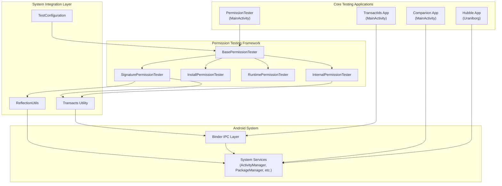
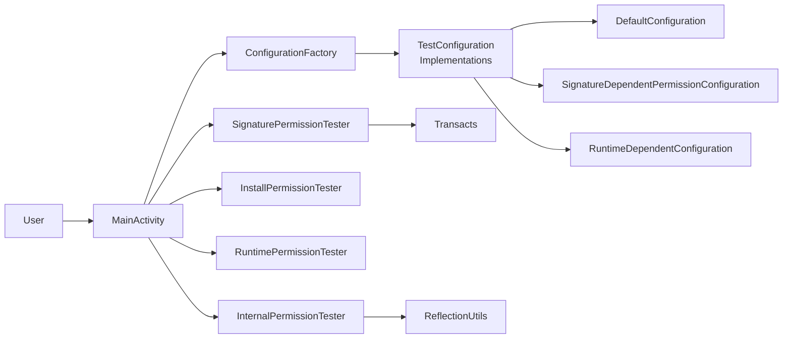
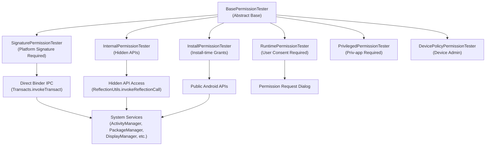
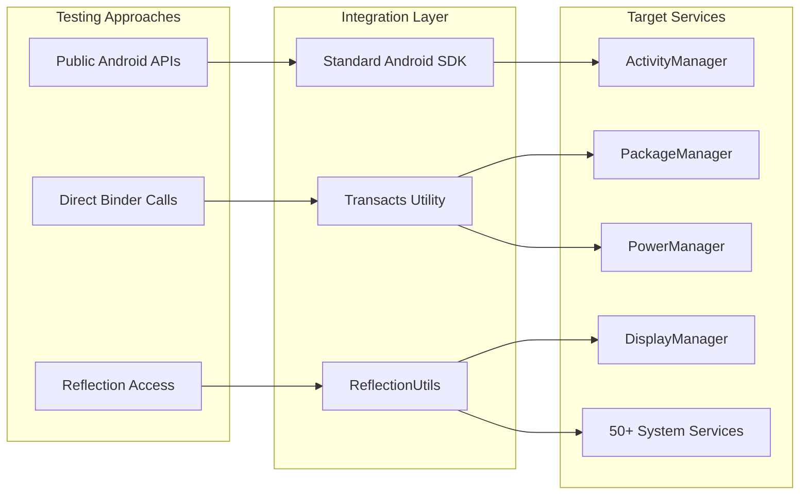

<!-- source: DeepWiki mcp.deepwiki.com · repo android/security-certification-resources · page 1 Overview · fetched 2026-10-23 -->

# Overview

Relevant source files

The following files were used as context for generating this wiki page:

- [niap-cc/Permissions/Companion/app/build.gradle](niap-cc/Permissions/Companion/app/build.gradle)
- [niap-cc/Permissions/Companion/app/src/main/AndroidManifest.xml](niap-cc/Permissions/Companion/app/src/main/AndroidManifest.xml)
- [niap-cc/Permissions/Companion/app/src/main/java/com/android/certifications/niap/permissions/companion/MainActivity.java](niap-cc/Permissions/Companion/app/src/main/java/com/android/certifications/niap/permissions/companion/MainActivity.java)
- [niap-cc/Permissions/Companion/app/src/main/res/layout/activity_main.xml](niap-cc/Permissions/Companion/app/src/main/res/layout/activity_main.xml)
- [niap-cc/Permissions/Companion/build.gradle.kts](niap-cc/Permissions/Companion/build.gradle.kts)
- [niap-cc/Permissions/Tester/app/build.gradle](niap-cc/Permissions/Tester/app/build.gradle)
- [niap-cc/Permissions/Tester/app/src/androidTest/AndroidManifest.xml](niap-cc/Permissions/Tester/app/src/androidTest/AndroidManifest.xml)
- [niap-cc/Permissions/Tester/app/src/main/AndroidManifest.xml](niap-cc/Permissions/Tester/app/src/main/AndroidManifest.xml)
- [niap-cc/Permissions/Tester/app/src/main/java/com/android/certifications/niap/permissions/InstallPermissionTester.java](niap-cc/Permissions/Tester/app/src/main/java/com/android/certifications/niap/permissions/InstallPermissionTester.java)
- [niap-cc/Permissions/Tester/app/src/main/java/com/android/certifications/niap/permissions/SignaturePermissionTester.java](niap-cc/Permissions/Tester/app/src/main/java/com/android/certifications/niap/permissions/SignaturePermissionTester.java)
- [niap-cc/Permissions/Tester/app/src/main/java/com/android/certifications/niap/permissions/activities/MainActivity.java](niap-cc/Permissions/Tester/app/src/main/java/com/android/certifications/niap/permissions/activities/MainActivity.java)
- [niap-cc/Permissions/Tester/app/src/main/java/com/android/certifications/niap/permissions/config/SignatureDependentPermissionConfiguration.java](niap-cc/Permissions/Tester/app/src/main/java/com/android/certifications/niap/permissions/config/SignatureDependentPermissionConfiguration.java)
- [niap-cc/Permissions/Tester/app/src/main/java/com/android/certifications/niap/permissions/utils/SdkV_Transacts.java](niap-cc/Permissions/Tester/app/src/main/java/com/android/certifications/niap/permissions/utils/SdkV_Transacts.java)
- [niap-cc/Permissions/Tester/app/src/main/java/com/android/certifications/niap/permissions/utils/Transacts.java](niap-cc/Permissions/Tester/app/src/main/java/com/android/certifications/niap/permissions/utils/Transacts.java)
- [niap-cc/Permissions/Tester/app/src/noperm/AndroidManifest.xml](niap-cc/Permissions/Tester/app/src/noperm/AndroidManifest.xml)
- [niap-cc/Permissions/Tester/app/src/normal/AndroidManifest.xml](niap-cc/Permissions/Tester/app/src/normal/AndroidManifest.xml)
- [niap-cc/Permissions/Tester/app/src/platform/AndroidManifest.xml](niap-cc/Permissions/Tester/app/src/platform/AndroidManifest.xml)
- [niap-cc/Permissions/TransactIds/app/src/main/java/com/android/certifications/niap/permissions/transactids/MainActivity.java](niap-cc/Permissions/TransactIds/app/src/main/java/com/android/certifications/niap/permissions/transactids/MainActivity.java)
- [niap-cc/Permissions/TransactIds/app/src/main/java/com/android/certifications/niap/permissions/transactids/Transacts.java](niap-cc/Permissions/TransactIds/app/src/main/java/com/android/certifications/niap/permissions/transactids/Transacts.java)

This document provides an overview of the Android Security Certification Resources repository, a comprehensive testing framework designed for NIAP (National Information Assurance Partnership) Common Criteria certification of Android devices. The framework validates that Android platform permissions are properly enforced by testing various permission protection levels through direct API invocation and system service interaction.

The repository contains multiple specialized applications that work together to thoroughly test Android's permission system, from basic install permissions to complex signature-level permissions that require platform signing. For detailed information about specific permission testing approaches, see [Permission Testing Framework](#2). For details about the build system and code generation tools, see [Build System and Code Generation](#4).

## System Architecture

The Android Security Certification Resources framework consists of four main applications that work together to provide comprehensive permission testing capabilities:

**Sources:** [niap-cc/Permissions/Tester/app/src/main/java/com/android/certifications/niap/permissions/activities/MainActivity.java:120-400](), [niap-cc/Permissions/Tester/app/src/main/java/com/android/certifications/niap/permissions/SignaturePermissionTester.java:280-320](), [niap-cc/Permissions/TransactIds/app/src/main/java/com/android/certifications/niap/permissions/transactids/MainActivity.java:83-142]()

## Core Applications

### Permission Tester Application
The main testing application (`MainActivity`) orchestrates permission tests across different protection levels. It uses a configuration-driven approach where `ConfigurationFactory` provides different test scenarios, and specialized tester classes handle specific permission types.

**Sources:** [niap-cc/Permissions/Tester/app/src/main/java/com/android/certifications/niap/permissions/activities/MainActivity.java:255-280](), [niap-cc/Permissions/Tester/app/src/main/java/com/android/certifications/niap/permissions/config/SignatureDependentPermissionConfiguration.java:44-117]()

### TransactIds Discovery Application
The `TransactIds` application (`MainActivity`) dynamically discovers binder transaction IDs for system services. Since transaction IDs can vary between device implementations, this tool uses reflection to query AIDL stub classes and generate device-specific transaction mappings.

### Companion Application
The `Companion` application prepares the test environment by setting up required resources like media files, configuring location services, and providing test services that other applications can bind to for permission validation.

### Hubble Data Collection
The `Hubble` application (part of the Uraniborg project) collects device information and preinstalled application data for analysis during certification testing.

**Sources:** [niap-cc/Permissions/TransactIds/app/src/main/java/com/android/certifications/niap/permissions/transactids/MainActivity.java:73-142](), [niap-cc/Permissions/Companion/app/src/main/java/com/android/certifications/niap/permissions/companion/MainActivity.java:86-150]()

## Permission Testing Framework

The framework implements a hierarchical testing architecture with `BasePermissionTester` as the foundation and specialized testers for different permission protection levels:

**Sources:** [niap-cc/Permissions/Tester/app/src/main/java/com/android/certifications/niap/permissions/SignaturePermissionTester.java:280-380](), [niap-cc/Permissions/Tester/app/src/main/java/com/android/certifications/niap/permissions/InstallPermissionTester.java:213-260]()

## Build System and Multi-Module Structure

The project uses a sophisticated Gradle build system with automated code generation and multiple application variants:

| Component | Purpose | Build Variants |
|-----------|---------|----------------|
| Permission Tester | Main testing app | `normal`, `platform`, `noperm` |
| Companion | Test environment setup | `debug`, `release` |
| TransactIds | Transaction ID discovery | Platform-signed only |
| Hubble | Device data collection | Standard build |

The build system includes custom Gradle plugins for code generation:
- `CodePorterPlugin` - Generates test modules from existing tester classes
- `BindServiceCodeGenPlugin` - Creates service classes for BIND_* permission testing
- Permission constant generation from `permissions.json`

**Sources:** [niap-cc/Permissions/Tester/app/build.gradle:19-137](), [niap-cc/Permissions/Companion/app/build.gradle:17-96](), [niap-cc/Permissions/Companion/build.gradle.kts:43-148]()

## System Service Integration

The framework achieves comprehensive permission testing through multiple integration approaches:

The `Transacts` utility class defines constants for over 50 system services and provides device-specific transaction ID mappings through generated subclasses like `SdkV_Transacts` for different Android API levels.

**Sources:** [niap-cc/Permissions/Tester/app/src/main/java/com/android/certifications/niap/permissions/utils/Transacts.java:59-320](), [niap-cc/Permissions/Tester/app/src/main/java/com/android/certifications/niap/permissions/utils/SdkV_Transacts.java:21-500]()

---

