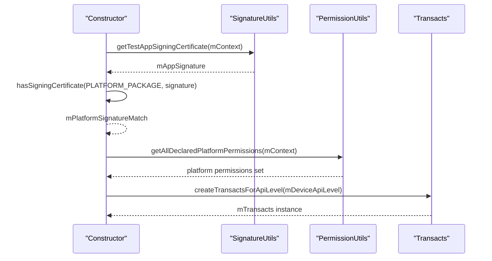
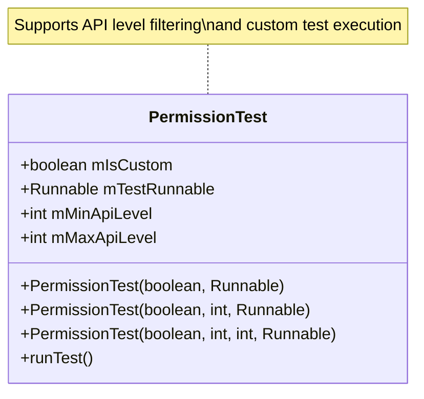
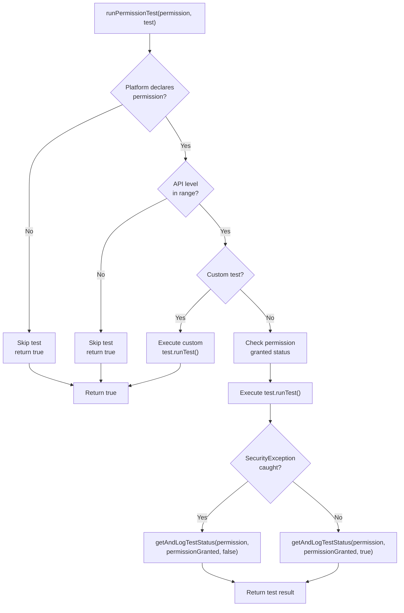
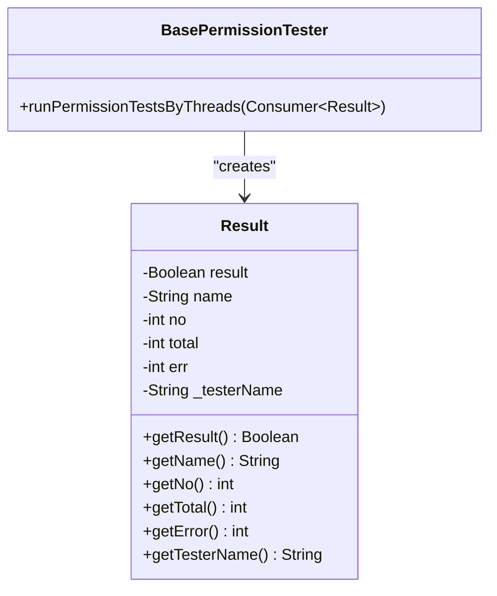
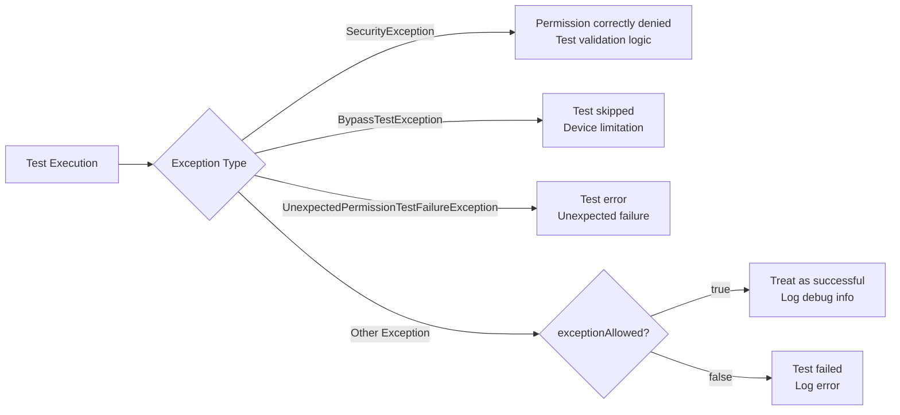
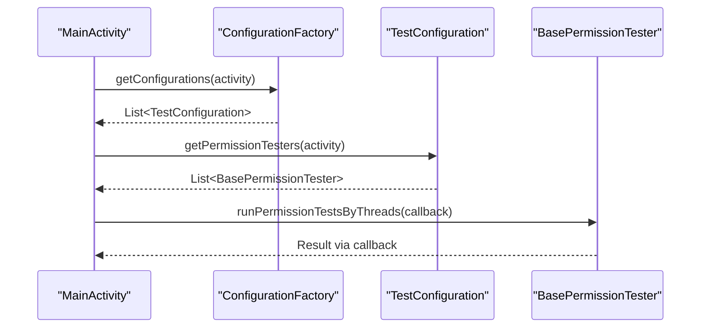

<!-- source: DeepWiki mcp.deepwiki.com · repo android/security-certification-resources · page 2 Permission Testing Framework · fetched 2026-10-23 -->

# Permission Testing Framework

Relevant source files

The following files were used as context for generating this wiki page:

- [niap-cc/Permissions/Tester/app/src/main/AndroidManifest.xml](niap-cc/Permissions/Tester/app/src/main/AndroidManifest.xml)
- [niap-cc/Permissions/Tester/app/src/main/java/com/android/certifications/niap/permissions/BasePermissionTester.java](niap-cc/Permissions/Tester/app/src/main/java/com/android/certifications/niap/permissions/BasePermissionTester.java)
- [niap-cc/Permissions/Tester/app/src/main/java/com/android/certifications/niap/permissions/DevicePolicyPermissionTester.java](niap-cc/Permissions/Tester/app/src/main/java/com/android/certifications/niap/permissions/DevicePolicyPermissionTester.java)
- [niap-cc/Permissions/Tester/app/src/main/java/com/android/certifications/niap/permissions/GmsPermissionTester.java](niap-cc/Permissions/Tester/app/src/main/java/com/android/certifications/niap/permissions/GmsPermissionTester.java)
- [niap-cc/Permissions/Tester/app/src/main/java/com/android/certifications/niap/permissions/NonPlatformPermissionTester.java](niap-cc/Permissions/Tester/app/src/main/java/com/android/certifications/niap/permissions/NonPlatformPermissionTester.java)
- [niap-cc/Permissions/Tester/app/src/main/java/com/android/certifications/niap/permissions/PrivilegedPermissionTester.java](niap-cc/Permissions/Tester/app/src/main/java/com/android/certifications/niap/permissions/PrivilegedPermissionTester.java)
- [niap-cc/Permissions/Tester/app/src/main/java/com/android/certifications/niap/permissions/RuntimePermissionTester.java](niap-cc/Permissions/Tester/app/src/main/java/com/android/certifications/niap/permissions/RuntimePermissionTester.java)
- [niap-cc/Permissions/Tester/app/src/main/java/com/android/certifications/niap/permissions/activities/MainActivity.java](niap-cc/Permissions/Tester/app/src/main/java/com/android/certifications/niap/permissions/activities/MainActivity.java)
- [niap-cc/Permissions/Tester/app/src/main/java/com/android/certifications/niap/permissions/config/RuntimeDependentPermissionConfiguration.java](niap-cc/Permissions/Tester/app/src/main/java/com/android/certifications/niap/permissions/config/RuntimeDependentPermissionConfiguration.java)
- [niap-cc/Permissions/Tester/app/src/main/java/com/android/certifications/niap/permissions/config/SignatureDependentPermissionConfiguration.java](niap-cc/Permissions/Tester/app/src/main/java/com/android/certifications/niap/permissions/config/SignatureDependentPermissionConfiguration.java)

## Purpose and Scope

The Permission Testing Framework provides the core architecture for testing Android permission enforcement across different protection levels and system components. This framework serves as the foundation for verifying that platform permissions properly guard their associated APIs, resources, and system services according to NIAP Common Criteria requirements.

The framework supports testing of runtime permissions, signature permissions, install permissions, internal permissions, privileged permissions, and device policy permissions. For details about specific permission tester implementations, see [Signature Permission Testing](#2.1), [Runtime Permission Testing](#2.2), [Install Permission Testing](#2.3), and [Internal Permission Testing](#2.4). For information about test orchestration and user interface, see [User Interface and Configuration](#6).

## Core Architecture Overview

The Permission Testing Framework follows a template method pattern with `BasePermissionTester` as the abstract foundation and specialized implementations for different permission types.

### Class Hierarchy and Relationships

```mermaid
classDiagram
    class BasePermissionTester {
        <<abstract>>
        +TestConfiguration mConfiguration
        +Activity mActivity
        +Transacts mTransacts
        +runPermissionTest(String, PermissionTest)
        +runPermissionTests()* 
        +runPermissionTestsByThreads(Consumer)*
        +getRegisteredPermissions()*
        +isPermissionGranted(String)
    }
    
    class RuntimePermissionTester {
        -Map~String,PermissionTest~ mPermissionTasks
        -WallpaperManager mWallpaperManager
        -SensorManager mSensorManager
        +runPermissionTests()
        +runPermissionTestsByThreads(Consumer)
    }
    
    class SignaturePermissionTester {
        -Map~String,PermissionTest~ mPermissionTasks
        -Set~String~ mSignaturePermissions
        +runPermissionTests()
        +runPermissionTestsByThreads(Consumer)
    }
    
    class InternalPermissionTester {
        -Map~String,PermissionTest~ mPermissionTasks
        +runPermissionTests()
        +runPermissionTestsByThreads(Consumer)
    }
    
    class InstallPermissionTester {
        -Map~String,PermissionTest~ mPermissionTasks
        +runPermissionTests()
        +runPermissionTestsByThreads(Consumer)
    }
    
    class DevicePolicyPermissionTester {
        -Map~String,PermissionTest~ mPermissionTasks
        -DevicePolicyManager dpm
        +runPermissionTests()
        +runPermissionTestsByThreads(Consumer)
    }
    
    class GmsPermissionTester {
        -Map~String,PermissionTest~ mPermissionTasks
        +runPermissionTests()
        +runPermissionTestsByThreads(Consumer)
    }
    
    class PermissionTest {
        +boolean mIsCustom
        +Runnable mTestRunnable
        +int mMinApiLevel
        +int mMaxApiLevel
        +runTest()
    }
    
    BasePermissionTester <|-- RuntimePermissionTester
    BasePermissionTester <|-- SignaturePermissionTester
    BasePermissionTester <|-- InternalPermissionTester
    BasePermissionTester <|-- InstallPermissionTester
    BasePermissionTester <|-- DevicePolicyPermissionTester
    BasePermissionTester <|-- GmsPermissionTester
    BasePermissionTester --> PermissionTest : "uses"
```

Sources: [niap-cc/Permissions/Tester/app/src/main/java/com/android/certifications/niap/permissions/BasePermissionTester.java:1-455](), [niap-cc/Permissions/Tester/app/src/main/java/com/android/certifications/niap/permissions/RuntimePermissionTester.java:1-100](), [niap-cc/Permissions/Tester/app/src/main/java/com/android/certifications/niap/permissions/DevicePolicyPermissionTester.java:1-50]()

## BasePermissionTester Foundation

The `BasePermissionTester` class provides the foundational infrastructure for all permission testing implementations. It establishes common initialization patterns, permission verification utilities, and test execution frameworks.

### Core Components and Initialization

The base class initializes essential Android system components and testing infrastructure:

| Component | Purpose | Initialization |
|-----------|---------|----------------|
| `TestConfiguration` | Defines test parameters and permissions | Passed via constructor |
| `Activity` and `Context` | Android runtime context | Passed via constructor |
| `Transacts` | Direct binder transaction utility | Created for device API level |
| `PackageManager` | Permission and signature verification | Retrieved from context |
| `Signature` | App signing certificate | Extracted for platform signature matching |

The constructor performs critical setup including platform signature verification and platform permission enumeration:

Sources: [niap-cc/Permissions/Tester/app/src/main/java/com/android/certifications/niap/permissions/BasePermissionTester.java:146-182]()

### PermissionTest Encapsulation

The `PermissionTest` class encapsulates individual permission verification logic with support for API level targeting and custom test behaviors:

Sources: [niap-cc/Permissions/Tester/app/src/main/java/com/android/certifications/niap/permissions/BasePermissionTester.java:355-420]()

## Permission Test Execution Model

The framework implements both synchronous and asynchronous test execution patterns to support different testing scenarios and user interface requirements.

### Test Execution Flow

The framework provides two execution models:

1. **Synchronous Execution** via `runPermissionTests()` - Traditional sequential testing
2. **Asynchronous Execution** via `runPermissionTestsByThreads(Consumer<Result>)` - Threaded testing with callback reporting

Sources: [niap-cc/Permissions/Tester/app/src/main/java/com/android/certifications/niap/permissions/BasePermissionTester.java:239-311]()

### Result Reporting System

The framework implements a standardized result reporting mechanism through the `Result` class:

Sources: [niap-cc/Permissions/Tester/app/src/main/java/com/android/certifications/niap/permissions/BasePermissionTester.java:62-118]()

## Exception Handling and Test Classification

The framework defines specialized exceptions for different test failure scenarios:

| Exception Type | Purpose | Usage |
|----------------|---------|-------|
| `BypassTestException` | Device doesn't meet test requirements | Test should be skipped |
| `UnexpectedPermissionTestFailureException` | Unexpected test failure | Test should be marked as error |
| `SecurityException` | Expected permission denial | Normal test flow validation |

Sources: [niap-cc/Permissions/Tester/app/src/main/java/com/android/certifications/niap/permissions/BasePermissionTester.java:275-311](), [niap-cc/Permissions/Tester/app/src/main/java/com/android/certifications/niap/permissions/BasePermissionTester.java:426-453]()

## Integration with Test Orchestration

The Permission Testing Framework integrates with the main application through the `MainActivity` orchestration system, which manages test configuration selection and execution coordination.

### Test Configuration Integration

The framework supports multiple execution models through the `TestConfiguration` interface, allowing for different permission testing scenarios such as runtime-dependent permissions, signature-dependent permissions, and install-only permissions.

Sources: [niap-cc/Permissions/Tester/app/src/main/java/com/android/certifications/niap/permissions/activities/MainActivity.java:293-362](), [niap-cc/Permissions/Tester/app/src/main/java/com/android/certifications/niap/permissions/config/SignatureDependentPermissionConfiguration.java:82-88]()

---

