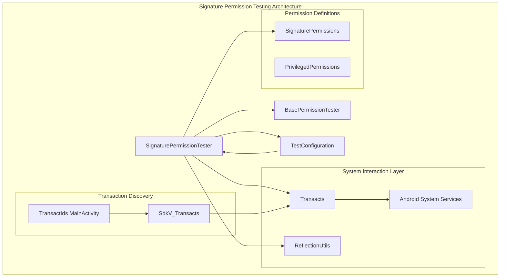
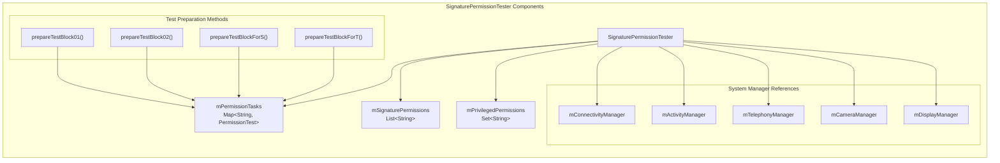
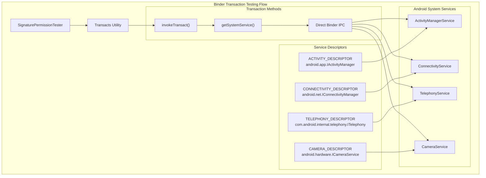
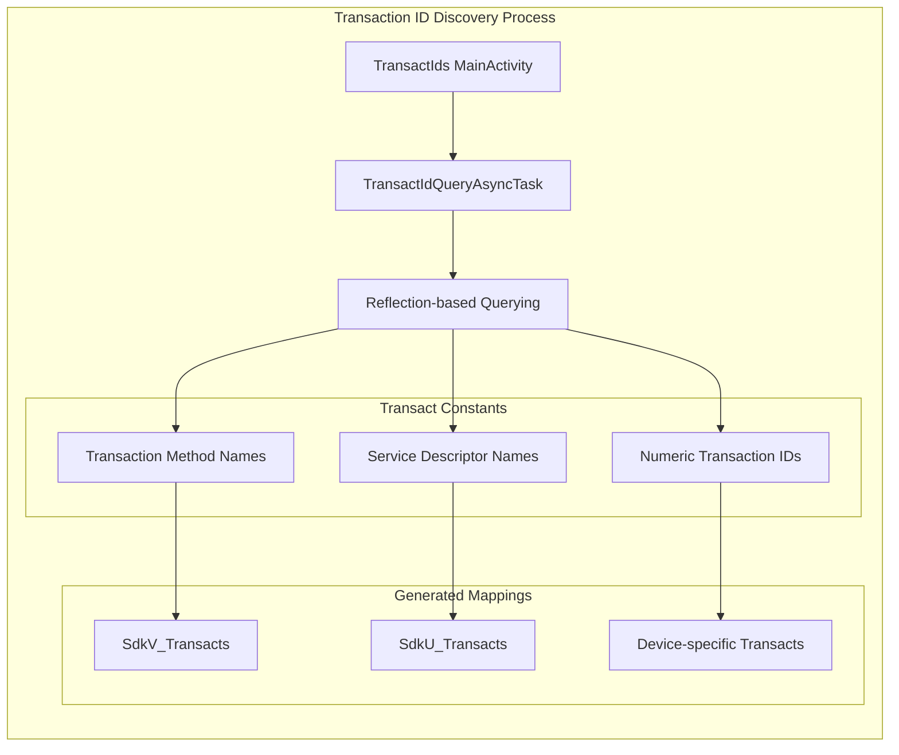
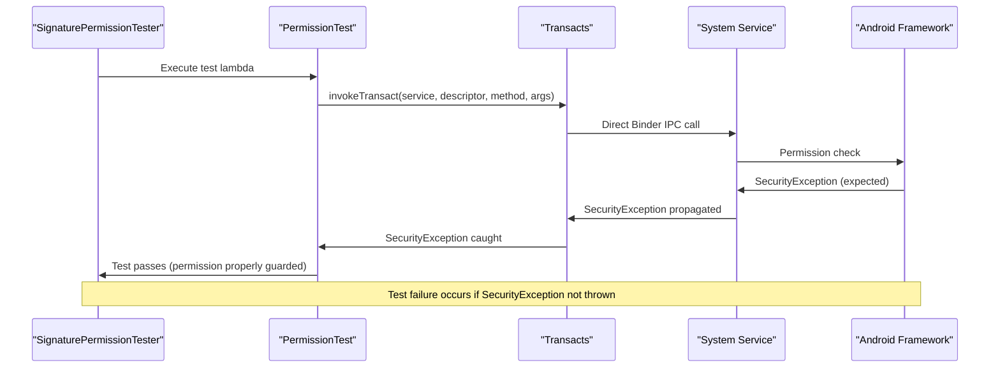
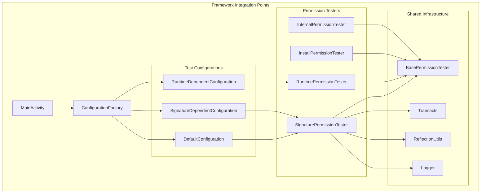

<!-- source: DeepWiki mcp.deepwiki.com · repo android/security-certification-resources · page 2.1 Signature Permission Testing · fetched 2026-10-23 -->

# Signature Permission Testing

<details>
<summary>Relevant source files</summary>

The following files were used as context for generating this wiki page:

- [niap-cc/Permissions/Tester/app/src/main/java/com/android/certifications/niap/permissions/SignaturePermissionTester.java](niap-cc/Permissions/Tester/app/src/main/java/com/android/certifications/niap/permissions/SignaturePermissionTester.java)
- [niap-cc/Permissions/Tester/app/src/main/java/com/android/certifications/niap/permissions/utils/SdkV_Transacts.java](niap-cc/Permissions/Tester/app/src/main/java/com/android/certifications/niap/permissions/utils/SdkV_Transacts.java)
- [niap-cc/Permissions/Tester/app/src/main/java/com/android/certifications/niap/permissions/utils/Transacts.java](niap-cc/Permissions/Tester/app/src/main/java/com/android/certifications/niap/permissions/utils/Transacts.java)
- [niap-cc/Permissions/Tester/app/src/noperm/AndroidManifest.xml](niap-cc/Permissions/Tester/app/src/noperm/AndroidManifest.xml)
- [niap-cc/Permissions/TransactIds/app/src/main/java/com/android/certifications/niap/permissions/transactids/MainActivity.java](niap-cc/Permissions/TransactIds/app/src/main/java/com/android/certifications/niap/permissions/transactids/MainActivity.java)
- [niap-cc/Permissions/TransactIds/app/src/main/java/com/android/certifications/niap/permissions/transactids/Transacts.java](niap-cc/Permissions/TransactIds/app/src/main/java/com/android/certifications/niap/permissions/transactids/Transacts.java)

</details>


This document covers the signature permission testing subsystem within the Android Security Certification Resources framework. This system verifies that signature-level permissions properly guard their corresponding APIs, resources, and system services. For information about other permission types, see [Runtime Permission Testing](#2.2), [Install Permission Testing](#2.3), and [Internal Permission Testing](#2.4).

## Purpose and Scope

The signature permission testing system validates that Android platform permissions declared with `protectionLevel="signature"` correctly enforce access control. These permissions can only be granted to applications signed with the same signing key as the platform, ensuring that only system-level applications can access protected functionality.

The system operates by:
- Attempting to invoke APIs protected by signature permissions from a non-platform-signed application
- Expecting `SecurityException` to be thrown when permission checks fail
- Using both standard Android APIs and direct Binder transaction calls to test comprehensive coverage
- Supporting version-specific permission testing across different Android API levels

## Architecture Overview

The signature permission testing system integrates with the broader permission testing framework through a layered architecture that separates test orchestration, permission validation, and low-level system interaction.



**Sources:** [niap-cc/Permissions/Tester/app/src/main/java/com/android/certifications/niap/permissions/SignaturePermissionTester.java:269-380](), [niap-cc/Permissions/Tester/app/src/main/java/com/android/certifications/niap/permissions/utils/Transacts.java:50-59]()

## Core Components

### SignaturePermissionTester Class

The `SignaturePermissionTester` class extends `BasePermissionTester` and serves as the primary orchestrator for signature permission validation. It maintains collections of signature permissions and implements test methods for each protected API.



**Sources:** [niap-cc/Permissions/Tester/app/src/main/java/com/android/certifications/niap/permissions/SignaturePermissionTester.java:280-380](), [niap-cc/Permissions/Tester/app/src/main/java/com/android/certifications/niap/permissions/SignaturePermissionTester.java:319-320]()

### Permission Test Organization

The system organizes permission tests into versioned blocks based on Android API levels, with each block containing tests for permissions introduced or modified in specific Android versions.

| Test Block | Method | API Level | Permission Count |
|------------|--------|-----------|------------------|
| Block 01 | `prepareTestBlock01()` | Base/Legacy | ~50 permissions |
| Block 02 | `prepareTestBlock02()` | API updates | ~30 permissions |
| QPR Block | `prepareTestBlockForQPR()` | Quarterly updates | ~15 permissions |
| S Block | `prepareTestBlockForS()` | Android 12 | ~25 permissions |
| T Block | `prepareTestBlockForT()` | Android 13 | ~20 permissions |
| U Block | `prepareTestBlockForU()` | Android 14 | ~15 permissions |
| V Block | `prepareTestBlockForV()` | Android 15 | ~10 permissions |

**Sources:** [niap-cc/Permissions/Tester/app/src/main/java/com/android/certifications/niap/permissions/SignaturePermissionTester.java:368-378]()

## Binder Transaction Testing Mechanism

Signature permission testing relies heavily on direct Binder transaction calls to bypass higher-level Android API abstractions and test permissions at the system service level.

### Transacts Utility Framework



**Sources:** [niap-cc/Permissions/Tester/app/src/main/java/com/android/certifications/niap/permissions/utils/Transacts.java:50-59](), [niap-cc/Permissions/Tester/app/src/main/java/com/android/certifications/niap/permissions/utils/Transacts.java:63-321]()

### Transaction ID Discovery

The framework includes a dedicated application for discovering device-specific Binder transaction IDs, which can vary between Android versions and device implementations.



**Sources:** [niap-cc/Permissions/TransactIds/app/src/main/java/com/android/certifications/niap/permissions/transactids/MainActivity.java:73-143](), [niap-cc/Permissions/Tester/app/src/main/java/com/android/certifications/niap/permissions/utils/SdkV_Transacts.java:21-24]()

## Test Execution Flow

Individual signature permission tests follow a consistent pattern of API invocation and security exception validation.

### Permission Test Implementation Pattern



**Sources:** [niap-cc/Permissions/Tester/app/src/main/java/com/android/certifications/niap/permissions/SignaturePermissionTester.java:385-516]()

### Example Permission Test Implementations

The system includes hundreds of specific permission tests. Here are representative examples:

**ACCESS_CACHE_FILESYSTEM Test:**
```
mPermissionTasks.put(permission.ACCESS_CACHE_FILESYSTEM, 
    new PermissionTest(false, () -> {
        File f = new File(Environment.getDownloadCacheDirectory(), 
                         "test_access_cache_filesystem.out");
        f.createNewFile(); // Should throw SecurityException
    }));
```

**CONNECTIVITY_INTERNAL Test:**
```
mPermissionTasks.put(permission.CONNECTIVITY_INTERNAL,
    new PermissionTest(false, () -> {
        mTransacts.invokeTransact(Transacts.CONNECTIVITY_SERVICE,
                                 Transacts.CONNECTIVITY_DESCRIPTOR,
                                 Transacts.getActiveNetworkForUid, mUid, false);
    }));
```

**Sources:** [niap-cc/Permissions/Tester/app/src/main/java/com/android/certifications/niap/permissions/SignaturePermissionTester.java:391-408](), [niap-cc/Permissions/Tester/app/src/main/java/com/android/certifications/niap/permissions/SignaturePermissionTester.java:676-681]()

## Integration with Permission Testing Framework

The signature permission tester integrates with the broader framework through the `TestConfiguration` system and shares infrastructure with other permission testers.



**Sources:** [niap-cc/Permissions/Tester/app/src/main/java/com/android/certifications/niap/permissions/SignaturePermissionTester.java:280-282](), [niap-cc/Permissions/Tester/app/src/main/java/com/android/certifications/niap/permissions/SignaturePermissionTester.java:321-322]()

## Platform Signing Requirements

The signature permission testing validates the fundamental Android security model where certain permissions can only be granted to applications signed with the platform's signing key. The testing application itself must be built in two variants:

- **Platform-signed variant**: Used for testing privileged permissions that require platform signature
- **Non-platform-signed variant**: Used for signature permission testing to ensure SecurityExceptions are properly thrown

This dual-variant approach ensures comprehensive validation of Android's permission enforcement at both the signature and privileged levels.

**Sources:** [niap-cc/Permissions/Tester/app/src/main/java/com/android/certifications/niap/permissions/SignaturePermissionTester.java:269-278](), [niap-cc/Permissions/Tester/app/src/noperm/AndroidManifest.xml:1-19]()

---

