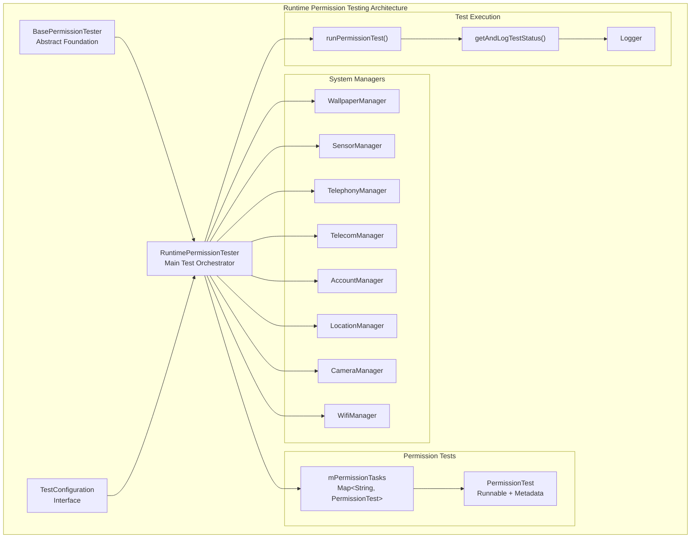
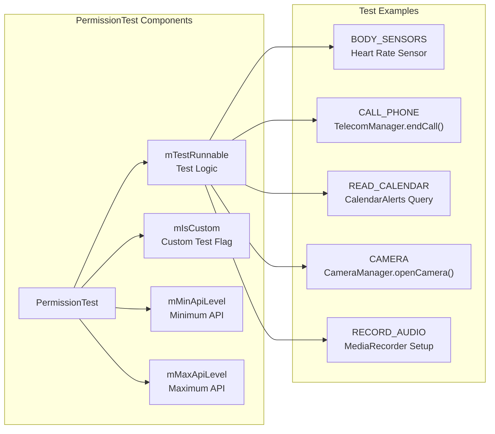
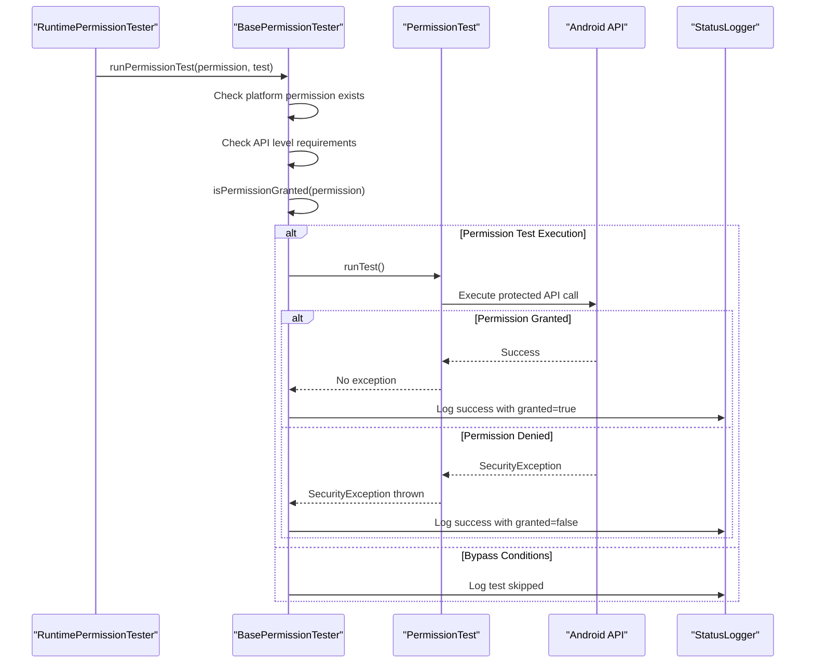
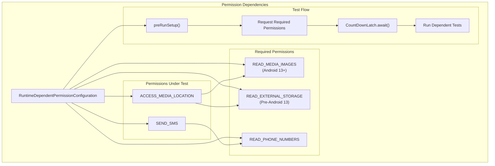
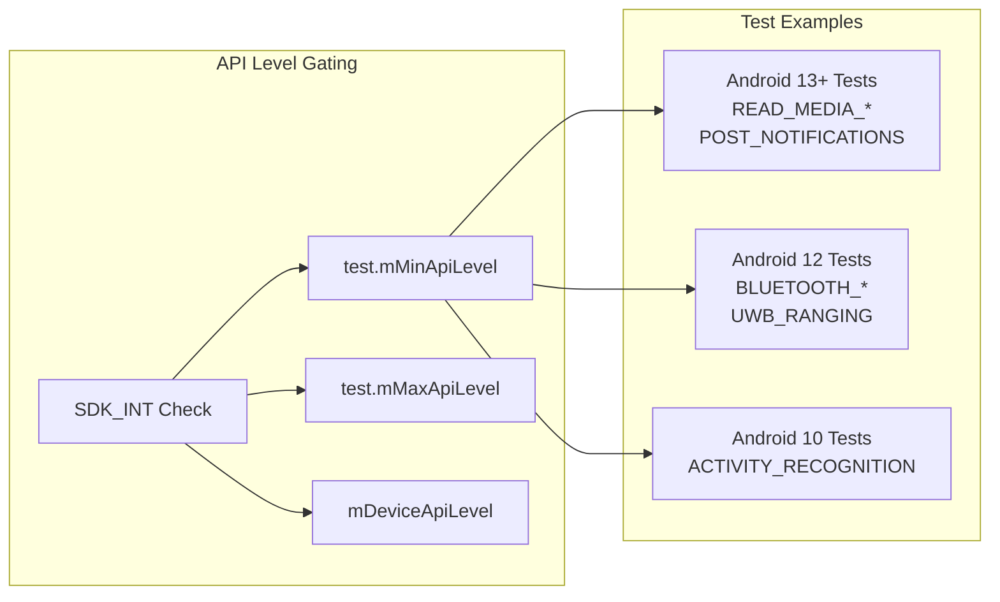
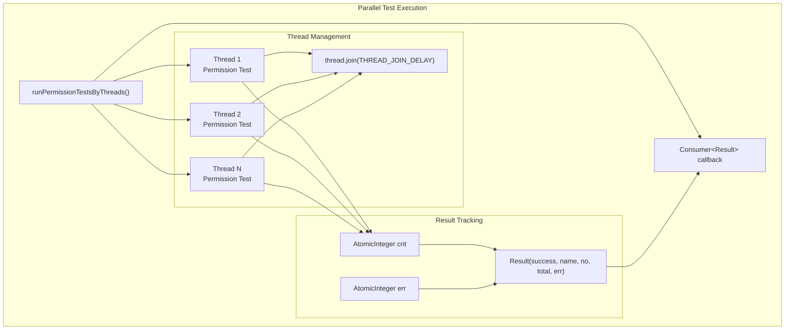
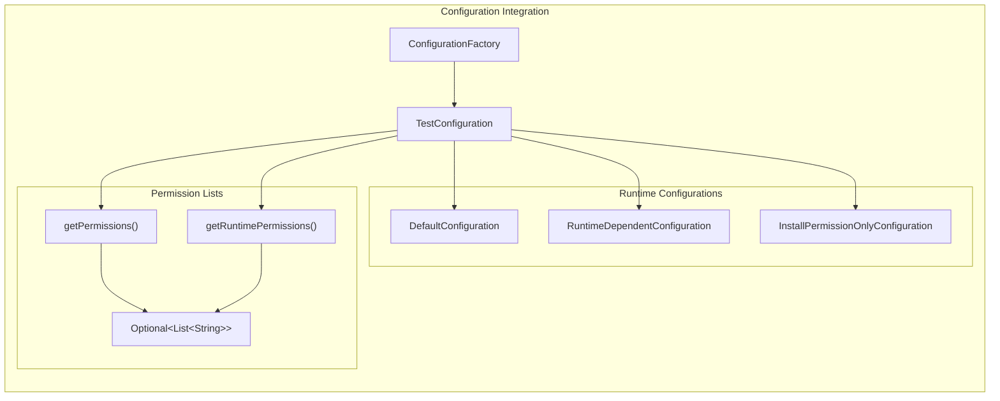

<!-- source: DeepWiki mcp.deepwiki.com · repo android/security-certification-resources · page 2.2 Runtime Permission Testing · fetched 2026-10-23 -->

# Runtime Permission Testing

Relevant source files

The following files were used as context for generating this wiki page:

- [niap-cc/Permissions/Tester/app/src/main/java/com/android/certifications/niap/permissions/BasePermissionTester.java](niap-cc/Permissions/Tester/app/src/main/java/com/android/certifications/niap/permissions/BasePermissionTester.java)
- [niap-cc/Permissions/Tester/app/src/main/java/com/android/certifications/niap/permissions/DevicePolicyPermissionTester.java](niap-cc/Permissions/Tester/app/src/main/java/com/android/certifications/niap/permissions/DevicePolicyPermissionTester.java)
- [niap-cc/Permissions/Tester/app/src/main/java/com/android/certifications/niap/permissions/GmsPermissionTester.java](niap-cc/Permissions/Tester/app/src/main/java/com/android/certifications/niap/permissions/GmsPermissionTester.java)
- [niap-cc/Permissions/Tester/app/src/main/java/com/android/certifications/niap/permissions/NonPlatformPermissionTester.java](niap-cc/Permissions/Tester/app/src/main/java/com/android/certifications/niap/permissions/NonPlatformPermissionTester.java)
- [niap-cc/Permissions/Tester/app/src/main/java/com/android/certifications/niap/permissions/PrivilegedPermissionTester.java](niap-cc/Permissions/Tester/app/src/main/java/com/android/certifications/niap/permissions/PrivilegedPermissionTester.java)
- [niap-cc/Permissions/Tester/app/src/main/java/com/android/certifications/niap/permissions/RuntimePermissionTester.java](niap-cc/Permissions/Tester/app/src/main/java/com/android/certifications/niap/permissions/RuntimePermissionTester.java)
- [niap-cc/Permissions/Tester/app/src/main/java/com/android/certifications/niap/permissions/config/RuntimeDependentPermissionConfiguration.java](niap-cc/Permissions/Tester/app/src/main/java/com/android/certifications/niap/permissions/config/RuntimeDependentPermissionConfiguration.java)

Runtime permission testing verifies that Android APIs properly enforce permission requirements for permissions that require user consent. This testing framework validates that protected APIs throw `SecurityException` when permissions are denied and function correctly when permissions are granted.

For signature permission testing, see [Signature Permission Testing](#2.1). For install-time permission testing, see [Install Permission Testing](#2.3).

## Purpose and Scope

Runtime permissions in Android require explicit user consent, either through the `-g` flag during `adb install` or through runtime permission dialogs. The `RuntimePermissionTester` validates that:

- APIs protected by runtime permissions throw `SecurityException` when the permission is not granted
- APIs function correctly when the permission is granted
- Permission dependencies are properly handled
- Version-specific permission behaviors are correctly implemented

Sources: [niap-cc/Permissions/Tester/app/src/main/java/com/android/certifications/niap/permissions/RuntimePermissionTester.java:135-141]()

## Architecture Overview

The runtime permission testing architecture centers around the `RuntimePermissionTester` class, which extends `BasePermissionTester` and manages individual permission tests through a structured framework.

Sources: [niap-cc/Permissions/Tester/app/src/main/java/com/android/certifications/niap/permissions/RuntimePermissionTester.java:142-172](), [niap-cc/Permissions/Tester/app/src/main/java/com/android/certifications/niap/permissions/BasePermissionTester.java:56-182]()

## Permission Test Structure

Each runtime permission test is encapsulated in a `PermissionTest` object that contains the test logic and metadata about API level requirements.

### Example Permission Test Implementation

| Permission | API Tested | Expected Behavior |
|------------|------------|-------------------|
| `BODY_SENSORS` | `SensorManager.getDefaultSensor(TYPE_HEART_RATE)` | Returns null if permission denied |
| `CALL_PHONE` | `TelecomManager.endCall()` | Throws SecurityException if denied |
| `READ_CALENDAR` | `ContentResolver.query(CalendarAlerts.CONTENT_URI)` | Throws SecurityException if denied |
| `CAMERA` | `CameraManager.openCamera()` | Fails in callback if denied |
| `RECORD_AUDIO` | `MediaRecorder.prepare()` | Throws RuntimeException if denied |

Sources: [niap-cc/Permissions/Tester/app/src/main/java/com/android/certifications/niap/permissions/RuntimePermissionTester.java:178-418](), [niap-cc/Permissions/Tester/app/src/main/java/com/android/certifications/niap/permissions/BasePermissionTester.java:355-421]()

## Test Execution Flow

The runtime permission testing follows a structured execution pattern that validates permission enforcement across different grant states.

Sources: [niap-cc/Permissions/Tester/app/src/main/java/com/android/certifications/niap/permissions/BasePermissionTester.java:239-311]()

## Dependency Handling

Some runtime permissions require other permissions to be granted for effective testing. The `RuntimeDependentPermissionConfiguration` handles these dependency scenarios.

### Dependency Resolution Process

The dependency resolution follows this sequence:

1. **Prerequisite Check**: Verify required permissions are declared in manifest
2. **Grant State Validation**: Ensure required permissions are not already granted
3. **Runtime Request**: Use `ActivityCompat.requestPermissions()` to request consent
4. **Synchronization**: Use `CountDownLatch` to wait for user response
5. **Test Execution**: Proceed with dependent permission tests

Sources: [niap-cc/Permissions/Tester/app/src/main/java/com/android/certifications/niap/permissions/config/RuntimeDependentPermissionConfiguration.java:50-153]()

## Version-Specific Testing

Runtime permissions have evolved across Android versions, requiring version-aware test execution.

| Android Version | New Runtime Permissions | Test Considerations |
|-----------------|------------------------|---------------------|
| API 28 (P) | Base runtime permissions | Foundation testing |
| API 29 (Q) | `ACTIVITY_RECOGNITION`, `ACCESS_MEDIA_LOCATION` | Sensor and media access |
| API 31 (S) | `BLUETOOTH_ADVERTISE`, `BLUETOOTH_CONNECT`, `BLUETOOTH_SCAN`, `UWB_RANGING` | Bluetooth and UWB features |
| API 33 (T) | `READ_MEDIA_AUDIO`, `READ_MEDIA_IMAGES`, `READ_MEDIA_VIDEO`, `POST_NOTIFICATIONS`, `NEARBY_WIFI_DEVICES` | Granular media and notification access |

### Version-Specific Implementation Pattern

Sources: [niap-cc/Permissions/Tester/app/src/main/java/com/android/certifications/niap/permissions/RuntimePermissionTester.java:424-741](), [niap-cc/Permissions/Tester/app/src/main/java/com/android/certifications/niap/permissions/BasePermissionTester.java:254-264]()

## Threading and Parallel Execution

The framework supports both sequential and parallel test execution through the `runPermissionTestsByThreads()` method.

Sources: [niap-cc/Permissions/Tester/app/src/main/java/com/android/certifications/niap/permissions/BasePermissionTester.java:196](), [niap-cc/Permissions/Tester/app/src/main/java/com/android/certifications/niap/permissions/BasePermissionTester.java:58-61]()

## Integration with Test Configuration System

Runtime permission testing integrates with the broader test configuration system to support different testing scenarios and build variants.

Sources: [niap-cc/Permissions/Tester/app/src/main/java/com/android/certifications/niap/permissions/config/RuntimeDependentPermissionConfiguration.java:216-227](), [niap-cc/Permissions/Tester/app/src/main/java/com/android/certifications/niap/permissions/config/TestConfiguration.java]()

---

