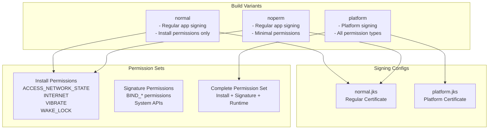
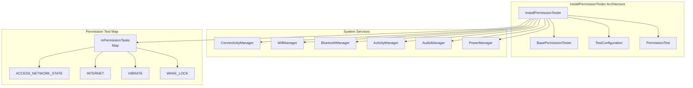
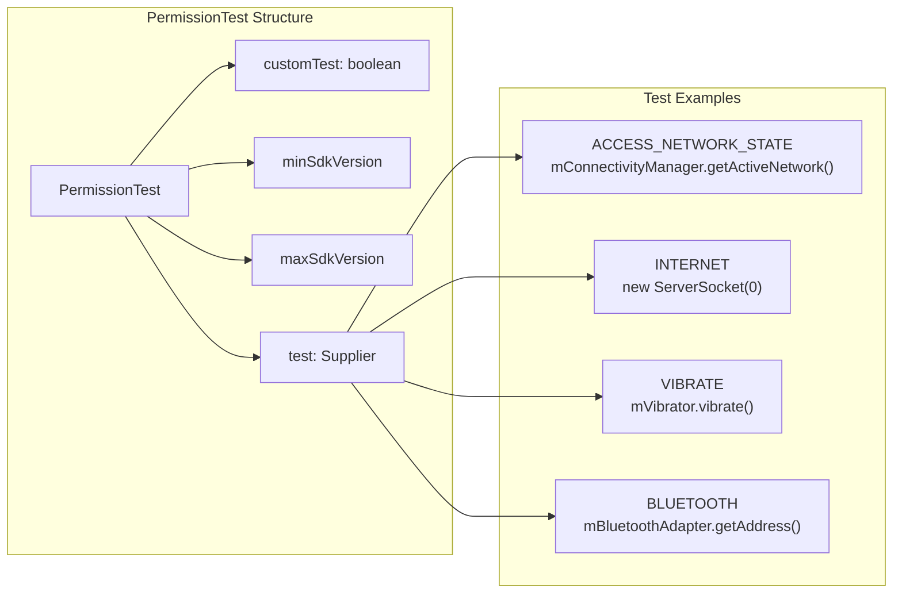
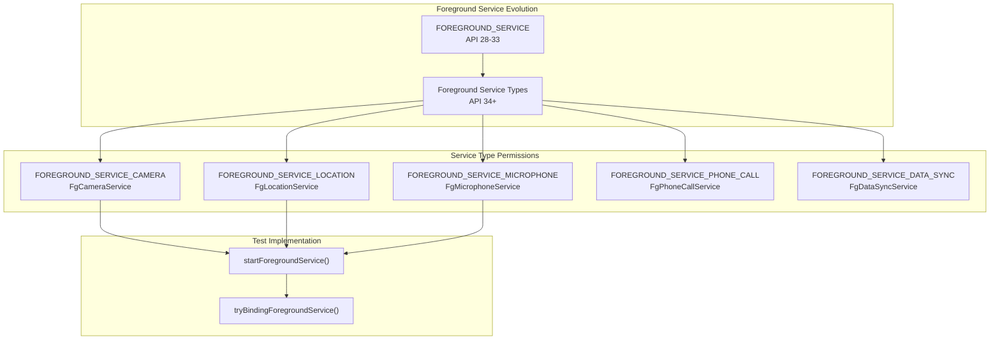
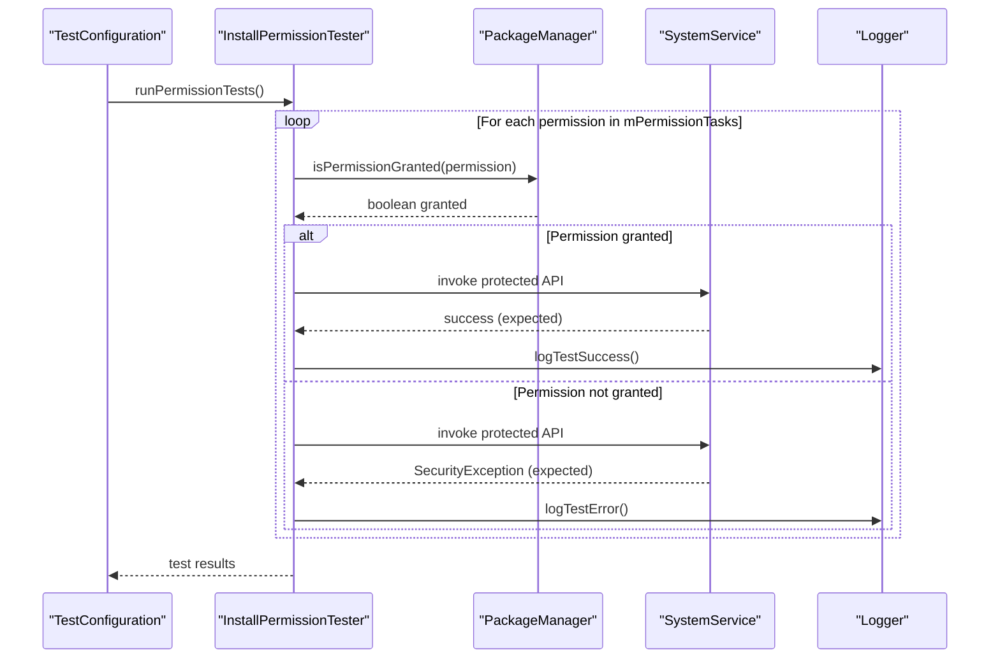

<!-- source: DeepWiki mcp.deepwiki.com · repo android/security-certification-resources · page 2.3 Install Permission Testing · fetched 2026-10-23 -->

# Install Permission Testing

<details>
<summary>Relevant source files</summary>

The following files were used as context for generating this wiki page:

- [niap-cc/Permissions/Tester/app/build.gradle](niap-cc/Permissions/Tester/app/build.gradle)
- [niap-cc/Permissions/Tester/app/src/androidTest/AndroidManifest.xml](niap-cc/Permissions/Tester/app/src/androidTest/AndroidManifest.xml)
- [niap-cc/Permissions/Tester/app/src/main/java/com/android/certifications/niap/permissions/InstallPermissionTester.java](niap-cc/Permissions/Tester/app/src/main/java/com/android/certifications/niap/permissions/InstallPermissionTester.java)
- [niap-cc/Permissions/Tester/app/src/normal/AndroidManifest.xml](niap-cc/Permissions/Tester/app/src/normal/AndroidManifest.xml)
- [niap-cc/Permissions/Tester/app/src/platform/AndroidManifest.xml](niap-cc/Permissions/Tester/app/src/platform/AndroidManifest.xml)

</details>


This document covers the install permission testing capabilities within the Android Security Certification Resources framework. Install permission testing validates that install-time permissions properly guard their associated APIs and resources. Install permissions are granted automatically upon app installation when declared in the AndroidManifest.xml using `<uses-permission>` tags, unlike runtime permissions which require user consent.

For signature permission testing that requires platform certificates, see [Signature Permission Testing](#2.1). For runtime permissions that require user interaction, see [Runtime Permission Testing](#2.2).

## Build Variants and Signing Configuration

The install permission testing system uses multiple build variants to test different permission scenarios based on app signing and permission declarations.



**Sources:** [niap-cc/Permissions/Tester/app/build.gradle:28-51](), [niap-cc/Permissions/Tester/app/build.gradle:110-124]()

The build configuration defines three product flavors in the `flavorDimensions "settings"`:

| Flavor | Signing | Purpose |
|--------|---------|---------|
| `normal` | `signingConfigs.norm` | Tests install permissions with regular app signing |
| `noperm` | `signingConfigs.norm` | Tests behavior when permissions are not declared |
| `platform` | `signingConfigs.platform` | Tests all permission types with platform signing |

**Sources:** [niap-cc/Permissions/Tester/app/build.gradle:110-124]()

## Core Testing Architecture

The `InstallPermissionTester` class implements the core testing logic for install permissions, extending the `BasePermissionTester` foundation.



**Sources:** [niap-cc/Permissions/Tester/app/src/main/java/com/android/certifications/niap/permissions/InstallPermissionTester.java:213-256]()

## Permission Test Implementation

Each install permission test is implemented as a `PermissionTest` object that defines the test logic and expected behavior.



**Sources:** [niap-cc/Permissions/Tester/app/src/main/java/com/android/certifications/niap/permissions/InstallPermissionTester.java:256-300]()

### Key Permission Tests

| Permission | Test Method | Version Range |
|------------|-------------|---------------|
| `ACCESS_NETWORK_STATE` | `mConnectivityManager.getActiveNetwork()` | All versions |
| `INTERNET` | `new ServerSocket(0)` | All versions |
| `VIBRATE` | `mVibrator.vibrate()` | All versions |
| `BLUETOOTH` | `mBluetoothAdapter.getAddress()` | API 28-30 only |
| `WAKE_LOCK` | `mPowerManager.newWakeLock()` | All versions |

**Sources:** [niap-cc/Permissions/Tester/app/src/main/java/com/android/certifications/niap/permissions/InstallPermissionTester.java:258-710]()

## Foreground Service Type Testing

Starting with Android 14 (API 34), foreground services require specific type permissions in addition to the base `FOREGROUND_SERVICE` permission.



**Sources:** [niap-cc/Permissions/Tester/app/src/main/java/com/android/certifications/niap/permissions/InstallPermissionTester.java:376-509]()

### Foreground Service Type Tests

The system tests each foreground service type by:

1. Starting the appropriate service with `startForegroundService()`
2. Attempting to bind to the service with `tryBindingForegroundService()`
3. Handling exceptions that indicate permission denial

```java
// Example test pattern for foreground service types
mPermissionTasks.put(FOREGROUND_SERVICE_CAMERA, new PermissionTest(true,
        Build.VERSION_CODES.UPSIDE_DOWN_CAKE, () -> {
    Intent serviceIntent = new Intent(mActivity, FgCameraService.class);
    try {
        mActivity.startForegroundService(serviceIntent);
        tryBindingForegroundService(serviceIntent);
    } catch(Throwable t) {
        mLogger.logDebug("FOREGROUND_SERVICE_CAMERA", t);
    }
}));
```

**Sources:** [niap-cc/Permissions/Tester/app/src/main/java/com/android/certifications/niap/permissions/InstallPermissionTester.java:376-387]()

## Test Execution Flow

The install permission testing follows a systematic execution pattern that validates permission enforcement.



**Sources:** [niap-cc/Permissions/Tester/app/src/main/java/com/android/certifications/niap/permissions/InstallPermissionTester.java:213-256]()

## Manifest Permission Declaration

Install permissions must be declared in the appropriate AndroidManifest.xml files for each build variant.

### Platform Variant Permissions

The platform variant includes comprehensive permission declarations for testing signature and system permissions:

```xml
<uses-permission android:name="android.permission.ACCESS_NETWORK_STATE" />
<uses-permission android:name="android.permission.INTERNET" />
<uses-permission android:name="android.permission.VIBRATE" />
<uses-permission android:name="android.permission.FOREGROUND_SERVICE" />
<uses-permission android:name="android.permission.FOREGROUND_SERVICE_CAMERA" />
<uses-permission android:name="android.permission.FOREGROUND_SERVICE_LOCATION" />
```

**Sources:** [niap-cc/Permissions/Tester/app/src/platform/AndroidManifest.xml:27-42]()

### Normal Variant Permissions

The normal variant focuses on install permissions available to regular applications:

```xml
<uses-permission android:name="android.permission.ACCESS_NETWORK_STATE" />
<uses-permission android:name="android.permission.INTERNET" />
<uses-permission android:name="android.permission.VIBRATE" />
<uses-permission android:name="android.permission.WAKE_LOCK" />
```

**Sources:** [niap-cc/Permissions/Tester/app/src/normal/AndroidManifest.xml:23-74]()

## Error Handling and Edge Cases

The install permission tester includes sophisticated error handling for various edge cases:

### Version-Specific Permission Handling

Some permissions have specific API level ranges where they are applicable:

- `BLUETOOTH` and `BLUETOOTH_ADMIN`: Only tested on API 28-30 (replaced by runtime permissions in API 31+)
- `FOREGROUND_SERVICE`: Only tested on API 28-33 (replaced by type-specific permissions in API 34+)
- Foreground service type permissions: Only tested on API 34+

**Sources:** [niap-cc/Permissions/Tester/app/src/main/java/com/android/certifications/niap/permissions/InstallPermissionTester.java:276-299](), [niap-cc/Permissions/Tester/app/src/main/java/com/android/certifications/niap/permissions/InstallPermissionTester.java:361-375]()

### Bypass Conditions

The testing framework includes bypass mechanisms for tests that cannot be performed due to device limitations:

- Hardware dependencies (NFC adapter, IR emitter, Bluetooth adapter)
- UI-affecting tests that could cause test instability
- Version-specific API availability

**Sources:** [niap-cc/Permissions/Tester/app/src/main/java/com/android/certifications/niap/permissions/InstallPermissionTester.java:278-282](), [niap-cc/Permissions/Tester/app/src/main/java/com/android/certifications/niap/permissions/InstallPermissionTester.java:575-577]()

---

