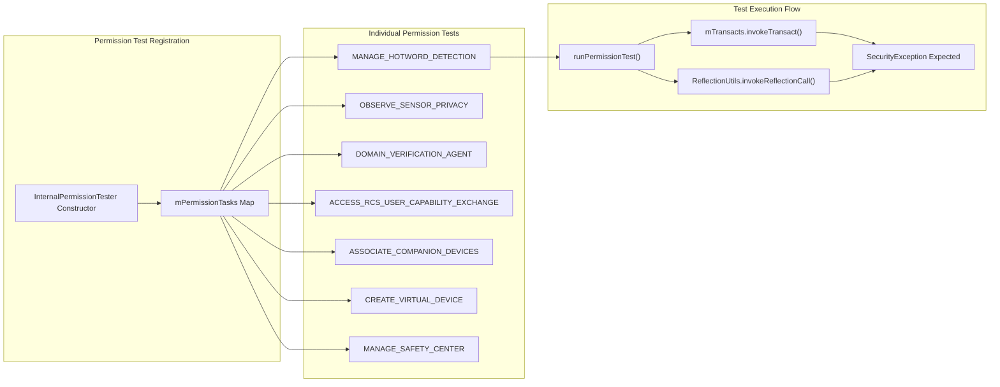
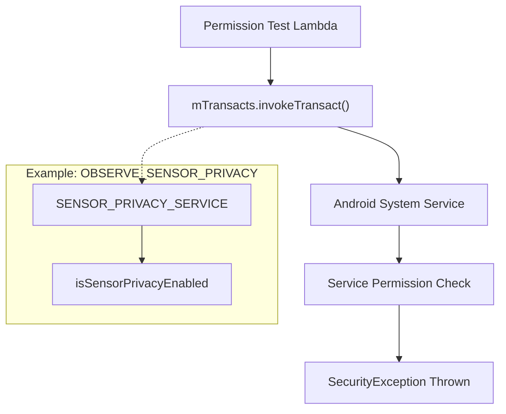
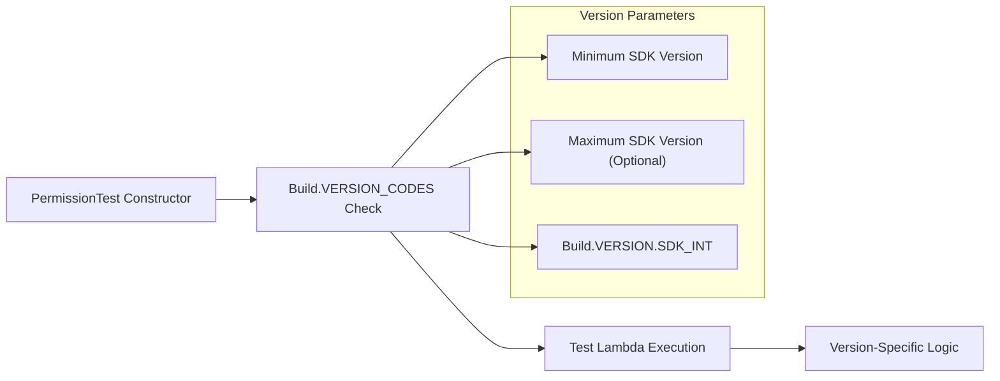

<!-- source: DeepWiki mcp.deepwiki.com · repo android/security-certification-resources · page 2.4 Internal Permission Testing · fetched 2026-10-23 -->

# Internal Permission Testing

<details>
<summary>Relevant source files</summary>

The following files were used as context for generating this wiki page:

- [niap-cc/Permissions/Tester/app/src/main/java/com/android/certifications/niap/permissions/InternalPermissionTester.java](niap-cc/Permissions/Tester/app/src/main/java/com/android/certifications/niap/permissions/InternalPermissionTester.java)
- [niap-cc/Permissions/Tester/app/src/main/java/com/android/certifications/niap/permissions/utils/ReflectionUtils.java](niap-cc/Permissions/Tester/app/src/main/java/com/android/certifications/niap/permissions/utils/ReflectionUtils.java)

</details>


This document covers the internal platform permission testing capabilities within the Android Security Certification Resources framework. Internal permissions are platform permissions with special protection levels that require more than just platform signature verification, often involving role-based checks, system service validation, or other specialized authorization mechanisms.

For signature permission testing, see [Signature Permission Testing](#2.1). For runtime permission testing, see [Runtime Permission Testing](#2.2). For install permission testing, see [Install Permission Testing](#2.3).

## Overview

Internal permissions differ from signature permissions in that applications cannot be granted these permissions solely by being signed with the platform signing key. Instead, internal permissions require additional authorization mechanisms such as:

- Specific system roles or capabilities
- Direct system service integration
- Hidden API access patterns
- Binder transaction-level authorization

The `InternalPermissionTester` class validates that these permissions properly protect their associated APIs by attempting to invoke protected functionality and verifying that `SecurityException`s are thrown when access is denied.

Sources: [niap-cc/Permissions/Tester/app/src/main/java/com/android/certifications/niap/permissions/InternalPermissionTester.java:97-103]()

## Architecture Overview

```mermaid
graph TB
    IPermTester["InternalPermissionTester"]
    BasePermTester["BasePermissionTester"]
    PermissionTest["PermissionTest"]
    ReflectionUtils["ReflectionUtils"]
    Transacts["Transacts"]
    InternalPerms["InternalPermissions"]
    
    IPermTester --|extends| BasePermTester
    IPermTester --|contains| PermissionTest
    IPermTester --|uses| ReflectionUtils
    IPermTester --|uses| Transacts
    IPermTester --|references| InternalPerms
    
    subgraph "Test Execution Methods"
        runPermissionTests["runPermissionTests()"]
        runPermissionTestsByThreads["runPermissionTestsByThreads()"]
        getRegisteredPermissions["getRegisteredPermissions()"]
    end
    
    subgraph "Core Testing Techniques"
        BinderTransacts["Binder Transaction Calls"]
        ReflectionCalls["Reflection API Calls"]
        HiddenAPI["Hidden API Access"]
        SystemServices["System Service Integration"]
    end
    
    IPermTester --> runPermissionTests
    IPermTester --> runPermissionTestsByThreads
    IPermTester --> getRegisteredPermissions
    
    PermissionTest --> BinderTransacts
    PermissionTest --> ReflectionCalls
    PermissionTest --> HiddenAPI
    PermissionTest --> SystemServices
```

Sources: [niap-cc/Permissions/Tester/app/src/main/java/com/android/certifications/niap/permissions/InternalPermissionTester.java:104-118](), [niap-cc/Permissions/Tester/app/src/main/java/com/android/certifications/niap/permissions/InternalPermissionTester.java:571-602]()

## Test Implementation Structure

The `InternalPermissionTester` maintains a `Map<String, PermissionTest>` called `mPermissionTasks` that associates each internal permission with its corresponding test implementation. Each test is designed to invoke the protected API and expect a `SecurityException` when the permission is not granted.



Sources: [niap-cc/Permissions/Tester/app/src/main/java/com/android/certifications/niap/permissions/InternalPermissionTester.java:114-118](), [niap-cc/Permissions/Tester/app/src/main/java/com/android/certifications/niap/permissions/InternalPermissionTester.java:120-569]()

## Key Testing Techniques

### Binder Transaction Integration

Internal permission tests frequently use the `Transacts` utility to make direct binder calls to system services. This bypasses standard Android API layers and tests permission enforcement at the system service level.



Sources: [niap-cc/Permissions/Tester/app/src/main/java/com/android/certifications/niap/permissions/InternalPermissionTester.java:144-148](), [niap-cc/Permissions/Tester/app/src/main/java/com/android/certifications/niap/permissions/InternalPermissionTester.java:73]()

### Reflection-Based API Access

The tester uses `ReflectionUtils` to access hidden APIs and instantiate objects that are not part of the public SDK. This is essential for testing internal permissions that protect non-public functionality.

| Reflection Method | Purpose | Example Usage |
|------------------|---------|---------------|
| `invokeReflectionCall()` | Call hidden methods | Accessing SafetyCenterManager APIs |
| `stubHiddenObject()` | Create hidden objects | VirtualDeviceParams construction |
| `stubRemoteCallback()` | Create callback stubs | Remote callback implementations |

Sources: [niap-cc/Permissions/Tester/app/src/main/java/com/android/certifications/niap/permissions/utils/ReflectionUtils.java:56-69](), [niap-cc/Permissions/Tester/app/src/main/java/com/android/certifications/niap/permissions/InternalPermissionTester.java:24-26]()

### Version-Specific Implementation

Internal permission tests include version checks to ensure tests only run on appropriate Android versions:



Sources: [niap-cc/Permissions/Tester/app/src/main/java/com/android/certifications/niap/permissions/InternalPermissionTester.java:121](), [niap-cc/Permissions/Tester/app/src/main/java/com/android/certifications/niap/permissions/InternalPermissionTester.java:206-207]()

## Specific Permission Test Examples

### MANAGE_HOTWORD_DETECTION

This permission protects voice interaction service APIs. The test invokes the `updateState` transaction on the `VOICE_INTERACTION_SERVICE` and handles a special case where the permission check passes but the caller validation fails.

Sources: [niap-cc/Permissions/Tester/app/src/main/java/com/android/certifications/niap/permissions/InternalPermissionTester.java:120-142]()

### CREATE_VIRTUAL_DEVICE

Tests the virtual device creation APIs by using reflection to construct `VirtualDeviceParams` objects and invoke the `createVirtualDevice` transaction with version-specific parameter handling.

Sources: [niap-cc/Permissions/Tester/app/src/main/java/com/android/certifications/niap/permissions/InternalPermissionTester.java:229-266]()

### MANAGE_DEVICE_LOCK_STATE

Implements complex callback-based testing using different interface versions between Android 14 and 15, demonstrating the evolution of internal permission APIs across Android versions.

Sources: [niap-cc/Permissions/Tester/app/src/main/java/com/android/certifications/niap/permissions/InternalPermissionTester.java:422-535]()

## Test Execution and Results

The `InternalPermissionTester` provides two execution modes:

### Sequential Execution

The `runPermissionTests()` method executes all registered permission tests sequentially and returns a boolean indicating overall success.

Sources: [niap-cc/Permissions/Tester/app/src/main/java/com/android/certifications/niap/permissions/InternalPermissionTester.java:571-602]()

### Threaded Execution  

The `runPermissionTestsByThreads()` method executes tests in parallel threads with timeout handling, providing real-time progress callbacks.

Sources: [niap-cc/Permissions/Tester/app/src/main/java/com/android/certifications/niap/permissions/InternalPermissionTester.java:603-629]()

## Integration with Framework Components

The `InternalPermissionTester` integrates with several framework components:

- **BasePermissionTester**: Provides common testing infrastructure and `PermissionTest` class
- **Transacts**: Enables direct binder transaction calls to system services  
- **ReflectionUtils**: Provides reflection utilities for hidden API access
- **InternalPermissions**: Contains permission constant definitions
- **TestConfiguration**: Specifies which internal permissions to test

Sources: [niap-cc/Permissions/Tester/app/src/main/java/com/android/certifications/niap/permissions/InternalPermissionTester.java:23](), [niap-cc/Permissions/Tester/app/src/main/java/com/android/certifications/niap/permissions/InternalPermissionTester.java:63-74]()

---

