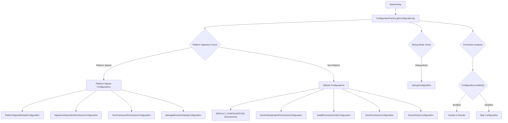
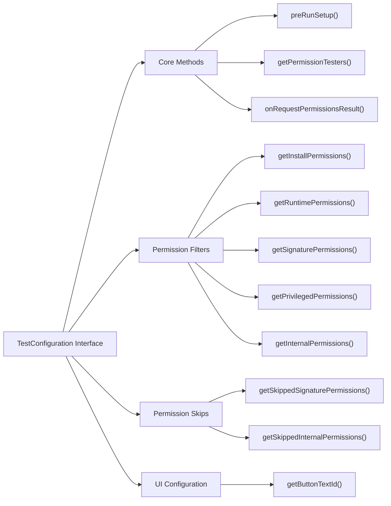
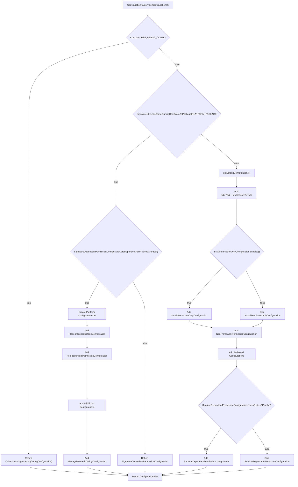
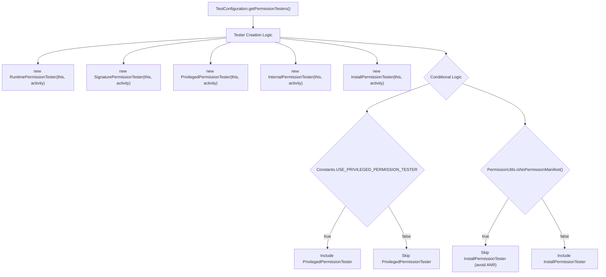
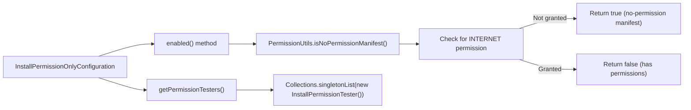
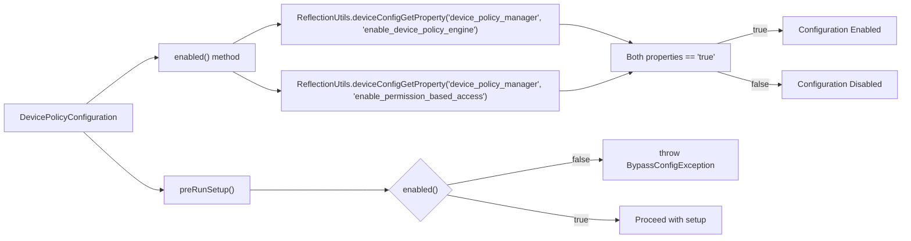
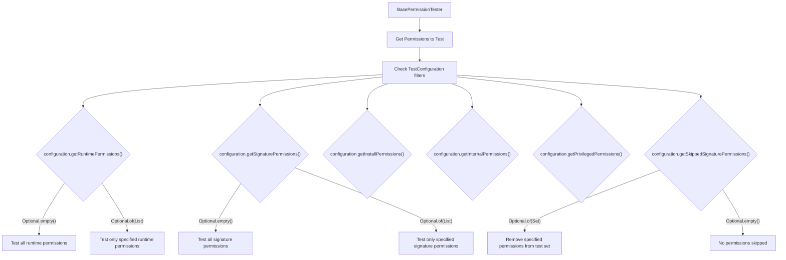
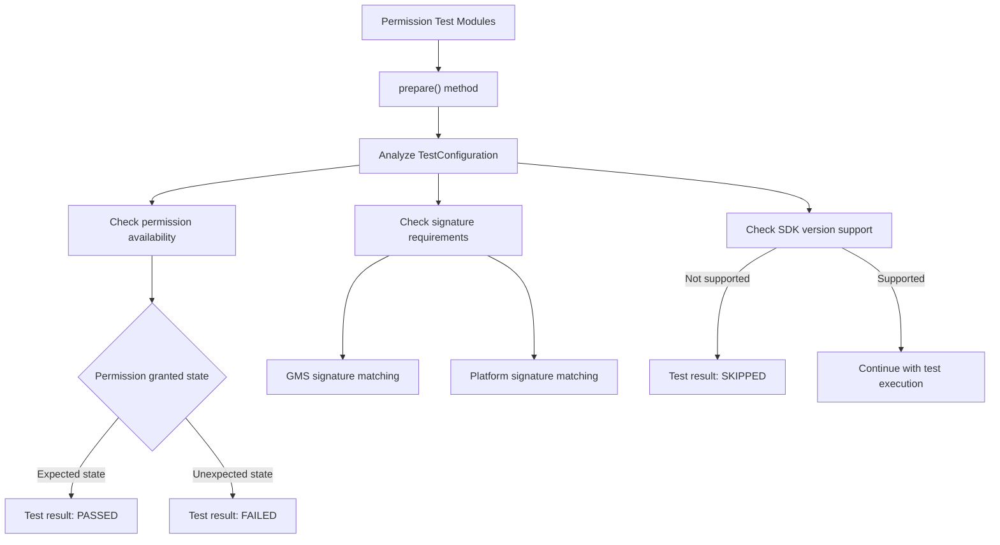

<!-- source: DeepWiki mcp.deepwiki.com · repo android/security-certification-resources · page 2.5 Test Configuration System · fetched 2026-10-23 -->

# Test Configuration System

Relevant source files

The following files were used as context for generating this wiki page:

- [niap-cc/Permissions/PermissionTester/app/src/androidTest/java/com/android/certification/niap/permission/dpctester/InternalPermissionJUnitTest.java](niap-cc/Permissions/PermissionTester/app/src/androidTest/java/com/android/certification/niap/permission/dpctester/InternalPermissionJUnitTest.java)
- [niap-cc/Permissions/PermissionTester/app/src/main/java/com/android/certification/niap/permission/dpctester/test/GmsTestModule.java](niap-cc/Permissions/PermissionTester/app/src/main/java/com/android/certification/niap/permission/dpctester/test/GmsTestModule.java)
- [niap-cc/Permissions/PermissionTester/app/src/main/java/com/android/certification/niap/permission/dpctester/test/InternalTestModule.java](niap-cc/Permissions/PermissionTester/app/src/main/java/com/android/certification/niap/permission/dpctester/test/InternalTestModule.java)
- [niap-cc/Permissions/PermissionTester/app/src/main/java/com/android/certification/niap/permission/dpctester/test/tool/ReflectionTool.kt](niap-cc/Permissions/PermissionTester/app/src/main/java/com/android/certification/niap/permission/dpctester/test/tool/ReflectionTool.kt)
- [niap-cc/Permissions/Tester/app/src/main/java/com/android/certifications/niap/permissions/config/ConfigurationFactory.java](niap-cc/Permissions/Tester/app/src/main/java/com/android/certifications/niap/permissions/config/ConfigurationFactory.java)
- [niap-cc/Permissions/Tester/app/src/main/java/com/android/certifications/niap/permissions/config/DevicePolicyConfiguration.java](niap-cc/Permissions/Tester/app/src/main/java/com/android/certifications/niap/permissions/config/DevicePolicyConfiguration.java)
- [niap-cc/Permissions/Tester/app/src/main/java/com/android/certifications/niap/permissions/config/InstallPermissionOnlyConfiguration.java](niap-cc/Permissions/Tester/app/src/main/java/com/android/certifications/niap/permissions/config/InstallPermissionOnlyConfiguration.java)
- [niap-cc/Permissions/Tester/app/src/main/java/com/android/certifications/niap/permissions/config/TestConfiguration.java](niap-cc/Permissions/Tester/app/src/main/java/com/android/certifications/niap/permissions/config/TestConfiguration.java)
- [niap-cc/Permissions/Tester/app/src/main/java/com/android/certifications/niap/permissions/utils/PermissionUtils.java](niap-cc/Permissions/Tester/app/src/main/java/com/android/certifications/niap/permissions/utils/PermissionUtils.java)
- [niap-cc/Permissions/Tester/app/src/main/java/com/android/certifications/niap/permissions/utils/SdkT_Transacts.java](niap-cc/Permissions/Tester/app/src/main/java/com/android/certifications/niap/permissions/utils/SdkT_Transacts.java)
- [niap-cc/Permissions/Tester/app/src/main/java/com/android/certifications/niap/permissions/utils/SdkU_Transacts.java](niap-cc/Permissions/Tester/app/src/main/java/com/android/certifications/niap/permissions/utils/SdkU_Transacts.java)
- [niap-cc/Permissions/TransactIds/app/src/androidTest/java/AndroidManifest.xml](niap-cc/Permissions/TransactIds/app/src/androidTest/java/AndroidManifest.xml)

## Purpose and Scope

The Test Configuration System provides a flexible framework for orchestrating Android permission tests across different device states and signing configurations. This system determines which permission testers to execute and how to configure them based on the application's signing status, requested permissions, and device capabilities.

For information about the specific permission testers that are configured by this system, see [Permission Testing Framework](#2). For details about individual tester implementations, see [Signature Permission Testing](#2.1), [Runtime Permission Testing](#2.2), [Install Permission Testing](#2.3), and [Internal Permission Testing](#2.4).

## Configuration Architecture

The configuration system follows a factory pattern where `ConfigurationFactory` analyzes the device and application state to determine appropriate test configurations.

Sources: [niap-cc/Permissions/Tester/app/src/main/java/com/android/certifications/niap/permissions/config/ConfigurationFactory.java:52-108]()

## TestConfiguration Interface

The `TestConfiguration` interface defines the contract for all configuration implementations, specifying which permission testers to run and which permissions to test.

Sources: [niap-cc/Permissions/Tester/app/src/main/java/com/android/certifications/niap/permissions/config/TestConfiguration.java:45-155]()

## Configuration Decision Flow

The `ConfigurationFactory` implements sophisticated logic to determine which configurations are appropriate for the current device and application state.

Sources: [niap-cc/Permissions/Tester/app/src/main/java/com/android/certifications/niap/permissions/config/ConfigurationFactory.java:52-108](), [niap-cc/Permissions/Tester/app/src/main/java/com/android/certifications/niap/permissions/config/ConfigurationFactory.java:114-127](), [niap-cc/Permissions/Tester/app/src/main/java/com/android/certifications/niap/permissions/config/ConfigurationFactory.java:137-151]()

## Configuration-to-Tester Mapping

Each configuration determines which `BasePermissionTester` implementations to instantiate and execute.

| Configuration Class | Permission Testers | Primary Use Case |
|---------------------|-------------------|------------------|
| `DEFAULT_CONFIGURATION` | `RuntimePermissionTester`, `SignaturePermissionTester`, `PrivilegedPermissionTester`, `InternalPermissionTester`, `InstallPermissionTester` | Standard platform permission testing |
| `SignatureDependentPermissionConfiguration` | Platform-specific testers | Apps signed with platform key requiring runtime permissions |
| `RuntimeDependentPermissionConfiguration` | Runtime permission focused testers | Apps with specific runtime permission configurations |
| `InstallPermissionOnlyConfiguration` | `InstallPermissionTester` only | Apps with no permission manifest (install-time testing only) |
| `DevicePolicyConfiguration` | `DevicePolicyPermissionTester` | Device policy manager testing |
| `GmsPermissionConfiguration` | Google Play Services permission testers | GMS-specific permission validation |

Sources: [niap-cc/Permissions/Tester/app/src/main/java/com/android/certifications/niap/permissions/config/TestConfiguration.java:55-71]()

## Specialized Configuration Examples

### InstallPermissionOnlyConfiguration

This configuration is designed for applications with no permission declarations in their manifest, focusing solely on install-time permission testing to avoid ANR issues.

Sources: [niap-cc/Permissions/Tester/app/src/main/java/com/android/certifications/niap/permissions/config/InstallPermissionOnlyConfiguration.java:45-47](), [niap-cc/Permissions/Tester/app/src/main/java/com/android/certifications/niap/permissions/utils/PermissionUtils.java:93-96]()

### DevicePolicyConfiguration

This configuration enables device policy manager testing when specific device configuration flags are enabled.

Sources: [niap-cc/Permissions/Tester/app/src/main/java/com/android/certifications/niap/permissions/config/DevicePolicyConfiguration.java:45-51](), [niap-cc/Permissions/Tester/app/src/main/java/com/android/certifications/niap/permissions/config/DevicePolicyConfiguration.java:54-59]()

## Permission Filtering and Scoping

Configurations can filter which permissions are tested through optional filter methods, allowing fine-grained control over test execution.

Sources: [niap-cc/Permissions/Tester/app/src/main/java/com/android/certifications/niap/permissions/config/TestConfiguration.java:82-146]()

## Integration with Test Modules

The configuration system integrates with the broader test module architecture, particularly in determining which test methods to execute based on configuration state.

Sources: [niap-cc/Permissions/PermissionTester/app/src/main/java/com/android/certification/niap/permission/dpctester/test/GmsTestModule.java:186-225](), [niap-cc/Permissions/PermissionTester/app/src/androidTest/java/com/android/certification/niap/permission/dpctester/InternalPermissionJUnitTest.java:196-233]()

---

