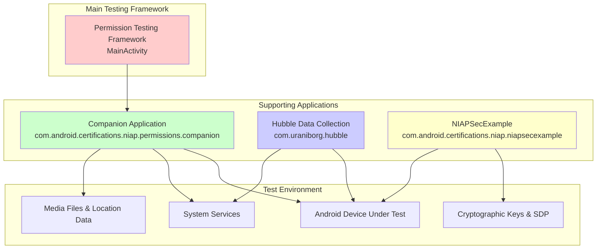
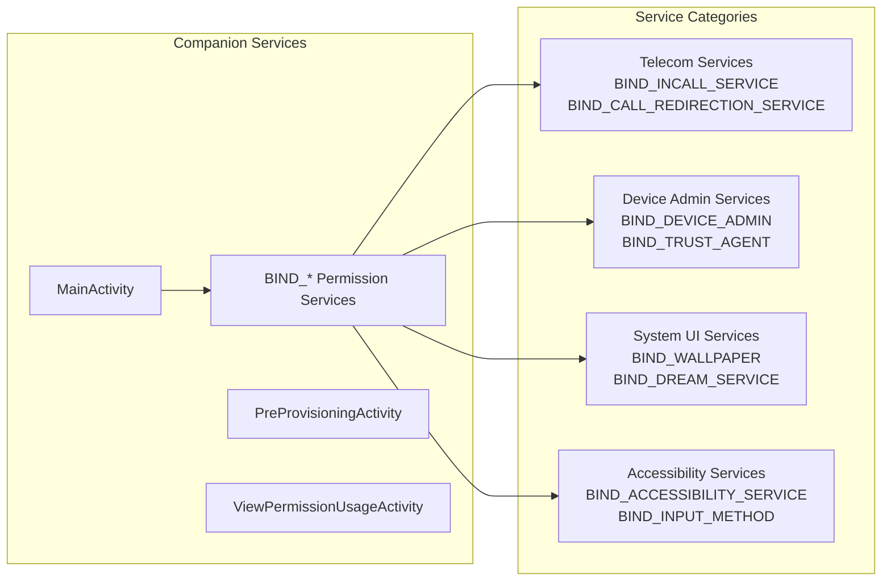
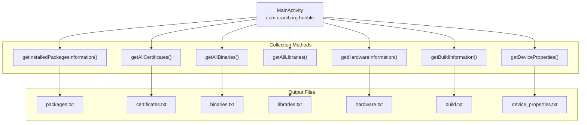
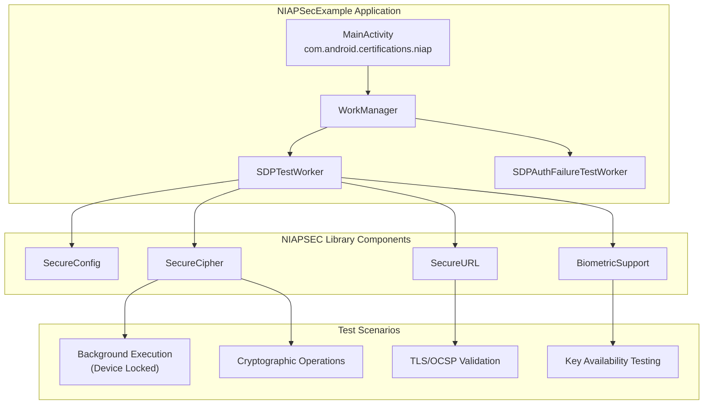
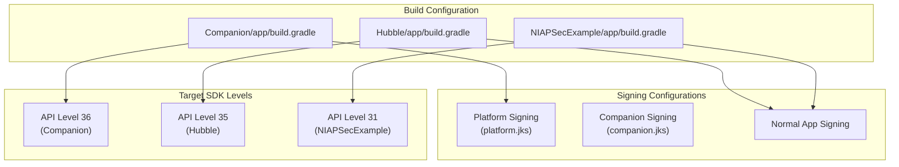

<!-- source: DeepWiki mcp.deepwiki.com · repo android/security-certification-resources · page 3 Supporting Applications · fetched 2026-10-23 -->

# Supporting Applications

Relevant source files

The following files were used as context for generating this wiki page:

- [niap-cc/NIAPSecExample/app/build.gradle](niap-cc/NIAPSecExample/app/build.gradle)
- [niap-cc/NIAPSecExample/app/src/main/AndroidManifest.xml](niap-cc/NIAPSecExample/app/src/main/AndroidManifest.xml)
- [niap-cc/NIAPSecExample/app/src/main/java/com/android/certifications/niap/MainActivity.java](niap-cc/NIAPSecExample/app/src/main/java/com/android/certifications/niap/MainActivity.java)
- [niap-cc/NIAPSecExample/build.gradle](niap-cc/NIAPSecExample/build.gradle)
- [niap-cc/NIAPSecExample/gradle.properties](niap-cc/NIAPSecExample/gradle.properties)
- [niap-cc/NIAPSecExample/gradle/wrapper/gradle-wrapper.properties](niap-cc/NIAPSecExample/gradle/wrapper/gradle-wrapper.properties)
- [niap-cc/Permissions/Companion/app/build.gradle](niap-cc/Permissions/Companion/app/build.gradle)
- [niap-cc/Permissions/Companion/app/src/main/AndroidManifest.xml](niap-cc/Permissions/Companion/app/src/main/AndroidManifest.xml)
- [niap-cc/Permissions/Companion/app/src/main/java/com/android/certifications/niap/permissions/companion/MainActivity.java](niap-cc/Permissions/Companion/app/src/main/java/com/android/certifications/niap/permissions/companion/MainActivity.java)
- [niap-cc/Permissions/Companion/app/src/main/res/layout/activity_main.xml](niap-cc/Permissions/Companion/app/src/main/res/layout/activity_main.xml)
- [niap-cc/Permissions/Companion/build.gradle.kts](niap-cc/Permissions/Companion/build.gradle.kts)
- [uraniborg/AndroidStudioProject/Hubble/app/build.gradle](uraniborg/AndroidStudioProject/Hubble/app/build.gradle)
- [uraniborg/AndroidStudioProject/Hubble/app/src/main/java/com/uraniborg/hubble/MainActivity.java](uraniborg/AndroidStudioProject/Hubble/app/src/main/java/com/uraniborg/hubble/MainActivity.java)
- [uraniborg/AndroidStudioProject/Hubble/app/src/main/java/com/uraniborg/hubble/PackageMetadata.java](uraniborg/AndroidStudioProject/Hubble/app/src/main/java/com/uraniborg/hubble/PackageMetadata.java)
- [uraniborg/AndroidStudioProject/Hubble/build.gradle](uraniborg/AndroidStudioProject/Hubble/build.gradle)
- [uraniborg/AndroidStudioProject/Hubble/gradle.properties](uraniborg/AndroidStudioProject/Hubble/gradle.properties)
- [uraniborg/AndroidStudioProject/Hubble/gradle/wrapper/gradle-wrapper.properties](uraniborg/AndroidStudioProject/Hubble/gradle/wrapper/gradle-wrapper.properties)
- [uraniborg/README.md](uraniborg/README.md)
- [uraniborg/docs/hubble_results.md](uraniborg/docs/hubble_results.md)
- [uraniborg/scripts/python/automate_observation.py](uraniborg/scripts/python/automate_observation.py)

This document provides an overview of the supporting applications that complement the main Permission Testing Framework in the Android Security Certification Resources repository. These applications work together to create a comprehensive testing environment for NIAP Common Criteria certification and Android security validation.

The supporting applications handle test environment setup, device data collection, and specialized security testing requirements. For detailed information about the core permission testing framework, see [Permission Testing Framework](#2). For advanced testing infrastructure including binder transactions and reflection utilities, see [Advanced Testing Infrastructure](#5).

## Application Architecture Overview

The supporting application ecosystem consists of three primary components that work alongside the main permission testing framework:

**Sources:** [niap-cc/Permissions/Companion/app/src/main/AndroidManifest.xml:17-89](), [uraniborg/AndroidStudioProject/Hubble/app/src/main/java/com/uraniborg/hubble/MainActivity.java:46-88](), [niap-cc/NIAPSecExample/app/src/main/java/com/android/certifications/niap/MainActivity.java:62-101]()

## Companion Application

The **Companion Application** serves as the primary test environment setup tool, providing essential infrastructure for permission testing scenarios.

### Key Responsibilities

| Component | Purpose | Implementation |
|-----------|---------|----------------|
| Test Environment Setup | Prepares device state for permission tests | `MainActivity.SetupTestsAsyncTask` |
| BIND Permission Testing | Provides services for BIND_* permission validation | Multiple `TestBind*Service` classes |
| Media Content Creation | Creates test files for media-related permissions | `setupMediaLocationTest()` |
| Location Service Setup | Configures GPS/location services for testing | `setupLocationTest()` |
| Device Policy Setup | Configures device policy flags for Android 14+ | DeviceConfig property management |

### Service Infrastructure

The Companion application declares numerous exported services protected by specific BIND_* permissions:

**Sources:** [niap-cc/Permissions/Companion/app/src/main/AndroidManifest.xml:76-543](), [niap-cc/Permissions/Companion/app/src/main/java/com/android/certifications/niap/permissions/companion/MainActivity.java:85-295]()

## Hubble Data Collection

**Hubble** is part of the Uraniborg project and provides comprehensive device data collection and analysis capabilities for Android security assessment.

### Data Collection Scope

The `MainActivity` class orchestrates collection of multiple data types:

### Package Analysis Features

| Data Type | Collection Method | Key Information Extracted |
|-----------|------------------|---------------------------|
| Installed Packages | `PackageManager.getInstalledPackages()` | Package metadata, permissions, signatures |
| Certificates | `SigningInfo` extraction | X.509 certificates, signature verification |
| System Binaries | PATH environment scanning | Executable analysis, hash verification |
| System Libraries | Library path enumeration | Native library analysis |
| Hardware Info | `Build` class properties | Device fingerprinting |
| Build Properties | System properties via `getprop` | Build configuration analysis |

**Sources:** [uraniborg/AndroidStudioProject/Hubble/app/src/main/java/com/uraniborg/hubble/MainActivity.java:98-289](), [uraniborg/AndroidStudioProject/Hubble/app/src/main/java/com/uraniborg/hubble/PackageMetadata.java:82-150]()

## NIAP Sensitive Data Protection Example

The **NIAPSecExample** application provides specialized testing for Sensitive Data Protection (SDP) requirements as part of NIAP Common Criteria certification.

### SDP Testing Architecture

### Key Testing Features

| Test Category | Implementation | Purpose |
|---------------|----------------|---------|
| Background Execution | `WorkManager` with delay | Verify key unavailability when device locked |
| Cryptographic Operations | `SecureCipher.encryptSensitiveDataAsymmetric()` | Test OAEP encryption/decryption |
| TLS Validation | `SecureURL.openConnection()` | Verify secure network connections |
| Authentication Failure | `SDPAuthFailureTestWorker` | Test failed authentication scenarios |

**Sources:** [niap-cc/NIAPSecExample/app/src/main/java/com/android/certifications/niap/MainActivity.java:118-166](), [niap-cc/NIAPSecExample/app/src/main/AndroidManifest.xml:13-49]()

## Inter-Application Coordination

The supporting applications work together to create a comprehensive testing environment:

### Build System Integration

### Application Package Identifiers

| Application | Package Name | Primary Purpose |
|-------------|--------------|-----------------|
| Companion | `com.android.certifications.niap.permissions.companion` | Test environment setup and BIND_* permission testing |
| Hubble | `com.uraniborg.hubble` | Device data collection and analysis |
| NIAPSecExample | `com.android.certifications.niap.niapsecexample` | Sensitive Data Protection testing |

**Sources:** [niap-cc/Permissions/Companion/app/build.gradle:43-51](), [uraniborg/AndroidStudioProject/Hubble/app/build.gradle:4-12](), [niap-cc/NIAPSecExample/app/build.gradle:25-31]()

## Testing Workflow Integration

These supporting applications integrate into the overall permission testing workflow by providing essential infrastructure and specialized testing capabilities that complement the main Permission Testing Framework. The Companion application prepares the test environment, Hubble provides device analysis capabilities, and NIAPSecExample validates cryptographic security requirements.

For detailed implementation information about each application, see the respective sub-sections: [Companion Application](#3.1), [Hubble Data Collection](#3.2), and [NIAP Sensitive Data Protection Example](#3.3).

---

